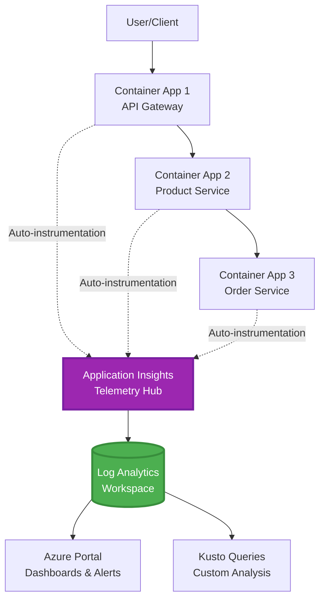
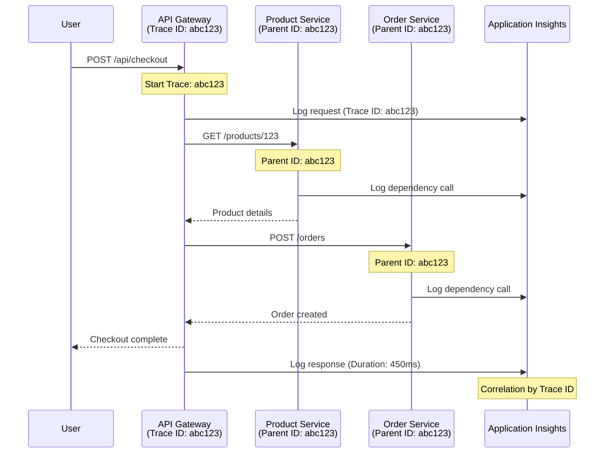

# Ενσωμάτωση Application Insights με το AZD

⏱️ **Εκτιμώμενος Χρόνος**: 40-50 λεπτά | 💰 **Επίδραση Κόστους**: ~$5-15/μήνα | ⭐ **Πολυπλοκότητα**: Μεσαίο επίπεδο

**📚 Διαδρομή Μάθησης:**
- ← Προηγούμενο: [Έλεγχοι Preflight](preflight-checks.md) - Επικύρωση πριν από την ανάπτυξη
- 🎯 **Εδώ βρίσκεστε**: Ενσωμάτωση Application Insights (Παρακολούθηση, τηλεμετρία, αποσφαλμάτωση)
- → Επόμενο: [Οδηγός Ανάπτυξης](../chapter-04-infrastructure/deployment-guide.md) - Ανάπτυξη στο Azure
- 🏠 [Αρχική Σελίδα Μαθήματος](../../README.md)

---

## Τι θα μάθετε

Ολοκληρώνοντας αυτό το μάθημα, θα:
- Δηλώσετε **Application Insights** στην υποδομή AZD και ρυθμίσετε την SDK οργάνωση
- Ρυθμίσετε **κατανεμημένη ιχνηλάτηση** για μικροϋπηρεσίες
- Υλοποιήσετε **προσαρμοσμένη τηλεμετρία** (μετρικές, γεγονότα, εξαρτήσεις)
- Ρυθμίσετε **ζωντανές μετρικές** για παρακολούθηση σε πραγματικό χρόνο
- Δημιουργήσετε **ειδοποιήσεις και πίνακες ελέγχου** από αναπτύξεις AZD
- Αποσφαλματώσετε προβλήματα παραγωγής με **ερωτήματα τηλεμετρίας**
- Βελτιστοποιήσετε τις στρατηγικές **κόστους και δειγματοληψίας**
- Παρακολουθήσετε **εφαρμογές AI/LLM** (τοκενς, καθυστερήσεις, κόστη)

## Γιατί είναι σημαντικό το Application Insights με το AZD

### Η Πρόκληση: Παρατήρηση Παραγωγής

**Χωρίς το Application Insights:**
```
❌ No visibility into production behavior
❌ Manual log aggregation across services
❌ Reactive debugging (wait for customer complaints)
❌ No performance metrics
❌ Cannot trace requests across services
❌ Unknown failure rates and bottlenecks
```

**Με το Application Insights + AZD:**
```
✅ Automatic telemetry collection
✅ Centralized logs from all services
✅ Proactive issue detection
✅ End-to-end request tracing
✅ Performance metrics and insights
✅ Real-time dashboards
✅ AZD provisions the monitoring declared in your templates
```

**Αναλογία**: Το Application Insights είναι σαν να έχεις έναν "μαύρο κουτί" καταγραφέα πτήσης + πίνακα οργάνων στο πιλοτήριο για την εφαρμογή σου. Βλέπεις τα πάντα σε πραγματικό χρόνο και μπορείς να αναπαραγάγεις οποιοδήποτε περιστατικό.

---

## Επισκόπηση Αρχιτεκτονικής

### Application Insights στην Αρχιτεκτονική AZD



### Τι Παρακολουθείται Αυτόματα

Η υποστηριζόμενη αυτόματη οργάνωση καταγράφει αιτήματα/εξαρτήσεις για τις οργανομένες βιβλιοθήκες. Τα προσαρμοσμένα γεγονότα και μετρικές απαιτούν κώδικα εφαρμογής· οι δοκιμές διαθεσιμότητας πρέπει να ρυθμιστούν ξεχωριστά. Δεν συλλέγει κάθε γραμμή παρακάτω απλώς επειδή υπάρχει ο πόρος.

| Τύπος Τηλεμετρίας | Τι Καταγράφει | Περίπτωση Χρήσης |
|----------------|------------------|----------|
| **Αιτήματα** | HTTP αιτήματα, κωδικοί κατάστασης, διάρκεια | Παρακολούθηση απόδοσης API |
| **Εξαρτήσεις** | Εξωτερικές κλήσεις (βάσεις δεδομένων, APIs, αποθήκευση) | Αναγνώριση σημεία συμφόρησης |
| **Εξαιρέσεις** | Αχειρίστα σφάλματα με στοίβες κλήσεων | Αποσφαλμάτωση αποτυχιών |
| **Προσαρμοσμένα Γεγονότα** | Επιχειρηματικά γεγονότα (εγγραφή, αγορά) | Ανάλυση και διοχετεύσεις |
| **Μετρικές** | Μετρητές απόδοσης, προσαρμοσμένες μετρικές | Σχεδιασμός χωρητικότητας |
| **Ιχνηλασίες** | Μηνύματα καταγραφής με βαθμό σοβαρότητας | Αποσφαλμάτωση και έλεγχος |
| **Διαθεσιμότητα** | Δοκιμές χρόνου λειτουργίας και απόκρισης | Παρακολούθηση SLA |

---

## Προαπαιτούμενα

### Απαραίτητα Εργαλεία

```bash
# Verify Azure Developer CLI
azd version
# Command reference baseline: azd 1.37.2

# Verify Azure CLI
az --version
# ✅ Expected: azure-cli 2.50.0 or higher
```

### Απαιτήσεις Azure

- Ενεργή συνδρομή Azure
- Δικαιώματα για δημιουργία:
  - Πόρων Application Insights
  - Χώρων εργασίας Log Analytics
  - Container Apps
  - Ομάδων πόρων

### Προαπαιτούμενη Γνώση

Πρέπει να έχετε ολοκληρώσει:
- [Βασικά AZD](../chapter-01-foundation/azd-basics.md) - Βασικές έννοιες AZD
- [Διαμόρφωση](../chapter-03-configuration/configuration.md) - Ρύθμιση περιβάλλοντος
- [Πρώτο Έργο](../chapter-01-foundation/first-project.md) - Βασική ανάπτυξη

---

## Μάθημα 1: Αυτόματο Application Insights με το AZD

### Πώς το AZD Προμηθεύει το Application Insights

Το AZD προμηθεύει το Application Insights **μόνο όταν η υποδομή του έργου το δηλώνει**. `azure.yaml` από μόνο του δεν δημιουργεί παρακολούθηση ή δεν οργανώνει κώδικα εφαρμογής.

> **Παράδειγμα εύρους:** Αυτό το μάθημα περιέχει θραύσματα ενσωμάτωσης, όχι ολόκληρο `monitored-app` έργο σε αυτή τη αποθήκη. Παρέχετε ένα κύριο πρότυπο και αντιστοίχιση παραμέτρων, περιβάλλον Container Apps, ρύθμιση μητρώου/εικόνας και ταυτότητας, Dockerfile, και ετικέτες υπηρεσίας πριν την ανάπτυξη. Αργότερα μαθήματα δείχνουν εναλλακτικά/επεκτατικά θραύσματα, όχι αρχεία που μπορούν να επικολληθούν όλα μαζί χωρίς αλλαγές. Ξεκινήστε με ένα λειτουργικό [παράδειγμα μικροϋπηρεσιών](../../../../examples/microservices) αν χρειάζεστε μια βασική λειτουργική βάση.

### Δομή Έργου

```
monitored-app/
├── azure.yaml                     # AZD configuration
├── infra/
│   ├── main.bicep                # Main infrastructure
│   ├── core/
│   │   └── monitoring.bicep      # Application Insights + Log Analytics
│   └── app/
│       └── api.bicep             # Container App with monitoring
└── src/
    ├── app.py                    # Application with telemetry
    ├── requirements.txt
    └── Dockerfile
```

---

### Βήμα 1: Ρύθμιση AZD (azure.yaml)

**Αρχείο: `azure.yaml`**

```yaml
name: monitored-app
metadata:
  template: monitored-app@1.0.0

services:
  api:
    project: ./src
    language: python
    host: containerapp

# Monitoring must be declared in infra/ and enabled in application code.
```

Αυτό δηλώνει την υπηρεσία που αναπτύσσεται. Οι επόμενες ρυθμίσεις Bicep και SDK παρέχουν παρακολούθηση· το azd δεν τις προσθέτει έμμεσα.

---

### Βήμα 2: Υποδομή Παρακολούθησης (Bicep)

**Αρχείο: `infra/core/monitoring.bicep`**

```bicep
param logAnalyticsName string
param applicationInsightsName string
param location string = resourceGroup().location
param tags object = {}

// Log Analytics Workspace (required for Application Insights)
resource logAnalytics 'Microsoft.OperationalInsights/workspaces@2022-10-01' = {
  name: logAnalyticsName
  location: location
  tags: tags
  properties: {
    sku: {
      name: 'PerGB2018'  // Pay-as-you-go pricing
    }
    retentionInDays: 30  // Keep logs for 30 days
    features: {
      enableLogAccessUsingOnlyResourcePermissions: true
    }
  }
}

// Application Insights
resource applicationInsights 'Microsoft.Insights/components@2020-02-02' = {
  name: applicationInsightsName
  location: location
  tags: tags
  kind: 'web'
  properties: {
    Application_Type: 'web'
    WorkspaceResourceId: logAnalytics.id
    IngestionMode: 'LogAnalytics'
    publicNetworkAccessForIngestion: 'Enabled'
    publicNetworkAccessForQuery: 'Enabled'
  }
}

// Outputs for Container Apps
output logAnalyticsWorkspaceId string = logAnalytics.id
output logAnalyticsWorkspaceName string = logAnalytics.name
output applicationInsightsConnectionString string = applicationInsights.properties.ConnectionString
output applicationInsightsInstrumentationKey string = applicationInsights.properties.InstrumentationKey
output applicationInsightsName string = applicationInsights.name
output applicationInsightsId string = applicationInsights.id
```

---

### Βήμα 3: Σύνδεση Container App με Application Insights

**Αρχείο: `infra/app/api.bicep`**

```bicep
param name string
param location string
param tags object = {}
param containerAppsEnvironmentId string
param containerImage string
param applicationInsightsConnectionString string

resource containerApp 'Microsoft.App/containerApps@2023-05-01' = {
  name: name
  location: location
  tags: tags
  properties: {
    managedEnvironmentId: containerAppsEnvironmentId
    configuration: {
      ingress: {
        external: true
        targetPort: 8000
      }
      secrets: [
        {
          name: 'appinsights-connection-string'
          value: applicationInsightsConnectionString
        }
      ]
    }
    template: {
      containers: [
        {
          name: 'api'
          image: containerImage // Supply an accessible image and registry authentication
          resources: {
            cpu: json('0.5')
            memory: '1Gi'
          }
          env: [
            {
              name: 'APPLICATIONINSIGHTS_CONNECTION_STRING'
              secretRef: 'appinsights-connection-string'
            }
            {
              name: 'APPLICATIONINSIGHTS_ENABLED'
              value: 'true'
            }
          ]
        }
      ]
    }
  }
}

output uri string = 'https://${containerApp.properties.configuration.ingress.fqdn}'
```

---

### Βήμα 4: Κώδικας Εφαρμογής με Τηλεμετρία

**Αρχείο: `src/app.py`**

```python
from flask import Flask, request, jsonify
from azure.monitor.opentelemetry import configure_azure_monitor
import logging
import os

app = Flask(__name__)

# Get Application Insights connection string
connection_string = os.environ.get('APPLICATIONINSIGHTS_CONNECTION_STRING')

if connection_string:
    # Azure Monitor OpenTelemetry instruments supported libraries, including Flask.
    configure_azure_monitor(
        connection_string=connection_string,
        logger_name=__name__,
        enable_live_metrics=True
    )
    logger = logging.getLogger(__name__)
    logger.setLevel(logging.INFO)
    
    print("✅ Application Insights enabled")
else:
    logger = logging.getLogger(__name__)
    logger.setLevel(logging.INFO)
    print("⚠️ Application Insights not configured")

@app.route('/health')
def health():
    logger.info('Health check endpoint called')
    return jsonify({'status': 'healthy', 'monitoring': 'enabled' if connection_string else 'disabled'})

@app.route('/api/products')
def get_products():
    logger.info('Fetching products')
    
    # In-memory fixture: this is not a database dependency call.
    products = [
        {'id': 1, 'name': 'Laptop', 'price': 999.99},
        {'id': 2, 'name': 'Mouse', 'price': 29.99},
        {'id': 3, 'name': 'Keyboard', 'price': 79.99}
    ]
    
    logger.info(f'Returned {len(products)} products')
    return jsonify(products)

@app.route('/api/error-test')
def error_test():
    """Test error tracking"""
    logger.error('Testing error tracking')
    try:
        raise ValueError('This is a test exception')
    except Exception as e:
        logger.exception('Exception occurred in error-test endpoint')
        return jsonify({'error': str(e)}), 500

@app.route('/api/slow')
def slow_endpoint():
    """Test performance tracking"""
    import time
    logger.info('Slow endpoint called')
    time.sleep(3)  # Simulate slow operation
    logger.warning('Endpoint took 3 seconds to respond')
    return jsonify({'message': 'Slow operation completed'})

if __name__ == '__main__':
    app.run(host='0.0.0.0', port=8000)
```

**Αρχείο: `src/requirements.txt`**

```txt
Flask
azure-monitor-opentelemetry
gunicorn
requests
openai
```

Επιλύστε αυτές τις εξαρτήσεις στο έργο σας, δοκιμάστε τις μαζί, και κλειδώστε τις εκδόσεις. Τα νέα έργα θα πρέπει να χρησιμοποιούν το Azure Monitor OpenTelemetry, όχι τους παλιούς OpenCensus Python εξαγωγείς.

---

### Βήμα 5: Ανάπτυξη και Επαλήθευση

```bash
# Deploy only after completing and wiring the infrastructure fragments above
azd up

# Get app URL
APP_URL=$(azd env get-value API_URL) # Requires this output in main.bicep

# Generate telemetry
curl $APP_URL/health
curl $APP_URL/api/products
curl $APP_URL/api/error-test
curl $APP_URL/api/slow
```

**✅ Αναμενόμενη έξοδος:**
```json
{
  "status": "healthy",
  "monitoring": "enabled"
}
```

---

### Βήμα 6: Προβολή Τηλεμετρίας στο Azure Portal

```bash
# Get Application Insights details
azd env get-values | grep APPLICATIONINSIGHTS

# Open in Azure Portal
az monitor app-insights component show \
  --app $(azd env get-values | grep APPLICATIONINSIGHTS_NAME | cut -d '=' -f2 | tr -d '"') \
  --resource-group $(azd env get-values | grep AZURE_RESOURCE_GROUP | cut -d '=' -f2 | tr -d '"') \
  --query "appId" -o tsv
```

**Πλοηγήσου στο Azure Portal → Application Insights → Transaction Search**

Πρέπει να δείτε:
- ✅ HTTP αιτήματα με κωδικούς κατάστασης
- ✅ Διάρκεια αιτήματος (3+ δευτερόλεπτα για `/api/slow`)
- ✅ Λεπτομέρειες εξαιρέσεων από `/api/error-test`
- ✅ Προσαρμοσμένα μηνύματα καταγραφής

---

## Μάθημα 2: Προσαρμοσμένη Τηλεμετρία και Γεγονότα

### Παρακολούθηση Επιχειρηματικών Γεγονότων

Ας προσθέσουμε προσαρμοσμένη τηλεμετρία για επιχειρηματικά κρίσιμα γεγονότα.

**Αρχείο: `src/telemetry.py`**

```python
from contextlib import contextmanager
from azure.monitor.opentelemetry import configure_azure_monitor
from opentelemetry import metrics, trace
from opentelemetry.trace import SpanKind
import logging
import os

class TelemetryClient:
    """Custom telemetry client for Application Insights"""
    
    def __init__(self, connection_string=None):
        self.connection_string = connection_string or os.environ.get('APPLICATIONINSIGHTS_CONNECTION_STRING')
        
        # Configure once per process. If app.py already calls this, keep only
        # one configure_azure_monitor call and use logger_name='telemetry'.
        if self.connection_string:
            configure_azure_monitor(
                connection_string=self.connection_string,
                logger_name=__name__,
                enable_live_metrics=True
            )
        self.logger = logging.getLogger(__name__)
        self.logger.setLevel(logging.INFO)
        self.tracer = trace.get_tracer(__name__)
        self.meter = metrics.get_meter(__name__)
        self.instruments = {}
    
    def track_event(self, event_name: str, properties: dict = None):
        """Track custom business event"""
        properties = properties or {}
        self.logger.info(
            f"CustomEvent: {event_name}",
            extra={
                # OTel log attributes become customDimensions in App Insights.
                    'event_name': event_name,
                    **properties
            }
        )
    
    def track_metric(self, metric_name: str, value: float, properties: dict = None):
        """Track custom metric"""
        properties = properties or {}
        if metric_name not in self.instruments:
            self.instruments[metric_name] = self.meter.create_histogram(metric_name)
        self.instruments[metric_name].record(value, attributes=properties)
    
    @contextmanager
    def track_dependency(self, name: str):
        """Time the real operation inside a client span; exceptions mark failure."""
        with self.tracer.start_as_current_span(name, kind=SpanKind.CLIENT) as span:
            yield span

# Global telemetry client
telemetry = TelemetryClient()
```

### Ενημέρωση Εφαρμογής με Προσαρμοσμένα Γεγονότα

**Αρχείο: `src/app.py` (ενισχυμένο)**

Προσθέστε αυτές τις διαδρομές στην υπάρχουσα εφαρμογή Flask· διατηρήστε τις προηγούμενες διαδρομές υγείας/δοκιμής. Το συμπτυγμένο μπλοκ παρακάτω δείχνει ξεχωριστή εφαρμογή για καθαρότητα. Η αρχικοποίηση της τηλεμετρίας τώρα ζει στο `telemetry.py`—μην αρχικοποιείτε εξαγωγείς δύο φορές.

```python
from flask import Flask, request, jsonify
from telemetry import telemetry
import time
import random
import os

app = Flask(__name__)

@app.route('/api/purchase', methods=['POST'])
def purchase():
    """Track purchase event with custom telemetry"""
    data = request.get_json(silent=True) or {}
    product_id = data.get('product_id')
    quantity = data.get('quantity', 1)
    price = data.get('price', 0)
    if not isinstance(quantity, int) or quantity < 1 or \
       not isinstance(price, (int, float)) or price < 0:
        return jsonify({'error': 'quantity and price must be non-negative numbers; quantity >= 1'}), 400
    
    # Track business event
    telemetry.track_event('Purchase', {
        'product_id': product_id,
        'quantity': quantity,
        'total_amount': price * quantity,
        'user_id': request.headers.get('X-User-Id', 'anonymous')
    })
    
    # Track revenue metric
    telemetry.track_metric('Revenue', price * quantity, {
        'product_id': product_id,
        'currency': 'USD'
    })
    
    return jsonify({
        'order_id': f'ORD-{random.randint(1000, 9999)}',
        'status': 'confirmed',
        'total': price * quantity
    })

@app.route('/api/search')
def search():
    """Track search queries"""
    query = request.args.get('q', '')
    
    start_time = time.time()
    
    # Simulate search (would be real database query)
    results = [{'id': 1, 'name': f'Result for {query}'}]
    
    duration = (time.time() - start_time) * 1000  # Convert to ms
    
    # Track search event
    telemetry.track_event('Search', {
        'query': query,
        'results_count': len(results),
        'duration_ms': duration
    })
    
    # Track search performance metric
    telemetry.track_metric('SearchDuration', duration, {
        'query_length': len(query)
    })
    
    return jsonify({'results': results, 'count': len(results)})

@app.route('/api/external-call')
def external_call():
    """Track external API dependency"""
    import requests
    
    try:
        # Set an actual test endpoint; api.example.com is not a working API.
        with telemetry.track_dependency('ExternalAPI'):
            response = requests.get(os.environ['EXTERNAL_API_URL'], timeout=5)
            response.raise_for_status()
            result = response.json()
    except Exception as e:
        return jsonify({'error': 'External dependency failed'}), 502
    
    return jsonify(result)

if __name__ == '__main__':
    app.run(host='0.0.0.0', port=8000)
```

### Δοκιμάστε την Προσαρμοσμένη Τηλεμετρία

```bash
# Track purchase event
curl -X POST $APP_URL/api/purchase \
  -H "Content-Type: application/json" \
  -H "X-User-Id: user123" \
  -d '{"product_id": 1, "quantity": 2, "price": 29.99}'

# Track search event
curl "$APP_URL/api/search?q=laptop"

# Track external dependency
curl $APP_URL/api/external-call
```

**Προβολή στο Azure Portal:**

Πλοηγήσου σε Application Insights → Logs, και μετά εκτέλεσε:

```kusto
// View purchase events
traces
| where customDimensions.event_name == "Purchase"
| project 
    timestamp,
    product_id = tostring(customDimensions.product_id),
    total_amount = todouble(customDimensions.total_amount),
    user_id = tostring(customDimensions.user_id)
| order by timestamp desc

// Revenue recorded in Purchase events (not a billing ledger)
traces
| where customDimensions.event_name == "Purchase"
| summarize TotalRevenue = sum(todouble(customDimensions.total_amount)) by bin(timestamp, 1h)
| render timechart

// View search performance
traces
| where customDimensions.event_name == "Search"
| summarize 
    AvgDuration = avg(todouble(customDimensions.duration_ms)),
    SearchCount = count()
  by bin(timestamp, 5m)
| render timechart
```

---

## Μάθημα 3: Κατανεμημένη Ιχνηλάτηση για Μικροϋπηρεσίες

### Ενεργοποίηση Ιχνηλάτησης Μεταξύ Υπηρεσιών

Με συμβατή οργάνωση και διάδοση W3C trace-context, το Application Insights συσχετίζει αιτήματα σε υπηρεσίες. Το μοίρασμα μόνο μιας συμβολοσειράς σύνδεσης δεν δημιουργεί γονικά-παιδικά spans. Το παρακάτω θραύσμα αρχιτεκτονικής αναφέρεται σε μονάδες που πρέπει να υλοποιήσετε.

**Αρχείο: `infra/main.bicep`**

```bicep
targetScope = 'subscription'

param environmentName string
param location string = 'eastus'

var tags = { 'azd-env-name': environmentName }

resource rg 'Microsoft.Resources/resourceGroups@2021-04-01' = {
  name: 'rg-${environmentName}'
  location: location
  tags: tags
}

// Monitoring (shared by all services)
module monitoring './core/monitoring.bicep' = {
  name: 'monitoring'
  scope: rg
  params: {
    logAnalyticsName: 'log-${environmentName}'
    applicationInsightsName: 'appi-${environmentName}'
    location: location
    tags: tags
  }
}

// API Gateway
module apiGateway './app/api-gateway.bicep' = {
  name: 'api-gateway'
  scope: rg
  params: {
    name: 'ca-gateway-${environmentName}'
    location: location
    tags: union(tags, { 'azd-service-name': 'gateway' })
    applicationInsightsConnectionString: monitoring.outputs.applicationInsightsConnectionString
  }
}

// Product Service
module productService './app/product-service.bicep' = {
  name: 'product-service'
  scope: rg
  params: {
    name: 'ca-products-${environmentName}'
    location: location
    tags: union(tags, { 'azd-service-name': 'products' })
    applicationInsightsConnectionString: monitoring.outputs.applicationInsightsConnectionString
  }
}

// Order Service
module orderService './app/order-service.bicep' = {
  name: 'order-service'
  scope: rg
  params: {
    name: 'ca-orders-${environmentName}'
    location: location
    tags: union(tags, { 'azd-service-name': 'orders' })
    applicationInsightsConnectionString: monitoring.outputs.applicationInsightsConnectionString
  }
}

output APPLICATIONINSIGHTS_CONNECTION_STRING string = monitoring.outputs.applicationInsightsConnectionString
output GATEWAY_URL string = apiGateway.outputs.uri
```

### Προβολή Ολοκληρωμένης Συναλλαγής



**Ερώτημα ολοκληρωμένης ιχνηλάτησης:**

```kusto
// Find complete request flow
let traceId = "abc123...";  // Copy operation_Id from a request in Application Insights
dependencies
| union requests
| where operation_Id == traceId
| project 
    timestamp,
    type = itemType,
    name,
    duration,
    success,
    cloud_RoleName
| order by timestamp asc
```

---

## Μάθημα 4: Ζωντανές Μετρικές και Παρακολούθηση σε Πραγματικό Χρόνο

### Ενεργοποίηση Ζωντανής Ροής Μετρικών

Οι Ζωντανές Μετρικές παρέχουν τηλεμετρία σχεδόν σε πραγματικό χρόνο όταν υποστηρίζονται και ενεργοποιούνται από το SDK. Δεν είναι SLA καθυστέρησης. Η ρύθμιση Python OpenTelemetry παραπάνω ενεργοποιεί με `enable_live_metrics=True`.

**Πρόσβαση στις Ζωντανές Μετρικές:**

```bash
# Get Application Insights resource
APPI_NAME=$(azd env get-values | grep APPLICATIONINSIGHTS_NAME | cut -d '=' -f2 | tr -d '"')

# Get resource group
RG_NAME=$(azd env get-values | grep AZURE_RESOURCE_GROUP | cut -d '=' -f2 | tr -d '"')

echo "Navigate to: Azure Portal → Resource Groups → $RG_NAME → $APPI_NAME → Live Metrics"
```

**Τι βλέπετε σε πραγματικό χρόνο:**
- ✅ Ρυθμός εισερχομένων αιτημάτων (αιτήματα/δευτερόλεπτο)
- ✅ Εξερχόμενες κλήσεις εξαρτήσεων
- ✅ Αριθμός εξαιρέσεων
- ✅ Χρήση CPU και μνήμης
- ✅ Αριθμός ενεργών διακομιστών
- ✅ Δείγμα τηλεμετρίας

### Δημιουργία Φορτίου για Δοκιμές

```bash
# Generate load to see live metrics
for i in {1..100}; do
  curl --silent --max-time 10 "$APP_URL/api/products"
  curl --silent --max-time 10 "$APP_URL/api/search?q=test$i"
done

# Watch live metrics in Azure Portal
# You should see request rate spike
```

---

## Πρακτικές Ασκήσεις

### Άσκηση 1: Ρύθμιση Ειδοποιήσεων ⭐⭐ (Μεσαίο)

**Στόχος**: Δημιουργία ειδοποιήσεων για υψηλό ποσοστό σφαλμάτων και αργές αποκρίσεις.

**Βήματα:**

1. **Δημιουργία ειδοποίησης για ποσοστό σφαλμάτων:**

```bash
# Get Application Insights resource ID
APPI_ID=$(az monitor app-insights component show \
  --app $APPI_NAME \
  --resource-group $RG_NAME \
  --query "id" -o tsv)

# Create metric alert for failed requests
az monitor metrics alert create \
  --name "High-Error-Rate" \
  --resource-group $RG_NAME \
  --scopes $APPI_ID \
  --condition "count requests/failed > 10" \
  --window-size 5m \
  --evaluation-frequency 1m \
  --description "Alert when failed request count exceeds 10 per 5 minutes"
```

2. **Δημιουργία ειδοποίησης για αργές αποκρίσεις:**

```bash
az monitor metrics alert create \
  --name "Slow-Responses" \
  --resource-group $RG_NAME \
  --scopes $APPI_ID \
  --condition "avg requests/duration > 3000" \
  --window-size 5m \
  --evaluation-frequency 1m \
  --description "Alert when average response time exceeds 3 seconds"
```

3. **Δημιουργία ειδοποίησης μέσω Bicep (προτιμητέο για AZD):**

**Αρχείο: `infra/core/alerts.bicep`**

```bicep
param applicationInsightsId string
param actionGroupId string = ''
param location string = resourceGroup().location

// High error rate alert
resource errorRateAlert 'Microsoft.Insights/metricAlerts@2018-03-01' = {
  name: 'high-error-rate'
  location: 'global'
  properties: {
    description: 'Alert when error rate exceeds threshold'
    severity: 2
    enabled: true
    scopes: [
      applicationInsightsId
    ]
    evaluationFrequency: 'PT1M'
    windowSize: 'PT5M'
    criteria: {
      'odata.type': 'Microsoft.Azure.Monitor.SingleResourceMultipleMetricCriteria'
      allOf: [
        {
          name: 'Error rate'
          metricName: 'requests/failed'
          operator: 'GreaterThan'
          threshold: 10
          timeAggregation: 'Count'
        }
      ]
    }
    actions: actionGroupId != '' ? [
      {
        actionGroupId: actionGroupId
      }
    ] : []
  }
}

// Slow response alert
resource slowResponseAlert 'Microsoft.Insights/metricAlerts@2018-03-01' = {
  name: 'slow-responses'
  location: 'global'
  properties: {
    description: 'Alert when response time is too high'
    severity: 3
    enabled: true
    scopes: [
      applicationInsightsId
    ]
    evaluationFrequency: 'PT1M'
    windowSize: 'PT5M'
    criteria: {
      'odata.type': 'Microsoft.Azure.Monitor.SingleResourceMultipleMetricCriteria'
      allOf: [
        {
          name: 'Response duration'
          metricName: 'requests/duration'
          operator: 'GreaterThan'
          threshold: 3000
          timeAggregation: 'Average'
        }
      ]
    }
  }
}

output errorAlertId string = errorRateAlert.id
output slowResponseAlertId string = slowResponseAlert.id
```

4. **Δοκιμή των ειδοποιήσεων:**

```bash
# Generate errors
for i in {1..20}; do
  curl $APP_URL/api/error-test
done

# Generate slow responses
for i in {1..10}; do
  curl $APP_URL/api/slow
done

# Check rule configuration (not fired/resolved alert-instance history)
az monitor metrics alert list \
  --resource-group $RG_NAME \
  --query "[].{Name:name, Enabled:enabled}" \
  --output table
```

**✅ Κριτήρια Επιτυχίας:**
- ✅ Οι ειδοποιήσεις δημιουργήθηκαν με επιτυχία
- ✅ Οι ειδοποιήσεις ενεργοποιούνται όταν ξεπεράνονται τα όρια
- ✅ Μπορείτε να δείτε το ιστορικό ειδοποιήσεων στο Azure Portal
- ✅ Ενσωματωμένο με ανάπτυξη AZD

**Χρόνος**: 20-25 λεπτά

---

### Άσκηση 2: Δημιουργία Προσαρμοσμένου Πίνακα Ελέγχου ⭐⭐ (Μεσαίο)

**Στόχος**: Δημιουργήστε έναν πίνακα που εμφανίζει βασικές μετρικές εφαρμογής.

**Βήματα:**

1. **Δημιουργία πίνακα μέσω Azure Portal:**

Πλοηγηθείτε σε: Azure Portal → Πίνακες → Νέος Πίνακας

2. **Προσθήκη πλακιδίων για βασικές μετρικές:**

- Αριθμός αιτημάτων (τελευταίες 24 ώρες)
- Μέσος χρόνος απόκρισης
- Ποσοστό σφαλμάτων
- Κορυφαίες 5 πιο αργές λειτουργίες
- Γεωγραφική κατανομή χρηστών

3. **Δημιουργία πίνακα μέσω Bicep:**

**Αρχείο: `infra/core/dashboard.bicep`**

```bicep
param dashboardName string
param applicationInsightsId string
param location string = resourceGroup().location

resource dashboard 'Microsoft.Portal/dashboards@2020-09-01-preview' = {
  name: dashboardName
  location: location
  properties: {
    lenses: [
      {
        order: 0
        parts: [
          // Request count
          {
            position: {
              x: 0
              y: 0
              rowSpan: 4
              colSpan: 6
            }
            metadata: {
              type: 'Extension/Microsoft_OperationsManagementSuite_Workspace/PartType/LogsDashboardPart'
              inputs: [
                {
                  name: 'resourceId'
                  value: applicationInsightsId
                }
                {
                  name: 'query'
                  value: '''
                    requests
                    | summarize RequestCount = count() by bin(timestamp, 1h)
                    | render timechart
                  '''
                }
              ]
            }
          }
          // Error rate
          {
            position: {
              x: 6
              y: 0
              rowSpan: 4
              colSpan: 6
            }
            metadata: {
              type: 'Extension/Microsoft_OperationsManagementSuite_Workspace/PartType/LogsDashboardPart'
              inputs: [
                {
                  name: 'resourceId'
                  value: applicationInsightsId
                }
                {
                  name: 'query'
                  value: '''
                    requests
                    | summarize 
                        Total = count(),
                        Failed = countif(success == false)
                    | extend ErrorRate = (Failed * 100.0) / Total
                    | project ErrorRate
                  '''
                }
              ]
            }
          }
        ]
      }
    ]
  }
}

output dashboardId string = dashboard.id
```

4. **Ανάπτυξη πίνακα:**

```bicep
// Add to a subscription-scoped main.bicep with rg and monitoring declared
module dashboard './core/dashboard.bicep' = {
  name: 'dashboard'
  scope: rg
  params: {
    dashboardName: 'dashboard-${environmentName}'
    applicationInsightsId: monitoring.outputs.applicationInsightsId
    location: location
  }
}
```

```bash
# Deploy
azd up
```

**✅ Κριτήρια Επιτυχίας:**
- ✅ Ο πίνακας εμφανίζει βασικές μετρικές
- ✅ Μπορεί να καρφιτσωθεί στην αρχική σελίδα του Azure Portal
- ✅ Ενημερώνεται σε πραγματικό χρόνο
- ✅ Αναπτύσσεται μέσω AZD

**Χρόνος**: 25-30 λεπτά

---

### Άσκηση 3: Παρακολούθηση Εφαρμογής AI/LLM ⭐⭐⭐ (Προχωρημένο)

**Στόχος**: Παρακολούθηση χρήσης Microsoft Foundry Models (τοκενς, κόστη, καθυστέρηση).

**Βήματα:**

1. **Δημιουργία wrapper για παρακολούθηση AI:**

**Αρχείο: `src/ai_telemetry.py`**

```python
from telemetry import telemetry
from openai import AzureOpenAI
import time

class MonitoredAzureOpenAI:
    """Microsoft Foundry Models client with automatic telemetry"""
    
    def __init__(self, api_key, endpoint, input_usd_per_million,
                 output_usd_per_million, api_version="2024-10-21"):
        self.client = AzureOpenAI(
            api_key=api_key,
            api_version=api_version,
            azure_endpoint=endpoint
        )
        self.input_rate = input_usd_per_million
        self.output_rate = output_usd_per_million
    
    def chat_completion(self, model: str, messages: list, **kwargs):
        """Track chat completion with telemetry"""
        start_time = time.time()
        
        try:
            # Call Microsoft Foundry Models
            response = self.client.chat.completions.create(
                model=model,
                messages=messages,
                **kwargs
            )
            
            duration = (time.time() - start_time) * 1000  # ms
            
            # Extract usage
            usage = response.usage
            prompt_tokens = usage.prompt_tokens
            completion_tokens = usage.completion_tokens
            total_tokens = usage.total_tokens
            
            # Approximation: supply actual deployment/region/contract rates.
            # Cached input, batch, provisioned and other charges need separate accounting.
            prompt_cost = (prompt_tokens / 1_000_000) * self.input_rate
            completion_cost = (completion_tokens / 1_000_000) * self.output_rate
            total_cost = prompt_cost + completion_cost
            
            # Track custom event
            telemetry.track_event('OpenAI_Request', {
                'model': model,
                'prompt_tokens': prompt_tokens,
                'completion_tokens': completion_tokens,
                'total_tokens': total_tokens,
                'duration_ms': duration,
                'cost_usd': total_cost,
                'success': True
            })
            
            # Track metrics
            telemetry.track_metric('OpenAI_Tokens', total_tokens, {
                'model': model,
                'type': 'total'
            })
            
            telemetry.track_metric('OpenAI_Cost', total_cost, {
                'model': model,
                'currency': 'USD'
            })
            
            telemetry.track_metric('OpenAI_Duration', duration, {
                'model': model
            })
            
            return response
            
        except Exception as e:
            duration = (time.time() - start_time) * 1000
            
            telemetry.track_event('OpenAI_Request', {
                'model': model,
                'duration_ms': duration,
                'success': False,
                'error': str(e)
            })
            
            raise
```

2. **Χρήση παρακολουθούμενου πελάτη:**

```python
from flask import Flask, request, jsonify
from ai_telemetry import MonitoredAzureOpenAI
import os

app = Flask(__name__)

# Initialize monitored OpenAI client
openai_client = MonitoredAzureOpenAI(
    api_key=os.environ['AZURE_OPENAI_API_KEY'],
    endpoint=os.environ['AZURE_OPENAI_ENDPOINT'],
    input_usd_per_million=float(os.environ['INPUT_USD_PER_MILLION']),
    output_usd_per_million=float(os.environ['OUTPUT_USD_PER_MILLION'])
)

@app.route('/api/chat', methods=['POST'])
def chat():
    data = request.json
    user_message = data.get('message')
    
    # Call with automatic monitoring
    response = openai_client.chat_completion(
        model=os.environ['AZURE_OPENAI_DEPLOYMENT'], # Deployment name, not catalog ID
        messages=[
            {'role': 'user', 'content': user_message}
        ]
    )
    
    return jsonify({
        'response': response.choices[0].message.content,
        'tokens': response.usage.total_tokens
    })
```

3. **Ερώτημα μετρικών AI:**

```kusto
// Total AI spend over time
traces
| where customDimensions.event_name == "OpenAI_Request"
| where tobool(customDimensions.success) == true
| summarize TotalCost = sum(todouble(customDimensions.cost_usd)) by bin(timestamp, 1h)
| render timechart

// Token usage by model
traces
| where customDimensions.event_name == "OpenAI_Request"
| summarize 
    TotalTokens = sum(toint(customDimensions.total_tokens)),
    RequestCount = count()
  by Model = tostring(customDimensions.model)

// Average latency
traces
| where customDimensions.event_name == "OpenAI_Request"
| summarize AvgDuration = avg(todouble(customDimensions.duration_ms))
| project AvgDurationSeconds = AvgDuration / 1000

// Cost per request
traces
| where customDimensions.event_name == "OpenAI_Request"
| extend Cost = todouble(customDimensions.cost_usd)
| summarize 
    TotalCost = sum(Cost),
    RequestCount = count(),
    AvgCostPerRequest = avg(Cost)
```

**✅ Κριτήρια Επιτυχίας:**
- ✅ Κάθε κλήση OpenAI παρακολουθείται αυτόματα
- ✅ Η χρήση token και το κόστος εμφανίζονται
- ✅ Η καθυστέρηση παρακολουθείται
- ✅ Μπορεί να ρυθμιστούν ειδοποιήσεις προϋπολογισμού

**Χρόνος**: 35-45 λεπτά

---

## Βελτιστοποίηση Κόστους

### Στρατηγικές Δειγματοληψίας

Ελέγξτε τα κόστη δειγματοληπτώντας την τηλεμετρία:

```python
import os

# Configure before the one configure_azure_monitor() call in your process.
os.environ["OTEL_TRACES_SAMPLER"] = "microsoft.fixed_percentage"
os.environ["OTEL_TRACES_SAMPLER_ARG"] = "0.1" # 10% trace sampling
```

Η δειγματοληψία ιχνών δεν μειώνει κάθε κατηγορία τηλεμετρίας κατά 90%. Τα metrics και τα ανεξάρτητα εκπεμπόμενα logs χρειάζονται δικούς τους ελέγχους όγκου. Επιλέξτε το ποσοστό βάσει αναγκών παρατηρήσιμότητας, όχι καθολικής απαγόρευσης παραγωγής.

Ορίστε ρητά τη δειγματοληψία SDK· η ιδιότητα `SamplingPercentage` του συστατικού δεν αντικαθιστά τη ρύθμιση του Python OpenTelemetry sampler.

### Διατήρηση Δεδομένων

```bicep
resource logAnalytics 'Microsoft.OperationalInsights/workspaces@2022-10-01' = {
  name: logAnalyticsName
  properties: {
    retentionInDays: 30  // Minimum (cheapest)
    // Options: 30, 31, 60, 90, 120, 180, 270, 365, 550, 730
  }
}
```

### Εκτιμήσεις Μηνιαίου Κόστους

| Όγκος Δεδομένων | Διάρκεια Διατήρησης | Μηνιαίο Κόστος |
|-------------|-----------|--------------|
| 1 GB/μήνα | 30 ημέρες | ~$2-5 |
| 5 GB/μήνα | 30 ημέρες | ~$10-15 |
| 10 GB/μήνα | 90 ημέρες | ~$25-40 |
| 50 GB/μήνα | 90 ημέρες | ~$100-150 |

Αυτές οι τιμές είναι ενδεικτικές, όχι προσφορές. Επιβεβαιώστε την τιμολόγηση εισαγωγής, διατήρησης, ειδοποίησης και δοκιμών στην περιοχή και τη συμφωνία σας· οι δωρεάν παροχές μοιράζονται/καθορίζονται σύμφωνα με την τιμολόγηση Azure Monitor, όχι ως εγγυημένο δωρεάν SKU ανά πόρο Application Insights.

---

## Σημείο Ελέγχου Γνώσης

### 1. Βασική Ενσωμάτωση ✓

Ελέγξτε την κατανόησή σας:

- [ ] **Ε1**: Πώς παρέχει το AZD το Application Insights;
  - **Α**: Αναπτύσσει τους πόρους παρακολούθησης που δηλώνονται ρητά από τα Bicep/Terraform πρότυπα του έργου.

- [ ] **Ε2**: Ποια μεταβλητή περιβάλλοντος ενεργοποιεί το Application Insights;
  - **Α**: `APPLICATIONINSIGHTS_CONNECTION_STRING`

- [ ] **Ε3**: Ποιοι είναι οι τρεις κύριοι τύποι τηλεμετρίας;
  - **Α**: Αιτήματα (HTTP κλήσεις), Εξαρτήσεις (εξωτερικές κλήσεις), Εξαιρέσεις (σφάλματα)

**Πρακτικός Έλεγχος:**
```bash
# Check if Application Insights is configured
azd env get-values | grep APPLICATIONINSIGHTS

# Verify telemetry is flowing
az monitor app-insights metrics show \
  --app $APPI_NAME \
  --resource-group $RG_NAME \
  --metric "requests/count"
```

---

### 2. Προσαρμοσμένη Τηλεμετρία ✓

Ελέγξτε την κατανόησή σας:

- [ ] **Ε1**: Πώς παρακολουθείτε προσαρμοσμένα επιχειρηματικά γεγονότα;
  - **Α**: Ο wrapper αυτού του μαθήματος γράφει δομημένα OTel logs με `event_name` χαρακτηριστικά, ερωτήσιμα στο `traces`· αυτά δεν είναι αυτόματα `customEvents`.

- [ ] **Ε2**: Ποια είναι η διαφορά μεταξύ γεγονότων και μετρικών;
  - **Α**: Τα γεγονότα είναι διακριτές εμφανίσεις, οι μετρικές αριθμητικές μετρήσεις

- [ ] **Ε3**: Πώς συσχετίζετε την τηλεμετρία ανάμεσα σε υπηρεσίες;
  - **Α**: Το Application Insights χρησιμοποιεί αυτόματα `operation_Id` για συσχέτιση

**Πρακτικός Έλεγχος:**
```kusto
// Verify custom events
traces
| where customDimensions.event_name != ""
| summarize count() by tostring(customDimensions.event_name)
```

---

### 3. Παρακολούθηση Παραγωγής ✓

Ελέγξτε την κατανόησή σας:

- [ ] **Ε1**: Τι είναι η δειγματοληψία και γιατί τη χρησιμοποιείτε;
  - **Α**: Μειώνει τον όγκο δεδομένων (και το κόστος) καταγράφοντας μόνο ένα ποσοστό τηλεμετρίας

- [ ] **Ε2**: Πώς ρυθμίζετε ειδοποιήσεις;
  - **Α**: Χρησιμοποιήστε ειδοποιήσεις μετρικών στο Bicep ή Azure Portal βασισμένες σε μετρικές Application Insights

- [ ] **Ε3**: Ποια είναι η διαφορά μεταξύ Log Analytics και Application Insights;
  - **Α**: Το Application Insights αποθηκεύει δεδομένα στο χώρο εργασίας Log Analytics· το App Insights παρέχει εφαρμογές ειδικές προβολές

**Πρακτικός Έλεγχος:**
```bash
# Check the sampler configured for the running application, not only the ARM component.
az containerapp show --name "$APP_NAME" --resource-group "$RG_NAME" \
  --query "properties.template.containers[].env[?starts_with(name, 'OTEL_TRACES_SAMPLER')]"
```

---

## Βέλτιστες Πρακτικές

### ✅ Κάντε:

1. **Χρησιμοποιήστε αναγνωριστικά συσχέτισης**
   ```python
   logger.info('Processing order', extra={
           'order_id': order_id,
           'user_id': user_id
   })
   ```

2. **Ρυθμίστε ειδοποιήσεις για κρίσιμες μετρικές**
   ```bicep
   // Error rate, slow responses, availability
   ```

3. **Χρησιμοποιήστε δομημένη καταγραφή**
   ```python
   # ✅ GOOD: Structured
   logger.info('User signup', extra={'user_id': 'pseudonymous-id'})
   
   # ❌ BAD: Unstructured
   logger.info(f'User 123 signed up')
   ```

4. **Παρακολουθήστε εξαρτήσεις**
   ```python
   # Automatically track database calls, HTTP requests, etc.
   ```

5. **Χρησιμοποιήστε Live Metrics κατά τις αναπτύξεις**

### ❌ Μην:

1. **Μην καταγράφετε ευαίσθητα δεδομένα**
   ```python
   # ❌ BAD
   logger.info(f'Login: {username}:{password}')
   
   # ✅ GOOD
   logger.info('Login attempt', extra={'result': 'failed'})
   ```

2. **Μην επιλέγετε δειγματοληψία χωρίς να μετρήσετε τον όγκο και τις διαγνωστικές ανάγκες**
   ```python
   # ❌ Expensive
   # 100% traces may be appropriate for a small workload or investigation.
   
   # ✅ Cost-effective
   # A lower trace rate reduces visibility; validate coverage before enabling.
   ```

3. **Μην αγνοείτε τις ουρές νεκρών γραμμάτων**

4. **Μην ξεχνάτε να ορίζετε όρια διατήρησης δεδομένων**

---

## Αντιμετώπιση προβλημάτων

### Πρόβλημα: Δεν εμφανίζεται τηλεμετρία

**Διάγνωση:**
```bash
# Check connection string is set
azd env get-values | grep APPLICATIONINSIGHTS

# Check application logs via Azure Monitor
azd monitor --logs

# Or use Azure CLI for Container Apps:
az containerapp logs show --name $APP_NAME --resource-group $RG_NAME --tail 50
```

**Λύση:**
```bash
# Verify connection string in Container App
az containerapp show \
  --name $APP_NAME \
  --resource-group $RG_NAME \
  --query "properties.template.containers[0].env" \
  | grep -i applicationinsights
```

---

### Πρόβλημα: Υψηλά κόστη

**Διάγνωση:**
```bash
# Query ingestion volume in the linked Log Analytics workspace.
# WORKSPACE_ID is the workspace customer ID (GUID), not its ARM resource ID.
az monitor log-analytics query --workspace "$WORKSPACE_ID" \
  --analytics-query "Usage | where TimeGenerated > ago(30d) | where IsBillable == true | summarize IngestedMB=sum(Quantity) by DataType"
```

**Λύση:**
- Μειώστε το ποσοστό δειγματοληψίας
- Μειώστε την περίοδο διατήρησης
- Αφαιρέστε την εκτενή καταγραφή

---

## Μάθετε Περισσότερα

### Επίσημη Τεκμηρίωση
- [Επισκόπηση Application Insights](https://learn.microsoft.com/azure/azure-monitor/app/app-insights-overview)
- [Ρυθμίσεις Azure Monitor OpenTelemetry](https://learn.microsoft.com/azure/azure-monitor/app/opentelemetry-enable?tabs=python)
- [Γλώσσα Ερωτημάτων Kusto](https://learn.microsoft.com/azure/data-explorer/kusto/query/)
- [AZD Παρακολούθηση](https://learn.microsoft.com/azure/developer/azure-developer-cli/monitor-your-app)

### Επόμενα Βήματα σε Αυτό το Μάθημα
- ← Προηγούμενο: [Προέλεγχοι](preflight-checks.md)
- → Επόμενο: [Οδηγός Ανάπτυξης](../chapter-04-infrastructure/deployment-guide.md)
- 🏠 [Αρχική Σελίδα Μαθήματος](../../README.md)

### Σχετικά Παραδείγματα
- [Παράδειγμα Microsoft Foundry Models](../../../../examples/azure-openai-chat) - Τηλεμετρία AI
- [Παράδειγμα Microservices](../../../../examples/microservices) - Κατανεμημένη παρακολούθηση

---

## Περίληψη

**Έχετε μάθει:**
- ✅ Αυτόματη προμήθεια Application Insights με AZD
- ✅ Προσαρμοσμένη τηλεμετρία (γεγονότα, μετρικές, εξαρτήσεις)
- ✅ Κατανεμημένη παρακολούθηση σε μικροσέρβις
- ✅ Ζωντανές μετρικές και παρακολούθηση σε πραγματικό χρόνο
- ✅ Ειδοποιήσεις και πίνακες ελέγχου
- ✅ Παρακολούθηση εφαρμογών AI/LLM
- ✅ Στρατηγικές βελτιστοποίησης κόστους

**Βασικά Συμπεράσματα:**
1. **Δηλώστε την παρακολούθηση ρητά** - Η AZD αναπτύσσει τα πρότυπά σας· η εργαλειοποίηση SDK στέλνει τηλεμετρία
2. **Χρησιμοποιείτε δομημένη καταγραφή** - Διευκολύνει την εκτέλεση ερωτημάτων
3. **Παρακολουθήστε επιχειρηματικά γεγονότα** - Όχι μόνο τεχνικές μετρικές
4. **Παρακολουθήστε τα κόστη AI** - Παρακολούθηση συμβόλων και δαπανών
5. **Ορίστε ειδοποιήσεις** - Να είστε προληπτικοί, όχι αντιδραστικοί
6. **Βελτιστοποιήστε κόστη** - Χρησιμοποιήστε δειγματοληψία και όρια διατήρησης

**Επόμενα Βήματα:**
1. Ολοκληρώστε τις πρακτικές ασκήσεις
2. Προσθέστε Application Insights στα έργα AZD σας
3. Δημιουργήστε προσαρμοσμένους πίνακες ελέγχου για την ομάδα σας
4. Μάθετε [Οδηγός Ανάπτυξης](../chapter-04-infrastructure/deployment-guide.md)

---

<!-- CO-OP TRANSLATOR DISCLAIMER START -->
**Αποποίηση ευθυνών**:
Αυτό το έγγραφο έχει μεταφραστεί χρησιμοποιώντας την υπηρεσία μετάφρασης με τεχνητή νοημοσύνη [Co-op Translator](https://github.com/Azure/co-op-translator). Ενώ επιδιώκουμε την ακρίβεια, παρακαλούμε να έχετε υπόψη ότι οι αυτοματοποιημένες μεταφράσεις ενδέχεται να περιέχουν λάθη ή ανακρίβειες. Το πρωτότυπο έγγραφο στη μητρική του γλώσσα πρέπει να θεωρείται η αυθεντική πηγή. Για κρίσιμες πληροφορίες, συνιστάται επαγγελματική ανθρώπινη μετάφραση. Δεν φέρουμε ευθύνη για τυχόν παρεξηγήσεις ή λανθασμένες ερμηνείες που προκύπτουν από τη χρήση αυτής της μετάφρασης.
<!-- CO-OP TRANSLATOR DISCLAIMER END -->