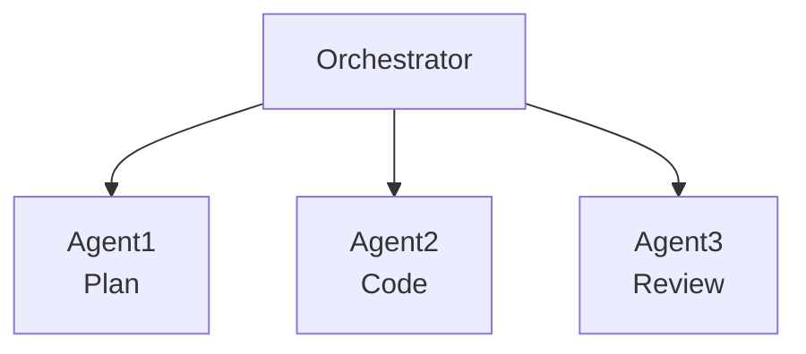
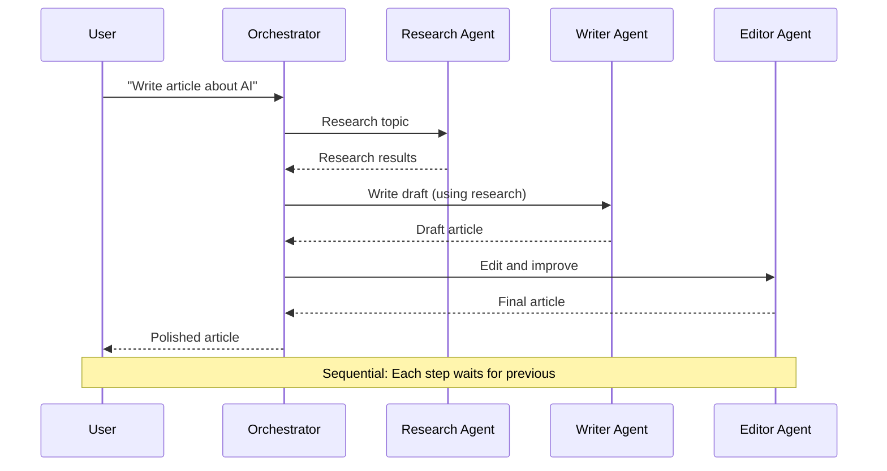
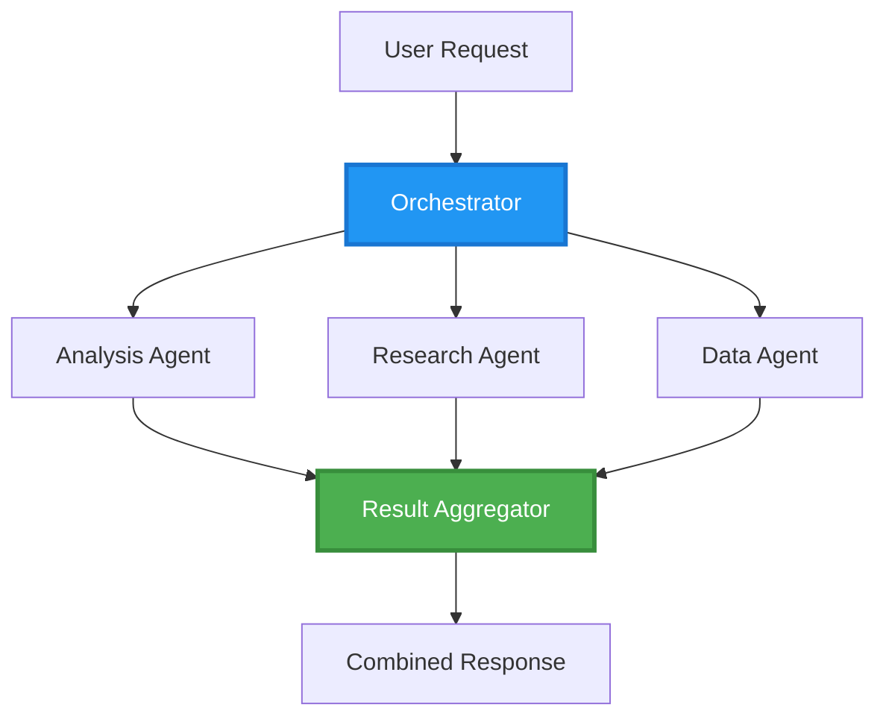
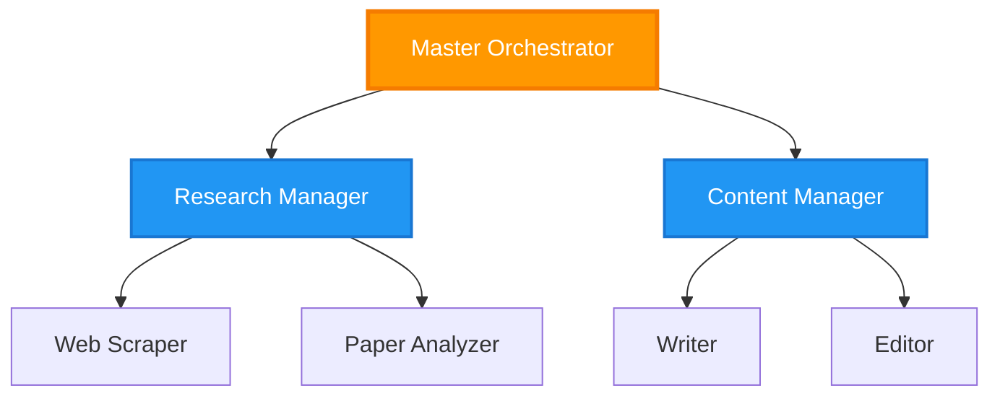
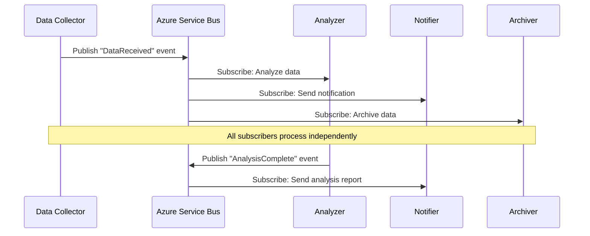
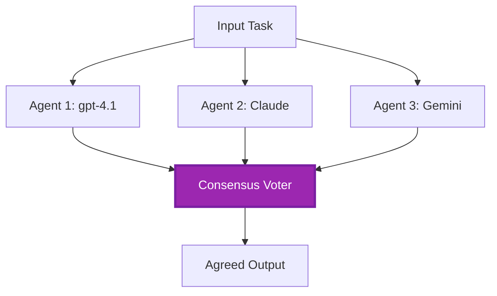
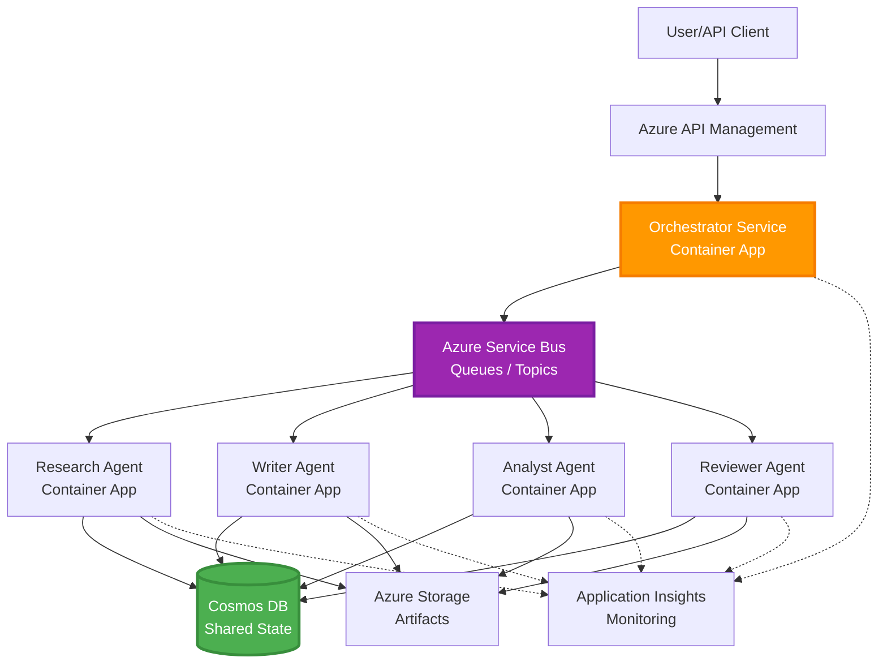

# Πρότυπα Συντονισμού Πολυ-Πρακτόρων

⏱️ **Εκτιμώμενος Χρόνος**: 60-75 λεπτά ανάγνωσης· αρκετές ώρες για υλοποίηση | 💰 **Εκτιμώμενο Κόστος**: εξαρτώμενο από φόρτο εργασίας | ⭐ **Βαθμός Δυσκολίας**: Προχωρημένος

**📚 Διαδρομή Μάθησης:**
- ← Προηγούμενο: [Capacity Planning](capacity-planning.md) - Στρατηγικές διαχείρισης μεγέθους και κλιμάκωσης πόρων
- 🎯 **Είστε Εδώ**: Πρότυπα Συντονισμού Πολυ-Πρακτόρων (Ορχήστρωση, επικοινωνία, διαχείριση κατάστασης)
- → Επόμενο: [SKU Selection](sku-selection.md) - Επιλογή κατάλληλων υπηρεσιών Azure
- 🏠 [Αρχική Σελίδα Μαθήματος](../../README.md)

---

## Τι θα Μάθετε

Με την ολοκλήρωση αυτού του μαθήματος, θα:
- Κατανοήσετε πρότυπα **αρχιτεκτονικής πολυ-πρακτόρων** και πότε να τα χρησιμοποιείτε
- Υλοποιήσετε **πρότυπα ορχήστρωσης** (κεντρικοποιημένη, αποκεντρωμένη, ιεραρχική)
- Σχεδιάσετε στρατηγικές **επικοινωνίας πρακτόρων** (συγχρονισμένη, ασύγχρονη, εκδήλωση-οδηγούμενη)
- Διαχειριστείτε **κοινή κατάσταση** μεταξύ διανεμημένων πρακτόρων
- Αναπτύξετε **συστήματα πολυ-πρακτόρων** στο Azure με AZD
- Εφαρμόσετε **πρότυπα συντονισμού** για ρεαλιστικά σενάρια τεχνητής νοημοσύνης
- Παρακολουθείτε και εντοπίζετε σφάλματα σε διανεμημένα συστήματα πρακτόρων

## Γιατί έχει σημασία ο Συντονισμός Πολυ-Πρακτόρων

### Η Εξέλιξη: Από Μοναδικό Πράκτορα σε Πολυ-Πράκτορες

**Μοναδικός Πράκτορας (Απλός):**
```
User → Agent → Response
```
- ✅ Εύκολος στην κατανόηση και υλοποίηση
- ✅ Γρήγορος για απλές εργασίες
- ❌ Περιορισμένος από τις δυνατότητες ενός μοντέλου
- ❌ Δεν μπορεί να παραλληλοποιήσει σύνθετες εργασίες
- ❌ Χωρίς εξειδίκευση

**Σύστημα Πολυ-Πρακτόρων (Προχωρημένο):**

- ✅ Εξειδικευμένοι πράκτορες για συγκεκριμένες εργασίες
- ✅ Παράλληλη εκτέλεση για ταχύτητα
- ✅ Μοντέρνο και εύκολο στη συντήρηση
- ✅ Καλύτερο σε σύνθετες ροές εργασίας
- ⚠️ Απαιτεί λογική συντονισμού

**Αναλογία**: Ο μοναδικός πράκτορας μοιάζει με ένα άτομο που κάνει όλες τις εργασίες. Ο πολυ-πράκτορας είναι σαν μια ομάδα όπου κάθε μέλος έχει εξειδικευμένες δεξιότητες (ερευνητής, προγραμματιστής, αξιολογητής, συγγραφέας) που συνεργάζονται.

---

## Βασικά Πρότυπα Συντονισμού

### Πρότυπο 1: Διαδοχικός Συντονισμός (Αλυσίδα Ευθύνης)

**Πότε να χρησιμοποιείται**: Οι εργασίες πρέπει να ολοκληρώνονται με συγκεκριμένη σειρά, κάθε πράκτορας βασίζεται στα αποτελέσματα του προηγούμενου.



**Οφέλη:**
- ✅ Σαφής ροή δεδομένων
- ✅ Εύκολο στον εντοπισμό σφαλμάτων
- ✅ Προβλέψιμη σειρά εκτέλεσης

**Περιορισμοί:**
- ❌ Πιο αργό (χωρίς παραλληλισμό)
- ❌ Μια αποτυχία μπλοκάρει ολόκληρη την αλυσίδα
- ❌ Δεν μπορεί να χειριστεί αλληλοεξαρτώμενες εργασίες

**Παραδείγματα Χρήσης:**
- Ροή δημιουργίας περιεχομένου (έρευνα → σύνταξη → επεξεργασία → δημοσίευση)
- Δημιουργία κώδικα (σχεδιασμός → υλοποίηση → δοκιμή → αναβάθμιση)
- Δημιουργία αναφορών (συλλογή δεδομένων → ανάλυση → οπτικοποίηση → περίληψη)

---

### Πρότυπο 2: Παράλληλος Συντονισμός (Fan-Out/Fan-In)

**Πότε να χρησιμοποιείται**: Ανεξάρτητες εργασίες μπορούν να τρέξουν ταυτόχρονα, με συνδυασμό αποτελεσμάτων στο τέλος.



**Οφέλη:**
- ✅ Γρήγορο (παράλληλη εκτέλεση)
- ✅ Ανθεκτικό σε σφάλματα (αποδεκτά μερικά αποτελέσματα)
- ✅ Κλιμακώνεται οριζόντια

**Περιορισμοί:**
- ⚠️ Τα αποτελέσματα μπορεί να φτάσουν εκτός σειράς
- ⚠️ Απαιτείται λογική συγκερασμού
- ⚠️ Σύνθετη διαχείριση κατάστασης

**Παραδείγματα Χρήσης:**
- Συλλογή δεδομένων από πολλαπλές πηγές (APIs + βάσεις δεδομένων + web scraping)
- Ανάλυση ανταγωνισμού (πολλαπλά μοντέλα παράγουν λύσεις, επιλέγεται η καλύτερη)
- Υπηρεσίες μετάφρασης (ταυτόχρονη μετάφραση σε πολλές γλώσσες)

---

### Πρότυπο 3: Ιεραρχικός Συντονισμός (Διαχειριστής-Εργάτης)

**Πότε να χρησιμοποιείται**: Σύνθετες ροές εργασίας με υπο-εργασίες και απαραίτητη ανάθεση.



**Οφέλη:**
- ✅ Διαχειρίζεται σύνθετες ροές εργασίας
- ✅ Μοντέρνο και εύκολο στη συντήρηση
- ✅ Σαφή όρια ευθυνών

**Περιορισμοί:**
- ⚠️ Πιο σύνθετη αρχιτεκτονική
- ⚠️ Μεγαλύτερη καθυστέρηση (πολλαπλά επίπεδα συντονισμού)
- ⚠️ Απαιτεί προηγμένη ορχήστρωση

**Παραδείγματα Χρήσης:**
- Επεξεργασία εταιρικών εγγράφων (κατηγοριοποίηση → δρομολόγηση → επεξεργασία → αρχειοθέτηση)
- Πολυεπίπεδες ροές δεδομένων (εισαγωγή → καθαρισμός → μετασχηματισμός → ανάλυση → αναφορά)
- Σύνθετες ροές αυτοματισμού (σχεδιασμός → κατανομή πόρων → εκτέλεση → παρακολούθηση)

---

### Πρότυπο 4: Εκδήλωση-Οδηγούμενος Συντονισμός (Publish-Subscribe)

**Πότε να χρησιμοποιείται**: Οι πράκτορες πρέπει να αντιδρούν σε εκδηλώσεις, απαιτείται χαλαρή σύνδεση.



**Οφέλη:**
- ✅ Χαλαρή σύνδεση μεταξύ πρακτόρων
- ✅ Εύκολο να προστεθούν νέοι πράκτορες (απλή εγγραφή)
- ✅ Ασύγχρονος χειρισμός
- ✅ Ανθεκτικό (επιμονή μηνυμάτων)

**Περιορισμοί:**
- ⚠️ Τελική συνέπεια
- ⚠️ Δύσκολη εντοπισμός σφαλμάτων
- ⚠️ Προκλήσεις στην παραγγελία μηνυμάτων

**Παραδείγματα Χρήσης:**
- Συστήματα παρακολούθησης σε πραγματικό χρόνο (ειδοποιήσεις, πίνακες ελέγχου, αρχεία καταγραφής)
- Πολυκαναλικές ειδοποιήσεις (email, SMS, push, Slack)
- Ροές επεξεργασίας δεδομένων (πολλαπλοί καταναλωτές των ίδιων δεδομένων)

---

### Πρότυπο 5: Συντονισμός με Βάση τη Συμφωνία (Διαψήφιση/Κβορούμ)

**Πότε να χρησιμοποιείται**: Απαιτείται συμφωνία από πολλούς πράκτορες πριν προχωρήσει η διαδικασία.



**Οφέλη:**
- ✅ Μεγαλύτερη ακρίβεια (πολλαπλές απόψεις)
- ✅ Ανθεκτικό σε σφάλματα (ανεκτές μικρές αποτυχίες)
- ✅ Ενσωματωμένη διασφάλιση ποιότητας

**Περιορισμοί:**
- ❌ Ακριβό (πολλαπλές κλήσεις μοντέλων)
- ❌ Πιο αργό (αναμονή για όλους τους πράκτορες)
- ⚠️ Απαιτείται επίλυση συγκρούσεων

**Παραδείγματα Χρήσης:**
- Μέτρηση περιεχομένου (πολλαπλά μοντέλα αξιολογούν το περιεχόμενο)
- Ανασκόπηση κώδικα (πολλαπλοί αναλυτές/ελεγκτές)
- Ιατρική διάγνωση (πολλαπλά μοντέλα AI, επικύρωση ειδικών)

---

## Επισκόπηση Αρχιτεκτονικής

### Πλήρες Σύστημα Πολυ-Πρακτόρων στο Azure



**Κύρια Συστατικά:**

| Συστατικό | Σκοπός | Υπηρεσία Azure |
|-----------|---------|---------------|
| **API Gateway** | Σημείο εισόδου, περιορισμός ρυθμού, αυθεντικοποίηση | API Management |
| **Orchestrator** | Συντονίζει ροές εργασιών πρακτόρων | Container Apps |
| **Message Queue** | Ασύγχρονη επικοινωνία | Service Bus / Event Hubs |
| **Πράκτορες** | Εξειδικευμένοι εργαζόμενοι AI | Container Apps / Functions |
| **State Store** | Κοινή κατάσταση, παρακολούθηση εργασιών | Cosmos DB |
| **Artifact Storage** | Έγγραφα, αποτελέσματα, αρχεία καταγραφής | Blob Storage |
| **Monitoring** | Διανεμημένη παρακολούθηση, αρχεία καταγραφής | Application Insights |

Τα queues/topics του Service Bus και τα Event Hubs είναι διαφορετικές υπηρεσίες με διαφορετικά μοντέλα παράδοσης/κατανάλωσης· το Event Hubs δεν αντικαθιστά αυτόματα τον κώδικα εργαζομένου του Service Bus που ακολουθεί. Ο παραλληλισμός, τα επίμονα μηνύματα και η ψηφοφορία μοντέλων από μόνα τους δεν εγγυώνται ανθεκτικότητα ή μεγαλύτερη ακρίβεια.

---

## Προαπαιτούμενα

### Απαιτούμενα Εργαλεία

```bash
# Verify Azure Developer CLI
azd version
# Command reference baseline: azd 1.37.2

# Verify Azure CLI
az --version
# ✅ Expected: azure-cli 2.50.0 or higher

# Verify Docker (for local testing)
docker --version
# ✅ Expected: Docker version 20.10 or higher
```

### Απαιτήσεις Azure

- Ενεργή συνδρομή Azure
- Δικαιώματα δημιουργίας:
  - Container Apps
  - Ονοματοχώροι Service Bus
  - Λογαριασμοί Cosmos DB
  - Λογαριασμοί αποθήκευσης
  - Application Insights

### Προαπαιτούμενες Γνώσεις

Πρέπει να έχετε ολοκληρώσει:
- [Διαχείριση Ρυθμίσεων](../chapter-03-configuration/configuration.md)
- [Αυθεντικοποίηση & Ασφάλεια](../chapter-03-configuration/authsecurity.md)
- [Παράδειγμα Microservices](../../../../examples/microservices)

---

## Οδηγός Υλοποίησης

> **Σχεδιαστικά θραύσματα, όχι πλήρες εργαστήριο:** Το δέντρο έργου και οι ετικέτες `File:` πιο κάτω περιγράφουν αρχεία που θα δημιουργήσετε στο δικό σας έργο· αυτή η αποθήκη δεν περιέχει ολοκληρωμένη εφαρμογή `multi-agent-system`. Λείπουν κομμάτια όπως πρότυπα κύριου/παραμέτρων, περιβάλλον/μητρώο Container Apps, Dockerfiles και κλειδώματα εξαρτήσεων, ρύθμιση βάσης δεδομένων/container Cosmos, αναπτύξεις μοντέλων, ρυθμίσεις ταυτότητας/ρόλων, κανόνες κλιμάκωσης και παράλληλοι εργάτες/ουρές. Μην περιμένετε `azd init` να δημιουργεί αυτά τα αρχεία ή `azd up` να αναπτύσσει τα αποσπάσματα αυτούσια. Για εκτελέσιμο σημείο εκκίνησης, ολοκληρώστε το [Multi-Agent Basics](../chapter-05-multi-agent/multi-agent-basics.md).

**Υποθέσεις χρόνου εκτέλεσης:** Python 3.10+, `azure-servicebus`, `azure-cosmos`, `openai`, Flask και (για παρακολούθηση) `azure-monitor-opentelemetry`; βάλτε `shared` στο μονοπάτι εισαγωγής Python σε κάθε υπηρεσία εικόνας. Το κοντέινερ Cosmos `agent-state/tasks` πρέπει να υπάρχει ήδη με πλήκτρο διαμερισμού `/id`. Οι συνδέσεις με βάση κλειδιά απλοποιούν αυτά τα θραύσματα, όχι οδηγία παραγωγής: προτιμήστε διαχειριζόμενες ταυτότητες με ρόλους περιορισμένου πεδίου για Service Bus/Cosmos/OpenAI data-plane. Μην εκθέτετε κλειδιά σε εξόδους ή αρχεία καταγραφής.

Η παράδοση Service Bus είναι **τουλάχιστον μία φορά**. Διατηρείστε αδιαίρετη την επαναληψιμότητα ανά εργασία **και βήμα**, χρησιμοποιήστε αισιόδοξη ταυτόχρονη διαχείριση (ETags) για ανάγνωση/τροποποίηση/εγγραφή κατάστασης και ανανεώστε τους κλειδώματα μηνυμάτων κατά τη μακροχρόνια επεξεργασία. Ο απλός διαχειριστής κατάστασης παρακάτω είναι μόνο διαδοχικός και δεν υλοποιεί αυτές τις εγγυήσεις παραγωγής.

### Δομή Έργου

```
multi-agent-system/
├── azure.yaml                    # AZD configuration
├── infra/
│   ├── main.bicep               # Main infrastructure
│   ├── core/
│   │   ├── servicebus.bicep     # Message queue
│   │   ├── cosmos.bicep         # State store
│   │   ├── storage.bicep        # Artifact storage
│   │   └── monitoring.bicep     # Application Insights
│   └── app/
│       ├── orchestrator.bicep   # Orchestrator service
│       └── agent.bicep          # Agent template
└── src/
    ├── orchestrator/            # Orchestration logic
    │   ├── app.py
    │   ├── workflows.py
    │   └── Dockerfile
    ├── agents/
    │   ├── research/            # Research agent
    │   ├── writer/              # Writer agent
    │   ├── analyst/             # Analyst agent
    │   └── reviewer/            # Reviewer agent
    └── shared/
        ├── state_manager.py     # Shared state logic
        └── message_handler.py   # Message handling
```

---

## Μάθημα 1: Διαδοχικό Πρότυπο Συντονισμού

### Υλοποίηση: Ροή Δημιουργίας Περιεχομένου

Ας σχεδιάσουμε μια διαδοχική ροή: Έρευνα → Σύνταξη → Επεξεργασία. Η δημοσίευση είναι εκτός αυτού του παραδείγματος.

### 1. Διαμόρφωση AZD

**Αρχείο: `azure.yaml`**

```yaml
name: content-pipeline
metadata:
  template: multi-agent-sequential@1.0.0

services:
  orchestrator:
    project: ./src/orchestrator
    language: python
    host: containerapp
  
  research-agent:
    project: ./src/agents/research
    language: python
    host: containerapp
  
  writer-agent:
    project: ./src/agents/writer
    language: python
    host: containerapp
  
  editor-agent:
    project: ./src/agents/editor
    language: python
    host: containerapp
```

### 2. Υποδομή: Service Bus για Συντονισμό

**Αρχείο: `infra/core/servicebus.bicep`**

```bicep
param name string
param location string
param tags object = {}

resource serviceBusNamespace 'Microsoft.ServiceBus/namespaces@2022-10-01-preview' = {
  name: name
  location: location
  tags: tags
  sku: {
    name: 'Standard'
    tier: 'Standard'
  }
  properties: {
    minimumTlsVersion: '1.2'
  }
}

// Queue for orchestrator → research agent
resource researchQueue 'Microsoft.ServiceBus/namespaces/queues@2022-10-01-preview' = {
  parent: serviceBusNamespace
  name: 'research-tasks'
  properties: {
    maxDeliveryCount: 3
    lockDuration: 'PT5M'
    deadLetteringOnMessageExpiration: true
  }
}

// Queue for research agent → writer agent
resource writerQueue 'Microsoft.ServiceBus/namespaces/queues@2022-10-01-preview' = {
  parent: serviceBusNamespace
  name: 'writer-tasks'
  properties: {
    maxDeliveryCount: 3
    lockDuration: 'PT5M'
  }
}

// Queue for writer agent → editor agent
resource editorQueue 'Microsoft.ServiceBus/namespaces/queues@2022-10-01-preview' = {
  parent: serviceBusNamespace
  name: 'editor-tasks'
  properties: {
    maxDeliveryCount: 3
    lockDuration: 'PT5M'
  }
}

output namespace string = serviceBusNamespace.name
// Do not output RootManageSharedAccessKey. Resolve scoped credentials
// securely or use managed identity in the application and scale rules.
```

### 3. Διαχειριστής Κοινής Κατάστασης

**Αρχείο: `src/shared/state_manager.py`**

```python
from azure.cosmos import CosmosClient, PartitionKey
from datetime import datetime, timezone
import os

class StateManager:
    """Manages shared state across agents using Cosmos DB"""
    
    def __init__(self):
        endpoint = os.environ['COSMOS_ENDPOINT']
        key = os.environ['COSMOS_KEY']
        
        self.client = CosmosClient(endpoint, key)
        self.database = self.client.get_database_client('agent-state')
        self.container = self.database.get_container_client('tasks')
    
    def create_task(self, task_id: str, task_type: str, input_data: dict):
        """Create a new task"""
        task = {
            'id': task_id,
            'type': task_type,
            'status': 'pending',
            'input': input_data,
            'created_at': datetime.now(timezone.utc).isoformat(),
            'steps': []
        }
        self.container.create_item(task)
        return task
    
    def update_task_step(self, task_id: str, step_name: str, result: dict):
        """Update task with completed step"""
        task = self.container.read_item(task_id, partition_key=task_id)
        
        task['steps'].append({
            'name': step_name,
            'completed_at': datetime.now(timezone.utc).isoformat(),
            'result': result
        })
        
        self.container.replace_item(task_id, task)
        return task
    
    def complete_task(self, task_id: str, final_result: dict):
        """Mark task as complete"""
        task = self.container.read_item(task_id, partition_key=task_id)
        task['status'] = 'completed'
        task['result'] = final_result
        task['completed_at'] = datetime.now(timezone.utc).isoformat()
        self.container.replace_item(task_id, task)
        return task
    
    def get_task(self, task_id: str):
        """Retrieve task state"""
        return self.container.read_item(task_id, partition_key=task_id)
```

### 4. Υπηρεσία Ορχήστρωσης

**Αρχείο: `src/orchestrator/app.py`**

```python
from flask import Flask, request, jsonify
from azure.servicebus import ServiceBusClient, ServiceBusMessage
import json
import uuid
import os
from shared.state_manager import StateManager

app = Flask(__name__)
state_manager = StateManager()

# Service Bus connection
servicebus_connection_str = os.environ['SERVICEBUS_CONNECTION_STRING']
servicebus_client = ServiceBusClient.from_connection_string(servicebus_connection_str)

@app.route('/health', methods=['GET'])
def health():
    return jsonify({'status': 'healthy', 'service': 'orchestrator'})

@app.route('/create-content', methods=['POST'])
def create_content():
    """
    Sequential workflow: Research → Write → Edit (returns a draft; no publishing)
    """
    data = request.get_json(silent=True) or {}
    topic = data.get('topic')
    
    if not topic:
        return jsonify({'error': 'Topic required'}), 400
    
    # Create task in state store
    task_id = str(uuid.uuid4())
    task = state_manager.create_task(
        task_id=task_id,
        task_type='content_creation',
        input_data={'topic': topic}
    )
    
    # Send message to research agent (first step)
    sender = servicebus_client.get_queue_sender('research-tasks')
    message = ServiceBusMessage(
        body=json.dumps({
            'task_id': task_id,
            'topic': topic,
            'next_queue': 'writer-tasks'  # Where to send results
        }),
        content_type='application/json'
    )
    
    with sender:
        sender.send_messages(message)
    
    return jsonify({
        'task_id': task_id,
        'status': 'started',
        'workflow': 'sequential',
        'steps': ['research', 'write', 'edit'],
        'message': 'Content creation pipeline initiated'
    }), 202

@app.route('/task/<task_id>', methods=['GET'])
def get_task_status(task_id):
    """Check task status"""
    try:
        task = state_manager.get_task(task_id)
        return jsonify(task)
    except Exception as e:
        return jsonify({'error': str(e)}), 404

if __name__ == '__main__':
    app.run(host='0.0.0.0', port=8080)
```

### 5. Πράκτορας Έρευνας

**Αρχείο: `src/agents/research/app.py`**

```python
from azure.servicebus import ServiceBusClient, ServiceBusMessage
from openai import AzureOpenAI
import json
import os
import time
from shared.state_manager import StateManager

# Initialize clients
state_manager = StateManager()
servicebus_client = ServiceBusClient.from_connection_string(
    os.environ['SERVICEBUS_CONNECTION_STRING']
)

openai_client = AzureOpenAI(
    api_key=os.environ['AZURE_OPENAI_API_KEY'],
    api_version="2024-10-21",
    azure_endpoint=os.environ['AZURE_OPENAI_ENDPOINT']
)

def process_research_task(message_data):
    """Process research request and pass to writer"""
    task_id = message_data['task_id']
    topic = message_data['topic']
    next_queue = message_data['next_queue']
    
    print(f"🔬 Researching: {topic}")
    
    # Call Microsoft Foundry Models for research
    response = openai_client.chat.completions.create(
        model=os.environ['AZURE_OPENAI_DEPLOYMENT'],
        messages=[
            {"role": "system", "content": "You are a research assistant. Provide comprehensive research on the given topic."},
            {"role": "user", "content": f"Research this topic thoroughly: {topic}"}
        ],
        max_tokens=1500
    )
    
    research_results = response.choices[0].message.content
    
    # Update state
    state_manager.update_task_step(
        task_id=task_id,
        step_name='research',
        result={'research': research_results}
    )
    
    # Send to next agent (writer)
    sender = servicebus_client.get_queue_sender(next_queue)
    message = ServiceBusMessage(
        body=json.dumps({
            'task_id': task_id,
            'topic': topic,
            'research': research_results,
            'next_queue': 'editor-tasks'
        }),
        content_type='application/json'
    )
    
    with sender:
        sender.send_messages(message)
    
    print(f"✅ Research complete for task {task_id}")

def main():
    """Listen to research queue"""
    receiver = servicebus_client.get_queue_receiver('research-tasks')
    
    print("🔬 Research Agent started, listening for tasks...")
    
    with receiver:
        while True:
            messages = receiver.receive_messages(max_wait_time=5)
            for message in messages:
                try:
                    message_data = json.loads(str(message))
                    process_research_task(message_data)
                    receiver.complete_message(message)
                except Exception as e:
                    print(f"❌ Error processing message: {e}")
                    receiver.abandon_message(message)

if __name__ == '__main__':
    main()
```

### 6. Πράκτορας Συγγραφής

**Αρχείο: `src/agents/writer/app.py`**

```python
from azure.servicebus import ServiceBusClient, ServiceBusMessage
from openai import AzureOpenAI
import json
import os
from shared.state_manager import StateManager

state_manager = StateManager()
servicebus_client = ServiceBusClient.from_connection_string(
    os.environ['SERVICEBUS_CONNECTION_STRING']
)

openai_client = AzureOpenAI(
    api_key=os.environ['AZURE_OPENAI_API_KEY'],
    api_version="2024-10-21",
    azure_endpoint=os.environ['AZURE_OPENAI_ENDPOINT']
)

def process_writing_task(message_data):
    """Write article based on research"""
    task_id = message_data['task_id']
    topic = message_data['topic']
    research = message_data['research']
    next_queue = message_data['next_queue']
    
    print(f"✍️ Writing article: {topic}")
    
    # Call Microsoft Foundry Models to write article
    response = openai_client.chat.completions.create(
        model=os.environ['AZURE_OPENAI_DEPLOYMENT'],
        messages=[
            {"role": "system", "content": "You are a professional writer. Write engaging, well-structured articles."},
            {"role": "user", "content": f"Based on this research:\n\n{research}\n\nWrite a comprehensive article about: {topic}"}
        ],
        max_tokens=2000
    )
    
    article_draft = response.choices[0].message.content
    
    # Update state
    state_manager.update_task_step(
        task_id=task_id,
        step_name='writing',
        result={'draft': article_draft}
    )
    
    # Send to editor
    sender = servicebus_client.get_queue_sender(next_queue)
    message = ServiceBusMessage(
        body=json.dumps({
            'task_id': task_id,
            'topic': topic,
            'draft': article_draft
        }),
        content_type='application/json'
    )
    
    with sender:
        sender.send_messages(message)
    
    print(f"✅ Article draft complete for task {task_id}")

def main():
    """Listen to writer queue"""
    receiver = servicebus_client.get_queue_receiver('writer-tasks')
    
    print("✍️ Writer Agent started, listening for tasks...")
    
    with receiver:
        while True:
            messages = receiver.receive_messages(max_wait_time=5)
            for message in messages:
                try:
                    message_data = json.loads(str(message))
                    process_writing_task(message_data)
                    receiver.complete_message(message)
                except Exception as e:
                    print(f"❌ Error: {e}")
                    receiver.abandon_message(message)

if __name__ == '__main__':
    main()
```

### 7. Πράκτορας Επεξεργασίας

**Αρχείο: `src/agents/editor/app.py`**

```python
from azure.servicebus import ServiceBusClient
from openai import AzureOpenAI
import json
import os
from shared.state_manager import StateManager

state_manager = StateManager()
servicebus_client = ServiceBusClient.from_connection_string(
    os.environ['SERVICEBUS_CONNECTION_STRING']
)

openai_client = AzureOpenAI(
    api_key=os.environ['AZURE_OPENAI_API_KEY'],
    api_version="2024-10-21",
    azure_endpoint=os.environ['AZURE_OPENAI_ENDPOINT']
)

def process_editing_task(message_data):
    """Edit and finalize article"""
    task_id = message_data['task_id']
    topic = message_data['topic']
    draft = message_data['draft']
    
    print(f"📝 Editing article: {topic}")
    
    # Call Microsoft Foundry Models to edit
    response = openai_client.chat.completions.create(
        model=os.environ['AZURE_OPENAI_DEPLOYMENT'],
        messages=[
            {"role": "system", "content": "You are an expert editor. Improve grammar, clarity, and structure."},
            {"role": "user", "content": f"Edit and improve this article:\n\n{draft}"}
        ],
        max_tokens=2000
    )
    
    final_article = response.choices[0].message.content
    
    # Mark task as complete
    state_manager.complete_task(
        task_id=task_id,
        final_result={
            'topic': topic,
            'final_article': final_article,
            'word_count': len(final_article.split())
        }
    )
    
    print(f"✅ Article finalized for task {task_id}")

def main():
    """Listen to editor queue"""
    receiver = servicebus_client.get_queue_receiver('editor-tasks')
    
    print("📝 Editor Agent started, listening for tasks...")
    
    with receiver:
        while True:
            messages = receiver.receive_messages(max_wait_time=5)
            for message in messages:
                try:
                    message_data = json.loads(str(message))
                    process_editing_task(message_data)
                    receiver.complete_message(message)
                except Exception as e:
                    print(f"❌ Error: {e}")
                    receiver.abandon_message(message)

if __name__ == '__main__':
    main()
```

### 8. Ανάπτυξη και Δοκιμή

Αυτές οι εντολές ισχύουν **μόνο αφού υλοποιήσετε τα ελλείποντα αρχεία έργου**. Η αλληλεπιδραστική αρχικοποίηση πρακτόρων Foundry είναι ξεχωριστή ροή εργασίας· δεν παράγει αυτόν τον σχεδιασμό Service Bus.

```bash
# In your completed custom project
azd up

# Alternative in a SEPARATE empty folder (agents beta.23 requires azd >= 1.37)
azd extension install azure.ai.agents
azd ai agent init
azd up
```

> Δείτε [Εντολές CLI AZD AI](../chapter-08-production/production-ai-practices.md#azd-ai-cli-commands-and-extensions) για όλα τα `azd ai` flags και επιλογές.

```bash
# Get orchestrator URL
ORCHESTRATOR_URL=$(azd env get-values | grep ORCHESTRATOR_URL | cut -d '=' -f2 | tr -d '"')

# Create content
curl -X POST $ORCHESTRATOR_URL/create-content \
  -H "Content-Type: application/json" \
  -d '{"topic": "The Future of AI in Healthcare"}'
```

**✅ Αναμενόμενη έξοδος:**
```json
{
  "task_id": "a1b2c3d4-e5f6-7890-abcd-ef1234567890",
  "status": "started",
  "workflow": "sequential",
  "steps": ["research", "write", "edit"],
  "message": "Content creation pipeline initiated"
}
```

**Ελέγξτε την πρόοδο της εργασίας:**
```bash
TASK_ID="a1b2c3d4-e5f6-7890-abcd-ef1234567890"
curl $ORCHESTRATOR_URL/task/$TASK_ID
```

**✅ Αναμενόμενη έξοδος (ολοκληρωμένη):**
```json
{
  "id": "a1b2c3d4-e5f6-7890-abcd-ef1234567890",
  "type": "content_creation",
  "status": "completed",
  "steps": [
    {
      "name": "research",
      "completed_at": "2025-11-19T10:30:00Z",
      "result": {"research": "..."}
    },
    {
      "name": "writing",
      "completed_at": "2025-11-19T10:32:00Z",
      "result": {"draft": "..."}
    }
  ],
  "result": {
    "topic": "The Future of AI in Healthcare",
    "final_article": "...",
    "word_count": 1500
  }
}
```

---

## Μάθημα 2: Παράλληλο Πρότυπο Συντονισμού

### Υλοποίηση: Συλλέκτης Πληροφοριών από Πολλαπλές Πηγές

Ας δημιουργήσουμε ένα παράλληλο σύστημα που συγκεντρώνει πληροφορίες ταυτόχρονα από πολλαπλές πηγές.

### Παράλληλος Ορχηστρωτής

**Αρχείο: `src/orchestrator/parallel_workflow.py`**

```python
from flask import Flask, request, jsonify
from azure.servicebus import ServiceBusClient, ServiceBusMessage
import json
import uuid
import os
from shared.state_manager import StateManager

app = Flask(__name__)
state_manager = StateManager()

servicebus_client = ServiceBusClient.from_connection_string(
    os.environ['SERVICEBUS_CONNECTION_STRING']
)

@app.route('/research-parallel', methods=['POST'])
def research_parallel():
    """
    Parallel workflow: Multiple agents work simultaneously
    """
    data = request.json
    query = data.get('query')
    
    task_id = str(uuid.uuid4())
    task = state_manager.create_task(
        task_id=task_id,
        task_type='parallel_research',
        input_data={
            'query': query,
            'agents': ['web', 'academic', 'news', 'social']
        }
    )
    
    # Fan-out: publish sequentially; workers may process concurrently.
    agents = [
        ('web-research-queue', 'web'),
        ('academic-research-queue', 'academic'),
        ('news-research-queue', 'news'),
        ('social-research-queue', 'social')
    ]
    
    for queue_name, agent_type in agents:
        sender = servicebus_client.get_queue_sender(queue_name)
        message = ServiceBusMessage(
            body=json.dumps({
                'task_id': task_id,
                'query': query,
                'agent_type': agent_type,
                'result_queue': 'aggregation-queue'
            }),
            content_type='application/json'
        )
        
        with sender:
            sender.send_messages(message)
    
    return jsonify({
        'task_id': task_id,
        'status': 'started',
        'workflow': 'parallel',
        'agents_dispatched': 4,
        'message': 'Parallel research initiated'
    }), 202

if __name__ == '__main__':
    app.run(host='0.0.0.0', port=8080)
```

### Λογική Συγκέντρωσης

**Αρχείο: `src/agents/aggregator/app.py`**

```python
from azure.servicebus import ServiceBusClient
import json
import os
from collections import defaultdict
from shared.state_manager import StateManager

state_manager = StateManager()
servicebus_client = ServiceBusClient.from_connection_string(
    os.environ['SERVICEBUS_CONNECTION_STRING']
)

# Single-process demo only: not durable or shared across replicas.
# Production: use durable unique (task_id, agent_type) result records.
task_results = defaultdict(dict)
expected_agents = 4  # web, academic, news, social

def process_result(message_data):
    """Aggregate results from parallel agents"""
    task_id = message_data['task_id']
    agent_type = message_data['agent_type']
    result = message_data['result']
    
    # Store result
    task_results[task_id][agent_type] = {
        'agent': agent_type,
        'data': result
    }
    
    print(f"📊 Received result from {agent_type} agent ({len(task_results[task_id])}/{expected_agents})")
    
    # Check if all agents completed (fan-in)
    if len(task_results[task_id]) == expected_agents:
        print(f"✅ All agents completed for task {task_id}. Aggregating...")
        
        # Combine results
        aggregated = {
            'query': message_data['query'],
            'sources': list(task_results[task_id].values()),
            'summary': generate_summary(list(task_results[task_id].values()))
        }
        
        # Mark complete
        state_manager.complete_task(task_id, aggregated)
        
        # Clean up
        del task_results[task_id]
        
        print(f"✅ Aggregation complete for task {task_id}")

def generate_summary(results):
    """Generate summary from all sources"""
    summaries = [r['data'].get('summary', '') for r in results]
    return '\n\n'.join(summaries)

def main():
    """Listen to aggregation queue"""
    receiver = servicebus_client.get_queue_receiver('aggregation-queue')
    
    print("📊 Aggregator started, listening for results...")
    
    with receiver:
        while True:
            messages = receiver.receive_messages(max_wait_time=5)
            for message in messages:
                try:
                    message_data = json.loads(str(message))
                    process_result(message_data)
                    receiver.complete_message(message)
                except Exception as e:
                    print(f"❌ Error: {e}")
                    receiver.abandon_message(message)

if __name__ == '__main__':
    main()
```

**Πλεονεκτήματα του Παράλληλου Προτύπου:**
- ⚡ **Πιθανώς μικρότερη καθυστέρηση** (περιορισμένη από τον πιο αργό εργάτη συν το κόστος συντονισμού)
- 🔄 **Υποστηρίζει μερικά αποτελέσματα** με ρητές προθεσμίες και πολιτική αποτυχίας (δεν υλοποιείται από τον βασικό συγκεντρωτή)
- 📈 **Κλιμακώνεται** (προσθέστε εύκολα περισσότερους πράκτορες)

---

## Πρακτικές Ασκήσεις

### Άσκηση 1: Προσθήκη Χειρισμού Timeout ⭐⭐ (Μεσαίο)

**Στόχος**: Υλοποίηση λογικής timeout ώστε ο συγκεντρωτής να μην περιμένει επ' αόριστον τους αργούς πράκτορες.

**Σημείο εκκίνησης:** Τρέξτε αυτή την τοπική προσομοίωση προθεσμίας πριν την ενσωματώσετε σε εργαζόμενο ουράς. Το timeout που ελέγχεται μόνο όταν φτάνει άλλο μήνυμα δεν πυροδοτείται αν ο εργάτης που λείπει δεν στείλει τίποτα.

**Βήματα**:

1. **Προσθέστε παρακολούθηση timeout στον συγκεντρωτή:**

```python
import asyncio

async def simulated_agent(name, delay):
    await asyncio.sleep(delay)
    return {'agent': name, 'result': 'done'}

async def main():
    tasks = [asyncio.create_task(simulated_agent(name, delay))
             for name, delay in [('web', 0.1), ('academic', 0.2),
                                 ('news', 0.3), ('social', 3)]]
    done, pending = await asyncio.wait(tasks, timeout=1)
    results = [task.result() for task in done]
    for task in pending:
        task.cancel()
    await asyncio.gather(*pending, return_exceptions=True)
    print({'completed_agents': len(results), 'timed_out': bool(pending)})
    assert len(results) == 3 and pending

asyncio.run(main())
```

2. **Αναμενόμενη έξοδος:**

```text
{'completed_agents': 3, 'timed_out': True}
```

3. **Ενσωμάτωση σε σύστημα ουράς (έργο σχεδιασμού):** Διατηρήστε την προθεσμία αποστολής και τους αναμενόμενους πράκτορες κατά τη δημιουργία της εργασίας, τρέξτε περιοδικό έλεγχο προθεσμίας ανεξάρτητα από παραλαμβανόμενα αποτελέσματα, ολοκληρώστε ατομικά τα μερικά αποτελέσματα και αγνοήστε καθυστερημένα/διπλά μηνύματα για ολοκληρωμένες εργασίες. Το τοπικό timeout δεν ακυρώνει απομακρυσμένους εργάτες.

Μόνο για το δικό σας υλοποιημένο έργο:

```bash
azd deploy aggregator

# Submit task
curl -X POST $ORCHESTRATOR_URL/research-parallel \
  -H "Content-Type: application/json" \
  -d '{"query": "AI safety research"}'

# Check results after 30 seconds
curl $ORCHESTRATOR_URL/task/$TASK_ID
```

**✅ Κριτήρια Επιτυχίας:**
- ✅ Το τοπικό τεστ επιστρέφει μετά από το δευτερόλεπτο προθεσμίας ακόμα και αν υπάρχει ελλιπής πράκτορας
- ✅ Η απόκριση υποδεικνύει μερικά αποτελέσματα (`"timed_out": true`)
- ✅ Επιστρέφονται διαθέσιμα αποτελέσματα (3 από 4 πράκτορες)

**Χρόνος**: 20-25 λεπτά

---

### Άσκηση 2: Υλοποίηση Λογικής Επανάληψης ⭐⭐⭐ (Προχωρημένο)

**Στόχος**: Επαναλάβετε αυτόματα τις αποτυχημένες εργασίες πρακτόρων πριν εγκαταλείψετε.

**Βήματα**:

1. **Χρησιμοποιήστε τους μετρητές παράδοσης του Service Bus αντί για προσαρμοσμένους μετρητές επανάληψης:**

```python
import json
import time
# Integration fragment: use a live peek-lock ServiceBusReceiver.
# Set queue maxDeliveryCount to 4 for one attempt + up to three retries.
```

2. **Προσθέστε χειριστή επανάληψης στους πράκτορες:**

```python
def process_with_retry(message, receiver, process_func):
    """Process message with automatic retry on failure"""
    try:
        message_data = json.loads(str(message))
        
        # Process the message
        process_func(message_data)
        
        # Success - complete
        receiver.complete_message(message)
        
    except Exception as e:
        if message.delivery_count < 4:
            # Bounded exponential delay: 5s, 10s, 20s.
            # Renew the lock if processing + waiting can exceed its duration.
            time.sleep(5 * 2 ** (message.delivery_count - 1))
            receiver.abandon_message(message)
        else:
            # Max retries exceeded - move to dead letter queue
            print(f"❌ Max attempts exceeded for message {message.message_id}")
            receiver.dead_letter_message(
                message,
                reason="MaxRetriesExceeded",
                error_description=str(e)
            )
```

3. **Παρακολουθήστε την ουρά dead letter:**

```python
def monitor_dead_letters():
    """Check dead letter queue for failed messages"""
    receiver = servicebus_client.get_queue_receiver(
        'research-tasks',
        sub_queue='deadletter'
    )
    
    with receiver:
        messages = receiver.receive_messages(max_wait_time=5)
        for message in messages:
            print(f"☠️ Dead letter: {message.message_id}")
            print(f"Reason: {message.dead_letter_reason}")
            print(f"Description: {message.dead_letter_error_description}")
```

**✅ Κριτήρια Επιτυχίας:**
- ✅ Οι αποτυχημένες εργασίες επαναλαμβάνονται αυτόματα (έως 3 φορές)
- ✅ Εκθετική αύξηση χρόνου μεταξύ επαναλήψεων (5s, 10s, 20s), με ανανέωση κλειδώματος μηνύματος όπου χρειάζεται
- ✅ Μετά από τις μέγιστες προσπάθειες, τα μηνύματα πηγαίνουν στην ουρά dead letter
- ✅ Τα μηνύματα του dead letter μπορούν να ελεγχθούν· η αναπαραγωγή απαιτεί ξεχωριστή διαδικασία επαναφοράς με αδιαίρετη λειτουργία

**Χρόνος**: 30-40 λεπτά

---

### Άσκηση 3: Υλοποίηση Κύκλου Διακοπής (Circuit Breaker) ⭐⭐⭐ (Προχωρημένο)

**Στόχος**: Αποτρέψτε αλυσιδωτές αποτυχίες σταματώντας τα αιτήματα προς αποτυγχάνοντες πράκτορες.

**Βήματα**:

1. **Δημιουργήστε κλάση κύκλου διακοπής:**

```python
from enum import Enum
from datetime import datetime, timedelta, timezone

class CircuitState(Enum):
    CLOSED = "closed"      # Normal operation
    OPEN = "open"          # Failing, reject requests
    HALF_OPEN = "half_open"  # Testing if recovered

class CircuitBreaker:
    def __init__(self, failure_threshold=5, timeout_seconds=60):
        self.failure_threshold = failure_threshold
        self.timeout_seconds = timeout_seconds
        self.failure_count = 0
        self.last_failure_time = None
        self.state = CircuitState.CLOSED
    
    def call(self, func):
        """Execute function with circuit breaker protection"""
        if self.state == CircuitState.OPEN:
            # Check if timeout expired
            if datetime.now(timezone.utc) - self.last_failure_time > timedelta(seconds=self.timeout_seconds):
                self.state = CircuitState.HALF_OPEN
                print("🔄 Circuit breaker: HALF_OPEN (testing)")
            else:
                raise Exception(f"Circuit breaker OPEN for agent. Try again in {self.timeout_seconds}s")
        
        try:
            result = func()
            
            # Success
            self.failure_count = 0 # Count consecutive failures only
            if self.state == CircuitState.HALF_OPEN:
                self.state = CircuitState.CLOSED
                self.failure_count = 0
                print("✅ Circuit breaker: CLOSED (recovered)")
            
            return result
            
        except Exception as e:
            self.failure_count += 1
            self.last_failure_time = datetime.now(timezone.utc)
            
            if self.failure_count >= self.failure_threshold:
                self.state = CircuitState.OPEN
                print(f"🔴 Circuit breaker: OPEN (too many failures)")
            
            raise
```

2. **Εφαρμόστε στις κλήσεις πρακτόρων:**

```python
# In orchestrator
agent_circuits = {
    'web': CircuitBreaker(failure_threshold=5, timeout_seconds=60),
    'academic': CircuitBreaker(failure_threshold=5, timeout_seconds=60),
    'news': CircuitBreaker(failure_threshold=5, timeout_seconds=60),
    'social': CircuitBreaker(failure_threshold=5, timeout_seconds=60)
}

def send_to_agent(agent_type, message_data):
    """Send with circuit breaker protection"""
    circuit = agent_circuits[agent_type]
    
    try:
        circuit.call(lambda: send_message(agent_type, message_data))
    except Exception as e:
        print(f"⚠️ Skipping {agent_type} agent: {e}")
        # Continue with other agents
```

Αυτό το κύκλωμα προστατεύει την **λειτουργία αποστολής**, όχι την ολοκλήρωση από τον απομακρυσμένο εργαζόμενο: η επιτυχής τοποθέτηση ενός μηνύματος στην ουρά δεν λέει τίποτα για το αν ένας πράκτορας είναι ζωντανός. `send_message` είναι η συνάρτηση αποστολέα της εφαρμογής σας. Για κυκλώματα εκτέλεσης, προωθήστε τα παρατηρούμενα σφάλματα/λήξεις χρόνου εργασιών σε έναν ανθεκτικό συντονιστή. Αυτή η κλάση που λειτουργεί στη μνήμη είναι μια επίδειξη μονής νηματικής εκτέλεσης, όχι ένας κατανεμημένος διακόπτης κυκλώματος.

3. **Δοκιμάστε τον διακόπτη κυκλώματος τοπικά:**

```python
# Run after the class definition; no Azure changes required.
circuit = CircuitBreaker(failure_threshold=5, timeout_seconds=0)
def fail():
    raise RuntimeError("simulated failure")
for _ in range(5):
    try:
        circuit.call(fail)
    except RuntimeError:
        pass
assert circuit.state == CircuitState.OPEN
assert circuit.call(lambda: "recovered") == "recovered"
assert circuit.state == CircuitState.CLOSED
print("Circuit breaker recovery verified")
```

**✅ Κριτήρια Επιτυχίας:**
- ✅ Μετά από 5 αποτυχίες, το κύκλωμα ανοίγει (απορρίπτει αιτήματα)
- ✅ Μετά από 60 δευτερόλεπτα, το κύκλωμα γίνεται ημι-ανοιχτό (δοκιμάζει ανάκαμψη)
- ✅ Οι άλλοι πράκτορες συνεχίζουν κανονικά τη δουλειά τους
- ✅ Το κύκλωμα κλείνει αυτόματα όταν ο πράκτορας ανακάμπτει

**Χρόνος**: 40-50 λεπτά

---

## Παρακολούθηση και Αποσφαλμάτωση

### Κατανεμημένη Παρακολούθηση με Application Insights

**Αρχείο: `src/shared/tracing.py`**

```python
from azure.monitor.opentelemetry import configure_azure_monitor
from opentelemetry import trace
from opentelemetry.trace import SpanKind
import logging
import os

connection_string = os.environ.get('APPLICATIONINSIGHTS_CONNECTION_STRING')

# Configure once per process. Message send/receive trace-context propagation
# and agent attributes on exceptions need explicit instrumentation.
if connection_string:
    configure_azure_monitor(connection_string=connection_string, logger_name=__name__)
tracer = trace.get_tracer(__name__)

# Configure logging
logger = logging.getLogger(__name__)
logger.setLevel(logging.INFO)

def trace_agent_call(agent_name, task_id, operation_name, operation):
    """Trace agent operations"""
    with tracer.start_as_current_span(f'agent.{agent_name}.{operation_name}', kind=SpanKind.CLIENT) as span:
        span.set_attribute('agent', agent_name)
        span.set_attribute('task_id', task_id)
        span.set_attribute('operation', operation_name)
        
        try:
            result = operation()
            span.set_attribute('status', 'success')
            logger.info('Agent operation completed', extra={
                'agent': agent_name, 'task_id': task_id, 'operation': operation_name
            })
            return result
        except Exception as e:
            span.set_attribute('status', 'error')
            logger.exception('Agent operation failed', extra={
                'agent': agent_name, 'task_id': task_id, 'operation': operation_name
            })
            raise
```

### Ερωτήματα Application Insights

**Παρακολούθηση ροών εργασίας πολλαπλών πρακτόρων:**

```kusto
// Trace complete workflow for a task
traces
| where customDimensions.task_id == "a1b2c3d4-..."
| project timestamp, message, customDimensions.agent, customDimensions.operation
| order by timestamp asc
```

**Σύγκριση απόδοσης πρακτόρων:**

```kusto
// Compare agent execution times
dependencies
| where name contains "agent"
| summarize 
    avg_duration = avg(duration),
    p95_duration = percentile(duration, 95),
    count = count()
  by agent = tostring(customDimensions.agent)
| order by avg_duration desc
```

**Ανάλυση αποτυχιών:**

```kusto
// Find which agents fail most
exceptions
| where customDimensions.agent != ""
| summarize 
    failure_count = count(),
    unique_errors = dcount(outerMessage)
  by agent = tostring(customDimensions.agent)
| order by failure_count desc
```

---

## Ανάλυση Κόστους

### Κόστη Συστημάτων Πολλαπλών Πρακτόρων (Μηνιαίες Εκτιμήσεις)

Εικονογραφημένοι αριθμοί προγραμματισμού μόνο, όχι προσφορές: το άθροισμα παρακάτω είναι **240-565$/μήνα**. Επαληθεύστε τους τρέχοντες περιφερειακούς τιμοκαταλόγους, ώρες ενεργών/ανενεργών αντιγράφων, μείγματα εισόδου/εξόδου tokens, αποθήκευση και τηλεμετρία. Το Serverless δεν έχει ελάχιστο εγγυημένο ρυθμό παροχής αλλά χρεώνει για αιτήματα και αποθήκευση.

| Συνιστώσα | Διαμόρφωση | Κόστος |
|-----------|--------------|------|
| **Συντονιστής (Orchestrator)** | 1 Container App (1 vCPU, 2GB) | 30-50$ |
| **4 Πράκτορες** | 4 Container Apps (0.5 vCPU, 1GB έκαστος) | 60-120$ |
| **Service Bus** | Τυπικό επίπεδο, 10M μηνύματα | 10-20$ |
| **Cosmos DB** | Serverless, 5GB αποθήκευση, 1M RU | 25-50$ |
| **Blob Storage** | 10GB αποθήκευση, 100K λειτουργίες | 5-10$ |
| **Application Insights** | 5GB εισαγωγή | 10-15$ |
| **Microsoft Foundry Models** | gpt-4.1, 10M tokens | 100-300$ |
| **Σύνολο** | | **240-565$/μήνα** |

### Στρατηγικές Βελτιστοποίησης Κόστους

1. **Χρησιμοποιήστε serverless όπου είναι εφικτό:**
   ```bicep
   // Cosmos DB serverless (no minimum cost)
   properties: {
     databaseAccountOfferType: 'Standard'
     capabilities: [{ name: 'EnableServerless' }]
   }
   ```

2. **Κλιμακώστε τους πράκτορες σε μηδέν όταν είναι αδρανείς:**
   ```bicep
   scale: {
     minReplicas: 0  // Requires a Service Bus/KEDA scale rule to wake workers
     maxReplicas: 10
   }
   ```

3. **Χρησιμοποιήστε ομαδοποίηση για το Service Bus:**
   ```python
   # Send messages in batches (cheaper)
   sender.send_messages([message1, message2, message3])
   ```

4. **Κρατήστε αποτελέσματα που χρησιμοποιούνται συχνά στην cache:**
   ```python
   # Use Azure Cache for Redis
   if cache.exists(query_hash):
       return cache.get(query_hash)
   ```

---

## Καλές Πρακτικές

### ✅ ΚΑΝΤΕ:

1. **Χρησιμοποιήστε ιδιόμορφες (idempotent) λειτουργίες**
   ```python
   # Pseudocode: implement a durable, atomic per-step deduplication claim.
   def process_task(task_id):
       raise NotImplementedError("Claim (task_id, step) atomically, execute, persist outcome")
   ```

2. **Εφαρμόστε ολοκληρωμένη καταγραφή**
   ```python
   logger.info(f"Agent: {agent_name}, Task: {task_id}, Action: {action}")
   ```

3. **Χρησιμοποιήστε αναγνωριστικά συσχέτισης (correlation IDs)**
   ```python
   # Pass task_id through entire workflow
   message_data = {
       'task_id': task_id,  # Correlation ID
       'timestamp': datetime.utcnow().isoformat()
   }
   ```

4. **Ορίστε TTL (χρονικό όριο ζωής) μηνυμάτων**
   ```bicep
   properties: {
     defaultMessageTimeToLive: 'PT1H'  // 1 hour max
   }
   ```

5. **Παρακολουθήστε ουρές dead letter**
   ```python
   # Regular monitoring of failed messages
   monitor_dead_letters()
   ```

### ❌ ΜΗΝ:

1. **Δημιουργείτε κυκλικές εξαρτήσεις**
   ```python
   # ❌ BAD: Agent A → Agent B → Agent A (infinite loop)
   # ✅ GOOD: Define clear directed acyclic graph (DAG)
   ```

2. **Μπλοκάρετε νημάτια πρακτόρων**
   ```python
   # ❌ BAD: Synchronous wait
   while not task_complete:
       time.sleep(1)
   
   # ✅ GOOD: Use message queue callbacks
   ```

3. **Παραβλέπετε μερικές αποτυχίες**
   ```python
   # ❌ BAD: Fail entire workflow if one agent fails
   # ✅ GOOD: Return partial results with error indicators
   ```

4. **Χρησιμοποιείτε άπειρες επαναλήψεις**
   ```python
   # ❌ BAD: retry forever
   # ✅ GOOD: max_retries = 3, then dead letter
   ```

---

## Οδηγός Επίλυσης Προβλημάτων

### Πρόβλημα: Μηνύματα κολλημένα στην ουρά

**Συμπτώματα:**
- Τα μηνύματα συσσωρεύονται στην ουρά
- Οι πράκτορες δεν επεξεργάζονται
- Η κατάσταση εργασίας μένει "εκκρεμής"

**Διάγνωση:**
```bash
# Check queue depth
az servicebus queue show \
  --resource-group "$RG_NAME" \
  --namespace-name mybus \
  --name research-tasks \
  --query "countDetails"

# Check agent logs using Azure CLI
az containerapp logs show --name research-agent --resource-group $RG_NAME --tail 50
```

**Λύσεις:**

1. **Αυξήστε αντίγραφα πρακτόρων:**
   ```bash
   az containerapp update \
     --resource-group "$RG_NAME" \
     --name research-agent \
     --min-replicas 3 \
     --max-replicas 10
   ```

2. **Ελέγξτε την ουρά dead letter:**
   ```bash
   az servicebus queue show \
     --resource-group "$RG_NAME" \
     --namespace-name mybus \
     --name research-tasks \
     --query "countDetails.deadLetterMessageCount"
   ```

---

### Πρόβλημα: Λήξη χρόνου εργασίας/δεν ολοκληρώνεται ποτέ

**Συμπτώματα:**
- Η κατάσταση εργασίας μένει "σε εξέλιξη"
- Κάποιοι πράκτορες ολοκληρώνουν, άλλοι όχι
- Δεν υπάρχουν μηνύματα σφάλματος

**Διάγνωση:**
```bash
# Check task state
curl $ORCHESTRATOR_URL/task/$TASK_ID

# Check Application Insights
# Run query: traces | where customDimensions.task_id == "..."
```

**Λύσεις:**

1. **Εφαρμόστε χρονικό όριο στον συγκεντρωτή (Άσκηση 1)**

2. **Ελέγξτε για αποτυχίες πρακτόρων με Azure Monitor:**
   ```bash
   # View logs via azd monitor
   azd monitor --logs
   
   # Or use Azure CLI to check specific container app logs
   az containerapp logs show --name <agent-name> --resource-group $RG_NAME --follow | grep "ERROR\|FAIL"
   ```

3. **Επαληθεύστε ότι όλοι οι πράκτορες τρέχουν:**
   ```bash
   az containerapp list \
     --resource-group rg-agents \
     --query "[].{name:name, status:properties.runningStatus}"
   ```

---

## Μάθετε Περισσότερα

### Επίσημη Τεκμηρίωση
- [Azure Service Bus](https://learn.microsoft.com/azure/service-bus-messaging/service-bus-messaging-overview)
- [Cosmos DB](https://learn.microsoft.com/azure/cosmos-db/introduction)
- [Container Apps DAPR](https://learn.microsoft.com/azure/container-apps/dapr-overview)
- [AI Agent Orchestration Patterns](https://learn.microsoft.com/azure/architecture/ai-ml/guide/ai-agent-design-patterns)

### Επόμενα Βήματα σε Αυτό το Μάθημα
- ← Προηγούμενο: [Capacity Planning](capacity-planning.md)
- → Επόμενο: [SKU Selection](sku-selection.md)
- 🏠 [Course Home](../../README.md)

### Σχετικά Παραδείγματα
- [Microservices Example](../../../../examples/microservices) - Πρότυπα επικοινωνίας υπηρεσιών
- [Microsoft Foundry Models Example](../../../../examples/azure-openai-chat) - Ενσωμάτωση AI

---

## Σύνοψη

**Έχετε μάθει:**
- ✅ Πέντε πρότυπα συντονισμού (διαδοχικό, παράλληλο, ιεραρχικό, συμβάν-οδηγούμενο, ομοφωνία)
- ✅ Αρχιτεκτονική πολλαπλών πρακτόρων στο Azure (Service Bus, Cosmos DB, Container Apps)
- ✅ Διαχείριση κατάστασης ανάμεσα σε κατανεμημένους πράκτορες
- ✅ Διαχείριση λήξεων χρόνου, επαναλήψεων, και διακοπτών κυκλώματος
- ✅ Παρακολούθηση και αποσφαλμάτωση κατανεμημένων συστημάτων
- ✅ Στρατηγικές βελτιστοποίησης κόστους

**Κύρια Μαθήματα:**
1. **Επιλέξτε το σωστό πρότυπο** - Διαδοχικό για διατεταγμένες ροές εργασίας, παράλληλο για ταχύτητα, συμβάν-οδηγούμενο για ευελιξία
2. **Διαχειριστείτε την κατάσταση με προσοχή** - Χρησιμοποιήστε Cosmos DB ή παρόμοιο για κοινή κατάσταση
3. **Αντιμετωπίστε τις αποτυχίες με καλή διαχείριση** - Λήξεις χρόνου, επαναλήψεις, διακόπτες κυκλώματος, ουρές dead letter
4. **Παρακολουθήστε τα πάντα** - Η κατανεμημένη παρακολούθηση είναι απαραίτητη για αποσφαλμάτωση
5. **Βελτιστοποιήστε τα κόστη** - Κλιμάκωση σε μηδέν, χρήση serverless, εφαρμογή caching

**Επόμενα Βήματα:**
1. Ολοκληρώστε τις πρακτικές ασκήσεις
2. Δημιουργήστε ένα σύστημα πολλαπλών πρακτόρων για το δικό σας σενάριο
3. Μελετήστε το [SKU Selection](sku-selection.md) για βελτιστοποίηση απόδοσης και κόστους

---

<!-- CO-OP TRANSLATOR DISCLAIMER START -->
**Αποποίηση ευθυνών**:
Αυτό το έγγραφο έχει μεταφραστεί χρησιμοποιώντας την υπηρεσία μετάφρασης με τεχνητή νοημοσύνη [Co-op Translator](https://github.com/Azure/co-op-translator). Ενώ επιδιώκουμε την ακρίβεια, παρακαλούμε να έχετε υπόψη ότι οι αυτοματοποιημένες μεταφράσεις ενδέχεται να περιέχουν λάθη ή ανακρίβειες. Το πρωτότυπο έγγραφο στη μητρική του γλώσσα πρέπει να θεωρείται η αυθεντική πηγή. Για κρίσιμες πληροφορίες, συνιστάται επαγγελματική ανθρώπινη μετάφραση. Δεν φέρουμε ευθύνη για τυχόν παρεξηγήσεις ή λανθασμένες ερμηνείες που προκύπτουν από τη χρήση αυτής της μετάφρασης.
<!-- CO-OP TRANSLATOR DISCLAIMER END -->