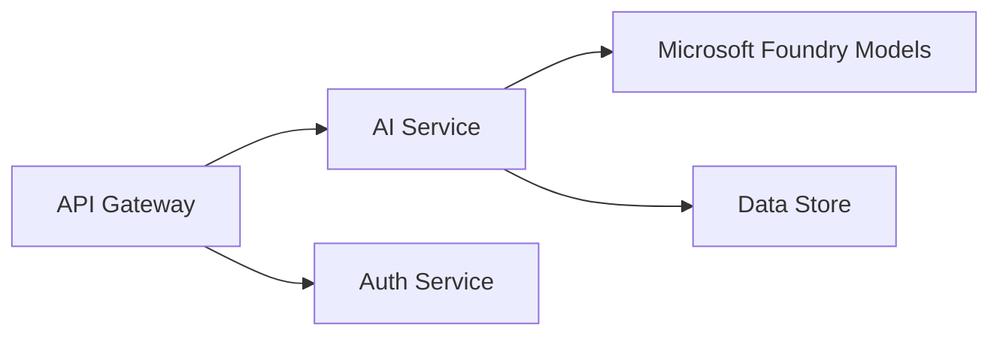
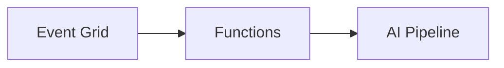

# Κεφάλαιο 8: Πρότυπα Παραγωγής & Επιχειρήσεων

**📚 Μάθημα**: [AZD Για Αρχάριους](../../README.md) | **⏱️ Διάρκεια**: 2-3 ώρες | **⭐ Πολυπλοκότητα**: Προχωρημένο

---

## Επισκόπηση

Αυτό το κεφάλαιο καλύπτει πρότυπα ανάπτυξης έτοιμα για επιχειρήσεις, ενίσχυση ασφάλειας, παρακολούθηση και βελτιστοποίηση κόστους για τις παραγωγικές εργασίες AI.

Πρόκειται για μία αρχιτεκτονική αναφορά, όχι για ένα πλήρες πρότυπο παραγωγής έτοιμο για ανάπτυξη. Τα παραδείγματα παραλείπουν λεπτομέρειες ενσωμάτωσης που πρέπει να παρέχονται και να δοκιμάζονται στην δική σας εφαρμογή· η ανάγνωση της λίστας ελέγχου δεν πιστοποιεί την ετοιμότητα για παραγωγή.

> **Ενημέρωση Foundry GA (2026-11-09):** Χρησιμοποιήστε `azd >= 1.37.0` και το γενικά διαθέσιμο `microsoft.foundry` 1.0 πακέτο για τη ροή εργασίας Foundry· οι αξιολογήσεις εγκαθίστανται ξεχωριστά. Δείτε [το πεδίο εφαρμογής έκδοσης και τη μετανάστευση](production-ai-practices.md#recent-release-changes-and-fixes) και το [παράδειγμα πιστοποιημένης ροής](production-ai-practices.md#cicd-pipeline-configuration). Πρόκειται για ανασκόπηση τεκμηρίωσης, όχι επιβεβαίωση ενεργής ανάπτυξης ή γενική κατάσταση GA για προαιρετικές λειτουργίες προεπισκόπησης.

## Στόχοι Μάθησης

Με την ολοκλήρωση αυτού του κεφαλαίου, θα:
- Αναπτύξετε εφαρμογές ανθεκτικές σε πολλαπλές περιοχές
- Υλοποιήσετε πρότυπα ασφάλειας επιχειρήσεων
- Ρυθμίσετε ολοκληρωμένη παρακολούθηση
- Βελτιστοποιήσετε το κόστος σε κλίμακα
- Διαμορφώσετε σωληνώσεις CI/CD με AZD

---

## 📚 Μαθήματα

| # | Μάθημα | Περιγραφή | Χρόνος |
|---|--------|-------------|------|
| 1 | [Πρακτικές Παραγωγής AI](production-ai-practices.md) | Πρότυπα ανάπτυξης επιχειρήσεων | 90 λεπτά |

---

## 🚀 Λίστα Ελέγχου Παραγωγής

- [ ] Ανάπτυξη σε πολλαπλές περιοχές για ανθεκτικότητα
- [ ] Διαχειριζόμενη ταυτότητα για αυθεντικοποίηση (χωρίς κλειδιά)
- [ ] Application Insights για παρακολούθηση
- [ ] Προϋπολογισμοί κόστους και ειδοποιήσεις ρυθμισμένες
- [ ] Ενεργοποιημένη σάρωση ασφάλειας
- [ ] Ενσωμάτωση σωληνώσεων CI/CD
- [ ] Σχέδιο αποκατάστασης από καταστροφή

---

## 🏗️ Πρότυπα Αρχιτεκτονικής

### Πρότυπο 1: Μικροϋπηρεσίες AI



### Πρότυπο 2: AI Οδηγούμενο από Γεγονότα



---

## 🔐 Καλύτερες Πρακτικές Ασφαλείας

```bicep
// Illustrative properties from different resources, NOT a standalone Bicep file.
// Attach identity to the application host:
identity: {
  type: 'SystemAssigned'
}

// AI account properties (also require private endpoints, DNS and app connectivity):
properties: {
  publicNetworkAccess: 'Disabled'
  networkAcls: {
    defaultAction: 'Deny'
  }
}
```

---

## 💰 Βελτιστοποίηση Κόστους

| Στρατηγική | Κύριος Περιορισμός |
|----------|---------|
| Κλιμάκωση στο μηδέν (Container Apps) | Απαιτεί κατάλληλο trigger· άλλες υπηρεσίες επιβαρύνουν ακόμα το κόστος |
| Χρήση επιπέδων κατανάλωσης για dev | Σύγκριση τιμολόγησης επιλεγμένης υπηρεσίας και φόρτου εργασίας |
| Προγραμματισμένη κλιμάκωση | Κλιμάκωση μέσω υποστηριζόμενης υποδομής/αυτοματοποίησης |
| Κρατήσεις/προετοιμασμένη χωρητικότητα | Μόνο όταν υποστηρίζεται· οι δεσμεύσεις μπορεί να αυξήσουν το κόστος αδράνειας |

Χρησιμοποιήστε το [πλήρες πρότυπο πόρου προϋπολογισμού](production-ai-practices.md#2-cost-monitoring-and-budgets) με έγκυρη ημερομηνία έναρξης, πεδίο χρέωσης, παραλήπτες και δικαιώματα. Ένας προϋπολογισμός στέλνει ειδοποιήσεις· δεν περιορίζει τις δαπάνες. Η εξοικονόμηση εξαρτάται από μετρημένη χρήση και δεν εγγυάται ποσοστά.

---

## 📊 Ρύθμιση Παρακολούθησης

```bash
# Open the Application Insights logs view (requires configured monitoring)
azd monitor --logs

# Check Application Insights
azd monitor --overview

# View metrics
az monitor metrics list --resource <resource-id>
```

---

## 🔗 Πλοήγηση

| Κατεύθυνση | Κεφάλαιο |
|-----------|---------|
| **Προηγούμενο** | [Κεφάλαιο 7: Αντιμετώπιση Προβλημάτων](../chapter-07-troubleshooting/README.md) |
| **Ολοκλήρωση Μαθήματος** | [Αρχική Σελίδα Μαθήματος](../../README.md) |

---

## 📖 Σχετικοί Πόροι

- [Οδηγός Πρακτόρων AI](../chapter-02-ai-development/agents.md)
- [Application Insights](../chapter-06-pre-deployment/application-insights.md)
- [Λύσεις Πολλαπλών Πρακτόρων](../chapter-05-multi-agent/README.md)
- [Παράδειγμα Μικροϋπηρεσιών](../../examples/microservices/README.md)

---

<!-- CO-OP TRANSLATOR DISCLAIMER START -->
**Αποποίηση ευθυνών**:
Αυτό το έγγραφο έχει μεταφραστεί χρησιμοποιώντας την υπηρεσία μετάφρασης με τεχνητή νοημοσύνη [Co-op Translator](https://github.com/Azure/co-op-translator). Ενώ επιδιώκουμε την ακρίβεια, παρακαλούμε να έχετε υπόψη ότι οι αυτοματοποιημένες μεταφράσεις ενδέχεται να περιέχουν λάθη ή ανακρίβειες. Το πρωτότυπο έγγραφο στη μητρική του γλώσσα πρέπει να θεωρείται η αυθεντική πηγή. Για κρίσιμες πληροφορίες, συνιστάται επαγγελματική ανθρώπινη μετάφραση. Δεν φέρουμε ευθύνη για τυχόν παρεξηγήσεις ή λανθασμένες ερμηνείες που προκύπτουν από τη χρήση αυτής της μετάφρασης.
<!-- CO-OP TRANSLATOR DISCLAIMER END -->