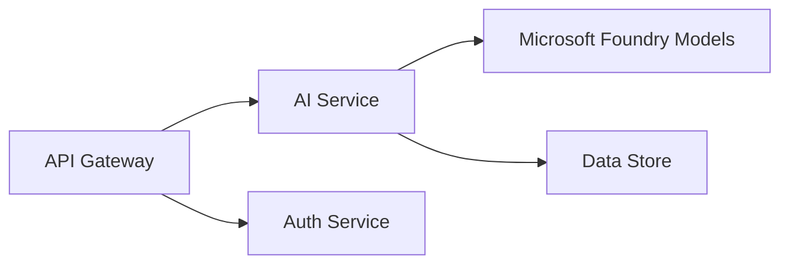
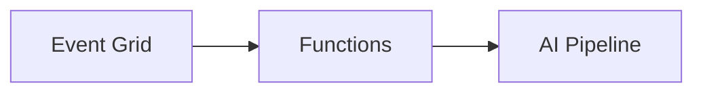

# Κεφάλαιο 8: Πρότυπα Παραγωγής & Επιχειρήσεων

**📚 Μάθημα**: [AZD Για Αρχάριους](../../README.md) | **⏱️ Διάρκεια**: 2-3 ώρες | **⭐ Πολυπλοκότητα**: Προχωρημένο

---

## Επισκόπηση

Αυτό το κεφάλαιο καλύπτει πρότυπα ανάπτυξης έτοιμα για επιχειρήσεις, ενίσχυση της ασφάλειας, παρακολούθηση και βελτιστοποίηση κόστους για εργασίες AI παραγωγής.

Αυτό είναι μια αρχιτεκτονική αναφορά, όχι ένα ολοκληρωμένο πρότυπο προς ανάπτυξη παραγωγής. Τα παραδείγματα παραλείπουν λεπτομέρειες ενσωμάτωσης που πρέπει να προστεθούν και να δοκιμαστούν στη δική σας εφαρμογή· η ανάγνωση της λίστας ελέγχου δεν πιστοποιεί ετοιμότητα παραγωγής.

> **Ανασκόπηση έκδοσης (2026-11-04):** Οι οδηγίες AI CLI ελέγχθηκαν σύμφωνα με την τεκμηρίωση/πηγή `azd 1.37.2`, τους πράκτορες `1.0.0-beta.23` και τις αξιολογήσεις `1.0.0-beta.2`. Δείτε [αλλαγές και διορθώσεις έκδοσης](production-ai-practices.md#recent-release-changes-and-fixes) για απαιτήσεις συμβατότητας και λεπτομέρειες μετανάστευσης· αυτή δεν είναι έγκυρη επικύρωση ζωντανής ανάπτυξης.

## Στόχοι Μάθησης

Ολοκληρώνοντας αυτό το κεφάλαιο, θα:
- Αναπτύσσετε πολυπεριφερειακές ανθεκτικές εφαρμογές
- Υλοποιήσετε πρότυπα ασφάλειας επιχειρήσεων
- Διαμορφώσετε ολοκληρωμένη παρακολούθηση
- Βελτιστοποιήσετε κόστη σε κλίμακα
- Στήσετε αγωγούς CI/CD με το AZD

---

## 📚 Μαθήματα

| # | Μάθημα | Περιγραφή | Χρόνος |
|---|--------|-------------|------|
| 1 | [Πρακτικές Παραγωγής AI](production-ai-practices.md) | Πρότυπα ανάπτυξης επιχειρήσεων | 90 λεπτά |

---

## 🚀 Λίστα Ελέγχου Παραγωγής

- [ ] Πολυπεριφερειακή ανάπτυξη για ανθεκτικότητα
- [ ] Διαχειριζόμενη ταυτότητα για αυθεντικοποίηση (χωρίς κλειδιά)
- [ ] Application Insights για παρακολούθηση
- [ ] Ρυθμισμένοι προϋπολογισμοί και ειδοποιήσεις κόστους
- [ ] Ενεργοποιημένη σάρωση ασφάλειας
- [ ] Ενσωμάτωση pipeline CI/CD
- [ ] Σχέδιο ανάκαμψης από καταστροφή

---

## 🏗️ Πρότυπα Αρχιτεκτονικής

### Πρότυπο 1: Microservices AI



### Πρότυπο 2: Event-Driven AI



---

## 🔐 Καλύτερες Πρακτικές Ασφαλείας

```bicep
// Illustrative properties from different resources, NOT a standalone Bicep file.
// Attach identity to the application host:
identity: {
  type: 'SystemAssigned'
}

// AI account properties (also require private endpoints, DNS and app connectivity):
properties: {
  publicNetworkAccess: 'Disabled'
  networkAcls: {
    defaultAction: 'Deny'
  }
}
```

---

## 💰 Βελτιστοποίηση Κόστους

| Στρατηγική | Κύριος Περιορισμός |
|----------|---------|
| Κλιμάκωση σε μηδέν (Container Apps) | Απαιτεί κατάλληλο ενεργοποιητή· άλλες υπηρεσίες εξακολουθούν να έχουν κόστος |
| Χρήση επιπέδων κατανάλωσης για ανάπτυξη | Σύγκριση τιμολόγησης επιλεγμένης υπηρεσίας και φόρτου εργασίας |
| Προγραμματισμένη κλιμάκωση | Κλιμάκωση μέσω υποστηριζόμενης υποδομής/αυτοματοποίησης |
| Κρατήσεις/διατεθειμένη χωρητικότητα | Μόνο όταν υποστηρίζεται· οι δεσμεύσεις μπορεί να αυξήσουν τα κόστη αδράνειας |

Χρησιμοποιήστε το [πλήρες πρότυπο πόρου προϋπολογισμού](production-ai-practices.md#2-cost-monitoring-and-budgets) με έγκυρη ημερομηνία έναρξης, πεδίο τιμολόγησης, παραλήπτες και δικαιώματα. Ένας προϋπολογισμός στέλνει ειδοποιήσεις· δεν περιορίζει τις δαπάνες. Οι εξοικονομήσεις εξαρτώνται από την μετρημένη χρήση και δεν είναι εγγυημένα ποσοστά.

---

## 📊 Ρύθμιση Παρακολούθησης

```bash
# Open the Application Insights logs view (requires configured monitoring)
azd monitor --logs

# Check Application Insights
azd monitor --overview

# View metrics
az monitor metrics list --resource <resource-id>
```

---

## 🔗 Πλοήγηση

| Κατεύθυνση | Κεφάλαιο |
|-----------|---------|
| **Προηγούμενο** | [Κεφάλαιο 7: Αντιμετώπιση Προβλημάτων](../chapter-07-troubleshooting/README.md) |
| **Ολοκλήρωση Μαθήματος** | [Αρχική Σελίδα Μαθήματος](../../README.md) |

---

## 📖 Σχετικοί Πόροι

- [Οδηγός AI Agents](../chapter-02-ai-development/agents.md)
- [Application Insights](../chapter-06-pre-deployment/application-insights.md)
- [Λύσεις Πολλαπλών Πρακτόρων](../chapter-05-multi-agent/README.md)
- [Παράδειγμα Μικροϋπηρεσιών](../../examples/microservices/README.md)

---

<!-- CO-OP TRANSLATOR DISCLAIMER START -->
**Αποποίηση ευθυνών**:
Αυτό το έγγραφο έχει μεταφραστεί χρησιμοποιώντας την υπηρεσία μετάφρασης με τεχνητή νοημοσύνη [Co-op Translator](https://github.com/Azure/co-op-translator). Ενώ επιδιώκουμε την ακρίβεια, παρακαλούμε να έχετε υπόψη ότι οι αυτοματοποιημένες μεταφράσεις ενδέχεται να περιέχουν λάθη ή ανακρίβειες. Το πρωτότυπο έγγραφο στη μητρική του γλώσσα πρέπει να θεωρείται η αυθεντική πηγή. Για κρίσιμες πληροφορίες, συνιστάται επαγγελματική ανθρώπινη μετάφραση. Δεν φέρουμε ευθύνη για τυχόν παρεξηγήσεις ή λανθασμένες ερμηνείες που προκύπτουν από τη χρήση αυτής της μετάφρασης.
<!-- CO-OP TRANSLATOR DISCLAIMER END -->