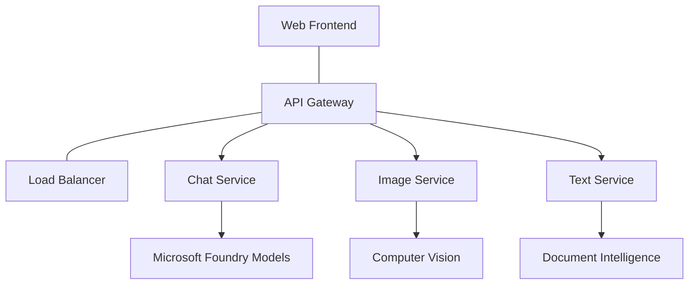

# Καλές Πρακτικές για Παραγωγικό Φορτίο AI με AZD

**Πλοήγηση Κεφαλαίου:**
- **📚 Αρχική Μαθήματος**: [AZD Για Αρχάριους](../../README.md)
- **📖 Τρέχον Κεφάλαιο**: Κεφάλαιο 8 - Παραγωγικά & Επιχειρησιακά Πρότυπα
- **⬅️ Προηγούμενο Κεφάλαιο**: [Κεφάλαιο 7: Επίλυση Προβλημάτων](../chapter-07-troubleshooting/debugging.md)
- **⬅️ Επίσης Σχετικό**: [Εργαστήριο AI](../chapter-02-ai-development/ai-workshop-lab.md)
- **🎯 Ολοκλήρωση Μαθήματος**: [AZD Για Αρχάριους](../../README.md)

## Επισκόπηση

Αυτός ο οδηγός εξηγεί πρότυπα σχεδιασμού παραγωγικού AI χρησιμοποιώντας το Azure Developer CLI (AZD). Είναι μια αναφορά σχεδιασμού, όχι μια εφαρμογή για ανάπτυξη ή πιστοποίηση παραγωγής.

**Όρια παραδείγματος:** Εκτός αν περιγράφεται ρητώς ως πλήρες, τα αποσπάσματα Bicep υποθέτουν παραμέτρους και αναφερόμενους πόρους από ένα περιεχόμενο πρότυπο. Παραλείπουν εικόνες/σχέδια υποδοχέα, ταυτότητες, εκχωρήσεις ρόλων, DNS, εξαγωγές και άλλες απαιτούμενες ενσωματώσεις. Οι διαδρομές υπηρεσίας YAML και τα scripts hook/test είναι ενδεικτικά αρχεία για δημιουργία **στη δική σας εφαρμογή**· δεν παρέχονται από αυτό το μάθημα. Χρησιμοποιήστε ένα λειτουργικό δείγμα AZD ως βάση, συγκροτήστε την πλήρη υποδομή και δοκιμάστε το σε απομονωμένο περιβάλλον πριν την παραγωγή.

## Κύριες Προκλήσεις που Αντιμετωπίζονται

Κοινές ανησυχίες παραγωγής περιλαμβάνουν αναπτύξεις πολλαπλών υπηρεσιών, διαχείριση ταυτοτήτων και μυστικών, κλιμάκωση, έλεγχο κόστους και παρακολούθηση. Δεν διεκδικείται εδώ μετρημένη επικράτηση.

## Πρότυπα Αρχιτεκτονικής για Παραγωγικό AI

### Πρότυπο 1: Αρχιτεκτονική Microservices AI

**Πότε να χρησιμοποιήσετε**: Πολύπλοκες εφαρμογές AI με πολλαπλές δυνατότητες



**Υλοποίηση με AZD**:

```yaml
# azure.yaml
name: enterprise-ai-platform
services:
  web:
    project: ./web
    host: staticwebapp
  api-gateway:
    project: ./api-gateway
    host: containerapp
  chat-service:
    project: ./services/chat
    host: containerapp
  vision-service:
    project: ./services/vision
    host: containerapp
  text-service:
    project: ./services/text
    host: containerapp
```

### Πρότυπο 2: Επεξεργασία AI με Βάση Γεγονότα

**Πότε να χρησιμοποιήσετε**: Επεξεργασία παρτίδων, ανάλυση εγγράφων, ασύγχρονα workflows

```bicep
// Event Hub for AI processing pipeline
resource eventHub 'Microsoft.EventHub/namespaces@2024-01-01' = {
  name: eventHubNamespaceName
  location: location
  sku: {
    name: 'Standard'
    tier: 'Standard'
    capacity: 1
  }
}

// Service Bus for reliable message processing
resource serviceBus 'Microsoft.ServiceBus/namespaces@2024-01-01' = {
  name: serviceBusNamespaceName
  location: location
  sku: {
    name: 'Premium'
    tier: 'Premium'
    capacity: 1
  }
}

// Function App for processing
resource functionApp 'Microsoft.Web/sites@2023-01-01' = {
  name: functionAppName
  location: location
  kind: 'functionapp,linux'
  properties: {
    siteConfig: {
      appSettings: [
        {
          name: 'FUNCTIONS_EXTENSION_VERSION'
          value: '~4'
        }
        {
          name: 'AZURE_OPENAI_ENDPOINT'
          value: '@Microsoft.KeyVault(VaultName=${keyVault.name};SecretName=openai-endpoint)'
        }
      ]
    }
  }
}
```

Αυτό δημιουργεί αποσπάσματα namespace, όχι hubs, ουρές, συνδρομές ή ενεργοποιητές Function. Μια εκτελέσιμη Function χρειάζεται επίσης σχέδιο φιλοξενίας, διαμόρφωση runtime/αποθήκευσης, συνδεδεμένη ταυτότητα, RBAC και πρόσβαση δικτύου. Η αναφορά Key Vault χρειάζεται δικαίωμα ανάγνωσης του μυστικού· ένα URL endpoint δεν αποτελεί διαπίστευση.

## Σκέψεις για την Υγεία του AI Agent

Όταν μια παραδοσιακή web εφαρμογή καταρρέει, τα συμπτώματα είναι οικεία: μια σελίδα δεν φορτώνει, ένα API επιστρέφει σφάλμα ή μια ανάπτυξη αποτυγχάνει. Οι εφαρμογές AI μπορούν να αποτύχουν με όλους αυτούς τους τρόπους—αλλά μπορούν επίσης να συμπεριφερθούν παράξενα με πιο λεπτούς τρόπους που δεν παράγουν προφανή μηνύματα σφάλματος.

Αυτή η ενότητα σας βοηθά να χτίσετε ένα νοητικό μοντέλο για την παρακολούθηση φορτίων AI ώστε να ξέρετε πού να κοιτάξετε όταν κάτι δεν φαίνεται σωστό.

### Πώς Διαφέρει η Υγεία του Agent από την Υγεία Παραδοσιακής Εφαρμογής

Οι παραδοσιακές εφαρμογές μπορούν επίσης να έχουν λεπτές αστοχίες ορθότητας. Ένας AI agent προσθέτει μη-νηφάλια ποιότητα απόκρισης στα συνήθη ζητήματα διαθεσιμότητας και ορθότητας. Σκεφτείτε την υγεία του agent σε δύο επίπεδα:

| Επίπεδο | Τι να Ελέγξετε | Πού να Κοιτάξετε |
|-------|----------------|---------------|
| **Υγεία υποδομής** | Τρέχει η υπηρεσία; Έχουν διατεθεί πόροι; Είναι προσβάσιμα τα endpoints; | `azd monitor`, υγεία πόρων στο Azure Portal, logs container/app |
| **Υγεία συμπεριφοράς** | Ανταποκρίνεται ο agent με ακρίβεια; Είναι οι απαντήσεις έγκαιρες; Καλείται σωστά το μοντέλο; | Traces Application Insights, μετρικές καθυστέρησης κλήσεων μοντέλου, logs ποιότητας απάντησης |

Η υγεία υποδομής είναι οικεία—είναι ίδια για κάθε εφαρμογή azd. Η υγεία συμπεριφοράς είναι το νέο επίπεδο που εισάγουν τα φορτία AI.

### Πού να Κοιτάξετε Όταν οι AI Εφαρμογές δεν Συμπεριφέρονται όπως Αναμένεται

Αν η AI εφαρμογή σας δεν παράγει τα αναμενόμενα αποτελέσματα, εδώ είναι ένας εννοιολογικός κατάλογος ελέγχου:

1. **Ξεκινήστε από τα βασικά.** Τρέχει η εφαρμογή; Μπορεί να φτάσει στις εξαρτήσεις της; Ελέγξτε `azd monitor` και την υγεία πόρων όπως θα κάνατε για οποιαδήποτε εφαρμογή.
2. **Ελέγξτε τη σύνδεση με το μοντέλο.** Καλεί επιτυχώς η εφαρμογή σας το μοντέλο AI; Οι αποτυχημένες ή καθυστερημένες κλήσεις στο μοντέλο είναι η πιο συχνή αιτία προβλημάτων AI εφαρμογών και θα εμφανίζουνται στα logs της εφαρμογής σας.
3. **Επιθεωρήστε με ασφάλεια την εισαγωγή και τη θεμελίωση.** Λάθος απαντήσεις μπορεί να προκύψουν από ανάκτηση, οδηγίες, περιορισμούς μοντέλου ή εκτέλεση εργαλείων. Χρησιμοποιήστε δεδομένα διαγνωστικών με ελεγχόμενη πρόσβαση και αποκοπή· μην ενεργοποιείτε την αδιακρίτως καταγραφή prompt/απάντησης στην παραγωγή.
4. **Ανασκοπήστε την καθυστέρηση απόκρισης.** Οι κλήσεις σε μοντέλα AI είναι πιο αργές από τις τυπικές κλήσεις API. Αν η εφαρμογή σας αισθάνεται αργή, ελέγξτε αν οι χρόνοι απόκρισης αυξήθηκαν—αυτό μπορεί να υποδεικνύει throttling, όρια χωρητικότητας ή συμφόρηση σε επίπεδο περιοχής.
5. **Παρακολουθήστε τα σήματα κόστους.** Απρόβλεπτες αυξήσεις στη χρήση token ή κλήσεων API μπορεί να υποδεικνύουν βρόχο, λάθος διαμορφωμένο prompt, ή υπερβολικές επαναλήψεις.

Δεν χρειάζεται να κυριαρχήσετε από την αρχή στα εργαλεία παρατηρησιμότητας. Το βασικό μήνυμα είναι ότι οι AI εφαρμογές εισάγουν ένα επιπλέον επίπεδο συμπεριφοράς προς παρακολούθηση, και το ενσωματωμένο monitoring του azd (`azd monitor`) σας δίνει ένα σημείο εκκίνησης για να εξετάσετε και τα δύο επίπεδα.

---

## Καλές Πρακτικές Ασφαλείας

### 1. Μοντέλο Ασφαλείας Μηδενικής Εμπιστοσύνης

**Στρατηγική Υλοποίησης**:
- Καμία επικοινωνία υπηρεσίας προς υπηρεσία χωρίς αυθεντικοποίηση
- Όλες οι κλήσεις API χρησιμοποιούν διαχειριζόμενες ταυτότητες
- Απομόνωση δικτύου με ιδιωτικά endpoints
- Έλεγχοι πρόσβασης ελάχιστου προνομίου

```bicep
// Managed Identity for each service
resource chatServiceIdentity 'Microsoft.ManagedIdentity/userAssignedIdentities@2023-01-31' = {
  name: 'chat-service-identity'
  location: location
}

// Role assignments with minimal permissions
resource openAIUserRole 'Microsoft.Authorization/roleAssignments@2022-04-01' = {
  scope: openAIAccount
  name: guid(openAIAccount.id, chatServiceIdentity.id, '5e0bd9bd-7b93-4f28-af87-19fc36ad61bd')
  properties: {
    roleDefinitionId: subscriptionResourceId('Microsoft.Authorization/roleDefinitions', '5e0bd9bd-7b93-4f28-af87-19fc36ad61bd')
    principalId: chatServiceIdentity.properties.principalId
    principalType: 'ServicePrincipal'
  }
}
```

### 2. Ασφαλής Διαχείριση Μυστικών

**Πρότυπο Ενσωμάτωσης Key Vault**:

```bicep
// Key Vault with proper access policies
resource keyVault 'Microsoft.KeyVault/vaults@2023-02-01' = {
  name: keyVaultName
  location: location
  properties: {
    tenantId: tenant().tenantId
    sku: {
      family: 'A'
      name: 'standard' // Premium is needed for HSM-backed keys, not ordinary secrets
    }
    enableRbacAuthorization: true  // Use RBAC instead of access policies
    enablePurgeProtection: true    // Prevent accidental deletion
    enableSoftDelete: true
    softDeleteRetentionInDays: 90
  }
}

// Optional legacy key-auth alternative; omit when using Entra ID.
resource openAIKeySecret 'Microsoft.KeyVault/vaults/secrets@2023-02-01' = {
  parent: keyVault
  name: 'openai-api-key'
  properties: {
    value: openAIAccount.listKeys().key1
    attributes: {
      enabled: true
    }
  }
}
```

Αναθέστε την ταυτότητα runtime `Key Vault Secrets User` στο κατάλληλο επίπεδο και συνδέστε την με τον υποδοχέα· `enableRbacAuthorization` μόνη της δεν παρέχει πρόσβαση. Προτιμήστε αυθεντικοποίηση με διαχειριζόμενη ταυτότητα OpenAI με `disableLocalAuth: true`. Το προαιρετικό κλειδί μυστικού έχει νόημα μόνο για λογαριασμό που έχει εκ προθέσεως ενεργοποιηθεί με κλειδί, και ο πάροχος ανάπτυξης χρειάζεται επίσης δικαίωμα εγγραφής μυστικών.

### 3. Ασφάλεια Δικτύου

**Διαμόρφωση Ιδιωτικού Endpoint**:

```bicep
// Virtual Network for AI services
resource virtualNetwork 'Microsoft.Network/virtualNetworks@2023-04-01' = {
  name: vnetName
  location: location
  properties: {
    addressSpace: {
      addressPrefixes: ['10.0.0.0/16']
    }
    subnets: [
      {
        name: 'ai-services-subnet'
        properties: {
          addressPrefix: '10.0.1.0/24'
          privateEndpointNetworkPolicies: 'Disabled'
        }
      }
      {
        name: 'app-services-subnet'
        properties: {
          addressPrefix: '10.0.2.0/24'
          delegations: [
            {
              name: 'Microsoft.Web/serverFarms'
              properties: {
                serviceName: 'Microsoft.Web/serverFarms'
              }
            }
          ]
        }
      }
    ]
  }
}

// Private endpoints for all AI services
resource openAIPrivateEndpoint 'Microsoft.Network/privateEndpoints@2023-04-01' = {
  name: '${openAIAccountName}-pe'
  location: location
  properties: {
    subnet: {
      id: virtualNetwork.properties.subnets[0].id
    }
    privateLinkServiceConnections: [
      {
        name: 'openai-connection'
        properties: {
          privateLinkServiceId: openAIAccount.id
          groupIds: ['account']
        }
      }
    ]
  }
}
```

Τα ιδιωτικά endpoints απαιτούν επίσης ιδιωτικές ομάδες ζωνών DNS/συνδέσεις VNet και ενοποίηση εφαρμογής VNet. Δεν αποκλείουν αυτόματα την δημόσια πρόσβαση: απενεργοποιήστε ρητά τη δημόσια δικτυακή πρόσβαση του AI λογαριασμού μετά τον έλεγχο της ιδιωτικής συνδεσιμότητας και της πρόσβασης ανάπτυξης.

## Απόδοση και Κλιμάκωση

### 1. Στρατηγικές Αυτόματης Κλιμάκωσης

**Αυτόματη κλιμάκωση εφαρμογών container**:

```bicep
resource containerApp 'Microsoft.App/containerApps@2023-05-01' = {
  name: containerAppName
  location: location
  properties: {
    configuration: {
      ingress: {
        external: true
        targetPort: 8000
        transport: 'http'
      }
    }
    template: {
      scale: {
        minReplicas: 2  // Always have 2 instances minimum
        maxReplicas: 50 // Scale up to 50 for high load
        rules: [
          {
            name: 'http-scaling'
            http: {
              metadata: {
                concurrentRequests: '20'  // Scale when >20 concurrent requests
              }
            }
          }
          {
            name: 'cpu-scaling'
            custom: {
              type: 'cpu'
              metadata: {
                type: 'Utilization'
                value: '70'  // Scale when CPU >70%
              }
            }
          }
        ]
      }
    }
  }
}
```

### 2. Στρατηγικές Κρυφής Μνήμης

**Redis Cache για Απαντήσεις AI**:

```bicep
// Legacy Azure Cache for Redis example (not recommended for new deployments)
resource redisCache 'Microsoft.Cache/redis@2023-04-01' = {
  name: redisCacheName
  location: location
  properties: {
    sku: {
      name: 'Premium'
      family: 'P'
      capacity: 1
    }
    enableNonSslPort: false
    minimumTlsVersion: '1.2'
    redisConfiguration: {
      'maxmemory-policy': 'allkeys-lru'
    }
    // Sharding distributes data; replication/failover provides availability.
    shardCount: 2
  }
}

// Cache configuration in application
var cacheConnectionString = '${redisCache.properties.hostName}:6380,password=${redisCache.listKeys().primaryKey},ssl=True,abortConnect=False'
```

Το Azure Cache for Redis Basic/Standard/Premium βρίσκεται σε [μονοπάτι σύνταξης εκτός λειτουργίας](https://learn.microsoft.com/azure/azure-cache-for-redis/retirement-faq). Χρησιμοποιήστε το Azure Managed Redis για νέους σχεδιασμούς και τη τεκμηριωμένη SKU, ταυτότητα και διαμόρφωση TLS του, αντί να αντιγράψετε αυτόν τον παλιό πόρο σε νέο παραγωγικό σύστημα. Η γραμμή connection-string είναι μη λειτουργική, όχι διαπίστευση. Διαχωρίστε τα κλειδιά της cache ανά εξουσιοδότηση, μοντέλο/οδηγίες και έκδοση ανάκτησης, με λήξη· μια κοινή cache μόνο για ερωτήματα μπορεί να αποκαλύψει δεδομένα άλλου χρήστη.

### 3. Διαχείριση Φορτίου και Κυκλοφορίας

**Application Gateway με WAF**:

```bicep
// Application Gateway with Web Application Firewall
resource applicationGateway 'Microsoft.Network/applicationGateways@2023-04-01' = {
  name: appGatewayName
  location: location
  properties: {
    sku: {
      name: 'WAF_v2'
      tier: 'WAF_v2'
      capacity: 2
    }
    webApplicationFirewallConfiguration: {
      enabled: true
      firewallMode: 'Prevention'
      ruleSetType: 'OWASP'
      ruleSetVersion: '3.2'
    }
    // Backend pools for AI services
    backendAddressPools: [
      {
        name: 'ai-services-pool'
        properties: {
          backendAddresses: [
            {
              fqdn: '${containerApp.properties.configuration.ingress.fqdn}'
            }
          ]
        }
      }
    ]
  }
}
```

Πρόκειται για μερικό πόρο Gateway: μια πραγματική ανάπτυξη χρειάζεται επίσης υποδίκτυο gateway/διαμόρφωση IP, IPs και θύρες frontend, TLS listeners/πιστοποιητικά, backend HTTP ρυθμίσεις/ probes, κανόνες δρομολόγησης και προτεραιότητες, και μια αναθεωρημένη πολιτική WAF. TLS hostname/SNI και αυθεντικοποίηση πρέπει να ταιριάζουν με το backend της εφαρμογής Container.

## 💰 Βελτιστοποίηση Κόστους

### 1. Σωστό Μέγεθος Πόρων

**Περιβαλλοντικές Διαμορφώσεις**:

Αυτά τα ονόματα είναι **ενδεικτικά εισαγωγικά προτύπων προσαρμογής**, όχι αυτόματες ρυθμίσεις AZD. Χαρτογραφήστε κάθε ένα σε `infra/main.parameters.json`/Bicep και διαμόρφωση υποδοχέα πρώτα. Για παράδειγμα, το δείγμα RAG χρησιμοποιεί `AZURE_SEARCH_SERVICE_SKU` και `AZURE_OPENAI_CHATGPT_DEPLOYMENT_CAPACITY`, όχι τα γενικά ονόματα παρακάτω. Δώστε στη μνήμη Container Apps μια υποστηριζόμενη μονάδα όπως `1Gi` στον πραγματικό πόρο. Εφαρμόστε αλλαγές υποδομής με `azd up` ή `azd provision`· `azd deploy` μόνη της δεν εφαρμόζει αλλαγές Bicep.

```bash
# Development environment
azd env new development
azd env set AZURE_OPENAI_SKU "S0"
azd env set AZURE_OPENAI_CAPACITY 10
azd env set AZURE_SEARCH_SKU "basic"
azd env set CONTAINER_CPU 0.5
azd env set CONTAINER_MEMORY 1.0

# Production environment  
azd env new production
azd env set AZURE_OPENAI_SKU "S0"
azd env set AZURE_OPENAI_CAPACITY 100
azd env set AZURE_SEARCH_SKU "standard"
azd env set CONTAINER_CPU 2.0
azd env set CONTAINER_MEMORY 4.0
```

### 2. Παρακολούθηση Κόστους και Προϋπολογισμοί

```bicep
// Supply the first day of the current UTC month, e.g. 2026-11-01T00:00:00Z.
param budgetStartDate string

// Cost management and budgets
resource budget 'Microsoft.Consumption/budgets@2024-08-01' = {
  name: 'ai-workload-budget'
  properties: {
    timePeriod: {
      startDate: budgetStartDate
    }
    timeGrain: 'Monthly'
    amount: 2000  // In the billing currency, not necessarily USD
    category: 'Cost'
    notifications: {
      warning: {
        enabled: true
        operator: 'GreaterThan'
        threshold: 80
        contactEmails: [
          'finance@company.com'
          'engineering@company.com'
        ]
        contactRoles: [
          'Owner'
          'Contributor'
        ]
      }
      critical: {
        enabled: true
        operator: 'GreaterThan'
        threshold: 95
        contactEmails: [
          'cto@company.com'
        ]
      }
    }
  }
}
```

Αντικαταστήστε τους παραληπτές παραδείγματος και ελέγξτε το πεδίο/δικαιώματα. Οι ειδοποιήσεις προϋπολογισμού χρησιμοποιούν καθυστερημένα δεδομένα τιμολόγησης και δεν επιβάλλουν όριο δαπανών.

### 3. Βελτιστοποίηση Χρήσης Token

**Διαχείριση Κόστους OpenAI**:

Πρόκειται μόνο για ευρετική μέθοδο με βάση χαρακτήρες για προεπισκόπηση UI, **όχι** για έλεγχο ορίου token μοντέλου. Ο κώδικας παραγωγής πρέπει να χρησιμοποιεί tokenizer κατάλληλο για το αναπτυγμένο μοντέλο και να λαμβάνει υπόψη συστηματικές οδηγίες, σχήματα εργαλείων, ιστορικό και προϋπολογισμό εξόδου. Απορρίψτε ένα υπερβολικά μεγάλο μήνυμα χρήστη παρά να το περικόψετε αθόρυβα.

```typescript
// Application-level token optimization
class TokenOptimizer {
  private readonly maxTokens = 4000;
  private readonly reserveTokens = 500;
  
  optimizePrompt(userInput: string, context: string): string {
    const availableTokens = this.maxTokens - this.reserveTokens;
    if (this.estimateTokens(userInput) + 8 >= availableTokens) {
      throw new Error("User input exceeds the illustrative prompt budget");
    }
    const estimatedTokens = this.estimateTokens(userInput + context) + 8;
    
    if (estimatedTokens > availableTokens) {
      // Truncate context, not user input
      context = this.truncateContext(context, Math.max(0, availableTokens - this.estimateTokens(userInput) - 8));
    }
    
    return `${context}\n\nUser: ${userInput}`;
  }
  
  private estimateTokens(text: string): number {
    // Rough estimation: 1 token ≈ 4 characters
    return Math.ceil(text.length / 4);
  }

  private truncateContext(text: string, estimatedBudget: number): string {
    return text.slice(0, Math.max(0, estimatedBudget) * 4);
  }
}
```

## Παρακολούθηση και Παρατηρησιμότητα

### 1. Ολοκληρωμένο Application Insights

```bicep
// Application Insights with advanced features
resource applicationInsights 'Microsoft.Insights/components@2020-02-02' = {
  name: applicationInsightsName
  location: location
  kind: 'web'
  properties: {
    Application_Type: 'web'
    WorkspaceResourceId: logAnalyticsWorkspace.id
    SamplingPercentage: 100  // Ingestion setting; review cost and SDK sampling separately
    DisableIpMasking: false  // Retain IP masking
  }
}

// Custom metrics for AI operations
resource aiMetricAlerts 'Microsoft.Insights/metricAlerts@2018-03-01' = {
  name: 'ai-high-error-rate'
  location: 'global'
  properties: {
    description: 'Alert when failed request count exceeds 10 in five minutes'
    severity: 2
    enabled: true
    scopes: [
      applicationInsights.id
    ]
    evaluationFrequency: 'PT1M'
    windowSize: 'PT5M'
    criteria: {
      'odata.type': 'Microsoft.Azure.Monitor.SingleResourceMultipleMetricCriteria'
      allOf: [
        {
          name: 'high-error-rate'
          metricName: 'requests/failed'
          operator: 'GreaterThan'
          threshold: 10
          timeAggregation: 'Count'
        }
      ]
    }
  }
}
```

### 2. Παρακολούθηση Ειδικά για AI

**Προσαρμοσμένοι Πίνακες Ελέγχου για Μετρικές AI**:

```json
{
  "dashboard": {
    "name": "AI Application Monitoring",
    "tiles": [
      {
        "name": "OpenAI Request Volume",
        "query": "dependencies | where target contains 'openai' | summarize count() by bin(timestamp, 5m)"
      },
      {
        "name": "AI Response Latency",
        "query": "dependencies | where target contains 'openai' | summarize avg(duration) by bin(timestamp, 5m)"
      },
      {
        "name": "Token Usage",
        "query": "customMetrics | where name == 'openai_tokens_used' | summarize sum(value) by bin(timestamp, 1h)"
      },
      {
        "name": "Cost per Hour",
        "query": "customMetrics | where name == 'openai_cost' | summarize sum(value) by bin(timestamp, 1h)"
      }
    ]
  }
}
```

Αυτό το JSON είναι σχήμα ορισμένο από την εφαρμογή, όχι ένα εισαγόμενο σχήμα πίνακα ελέγχου Azure portal. Τα ερωτήματα token/κόστους απαιτούν την εφαρμογή σας να εκπέμπει αυτές τις ακριβείς προσαρμοσμένες μετρικές· δεν δημιουργούνται από το AZD. Προσαρμόστε τα φίλτρα εξαρτήσεων για τα πραγματικά ονόματα endpoint/διάρκειας του μοντέλου σας.

### 3. Έλεγχοι Υγείας και Παρακολούθηση Διαθεσιμότητας

```bicep
// Application Insights availability tests
resource availabilityTest 'Microsoft.Insights/webtests@2022-06-15' = {
  name: 'ai-app-availability-test'
  location: location
  tags: {
    'hidden-link:${applicationInsights.id}': 'Resource'
  }
  properties: {
    SyntheticMonitorId: 'ai-app-availability-test'
    Name: 'AI Application Availability Test'
    Description: 'Tests AI application endpoints'
    Enabled: true
    Frequency: 300  // 5 minutes
    Timeout: 120    // 2 minutes
    Kind: 'standard'
    Locations: [
      {
        Id: 'us-east-2-azr'
      }
      {
        Id: 'us-west-2-azr'
      }
    ]
    Request: {
      RequestUrl: 'https://${webApp.properties.defaultHostName}/health'
      HttpVerb: 'GET'
      FollowRedirects: true
      ParseDependentRequests: false
    }
    ValidationRules: {
      ExpectedHttpStatusCode: 200
      SSLCheck: true
      SSLCertRemainingLifetimeCheck: 7
    }
  }
}
```

## Ανάκτηση από Καταστροφές και Υψηλή Διαθεσιμότητα

Η προηγούμενη δοκιμή υποθέτει υπάρχουσα υπηρεσία App Service `webApp` και πόρο Application Insights. Οι δοκιμές στάνταρ διαθεσιμότητας χρεώνονται και απαιτούν προσιτό endpoint· οι εφαρμογές μόνο με ιδιωτική πρόσβαση χρειάζονται κατάλληλο σχεδιασμό ιδιωτικής παρακολούθησης. Οι ping URLs έχουν αποσυρθεί· χρησιμοποιήστε [τυπικές δοκιμές διαθεσιμότητας](https://learn.microsoft.com/azure/azure-monitor/app/availability).

### 1. Ανάπτυξη Πολυ-Περιοχής

```yaml
# azure.yaml - Multi-region configuration
name: ai-app-multiregion
services:
  api-primary:
    project: ./api
    host: containerapp
    env:
      AZURE_REGION: eastus
  api-secondary:
    project: ./api
    host: containerapp
    env:
      AZURE_REGION: westus2
```

```bicep
// Separate App Service topology, not the Container Apps declarations above
resource trafficManager 'Microsoft.Network/trafficManagerProfiles@2022-04-01' = {
  name: trafficManagerProfileName
  location: 'global'
  properties: {
    profileStatus: 'Enabled'
    trafficRoutingMethod: 'Priority'
    dnsConfig: {
      relativeName: trafficManagerProfileName
      ttl: 30
    }
    monitorConfig: {
      protocol: 'HTTPS'
      port: 443
      path: '/health'
      intervalInSeconds: 30
      toleratedNumberOfFailures: 3
      timeoutInSeconds: 10
    }
    endpoints: [
      {
        name: 'primary-endpoint'
        type: 'Microsoft.Network/trafficManagerProfiles/azureEndpoints'
        properties: {
          targetResourceId: primaryAppService.id
          endpointStatus: 'Enabled'
          priority: 1
        }
      }
      {
        name: 'secondary-endpoint'
        type: 'Microsoft.Network/trafficManagerProfiles/azureEndpoints'
        properties: {
          targetResourceId: secondaryAppService.id
          endpointStatus: 'Enabled'
          priority: 2
        }
      }
    ]
  }
}
```

Οι μεταβλητές περιβάλλοντος δεν επιλέγουν τοποθεσίες πόρων. Το IaC πρέπει να αναπτύσσει ξεχωριστούς περιφερειακούς υποδοχείς και να δένει κάθε υπηρεσία με `resourceName` ή `azd-service-name` ετικέτες. Το παράδειγμα Traffic Manager είναι **ξεχωριστή τοπολογία App Service** (`primaryAppService`/`secondaryAppService`), όχι δρομολόγηση για τις δηλώσεις Container Apps. Τα Container Apps απαιτούν κατάλληλα ρυθμισμένο εξωτερικό endpoint/εσωτερική πόρτα, δρομολόγηση TLS/προσαρμοσμένου domain και έλεγχο υγείας.

### 2. Δημιουργία Αντιγράφων και Ανάκτηση Δεδομένων

```bicep
// Backup configuration for critical data
resource backupVault 'Microsoft.DataProtection/backupVaults@2023-05-01' = {
  name: backupVaultName
  location: location
  identity: {
    type: 'SystemAssigned'
  }
  properties: {
    storageSettings: [
      {
        datastoreType: 'VaultStore'
        type: 'LocallyRedundant'
      }
    ]
  }
}

```

Το vault από μόνο του δεν δημιουργεί αντίγραφα. Διαμορφώστε **πολιτική και παράδειγμα backup ειδικά για φορτίο εργασίας**, δικαιώματα πηγής, διατήρηση και δοκιμές αποκατάστασης χρησιμοποιώντας τους [πίνακες υποστήριξης Azure Backup](https://learn.microsoft.com/azure/backup/backup-support-matrix). Δεν υπάρχει γενική πολιτική Azure Backup για αναπτύξεις μοντέλων Azure OpenAI που φιλοξενούνται. Κρατήστε ορισμούς υποδομής/ανάπτυξης μοντέλου σε έλεγχο έκδοσης· προστατέψτε ανεβασμένα έγγραφα, δεδομένα εφαρμογής και τεχνουργήματα fine-tuning χρησιμοποιώντας τις υποστηριζόμενες λειτουργίες backup/export κάθε υπηρεσίας υποστήριξης. Ορίστε και δοκιμάστε ρητώς RPO/RTO.

## DevOps και Ενσωμάτωση CI/CD

### 1. Workflow GitHub Actions

```yaml
# .github/workflows/deploy-ai-app.yml
name: Deploy AI Application

on:
  push:
    branches: [main]
  pull_request:
    branches: [main]

jobs:
  test:
    runs-on: ubuntu-latest
    steps:
      - uses: actions/checkout@v4
      
      - name: Setup Python
        uses: actions/setup-python@v4
        with:
          python-version: '3.11'
          
      - name: Install dependencies
        run: |
          pip install -r requirements.txt
          pip install pytest
          
      - name: Run tests
        run: pytest tests/
        
      - name: AI Safety Tests
        run: |
          python scripts/test_ai_safety.py
          python scripts/validate_prompts.py

```

Αυτό είναι το **μόνο μέρος δοκιμής** ενός workflow και υποθέτει ότι έχετε δημιουργήσει `requirements.txt`, `tests/` και τα δύο scripts ασφαλείας. Προσθέστε τις δουλειές authenticated OIDC παροχής/ανάπτυξης από το [CI/CD Pipeline Configuration](#cicd-pipeline-configuration), με `needs: test`, αξιόπιστο push/χειροκίνητο trigger και προστατευμένα περιβάλλοντα GitHub. Μην αναπτύσσετε μη αξιόπιστο κώδικα pull-request με διαπιστευτήρια cloud. Ένας νέος runner δεν έχει επιλεγμένο τοπικό περιβάλλον AZD· δώστε τα inputs περιβάλλοντος/συνδρομής/τοποθεσίας και χρησιμοποιήστε `azd auth login`, όχι μόνο `azure/login`.

### 2. Έλεγχος Υποδομής

```bash
# scripts/validate_infrastructure.sh
#!/bin/bash
set -euo pipefail

echo "Validating AI infrastructure deployment..."

# Requires Azure CLI login and the resource group selected explicitly.
: "${AZURE_RESOURCE_GROUP:?Set AZURE_RESOURCE_GROUP}"
: "${AZURE_OPENAI_NAME:?Set AZURE_OPENAI_NAME}"
: "${AZURE_OPENAI_CHAT_DEPLOYMENT:?Set the actual deployment name}"

# A successful empty list is not proof that resources exist.
types=("Microsoft.CognitiveServices/accounts" "Microsoft.Search/searchServices"
       "Microsoft.Storage/storageAccounts" "Microsoft.KeyVault/vaults")
for resource_type in "${types[@]}"; do
    count=$(az resource list --resource-group "$AZURE_RESOURCE_GROUP" \
        --resource-type "$resource_type" --query "length(@)" -o tsv)
    if [[ "$count" -lt 1 ]]; then
        echo "ERROR: No $resource_type found in $AZURE_RESOURCE_GROUP"
        exit 1
    fi
done

# Validate OpenAI model deployments
echo "Validating OpenAI model deployments..."
state=$(az cognitiveservices account deployment show \
  --name "$AZURE_OPENAI_NAME" --resource-group "$AZURE_RESOURCE_GROUP" \
  --deployment-name "$AZURE_OPENAI_CHAT_DEPLOYMENT" \
  --query "properties.provisioningState" -o tsv)
if [[ "$state" != "Succeeded" ]]; then
    echo "ERROR: Required model deployment is not provisioned successfully"
    exit 1
fi

echo "Infrastructure validation completed successfully!"
```

Αναμενόμενο: μηδενικός κωδικός εξόδου και μήνυμα ολοκλήρωσης μόνο όταν υπάρχουν όλοι οι αναμενόμενοι τύποι και έχει διατεθεί η ονομασμένη ανάπτυξη μοντέλου. Ελέγχει κατάσταση απογραφής/παροχής, **όχι** υγεία πόρων, ακριβή τοπολογία, RBAC, προσβασιμότητα δικτύου ή συμπεριφορά μοντέλου. Προσαρμόστε τους αναμενόμενους τύπους στην αρχιτεκτονική σας, κατόπιν εκτελέστε ξεχωριστό authenticated readiness test εφαρμογής.

## Λίστα Ελέγχου Ετοιμότητας Παραγωγής

### Ασφάλεια ✅
- [ ] Όλες οι υπηρεσίες χρησιμοποιούν διαχειριζόμενες ταυτότητες
- [ ] Μυστικά αποθηκευμένα σε Key Vault
- [ ] Ρυθμισμένα ιδιωτικά endpoints
- [ ] Υλοποιημένες ομάδες ασφαλείας δικτύου
- [ ] RBAC με ελάχιστο προνόμιο
- [ ] WAF ενεργοποιημένο σε δημόσια endpoints

### Απόδοση ✅
- [ ] Ρυθμισμένη αυτόματη κλιμάκωση
- [ ] Εφαρμογή κρυφής μνήμης
- [ ] Ρύθμιση ισοζυγίου φορτίου
- [ ] CDN για στατικό περιεχόμενο
- [ ] Διαχείριση pool συνδέσεων βάσης δεδομένων
- [ ] Βελτιστοποίηση χρήσης token

### Παρακολούθηση ✅
- [ ] Ρυθμισμένο Application Insights
- [ ] Ορισμένες προσαρμοσμένες μετρικές
- [ ] Ρυθμιζόμενοι κανόνες ειδοποίησης
- [ ] Δημιουργημένος πίνακας ελέγχου
- [ ] Εφαρμοσμένοι έλεγχοι υγείας
- [ ] Πολιτικές διατήρησης logs

### Αξιοπιστία ✅
- [ ] Ανάπτυξη σε πολλές περιοχές
- [ ] Σχέδιο backup και ανάκτησης
- [ ] Εφαρμογή διακοπτών κυκλώματος
- [ ] Ρυθμισμένες πολιτικές επανάληψης
- [ ] Ομαλή υποβάθμιση
- [ ] Endpoints ελέγχου υγείας

### Διαχείριση Κόστους ✅
- [ ] Ρυθμισμένες ειδοποιήσεις προϋπολογισμού
- [ ] Σωστό μέγεθος πόρων
- [ ] Εφαρμογή εκπτώσεων ανάπτυξης/δοκιμής
- [ ] Αγορά κρατημένων instances
- [ ] Πίνακας ελέγχου παρακολούθησης κόστους
- [ ] Κανονικές αναθεωρήσεις κόστους

### Συμμόρφωση ✅
- [ ] Τήρηση απαιτήσεων τοποθεσίας δεδομένων
- [ ] Ενεργοποιημένη καταγραφή ελέγχου
- [ ] Εφαρμογή πολιτικών συμμόρφωσης
- [ ] Υλοποίηση βασικών ασφαλείας
- [ ] Τακτικές εκτιμήσεις ασφαλείας
- [ ] Σχέδιο αντιμετώπισης περιστατικών

## Μετρήσεις Απόδοσης

### Ενδεικτικοί Στόχοι Παραγωγής

Αυτοί είναι παραδειγματικοί SLO προς διαπραγμάτευση και δοκιμασία φόρτου, όχι μετρήσιμα benchmarks ή εγγυήσεις. Η καθυστέρηση απόκρισης εξαρτάται από το μήκος μοντέλου/εξόδου· η μηνιαία δαπάνη token εξαρτάται από την κίνηση και τις τιμές, όχι μόνο τον αριθμό token.

| Μετρική | Στόχος | Παρακολούθηση |
|--------|--------|------------|
| **Χρόνος Απόκρισης** | < 2 δευτερόλεπτα | Application Insights |
| **Διαθεσιμότητα** | 99.9% | Παρακολούθηση χρόνου διαθεσιμότητας |
| **Ποσοστό Σφάλματος** | < 0.1% | Logs εφαρμογής |
| **Δαπάνη Μοντέλου** | < $500/μήνα (παραδειγματικός προϋπολογισμός) | Διαχείριση κόστους |
| **Ταυτόχρονοι Χρήστες** | 1000+ | Δοκιμή φόρτου |
| **Χρόνος Ανάκτησης** | < 1 ώρα | Δοκιμές αποκατάστασης καταστροφών |

### Δοκιμή Φόρτου

Το παρακάτω είναι ένα σκίτσο διεπαφής για ένα σενάριο δοκιμής φόρτου **που πρέπει να υλοποιήσετε**· αυτό το αποθετήριο δεν παρέχει `scripts/load_test.py`. Ορίστε τα payload των αιτημάτων, την πιστοποίηση, τις αντιπροσωπευτικές εργασίες, τις εκτιμήσεις λανθάνουσας καθυστέρησης/σφάλματος ανά εκατοστημόριο, και ανώτατο όριο δαπανών στο εργαλείο δοκιμής φόρτου της επιλογής σας πριν το εκτελέσετε:

```bash
# Load testing script for AI applications
python scripts/load_test.py \
  --endpoint https://your-ai-app.azurewebsites.net \
  --concurrent-users 100 \
  --duration 300 \
  --ramp-up 60
```

## 🤝 Καλύτερες Πρακτικές Κοινότητας

Βάσει σχολίων από την κοινότητα Microsoft Foundry Discord:

### Κορυφαίες Συστάσεις από την Κοινότητα:

1. **Ξεκινήστε Μικρά, Κλιμακώστε Σταδιακά**: Ξεκινήστε με βασικά SKUs και κλιμακώστε βάσει της πραγματικής χρήσης
2. **Παρακολουθήστε τα Πάντα**: Εγκαταστήστε εκτενή παρακολούθηση από την πρώτη μέρα
3. **Αυτοματοποιήστε την Ασφάλεια**: Χρησιμοποιήστε υποδομή ως κώδικα για συνεπή ασφάλεια
4. **Δοκιμάστε Ενδελεχώς**: Συμπεριλάβετε ειδικές για AI δοκιμές στο pipeline σας
5. **Σχεδιάστε για Κόστη**: Παρακολουθήστε τη χρήση των token και ρυθμίστε ειδοποιήσεις προϋπολογισμού νωρίς

### Συνήθη Λάθη προς Αποφυγή:

- ❌ Σκληρός κώδικας κλειδιών API στον κώδικα
- ❌ Μη ρύθμιση κατάλληλης παρακολούθησης
- ❌ Αγνόηση βελτιστοποίησης κόστους
- ❌ Μη δοκιμή σεναρίων αποτυχίας
- ❌ Ανάπτυξη χωρίς ελέγχους υγείας

## Εντολές AI CLI AZD και Επεκτάσεις

Το AZD περιλαμβάνει ένα αυξανόμενο σύνολο εντολών και επεκτάσεων ειδικά για AI που απλοποιούν εργασίες παραγωγής AI. Αυτά τα εργαλεία γεφυρώνουν το χάσμα μεταξύ τοπικής ανάπτυξης και παραγωγικής ανάπτυξης για εργασίες AI.

> **Ενημέρωση Foundry GA (2026-11-09):** Το πακέτο `microsoft.foundry` έφτασε στην **1.0 / γενική διαθεσιμότητα** στις [5 Νοεμβρίου 2026](https://devblogs.microsoft.com/azure-sdk/microsoft-foundry-azure-developer-cli-ga/). Χρησιμοποιήστε **`azd >= 1.37.0`** για αυτή τη ροή εργασιών. Η προηγούμενη αναθεώρηση `azd 1.37.2`, agents beta.23 και evaluations beta.2 διατηρείται παρακάτω ως ιστορικό μετανάστευσης, όχι ως η τρέχουσα έκδοση του πακέτου. Πρόκειται για επισκόπηση τεκμηρίωσης/πηγής, όχι επικύρωση ζωντανής ανάπτυξης ή ισχυρισμό ότι κάθε προαιρετική επέκταση, API ή λειτουργία προεπισκόπησης είναι GA.

### Επεκτάσεις AZD για AI

Το AZD χρησιμοποιεί σύστημα επεκτάσεων για την προσθήκη δυνατοτήτων ειδικά για AI. Εγκαταστήστε και διαχειριστείτε επεκτάσεις με:

```bash
# List all available extensions (including AI)
azd extension list

# Inspect installed versions
azd version
azd ext list --installed

# Install the GA Foundry bundle
azd ext install microsoft.foundry

# Install the separate Foundry evaluations extension
azd extension install azure.ai.evaluations

# Install the fine-tuning extension
azd extension install azure.ai.finetune

# Install the custom models extension
azd extension install azure.ai.models

# Upgrade the Foundry bundle
azd ext upgrade microsoft.foundry
```

**Διαθέσιμες επεκτάσεις AI:**

| Επέκταση | Σκοπός | Κατάσταση |
|-----------|---------|--------|
| `microsoft.foundry` | Μετα-πακέτο που εγκαθιστά τις επτά βασικές επεκτάσεις παρακάτω· δεν έχει δική του ομάδα εντολών | GA πακέτο 1.0 |
| `azure.ai.agents` | `azd ai agent`: ρύθμιση πράκτορα, τοπική εκτέλεση και λειτουργίες | Περιλαμβάνεται; ανεξάρτητα εκδοσιοποιημένο |
| `azure.ai.connections` | `azd ai connection`: συνδέσεις έργων | Περιλαμβάνεται; ανεξάρτητα εκδοσιοποιημένο |
| `azure.ai.inspector` | `azd ai inspector`: τοπικό UI Agent Inspector | Περιλαμβάνεται; ανεξάρτητα εκδοσιοποιημένο |
| `azure.ai.projects` | `azd ai project`: πόροι έργου και αναπτύξεις μοντέλων | Περιλαμβάνεται; ανεξάρτητα εκδοσιοποιημένο |
| `azure.ai.routines` | `azd ai routine`: προγράμματα και ενεργοποιητές | Περιλαμβάνεται; ανεξάρτητα εκδοσιοποιημένο |
| `azure.ai.skills` | `azd ai skill`: επαναχρησιμοποιήσιμες κατευθυντήριες γραμμές συμπεριφοράς | Περιλαμβάνεται; ανεξάρτητα εκδοσιοποιημένο |
| `azure.ai.toolboxes` | `azd ai toolbox`: εκδοσιοποιημένες συλλογές εργαλείων | Περιλαμβάνεται; ανεξάρτητα εκδοσιοποιημένο |
| `azure.ai.evaluations` | Σύνολα δεδομένων αξιολόγησης, αξιολογητές, ομάδες αξιολόγησης και εκτελέσεις | Ξεχωριστή εγκατάσταση/κυκλοφορία |
| `azure.ai.dataset` | Εγγραφή και εκδοσιοποίηση συνόλων δεδομένων | Ξεχωριστή εγκατάσταση/κυκλοφορία |
| `azure.ai.finetune` | Εξειδίκευση μοντέλων Foundry | Ξεχωριστή εγκατάσταση/κυκλοφορία |
| `azure.ai.models` | Προσαρμοσμένα μοντέλα Foundry | Ξεχωριστή εγκατάσταση/κυκλοφορία |

Η εγκατάσταση του `azure.ai.agents` μεμονωμένα παραμένει υποστηριζόμενη και εγκαθιστά τις εξαρτήσεις του· το πακέτο είναι το προεπιλεγμένο κατά την πορεία του μαθήματος για τη ροή εργασιών GA. Η GA πακέτο δεν αποτελεί εγγύηση συνολικής κατάστασης κυκλοφορίας για τις προαιρετικές δυνατότητες των συστατικών του. Δείτε την [πακετοποίηση και επαλήθευση επεκτάσεων](https://learn.microsoft.com/azure/foundry/agents/how-to/install-cli-foundry-extensions) και ελέγξτε τη βοήθεια εντολών που έχει εγκατασταθεί πριν τη χρήση.

> Αναβαθμίστε πρώτα τον βασικό CLI με `azd update` ή τη σωστή [μέθοδο εγκατάστασης/ενημέρωσης](https://learn.microsoft.com/azure/developer/azure-developer-cli/install-azd), στη συνέχεια εκτελέστε `azd ext upgrade microsoft.foundry`. Ενημερώστε ξεχωριστά εγκατεστημένες αξιολογήσεις με `azd ext upgrade azure.ai.evaluations` όπως απαιτείται. Δεν υπάρχει βασική εντολή `azd upgrade`. Καταγράψτε και ελέγξτε ανεξάρτητα εκδοσιοποιημένες επεκτάσεις στην αυτοματοποίηση παραγωγής· μια αναβάθμιση δεν μεταφέρει αυτόματα παλιές ρυθμίσεις.

### Πρόσφατες Αλλαγές Κυκλοφορίας και Διορθώσεις

| Κυκλοφορία | Τι αλλάζει για αυτό το μάθημα |
|---------|------------------------------|
| `microsoft.foundry` 1.0 GA (2026-11-05) | Προεπιλεγμένη η δέσμη των επτά επεκτάσεων, διατηρήστε ρυθμίσεις πράκτορα/ανάπτυξης στο `azure.yaml`, δοκιμάστε τοπικά με Agent Inspector και ανεβάστε κώδικα για απομακρυσμένη κατασκευή Foundry. Εγκαταστήστε αξιολογήσεις ξεχωριστά και επανεγκαταστήστε τις απαιτούμενες επεκτάσεις στους CI runners. |
| `azd 1.37.0` | Προσθέτει σταθερά API προεπισκόπησης ανάπτυξης και διορθώνει την επανεγγραφή ρυθμίσεων `azure.yaml` που δεν σχετίζονται με τις επεκτάσεις. |
| `azd 1.37.1` | Διορθώνει τη διάδοση Ctrl+C σε επεκτάσεις και διαχωρίζει ακυρώσεις/χρονοδιακοπές από γενικές αποτυχίες. |
| `azd 1.37.2` | Βελτιώνει την επικύρωση παροχής: κρίσιμες προειδοποιήσεις έχουν προεπιλογή **Όχι**, αποτυγχάνουν χωρίς επιβεβαίωση σε μη επιτηρούμενες εκτελέσεις, και η ακύρωση παρακάμπτει τα δεσμευτικά hooks μετά την παροχή. Επίσης διορθώνει μη επιλυμένες τιμές περιβάλλοντος σε λίστες άρνησης Deployment Stacks όταν η αλφα λειτουργία είναι ενεργοποιημένη. |
| Agents `beta.22` | Μεταφέρει αξιολόγηση σε `azd ai eval`, αλλάζει βελτιστοποίηση στο GA v1 API, απαιτεί πληθυντικά `toolboxes` και διαχωρίζει managed-harness, voice και long-running preview opt-ins. Διορθώνει περιβαλλοντικά προβλήματα επιλογής μοντέλου και πιστοποίησης εργαλειοθήκης. |
| Agents `beta.23` | Εμφανίζει `init --harness`· διορθώνει A2A 0.3 απαντήσεις, άκυρα μονοπάτια/μονάδες prompt-agent διαστρωμάτων υποδομής, διάγνωση χρονοδιακοπής ενεργοποίησης, και διατηρημένες προειδοποιήσεις RBAC προγραμματιστών. |
| Evaluations `beta.2` | Απαιτεί διαμόρφωση αξιολόγησης camelCase, προσθέτει στατική/προσομοιωμένη συγγραφή συνομιλίας και ρητές τοπικές πηγές αρχείων, και διορθώνει την ταυτότητα/εκδοσιοποίηση συνόλων δεδομένων, μετρήσεις quality-gate, και διαγνώσεις αποτυχημένων εκτελέσεων. |

Μια χρονοδιακοπή ενεργοποίησης πρακτόρα **δεν** αποδεικνύει αποτυχία ανάπτυξης: εξετάστε την προσπάθεια έκδοσης και την κατάσταση πριν από την επανεκτέλεση. Οι προειδοποιήσεις RBAC προγραμματιστών μπορεί να παραμείνουν ακόμη και όταν η παροχή πετυχαίνει· επιλύστε την απώλεια πρόσβασης πριν καλέσετε ως εκείνος ο προγραμματιστής.

Οι παραπάνω βήτα γραμμές περιγράφουν παλιότερες διορθώσεις και όρια μετανάστευσης, όχι απαίτηση να δεσμεύετε νέα έργα σε εκείνες τις εκδόσεις.

Πηγές: [Ανακοίνωση Foundry GA](https://devblogs.microsoft.com/azure-sdk/microsoft-foundry-azure-developer-cli-ga/), [εκδόσεις AZD](https://github.com/Azure/azure-dev/releases), [κυκλοφορία agents beta.23](https://github.com/Azure/azure-dev/releases/tag/azd-ext-azure-ai-agents_1.0.0-beta.23), [μετανάστευση agents beta.22](https://github.com/Azure/azure-dev/releases/tag/azd-ext-azure-ai-agents_1.0.0-beta.22), και [κυκλοφορία evaluations beta.2](https://github.com/Azure/azure-dev/releases/tag/azd-ext-azure-ai-evaluations_1.0.0-beta.2).

**Τι είναι οι παρεχόμενες επεκτάσεις `skills` και `connections`;**

Αυτές εγκαθίστανται με το βασικό πακέτο αλλά εξυπηρετούν διαφορετικούς σκοπούς:

- **`azure.ai.skills`** — Μια **δεξιότητα** πακετάρει επαναχρησιμοποιήσιμες κατευθυντήριες γραμμές συμπεριφοράς για πράκτορες. Μοιραστείτε ελεγμένες οδηγίες ανάμεσα σε πράκτορες αντί να τις αντιγράφετε. Η δεξιότητα από μόνη της δεν υλοποιεί εργαλείο ή παρέχει πρόσβαση σε δεδομένα· χρησιμοποιήστε εργαλειοθήκες και κώδικα εφαρμογής για εκτέλεση εργαλείων.
- **`azure.ai.connections`** — Μια **σύνδεση** είναι ένας διαχειριζόμενος σύνδεσμος από το έργο Foundry σας σε εξωτερικό πόρο που χρειάζονται οι πράκτορές σας—μια πηγή δεδομένων (όπως Azure AI Search), ένα σημείο πρόσβασης εργαλείου ή άλλη υπηρεσία. Οι συνδέσεις συγκεντρώνουν *πού* και *πώς* οι πράκτορες έχουν πρόσβαση σε δεδομένα, ώστε τα διαπιστευτήρια και τα σημεία πρόσβασης να ζουν σε ένα διακυβερνημένο μέρος αντί να είναι διασκορπισμένα μέσα σε κώδικα.

Δεν χρειάζεται να ρυθμίσετε κάθε παρεχόμενη δυνατότητα για να αναπτύξετε τον πρώτο σας πράκτορα. Χρησιμοποιήστε δεξιότητες όταν οι πράκτορες μοιράζονται κατευθυντήριες γραμμές συμπεριφοράς και συνδέσεις όταν μοιράζονται εξωτερικούς πόρους.

### Αρχικοποίηση Έργων Πρακτόρων με `azd ai agent init`

Η εντολή `azd ai agent init` δημιουργεί ένα έργο πράκτορα Microsoft Foundry. Για ένα παράδειγμα ανάπτυξης κώδικα με Python 3.13+ και τρέχον uv, ακολουθήστε τον [οδηγό φιλοξενούμενου πράκτορα GA](../chapter-02-ai-development/microsoft-foundry-integration.md#hosted-agent-walkthrough-ga). Οι παρακάτω εντολές απεικονίζουν την υιοθέτηση **του δικού σας** τρέχοντος προτύπου έργου `azure.yaml`· το ονομασμένο τοπικό πρότυπο δεν παρέχεται από αυτό το μάθημα:

```bash
# Initialize a new agent project from a local project template
azd ai agent init --template ./templates/support-agent/azure.yaml

# Initialize and target a specific Foundry project
azd ai agent init --template ./templates/support-agent/azure.yaml --project-id <foundry-project-id>

# Adopt the template into a different directory
azd ai agent init --template ./templates/support-agent/azure.yaml --src ./agents/my-agent
```

**Κύριες σημαίες:**

| Σημαία | Περιγραφή |
|------|-------------|
| `-t, --template` | Διαδρομή ή υποστηριζόμενο URI Github σε έγγραφο έργου `azure.yaml` |
| `-p, --project-id` | Υφιστάμενο Microsoft Foundry Project ID για το περιβάλλον azd σας |
| `-s, --src` | Φάκελος πηγής για δημιουργημένους πράκτορες, ή φάκελος προορισμού κατά την υιοθέτηση έργου |
| `--deploy-mode code` | Ανέβασμα πηγής για απομακρυσμένη κατασκευή Foundry αντί τοπικής κατασκευής κοντέινερ |
| `--model-deployment` | Επαναχρησιμοποίηση ονομασμένης υπάρχουσας ανάπτυξης μοντέλου κατά την αρχικοποίηση |
| `--kind` | Αρχικοποιήστε έναν πράκτορα `hosted`, `prompt`, ή δοκιμαστικής έκδοσης `prompt-voice` |
| `--harness` | Προαιρετικός εκτελεστικός μηχανισμός για `--kind prompt`· απαιτεί το preview opt-in |
| `-e, --environment` | Το περιβάλλον azd προς χρήση |

`--manifest`/`-m` είναι ξεπερασμένο ψευδώνυμο για `--template`/`-t`· η μετονομασία της σημαίας δεν μετατρέπει παλιό manifest σε τρέχον έγγραφο έργου. `--host containerapp` δεν είναι τρέχουσα σημαία agent-init. Για εφαρμογή Container Apps, χρησιμοποιήστε `azd init --template` με πρότυπο που δηλώνει `host: containerapp`.

Για υπάρχον έργο με ακριβώς μια υπηρεσία `azure.ai.project`, `azd ai agent add support-agent --file ./agents/support-agent.yaml` προσθέτει ή ενημερώνει απευθείας ορισμό πράκτορα χωρίς παροχή ή ανάπτυξη. Οι εντολές χρόνου εκτέλεσης απορρίπτουν παλιά ρητά `agent.yaml`/AgentManifest και εμφωλευμένους ορισμούς υπηρεσίας `config:`· μεταφέρετέ τα σε τρέχουσα υπηρεσία `azure.ai.agent`. Όταν το init τυπώνει βήμα `cd`, εκτελέστε το πριν το `azd up`· το init δεν αλλάζει τον φάκελο του shell σας.

**Συμβουλή παραγωγής**: Χρησιμοποιήστε `--project-id` για να συνδεθείτε απευθείας με υπάρχον έργο Foundry, διατηρώντας τον κώδικά σας και τους πόρους cloud συνδεδεμένους από την αρχή.

#### Προαιρετικές Λειτουργίες Προεπισκόπησης

Ο διαχειριζόμενος μηχανισμός, η φωνή και οι μακροχρόνιες κλήσεις είναι εξ ορισμού ανεξάρτητα απενεργοποιημένες. Ρυθμίστε μόνο το διακόπτη για τη λειτουργία που χρειάζεστε στο **περιβάλλον διαδικασίας shell/CI**, όχι με `azd env set`:

| Λειτουργία | Μεταβλητή περιβάλλοντος διαδικασίας |
|---------|------------------------------|
| Διαχειριζόμενος μηχανισμός (`init --kind prompt --harness ...`) | `AZD_ALPHA_ENABLE_AGENTS_MANAGED_HARNESS=true` |
| Φωνή (`init --kind prompt-voice`) | `AZD_ALPHA_ENABLE_AGENTS_VOICE=true` |
| Μακροχρόνια κλήση | `AZD_ALPHA_ENABLE_AGENTS_LONG_RUNNING=true` |

Για παράδειγμα, χρησιμοποιήστε `export AZD_ALPHA_ENABLE_AGENTS_MANAGED_HARNESS=true` σε Bash ή `$env:AZD_ALPHA_ENABLE_AGENTS_MANAGED_HARNESS = "true"` σε PowerShell πριν εκτελέσετε την αντίστοιχη εντολή. Ένας διακόπτης δεν ενεργοποιεί τους άλλους. Δείτε το [README για κυκλοφορημένους πράκτορες](https://github.com/Azure/azure-dev/blob/azd-ext-azure-ai-agents_1.0.0-beta.23/cli/azd/extensions/azure.ai.agents/README.md) για όλους τους διακόπτες προεπισκόπησης και περιορισμούς.

### Διαχείριση Κύκλου Ζωής Πρακτόρα

Η επέκταση `azure.ai.agents` του πακέτου υποστηρίζει τοπικές δοκιμές και λειτουργίες αναπτυχθέντων πρακτόρων. Εγκαταστήστε `azure.ai.evaluations` ξεχωριστά για μέτρηση ποιότητας:

```bash
# Start the local agent and Agent Inspector (leave running)
azd ai agent run

# From a second terminal in the project directory
azd ai agent invoke --local "Explain how this agent is deployed."

# Invoke a deployed agent and view server response timing
# (total latency and time to first byte)
azd ai agent invoke

# Show the live endpoint configuration before changing it
azd ai agent endpoint show

# Download the deployed source of a code-based hosted agent
# (with SHA-256 verification)
azd ai agent code download

# Delete a hosted agent and all of its versions
# (--force terminates active sessions)
azd ai agent delete --force
```

**Κύκλος ζωής με μια ματιά:**

| Στάδιο | Εντολή | Χρήση παραγωγής |
|-------|---------|----------------|
| Τοπική δοκιμή | `azd ai agent run`, έπειτα `azd ai agent invoke --local "Test prompt"` | Εξετάστε αιτήματα και αποκρίσεις πριν την ανάπτυξη· οι κλήσεις μοντέλου Azure επιβαρύνονται |
| Ανάπτυξη | `azd deploy` | Σε κώδικα, κατασκευάστε την ανεβασμένη πηγή απομακρυσμένα στο Foundry |
| Δοκιμή | `azd ai agent invoke` | Επαληθεύστε αποκρίσεις και μετρήστε καθυστέρηση πριν την κυκλοφορία |
| Διάγνωση | `azd ai agent doctor`, `azd ai agent monitor --follow` | Ελέγξτε εγκατάσταση/δικαιώματα και ροές καταγραφής πράκτορα |
| Επιθεώρηση | `azd ai agent endpoint show` | Επανεξετάστε πιστοποίηση/ρυθμίσεις τελικού σημείου· εντοπίστε πρώιμες αλλαγές που σπάνε |
| Μέτρηση | `azd ai eval init`, `generate`, `run start` | Ορίστε, αναπτύξτε και εκτελέστε επαναλήψιμες αξιολογήσεις |
| Βελτίωση | `azd ai agent optimize --eval <evaluation-name> --optimize-model <optimizer-deployment>` | Επαναχρησιμοποιήστε συμβατή αξιολόγηση για βελτιστοποίηση του πράκτορα |
| Ανάκτηση | `azd ai agent code download` | Ανάκτηση ακριβούς αναπτυγμένης πηγής για έλεγχο/επιστροφή |
| Απόσυρση | `azd ai agent delete --force` | Καθαρή κατάργηση πράκτορα και εκδόσεων |

> Εκτελέστε `azd ai agent --help` για να ελέγξετε τις εντολές στην εγκατεστημένη έκδοσή σας. Το πακέτο είναι GA· οι ανεξάρτητα προστατευμένες λειτουργίες προεπισκόπησης παραμένουν προαιρετικές. Πριν τον καθαρισμό, διαχωρίστε τη διαγραφή πράκτορα από τη διαγραφή έργου: η `azd down` διαγράφει το resource group ενός νεοδημιουργημένου έργου, αλλά αφήνει πόρους επαναχρησιμοποιημένου έργου. Ακολουθήστε τις [κατευθυντήριες οδηγίες καθαρισμού](../chapter-02-ai-development/microsoft-foundry-integration.md#7-clean-up-deliberately).

`endpoint show` υποστηρίζει πράκτορες φιλοξενίας, prompt, και φωνής, αλλά οι ενημερώσεις τελικού σημείου είναι μόνο φιλοξενίας· οι πράκτορες ροής εργασιών δεν υποστηρίζονται. Η λήψη κώδικα και το παράδειγμα απόσυρσης φιλοξενούμενου πράκτορα παραπάνω δεν είναι γενικές λειτουργίες για κάθε τύπο πράκτορα.

#### Μετανάστευση Αξιολόγησης και Έλεγχοι Ποιότητας

Από agents **1.0.0-beta.22 (2026-10-23)**, οι παλιοί `azd ai agent eval` commands παρέχουν οδηγίες μετανάστευσης αντί της παλιάς ροής εργασιών αξιολόγησης. Μην αντιγράφετε παλιά παραδείγματα `eval generate --dataset ...`· η αξιολόγηση πλέον ζει υπό **`azd ai eval`**.

Σε ένα αρχικοποιημένο έργο πράκτορα, αυθεντικοποιηθείτε με `azd auth login`, επιβεβαιώστε το επιλεγμένο περιβάλλον/έργο Foundry, και εγκαταστήστε `azure.ai.evaluations`. Απαιτείται ανάπτυξη μοντέλου δικαστή για βαθμολογία με βάση το μοντέλο· η δημιουργία και η προσομοίωση συνομιλίας μπορεί να απαιτούν τις δικές τους επιλογές μοντέλου και να επιφέρουν επιπλέον χρεώσεις.

```bash
# Generate a draft rubric and dataset from the deployed agent
azd ai eval generate

# After reviewing the assets, configure a named evaluation
azd ai eval init --name quality

# Review generated files, then register datasets, evaluators, and eval groups
azd up

# Start an evaluation and wait for its results
azd ai eval run start --eval quality --wait

# Inspect runs and available test-case output
azd ai eval run list
azd ai eval run show <run-id>
azd ai eval run output list <run-id>
```

Για το παράδειγμα της ανακοίνωσης GA, επιλέξτε **Dataset and evaluator** και **Turn** κατά τη δημιουργία, στη συνέχεια επιλέξτε αυτά τα αναθεωρημένα περιουσιακά στοιχεία και ένα μοντέλο δικαστή κατά την αρχικοποίηση. Ακολουθήστε τα εκτυπωμένα επόμενα βήματα αντί να υποθέσετε ότι τα δημιουργημένα περιουσιακά στοιχεία είναι ήδη καταχωρημένα. Μπορείτε επίσης να αρχικοποιήσετε έναν υπάρχοντα αναθεωρημένο dataset/rubric χωρίς να δημιουργήσετε νέα δεδομένα. Η ρύθμιση αξιολόγησης βρίσκεται συνήθως σε `evals/azure.eval.yaml`, που αναφέρεται από την υπηρεσία `azure.ai.eval` στο `azure.yaml`. Τα κλειδιά είναι σε **camelCase** (`evaluationLevel`, `maxSamples`, `initializationParameters`, `dataMapping`)· παλιά κλειδιά ρύθμισης σε snake_case απορρίπτονται. Οι διαδρομές μέσα σε μια αναφερόμενη ρύθμιση επιλύονται σχετικώς προς αυτό το αρχείο, όχι προς τη ρίζα του αποθετηρίου.

Για τις αξιολογήσεις συνομιλίας, επιλέξτε **static** για βαθμολόγηση ολοκληρωμένων απομαγνητοφωνήσεων χωρίς να καλέσετε έναν πράκτορα, ή **simulation** για να δημιουργήσετε συνομιλίες από σενάρια seed. Η προσομοίωση χρειάζεται έναν στόχο πράκτορα, ένα μοντέλο προσομοιωτή και ξεχωριστή επιλογή μοντέλου δικαστή. Για εντολές χωρίς επίβλεψη, παρέχετε τις εισόδους που απαριθμεί ο `azd ai eval init --help` και ο `azd ai eval generate --help`· μην υποθέτετε ότι το μοντέλο δημιουργίας είναι επίσης ο δικαστής ή ο προσομοιωτής.

Για CI, διαμορφώστε μια ρητή πολιτική ποιότητας χρησιμοποιώντας `azd ai eval run start --help` (`--fail-on`) και αντιμετωπίστε μη μηδενική έξοδο κεντρικού υπολογιστή ως αποτυχία. Μια ολοκληρωμένη εκτέλεση δεν είναι αυτόματα δίοδος ποιότητας. Εξετάστε τις αποτυχημένες/με σφάλμα γραμμές και τις διαγνώσεις· η έλλειψη ή ασυνεπής μέτρηση αποτελεσμάτων δεν αποτελεί απόδειξη επιτυχίας. Τα καταχωρημένα datasets διατηρούν την υπηρεσιακή τους ταυτότητα/έκδοση· ο `--max-samples` δεν μπορεί να υποσύνολο ενός καταχωρημένου dataset. Δημοσιεύστε σκόπιμα ένα μικρότερο dataset ή χρησιμοποιήστε μια υποστηριζόμενη πηγή τοπικού αρχείου.

```bash
# Example CI policy: at least 90% of all test cases must pass
azd ai eval run start --eval quality --wait --no-prompt --fail-on "pass-rate=0.9"
```

Η πύλη περάσματος χρησιμοποιεί ποσοστό περάσματος που είναι οι περασμένες δοκιμαστικές περιπτώσεις διαιρεμένες με το σύνολο των δοκιμαστικών περιπτώσεων· οι αποτυχημένες, με σφάλμα, παραληφθείσες και άλλες μη περασμένες γραμμές μετράνε εναντίον της. Μην συνδυάζετε μια πύλη με `--no-wait`, που επιστρέφει πριν είναι διαθέσιμη μια απόφαση.

#### Μεταφορά Ρυθμίσεων Βελτιστοποίησης

Η βελτιστοποίηση χρησιμοποιεί πλέον το API GA v1. Για επαναχρησιμοποίηση μιας συμβατής αξιολόγησης **σε επίπεδο γύρου, στηριζόμενης σε dataset** από τη νέα ροή εργασίας:

```bash
# Replace placeholders with the evaluation name and optimizer model deployment
azd ai agent optimize --eval-config ./evals/azure.eval.yaml --eval <evaluation-name> --optimize-model <optimizer-deployment>
```

Το `--eval` επιλέγει μια αξιολόγηση· το `--eval-config` επιλέγει το αρχείο ρύθμισής της (συμπεριλαμβανομένων των ορισμών με βάση αρχεία). Το `--config` αντ’ αυτού δέχεται ένα **αυτόνομο αίτημα βελτιστοποίησης API** σε YAML ή JSON. Μην περάσετε παλιό `eval.yaml` πράκτορα ή το νέο `azure.eval.yaml` στο `--config`, και μην συνδυάζετε `--config` με `--eval`/`--eval-config`. Οι αξιολογήσεις συνομιλίας, με βάση αποσπάσματα ή προσομοίωσης δεν είναι εναλλάξιμες με το συνοπτικό δρόμο βελτιστοποίησης με βάση dataset· χρησιμοποιήστε το υποστηριζόμενο φορμά αιτήματος βελτιστοποίησης για αυτά τα σενάρια. Εξετάστε υποψήφιους πριν τους εφαρμόσετε ή αναπτύξετε.

Δείτε την [αναφορά αξιολογήσεων για την αναθεωρημένη έκδοση](https://github.com/Azure/azure-dev/blob/azd-ext-azure-ai-evaluations_1.0.0-beta.2/cli/azd/extensions/azure.ai.evaluations/README.md) και την [πηγή εντολών βελτιστοποίησης για την αναθεωρημένη έκδοση](https://github.com/Azure/azure-dev/blob/azd-ext-azure-ai-agents_1.0.0-beta.23/cli/azd/extensions/azure.ai.agents/internal/cmd/optimize.go) για ακριβείς επιλογές.

#### Προεπισκόπηση Ανάπτυξης Φιλοξενούμενου Πράκτορα Μόνο-Ανάγνωσης

Για υπάρχον περιβάλλον συνδεδεμένο με Foundry με ενοποιημένη υπηρεσία `azure.ai.agent` του `kind: hosted`, συγκρίνετε τη ρυθμισμένη υποστήριξη πριν την ανάπτυξη:

```bash
azd deploy <service-name> --preview --no-prompt
```

Αυτή η προεπισκόπηση δεν αναπτύσσει τον πράκτορα. Δεν αποτελεί πλήρη διαφορά υποδομής/ασφάλειας: οι πράκτορες prompt/φωνής/ροής εργασίας, οι παλιοί διατάξεις ρύθμισης και ορισμένες ρυθμίσεις φιλοξενίας είναι εκτός του πεδίου του. Ένα αποτέλεσμα `unknown` δεν αποτελεί έγκριση για ανάπτυξη. Δεν υπάρχει αυτόνομη εντολή `azd ai agent deploy` ή `--dry-run` πράκτορα· χρησιμοποιήστε τη βασική ροή ανάπτυξης.

### Πρωτόκολλο Πλαισίου Μοντέλου (MCP) με `azd mcp`

Το AZD περιλαμβάνει ενσωματωμένη υποστήριξη διακομιστή MCP (Alpha), επιτρέποντας σε πράκτορες AI και εργαλεία να αλληλεπιδρούν με τους πόρους Azure σας μέσω ενός τυποποιημένου πρωτοκόλλου:

```bash
# Start the MCP server for your project
azd mcp start

# Review current Copilot consent rules for tool execution
azd copilot consent list
```

Ο διακομιστής MCP εκθέτει το πλαίσιο έργου azd — περιβάλλοντα, υπηρεσίες και πόρους Azure — σε εργαλεία ανάπτυξης με υποστήριξη τεχνητής νοημοσύνης. Αυτό επιτρέπει:

- **Ανάπτυξη με βοήθεια AI**: Αφήστε πράκτορες κώδικα να ερωτούν την κατάσταση του έργου σας και να ενεργοποιούν αναπτύξεις
- **Ανακάλυψη πόρων**: Τα εργαλεία AI μπορούν να εντοπίσουν ποιους πόρους Azure χρησιμοποιεί το έργο σας
- **Διαχείριση περιβάλλοντος**: Πράκτορες μπορούν να εναλλάσσονται μεταξύ περιβαλλόντων ανάπτυξης/δοκιμής/παραγωγής

### Δημιουργία Υποδομής με `azd infra generate`

Για παραγωγικά φορτία εργασίας AI, μπορείτε να δημιουργήσετε και να προσαρμόσετε Υποδομή ως Κώδικα αντί να βασίζεστε στην αυτόματη παροχή:

```bash
# Generate supported infrastructure for this project type
azd infra generate
```

Η υποστήριξη εξαρτάται από το έργο/φιλοξενητή και τους εγκατεστημένους παρόχους· αυτή δεν είναι μια γενική εντολή αντίστροφης μηχανικής για αυθαίρετους πόρους Azure ούτε υπόσχεση για δημιουργία τόσο Bicep όσο και Terraform. Εκτελέστε `azd infra generate --help` και ελέγξτε το παραγόμενο φορμά. Όπου υποστηρίζεται, η εγγραφή IaC στο δίσκο σας επιτρέπει:
- Ανασκόπηση και έλεγχο υποδομής πριν την ανάπτυξη
- Προσθήκη προσαρμοσμένων πολιτικών ασφάλειας (κανόνες δικτύου, ιδιωτικά τελικά σημεία)
- Ενσωμάτωση με υπάρχοντες διαδικασίες ελέγχου IaC
- Έλεγχο έκδοσης αλλαγών υποδομής ξεχωριστά από τον κώδικα εφαρμογής

### Γάντζοι Κύκλου Ζωής Παραγωγής

Οι γάντζοι AZD σας επιτρέπουν να εισάγετε προσαρμοσμένη λογική σε κάθε στάδιο του κύκλου ζωής ανάπτυξης — κρίσιμο για παραγωγικά φορτία εργασίας AI:

```yaml
# azure.yaml - Production hooks example
name: ai-production-app
hooks:
  preprovision:
    shell: sh
    run: scripts/validate-quotas.sh    # Check AI model quota before provisioning
  postprovision:
    shell: sh
    run: scripts/verify-networking.sh  # Verify IaC-provisioned private connectivity
  predeploy:
    shell: sh
    run: scripts/run-ai-safety-tests.sh  # Run prompt safety checks
  postdeploy:
    shell: sh
    run: scripts/smoke-test.sh           # Verify agent responses post-deploy
services:
  agent-api:
    project: ./src/agent
    host: containerapp
    hooks:
      predeploy:
        shell: sh
        run: scripts/validate-model-access.sh  # Per-service hook
```

```bash
# Run a specific hook manually during development
azd hooks run predeploy
```

**Συνιστώμενοι γάντζοι παραγωγής για φορτία εργασίας AI:**

| Γάντζος | Περίπτωση Χρήσης |
|------|----------|
| `preprovision` | Επαλήθευση ορίων συνδρομής για χωρητικότητα μοντέλου AI |
| `postprovision` | Επαλήθευση ιδιωτικής συνδεσιμότητας και απαιτούμενων εξαγωγών πόρων |
| `predeploy` | Εκτέλεση δοκιμών ασφάλειας AI, επικύρωση προτύπων prompt |
| `postdeploy` | Δοκιμή καπνού απαντήσεων πράκτορα, έλεγχος συνδεσιμότητας μοντέλου |

### Ρύθμιση Pipeline CI/CD

Πρώτα επαληθεύστε το έργο τοπικά και ολοκληρώστε ένα επιτυχημένο `azd up`. Κατόπιν χρησιμοποιήστε `azd pipeline config` για να το συνδέσετε με GitHub Actions ή Azure Pipelines με ασφαλή αυθεντικοποίηση Azure:

```bash
# Configure CI/CD pipeline (interactive)
azd pipeline config

# Configure with a specific provider
azd pipeline config --provider github
```

Αυτή η εντολή:
- Δημιουργεί ή διαμορφώνει μια ταυτότητα pipeline· εξετάστε το δημιουργηθέν εύρος/δικαιώματα ρόλου αντί να υποθέτετε ελάχιστη προνομιακή πρόσβαση
- Διαμορφώνει ομοσπονδιακά διαπιστευτήρια (χωρίς αποθηκευμένα μυστικά)
- Δημιουργεί ή ενημερώνει το αρχείο ορισμού pipeline σας
- Θέτει τις απαιτούμενες μεταβλητές περιβάλλοντος στο σύστημα CI/CD

#### Βήμα-βήμα: το πρώτο pipeline GitHub Actions

Εδώ είναι η πλήρης διαδικασία από ένα λειτουργικό έργο azd μέχρι αυτοματοποιημένες αναπτύξεις σε κάθε push.

**1. Βεβαιωθείτε ότι το έργο σας είναι στο GitHub**

```bash
git init
git add .
git commit -m "Initial azd project"
gh repo create my-ai-app --private --source=. --push
```

**2. Εκτελέστε ρύθμιση pipeline**

```bash
azd pipeline config --provider github
```

Το azd θα, διαδραστικά:
- Ρωτήσει ποια συνδρομή Azure και περιβάλλον να στοχεύσει
- Δημιουργήσει μια **εγγραφή εφαρμογής + κύριο λογαριασμό υπηρεσίας** Entra για το pipeline
- Ρυθμίσει **ομοσπονδιακά διαπιστευτήρια (OIDC)** — ώστε το GitHub να αυθεντικοποιείται στο Azure με βραχύβια διακριτικά και **χωρίς αποθηκευμένα μυστικά**
- Σπρώξει τις απαιτούμενες **μεταβλητές** στο αποθετήριο GitHub σας (`AZURE_CLIENT_ID`, `AZURE_TENANT_ID`, `AZURE_SUBSCRIPTION_ID`, `AZURE_ENV_NAME`, `AZURE_LOCATION`)

**3. Κατανοήστε τη δημιουργημένη ροή εργασίας**

Για υποστηριζόμενο πρότυπο, ρυθμίστε/εξετάστε `.github/workflows/azure-dev.yml`. Το παρακάτω παράδειγμα Foundry διατηρεί τις ρυθμίσεις checkout, OIDC σύνδεσης και περιβάλλοντος στόχου και εγκαθιστά το πακέτο GA συν αξιολογήσεις στον runner. Προσθέστε την αλυσίδα εργαλείων της εφαρμογής σας και τις απαιτήσεις παρόχου υποδομής· για Terraform, διατηρήστε τη δημιουργημένη ρύθμιση, απομακρυσμένη κατάσταση και βήματα αυθεντικοποίησης. Επιλέξτε και καθορίστε μια αναθεωρημένη έκδοση AZD στην ή πάνω από την 1.37.0· αυτό το απόσπασμα χρησιμοποιεί το ελάχιστο της ανακοίνωσης.

```yaml
# .github/workflows/azure-dev.yml
on:
  push:
    branches: [ main ]
  workflow_dispatch:        # lets you run it manually too

permissions:
  id-token: write           # required for OIDC federated login
  contents: read

concurrency:
  group: foundry-production-deployment
  cancel-in-progress: false

jobs:
  build:
    runs-on: ubuntu-latest
    env:
      AZURE_CLIENT_ID: ${{ vars.AZURE_CLIENT_ID }}
      AZURE_TENANT_ID: ${{ vars.AZURE_TENANT_ID }}
      AZURE_SUBSCRIPTION_ID: ${{ vars.AZURE_SUBSCRIPTION_ID }}
      AZURE_ENV_NAME: ${{ vars.AZURE_ENV_NAME }}
      AZURE_LOCATION: ${{ vars.AZURE_LOCATION }}
    steps:
      - uses: actions/checkout@v4
      - name: Install azd
        uses: Azure/setup-azd@v2
        with:
          version: 1.37.0
      - name: Install Foundry extensions
        run: azd ext install microsoft.foundry azure.ai.evaluations
      - name: Log in with OIDC
        run: azd auth login --client-id "$AZURE_CLIENT_ID" --federated-credential-provider "github" --tenant-id "$AZURE_TENANT_ID"
      - name: Provision infrastructure
        run: azd provision --no-prompt
      - name: Deploy application
        run: azd deploy --no-prompt
      - name: Evaluate deployed agent
        run: azd ai eval run start --eval quality --wait --no-prompt --fail-on "pass-rate=0.9"
```

Το βήμα αξιολόγησης απαιτεί ένα δεσμευμένο `evals/azure.eval.yaml`, την αναφορά υπηρεσίας του στο `azure.yaml`, αναθεωρημένα, μη μυστικά δοκιμαστικά περιουσιακά στοιχεία και πρόσβαση pipeline στα αναφερόμενα datasets, αξιολογητές και αναπτύξεις μοντέλων. Ρυθμίστε το `quality` πριν ενεργοποιήσετε αυτό το βήμα· παραλείψτε τόσο το βήμα όσο και την εγκατάσταση αξιολογήσεων αν το έργο σας δε το χρησιμοποιεί. Μια ολοκληρωμένη εκτέλεση από μόνη της δεν είναι πύλη ποιότητας: αυτό το παράδειγμα απαιτεί τουλάχιστον 90% πέρασμα όλων των περιπτώσεων.

Χρησιμοποιήστε ξεχωριστό περιβάλλον AZD και κατάλληλες εγκρίσεις για κάθε στάδιο. Η ομάδα παράλληλης εκτέλεσης σειριοποιεί μόνο αυτή τη ροή εργασίας, όχι άλλα εργαλεία ή αποθετήρια που ενημερώνουν τον ίδιο πράκτορα. Χορηγήστε τα απαιτούμενα δικαιώματα πόρων και Foundry στην ταυτότητα pipeline και αποθηκεύστε τυχόν απαραίτητα διαπιστευτήρια χρόνου εκτέλεσης σε μυστικά, όχι σε δεσμευμένη ρύθμιση. Δείτε τον [πλήρη οδηγό Foundry CI/CD](https://learn.microsoft.com/azure/foundry/agents/how-to/set-up-ci-cd-cli) για απαιτήσεις ειδικές στον πάροχο.

**4. Επαληθεύστε ότι λειτουργεί**

```bash
# Push a change to trigger the pipeline
git commit -am "Trigger pipeline" --allow-empty
git push
```

Ανοίξτε την καρτέλα **Actions** στο αποθετήριο GitHub και παρακολουθήστε το τρέξιμο της ροής εργασίας `azd provision` και `azd deploy` αυτόματα.

> **Γιατί έχουν σημασία τα ομοσπονδιακά διαπιστευτήρια:** παλαιότερα pipelines αποθήκευαν ένα μυστικό πελάτη στο GitHub. Τα ομοσπονδιακά διαπιστευτήρια OIDC αφαιρούν εντελώς αυτό το μυστικό — το GitHub αιτείται βραχύβιο διακριτικό κατά το χρόνο εκτέλεσης, που είναι πιο ασφαλές και δεν απαιτεί περιστροφή ή διαρροή. Αυτό είναι το προεπιλεγμένο που ρυθμίζει το `azd pipeline config`.

> **Μυστικά έναντι μεταβλητών:** μη ευαίσθητοι αναγνωριστές (`AZURE_CLIENT_ID`, κ.λπ.) τοποθετούνται σε **μεταβλητές** αποθετηρίου. Αν η εφαρμογή σας χρειάζεται πράγματι μυστικό σε χρόνο κατασκευής, προσθέστε το ως **μυστικό** GitHub και αναφερθείτε το με `${{ secrets.NAME }}` — αλλά προτιμήστε Key Vault + διαχειριζόμενη ταυτότητα σε χρόνο εκτέλεσης (βλέπε [Κεφάλαιο 3](../chapter-03-configuration/authsecurity.md)).

**Παραγωγική ροή εργασίας με ρύθμιση pipeline:**

```bash
# 1. Set up production environment
azd env new production
azd env set AZURE_OPENAI_CAPACITY 100

# 2. Configure the pipeline
azd pipeline config --provider github

# 3. Review the generated trigger, provisioning/deployment steps, and approvals
```

#### Βήμα-βήμα: Azure DevOps Pipelines

Προτιμάτε Azure DevOps αντί GitHub Actions; το azd το υποστηρίζει αυτόματα με τον πάροχο `azdo`. Η ροή είναι σχεδόν ταυτόσημη — το azd δημιουργεί το αρχείο pipeline, δημιουργεί μια σύνδεση υπηρεσίας και στήνει την αυθεντικοποίηση.

**1. Βεβαιωθείτε ότι έχετε ένα έργο Azure DevOps**

Χρειάζεστε έναν οργανισμό και έργο στο `https://dev.azure.com/<your-org>`. Δημιουργήστε ένα Personal Access Token (PAT) με δικαιώματα **Build (Read & execute)**, **Code (Read & write)** και **Service Connections (Read, query & manage)** — το azd θα σας το ζητήσει.

**2. Ρυθμίστε το pipeline**

```bash
azd pipeline config --provider azdo
```

Το azd θα:
- Ρωτήσει τον οργανισμό και το έργο Azure DevOps σας
- Δημιουργήσει (ή επαναχρησιμοποιήσει) μια **σύνδεση υπηρεσίας** στο Azure με κύριο λογαριασμό υπηρεσίας
- Διαμορφώσει **ομοσπονδιακή ταυτότητα φόρτου εργασίας (OIDC)** ώστε να μην αποθηκεύεται μυστικό πελάτη
- Ρυθμίσει έναν ορισμό pipeline (συνήθως `.azdo/pipelines/azure-dev.yml`) από το πρότυπο pipeline του έργου

**3. Εξετάστε το δημιουργημένο pipeline**

Χρησιμοποιήστε το δημιουργημένο pipeline του έργου, συμπεριλαμβανομένων των **συνδέσεων υπηρεσίας Azure και βημάτων αυθεντικοποίησης AZD**. Ο επίσημος [οδηγός εγκατάστασης Azure Pipelines](https://learn.microsoft.com/azure/developer/azure-developer-cli/pipeline-azure-pipelines) παρουσιάζει το παρακάτω τμήμα εγκατάστασης· αυτή είναι **μόνο εγκατάσταση**, όχι ροή εργασίας τρέξιμου αυθεντικοποιημένης ανάπτυξης:

```yaml
# .azdo/pipelines/azure-dev.yml (installer fragment only)
trigger:
  - main

pool:
  vmImage: ubuntu-latest

steps:
  - task: setup-azd@0
    displayName: Install azd
```

Εγκαταστήστε την επέκταση AZD Azure DevOps αν αυτή η εργασία δεν είναι διαθέσιμη στον οργανισμό σας. Για εργασίες Foundry, επαληθεύστε AZD 1.37.0+ και εγκαταστήστε `microsoft.foundry` στον runner, συν `azure.ai.evaluations` όταν απαιτούνται αξιολογήσεις. Μην αντιγράφετε απλά γυμνά `azd provision`/`azd deploy` βήματα κελύφους χωρίς αυθεντικοποίηση: η ρύθμιση σύνδεσης υπηρεσίας δεν συνδέει αυτόματα κάθε διαδικασία στο AZD. Ακολουθήστε το OIDC login και το εξουσιοδοτημένο πλαίσιο εργασίας του δημιουργημένου προτύπου, και παρέχετε το επιλεγμένο περιβάλλον/συνδρομή/τοποθεσία.

**4. Από που προέρχονται οι μεταβλητές**

Το azd αποθηκεύει τις τιμές περιβάλλοντος (`AZURE_ENV_NAME`, `AZURE_LOCATION`, `AZURE_SUBSCRIPTION_ID`) ως **ομάδα μεταβλητών** στο Azure DevOps ώστε το pipeline να μπορεί να τις διαβάζει. Μπορείτε να τις δείτε και να τις επεξεργαστείτε στο **Pipelines → Library**.

> **Ίδιο πλεονέκτημα OIDC με το GitHub:** ο πάροχος `azdo` επίσης ρυθμίζει ομοσπονδιακή ταυτότητα φόρτου εργασίας από προεπιλογή, έτσι δεν υπάρχει μυστικό πελάτη στη σύνδεση υπηρεσίας — το Azure DevOps ανταλλάσσει ένα βραχύβιο διακριτικό κατά το χρόνο εκτέλεσης. Περάστε `--auth-type client-credentials` μόνο αν ο οργανισμός σας δεν μπορεί να χρησιμοποιήσει ακόμα OIDC.

**5. Τρέξτε το**

```bash
git commit -am "Add Azure DevOps pipeline" --allow-empty
git push
```

Ανοίξτε το **Pipelines** στο Azure DevOps για να παρακολουθήσετε την εκτέλεση `azd provision` και `azd deploy`.

### Προσθήκη Συνιστωσών με `azd add`

Προσθέστε σταδιακά υπηρεσίες Azure σε υπάρχον έργο:

```bash
# Add a new service component interactively
azd add
```

Αυτό είναι ιδιαίτερα χρήσιμο για επέκταση παραγωγικών εφαρμογών AI — για παράδειγμα, προσθήκη υπηρεσίας αναζήτησης vector, νέου endpoint πράκτορα, ή συστατικού παρακολούθησης σε υπάρχουσα ανάπτυξη.

## Επιπλέον Πόροι

- **Azure Well-Architected Framework**: [Οδηγίες φορτίου εργασίας AI](https://learn.microsoft.com/azure/well-architected/ai/)
- **Τεκμηρίωση Microsoft Foundry**: [Επίσημα έγγραφα](https://learn.microsoft.com/azure/ai-studio/)
- **Κοινότητες Προτύπων**: [Παραδείγματα Azure](https://github.com/Azure-Samples)
- **Κοινότητα Discord**: [Κανάλι #Azure](https://discord.gg/microsoft-azure)
- **Agent Skills για Azure**: [microsoft/github-copilot-for-azure στο skills.sh](https://skills.sh/microsoft/github-copilot-for-azure) - Επαναχρησιμοποιήσιμες δεξιότητες πράκτορα για Azure AI, Foundry, ανάπτυξη, βελτιστοποίηση κόστους και διαγνωστικά. Εγκαταστήστε στον επεξεργαστή σας:
  ```bash
  npx skills add microsoft/github-copilot-for-azure
  ```

---

**Πλοήγηση Κεφαλαίου:**
- **📚 Αρχική Μαθήματος**: [AZD Για Αρχάριους](../../README.md)
- **📖 Τρέχον Κεφάλαιο**: Κεφάλαιο 8 - Παραγωγικά & Επιχειρησιακά Πρότυπα
- **⬅️ Προηγούμενο Κεφάλαιο**: [Κεφάλαιο 7: Αντιμετώπιση Προβλημάτων](../chapter-07-troubleshooting/debugging.md)
- **⬅️ Σχετικό Επίσης**: [AI Workshop Lab](../chapter-02-ai-development/ai-workshop-lab.md)
- **🎯 Εργαστήριο Μαθήματος Ολοκληρώθηκε**: [AZD Για Αρχάριους](../../README.md)

**Θυμηθείτε**: Οι παραγωγικοί φόρτοι εργασίας AI απαιτούν προσεκτικό σχεδιασμό, παρακολούθηση και συνεχή βελτιστοποίηση. Ξεκινήστε με αυτά τα πρότυπα και προσαρμόστε τα στις δικές σας απαιτήσεις.

---

<!-- CO-OP TRANSLATOR DISCLAIMER START -->
**Αποποίηση ευθυνών**:
Αυτό το έγγραφο έχει μεταφραστεί χρησιμοποιώντας την υπηρεσία μετάφρασης με τεχνητή νοημοσύνη [Co-op Translator](https://github.com/Azure/co-op-translator). Ενώ επιδιώκουμε την ακρίβεια, παρακαλούμε να έχετε υπόψη ότι οι αυτοματοποιημένες μεταφράσεις ενδέχεται να περιέχουν λάθη ή ανακρίβειες. Το πρωτότυπο έγγραφο στη μητρική του γλώσσα πρέπει να θεωρείται η αυθεντική πηγή. Για κρίσιμες πληροφορίες, συνιστάται επαγγελματική ανθρώπινη μετάφραση. Δεν φέρουμε ευθύνη για τυχόν παρεξηγήσεις ή λανθασμένες ερμηνείες που προκύπτουν από τη χρήση αυτής της μετάφρασης.
<!-- CO-OP TRANSLATOR DISCLAIMER END -->