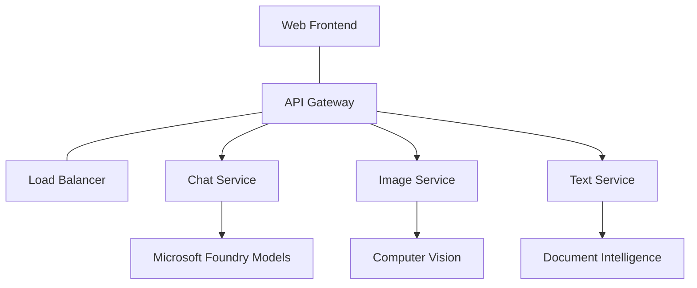

# Βέλτιστες Πρακτικές Φορτίου Εργασίας Παραγωγής AI με AZD

**Πλοήγηση Κεφαλαίου:**
- **📚 Αρχική Μαθήματος**: [AZD Για Αρχάριους](../../README.md)
- **📖 Τρέχον Κεφάλαιο**: Κεφάλαιο 8 - Παρατηρήσεις Παραγωγής & Επιχειρήσεων
- **⬅️ Προηγούμενο Κεφάλαιο**: [Κεφάλαιο 7: Αντιμετώπιση Προβλημάτων](../chapter-07-troubleshooting/debugging.md)
- **⬅️ Σχετικό επίσης**: [AI Εργαστήριο Workshop](../chapter-02-ai-development/ai-workshop-lab.md)
- **🎯 Πλήρης Κύκλος Μαθήματος**: [AZD Για Αρχάριους](../../README.md)

## Επισκόπηση

Αυτός ο οδηγός εξηγεί πρότυπα σχεδιασμού παραγωγής AI χρησιμοποιώντας το Azure Developer CLI (AZD). Είναι μια αναφορά σχεδιασμού, όχι μια εφαρμογή προς ανάπτυξη ή πιστοποίηση παραγωγής.

**Περιορισμοί παραδείγματος:** Εκτός αν περιγράφεται ρητά ως πλήρης, τα θραύσματα Bicep υποθέτουν παραμέτρους και αναφερόμενους πόρους από ένα περιλαμβανόμενο πρότυπο. Παραλείπουν εικόνες/πλάνα φιλοξενίας, ταυτότητες, αναθέσεις ρόλων, DNS, αποτελέσματα και άλλες απαιτούμενες ενσωματώσεις. Τα YAML μονοπάτια υπηρεσίας και τα σενάρια hook/test είναι ενδεικτικά αρχεία προς δημιουργία **στη δική σας εφαρμογή**· δεν παρέχονται από αυτό το μάθημα. Χρησιμοποιήστε ένα λειτουργικό δείγμα AZD ως βάση, συνθέστε την πλήρη υποδομή και δοκιμάστε το σε απομονωμένο περιβάλλον πριν την παραγωγή.

## Κύριες Προκλήσεις που Αντιμετωπίζονται

Συνηθισμένες ανησυχίες παραγωγής περιλαμβάνουν αναπτύξεις πολλαπλών υπηρεσιών, διαχείριση ταυτότητας και μυστικών, κλιμάκωση, έλεγχο κόστους και παρακολούθηση. Δεν υποστηρίζεται εδώ μετρημένη επικράτηση.

## Πρότυπα Αρχιτεκτονικής για Παραγωγή AI

### Πρότυπο 1: Αρχιτεκτονική Microservices AI

**Πότε να χρησιμοποιηθεί**: Πολύπλοκες εφαρμογές AI με πολλαπλές ικανότητες



**Υλοποίηση AZD**:

```yaml
# azure.yaml
name: enterprise-ai-platform
services:
  web:
    project: ./web
    host: staticwebapp
  api-gateway:
    project: ./api-gateway
    host: containerapp
  chat-service:
    project: ./services/chat
    host: containerapp
  vision-service:
    project: ./services/vision
    host: containerapp
  text-service:
    project: ./services/text
    host: containerapp
```

### Πρότυπο 2: Επεξεργασία AI Με Βάση Γεγονότα

**Πότε να χρησιμοποιηθεί**: Επεξεργασία παρτίδων, ανάλυση εγγράφων, ασύγχρονα ροή εργασιών

```bicep
// Event Hub for AI processing pipeline
resource eventHub 'Microsoft.EventHub/namespaces@2024-01-01' = {
  name: eventHubNamespaceName
  location: location
  sku: {
    name: 'Standard'
    tier: 'Standard'
    capacity: 1
  }
}

// Service Bus for reliable message processing
resource serviceBus 'Microsoft.ServiceBus/namespaces@2024-01-01' = {
  name: serviceBusNamespaceName
  location: location
  sku: {
    name: 'Premium'
    tier: 'Premium'
    capacity: 1
  }
}

// Function App for processing
resource functionApp 'Microsoft.Web/sites@2023-01-01' = {
  name: functionAppName
  location: location
  kind: 'functionapp,linux'
  properties: {
    siteConfig: {
      appSettings: [
        {
          name: 'FUNCTIONS_EXTENSION_VERSION'
          value: '~4'
        }
        {
          name: 'AZURE_OPENAI_ENDPOINT'
          value: '@Microsoft.KeyVault(VaultName=${keyVault.name};SecretName=openai-endpoint)'
        }
      ]
    }
  }
}
```

Αυτό δημιουργεί θραύσματα χώρου ονομάτων, όχι κόμβους, ουρές, συνδρομές ή ενεργοποιητές Function. Μια εκτελέσιμη Function χρειάζεται επίσης πλάνο φιλοξενίας, διαμόρφωση χρόνου εκτέλεσης/αποθήκευσης, συνημμένη ταυτότητα, RBAC και πρόσβαση δικτύου. Η αναφορά Key Vault χρειάζεται άδεια ανάγνωσης του μυστικού· ένα endpoint URL από μόνο του δεν αποτελεί διαπιστευτήριο.

## Σκέψεις Για Την Υγεία Του Πράκτορα AI

Όταν μια παραδοσιακή ιστοσελίδα σπάει, τα συμπτώματα είναι οικεία: μια σελίδα δεν φορτώνει, ένα API επιστρέφει σφάλμα ή μια ανάπτυξη αποτυγχάνει. Οι εφαρμογές που τροφοδοτούνται από AI μπορούν να σπάσουν με όλους αυτούς τους ίδιους τρόπους — αλλά μπορούν επίσης να λειτουργήσουν λανθασμένα με πιο λεπτούς τρόπους που δεν παράγουν προφανή μηνύματα σφάλματος.

Αυτό το τμήμα βοηθά να δημιουργήσετε ένα νοητικό μοντέλο για την παρακολούθηση φορτίων εργασίας AI ώστε να ξέρετε πού να κοιτάξετε όταν κάτι φαίνεται λάθος.

### Πώς Διαφέρει η Υγεία του Πράκτορα από την Υγεία Παραδοσιακής Εφαρμογής

Οι παραδοσιακές εφαρμογές μπορούν επίσης να έχουν λεπτές αποτυχίες ορθότητας. Ένας πράκτορας AI προσθέτει μη ντετερμινιστική ποιότητα απόκρισης στις συνήθεις ανησυχίες διαθεσιμότητας και ορθότητας. Σκεφτείτε την υγεία του πράκτορα σε δύο στρώματα:

| Στρώμα | Τι Να Παρακολουθείτε | Πού Να Κοιτάξετε |
|-------|--------------|---------------|
| **Υγεία Υποδομής** | Λειτουργεί η υπηρεσία; Έχουν προμηθευτεί πόροι; Είναι προσβάσιμα τα endpoints; | `azd monitor`, υγεία πόρων στο Azure Portal, αρχεία καταγραφής container/app |
| **Υγεία Συμπεριφοράς** | Αντιδρά ο πράκτορας με ακρίβεια; Είναι οι απαντήσεις έγκαιρες; Καλείται σωστά το μοντέλο; |  ίχνη Application Insights, μετρικές καθυστέρησης κλήσεων μοντέλου, αρχεία καταγραφής ποιότητας απόκρισης |

Η υγεία υποδομής είναι γνωστή—είναι η ίδια για κάθε εφαρμογή azd. Η υγεία συμπεριφοράς είναι το νέο στρώμα που εισάγουν τα φορτία AI.

### Πού Να Κοιτάξετε Όταν Οι Εφαρμογές AI Δεν Συμπεριφέρονται Όπως Αναμένεται

Αν η εφαρμογή AI σας δεν παράγει τα αναμενόμενα αποτελέσματα, ορίστε μια εννοιολογική λίστα ελέγχου:

1. **Ξεκινήστε με τα βασικά.** Λειτουργεί η εφαρμογή; Μπορεί να φτάσει στις εξαρτήσεις της; Ελέγξτε `azd monitor` και την υγεία πόρων όπως θα κάνατε με οποιαδήποτε εφαρμογή.
2. **Ελέγξτε τη σύνδεση μοντέλου.** Καλεί με επιτυχία η εφαρμογή το μοντέλο AI; Οι αποτυχημένες ή ληξιπρόθεσμες κλήσεις μοντέλου είναι η πιο κοινή αιτία προβλημάτων AI και θα εμφανίζονται στα αρχεία καταγραφής της εφαρμογής σας.
3. **Επιθεωρήστε τις εισόδους και τη θεμελίωση με ασφάλεια.** Λάθος απαντήσεις μπορεί να προέρχονται από ανάκτηση, οδηγίες, περιορισμούς μοντέλου ή εκτέλεση εργαλείου. Χρησιμοποιήστε διαγνωστικά δεδομένα με ελεγχόμενη πρόσβαση και απόκρυψη· μην ενεργοποιείτε την αδιάκριτη καταγραφή προτροπής/απόκρισης σε παραγωγή.
4. **Αναθεωρήστε την καθυστέρηση απόκρισης.** Οι κλήσεις μοντέλου AI είναι πιο αργές από τυπικές κλήσεις API. Αν η εφαρμογή σας αργεί, ελέγξτε αν οι χρόνοι απόκρισης του μοντέλου έχουν αυξηθεί — αυτό μπορεί να δείχνει περιορισμό, όρια χωρητικότητας ή συμφόρηση σε επίπεδο περιοχής.
5. **Παρακολουθήστε σήματα κόστους.** Απροσδόκητες αιχμές στη χρήση token ή κλήσεων API μπορεί να υποδηλώνουν βρόχο, εσφαλμένη εντολή ή υπερβολικές επαναλήψεις.

Δεν χρειάζεται να γίνετε ειδικοί στα εργαλεία παρατηρησιμότητας αμέσως. Το βασικό συμπέρασμα είναι ότι οι εφαρμογές AI έχουν ένα επιπλέον στρώμα συμπεριφοράς προς παρακολούθηση, και η ενσωματωμένη παρακολούθηση του azd (`azd monitor`) σας δίνει ένα σημείο εκκίνησης για διερεύνηση και των δύο στρωμάτων.

---

## Βέλτιστες Πρακτικές Ασφάλειας

### 1. Μοντέλο Ασφάλειας Μηδενικής Εμπιστοσύνης

**Στρατηγική Υλοποίησης**:
- Καμία επικοινωνία υπηρεσίας προς υπηρεσία χωρίς αυθεντικοποίηση
- Όλες οι κλήσεις API χρησιμοποιούν διαχειριζόμενες ταυτότητες
- Απομόνωση δικτύου με ιδιωτικά endpoints
- Έλεγχοι πρόσβασης με ελάχιστα προνόμια

```bicep
// Managed Identity for each service
resource chatServiceIdentity 'Microsoft.ManagedIdentity/userAssignedIdentities@2023-01-31' = {
  name: 'chat-service-identity'
  location: location
}

// Role assignments with minimal permissions
resource openAIUserRole 'Microsoft.Authorization/roleAssignments@2022-04-01' = {
  scope: openAIAccount
  name: guid(openAIAccount.id, chatServiceIdentity.id, '5e0bd9bd-7b93-4f28-af87-19fc36ad61bd')
  properties: {
    roleDefinitionId: subscriptionResourceId('Microsoft.Authorization/roleDefinitions', '5e0bd9bd-7b93-4f28-af87-19fc36ad61bd')
    principalId: chatServiceIdentity.properties.principalId
    principalType: 'ServicePrincipal'
  }
}
```

### 2. Ασφαλής Διαχείριση Μυστικών

**Πρότυπο Ενσωμάτωσης Key Vault**:

```bicep
// Key Vault with proper access policies
resource keyVault 'Microsoft.KeyVault/vaults@2023-02-01' = {
  name: keyVaultName
  location: location
  properties: {
    tenantId: tenant().tenantId
    sku: {
      family: 'A'
      name: 'standard' // Premium is needed for HSM-backed keys, not ordinary secrets
    }
    enableRbacAuthorization: true  // Use RBAC instead of access policies
    enablePurgeProtection: true    // Prevent accidental deletion
    enableSoftDelete: true
    softDeleteRetentionInDays: 90
  }
}

// Optional legacy key-auth alternative; omit when using Entra ID.
resource openAIKeySecret 'Microsoft.KeyVault/vaults/secrets@2023-02-01' = {
  parent: keyVault
  name: 'openai-api-key'
  properties: {
    value: openAIAccount.listKeys().key1
    attributes: {
      enabled: true
    }
  }
}
```

Εκχωρήστε την ταυτότητα χρόνου εκτέλεσης `Key Vault Secrets User` στο κατάλληλο εύρος και επισυνάψτε την στον host· μόνο το `enableRbacAuthorization` δεν παρέχει πρόσβαση. Προτιμήστε αυθεντικοποίηση ταυτότητας που διαχειρίζεται το OpenAI με `disableLocalAuth: true`. Το προαιρετικό μυστικό κλειδιού έχει νόημα μόνο για λογαριασμό με σκόπιμα ενεργοποιημένο κλειδί, και ο κύριος προμήθειας χρειάζεται επίσης δικαίωμα εγγραφής μυστικών.

### 3. Ασφάλεια Δικτύου

**Διαμόρφωση Ιδιωτικού Endpoint**:

```bicep
// Virtual Network for AI services
resource virtualNetwork 'Microsoft.Network/virtualNetworks@2023-04-01' = {
  name: vnetName
  location: location
  properties: {
    addressSpace: {
      addressPrefixes: ['10.0.0.0/16']
    }
    subnets: [
      {
        name: 'ai-services-subnet'
        properties: {
          addressPrefix: '10.0.1.0/24'
          privateEndpointNetworkPolicies: 'Disabled'
        }
      }
      {
        name: 'app-services-subnet'
        properties: {
          addressPrefix: '10.0.2.0/24'
          delegations: [
            {
              name: 'Microsoft.Web/serverFarms'
              properties: {
                serviceName: 'Microsoft.Web/serverFarms'
              }
            }
          ]
        }
      }
    ]
  }
}

// Private endpoints for all AI services
resource openAIPrivateEndpoint 'Microsoft.Network/privateEndpoints@2023-04-01' = {
  name: '${openAIAccountName}-pe'
  location: location
  properties: {
    subnet: {
      id: virtualNetwork.properties.subnets[0].id
    }
    privateLinkServiceConnections: [
      {
        name: 'openai-connection'
        properties: {
          privateLinkServiceId: openAIAccount.id
          groupIds: ['account']
        }
      }
    ]
  }
}
```

Τα ιδιωτικά endpoints απαιτούν επίσης ομάδες ζωνών DNS ιδιωτικές / συνδέσμους VNet και ενοποίηση εφαρμογής VNet. Δεν αποκλείουν αυτόματα τη δημόσια πρόσβαση: απενεργοποιήστε ρητά τη δημόσια δικτυακή πρόσβαση του λογαριασμού AI μετά την επικύρωση της ιδιωτικής συνδεσιμότητας και της πρόσβασης ανάπτυξης.

## Απόδοση και Κλιμάκωση

### 1. Στρατηγικές Αυτόματης Κλιμάκωσης

**Αυτόματη κλιμάκωση container apps**:

```bicep
resource containerApp 'Microsoft.App/containerApps@2023-05-01' = {
  name: containerAppName
  location: location
  properties: {
    configuration: {
      ingress: {
        external: true
        targetPort: 8000
        transport: 'http'
      }
    }
    template: {
      scale: {
        minReplicas: 2  // Always have 2 instances minimum
        maxReplicas: 50 // Scale up to 50 for high load
        rules: [
          {
            name: 'http-scaling'
            http: {
              metadata: {
                concurrentRequests: '20'  // Scale when >20 concurrent requests
              }
            }
          }
          {
            name: 'cpu-scaling'
            custom: {
              type: 'cpu'
              metadata: {
                type: 'Utilization'
                value: '70'  // Scale when CPU >70%
              }
            }
          }
        ]
      }
    }
  }
}
```

### 2. Στρατηγικές Κρυφής Μνήμης (Caching)

**Redis Cache για Απαντήσεις AI**:

```bicep
// Legacy Azure Cache for Redis example (not recommended for new deployments)
resource redisCache 'Microsoft.Cache/redis@2023-04-01' = {
  name: redisCacheName
  location: location
  properties: {
    sku: {
      name: 'Premium'
      family: 'P'
      capacity: 1
    }
    enableNonSslPort: false
    minimumTlsVersion: '1.2'
    redisConfiguration: {
      'maxmemory-policy': 'allkeys-lru'
    }
    // Sharding distributes data; replication/failover provides availability.
    shardCount: 2
  }
}

// Cache configuration in application
var cacheConnectionString = '${redisCache.properties.hostName}:6380,password=${redisCache.listKeys().primaryKey},ssl=True,abortConnect=False'
```

Το Azure Cache for Redis Basic/Standard/Premium βρίσκεται σε [διαδρομή απόσυρσης](https://learn.microsoft.com/azure/azure-cache-for-redis/retirement-faq). Χρησιμοποιήστε το Azure Managed Redis για νέους σχεδιασμούς και τη εγγραμμένη διαμόρφωση SKU, ταυτότητας και TLS του, αντί να αντιγράφετε αυτόν τον παλιό πόρο σε νέο σύστημα παραγωγής. Η γραμμή σύνδεσης-αλυσίδας είναι ένα μη λειτουργικό placeholder, όχι διαπιστευτήριο. Διαμέριση κλειδιών cache κατά εξουσιοδότηση, μοντέλο/οδηγίες και έκδοση ανάκτησης, με ημερομηνία λήξης· μια κοινή cache μόνο για ερωτήματα μπορεί να αποκαλύψει δεδομένα άλλου χρήστη.

### 3. Ισορροπία Φορτίου και Διαχείριση Κυκλοφορίας

**Application Gateway με WAF**:

```bicep
// Application Gateway with Web Application Firewall
resource applicationGateway 'Microsoft.Network/applicationGateways@2023-04-01' = {
  name: appGatewayName
  location: location
  properties: {
    sku: {
      name: 'WAF_v2'
      tier: 'WAF_v2'
      capacity: 2
    }
    webApplicationFirewallConfiguration: {
      enabled: true
      firewallMode: 'Prevention'
      ruleSetType: 'OWASP'
      ruleSetVersion: '3.2'
    }
    // Backend pools for AI services
    backendAddressPools: [
      {
        name: 'ai-services-pool'
        properties: {
          backendAddresses: [
            {
              fqdn: '${containerApp.properties.configuration.ingress.fqdn}'
            }
          ]
        }
      }
    ]
  }
}
```

Αυτό είναι μερικός πόρος gateway: μια πραγματική ανάπτυξη χρειάζεται επίσης υποδίκτυο gateway/διαμόρφωση IP, frontend IPs και ports, ακροατές/πιστοποιητικά TLS, ρυθμίσεις HTTP backend/ probes, κανόνες δρομολόγησης και προτεραιότητες, και πολιτική WAF που έχει αναθεωρηθεί. Η αναγνώριση ονόματος κεντρικού υπολογιστή TLS/SNI και η αυθεντικοποίηση πρέπει να ταιριάζουν με το backend του Container App.

## 💰 Βελτιστοποίηση Κόστους

### 1. Δέσμευση Πόρων Στοχευμένα

**Διαμορφώσεις συγκεκριμένες για το περιβάλλον**:

Αυτά τα ονόματα είναι **ενδεικτικές είσοδοι προτύπου προσαρμογής**, όχι αυτόματες ρυθμίσεις AZD. Χαρτογραφήστε κάθε ένα σε `infra/main.parameters.json`/Bicep και διαμόρφωση host πρώτα. Για παράδειγμα, το δείγμα RAG χρησιμοποιεί `AZURE_SEARCH_SERVICE_SKU` και `AZURE_OPENAI_CHATGPT_DEPLOYMENT_CAPACITY`, όχι τα γενικά ονόματα παρακάτω. Δώστε στη μνήμη Container Apps μονάδα που υποστηρίζεται όπως `1Gi` στον πραγματικό πόρο. Εφαρμόστε αλλαγές υποδομής με `azd up` ή `azd provision`· μόνο `azd deploy` δεν εφαρμόζει αλλαγές Bicep.

```bash
# Development environment
azd env new development
azd env set AZURE_OPENAI_SKU "S0"
azd env set AZURE_OPENAI_CAPACITY 10
azd env set AZURE_SEARCH_SKU "basic"
azd env set CONTAINER_CPU 0.5
azd env set CONTAINER_MEMORY 1.0

# Production environment  
azd env new production
azd env set AZURE_OPENAI_SKU "S0"
azd env set AZURE_OPENAI_CAPACITY 100
azd env set AZURE_SEARCH_SKU "standard"
azd env set CONTAINER_CPU 2.0
azd env set CONTAINER_MEMORY 4.0
```

### 2. Παρακολούθηση Κόστους και Προϋπολογισμοί

```bicep
// Supply the first day of the current UTC month, e.g. 2026-11-01T00:00:00Z.
param budgetStartDate string

// Cost management and budgets
resource budget 'Microsoft.Consumption/budgets@2024-08-01' = {
  name: 'ai-workload-budget'
  properties: {
    timePeriod: {
      startDate: budgetStartDate
    }
    timeGrain: 'Monthly'
    amount: 2000  // In the billing currency, not necessarily USD
    category: 'Cost'
    notifications: {
      warning: {
        enabled: true
        operator: 'GreaterThan'
        threshold: 80
        contactEmails: [
          'finance@company.com'
          'engineering@company.com'
        ]
        contactRoles: [
          'Owner'
          'Contributor'
        ]
      }
      critical: {
        enabled: true
        operator: 'GreaterThan'
        threshold: 95
        contactEmails: [
          'cto@company.com'
        ]
      }
    }
  }
}
```

Αντικαταστήστε τους παραλήπτες παραδείγματος και ελέγξτε εύρος/δικαιώματα. Οι ειδοποιήσεις προϋπολογισμού χρησιμοποιούν καθυστερημένα δεδομένα χρέωσης και δεν επιβάλλουν όριο δαπανών.

### 3. Βελτιστοποίηση Χρήσης Token

**Διαχείριση Κόστους OpenAI**:

Αυτό είναι μόνο μια ευρετική βάσει χαρακτήρων για προεπισκόπηση UI, **όχι** έλεγχος ορίου token μοντέλου. Ο κώδικας παραγωγής πρέπει να χρησιμοποιεί tokenizer κατάλληλο για το αναπτυγμένο μοντέλο και να λαμβάνει υπόψη οδηγίες συστήματος, σχήματα εργαλείων, ιστορικό και προϋπολογισμό εξόδου. Απορρίψτε ένα υπερμεγέθες μήνυμα χρήστη παρά να το περικόπτετε σιωπηλά.

```typescript
// Application-level token optimization
class TokenOptimizer {
  private readonly maxTokens = 4000;
  private readonly reserveTokens = 500;
  
  optimizePrompt(userInput: string, context: string): string {
    const availableTokens = this.maxTokens - this.reserveTokens;
    if (this.estimateTokens(userInput) + 8 >= availableTokens) {
      throw new Error("User input exceeds the illustrative prompt budget");
    }
    const estimatedTokens = this.estimateTokens(userInput + context) + 8;
    
    if (estimatedTokens > availableTokens) {
      // Truncate context, not user input
      context = this.truncateContext(context, Math.max(0, availableTokens - this.estimateTokens(userInput) - 8));
    }
    
    return `${context}\n\nUser: ${userInput}`;
  }
  
  private estimateTokens(text: string): number {
    // Rough estimation: 1 token ≈ 4 characters
    return Math.ceil(text.length / 4);
  }

  private truncateContext(text: string, estimatedBudget: number): string {
    return text.slice(0, Math.max(0, estimatedBudget) * 4);
  }
}
```

## Παρακολούθηση και Παρατηρησιμότητα

### 1. Ολοκληρωμένα Application Insights

```bicep
// Application Insights with advanced features
resource applicationInsights 'Microsoft.Insights/components@2020-02-02' = {
  name: applicationInsightsName
  location: location
  kind: 'web'
  properties: {
    Application_Type: 'web'
    WorkspaceResourceId: logAnalyticsWorkspace.id
    SamplingPercentage: 100  // Ingestion setting; review cost and SDK sampling separately
    DisableIpMasking: false  // Retain IP masking
  }
}

// Custom metrics for AI operations
resource aiMetricAlerts 'Microsoft.Insights/metricAlerts@2018-03-01' = {
  name: 'ai-high-error-rate'
  location: 'global'
  properties: {
    description: 'Alert when failed request count exceeds 10 in five minutes'
    severity: 2
    enabled: true
    scopes: [
      applicationInsights.id
    ]
    evaluationFrequency: 'PT1M'
    windowSize: 'PT5M'
    criteria: {
      'odata.type': 'Microsoft.Azure.Monitor.SingleResourceMultipleMetricCriteria'
      allOf: [
        {
          name: 'high-error-rate'
          metricName: 'requests/failed'
          operator: 'GreaterThan'
          threshold: 10
          timeAggregation: 'Count'
        }
      ]
    }
  }
}
```

### 2. Παρακολούθηση Ειδική για AI

**Προσαρμοσμένοι Πίνακες Ελέγχου για Μετρικές AI**:

```json
{
  "dashboard": {
    "name": "AI Application Monitoring",
    "tiles": [
      {
        "name": "OpenAI Request Volume",
        "query": "dependencies | where target contains 'openai' | summarize count() by bin(timestamp, 5m)"
      },
      {
        "name": "AI Response Latency",
        "query": "dependencies | where target contains 'openai' | summarize avg(duration) by bin(timestamp, 5m)"
      },
      {
        "name": "Token Usage",
        "query": "customMetrics | where name == 'openai_tokens_used' | summarize sum(value) by bin(timestamp, 1h)"
      },
      {
        "name": "Cost per Hour",
        "query": "customMetrics | where name == 'openai_cost' | summarize sum(value) by bin(timestamp, 1h)"
      }
    ]
  }
}
```

Αυτό το JSON είναι ένα σκίτσο ορισμένο από την εφαρμογή, όχι ένα εισαγόμενο σχήμα πίνακα ελέγχου Azure portal. Τα ερωτήματα token/cost απαιτούν η εφαρμογή σας να εκπέμπει ακριβώς αυτές τις προσαρμοσμένες μετρικές· δεν δημιουργούνται από το AZD. Προσαρμόστε φίλτρα εξαρτήσεων για το πραγματικό τέλος/ονομασίες διαστήματος μοντέλου.

### 3. Ελέγχοι Υγείας και Παρακολούθηση Διαθεσιμότητας

```bicep
// Application Insights availability tests
resource availabilityTest 'Microsoft.Insights/webtests@2022-06-15' = {
  name: 'ai-app-availability-test'
  location: location
  tags: {
    'hidden-link:${applicationInsights.id}': 'Resource'
  }
  properties: {
    SyntheticMonitorId: 'ai-app-availability-test'
    Name: 'AI Application Availability Test'
    Description: 'Tests AI application endpoints'
    Enabled: true
    Frequency: 300  // 5 minutes
    Timeout: 120    // 2 minutes
    Kind: 'standard'
    Locations: [
      {
        Id: 'us-east-2-azr'
      }
      {
        Id: 'us-west-2-azr'
      }
    ]
    Request: {
      RequestUrl: 'https://${webApp.properties.defaultHostName}/health'
      HttpVerb: 'GET'
      FollowRedirects: true
      ParseDependentRequests: false
    }
    ValidationRules: {
      ExpectedHttpStatusCode: 200
      SSLCheck: true
      SSLCertRemainingLifetimeCheck: 7
    }
  }
}
```

## Ανάκτηση από Καταστροφή και Υψηλή Διαθεσιμότητα

Η προηγούμενη δοκιμή υποθέτει υπάρχουσα υπηρεσία App Service `webApp` και πόρο Application Insights. Οι τυπικοί έλεγχοι διαθεσιμότητας χρεώνονται και απαιτούν προσβάσιμο endpoint· οι εφαρμογές με μόνο ιδιωτική πρόσβαση χρειάζονται κατάλληλο σχεδιασμό ιδιωτικής παρακολούθησης. Οι δοκιμές ping URL είναι αποσυρμένες· χρησιμοποιήστε [τυπικούς ελέγχους διαθεσιμότητας](https://learn.microsoft.com/azure/azure-monitor/app/availability).

### 1. Ανάπτυξη σε Πολλαπλές Περιοχές

```yaml
# azure.yaml - Multi-region configuration
name: ai-app-multiregion
services:
  api-primary:
    project: ./api
    host: containerapp
    env:
      AZURE_REGION: eastus
  api-secondary:
    project: ./api
    host: containerapp
    env:
      AZURE_REGION: westus2
```

```bicep
// Separate App Service topology, not the Container Apps declarations above
resource trafficManager 'Microsoft.Network/trafficManagerProfiles@2022-04-01' = {
  name: trafficManagerProfileName
  location: 'global'
  properties: {
    profileStatus: 'Enabled'
    trafficRoutingMethod: 'Priority'
    dnsConfig: {
      relativeName: trafficManagerProfileName
      ttl: 30
    }
    monitorConfig: {
      protocol: 'HTTPS'
      port: 443
      path: '/health'
      intervalInSeconds: 30
      toleratedNumberOfFailures: 3
      timeoutInSeconds: 10
    }
    endpoints: [
      {
        name: 'primary-endpoint'
        type: 'Microsoft.Network/trafficManagerProfiles/azureEndpoints'
        properties: {
          targetResourceId: primaryAppService.id
          endpointStatus: 'Enabled'
          priority: 1
        }
      }
      {
        name: 'secondary-endpoint'
        type: 'Microsoft.Network/trafficManagerProfiles/azureEndpoints'
        properties: {
          targetResourceId: secondaryAppService.id
          endpointStatus: 'Enabled'
          priority: 2
        }
      }
    ]
  }
}
```

Οι μεταβλητές περιβάλλοντος δεν επιλέγουν τοποθεσίες πόρων. Το IaC πρέπει να προμηθεύσει ξεχωριστούς περιφερειακούς hosts και να δέσει κάθε υπηρεσία με ετικέτες `resourceName` ή `azd-service-name`. Το παράδειγμα Traffic Manager είναι μια **ξεχωριστή τοπολογία App Service** (`primaryAppService`/`secondaryAppService`), όχι δρομολόγηση για τις δηλώσεις Container Apps. Τα Container Apps απαιτούν κατάλληλα διαμορφωμένο εξωτερικό endpoint/front door, TLS/δρομολόγηση προσαρμοσμένου τομέα, και ελέγχους υγείας.

### 2. Αντίγραφα Ασφαλείας και Ανάκτηση Δεδομένων

```bicep
// Backup configuration for critical data
resource backupVault 'Microsoft.DataProtection/backupVaults@2023-05-01' = {
  name: backupVaultName
  location: location
  identity: {
    type: 'SystemAssigned'
  }
  properties: {
    storageSettings: [
      {
        datastoreType: 'VaultStore'
        type: 'LocallyRedundant'
      }
    ]
  }
}

```

Το vault από μόνο του δεν κάνει αντιγραφή ασφαλείας. Διαμορφώστε μια **υποστηριζόμενη πολιτική και παράδειγμα backup ειδικό για το φορτίο εργασίας**, δικαιώματα πηγής, διατήρηση και δοκιμές επαναφοράς με χρήση των [πινάκων υποστήριξης Azure Backup](https://learn.microsoft.com/azure/backup/backup-support-matrix). Δεν υπάρχει γενική πολιτική Azure Backup για αναπτύξεις Azure OpenAI μοντέλων φιλοξενίας. Κρατήστε τους ορισμούς υποδομής/ανάπτυξης μοντέλου στον έλεγχο πηγής· προστατέψτε ανεβασμένα έγγραφα, δεδομένα εφαρμογής και τεχνουργήματα fine-tuning χρησιμοποιώντας τις υποστηριζόμενες δυνατότητες backup/εξαγωγής κάθε υπηρεσίας. Ορίστε και δοκιμάστε σαφώς RPO/RTO.

## Ενσωμάτωση DevOps και CI/CD

### 1. GitHub Actions Workflow

```yaml
# .github/workflows/deploy-ai-app.yml
name: Deploy AI Application

on:
  push:
    branches: [main]
  pull_request:
    branches: [main]

jobs:
  test:
    runs-on: ubuntu-latest
    steps:
      - uses: actions/checkout@v4
      
      - name: Setup Python
        uses: actions/setup-python@v4
        with:
          python-version: '3.11'
          
      - name: Install dependencies
        run: |
          pip install -r requirements.txt
          pip install pytest
          
      - name: Run tests
        run: pytest tests/
        
      - name: AI Safety Tests
        run: |
          python scripts/test_ai_safety.py
          python scripts/validate_prompts.py

```

Αυτό είναι το **τμήμα μόνο για δοκιμές** ενός workflow και υποθέτει ότι έχετε δημιουργήσει `requirements.txt`, `tests/`, και τα δύο σενάρια ασφαλείας. Προσθέστε τις αυθεντικοποιημένες δουλειές προμήθειας/ανάπτυξης OIDC από το [CI/CD Pipeline Configuration](#cicd-pipeline-configuration), με `needs: test`, έναν αξιόπιστο push/χειροκίνητο trigger, και προστατευμένα περιβάλλοντα GitHub. Μην αναπτύσσετε κώδικα pull-request χωρίς εμπιστοσύνη με διαπιστευτήρια cloud. Ένας φρέσκος runner δεν έχει επιλεγμένο τοπικό περιβάλλον AZD· παράσχετε τις εισόδους περιβάλλοντος/συνδρομής/τοποθεσίας και χρησιμοποιήστε `azd auth login`, όχι μόνο `azure/login`.

### 2. Επαλήθευση Υποδομής

```bash
# scripts/validate_infrastructure.sh
#!/bin/bash
set -euo pipefail

echo "Validating AI infrastructure deployment..."

# Requires Azure CLI login and the resource group selected explicitly.
: "${AZURE_RESOURCE_GROUP:?Set AZURE_RESOURCE_GROUP}"
: "${AZURE_OPENAI_NAME:?Set AZURE_OPENAI_NAME}"
: "${AZURE_OPENAI_CHAT_DEPLOYMENT:?Set the actual deployment name}"

# A successful empty list is not proof that resources exist.
types=("Microsoft.CognitiveServices/accounts" "Microsoft.Search/searchServices"
       "Microsoft.Storage/storageAccounts" "Microsoft.KeyVault/vaults")
for resource_type in "${types[@]}"; do
    count=$(az resource list --resource-group "$AZURE_RESOURCE_GROUP" \
        --resource-type "$resource_type" --query "length(@)" -o tsv)
    if [[ "$count" -lt 1 ]]; then
        echo "ERROR: No $resource_type found in $AZURE_RESOURCE_GROUP"
        exit 1
    fi
done

# Validate OpenAI model deployments
echo "Validating OpenAI model deployments..."
state=$(az cognitiveservices account deployment show \
  --name "$AZURE_OPENAI_NAME" --resource-group "$AZURE_RESOURCE_GROUP" \
  --deployment-name "$AZURE_OPENAI_CHAT_DEPLOYMENT" \
  --query "properties.provisioningState" -o tsv)
if [[ "$state" != "Succeeded" ]]; then
    echo "ERROR: Required model deployment is not provisioned successfully"
    exit 1
fi

echo "Infrastructure validation completed successfully!"
```

Αναμενόμενο: μηδενικός κωδικός εξόδου και μήνυμα ολοκλήρωσης μόνο όταν υπάρχουν όλοι οι αναμενόμενοι τύποι και έχει προμηθευτεί η ονομασμένη ανάπτυξη μοντέλου. Αυτό ελέγχει την κατάσταση απογραφής/προμήθειας, **όχι** υγεία πόρων, ακριβή τοπολογία, RBAC, προσβασιμότητα δικτύου ή συμπεριφορά μοντέλου. Προσαρμόστε τους αναμενόμενους τύπους στην αρχιτεκτονική σας, και στη συνέχεια πραγματοποιήστε ξεχωριστό αυθεντικοποιημένο τεστ ετοιμότητας εφαρμογής.

## Λίστα Ελέγχου Ετοιμότητας Παραγωγής

### Ασφάλεια ✅
- [ ] Όλες οι υπηρεσίες χρησιμοποιούν διαχειριζόμενες ταυτότητες
- [ ] Μυστικά αποθηκευμένα σε Key Vault
- [ ] Ιδιωτικά endpoints διαμορφωμένα
- [ ] Υλοποιημένες ομάδες ασφάλειας δικτύου
- [ ] RBAC με ελάχιστα προνόμια
- [ ] Ενεργοποιημένο WAF σε δημόσια endpoints

### Απόδοση ✅
- [ ] Διαμορφωμένη αυτόματη κλιμάκωση
- [ ] Υλοποιημένο caching
- [ ] Ρύθμιση ισορροπίας φόρτου
- [ ] CDN για στατικό περιεχόμενο
- [ ] Pooling συνδέσεων βάσης δεδομένων
- [ ] Βελτιστοποίηση χρήσης token

### Παρακολούθηση ✅
- [ ] Διαμορφωμένα Application Insights
- [ ] Ορισμένες προσαρμοσμένες μετρικές
- [ ] Ρυθμίσεις κανόνων ειδοποίησης
- [ ] Δημιουργημένος πίνακας ελέγχου
- [ ] Υλοποιημένοι έλεγχοι υγείας
- [ ] Πολιτικές διατήρησης καταγραφών

### Αξιοπιστία ✅
- [ ] Ανάπτυξη σε πολλαπλές περιοχές
- [ ] Σχέδιο backup και ανάκτησης
- [ ] Υλοποίηση διακοπτών κυκλώματος
- [ ] Διαμορφωμένες πολιτικές επαναληπτικών προσπαθειών
- [ ] Ομαλή απαξίωση
- [ ] Endpoints ελέγχου υγείας

### Διαχείριση Κόστους ✅
- [ ] Διαμορφωμένες ειδοποιήσεις προϋπολογισμού
- [ ] Στοχευμένη δέσμευση πόρων
- [ ] Εφαρμοσμένες εκπτώσεις dev/test
- [ ] Αγορασμένες κρατημένες περιπτώσεις
- [ ] Πίνακας παρακολούθησης κόστους
- [ ] Τακτικές ανασκοπήσεις κόστους

### Συμμόρφωση ✅
- [ ] Ικανοποίηση απαιτήσεων κατοικίας δεδομένων
- [ ] Ενεργοποιημένη καταγραφή ελέγχων
- [ ] Εφαρμοσμένες πολιτικές συμμόρφωσης
- [ ] Υλοποιημένες βάσεις ασφάλειας
- [ ] Τακτικές εκτιμήσεις ασφάλειας
- [ ] Σχέδιο ανταπόκρισης περιστατικών

## Μετρήσεις Απόδοσης

### Ενδεικτικοί Στόχοι Παραγωγής

Αυτοί είναι παραδείγματα SLO προς διαπραγμάτευση και δοκιμή φόρτου, όχι μετρημένες μετρήσεις ή εγγυήσεις. Η καθυστέρηση απόκρισης εξαρτάται από το μήκος μοντέλου/εξόδου· η μηνιαία δαπάνη token εξαρτάται από την κίνηση και τις τιμές, όχι μόνο από τον αριθμό token.

| Μετρική | Στόχος | Παρακολούθηση |
|--------|--------|------------|
| **Χρόνος Απόκρισης** | < 2 δευτερόλεπτα | Application Insights |
| **Διαθεσιμότητα** | 99.9% | Παρακολούθηση διαθεσιμότητας |
| **Ποσοστό Σφάλματος** | < 0.1% | Αρχεία καταγραφής εφαρμογής |
| **Δαπάνη Μοντέλου** | < $500/μήνα (παράδειγμα προϋπολογισμού) | Διαχείριση κόστους |
| **Ταυτόχρονοι Χρήστες** | 1000+ | Δοκιμή φορτίου |
| **Χρόνος Αποκατάστασης** | < 1 ώρα | Δοκιμές αποκατάστασης καταστροφών |

### Δοκιμή Φόρτου

Το παρακάτω είναι ένα σκίτσο διεπαφής για ένα σενάριο δοκιμής φόρτου **που πρέπει να υλοποιήσετε**· αυτό το αποθετήριο δεν παρέχει `scripts/load_test.py`. Ορίστε τα φορτία αιτήσεων, τον έλεγχο ταυτότητας, αντιπροσωπευτικά φορτία εργασίας, δηλώσεις λατενσίας/σφαλμάτων ανά εκατοστημόριο και όριο δαπανών στο εργαλείο δοκιμής φόρτου της επιλογής σας πριν το εκτελέσετε:

```bash
# Load testing script for AI applications
python scripts/load_test.py \
  --endpoint https://your-ai-app.azurewebsites.net \
  --concurrent-users 100 \
  --duration 300 \
  --ramp-up 60
```

## 🤝 Βέλτιστες Πρακτικές Κοινότητας

Βάσει των σχολίων της κοινότητας Microsoft Foundry στο Discord:

### Κύριες Συστάσεις από την Κοινότητα:

1. **Ξεκινήστε Μικρά, Κλιμακώστε Σταδιακά**: Ξεκινήστε με βασικά SKUs και αυξήστε βάσει πραγματικής χρήσης
2. **Παρακολουθείτε Τα Πάντα**: Ρυθμίστε ολοκληρωμένη παρακολούθηση από την πρώτη μέρα
3. **Αυτοματοποιήστε την Ασφάλεια**: Χρησιμοποιήστε υποδομή ως κώδικα για συνεπή ασφάλεια
4. **Δοκιμάστε Ενδελεχώς**: Συμπεριλάβετε δοκιμές ειδικές για AI στην αλυσίδα
5. **Προγραμματίστε για Κόστη**: Παρακολουθήστε τη χρήση tokens και ορίστε ειδοποιήσεις προϋπολογισμού νωρίς

### Συνηθισμένες Παγίδες που Πρέπει να Αποφύγετε:

- ❌ Σκληρός κωδικός κλειδιών API στον κώδικα
- ❌ Μη ρύθμιση σωστής παρακολούθησης
- ❌ Αγνόηση βελτιστοποίησης κόστους
- ❌ Μη δοκιμή σεναρίων αποτυχίας
- ❌ Ανάπτυξη χωρίς ελέγχους υγείας

## Εντολές και Επεκτάσεις AZD AI CLI

Το AZD περιλαμβάνει ένα αυξανόμενο σύνολο εντολών και επεκτάσεων ειδικών για AI που απλοποιούν ροές εργασίας παραγωγής AI. Αυτά τα εργαλεία γεφυρώνουν το κενό μεταξύ της τοπικής ανάπτυξης και της παραγωγικής υλοποίησης για φορτία AI.

> **Ανασκόπηση έκδοσης (2026-11-04):** Η παρακάτω καθοδήγηση CLI ελέγχθηκε ενάντια στις δημοσιευμένες εκδόσεις των `azd` **1.37.2**, `azure.ai.agents` **1.0.0-beta.23**, και `azure.ai.evaluations` **1.0.0-beta.2**. Οι agents beta.23 απαιτούν `azd >= 1.37.0`· οι αξιολογήσεις beta.2 απαιτούν `azd >= 1.33.0`. Χρησιμοποιήστε τουλάχιστον 1.37.0 για συνδυασμένη ροή εργασίας. Πρόκειται για ανασκόπηση τεκμηρίωσης/πηγής, όχι για ζωντανή επικύρωση ανάπτυξης Azure.

### Επεκτάσεις AZD για AI

Το AZD χρησιμοποιεί σύστημα επεκτάσεων για να προσθέσει δυνατότητες ειδικές για AI. Εγκαταστήστε και διαχειριστείτε επεκτάσεις με:

```bash
# List all available extensions (including AI)
azd extension list

# Inspect installed extension details
azd version
azd extension show azure.ai.agents

# Install the Foundry agents extension
azd extension install azure.ai.agents

# Install the separate Foundry evaluations extension
azd extension install azure.ai.evaluations

# Install the fine-tuning extension
azd extension install azure.ai.finetune

# Install the custom models extension
azd extension install azure.ai.models

# Upgrade all installed extensions
azd extension upgrade --all
```

**Διαθέσιμες επεκτάσεις AI:**

| Επέκταση | Σκοπός | Κατάσταση |
|-----------|---------|--------|
| `azure.ai.agents` | Διαχείριση υπηρεσίας Foundry Agent | Προεπισκόπηση |
| `azure.ai.evaluations` | Σύνολα δεδομένων αξιολογήσεων, αξιολογητές, ομάδες αξιολογήσεων και εκτελέσεις | Προεπισκόπηση |
| `azure.ai.skills` | Επαναχρησιμοποιήσιμες δεξιότητες agent | Προεπισκόπηση |
| `azure.ai.connections` | Συνδέσεις Foundry (πηγές δεδομένων, εργαλεία) | Προεπισκόπηση |
| `azure.ai.finetune` | Λεπτομερής ρύθμιση μοντέλων Foundry | Προεπισκόπηση |
| `azure.ai.models` | Προσαρμοσμένα μοντέλα Foundry | Προεπισκόπηση |
| `azure.coding-agent` | Διαμόρφωση coding agent | Διαθέσιμο |

> Εκτελέστε `azd extension list --installed` και `azd extension show azure.ai.evaluations` για να ελέγξετε τις εγκατεστημένες εκδόσεις. Ενημερώστε πρώτα το βασικό CLI χρησιμοποιώντας τις [οδηγίες εγκατάστασης/ενημέρωσης](https://learn.microsoft.com/azure/developer/azure-developer-cli/install-azd) (για εγκατάσταση Windows μέσω winget: `winget upgrade Microsoft.Azd`), και μετά τρέξτε `azd extension upgrade --all`. Δεν υπάρχει εντολή core `azd upgrade`. Εξετάστε τις αλλαγές συμβατότητας πριν από την αναβάθμιση της παραγωγικής αυτοματοποίησης· μην υποθέτετε ότι μια αναβάθμιση επέκτασης διατηρεί τις παλιές μορφές εντολών ή διαμόρφωσης.

### Πρόσφατες Αλλαγές και Διορθώσεις Έκδοσης

| Έκδοση | Τι αλλάζει για αυτό το μάθημα |
|---------|------------------------------|
| `azd 1.37.0` | Προσθέτει σταθερά APIs παραγωγής-προεπισκόπησης και διορθώνει επεξεργασίες επεκτάσεων που ξαναγράφουν μη σχετικές ρυθμίσεις `azure.yaml`. |
| `azd 1.37.1` | Διορθώνει τη διάδοση Ctrl+C σε επεκτάσεις και διαχωρίζει ακυρώσεις/λήξεις χρόνου από γενικές αποτυχίες. |
| `azd 1.37.2` | Βελτιώνει την επικύρωση παροχής: κρίσιμες προειδοποιήσεις έχουν προεπιλογή **Όχι**, αποτυγχάνουν χωρίς επιβεβαίωση σε εκτελέσεις χωρίς επίβλεψη, και η ακύρωση παρακάμπτει hooks μετά την παροχή. Επίσης διορθώνει μη επιλυμένες τιμές περιβάλλοντος σε λίστες άρνησης Deployment Stacks όταν η δυνατότητα alpha είναι ενεργοποιημένη. |
| Agents `beta.22` | Μεταφέρει την αξιολόγηση σε `azd ai eval`, αλλάζει τη βελτιστοποίηση στο GA v1 API, απαιτεί πληθυντικό `toolboxes`, και διαχωρίζει τη διαχείριση harness, voice, και παρατεταμένα preview opt-in. Διορθώνει επιλογή μοντέλου ειδική περιβάλλοντος και έλεγχο ταυτότητας toolbox. |
| Agents `beta.23` | Αποκαλύπτει `init --harness`; διορθώνει έξοδο απάντησης A2A 0.3, μη έγκυρες διαδρομές/modules prompt-agent σε επίπεδα υποδομής, διαγνωστικά χρόνου λήξης ενεργοποίησης, και προειδοποιήσεις RBAC προγραμματιστή που διατηρούνται. |
| Evaluations `beta.2` | Απαιτεί ρυθμίσεις αξιολόγησης camelCase, προσθέτει στατική/προσομοιωμένη συγγραφή συνομιλιών και ρητές τοπικές πηγές αρχείων, και διορθώνει διαχείριση ταυτότητας/έκδοσης dataset, μετρήσεις quality-gate, και διαγνωστικά αποτυχιών εκτέλεσης. |

Ένα timeout ενεργοποίησης agent δεν αποδεικνύει αποτυχία ανάπτυξης: ελέγξτε την προσπαθούμενη έκδοση και την κατάστασή της πριν ξαναδοκιμάσετε. Προειδοποιήσεις RBAC προγραμματιστή μπορούν να παραμείνουν ακόμη και αν το provisioning πετύχει· επιλύστε την έλλειψη πρόσβασης πριν καλέσετε ως εκείνος ο προγραμματιστής.

Πηγές: [AZD releases](https://github.com/Azure/azure-dev/releases), [agents beta.23 release](https://github.com/Azure/azure-dev/releases/tag/azd-ext-azure-ai-agents_1.0.0-beta.23), [agents beta.22 migration](https://github.com/Azure/azure-dev/releases/tag/azd-ext-azure-ai-agents_1.0.0-beta.22), και [evaluations beta.2 release](https://github.com/Azure/azure-dev/releases/tag/azd-ext-azure-ai-evaluations_1.0.0-beta.2).

**Τι είναι οι νεότερες επεκτάσεις `skills` και `connections`;**

Δύο προεπισκοπικές επεκτάσεις εμφανίστηκαν παράλληλα με τα εργαλεία agent και αξίζουν να τις κατανοήσετε ακόμα και ως αρχάριος:

- **`azure.ai.skills`** — Μια **δεξιότητα** είναι μια επαναχρησιμοποιήσιμη ικανότητα (ένα συσκευασμένο εργαλείο ή συμπεριφορά) που μπορείτε να επισυνάψετε σε έναν ή περισσότερους agents αντί να την υλοποιείτε ξανά κάθε φορά. Σκεφτείτε το ως ένα κοινό οικοδομικό στοιχείο: ορίστε μια δεξιότητα "αναζήτησε στα έγγραφα" ή "κάνε αναζήτηση παραγγελίας" μία φορά, και μετά ξαναχρησιμοποιήστε τη σε πολλούς agents. Αυτό διατηρεί τα συστήματα πολλαπλών agents (Κεφάλαιο 5) συνεπή και αποφεύγει την αντιγραφή-επικόλληση.
- **`azure.ai.connections`** — Μια **σύνδεση** είναι ένας διαχειριζόμενος σύνδεσμος από το έργο Foundry σας σε εξωτερική πηγή που χρειάζονται οι agents σας — μια πηγή δεδομένων (όπως Azure AI Search), ένα σημείο τερματισμού εργαλείου ή άλλη υπηρεσία. Οι Συσυνδέσεις κεντροποιούν *πού* και *πώς* έχουν πρόσβαση οι agents σε δεδομένα, ώστε τα διαπιστευτήρια και τα σημεία τερματισμού να διατηρούνται σε ένα ελεγχόμενο σημείο και όχι διάσπαρτα στον κώδικα.

Δεν χρειάζεστε αυτά για να αναπτύξετε τους πρώτους agents σας — μείνετε με το `azure.ai.agents` ενώ μαθαίνετε. Καταφύγετε στο `skills` όταν διαπιστώσετε ότι πολλαπλασιάζετε το ίδιο εργαλείο σε agents, και στο `connections` όταν αρκετοί agents μοιράζονται την ίδια πηγή δεδομένων.

### Εκκίνηση έργων Agent με `azd ai agent init`

Η εντολή `azd ai agent init` δημιουργεί το σκελετό ενός Microsoft Foundry agent project. Χρησιμοποιήστε ένα τρέχον πρότυπο `azure.yaml` έργου, όχι έναν παρωχημένο ρητό agent manifest:

```bash
# Initialize a new agent project from a local project template
azd ai agent init --template ./templates/support-agent/azure.yaml

# Initialize and target a specific Foundry project
azd ai agent init --template ./templates/support-agent/azure.yaml --project-id <foundry-project-id>

# Adopt the template into a different directory
azd ai agent init --template ./templates/support-agent/azure.yaml --src ./agents/my-agent
```

**Κύριες σημαίες:**

| Σημαία | Περιγραφή |
|------|-------------|
| `-t, --template` | Διαδρομή ή υποστηριζόμενη URI GitHub σε ένα έγγραφο έργου `azure.yaml` |
| `-p, --project-id` | ID υπάρχοντος Microsoft Foundry Project για το περιβάλλον azd |
| `-s, --src` | Φάκελος προέλευσης για τους παραγόμενους agents ή φάκελος στόχος κατά την υιοθέτηση έργου |
| `--kind` | Αρχικοποιήστε έναν agent `hosted`, `prompt` ή προεπισκόπησης `prompt-voice` |
| `--harness` | Προαιρετικό execution harness για `--kind prompt`· απαιτεί το προεπισκοπικό opt-in |
| `-e, --environment` | Το περιβάλλον azd προς χρήση |

`--manifest`/`-m` είναι ένας παρωχημένος ψευδώνυμος για `--template`/`-t`· η μετονομασία της σημαίας δεν μετατρέπει ένα παλιό manifest σε τρέχον έγγραφο έργου. `--host containerapp` δεν είναι τρέχουσα σημαία agent-init. Για μια κοινή εφαρμογή Container Apps, χρησιμοποιήστε `azd init --template` με ένα πρότυπο που δηλώνει `host: containerapp`.

Για ένα υπάρχον έργο με ακριβώς μια υπηρεσία `azure.ai.project`, η `azd ai agent add support-agent --file ./agents/support-agent.yaml` προσθέτει ή ενημερώνει μια άμεση ορισμό agent χωρίς παροχή ή ανάπτυξη. Οι εντολές runtime απορρίπτουν παλαιούς ρητούς `agent.yaml`/AgentManifest και ενσωματωμένες υπηρεσίες `config:`· μεταφέρετέ τες σε τρέχουσα υπηρεσία `azure.ai.agent`. Όταν το init τυπώνει το `cd` επόμενο βήμα, τρέξτε το πριν από `azd up`· το init δεν αλλάζει τον κατάλογο shell σας.

**Συμβουλή παραγωγής**: Χρησιμοποιήστε το `--project-id` για να συνδεθείτε άμεσα με ένα υπάρχον έργο Foundry, διατηρώντας τον κώδικα agent και τους πόρους cloud συνδεδεμένους από την αρχή.

#### Προαιρετικά Χαρακτηριστικά Προεπισκόπησης

Managed harness, voice, και παρατεταμένη ενεργοποίηση είναι ανεξάρτητα απενεργοποιημένα από προεπιλογή. Ορίστε μόνο το διακόπτη για το χαρακτηριστικό που χρειάζεστε στο **περιβάλλον εργασίας/διαδικασίας CI**, όχι με `azd env set`:

| Χαρακτηριστικό | Μεταβλητή περιβάλλοντος διαδικασίας |
|---------|------------------------------|
| Managed harness (`init --kind prompt --harness ...`) | `AZD_ALPHA_ENABLE_AGENTS_MANAGED_HARNESS=true` |
| Φωνή (`init --kind prompt-voice`) | `AZD_ALPHA_ENABLE_AGENTS_VOICE=true` |
| Παρατεταμένη ενεργοποίηση | `AZD_ALPHA_ENABLE_AGENTS_LONG_RUNNING=true` |

Για παράδειγμα, χρησιμοποιήστε `export AZD_ALPHA_ENABLE_AGENTS_MANAGED_HARNESS=true` σε Bash ή `$env:AZD_ALPHA_ENABLE_AGENTS_MANAGED_HARNESS = "true"` σε PowerShell πριν εκτελέσετε την σχετική εντολή. Ένας διακόπτης δεν ενεργοποιεί τους άλλους. Δείτε το [απελευθερωμένο README agents](https://github.com/Azure/azure-dev/blob/azd-ext-azure-ai-agents_1.0.0-beta.23/cli/azd/extensions/azure.ai.agents/README.md) για όλους τους διακόπτες προεπισκόπησης και τις περιορισμούς.

### Διαχείριση κύκλου ζωής Agent

Χρησιμοποιήστε `azure.ai.agents` για να δοκιμάσετε, ελέγξετε, βελτιστοποιήσετε και αποσύρετε agents, και την ξεχωριστή επέκταση `azure.ai.evaluations` για μέτρηση ποιότητας:

```bash
# Invoke a deployed agent and view server response timing
# (total latency and time to first byte)
azd ai agent invoke

# Show the live endpoint configuration before changing it
azd ai agent endpoint show

# Download the deployed source of a code-based hosted agent
# (with SHA-256 verification)
azd ai agent code download

# Delete a hosted agent and all of its versions
# (--force terminates active sessions)
azd ai agent delete --force
```

**Κύκλος ζωής με μια ματιά:**

| Στάδιο | Εντολή | Παραγωγική χρήση |
|-------|---------|----------------|
| Δοκιμή | `azd ai agent invoke` | Επικύρωση απαντήσεων και μέτρηση λατενσίας πριν την κυκλοφορία |
| Έλεγχος | `azd ai agent endpoint show` | Επανεξέταση ελέγχου ταυτότητας/διαμόρφωσης τερματικού σημείου; εντοπίστε έγκαιρα αλλαγές συμβατότητας |
| Μέτρηση | `azd ai eval init`, `generate`, `run start` | Ορίστε, αναπτύξτε και εκτελέστε επαναλαμβανόμενες αξιολογήσεις |
| Βελτίωση | `azd ai agent optimize --eval <evaluation-name> --optimize-model <optimizer-deployment>` | Επαναχρησιμοποιήστε μια συμβατή αξιολόγηση για βελτιστοποίηση του agent |
| Αποκατάσταση | `azd ai agent code download` | Ανάκτηση του ακριβούς αναπτυγμένου πηγαίου για έλεγχο/επανεγκατάσταση |
| Αποχώρηση | `azd ai agent delete --force` | Απομάκρυνση agent και των εκδόσεών του καθαρά |

> Αυτές είναι εντολές σε προεπισκόπηση και μπορεί να αλλάξουν μεταξύ εκδόσεων επεκτάσεων. Τρέξτε `azd ai agent --help` για να δείτε τις ακριβείς διαθέσιμες υποεντολές στην εγκατεστημένη έκδοση σας.

`endpoint show` υποστηρίζει hosted, prompt, και voice agents, αλλά οι ενημερώσεις τερματικών είναι μόνο για hosted· οι workflow agents δεν υποστηρίζονται. Η λήψη κώδικα και το παράδειγμα απόσυρσης hosted-agent παραπάνω δεν είναι γενικές λειτουργίες για κάθε τύπο agent.

#### Μεταφορά Αξιολόγησης και Έλεγχοι Ποιότητας

Ξεκινώντας με τους agents **1.0.0-beta.22 (2026-10-23)**, οι παλαιές εντολές `azd ai agent eval` παρέχουν καθοδήγηση μετανάστευσης αντί για την παλιά ροή αξιολόγησης. Μη αντιγράφετε παλαιά `eval generate --dataset ...` παραδείγματα: η αξιολόγηση ζει πλέον κάτω από **`azd ai eval`**.

Σε ένα αρχικοποιημένο έργο agent, ελέγξτε ταυτότητα με `azd auth login`, επιβεβαιώστε το επιλεγμένο περιβάλλον/έργο Foundry, και εγκαταστήστε `azure.ai.evaluations`. Απαιτείται ανάπτυξη μοντέλου judge για σκοράρισμα βάσει μοντέλου· η παραγωγή και η προσομοίωση συνομιλιών μπορεί να απαιτούν δικές τους επιλογές μοντέλου και επιφέρουν επιπλέον χρεώσεις.

```bash
# Scaffold evals/ and wire an azure.ai.eval service into azure.yaml
azd ai eval init

# Optionally synthesize a rubric and dataset from the agent
azd ai eval generate

# Review generated files, then register datasets, evaluators, and eval groups
azd up

# Start an evaluation and wait for its results
azd ai eval run start --wait

# Inspect runs and available test-case output
azd ai eval run list
azd ai eval run show <run-id>
azd ai eval run output list <run-id>
```

Ακολουθήστε τις αλληλεπιδραστικές επιλογές και τα τυπωμένα επόμενα βήματα αντί να υποθέσετε ότι τα παραγόμενα στοιχεία είναι ήδη καταχωρημένα. Η διαμόρφωση αξιολόγησης συνήθως ζει στο `evals/azure.eval.yaml`, αναφερόμενη από την υπηρεσία `azure.ai.eval` στο `azure.yaml`. Τα κλειδιά είναι **camelCase** (`evaluationLevel`, `maxSamples`, `initializationParameters`, `dataMapping`)· απορρίπτονται τα παλαιά κλειδιά διαμόρφωσης snake_case. Οι διαδρομές μέσα σε αναφερόμενη διαμόρφωση επιλύονται σχετικώς προς το αρχείο, όχι τη ρίζα του αποθετηρίου.

Για αξιολογήσεις συνομιλιών, επιλέξτε **στατική** για να σκοράρετε ολοκληρωμένες απομαγνητοφωνήσεις χωρίς να καλέσετε agent, ή **προσομοίωση** για να δημιουργήσετε συνομιλίες από σενάρια. Η προσομοίωση χρειάζεται ένα agent στόχο, ένα μοντέλο προσομοιωτή, και ξεχωριστή επιλογή μοντέλου judge. Για εντολές χωρίς επίβλεψη, χρησιμοποιήστε τα εισαγόμενα που απαριθμούνται από `azd ai eval init --help` και `azd ai eval generate --help`· μην υποθέτετε ότι το μοντέλο παραγωγής είναι επίσης judge ή προσομοιωτής.

Για CI, διαμορφώστε ρητή πολιτική ποιότητας με `azd ai eval run start --help` (`--fail-on`) και θεωρήστε διαφορετικό του μηδενός κωδικό εξόδου host ως αποτυχία. Μια ολοκληρωμένη εκτέλεση δεν είναι αυτόματα πέρασμα ποιότητας. Επανεξετάστε αποτυχημένες/με σφάλματα γραμμές και διαγνωστικά· η έλλειψη ή ασυνέπεια αριθμών αποτελεσμάτων δεν αποτελεί απόδειξη επιτυχίας. Τα καταχωρημένα σύνολα δεδομένων διατηρούν την ταυτότητα/έκδοση υπηρεσίας· το `--max-samples` δεν μπορεί να υποσύνολο ενός καταχωρημένου dataset. Δημοσιεύστε σκόπιμα μικρότερο dataset ή χρησιμοποιήστε υποστηριζόμενη πηγή τοπικού αρχείου.

```bash
# Example CI policy: at least 90% of all test cases must pass
azd ai eval run start --wait --fail-on "pass-rate=0.9"
```

Η πύλη βαθμολογίας περνά περιστρέφοντας τις επιτυχημένες δοκιμαστικές περιπτώσεις δια  το σύνολο των δοκιμαστικών περιπτώσεων· απορριφθείσες, με σφάλμα, παραλειφθείσες και άλλως μη περασμένες γραμμές υπολογίζονται ως αρνητικές. Μη συνδυάζετε την πύλη με `--no-wait`, που επιστρέφει πριν βγει απόφαση.

#### Μετανάστευση Διαμόρφωσης Βελτιστοποίησης

Η βελτιστοποίηση πλέον χρησιμοποιεί το GA v1 API. Για να επαναχρησιμοποιήσετε μια συμβατή αξιολόγηση **επίπεδου γύρου, υποστηριζόμενη από dataset** από τη νέα ροή εργασίας:

```bash
# Replace placeholders with the evaluation name and optimizer model deployment
azd ai agent optimize --eval-config ./evals/azure.eval.yaml --eval <evaluation-name> --optimize-model <optimizer-deployment>
```

`--eval` επιλέγει μια αξιολόγηση· `--eval-config` επιλέγει το αρχείο διαμόρφωσής της (συμπεριλαμβανομένων των ορισμών με υποστήριξη αρχείων). Το `--config` αντίθετα παίρνει ένα **αυτόνομο αίτημα API βελτιστοποίησης** σε YAML ή JSON. Μην στέλνετε έναν παλιό πράκτορα `eval.yaml` ή τον νέο `azure.eval.yaml` στο `--config`, και μην συνδυάζετε `--config` με `--eval`/`--eval-config`. Οι αξιολογήσεις συνομιλίας, με υποστήριξη ίχνους ή προσομοίωσης δεν είναι ανταλλάξιμες με τη συντόμευση βελτιστοποίησης βασισμένη στο σύνολο δεδομένων· χρησιμοποιήστε τη μορφή υποστηριζόμενου αιτήματος βελτιστοποίησης για αυτά τα σενάρια. Εξετάστε τους υποψηφίους πριν τους εφαρμόσετε ή τους αναπτύξετε.

Δείτε την [αναφορά αξιολογήσεων για την αναθεωρημένη έκδοση](https://github.com/Azure/azure-dev/blob/azd-ext-azure-ai-evaluations_1.0.0-beta.2/cli/azd/extensions/azure.ai.evaluations/README.md) και τον [πηγαίο κώδικα εντολών βελτιστοποίησης για την αναθεωρημένη έκδοση](https://github.com/Azure/azure-dev/blob/azd-ext-azure-ai-agents_1.0.0-beta.23/cli/azd/extensions/azure.ai.agents/internal/cmd/optimize.go) για ακριβείς επιλογές.

#### Προεπισκόπηση Ανάπτυξης Πράκτορα μόνο για Ανάγνωση

Για ένα υπάρχον περιβάλλον δεμένο με Foundry με μια ενοποιημένη υπηρεσία `azure.ai.agent` του `kind: hosted`, συγκρίνετε τη υποστηριζόμενη διαμόρφωση πριν την ανάπτυξη:

```bash
azd deploy <service-name> --preview --no-prompt
```

Αυτή η προεπισκόπηση δεν αναπτύσσει τον πράκτορα. Δεν είναι μια πλήρης διαφορά υποδομής/ασφαλείας: οι πράκτορες προτροπής/φωνής/ροής εργασίας, οι παλιοί σχεδιασμοί διαμόρφωσης και ορισμένες φιλοξενούμενες ρυθμίσεις βρίσκονται εκτός του πεδίου της. Ένα αποτέλεσμά `unknown` δεν αποτελεί έγκριση για ανάπτυξη. Δεν υπάρχει αυτόνομη εντολή `azd ai agent deploy` ή πράκτορα `--dry-run`· χρησιμοποιήστε τη βασική ροή ανάπτυξης.

### Πρωτόκολλο Συμφραζομένων Μοντέλου (MCP) με `azd mcp`

Το AZD περιλαμβάνει ενσωματωμένη υποστήριξη διακομιστή MCP (Alpha), επιτρέποντας στους πρακτορες AI και τα εργαλεία να αλληλεπιδρούν με τους πόρους Azure σας μέσω ενός τυποποιημένου πρωτοκόλλου:

```bash
# Start the MCP server for your project
azd mcp start

# Review current Copilot consent rules for tool execution
azd copilot consent list
```

Ο διακομιστής MCP εκθέτει το πλαίσιο έργου σας azd—περιβάλλοντα, υπηρεσίες και πόρους Azure—σε εργαλεία ανάπτυξης με τεχνητή νοημοσύνη. Αυτό διευκολύνει:

- **Υποβοηθούμενη ανάπτυξη AI**: Επιτρέπει στους κωδικογράφους πράκτορες να ρωτούν την κατάσταση του έργου και να πυροδοτούν αναπτύξεις
- **Ανακάλυψη πόρων**: Τα εργαλεία AI μπορούν να ανακαλύψουν ποιους πόρους Azure χρησιμοποιεί το έργο σας
- **Διαχείριση περιβάλλοντος**: Οι πράκτορες μπορούν να εναλλάσσονται ανάμεσα σε περιβάλλοντα ανάπτυξης/δοκιμής/παραγωγής

### Δημιουργία Υποδομής με `azd infra generate`

Για παραγωγικά φορτία εργασίας AI, μπορείτε να δημιουργήσετε και να προσαρμόσετε Υποδομή ως Κώδικα αντί να βασίζεστε σε αυτόματη παροχή:

```bash
# Generate supported infrastructure for this project type
azd infra generate
```

Η υποστήριξη εξαρτάται από το έργο/διακομιστή και τους εγκατεστημένους παρόχους· αυτή δεν είναι μια γενική εντολή αντίστροφης μηχανικής για αυθαίρετους πόρους Azure ή μια υπόσχεση για δημιουργία και Bicep και Terraform. Εκτελέστε `azd infra generate --help` και ελέγξτε τη δημιουργημένη μορφή. Όπου υποστηρίζεται, η εγγραφή IaC στο δίσκο σας επιτρέπει:
- Να εξετάζετε και να ελέγχετε την υποδομή πριν την ανάπτυξη
- Να προστίθενται προσαρμοσμένες πολιτικές ασφάλειας (κανόνες δικτύου, ιδιωτικά endpoints)
- Να ενσωματώνεστε σε υπάρχοντες διαδικασίες ελέγχου IaC
- Να ελέγχετε τις αλλαγές υποδομής ξεχωριστά από τον κώδικα εφαρμογής

### Σύνδεσμοι Ζωής Παραγωγής

Οι σύνδεσμοι AZD σας επιτρέπουν να εγχύετε προσαρμοσμένη λογική σε κάθε στάδιο του κύκλου ζωής ανάπτυξης—κριτικής σημασίας για παραγωγικά φορτία εργασίας AI:

```yaml
# azure.yaml - Production hooks example
name: ai-production-app
hooks:
  preprovision:
    shell: sh
    run: scripts/validate-quotas.sh    # Check AI model quota before provisioning
  postprovision:
    shell: sh
    run: scripts/verify-networking.sh  # Verify IaC-provisioned private connectivity
  predeploy:
    shell: sh
    run: scripts/run-ai-safety-tests.sh  # Run prompt safety checks
  postdeploy:
    shell: sh
    run: scripts/smoke-test.sh           # Verify agent responses post-deploy
services:
  agent-api:
    project: ./src/agent
    host: containerapp
    hooks:
      predeploy:
        shell: sh
        run: scripts/validate-model-access.sh  # Per-service hook
```

```bash
# Run a specific hook manually during development
azd hooks run predeploy
```

**Προτεινόμενοι σύνδεσμοι παραγωγής για φορτία εργασίας AI:**

| Σύνδεσμος | Περίπτωση Χρήσης |
|------|----------|
| `preprovision` | Επαλήθευση ποσοστώσεων συνδρομής για χωρητικότητα μοντέλου AI |
| `postprovision` | Επαλήθευση ιδιωτικής συνδεσιμότητας και απαιτούμενων εξόδων πόρων |
| `predeploy` | Εκτέλεση δοκιμών ασφάλειας AI, επαλήθευση προτύπων προτροπής |
| `postdeploy` | Δοκιμή καπνού στις αποκρίσεις πράκτορα, επαλήθευση συνδεσιμότητας μοντέλου |

### Διαμόρφωση CI/CD Pipeline

Χρησιμοποιήστε `azd pipeline config` για να συνδέσετε το έργο σας με GitHub Actions ή Azure Pipelines με ασφαλή αυθεντικοποίηση Azure:

```bash
# Configure CI/CD pipeline (interactive)
azd pipeline config

# Configure with a specific provider
azd pipeline config --provider github
```

Αυτή η εντολή:
- Δημιουργεί ή διαμορφώνει μια ταυτότητα pipeline· ελέγξτε το δημιουργημένο εύρος ρόλων/δικαιωμάτων αντί να υποθέτετε τον ελάχιστο προνόμιο
- Διαμορφώνει ομοσπονδιακά διαπιστευτήρια (χωρίς αποθηκευμένα μυστικά)
- Δημιουργεί ή ενημερώνει το αρχείο ορισμού pipeline σας
- Ορίζει απαιτούμενες μεταβλητές περιβάλλοντος στο σύστημα CI/CD σας

#### Βήμα-βήμα: το πρώτο σας pipeline στο GitHub Actions

Ακολουθεί η πλήρης παρουσίαση από ένα λειτουργικό έργο azd μέχρι τις αυτοματοποιημένες αναπτύξεις σε κάθε push.

**1. Βεβαιωθείτε ότι το έργο σας είναι στο GitHub**

```bash
git init
git add .
git commit -m "Initial azd project"
gh repo create my-ai-app --private --source=. --push
```

**2. Εκτελέστε τη διαμόρφωση pipeline**

```bash
azd pipeline config --provider github
```

Το azd θα, διαδραστικά:
- Ζητήσει ποια συνδρομή Azure και περιβάλλον θα στοχεύσει
- Δημιουργήσει μια **εγγραφή εφαρμογής + εκπρόσωπο υπηρεσίας** Entra για το pipeline
- Ρυθμίσει **ομοσπονδιακά διαπιστευτήρια (OIDC)**—ώστε το GitHub να αυθεντικοποιείται στο Azure με βραχύβια tokens και **χωρίς αποθηκευμένα μυστικά**
- Στείλει τις απαιτούμενες **μεταβλητές** στο αποθετήριο σας στο GitHub (`AZURE_CLIENT_ID`, `AZURE_TENANT_ID`, `AZURE_SUBSCRIPTION_ID`, `AZURE_ENV_NAME`, `AZURE_LOCATION`)

**3. Κατανοήστε τη δημιουργημένη ροή εργασίας**

Για ένα υποστηριζόμενο πρότυπο, διαμορφώστε/εξετάστε το `.github/workflows/azure-dev.yml`. Τα βασικά μέρη μοιάζουν έτσι (το πρότυπο πρέπει να παρέχει την εργαλειοθήκη της εφαρμογής και τις παραμέτρους περιβάλλοντος):

```yaml
# .github/workflows/azure-dev.yml
on:
  push:
    branches: [ main ]
  workflow_dispatch:        # lets you run it manually too

permissions:
  id-token: write           # required for OIDC federated login
  contents: read

jobs:
  build:
    runs-on: ubuntu-latest
    env:
      AZURE_CLIENT_ID: ${{ vars.AZURE_CLIENT_ID }}
      AZURE_TENANT_ID: ${{ vars.AZURE_TENANT_ID }}
      AZURE_SUBSCRIPTION_ID: ${{ vars.AZURE_SUBSCRIPTION_ID }}
      AZURE_ENV_NAME: ${{ vars.AZURE_ENV_NAME }}
      AZURE_LOCATION: ${{ vars.AZURE_LOCATION }}
    steps:
      - uses: actions/checkout@v4
      - name: Install azd
        uses: Azure/setup-azd@v2
      - name: Log in with OIDC
        run: azd auth login --client-id "$AZURE_CLIENT_ID" --federated-credential-provider "github" --tenant-id "$AZURE_TENANT_ID"
      - name: Provision infrastructure
        run: azd provision --no-prompt
      - name: Deploy application
        run: azd deploy --no-prompt
```

**4. Επαληθεύστε ότι λειτουργεί**

```bash
# Push a change to trigger the pipeline
git commit -am "Trigger pipeline" --allow-empty
git push
```

Ανοίξτε την καρτέλα **Actions** στο αποθετήριό σας στο GitHub και παρακολουθήστε τη ροή εργασίας να εκτελεί `azd provision` και `azd deploy` αυτόματα.

> **Γιατί έχουν σημασία τα ομοσπονδιακά διαπιστευτήρια:** τα παλιότερα pipelines αποθήκευαν ένα μυστικό πελάτη στο GitHub. Τα ομοσπονδιακά διαπιστευτήρια OIDC αφαιρούν εντελώς αυτό το μυστικό—το GitHub ζητά ένα βραχύβιο token κατά το runtime, που είναι πιο ασφαλές και δεν χρειάζεται περιστροφή ή διαρροή. Αυτό είναι η προεπιλεγμένη διαμόρφωση που ρυθμίζει το `azd pipeline config`.

> **Μυστικά vs μεταβλητές:** μη ευαίσθητοι αναγνωριστές (`AZURE_CLIENT_ID`, κ.λπ.) πηγαίνουν στις **μεταβλητές** του αποθετηρίου. Αν η εφαρμογή σας χρειάζεται πραγματικά ένα μυστικό κατά το χρόνο κατασκευής, προσθέστε το σαν **μυστικό** στο GitHub και αναφερθείτε σε αυτό με `${{ secrets.NAME }}`—αλλά προτιμήστε το Key Vault + διαχειριζόμενη ταυτότητα κατά το runtime (δείτε [Κεφάλαιο 3](../chapter-03-configuration/authsecurity.md)).

**Ροή εργασίας παραγωγής με διαμόρφωση pipeline:**

```bash
# 1. Set up production environment
azd env new production
azd env set AZURE_OPENAI_CAPACITY 100

# 2. Configure the pipeline
azd pipeline config --provider github

# 3. Review the generated trigger, provisioning/deployment steps, and approvals
```

#### Βήμα-βήμα: Azure DevOps Pipelines

Προτιμάτε Azure DevOps αντί GitHub Actions; Το azd το υποστηρίζει εγγενώς με τον πάροχο `azdo`. Η ροή είναι σχεδόν πανομοιότυπη—το azd δημιουργεί το αρχείο pipeline, δημιουργεί μια υπηρεσία σύνδεσης και ρυθμίζει την αυθεντικοποίηση.

**1. Βεβαιωθείτε ότι έχετε έργο Azure DevOps**

Χρειάζεστε έναν οργανισμό και ένα έργο στο `https://dev.azure.com/<your-org>`. Δημιουργήστε ένα Προσωπικό Διακριτικό Πρόσβασης (PAT) με δικαιώματα **Build (Ανάγνωση & εκτέλεση)**, **Code (Ανάγνωση & εγγραφή)**, και **Service Connections (Ανάγνωση, ερώτηση & διαχείριση)**—το azd θα σας το ζητήσει.

**2. Διαμορφώστε το pipeline**

```bash
azd pipeline config --provider azdo
```

Το azd θα:
- Ζητήσει τον οργανισμό Azure DevOps και το έργο σας
- Δημιουργήσει (ή επαναχρησιμοποιήσει) μια **υπηρεσία σύνδεσης** στο Azure χρησιμοποιώντας έναν εκπρόσωπο υπηρεσίας
- Ρυθμίσει **ομοσπονδία ταυτότητας φορτίου εργασίας (OIDC)** ώστε να μην αποθηκεύεται μυστικό πελάτη
- Ρυθμίσει έναν ορισμό pipeline (συνήθως `.azdo/pipelines/azure-dev.yml`) από το πρότυπο pipeline του έργου

**3. Εξετάστε το δημιουργημένο pipeline**

Χρησιμοποιήστε το δημιουργημένο pipeline του έργου, συμπεριλαμβανομένων των **βημάτων σύνδεσης υπηρεσίας Azure και αυθεντικοποίησης AZD**. Ο επίσημος [οδηγός ρύθμισης Azure Pipelines](https://learn.microsoft.com/azure/developer/azure-developer-cli/pipeline-azure-pipelines) δείχνει το τμήμα εγκατάστασης παρακάτω· αυτό είναι μόνο **εγκατάσταση**, όχι εκτελέσιμη ροή ανάπτυξης με αυθεντικοποίηση:

```yaml
# .azdo/pipelines/azure-dev.yml (installer fragment only)
trigger:
  - main

pool:
  vmImage: ubuntu-latest

steps:
  - task: setup-azd@0
    displayName: Install azd
```

Εγκαταστήστε την επέκταση AZD Azure DevOps αν η εργασία αυτή δεν είναι διαθέσιμη στον οργανισμό σας. Μην αντιγράφετε γυμνές εντολές `azd provision`/`azd deploy` χωρίς αυθεντικοποίηση: η ρύθμιση υπηρεσίας σύνδεσης δεν κάνει αυτόματα login κάθε διαδικασία στο AZD. Ακολουθήστε την είσοδο OIDC και το εξουσιοδοτημένο πλαίσιο εργασίας του προτύπου και δώστε το επιλεγμένο περιβάλλον/συνδρομή/τοποθεσία.

**4. Από πού προκύπτουν οι μεταβλητές**

Το azd αποθηκεύει τις τιμές περιβάλλοντος (`AZURE_ENV_NAME`, `AZURE_LOCATION`, `AZURE_SUBSCRIPTION_ID`) ως **ομάδα μεταβλητών** στο Azure DevOps ώστε το pipeline να μπορεί να τις διαβάσει. Μπορείτε να τις δείτε και να τις επεξεργαστείτε κάτω από **Pipelines → Library**.

> **Ίδιο όφελος OIDC με το GitHub:** ο πάροχος `azdo` ρυθμίζει επίσης από προεπιλογή ομοσπονδία ταυτότητας φορτίου εργασίας, οπότε δεν αποθηκεύεται μυστικό πελάτη στην υπηρεσία σύνδεσης—το Azure DevOps ανταλλάσσει βραχύβιο token κατά το runtime. Περάστε `--auth-type client-credentials` μόνο αν ο οργανισμός σας δεν μπορεί να χρησιμοποιήσει ακόμη OIDC.

**5. Εκτελέστε το**

```bash
git commit -am "Add Azure DevOps pipeline" --allow-empty
git push
```

Ανοίξτε τα **Pipelines** στο Azure DevOps για να παρακολουθήσετε την εκτέλεση `azd provision` και `azd deploy`.

### Προσθήκη Συστατικών με `azd add`

Προσθέστε σταδιακά υπηρεσίες Azure σε υπάρχον έργο:

```bash
# Add a new service component interactively
azd add
```

Αυτό είναι ιδιαίτερα χρήσιμο για επέκταση παραγωγικών εφαρμογών AI—για παράδειγμα, προσθέτοντας μια υπηρεσία αναζήτησης διανυσμάτων, ένα νέο endpoint πράκτορα, ή ένα στοιχείο παρακολούθησης σε υπάρχουσα ανάπτυξη.

## Πρόσθετοι Πόροι

- **Πλαίσιο Azure Well-Architected**: [Κατευθύνσεις φορτίου εργασίας AI](https://learn.microsoft.com/azure/well-architected/ai/)
- **Τεκμηρίωση Microsoft Foundry**: [Επίσημα έγγραφα](https://learn.microsoft.com/azure/ai-studio/)
- **Πρότυπα Κοινότητας**: [Δείγματα Azure](https://github.com/Azure-Samples)
- **Κοινότητα Discord**: [κανάλι #Azure](https://discord.gg/microsoft-azure)
- **Δεξιότητες Πρακτόρων για Azure**: [microsoft/github-copilot-for-azure στο skills.sh](https://skills.sh/microsoft/github-copilot-for-azure) - Επαναχρησιμοποιήσιμες δεξιότητες πρακτόρων για Azure AI, Foundry, ανάπτυξη, βελτιστοποίηση κόστους και διαγνωστικά. Εγκαταστήστε στον επεξεργαστή σας:
  ```bash
  npx skills add microsoft/github-copilot-for-azure
  ```

---

**Πλοήγηση Κεφαλαίου:**
- **📚 Αρχική Μαθήματος**: [AZD Για Αρχάριους](../../README.md)
- **📖 Τρέχον Κεφάλαιο**: Κεφάλαιο 8 - Παραγωγή & Επιχειρηματικά Μοντέλα
- **⬅️ Προηγούμενο Κεφάλαιο**: [Κεφάλαιο 7: Επίλυση Προβλημάτων](../chapter-07-troubleshooting/debugging.md)
- **⬅️ Επίσης Σχετικό**: [Εργαστήριο AI](../chapter-02-ai-development/ai-workshop-lab.md)
- **🎯 Ολοκλήρωση Μαθήματος**: [AZD Για Αρχάριους](../../README.md)

**Θυμηθείτε**: Τα παραγωγικά φορτία εργασίας AI απαιτούν προσεκτικό σχεδιασμό, παρακολούθηση και συνεχή βελτιστοποίηση. Ξεκινήστε με αυτά τα πρότυπα και προσαρμόστε τα στις συγκεκριμένες απαιτήσεις σας.

---

<!-- CO-OP TRANSLATOR DISCLAIMER START -->
**Αποποίηση ευθυνών**:
Αυτό το έγγραφο έχει μεταφραστεί χρησιμοποιώντας την υπηρεσία μετάφρασης με τεχνητή νοημοσύνη [Co-op Translator](https://github.com/Azure/co-op-translator). Ενώ επιδιώκουμε την ακρίβεια, παρακαλούμε να έχετε υπόψη ότι οι αυτοματοποιημένες μεταφράσεις ενδέχεται να περιέχουν λάθη ή ανακρίβειες. Το πρωτότυπο έγγραφο στη μητρική του γλώσσα πρέπει να θεωρείται η αυθεντική πηγή. Για κρίσιμες πληροφορίες, συνιστάται επαγγελματική ανθρώπινη μετάφραση. Δεν φέρουμε ευθύνη για τυχόν παρεξηγήσεις ή λανθασμένες ερμηνείες που προκύπτουν από τη χρήση αυτής της μετάφρασης.
<!-- CO-OP TRANSLATOR DISCLAIMER END -->