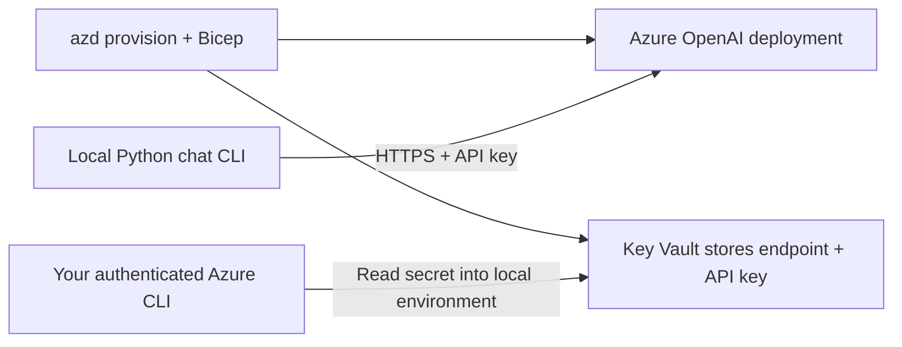

# Azure OpenAI Chat — Τοπικό CLI και Υποδομή AZD

**Επίπεδο:** Ενδιάμεσο · **Χρόνος:** 35–60 λεπτά συμπεριλαμβανομένης της ρύθμισης

Αυτό το δείγμα παρέχει έναν **πόρο Azure OpenAI και Key Vault**, και μετά εκτελεί ένα
διαδραστικό Python chat CLI **στον υπολογιστή σας**. Δεν φιλοξενεί web εφαρμογή
ή Container App. Το προεπιλεγμένο μοντέλο είναι `gpt-4.1`, έκδοση `2025-04-14`, με
δυναμικότητα ανάπτυξης `GlobalStandard` 20. Ελέγξτε τη διαθεσιμότητα και το όριο στον
επιλεγμένο σας τομέα πριν από την παροχή · οι ημερομηνίες ζωής του μοντέλου μπορεί να αλλάξουν.

## Μαθησιακοί στόχοι

- Παροχή υποδομής μοντέλου με Bicep και azd.
- Ανάκτηση κλειδιού API από το Key Vault χωρίς να το βάζετε στα αποτελέσματα ανάπτυξης.
- Αποστολή αιτημάτων Chat Completions και διατήρηση ιστορικού συνομιλίας.
- Ερμηνεία πλήθους token και περιορισμών εκτιμήσεων κόστους.



Δεν υπάρχει ενσωμάτωση runtime με διαχειριζόμενη ταυτότητα, πολυπεριοχική εφεδρεία,
προσαρμοσμένος περιοριστής ρυθμού, λειτουργία ροής ή φιλοξενούμενος υπολογισμός σε αυτό το δείγμα. Το SDK OpenAI
εκτελεί έως δύο επαναλήψεις για αποτυχίες που επιδέχονται επανάληψη· το CLI αναφέρει τα υπόλοιπα σφάλματα.

## Προαπαιτούμενα

- Μια τρέχουσα σταθερή έκδοση [azd](https://learn.microsoft.com/azure/developer/azure-developer-cli/install-azd)
  (δημοσιευμένη έκδοση την ώρα της επισκόπησης: 1.37.2).
- [Azure CLI](https://learn.microsoft.com/cli/azure/install-azure-cli).
- Python **3.10+** (συνιστάται 3.11) και εικονικό περιβάλλον.
- Μια συνδρομή Azure με δικαίωμα δημιουργίας υπηρεσιών Cognitive Services και Key Vault
  πόρων, ανάπτυξης μοντέλων και ανάγνωσης των μυστικών του vault.
- Περιφερειακή διαθεσιμότητα και όριο `GlobalStandard` για `gpt-4.1`. Οι απαιτήσεις πρόσβασης
  εξαρτώνται από τη συνδρομή και τη δυνατότητα· δεν υπάρχει εγγυημένος χρόνος έγκρισης.

```bash
azd version
az version
python --version
azd auth login
az login
```

Αυτές είναι ξεχωριστές συνεδρίες πιστοποίησης. Επιλέξτε την ίδια συνδρομή και στα δύο
εργαλεία πριν εκτελέσετε τις παρακάτω εντολές.

## Γρήγορη εκκίνηση (Bash)

Εκτελέστε από τη ρίζα του αποθετηρίου:

```bash
cd examples/azure-openai-chat
azd env new myopenai
azd provision
```

Επιλέξτε μία υποστηριζόμενη περιοχή. Η παροχή δημιουργεί μια ομάδα πόρων, λογαριασμό OpenAI,
ανάπτυξη μοντέλου, Key Vault και τα μυστικά `openai-endpoint`/`openai-api-key`.
Δεν υπάρχουν **υπηρεσίες προς ανάπτυξη** στο `azure.yaml`.

Φορτώστε τα μη μυστικά αποτελέσματα και πάρτε το μυστικό στο τρέχον shell σας:

```bash
export AZURE_OPENAI_ENDPOINT="$(azd env get-value AZURE_OPENAI_ENDPOINT)"
export AZURE_OPENAI_MODEL="$(azd env get-value AZURE_OPENAI_MODEL)"
KV_NAME="$(azd env get-value AZURE_KEY_VAULT_NAME)"
export AZURE_OPENAI_API_KEY="$(az keyvault secret show \
  --vault-name "$KV_NAME" --name openai-api-key --query value --output tsv)"

python -m venv .venv
source .venv/bin/activate
python -m pip install -r src/requirements.txt
python src/chat.py
```

Στο PowerShell, ενεργοποιήστε με `.\.venv\Scripts\Activate.ps1` και αναθέστε μεταβλητές περιβάλλοντος
με `$env:AZURE_OPENAI_ENDPOINT = azd env get-value AZURE_OPENAI_ENDPOINT`
(και παρόμοια για το μοντέλο). Αντλήστε το κλειδί API χρησιμοποιώντας
`$env:AZURE_OPENAI_API_KEY = az keyvault secret show --vault-name $KV_NAME --name openai-api-key --query value -o tsv`.
Ορίστε πρώτα το `$KV_NAME = azd env get-value AZURE_KEY_VAULT_NAME`.

Μη τυπώνετε, δεσμεύετε ή επικολλάτε το κλειδί API σε αναφορές θεμάτων. Η CLI διαβάζει τη διαδικασία
μεταβλητές περιβάλλοντος· **δεν** ανακτά μυστικά από το Key Vault ούτε φορτώνει αρχεία `.env`.
`config.py` επαληθεύει το endpoint, το όριο token και τη θερμοκρασία κατά την εκκίνηση.

Αναμενόμενη έξοδος (περιεχόμενο και χρήση διαφέρουν):

```text
Azure OpenAI Chat Application
Model: gpt-4.1
...
You: Say hello in one sentence.
Assistant: Hello! How can I help you today?
[Tokens: ... | Cost: $...]
```

Εντολές: `stats` εμφανίζει συνολικά, `clear` καθαρίζει το ιστορικό συνομιλίας, και
`quit`/`exit` τερματίζει τη συνεδρία. Δεν υπάρχουν εντολές `--stream`, `--show-tokens`, `tokens`,
ή `cost`.

## Επαλήθευση της ανάπτυξης

Μετά τη φόρτωση των παραπάνω μεταβλητών κελύφους:

```bash
curl --fail-with-body \
  "${AZURE_OPENAI_ENDPOINT%/}/openai/deployments/${AZURE_OPENAI_MODEL}/chat/completions?api-version=2024-10-21" \
  -H "Content-Type: application/json" \
  -H "api-key: $AZURE_OPENAI_API_KEY" \
  -d '{"messages":[{"role":"user","content":"Say hello!"}],"max_tokens":50}'

az keyvault secret list --vault-name "$KV_NAME" --query "[].name" -o table
```

Επιτυχία: το API επιστρέφει HTTP 200 με `choices[0].message.content` και `usage`·
το vault απαριθμεί `openai-api-key` και `openai-endpoint`. Μόνη η επιτυχής ανάπτυξη ARM
δεν επαληθεύει την έμμεση συλλογιστική.

## Αρχεία και διαμόρφωση

```text
azure.yaml                         # Infrastructure-only AZD project
infra/main.bicep                   # Subscription deployment
infra/main.parameters.json         # Environment, location, principal ID
infra/resources/openai.bicep       # Account + model
infra/resources/keyvault.bicep     # Vault + deploying user's secret access policy
infra/resources/secrets.bicep      # Writes secrets, no key output
src/chat.py                        # Interactive CLI
src/config.py                      # Environment validation
src/requirements.txt               # Python packages
```

Για να αλλάξετε το προ-εγκατεστημένο μοντέλο/έκδοση/χωρητικότητα, επεξεργαστείτε τις προεπιλογές στο
`infra/main.bicep` και εκτελέστε `azd provision`. Η ρύθμιση `AZURE_OPENAI_MODEL` στο
κέλυφός σας επιλέγει μόνο ένα **υφιστάμενο όνομα ανάπτυξης**· δεν αναπτύσσει άλλο μοντέλο.

| Μεταβλητή χρόνου εκτέλεσης | Προεπιλογή / πηγή |
|---|---|
| `AZURE_OPENAI_ENDPOINT` | Απαιτείται· έξοδος azd που δεν είναι μυστική |
| `AZURE_OPENAI_API_KEY` | Απαιτείται· ανάλυση από Key Vault |
| `AZURE_OPENAI_MODEL` | `gpt-4.1`· όνομα ανάπτυξης Azure |
| `AZURE_OPENAI_MAX_TOKENS` | 800 (εύρος επικύρωσης 1–4096) |
| `AZURE_OPENAI_TEMPERATURE` | 0.7 (εύρος 0–2) |
| `AZURE_OPENAI_INPUT_PRICE_PER_1K` | 0.002 USD· ενδεικτικός ρυθμός εισόδου χωρίς cache |
| `AZURE_OPENAI_OUTPUT_PRICE_PER_1K` | 0.008 USD· ενδεικτικός ρυθμός εξόδου |

## Κόστη και περιορισμοί ασφαλείας

Η εμφάνιση κόστους είναι μια **εκτίμηση**, όχι τιμολόγηση Azure. Πολλαπλασιάζει τη χρήση token API
με τους ρυθμισμένους συντελεστές και δεν λαμβάνει υπόψη εκπτώσεις εισόδου με cache,
περιφερειακές/διαφορές SKU, φόρους, αλλαγές τιμών ή αποτυχημένες/επανειλημμένες κλήσεις.
Πάντα παρακαμφθείτε **και οι δύο συντελεστές** όταν χρησιμοποιείτε άλλο μοντέλο ή SKU και επαληθεύστε την τρέχουσα
[Τιμολόγηση Azure OpenAI](https://azure.microsoft.com/pricing/details/cognitive-services/openai-service/).

Για παράδειγμα, 100 αιτήματα χρησιμοποιώντας 500 μη προσωρινά αποθηκευμένους εισαγωγικούς και 200 εξαγωγικούς χαρακτήρες το καθένα
με τις προεπιλεγμένες τιμές κοστίζουν `100 × (500/1000 × .002 + 200/1000 × .008) = $0.26`.
Οι λειτουργίες/αποθήκευση του Key Vault επιβαρύνονται με ξεχωριστά τέλη. Δεν υπάρχει σταθερή χρέωση $50/μήνα
για αυτό το τοπικό CLI και δεν υπάρχει φιλοξενούμενος υπολογιστής στο πρότυπο.

Το vault χρησιμοποιεί πολιτική πρόσβασης για τον κύριο που υλοποιεί· δεν είναι παράδειγμα εφαρμογής RBAC ή
με διαχειριζόμενη ταυτότητα. Χρησιμοποιούνται δημόσια σημεία πρόσβασης και αυθεντικοποίηση με API key
για διδακτικούς σκοπούς. Περιορίστε τα δικαιώματα και προσθέστε κατάλληλους ελέγχους ταυτότητας/δικτύου
πριν το προσαρμόσετε για παραγωγή.

## Πρακτικές ασκήσεις

### 1. Επαλήθευση συμφραζομένων και επαναφορά τους

**Έναρξη:** εκτέλεση CLI. **Στόχος:** παρατηρήστε το ιστορικό.
Πείτε «Θυμήσου τη λέξη cedar», μετά ρωτήστε «Ποια λέξη σου ζήτησα να θυμηθείς;»
Εκτελέστε `stats`· δύο επιτυχημένες στροφές θα μετρηθούν ως δύο ανταλλαγμένα μηνύματα.
Εκτελέστε `clear` και `stats`· τα ανταλλαγμένα μηνύματα θα είναι μηδέν (τα αθροίσματα χαρακτήρων παραμένουν).
Η ακριβής διατύπωση του μοντέλου δεν είναι ντετερμινιστική.

### 2. Αλλαγή ορίου απόκρισης

**Έναρξη:** έξοδος από το CLI, διατηρώντας το ίδιο τελικό περιβάλλον.
Εκτελέστε `export AZURE_OPENAI_MAX_TOKENS=100`, επανεκκινήστε `python src/chat.py`, και ζητήστε
μια σύντομη εξήγηση του azd. Ελέγξτε ότι το πανό δείχνει 100.
Επαναφέρετε με `unset AZURE_OPENAI_MAX_TOKENS`. Ένα μικρότερο όριο απόκρισης δεν
μειώνει τους ήδη αποσταλθέντες χαρακτήρες ιστορικού.

### Συχνά προβλήματα

- **Λείπουν μεταβλητές περιβάλλοντος:** η προμήθεια δεν εξάγει τιμές κελύφους·
  επαναλάβετε τα βήματα εξαγωγής. Ένα νέο τερματικό τις χρειάζεται ξανά.
- **403 ανάγνωση Key Vault:** επαληθεύστε τη συνδρομή/σύνδεση Azure CLI και τον κύριο
  στην πολιτική πρόσβασης του vault. Οι αλλαγές πολιτικής μπορεί να χρειαστούν χρόνο για να διαδοθούν.
- **404 εξαγωγή:** ελέγξτε το όνομα υλοποίησης, το endpoint, και την κατάσταση υλοποίησης.
- **429 εξαγωγή:** περιμένετε να επαναρυθμιστούν τα όρια ρυθμού· επαληθεύστε το περιφερειακό όριο μοντέλου.
  Το CLI αφαιρεί αποτυχημένες στροφές από το ιστορικό ώστε η επανεκτέλεση να μην τις διπλοκαταγράψει.
- **Μήκος συμφραζομένων:** το παράδειγμα δεν περικόπτει μακρές συνομιλίες· χρησιμοποιήστε `clear`.
- **Μοντέλο μη διαθέσιμο/αποσυρμένο:** συμβουλευτείτε την τρέχουσα διαθεσιμότητα μοντέλου και ενημερώστε
  το μοντέλο/έκδοση/SKU μαζί· η έκδοση API και η έκδοση μοντέλου είναι διαφορετικές ρυθμίσεις.

## Καθαρισμός και επόμενα βήματα

```bash
azd down
unset AZURE_OPENAI_API_KEY
```

Η διατήρηση μαλακού διαγραφής του Key Vault είναι επτά ημέρες· η πλήρης διαγραφή απαιτεί ξεχωριστά δικαιώματα.
Δεν υπάρχει δεσμευμένο σύνολο δοκιμών· μην εκτελείτε την ανύπαρκτη εντολή `pytest tests/`.
Προσθέστε ψευδο-δοκιμές API πριν επεκτείνετε τον κώδικα.

[Παραδείγματα Container](../../../../examples/container-app) · [Πρότυπο αρχιτεκτονικής λιανικής](../retail-scenario.md) ·
[Αρχική σελίδα μαθήματος](../../README.md) · [Αναφορά προβλήματος](https://github.com/microsoft/AZD-for-beginners/issues)

---

<!-- CO-OP TRANSLATOR DISCLAIMER START -->
**Αποποίηση ευθυνών**:
Αυτό το έγγραφο έχει μεταφραστεί χρησιμοποιώντας την υπηρεσία μετάφρασης με τεχνητή νοημοσύνη [Co-op Translator](https://github.com/Azure/co-op-translator). Ενώ επιδιώκουμε την ακρίβεια, παρακαλούμε να έχετε υπόψη ότι οι αυτοματοποιημένες μεταφράσεις ενδέχεται να περιέχουν λάθη ή ανακρίβειες. Το πρωτότυπο έγγραφο στη μητρική του γλώσσα πρέπει να θεωρείται η αυθεντική πηγή. Για κρίσιμες πληροφορίες, συνιστάται επαγγελματική ανθρώπινη μετάφραση. Δεν φέρουμε ευθύνη για τυχόν παρεξηγήσεις ή λανθασμένες ερμηνείες που προκύπτουν από τη χρήση αυτής της μετάφρασης.
<!-- CO-OP TRANSLATOR DISCLAIMER END -->