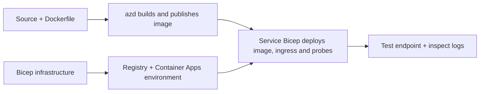

# Παραδείγματα Ανάπτυξης Container App με AZD

Αυτός ο κατάλογος περιέχει δύο δείγματα εκμάθησης με πηγαίο κώδικα, Dockerfiles,
υποδομή Bicep και `azure.yaml`. Κανένα από αυτά δεν είναι έτοιμο για παραγωγή.

## Επιλέξτε ένα παράδειγμα

| Παράδειγμα | Τι υλοποιείται | Προαπαιτούμενα |
|---|---|---|
| [Απλό Flask API](../../../../examples/container-app/simple-flask-api) | Μονό CRUD API Python, αντικείμενα στη μνήμη, probes υγείας, HTTP scaling | Βασικές γνώσεις CLI και HTTP |
| [Δύο υπηρεσίες μικροϋπηρεσιών](../../../../examples/container-app/microservices) | Πύλη Node.js, εσωτερική υπηρεσία προϊόντος Python για ανάγνωση μόνο, τηλεμετρία και scaling | Πρώτα ολοκληρώστε το δείγμα με μία υπηρεσία |

Προβλέψτε 30–60 λεπτά συμπεριλαμβανομένης της ρύθμισης και της επαλήθευσης. Ο χρόνος προμήθειας Azure διαφέρει.

## Προαπαιτούμενα

- [Azure Developer CLI](https://learn.microsoft.com/azure/developer/azure-developer-cli/install-azd)
- [Azure CLI](https://learn.microsoft.com/cli/azure/install-azure-cli) για εντολές επαλήθευσης
- Docker με το daemon του σε λειτουργία για την κατασκευή αυτών των εικόνων container
- Συνδρομή Azure με δικαιώματα δημιουργίας πόρων και επαρκή περιφερειακή χωρητικότητα
- Bash για τα παραδείγματα shell, ή αντίστοιχες εντολές PowerShell

```bash
azd version
az version
docker info
azd auth login
az login
```

Τα δύο εργαλεία έχουν ξεχωριστές συνεδρίες σύνδεσης. Χρησιμοποιήστε μια τρέχουσα σταθερή έκδοση azd· η τρέχουσα
δημοσιευμένη έκδοση κατά το χρόνο αναθεώρησης είναι 1.37.2. Παλαιότερες ελάχιστες εκδόσεις δεν αποτελούν
εγγύηση συμβατότητας.

## Γρήγορη εκκίνηση

Από τη ρίζα του αποθετηρίου:

```bash
cd examples/container-app/simple-flask-api
azd env new flask-demo
azd up
API_URL=$(azd env get-value API_ENDPOINT)
curl --fail-with-body "${API_URL}/health"
```

Αναμενόμενο: HTTP 200 με `"status": "healthy"`. Ακολουθήστε το README του δείγματος για να δημιουργήσετε,
να διαβάσετε, να ενημερώσετε και να διαγράψετε ένα αντικείμενο, και για να ελέγξετε τα αρχεία καταγραφής.



Η αρχική παροχή χρησιμοποιεί μια δημόσια εικόνα hello-world στη θύρα 80. Οι παράμετροι αρχείων Bicep ειδικοί για την υπηρεσία
επιτρέπουν στο `azd deploy` να την αντικαταστήσει με την κατασκευασμένη εικόνα εφαρμογής
και τη σωστή θύρα εφαρμογής/ελέγχους (8000 για Flask/προϊόν, 8080 για την πύλη).
Κρατήστε αυτά τα αρχεία με τις ρυθμίσεις `azure.yaml` `module`.

## Διαμόρφωση: τι αλλάζει τι

Το `azure.yaml` επιλέγει τους φακέλους προέλευσης, γλώσσες, κεντρικούς υπολογιστές και μονάδες ανάπτυξης.
Οι πόροι CPU/μνήμης container, η είσοδος, οι έλεγχοι, οι αριθμοί αντιγράφων και οι κανόνες κλιμάκωσης ορίζονται
στο **Bicep**, όχι σε αυθαίρετες ιδιότητες υπηρεσίας `resources`, `scale` ή `regions`.

Το `azd env set SOME_VALUE ...` αποθηκεύει μια τιμή τοπικά. Αλλάζει ένα αναπτυγμένο
πόρο μόνο όταν μια παράμετρος, αντιστοίχιση περιβάλλοντος ή hook την καταναλώνει ρητά.
Αυτά τα παραδείγματα δεν καταναλώνουν `MAX_REPLICAS`, `SCALE_TO_ZERO_TIMEOUT`,
`CONTAINER_APP_REPLICA_TYPE` ή προσαρμοσμένες ρυθμίσεις canary από τις τιμές περιβάλλοντος azd.
Επεξεργαστείτε το σχετικό Bicep και εκτελέστε `azd up` για επαναφορά παροχής και ανάπτυξη.

Μην τοποθετείτε τον κώδικα της εφαρμογής κάτω από `infra/`. Το `project` πρέπει να δείχνει στον φάκελο προέλευσης
που περιέχει το Dockerfile και το αρχείο εξαρτήσεων.

## Παρακολούθηση και κόστη

- Το `azd monitor --logs` ανοίγει μια προβολή πύλης· δεν είναι ροή καταγραφής τερματικού.
  Χρησιμοποιήστε το `az containerapp logs show --follow` με το πραγματικό όνομα πόρου.
- Η απλή API γράφει καταγραφές stdout που συλλέγονται μέσω Container Apps/Log Analytics.
  Ο πόρος Application Insights που παρέχεται δεν είναι αυτόματα οπλισμένος.
- Η πύλη μικροϋπηρεσιών χρησιμοποιεί το SDK Node.js του Application Insights· η υπηρεσία Python
  εξάγει ιχνη καταγραφής εφαρμογής. Δεν είναι ρυθμισμένη η πλήρης ανίχνευση αιτημάτων/εξαρτήσεων Python.

- Το scale-to-zero μπορεί να μειώσει τα έξοδα υπολογισμού, αλλά η κατανάλωση/αποθήκευση ημερολογίων και το μητρώο
  μπορεί ακόμα να κοστίζουν χρήματα. Οι προεπιλογές μικροϋπηρεσιών κρατούν αντίγραφα σε λειτουργία.
  Υπολογίστε την περιοχή και τη χρήση σας στο
  [Εργαλείο υπολογισμού κόστους Azure](https://azure.microsoft.com/pricing/calculator/).

## Προχωρημένα μοτίβα - μη περιλαμβανόμενες υλοποιήσεις

Αυτές είναι κατευθύνσεις σχεδίασης, όχι πρόσθετα τοπικά έργα ή αποσπάσματα αντιγραφής-εκτέλεσης:

- **Επίμονα δεδομένα και αυθεντικοποίηση:** αντικατάσταση αποθηκευτικών μνήμης και προσθήκη
  αυθεντικοποίησης/εξουσιοδότησης Microsoft Entra ID πριν από την παραγωγή.
- **Blue-green/canary:** χρησιμοποιήστε το πολλαπλών αναθεωρήσεων mode των Container Apps, ετικέτες αναθεώρησης,
  βάρη κυκλοφορίας, επαλήθευση υγείας και διαδικασίες επαναφοράς.
  Δεν υπάρχει ρύθμιση `deploymentStrategy: canary` azd σε αυτά τα δείγματα.
  Δείτε [διαχείριση αναθεώρησης](https://learn.microsoft.com/azure/container-apps/revisions).
- **Πολλαπλές περιοχές:** δημιουργήστε ξεχωριστά περιβάλλοντα και εφαρμογές στο Bicep και σχεδιάστε
  παγκόσμια δρομολόγηση και συνέπεια δεδομένων. Μια `regions` λίστα υπηρεσιών δεν είναι μηχανισμός ανάπτυξης azd.
- **Εργάτες ουράς:** προσθέστε πηγή εργάτη, εξαρτήσεις, πόρους ουράς, μια διαχειριζόμενη
- **Εργάτες ουράς:** προσθέστε πηγή εργαζομένου, εξαρτήσεις, πόρους ουράς, μια διαχειριζόμενη
  ταυτότητα με ρόλους data-plane, και έναν πιστοποιημένο κανόνα κλίμακας. Μην αντιγράφετε
  μια κενή διαδρομή `src/worker` και περιμένετε ένα εκτελέσιμο έργο.
- **Dapr:** παρέχετε συστατικά, ρυθμίστε το sidecar, εγκαταστήστε το αντίστοιχο SDK,
  και υλοποιήστε διαχείριση σφαλμάτων κατάστασης/pub-sub.
- **Μυστικά:** χρησιμοποιήστε διαχειριζόμενη ταυτότητα και αναθέσεις ρόλων όπου είναι δυνατόν. Απλώς
  η δημιουργία ενός Key Vault δεν δίνει πρόσβαση στις εφαρμογές ή φορτώνει μυστικά.

## Καθαρισμός

Από τον κατάλογο δειγμάτων:

```bash
azd down
```

Ελέγξτε τις ερωτήσεις διαγραφής και επιβεβαιώστε ότι η αφιερωμένη ομάδα πόρων αφαιρείται.
Μην χρησιμοποιείτε αυτά τα δείγματα ως βάση παραγωγής χωρίς επιπλέον σχεδιασμό και δοκιμές.

[Ευρετήριο παραδειγμάτων](../README.md) · [Αρχική σελίδα μαθήματος](../../README.md) ·
[Τεκμηρίωση Container Apps](https://learn.microsoft.com/azure/container-apps/) ·
[Αναφέρετε ένα πρόβλημα](https://github.com/microsoft/AZD-for-beginners/issues)

---

<!-- CO-OP TRANSLATOR DISCLAIMER START -->
**Αποποίηση ευθυνών**:
Αυτό το έγγραφο έχει μεταφραστεί χρησιμοποιώντας την υπηρεσία μετάφρασης με τεχνητή νοημοσύνη [Co-op Translator](https://github.com/Azure/co-op-translator). Ενώ επιδιώκουμε την ακρίβεια, παρακαλούμε να έχετε υπόψη ότι οι αυτοματοποιημένες μεταφράσεις ενδέχεται να περιέχουν λάθη ή ανακρίβειες. Το πρωτότυπο έγγραφο στη μητρική του γλώσσα πρέπει να θεωρείται η αυθεντική πηγή. Για κρίσιμες πληροφορίες, συνιστάται επαγγελματική ανθρώπινη μετάφραση. Δεν φέρουμε ευθύνη για τυχόν παρεξηγήσεις ή λανθασμένες ερμηνείες που προκύπτουν από τη χρήση αυτής της μετάφρασης.
<!-- CO-OP TRANSLATOR DISCLAIMER END -->