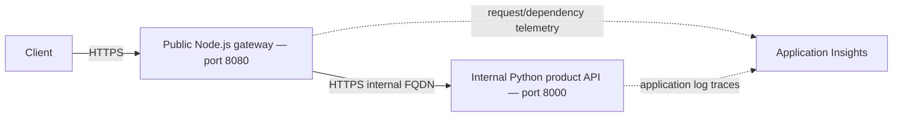

# Μικροϋπηρεσίες με δύο Υπηρεσίες — Azure Container Apps

**Επίπεδο:** Ενδιάμεσο · **Χρόνος:** 45–60 λεπτά συμπεριλαμβανομένης της ρύθμισης

Αυτό το δείγμα μάθησης υλοποιεί μια **Πύλη API Node.js** και μια **Python Υπηρεσία Προϊόντος μόνο για ανάγνωση**.
Περιλαμβάνονται ο πηγαίος κώδικας, Dockerfiles, Bicep και ρυθμίσεις azd.
Δεν είναι σύστημα έτοιμο για παραγωγή.

## Τι θα μάθετε

- Ανάπτυξη δύο υπηρεσιών ανεξάρτητα.
- Χρήση εσωτερικού backend FQDN μέσω HTTPS.
- Επαλήθευση επιτυχίας, μη ευρισκόμενων, και απαντήσεων μη διαθέσιμης υπηρεσίας.
- Κατανόηση τηλεμετρίας και ορίων ανεξάρτητης κλιμάκωσης.



Ο κατάλογος προϊόντων περιέχει πέντε σταθερά προϊόντα στη μνήμη. Δεν υπάρχουν **χειριστές POST,
PUT ή DELETE**, βάση δεδομένων, Service Bus, υπηρεσίες παραγγελίας/χρήστη/ειδοποίησης,
κώδικας C# ή Go. Αυτές είναι ιδέες μελλοντικής ανάπτυξης, όχι ενσωματωμένα χαρακτηριστικά.
Η πύλη δεν αυθεντικοποιεί χρήστες· η εσωτερική είσοδος δεν υποκαθιστά
την εξουσιοδότηση της εφαρμογής.

## Προαπαιτούμενα

Ολοκληρώστε πρώτα το [μοναδικό Flask API](../../../../../examples/container-app/simple-flask-api).
Εγκαταστήστε μια τρέχουσα σταθερή έκδοση azd (δημοσιευμένη έκδοση κατά το χρόνο ανασκόπησης: 1.37.2), το Azure CLI,
και το Docker με τον daemon σε εκτέλεση. Χρειάζεστε συνδρομή Azure, δικαιώματα δημιουργίας πόρων,
και περιφερειακό όριο Container Apps.

```bash
azd version
az version
docker info
azd auth login
az login
```

Χρησιμοποιήστε την ίδια συνδρομή και στα δύο εργαλεία CLI. Οι εντολές παρακάτω χρησιμοποιούν Bash.

## Ανάπτυξη και επαλήθευση

Από τη ρίζα του αποθετηρίου:

```bash
cd examples/container-app/microservices
azd env new microservices-demo
azd up
GATEWAY_URL=$(azd env get-value API_GATEWAY_URL)
RG_NAME=$(azd env get-value AZURE_RESOURCE_GROUP)
GATEWAY_NAME=$(azd env get-value API_GATEWAY_NAME)
PRODUCT_NAME=$(azd env get-value PRODUCT_SERVICE_NAME)

curl --fail-with-body "${GATEWAY_URL}/health"
curl --fail-with-body "${GATEWAY_URL}/api/products"
curl --fail-with-body "${GATEWAY_URL}/api/products/1"
curl -i "${GATEWAY_URL}/api/products/999"
```

**Επιτυχία:** health 200; list 200 με **πέντε** προϊόντα; το προϊόν 1 είναι ένα Laptop
τιμολογημένο στα 999.99 με απόθεμα 50; το άγνωστο προϊόν επιστρέφει 404.
Περιγραφές περιλαμβάνονται στις απαντήσεις· οι χρονικές σήμανσεις ποικίλουν.

Η αρχική παροχή χρησιμοποιεί δημόσιες εικόνες hello-world στην θύρα 80 ώστε να μην προσπαθεί
να τραβήξει ανύπαρκτες εικόνες από άδειο μητρώο. Τα συγκεκριμένα για υπηρεσία Bicep modules
και αρχεία παραμέτρων τα αντικαθιστούν με κατασκευασμένες εικόνες και θύρες/ελέγχους εφαρμογών κατά την
`azd deploy`. Οι κύριες παράμετροι διατηρούν τα ονόματα των δημοσιευμένων εικόνων για μελλοντική παροχή.

## Υπηρεσίες και δικτύωση

| Υπηρεσία | Εκτεθημένα σημεία πρόσβασης | Προεπιλεγμένοι πόροι |
|---|---|---|
| Πύλη | GET `/`, `/health`, `/api/products`, `/api/products/:id` | 1 vCPU, 2 GiB, 2–20 αντίγραφα |
| Προϊόν | GET `/`, `/health`, `/products`, `/products/<id>` | 0.5 vCPU, 1 GiB, 1–10 αντίγραφα |

Ο εσωτερικός δρόμος του προϊόντος έχει `external: false` και `allowInsecure: false`. Το Bicep ενσωματώνει
`PRODUCT_SERVICE_URL=https://<actual-internal-fqdn>` στην πύλη. Το HTTP θα
ανακατευθύνει· το HTTPS ταιριάζει με την διαμορφωμένη είσοδο. Ένα σύντομο DNS όνομα πρέπει να ταιριάζει με το
**πραγματικό όνομα Container App**, όχι το λογικό κλειδί υπηρεσίας `product-service`.
Μην προσπαθήσετε να καλέσετε απευθείας το εσωτερικό URL από το φορητό σας υπολογιστή.

Η πύλη έχει χρόνο αναμονής πέντε δευτερολέπτων για κλήσεις προϊόντος. Τα λείποντα ID προϊόντος
διαδίδονται ως 404· αστοχίες μεταφοράς/άλλες βλάβες backend επιστρέφουν 503. Η πύλη
`/health` ελέγχει μόνο την πύλη, όχι τη διαθεσιμότητα backend.

## Αρχεία και ρύθμιση

```text
azure.yaml
infra/main.bicep
infra/main.parameters.json
infra/abbreviations.json
infra/core/container-apps-environment.bicep
infra/core/monitor.bicep
infra/app/api-gateway.bicep
infra/app/api-gateway.parameters.json
infra/app/product-service.bicep
infra/app/product-service.parameters.json
src/api-gateway/{app.js,package.json,Dockerfile}
src/product-service/{main.py,requirements.txt,Dockerfile}
```

Η κλιμάκωση, CPU/μνήμη, θύρες και έλεγχοι ορίζονται στο `infra/app/*.bicep`. Αλλάξτε αυτά
τα αρχεία και τρέξτε `azd up` για να εφαρμόσετε την υποδομή και να αναπτύξετε ξανά. Δεν υπάρχει
παράμετρος `GATEWAY_MAX_REPLICAS` μεταβλητής περιβάλλοντος σε αυτό το δείγμα.

Για αλλαγές μόνο στον κώδικα:

```bash
azd deploy product-service
azd deploy api-gateway
```

Η εικόνα Node χρησιμοποιεί Node 22· η εικόνα Python χρησιμοποιεί Python 3.11. Και οι δύο δεσμεύονται στη
`0.0.0.0`. Η είσοδος/οι έλεγχοι χρησιμοποιούν θύρα 8080 (πύλη) και 8000 (προϊόν), αντίστοιχα.

## Τοπική ανάπτυξη με Docker

Τρέξτε από αυτόν τον φάκελο παραδείγματος. Χρησιμοποιήστε ένα δίκτυο ορισμένο από τον χρήστη, **όχι `localhost`
από ένα κοντέινερ για να φτάσει στο άλλο**:

```bash
docker network create azd-microservices-demo
docker build -t local-product ./src/product-service
docker build -t local-gateway ./src/api-gateway
docker run -d --name azd-product --network azd-microservices-demo local-product
docker run -d --name azd-gateway --network azd-microservices-demo \
  -p 8080:8080 -e PRODUCT_SERVICE_URL=http://azd-product:8000 local-gateway
curl --fail-with-body http://localhost:8080/api/products
```

Αναμενόμενο: πέντε προϊόντα. Το HTTP χρησιμοποιείται μόνο για αυτό το τοπικό δίκτυο Docker.

```bash
docker stop azd-product azd-gateway
docker rm azd-product azd-gateway
docker network rm azd-microservices-demo
```

## Παρακολούθηση

```bash
az containerapp logs show --name "$GATEWAY_NAME" --resource-group "$RG_NAME" --follow
# In a separate terminal:
az containerapp logs show --name "$PRODUCT_NAME" --resource-group "$RG_NAME" --tail 100
```

`azd monitor --logs` ανοίγει μια προβολή portal· δεν ρολάει αρχεία καταγραφής τερματικού.
Το Node SDK συλλέγει αιτήματα/εξαρτήσεις πύλης. Το Python `AzureLogHandler`
εξάγει **ίχνη καταγραφής**, όχι αυτόματα αιτήματα Flask, εξαρτήσεις SQL ή πλήρη
κατανεμημένα ίχνη. Το OpenCensus είναι SDK κληρονομιάς· προτιμήστε το Azure Monitor OpenTelemetry
όταν επεκτείνετε αυτό το δείγμα.

Στα Application Insights Logs, δημιουργήστε αιτήματα και ελέγξτε:

```kusto
requests
| where timestamp > ago(1h)
| where name contains "products"
| summarize RequestCount=count(), AvgDuration=avg(duration) by bin(timestamp, 5m)
```

Για μηνύματα εφαρμογής Python:

```kusto
traces
| where timestamp > ago(1h)
| where message contains "products"
| project timestamp, message, severityLevel
```

Επιτρέψτε καθυστέρηση επεξεργασίας και δειγματοληψία· μην περιμένετε ακριβή αριθμό αιτημάτων ή
εγγυημένη λανθάνουσα κατάσταση. Δεν ρυθμίζονται προσαρμοσμένες ειδοποιήσεις ή πίνακες.

## Πρακτικές ασκήσεις

### Άσκηση 1: Τροποποιήστε τον κατάλογο

**Σημείο εκκίνησης:** `src/product-service/main.py`.
**Στόχος:** επαλήθευση ανεξάρτητης ανάπτυξης υπηρεσίας.
Αλλάξτε το απόθεμα του Laptop από 50 σε 49 στη σταθερή λίστα `products`, τρέξτε
`azd deploy product-service`, και ζητήστε `${GATEWAY_URL}/api/products/1`.

**Κριτήρια επιτυχίας / λύση:** HTTP 200 με `"stock":49`. Επαναφέρετε 50 και αναπτύξτε ξανά.
**Συχνό σφάλμα:** επεξεργασία της πύλης αντί της υπηρεσίας που κατέχει τον κατάλογο.
Αυτή η αλλαγή αφορά δεδομένα πηγής, όχι μια επίμονη βάση δεδομένων αποθέματος.

### Άσκηση 2: Επαλήθευση ρύθμισης αντιγράφων

**Σημείο εκκίνησης:** `infra/app/product-service.bicep`.
**Στόχος:** παρατηρήστε μια αλλαγή υποδομής χωρίς υποθέσεις για αυτόματη κλιμάκωση.
Αλλάξτε `minReplicas: 1` σε `minReplicas: 2`, τρέξτε `azd up`, και μετά:

```bash
az containerapp show --name "$PRODUCT_NAME" --resource-group "$RG_NAME" \
  --query properties.template.scale -o json
```

**Κριτήρια επιτυχίας:** το ελάχιστο διαμορφωμένο είναι 2 και το μέγιστο παραμένει 10.
Επαναφέρετε το ελάχιστο σε 1 και τρέξτε `azd up`.
**Συχνό σφάλμα:** `azd deploy` μόνο του δεν εφαρμόζει αλλαγές σε μη συσχετισμένη κοινή
υποδομή. Μην ορίσετε `maxReplicas` σε μηδέν ως προσομοίωση αποτυχίας.
Αυτό επαληθεύει τη ρύθμιση, όχι ένα τεστ φόρτωσης ή εγγυημένο στιγμιαίο αριθμό αντιγράφων.

### Άσκηση 3: Δοκιμή διαχείρισης μη διαθέσιμης υπηρεσίας τοπικά

**Σημείο εκκίνησης:** και τα δύο τοπικά κοντέινερ Docker παραπάνω τρέχουν.
**Στόχος:** διάκριση αποτυχίας backend από λείπον προϊόν.
Σταματήστε μόνο το κοντέινερ προϊόντος:

```bash
docker stop azd-product
curl -i http://localhost:8080/api/products
docker start azd-product
curl --fail-with-body http://localhost:8080/api/products
```

**Κριτήρια επιτυχίας:** ενώ είναι σταματημένο, η πύλη επιστρέφει 503 με
`"error":"Product service unavailable"`· μετά την επανεκκίνηση, η λίστα επιστρέφει 200.
Επαναλάβετε μετά από μικρή καθυστέρηση εκκίνησης εάν χρειάζεται.
**Συχνό σφάλμα:** το να σταματήσετε την πύλη ελέγχει άλλη αποτυχία (χωρίς HTTP απάντηση).

## Κόστη και κενά παραγωγής

Τα προεπιλεγμένα ελάχιστα αντίγραφα κρατούν τον υπολογισμό σε λειτουργία. Το μητρώο και η παρακολούθηση επίσης επιφέρουν
χρεώσεις. Δεν υπάρχει επικυρωμένο συνολικό σταθερό κόστος $50/μήνα: υπολογίστε CPU/μνήμη περιφέρειας,
ώρες αντιγράφων, αιτήματα, μητρώο και διατήρηση αρχείων στο
[Azure pricing calculator](https://azure.microsoft.com/pricing/calculator/).
Διαγράψτε τους πόρους μάθησης άμεσα.

Η εργασία παραγωγής περιλαμβάνει αυθεντικοποίηση/εξουσιοδότηση, διαχειριζόμενες ταυτότητες με εύρος,
επίμονα δεδομένα, επικύρωση εισόδου/απόκρισης, υποστηριζόμενη εποπτεία οργάνων,
φόρτωση/τεστ αποτυχίας, CI/CD, ειδοποιήσεις, και διαδικασίες ανάκαμψης. Η προσθήκη υπηρεσίας παραγγελίας,
ουράς, ή βάσης δεδομένων είναι ξεχωριστή εργασία υλοποίησης, όχι ολοκληρωμένη
άσκηση ή διαθέσιμο χαρακτηριστικό εδώ.

## Αντιμετώπιση προβλημάτων και καθαρισμός

- **Εικόνα δεν βρέθηκε κατά την πρώτη παροχή:** bootstrap πρέπει να χρησιμοποιεί την δημόσια εικόνα·
  ελέγξτε τις προεπιλεγμένες παραμέτρους εικόνας και την αντιστοίχιση μονάδων ανάπτυξης.
- **503 προϊόντα:** ελέγξτε τα αρχεία καταγραφής προϊόντων, την αναθεώρηση εικόνας, και το ενσωματωμένο εσωτερικό URL HTTPS.
- **404 απροσδόκητη διαδρομή:** το API προϊόντος είναι μόνο για ανάγνωση· ελέγξτε τη διαδρομή, όχι έναν ανύπαρκτο χειριστή CRUD.
- **Καμία τηλεμετρία:** ελέγξτε τις συνδέσεις χρόνου εκτέλεσης χωρίς να τις εκθέτετε και
  επιτρέψτε καθυστέρηση επεξεργασίας. Οι πίνακες αιτημάτων Python δεν γεμίζουν από τον χειριστή καταγραφής.

Από αυτόν τον φάκελο δείγματος:

```bash
azd down
```

Επανεξετάστε τις προτροπές διαγραφής και βεβαιωθείτε ότι η αφιερωμένη ομάδα πόρων έχει αφαιρεθεί.

[Προηγούμενο: Flask API](../../../../../examples/container-app/simple-flask-api) · [Επόμενο: Εφαρμογή βάσης δεδομένων](../../../../../examples/database-app) ·
[Ανάπτυξη AI](../../../docs/chapter-02-ai-development/README.md) ·
[Αρχική σελίδα μαθήματος](../../../README.md) · [Αναφέρετε ένα ζήτημα](https://github.com/microsoft/AZD-for-beginners/issues)

---

<!-- CO-OP TRANSLATOR DISCLAIMER START -->
**Αποποίηση ευθυνών**:
Αυτό το έγγραφο έχει μεταφραστεί χρησιμοποιώντας την υπηρεσία μετάφρασης με τεχνητή νοημοσύνη [Co-op Translator](https://github.com/Azure/co-op-translator). Ενώ επιδιώκουμε την ακρίβεια, παρακαλούμε να έχετε υπόψη ότι οι αυτοματοποιημένες μεταφράσεις ενδέχεται να περιέχουν λάθη ή ανακρίβειες. Το πρωτότυπο έγγραφο στη μητρική του γλώσσα πρέπει να θεωρείται η αυθεντική πηγή. Για κρίσιμες πληροφορίες, συνιστάται επαγγελματική ανθρώπινη μετάφραση. Δεν φέρουμε ευθύνη για τυχόν παρεξηγήσεις ή λανθασμένες ερμηνείες που προκύπτουν από τη χρήση αυτής της μετάφρασης.
<!-- CO-OP TRANSLATOR DISCLAIMER END -->