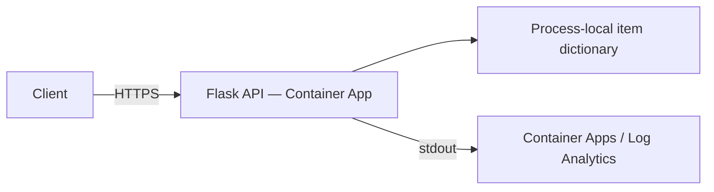

# Απλή Flask API — Azure Container Apps

**Επίπεδο:** Αρχάριος · **Χρόνος:** 30–45 λεπτά συμπεριλαμβανομένης της εγκατάστασης

Αναπτύξτε μια Python Flask CRUD API με το Azure Developer CLI (azd). Περιλαμβάνονται ο κώδικας, το Dockerfile,
τα Bicep και οι παράμετροι ανάπτυξης. Πρόκειται για ένα **παράδειγμα μάθησης**, όχι
μια API έτοιμη για παραγωγή.

## Τι θα μάθετε

- Δημιουργήστε και δημοσιεύστε ένα container μέσω azd.
- Διαμορφώστε το ingress και τα liveness/readiness probes.
- Επαληθεύστε τις απαντήσεις CRUD και εξετάστε τα αρχεία καταγραφής εφαρμογής.
- Κατανοήστε γιατί τα δεδομένα στη μνήμη δεν είναι κατάλληλα για ανθεκτικές εφαρμογές.



**Σημαντικό:** τα αντικείμενα διατηρούνται σε μία διαδικασία. Η προεπιλογή είναι **ένας worker Gunicorn,
0–1 αντίγραφα**, αποφεύγοντας σκόπιμα ασυνεπή δεδομένα μεταξύ εργαζομένων/αντιγράφων.
Τα αντικείμενα χάνονται σε επανεκκίνηση, αλλαγή έκδοσης ή κλιμάκωση σε μηδέν αντίγραφα. Η αύξηση των αντιγράφων
απαιτεί κοινόχρηστο μόνιμο αποθηκευτικό χώρο. Η API δεν έχει αυθεντικοποίηση ή εξουσιοδότηση.

## Προαπαιτούμενα

- [Τρέχον αξιόπιστο azd](https://learn.microsoft.com/azure/developer/azure-developer-cli/install-azd)
  (δημοσιευμένη έκδοση κατά τον χρόνο αξιολόγησης: 1.37.2).
- [Azure CLI](https://learn.microsoft.com/cli/azure/install-azure-cli) για τον έλεγχο.
- Docker με το daemon να τρέχει· απαιτείται για τη δημιουργία τοπικής εικόνας από προεπιλογή.
- Συνδρομή Azure, δικαιώματα δημιουργίας πόρων και περιφερειακό όριο Container Apps.
- Bash για τις παρακάτω εντολές (ή ισοδύναμο PowerShell).
- Python 3.11 για προαιρετική τοπική ανάπτυξη.

```bash
azd version
az version
docker info
azd auth login
az login
```

Τα εργαλεία CLI έχουν ξεχωριστές συνεδρίες σύνδεσης. Χρησιμοποιήστε την ίδια συνδρομή και στα δύο.

## Γρήγορη εκκίνηση

Από τη ρίζα του αποθετηρίου:

```bash
cd examples/container-app/simple-flask-api
azd env new flask-demo
azd up
API_URL=$(azd env get-value API_ENDPOINT)
RG_NAME=$(azd env get-value AZURE_RESOURCE_GROUP)
API_NAME=$(azd env get-value API_NAME)
curl --fail-with-body "${API_URL}/health"
```

Αναμένεται: HTTP 200 και JSON με `"status":"healthy"`,
`"service":"simple-flask-api"`, και τρέχον χρονικό σήμα UTC.
Η προμήθεια και η δημιουργία εικόνας συνήθως διαρκούν μερικά λεπτά· οι χρόνοι ποικίλλουν.

Η αρχική προμήθεια χρησιμοποιεί μια δημόσια εικόνα hello-world που ακούει στην πόρτα 80.
`azure.yaml` επιλέγει `infra/app/api.bicep` και το αντίστοιχο αρχείο παραμέτρων για
ανάπτυξη υπηρεσίας, που αλλάζει την εικόνα, το ingress και τα probes στην πόρτα 8000.
Μην διαγράψετε αυτές τις παραμέτρους ανάπτυξης.

## Επαλήθευση CRUD

Τρέξτε τα ακόλουθα διαδοχικά όσο παραμένει ενεργό το ίδιο αντίγραφο:

```bash
# Create: HTTP 201; note the returned id (1 for a fresh process).
curl -i -X POST "${API_URL}/api/items" \
  -H "Content-Type: application/json" \
  -d '{"name":"Test Item","description":"My first item"}'

# Read list: HTTP 200, total 1 in a fresh process.
curl --fail-with-body "${API_URL}/api/items"

# Replace 1 if your create response returned another id.
curl --fail-with-body "${API_URL}/api/items/1"
curl -i -X PUT "${API_URL}/api/items/1" \
  -H "Content-Type: application/json" -d '{"name":"Updated Item"}'
curl -i -X DELETE "${API_URL}/api/items/1"
curl -i "${API_URL}/api/items/1"
```

Επιτυχία: POST 201, reads/PUT 200, DELETE 204 χωρίς σώμα, μετά απούσα εγγραφή 404.
Λανθασμένο/μη αντικείμενο JSON ή κενό όνομα επιστρέφει 400.
Αν ένα αντικείμενο εξαφανίζεται μεταξύ αιτημάτων, ελέγξτε για επανεκκίνηση ή κλιμάκωση σε μηδέν·
αυτό είναι ένας σκόπιμος περιορισμός στη μνήμη, όχι συνεχή αποθήκευση.

| Σημείο πρόσβασης | Μέθοδοι |
|---|---|
| `/` | GET — πληροφορίες υπηρεσίας |
| `/health` | GET — liveness/readiness |
| `/api/items` | GET, POST |
| `/api/items/{id}` | GET, PUT, DELETE |

## Αρχεία καταγραφής και διαμόρφωση

```bash
az containerapp logs show --name "$API_NAME" --resource-group "$RG_NAME" --follow
```

Αναμένεται: εκκίνηση Gunicorn, αιτήματα πρόσβασης στα αρχεία καταγραφής, και μηνύματα εφαρμογής.
`azd monitor --logs` ανοίγει την προβολή portal· δεν ροή στο τερματικό.
Το Application Insights έχει προμηθευτεί αλλά **δεν είναι ορισμένο από αυτόν τον κώδικα Flask**·
χρησιμοποιήστε Container Apps/Log Analytics για stdout αρχεία καταγραφής.

Επεξεργαστείτε `infra/app/api.bicep` για CPU/μνήμη, όρια αντιγράφων ή κανόνες κλιμάκωσης, και μετά
τρέξτε `azd up`. Οι προεπιλογές είναι 0.5 vCPU, 1 GiB, ελάχιστο 0 / μέγιστο 1 αντίγραφο, και ένα
όριο HTTP των 50 ταυτόχρονων αιτημάτων. Η κλιμάκωση σε μηδέν μπορεί να προσθέσει καθυστέρηση κρύας εκκίνησης.

Τυχαίες `azd env set MAX_REPLICAS`, `API_KEY`, `LOG_LEVEL`, ή
`SCALE_TO_ZERO_TIMEOUT` τιμές **δεν συνδέονται με αυτό το πρότυπο ή την εφαρμογή**.
Η ορισμός μιας τιμής δεν την καθιστά αυτόματα μεταβλητή περιβάλλοντος χρόνου εκτέλεσης.
Η εικόνα δένεται ρητά στην πόρτα 8000· ενημερώστε το Dockerfile, το ingress Bicep και τα probes
μαζί εάν αλλάξετε την πόρτα.

## Αρχεία

```text
azure.yaml
infra/main.bicep
infra/main.parameters.json
infra/app/container-apps.bicep       # Environment, registry, monitoring
infra/app/api.bicep                  # App, ingress, probes, scale settings
infra/app/api.parameters.json        # Image and resource values for azd deploy
src/app.py
src/Dockerfile
src/requirements.txt
```

## Τοπική ανάπτυξη

Από αυτόν τον φάκελο παραδείγματος:

```bash
python -m venv .venv
source .venv/bin/activate  # PowerShell: .\.venv\Scripts\Activate.ps1
python -m pip install -r src/requirements.txt
python src/app.py
```

Σε άλλο τερματικό, δοκιμάστε `http://localhost:8000/health` και τα σημεία πρόσβασης CRUD.
Ή κατασκευάστε και τρέξτε την πραγματική εικόνα:

```bash
docker build -t flask-api:local ./src
docker run --rm -p 8000:8000 flask-api:local
```

Για αλλαγές αποκλειστικά στον κώδικα μετά την πρώτη ανάπτυξη, τρέξτε `azd deploy api`.
Για αλλαγές στο Bicep, τρέξτε `azd up` για επανεκκίνηση και ανάπτυξη.

## Πρακτικές ασκήσεις

### 1. Επικύρωση απόρριψης εισόδου

**Αφετηρία:** αναπτυγμένη API, `API_URL` παραπάνω.
**Στόχος:** επαληθεύστε ότι η API απορρίπτει άκυρες μορφές JSON και ελλείποντα ονόματα.

```bash
curl -i -X POST "${API_URL}/api/items" \
  -H "Content-Type: application/json" -d '[]'
curl -i -X POST "${API_URL}/api/items" \
  -H "Content-Type: application/json" -d '{"name":""}'
```

**Κριτήρια επιτυχίας / λύση:** και τα δύο επιστρέφουν 400 με JSON σφάλμα, όχι 500.
**Συνηθισμένο πρόβλημα:** παράλειψη της κεφαλίδας content-type JSON.

### 2. Προσθήκη endpoint μόνο για ανάγνωση

**Αφετηρία:** `src/app.py`. **Στόχος:** επεκτείνετε και αναπτύξτε ξανά την API.
Προσθέστε το πριν από το μπλοκ `if __name__ == '__main__':`:

```python
@app.route('/version', methods=['GET'])
def version():
    return jsonify({'version': '1.0.0'})
```

Τρέξτε `azd deploy api`, μετά `curl --fail-with-body "${API_URL}/version"`.
**Κριτήρια επιτυχίας:** HTTP 200 και `{"version":"1.0.0"}`.
**Συνηθισμένο πρόβλημα:** τοποθέτηση της διαδρομής μετά το αποκλειστικό κάλεσμα `app.run()` όταν
δοκιμάζετε με `python src/app.py`.

### Στάση γνώσης

Γιατί ένας worker δεν αρκεί για ανθεκτικά δεδομένα; Επειδή ακόμα και μια μόνο διαδικασία χάνει
το λεξικό της σε επανεκκίνηση. Μια έκδοση παραγωγής χρειάζεται κοινόχρηστο μόνιμο αποθηκευτικό χώρο,
αυθεντικοποίηση, εξουσιοδότηση, μεταναστεύσεις, δοκιμές και επιχειρησιακή παρακολούθηση.

## Κόστη και αντιμετώπιση προβλημάτων

Πρόκειται για ανάπτυξη που δεν είναι εγγυημένη ως δωρεάν: το Basic registry και η αποθήκευση/καταγραφή
μπορούν να επιφέρουν χρεώσεις ακόμη και όταν ο υπολογισμός της εφαρμογής είναι στο μηδέν. Χρησιμοποιήστε τον
[υπολογιστή κόστους](https://azure.microsoft.com/pricing/calculator/) για την περιοχή σας.

- **Σφάλμα δημιουργίας Docker:** επιβεβαιώστε `docker info`, πρόσβαση δικτύου και εξαρτήσεις.
- **Μη υγιής εφαρμογή:** εξετάστε τα αρχεία καταγραφής κονσόλας/συστήματος και βεβαιωθείτε ότι η πόρτα εικόνας, το ingress,
  και τα probes συμφωνούν. Ένα placeholder δεν πρέπει να ελέγχεται στην πόρτα Flask.
- **403/δικαιώματα:** επιβεβαιώστε τη συνδρομή και τα δικαιώματα δημιουργίας πόρων.
- **Εξαφάνιση αντικειμένων:** η κατάσταση στη μνήμη μηδενίζεται σε επανεκκίνηση/κλιμάκωση σε μηδέν· προσθέστε μια βάση δεδομένων
  για ανθεκτική συμπεριφορά.

## Καθαρισμός και επόμενα βήματα

```bash
azd down
```

Εξετάστε την προτροπή διαγραφής και επαληθεύστε ότι η αφιερωμένη ομάδα πόρων αφαιρείται.
Μην χρησιμοποιείτε καταστροφικό καθαρισμό σε ομάδα πόρων που περιέχει άσχετα δεδομένα.

[Επόμενο: Εφαρμογή βάσης δεδομένων](../../../../../examples/database-app) · [Μικροϋπηρεσίες](../../../../../examples/container-app/microservices) ·
[Επισκόπηση Container](../README.md) · [Αρχική σελίδα μαθήματος](../../../README.md) ·
[Αναφορά προβλήματος](https://github.com/microsoft/AZD-for-beginners/issues)

---

<!-- CO-OP TRANSLATOR DISCLAIMER START -->
**Αποποίηση ευθυνών**:
Αυτό το έγγραφο έχει μεταφραστεί χρησιμοποιώντας την υπηρεσία μετάφρασης με τεχνητή νοημοσύνη [Co-op Translator](https://github.com/Azure/co-op-translator). Ενώ επιδιώκουμε την ακρίβεια, παρακαλούμε να έχετε υπόψη ότι οι αυτοματοποιημένες μεταφράσεις ενδέχεται να περιέχουν λάθη ή ανακρίβειες. Το πρωτότυπο έγγραφο στη μητρική του γλώσσα πρέπει να θεωρείται η αυθεντική πηγή. Για κρίσιμες πληροφορίες, συνιστάται επαγγελματική ανθρώπινη μετάφραση. Δεν φέρουμε ευθύνη για τυχόν παρεξηγήσεις ή λανθασμένες ερμηνείες που προκύπτουν από τη χρήση αυτής της μετάφρασης.
<!-- CO-OP TRANSLATOR DISCLAIMER END -->