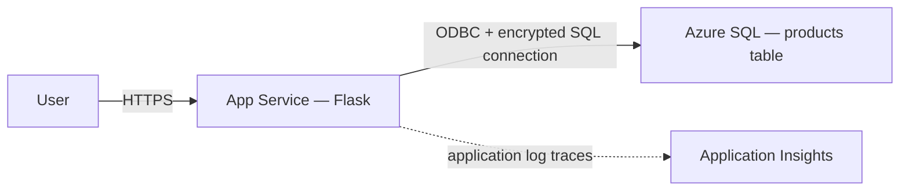

# Flask και Azure SQL στο App Service

**Επίπεδο:** Μεσαίο · **Χρόνος:** 30–60 λεπτά συμπεριλαμβανομένων των προαπαιτούμενων

Αυτό το δείγμα αναπτύσσει ένα Python Flask read API σε **Linux App Service** και μια Basic
βάση δεδομένων Azure SQL. Περιλαμβάνονται πηγαίος κώδικας, Bicep και ρυθμίσεις azd. Είναι μια
εφαρμογή εκμάθησης, όχι μια αρχιτεκτονική βάσης δεδομένων έτοιμη για παραγωγή.

## Τι θα μάθετε

- Παροχή πόρων App Service, SQL και παρακολούθησης με Bicep.
- Διαμόρφωση κρυπτογραφημένης σύνδεσης SQL χωρίς αποθήκευση διαπιστευτηρίων.
- Αρχικοποίηση ενός σχήματος πριν από την εκκίνηση των Gunicorn workers.
- Επαλήθευση σποράς δεδομένων, απαντήσεων μη εύρεσης και υγείας βάσης δεδομένων.



Πόροι: αφιερωμένη ομάδα πόρων, σχέδιο B1 Linux App Service, Python 3.11 Web
App, διακομιστής SQL και Basic βάση δεδομένων 2-GB, Application Insights και Log Analytics.
Η Web App χρησιμοποιεί **ανάπτυξη από source/ZIP και εγκατάσταση εξαρτήσεων Oryx**·
`azd deploy` δεν χτίζει ή αναπτύσσει το προαιρετικό Dockerfile.

## Προαπαιτούμενα

- Τρέχουσα σταθερή έκδοση [azd](https://learn.microsoft.com/azure/developer/azure-developer-cli/install-azd)
  (δημοσιευμένη έκδοση κατά το χρόνο αναθεώρησης: 1.37.2).
- [Azure CLI](https://learn.microsoft.com/cli/azure/install-azure-cli) για επαλήθευση.
- Συνδρομή Azure, δικαιώματα δημιουργίας των αναφερόμενων πόρων και περιφερειακά όρια.
- Python **3.11** για τοπική ανάπτυξη· το δεσμευμένο `pyodbc==5.0.1` μπορεί να απαιτεί
  εγγενή εργαλεία κατασκευής σε νεότερες εκδόσεις Python.
- Microsoft ODBC Driver 18 (ή 17) για τον SQL Server σε τοπικές μηχανές. `pip install
  pyodbc` δεν εγκαθιστά τον συστημικό οδηγό. Δείτε
  [Εγκατάσταση ODBC](https://learn.microsoft.com/sql/connect/odbc/download-odbc-driver-for-sql-server).
- Docker μόνο αν δοκιμάζετε το προαιρετικό κοντέινερ τοπικά.

```bash
azd version
az version
azd auth login
az login
```

Χρησιμοποιήστε την ίδια συνδρομή και στα δύο εργαλεία. Οι εντολές παρακάτω είναι με Bash.

## Ανάπτυξη

Από τη ρίζα του αποθετηρίου:

```bash
cd examples/database-app
azd env new sql-demo
azd provision
azd deploy
WEB_URL=$(azd env get-value WEB_APP_URI)
WEB_NAME=$(azd env get-value WEB_APP_NAME)
RG_NAME=$(azd env get-value AZURE_RESOURCE_GROUP)
```

Επιλέξτε μια υποστηριζόμενη περιοχή. `sqlAdminLogin` έχει προεπιλογή `sqladmin`· η απαιτούμενη
`sqlAdminPassword` είναι μια ασφαλής παράμετρος. Παρέχετε ισχυρό κωδικό όταν ζητηθεί.
Διατηρήστε τα διαπιστευτήρια ανάπτυξης εκτός Git και αναφορών σφαλμάτων. Ο τρέχων
συμβολοσειράς σύνδεσης αναμένει κωδικό χωρίς διαχωριστικά σύνδεσης όπως
`;`· προσαρμόστε την αποφυγή χαρακτήρων πριν τη χρήση τέτοιων τιμών.

Το Bicep ορίζει μια εντολή εκκίνησης που τρέχει `init_database()` **πριν** την
εκκίνηση των Gunicorn workers. Αυτό είναι απαραίτητο επειδή η εισαγωγή του `app:app` δεν εκτελεί
το μπλοκ `if __name__ == '__main__'` της Python. Σε μια φρέσκια βάση δεδομένων, η αρχικοποίηση
δημιουργεί `products` και εισάγει πέντε γραμμές. Είναι ένα απλό εκπαιδευτικό σπόρο, όχι
παράλληλο πλαίσιο μετανάστευσης· χρησιμοποιήστε κατάλληλες μεταναστεύσεις πριν την κλιμάκωση των περιπτώσεων.

Η εφαρμογή επιλέγει τον εγκατεστημένο Microsoft ODBC Driver 18, μετά τον 17, αν η συμβολοσειρά σύνδεσης
δεν ονομάζει ρητά οδηγό. Αν δεν υπάρχει κανένας, η εκκίνηση αποτυγχάνει με
σφάλμα εγκατάστασης που μπορεί να διορθωθεί. Επαληθεύστε τη διαθεσιμότητα οδηγού στο runtime
του App Service που έχετε επιλέξει αντί να το υποθέσετε.

## Επαλήθευση

```bash
curl --fail-with-body "${WEB_URL}/"
curl --fail-with-body "${WEB_URL}/health"
curl --fail-with-body "${WEB_URL}/products"
curl --fail-with-body "${WEB_URL}/products/1"
curl -i "${WEB_URL}/products/999"
```

Αναμενόμενο:

- `/` επιστρέφει πληροφορίες τελικού σημείου.
- `/health` επιστρέφει 200 με `{"status":"healthy","database":"connected"}`.
- `/products` επιστρέφει πέντε σπορά προϊόντα σε φρέσκο βάση.
- `/products/1` επιστρέφει Laptop με τιμή 1299.99.
- Ένα μη υπάρχον προϊόν επιστρέφει 404 με `{"error":"Product not found"}`.

Το API είναι μόνο για ανάγνωση. Δεν υπάρχει διαδρομή POST/PUT/DELETE ή UI περιηγητή.
Αποτυχία σύνδεσης βάσης δεδομένων επιστρέφει 503 από `/health`· δεν είναι επιτυχία.

## Αρχεία και ρυθμίσεις

```text
azure.yaml                         # Python App Service source deployment
infra/main.bicep
infra/main.parameters.json
infra/abbreviations.json
infra/resources/sql-server.bicep
infra/resources/sql-database.bicep
infra/resources/app-service-plan.bicep
infra/resources/web-app.bicep       # Settings + initialization/startup command
infra/resources/app-insights.bicep
src/web/app.py
src/web/requirements.txt
src/web/Dockerfile                 # Optional local container, not the azd target
.env.sample
```

`SQL_CONNECTION_STRING` περνά ως ασφαλής παράμετρος Bicep στο Web App module
και αποθηκεύεται στις ρυθμίσεις App Service, όχι στα αποτελέσματα ανάπτυξης.
`APPLICATIONINSIGHTS_CONNECTION_STRING` ρυθμίζει την εξαγωγή καταγραφών.
`SCM_DO_BUILD_DURING_DEPLOYMENT=true` ενεργοποιεί την εγκατάσταση εξαρτήσεων στην πλευρά διακομιστή.
Η ρύθμιση αυθαίρετων τιμών `azd env` δεν αλλάζει αυτόματα τις ρυθμίσεις της εφαρμογής.

Ο κανόνας `0.0.0.0` του τείχους προστασίας SQL επιτρέπει συνδέσεις από **υπηρεσίες Azure,
συμπεριλαμβανομένων συνδρομών άλλων πελατών**, υπό την προϋπόθεση πιστοποίησης SQL. Δεν είναι
περιορισμένος σε αυτήν την εφαρμογή ή συνδρομή. Η δημόσια πρόσβαση δικτύου SQL είναι ενεργή.
Χρησιμοποιήστε δικτύωση με εύρος και ταυτότητα εφαρμογής χωρίς διαχειριστικά δικαιώματα πριν την παραγωγή.

## Τοπική ανάπτυξη

Χρησιμοποιήστε Python 3.11 και εγκατεστημένο Microsoft SQL ODBC driver:

```bash
python -m venv .venv
source .venv/bin/activate  # PowerShell: .\.venv\Scripts\Activate.ps1
python -m pip install -r src/web/requirements.txt
export SQL_CONNECTION_STRING='Server=tcp:YOUR_SERVER.database.windows.net,1433;Database=YOUR_DATABASE;UID=YOUR_USER;PWD=YOUR_PASSWORD;Encrypt=yes;TrustServerCertificate=no;Connection Timeout=30;'
python src/web/app.py
```

Αντικαταστήστε τους χώρους ασφαλώς. Ένα αντιγραμμένο `.env` αρχείο **δεν φορτώνεται αυτόματα**
από αυτή την εφαρμογή. Εξάγετε τις μεταβλητές στο τρέχον περιβάλλον shell.
Για Azure SQL από φορητό υπολογιστή, επιτρέψτε προσωρινά μόνο τη δική σας δημόσια IP:

```bash
SQL_SERVER=$(azd env get-value SQL_SERVER_NAME)
MY_IP=YOUR_PUBLIC_IP
az sql server firewall-rule create -g "$RG_NAME" -s "$SQL_SERVER" \
  -n AllowMyLearningIP --start-ip-address "$MY_IP" --end-ip-address "$MY_IP"
```

Αφαιρέστε τον κανόνα μετά τη δοκιμή:

```bash
az sql server firewall-rule delete -g "$RG_NAME" -s "$SQL_SERVER" -n AllowMyLearningIP
```

Προαιρετική δοκιμή κοντέινερ από αυτόν τον κατάλογο παραδείγματος:

```bash
docker build -t sql-flask:local src/web
docker run --rm -p 8000:8000 -e SQL_CONNECTION_STRING sql-flask:local
```

Αυτή η εικόνα εγκαθιστά τον Driver 18 μέσω του αποθετηρίου πακέτων Debian 12 που ταιριάζει
στη βάση Bookworm, αρχικοποιεί τη βάση μία φορά και μετά ξεκινά Gunicorn.

## Παρακολούθηση και αντιμετώπιση προβλημάτων

Ενεργοποιήστε/παρακολουθήστε τα αρχεία εφαρμογής filesystem του App Service όταν διαγιγνώσκετε την εκκίνηση:

```bash
az webapp log config --name "$WEB_NAME" --resource-group "$RG_NAME" \
  --application-logging filesystem --level information
az webapp log tail --name "$WEB_NAME" --resource-group "$RG_NAME"
```

Αυτός ο κώδικας εξάγει **ίχνη καταγραφής** εφαρμογής μέσω ενός παλαιού χειριστή OpenCensus.
Δεν διαμορφώνει αυτόματο ιχνηλάτη αιτημάτων/εξαρτήσεων Flask, Live Metrics,
λογιστική SQL, ρυθμίσεις διάγνωσης ή ειδοποιήσεις. Αυτά απαιτούν ξεχωριστή ρύθμιση.
Για νέους μηχανισμούς, προτιμήστε το Azure Monitor OpenTelemetry.

Στα Application Insights Logs, μετά από αιτήματα API:

```kusto
traces
| where timestamp > ago(1h)
| where message contains "products" or message contains "Health check"
| project timestamp, message, severityLevel
```

Επιτρέψτε καθυστέρηση κατάποσης. Ο πίνακας αιτημάτων ή η δραστηριότητα Live Metrics δεν αποτελεί κριτήριο ολοκλήρωσης
για αυτήν την μόνο καταγραφική παρακολούθηση.

- **Λείπει ο οδηγός:** ελέγξτε το `pyodbc.drivers()` στο runtime και εγκαταστήστε έναν
  υποστηριζόμενο Microsoft ODBC driver. Ένα πακέτο Python μόνο δεν αρκεί.
- **Αποτυχία σύνδεσης:** ελέγξτε τις ρυθμίσεις SQL, τα διαπιστευτήρια, το τείχος προστασίας
  και τη συνδρομή που έχει επιλεγεί. Μην απενεργοποιείτε την κρυπτογράφηση για να παρακάμψετε σφάλμα.
- **Λείπει ο πίνακας προϊόντων:** επιβεβαιώστε ότι η εντολή εκκίνησης Bicep αναπτύχθηκε·
  η εκκίνησης μόνο `gunicorn app:app` παραλείπει την αρχικοποίηση.
- **Αποτυχία κατασκευής πακέτου:** χρησιμοποιήστε Python 3.11 ή παρέχετε εγγενή εργαλεία κατασκευής.
- **Δεδομένα με τιμή μηδέν:** το μηδέν είναι έγκυρη δεκαδική τιμή τιμής· πρέπει να σειριοποιείται ως 0.0,
  όχι `null`.

## Πρακτικές Ασκήσεις

### Άσκηση 1: Επαλήθευση συμπεριφοράς μη υπάρχοντος προϊόντος

**Σημείο εκκίνησης:** αναπτυγμένο API και `WEB_URL` παραπάνω.
**Στόχος:** διάκριση μεταξύ μη υπάρχουσας γραμμής και σπασμένης βάσης δεδομένων.
Κάντε αίτηση `/health` και `/products/999` χρησιμοποιώντας τις εντολές παραπάνω.
**Κριτήρια επιτυχίας / απάντηση:** υγεία 200, μη υπάρχον προϊόν 404 (όχι 500 ή 503).
**Συνηθισμένο πρόβλημα:** η υπόθεση ότι μια απάντηση μη εύρεσης αποδεικνύει ότι η σύνδεση SQL είναι σπασμένη.

### Άσκηση 2: Αλλαγή σπόρου τιμής

**Σημείο εκκίνησης:** Azure SQL Query Editor, συνδεδεμένο στη δείγμα-βάση.
**Στόχος:** να δείξετε ότι τα δεδομένα API αποθηκεύονται στη SQL και όχι στη μνήμη διαδικασίας.

```sql
UPDATE products SET price = 0 WHERE id = 1;
SELECT id, name, price FROM products WHERE id = 1;
```

Κάντε αίτηση `${WEB_URL}/products/1`. **Κριτήρια επιτυχίας:** η τιμή είναι `0.0`, όχι `null`.
Επαναφέρετε την τιμή:

```sql
UPDATE products SET price = 1299.99 WHERE id = 1;
```

**Συνηθισμένο πρόβλημα:** η επεξεργασία της λίστας σπόρου Python δεν ενημερώνει γραμμές ήδη στη SQL.
Μην εκτελείτε ασκήσεις σχήματος/δεδομένων σε βάση παραγωγής.

### Άσκηση 3: Προσθήκη read-only endpoint μέτρησης

**Σημείο εκκίνησης:** `src/web/app.py`.
**Στόχος:** επεκτείνετε το API χρησιμοποιώντας μια ερώτηση σύνοψης χωρίς παραμέτρους.
Προσθέστε αυτό πριν από το μπλοκ `if __name__ == '__main__':`:

```python
@app.route('/product-count')
def product_count():
    from contextlib import closing
    with closing(get_db_connection()) as conn, closing(conn.cursor()) as cursor:
        cursor.execute("SELECT COUNT(*) FROM products")
        return jsonify({'count': cursor.fetchone()[0]})
```

Τρέξτε `azd deploy web`, στη συνέχεια ζητήστε `${WEB_URL}/product-count`.
**Κριτήρια επιτυχίας:** 200 με `{"count":5}` στη φρέσκια σποριασμένη βάση.
**Συνηθισμένο πρόβλημα:** αλλαγή της διαδρομής και λήθη επαναανάπτυξης.
Για παραγωγή, προσθέστε χειρισμό σφαλμάτων/δοκιμές· αυτή η σύντομη άσκηση εστιάζει στην ερώτηση.

## Κόστη, κενά παραγωγής και καθαρισμός

Το B1 App Service και η Basic βάση χρεώνονται όσο είναι ενεργά. Η διακοπή της
Web App **δεν** διακόπτει τη χρέωση του σχεδίου App Service. Καταγραφές και αποθηκευτικός χώρος μπορούν να προσθέσουν κόστος.
Χρησιμοποιήστε τον [υπολογιστή τιμολόγησης Azure](https://azure.microsoft.com/pricing/calculator/)
για τρέχουσες περιφερειακές τιμές. Το πέρασμα σε F1 απαιτεί επίσης απενεργοποίηση `alwaysOn`·
δεν είναι απλή αντικατάσταση γραμμής. Το SQL serverless δεν είναι αυτόματα δωρεάν.

Η παραγωγή περιλαμβάνει ταυτότητα εφαρμογής με ελάχιστα προνόμια (όχι SQL admin),
ταυτοποίηση/εξουσιοδότηση, ιδιωτική δικτύωση, ασφαλείς μεταναστεύσεις, ανασκόπηση ανακύκλωσης σύνδεσης,
τηλεμετρία, λογιστική, ειδοποιήσεις, δοκιμές και διαδικασίες ανάκτησης.
Η προσωρινή αποθήκευση Redis και επιπρόσθετοι πίνακες είναι ιδέες ανάπτυξης, όχι υλοποιημένες ασκήσεις.

Από αυτόν τον κατάλογο παραδείγματος:

```bash
azd down
```

Ελέγξτε την προτροπή διαγραφής και επαληθεύστε ότι αφαιρείται η αφιερωμένη ομάδα πόρων.
Μην διαγράφετε ομάδες που περιέχουν άσχετα δεδομένα.

[Παραδείγματα Container](../../../../examples/container-app) ·
[Ανάπτυξη AI](../../docs/chapter-02-ai-development/README.md) ·
[Αρχική Σελίδα Μαθήματος](../../README.md) · [Αναφορά Σφάλματος](https://github.com/microsoft/AZD-for-beginners/issues)

---

<!-- CO-OP TRANSLATOR DISCLAIMER START -->
**Αποποίηση ευθυνών**:
Αυτό το έγγραφο έχει μεταφραστεί χρησιμοποιώντας την υπηρεσία μετάφρασης με τεχνητή νοημοσύνη [Co-op Translator](https://github.com/Azure/co-op-translator). Ενώ επιδιώκουμε την ακρίβεια, παρακαλούμε να έχετε υπόψη ότι οι αυτοματοποιημένες μεταφράσεις ενδέχεται να περιέχουν λάθη ή ανακρίβειες. Το πρωτότυπο έγγραφο στη μητρική του γλώσσα πρέπει να θεωρείται η αυθεντική πηγή. Για κρίσιμες πληροφορίες, συνιστάται επαγγελματική ανθρώπινη μετάφραση. Δεν φέρουμε ευθύνη για τυχόν παρεξηγήσεις ή λανθασμένες ερμηνείες που προκύπτουν από τη χρήση αυτής της μετάφρασης.
<!-- CO-OP TRANSLATOR DISCLAIMER END -->