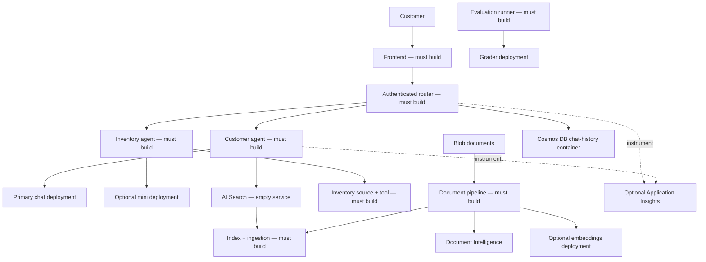

# Υποστήριξη Πελατών με Πολλαπλούς Πράκτορες — Σχεδιαστικό Μοντέλο Λιανικής

**Κεφάλαιο 5: Λύσεις Τεχνητής Νοημοσύνης με Πολλαπλούς Πράκτορες**

- [Αρχική σελίδα μαθήματος](../README.md)
- [Κεφάλαιο 5](../docs/chapter-05-multi-agent/README.md)
- [Προαπαιτούμενο: Ενσωμάτωση AI](../docs/chapter-02-ai-development/microsoft-foundry-integration.md)
- [Επόμενο: Σχεδιασμός χωρητικότητας](../docs/chapter-06-pre-deployment/capacity-planning.md)
- [Πλαίσιο υποδομής ARM](retail-multiagent-arm-template/README.md)

> **Οδηγός αρχιτεκτονικής, όχι λειτουργική εφαρμογή.** Τα μόνα αρχεία υλοποίησης
> λιανικής είναι τα `azuredeploy.json`, `azuredeploy.parameters.json`, και `deploy.sh` στο
> `retail-multiagent-arm-template/`. Τα δοχεία δρομολογητή/frontend είναι απλά δείγματα hello-world.
> Δεν υπάρχει κανένας πράκτορας λιανικής, διεπαφή χρήστη, διαδικασία εισαγωγής, αξιολογητής,
> σαρωτής ή σουίτα δοκιμών εφαρμογής τοπικά.

## Επισκόπηση

**Στόχος:** σχεδίαση συστήματος υποστήριξης πελατών με πράκτορα πελάτη και πράκτορα
αποθεμάτων, αναγνώριση των δυνατοτήτων της υποδομής και σχεδιασμός των ελλειπόντων 
συμβάσεων εφαρμογής και επαλήθευσης.

**Κοινό:** προγραμματιστές που έχουν ολοκληρώσει το τοπικό
[παράδειγμα συνομιλίας](../../../examples/azure-openai-chat) και [παράδειγμα δοχείου δύο υπηρεσιών](../../../examples/container-app/microservices).
Αφιερώνετε 2–3 ώρες για μελέτη αρχιτεκτονικής. Η κατασκευή της εφαρμογής είναι ξεχωριστό
έργο: 80–120 ώρες ανάπτυξης είναι εκτιμώμενος προγραμματισμός για
έμπειρους προγραμματιστές, **όχι υποσχέση παράδοσης**· η σταθεροποίηση παραγωγής, οι δοκιμές,
η ασφάλεια και η λειτουργία απαιτούν επιπλέον εργασία.

### Αποτελέσματα μάθησης

- Επεξήγηση δρομολόγησης, "grounding", αδειών εργαλείων και ιδιοκτησίας συνομιλίας.
- Διάκριση αναγνωριστικών μοντέλων, ονομάτων ανάπτυξης, εκδόσεων API και εκδόσεων ARM.
- Σχεδιασμός εισαγωγής και ανάκτησης εγγράφων με ταιριαστές διαστάσεις διανυσμάτων.
- Ορισμός επαληθεύσιμων λειτουργικών, αξιολογητικών και απαιτήσεων ανάκαμψης αποτυχίας.
- Διαχωρισμός προαιρετικών στόχων αρχιτεκτονικής από τους πόρους που παρέχονται πραγματικά.

## Αρχιτεκτονική Λύσης



Αυτή είναι μια **αρχιτεκτονική εφαρμογής στόχου**, όχι διάγραμμα τρεχουσών υπηρεσιών πράκτορα.
Το πλαίσιο ARM δημιουργεί μόνο τις υποκείμενες υπηρεσίες και δύο δοχεία θέσης κράτησης.
Front Door, μητρώο, διαχειριζόμενες ταυτότητες, εκχωρήσεις ρόλων,
ιδιωτικά endpoints, αποτυχία εναλλαγής, εφαρμοσμένη παρακολούθηση και ειδοποιήσεις δεν συμπεριλαμβάνονται.

### Ευθύνες και συμβάσεις

| Συστατικό | Απαιτούμενη συμπεριφορά | Αποδεικτικά πριν το θεωρήσουμε ολοκληρωμένο |
|---|---|---|
| Frontend | Πιστοποίηση χρηστών, απόδοση συνομιλίας, ασφαλής αποστολή εγγράφων | Δοκιμές UI και αποστολής, προσβάσιμα σφάλματα |
| Router | Εξουσιοδότηση αιτημάτων, επιλογή πράκτορα, περιορισμοί κλήσεων εργαλείων/χρόνου | Δοκιμές δρομολόγησης, έλεγχοι εξουσιοδότησης, δοκιμές αποτυχίας |
| Πράκτορας πελάτη | Θεμελίωση απαντήσεων πολιτικής/προϊόντος σε εγκεκριμένες πηγές | Σωστές αναφορές, αποχή όταν απουσιάζουν δεδομένα |
| Εργαλείο αποθέματος | Ανάγνωση αυθεντικών αποθεμάτων με καθορισμένα δικαιώματα | Αποφασιστικές δοκιμές αποθεμάτων· χωρίς επινοημένη διαθεσιμότητα |
| Διαδικασία εγγράφων | Εξαγωγή, διαχωρισμός, ενσωμάτωση, ευρετηρίαση, ενημέρωση/διαγραφή | Ευρετηριασμένα αρχεία και συμπεριφορά επανάληψης/νεκρής επιστολής |
| Αποθήκευση συνομιλιών | Απομόνωση χρηστών, επιβολή διατήρησης | Πόρωση εξουσιοδότησης μεταξύ χρηστών και δοκιμές TTL |
| Εκτελεστής αξιολόγησης | Σύγκριση αποτελεσμάτων με αληθινά δεδομένα και κριτήριο | Κάλυψη, καταμέτρηση αποτυχιών, αναπαραγώγιμες αναφορές |

Σκεφτείτε τον δρομολογητή ως γραφείο υποδοχής και τα εργαλεία ως περιορισμένα εσωτερικά συστήματα:
η επιλογή ειδικού δεν είναι εξουσιοδότηση πρόσβασης σε όλα τα αρχεία πελατών.
Επιβάλετε ταυτότητα και δικαιώματα στον κώδικα εφαρμογής και στις υπηρεσίες δεδομένων, όχι στα προτροπές.

## Υποδομή έναντι Εφαρμογής

Διαβάστε το [scaffold README](retail-multiagent-arm-template/README.md) πριν 
από την παροχή πόρων. Καταγράφει ακριβείς πόρους, τρόπους, κόστη και περιορισμούς.

| Λογική χρήση | Όνομα ανάπτυξης ARM | Μοντέλο / έκδοση | Προεπιλεγμένη περιοχή |
|---|---|---|---|
| Συνομιλία πελάτη | `gpt-4.1-chat` | `gpt-4.1` / `2025-04-14` | `eastus2` |
| Απόθεμα | `gpt-4.1-mini-inventory` | `gpt-4.1-mini` / `2025-04-14` | `westus2`, προαιρετικό |
| Ενσωματώσεις | `text-embedding-ada-002` | `text-embedding-ada-002` / `2` | `francecentral`, προαιρετικό |
| Αξιολόγηση | `gpt-4.1-grader` | `gpt-4.1` / `2025-04-14` | Κύρια περιοχή ως προεπιλογή |

Ελέγξτε τη διαθεσιμότητα μοντέλου/έκδοσης/SKU και τα όρια σε **κάθε περιοχή**. Η συνομιλία/mini/grader
χρησιμοποιεί `GlobalStandard`· οι ενσωματώσεις χρησιμοποιούν `Standard`. Οι συνεργασίες μονάδων χωρητικότητας με TPM
είναι συγκεκριμένες για κάθε μοντέλο. Μην προσθέτετε μη όμοιες μονάδες χωρητικότητας ως καθολική εγγύηση ορίου.

Το όρισμα `model` ενός αιτήματος Azure OpenAI είναι το **όνομα ανάπτυξης** και όχι
απαραίτητα ο αναγνωριστικός καταλόγου μοντέλου. Η έκδοση API επιπέδου δεδομένων `2024-10-21`
διαφέρει από την έκδοση μοντέλου `2025-04-14` και τον πόρο ARM `apiVersion`.
Δεν μπορεί να επιδιορθωθεί ένα μη διαθέσιμο μοντέλο απλά αλλάζοντας την έκδοση API επιπέδου δεδομένων.

Ο `--no-multi-region` παραλείπει δευτερεύοντες και λογαριασμούς ενσωμάτωσης. Παραμένει ένας κύριος συνομιλητής και
ανεξάρτητος λογαριασμός βαθμολόγησης. Ξεχωριστοί λογαριασμοί μοντέλου δεν παρέχουν αυτόματη
εφεδρεία· για αυτό απαιτείται δρομολόγηση εφαρμογής, συμβατές αναπτύξεις, έλεγχοι υγείας,
όρια επανάληψης και αξιολόγηση κατοίκησης δεδομένων.

## Οδικός Χάρτης Υλοποίησης

### 1. Ξεκινήστε με μία δοκιμασμένη αλληλεπίδραση

Πριν από την προμήθεια του μεγάλου σκελετού, χρησιμοποιήστε το τοπικό δείγμα συνομιλίας για να εδραιώσετε
τη συνδεσιμότητα συμπερασμού. Ορίστε μία αντιπροσωπευτική ερώτηση πελάτη, την εγκεκριμένη
πηγή απάντησης, την αναμενόμενη παραπομπή και τη συμπεριφορά αποτυχίας όταν αυτή η πηγή λείπει.

### 2. Ορίστε δρομολόγηση και όρια εργαλείων

Δημιουργήστε τη δική σας πηγή δρομολογητή, το μανιφέστο εξαρτήσεων, το Dockerfile και τις δοκιμές. Ένα
ενδεικτικό συμβόλαιο θα μπορούσε να είναι `POST /chat` με `{"message":"...","conversation_id":"..."}`.
**Αυτή η τελική διεύθυνση είναι πρόταση σχεδίασης· δεν υλοποιείται από το πρότυπο ARM.**

Επικυρώστε τύπους/όρια σώματος, αποσπάστε ταυτότητα χρήστη από αυθεντικοποίηση, επιβάλετε
ιδιοκτησία συνομιλίας, εφαρμόστε χρονικά όρια αιτήματος και επιστρέψτε ουσιαστικούς κωδικούς σφάλματος.
Μην αντιμετωπίζετε αποτυχίες HTTP ή κενές απαντήσεις ως επιτυχημένα αποτελέσματα πράκτορα.

### 3. Υλοποιήστε αδρανοποίηση και εισαγωγή

Το πρότυπο ARM δεν δημιουργεί ευρετήριο αναζήτησης. Αυτή είναι μία **αναφορά αποσπάσματος JSON
για προσαρμογή στον δικό σας ορισμό ευρετηρίου**, όχι αρχείο ήδη στο αποθετήριο:

```json
{
  "name": "retail-product-index",
  "fields": [
    {"name": "id", "type": "Edm.String", "key": true},
    {"name": "title", "type": "Edm.String", "searchable": true},
    {"name": "content", "type": "Edm.String", "searchable": true},
    {"name": "category", "type": "Edm.String", "filterable": true},
    {
      "name": "content_vector",
      "type": "Collection(Edm.Single)",
      "searchable": true,
      "dimensions": 1536,
      "vectorSearchProfile": "retail-profile"
    }
  ],
  "vectorSearch": {
    "algorithms": [{"name": "retail-hnsw", "kind": "hnsw"}],
    "profiles": [{"name": "retail-profile", "algorithm": "retail-hnsw"}]
  }
}
```

Το προφίλ συνδέει το πεδίο διανύσματος με τον αλγόριθμό του. Οι διαστάσεις πρέπει να ταιριάζουν με το
πραγματικό αποτέλεσμα ενσωμάτωσης (1536 για αυτή την ανάπτυξη `ada-002`). Για ανάκτηση Python,
χρησιμοποιήστε `azure.search.documents.models.VectorizedQuery` αντί για ένα ελλιπές
λεξικό που λείπει το είδος του διανύσματος ερωτήματος:

```python
# Reference function only: supply an authenticated async SearchClient and an embedding.
from azure.search.documents.models import VectorizedQuery

async def retrieve(search_client, embedding):
    results = await search_client.search(
        search_text=None,
        vector_queries=[VectorizedQuery(
            vector=embedding,
            k_nearest_neighbors=5,
            fields="content_vector"
        )],
        select=["id", "title", "content"]
    )
    return [document async for document in results]
```

Δημιουργήστε ξεχωριστή υλοποίηση εισαγωγής που:

1. Εξουσιοδοτεί πρόσβαση μεταφόρτωσης και επικυρώνει τύπο και μέγεθος περιεχομένου.
2. Διαβάζει ιδιωτικά Blob χρησιμοποιώντας αυθεντικοποιημένες κλήσεις SDK. Μία ιδιωτική διεύθυνση URL Blob από μόνη της
   **δεν είναι** αναγνώσιμη είσοδος Document Intelligence· στείλτε τα κατεβασμένα bytes με
   `AnalyzeDocumentRequest(bytes_source=...)` ή χρησιμοποιήστε ένα κατάλληλα πεπερασμένο,
   βραχύβιο SAS μετά από αξιολόγηση απαιτήσεων πρόσβασης.
3. Εξάγει κείμενο, το χωρίζει σε κομμάτια ώστε να ταιριάζει στα όρια ενσωμάτωσης και δημιουργεί ενσωματώσεις.
4. Δημιουργεί σταθερά έγκυρα κλειδιά εγγράφων και ανεβάζει τμήματα με αντιστοιχισμένα διανύσματα.
5. Ελέγχει τα αποτελέσματα ευρετηρίασης ανά έγγραφο, χειρίζεται επαναλήψεις και ενημερώνει/διαγράφει ξεπερασμένα δεδομένα.

Μην παρεμβάλλετε αυθαίρετα κλειδιά/τιμές χρήστη σε φίλτρα OData. Ενεργοποιήστε λίστες πεδίων,
επικυρώστε τύπους τιμών και αποδώστε τα αποσιωπητικά συμβόλων αλφαριθμητικών. Φίλτρα boolean και αριθμητικά
χρειάζονται τυποποιημένες λεκτικές τιμές, όχι αποσπασμένες συμβολοσειρές.

### 4. Εδραίωση διαδικτύου

**Η αναζήτηση Bing v7 αποσύρθηκε στις 11 Αυγούστου 2025.** Ο παλιός πόρος `Microsoft.Bing/accounts`
και τα παραδείγματα `api.bing.microsoft.com/v7.0/search` δεν αποτελούν υποστηριζόμενη
διαδρομή υλοποίησης. Αξιολογήστε μία τρέχουσα υποστηριζόμενη ενσωμάτωση εδραίωσης στο
Microsoft Foundry και το SDK, τα δικαιώματα, τη χρέωση και τις απαιτήσεις παραπομπής·
κανένα δεν υλοποιείται εδώ. Δεν είναι εναλλακτική λύση αντικατάστασης για τον απερχόμενο τελικό σημείο.

### 5. Προσθέστε τηλεμετρία και αξιολόγηση

Η δημιουργία Application Insights δεν οπτικοποιεί κώδικα. Χρησιμοποιήστε υποστηριζόμενη οπτικοποίηση Azure Monitor
OpenTelemetry κατά το χτίσιμο νέας εφαρμογής, διαδώστε το πλαίσιο ιχνών μεταξύ υπηρεσιών και αποφύγετε
την καταγραφή υποδείξεων πελατών, εγγράφων ή μυστικών. Η περικοπή ενός ερωτήματος δεν
το ανωνυμοποιεί.

Μετρήστε τη διάρκεια αιτήματος, αποτυχίες δρομολόγησης/εργαλείων, σχετικότητα ανάκτησης, ακρίβεια παραπομπών,
χρήση τοκενών και αποχή. Αποθηκεύστε δεδομένα πολιτικής/αποθεμάτων γείωσης
μαζί με περιπτώσεις αξιολόγησης· ένας βαθμολογητής δεν μπορεί αξιόπιστα να προσδιορίσει την πραγματική ακρίβεια
μόνο από μία ερώτηση και μία απάντηση.

Μία ανάπτυξη βαθμολογητή δεν είναι εκτελεστής αξιολόγησης. Υλοποιήστε ένα έκδοσης ρουμπρίκο,
δομημένη έξοδο/επικύρωση σχήματος, έλεγχοι εύρους βαθμολογίας, μετρήσεις αποτυχιών μεταφοράς
και περιπτώσεις ανασκόπησης από άνθρωπο. Αναφέρετε ξεχωριστά τις ατελείς/σφάλματος περιπτώσεις· μη
τις μετατρέπετε σε επιτυχημένους βαθμούς ή μη σιωπηλά σε απαντήσεις μοντέλου μηδενικής ποιότητας.

Ομοίως, λίγοι έλεγχοι λέξεων-κλειδιών δεν αποτελούν πιστοποίηση ασφάλειας. Μία αποτυχημένη αίτηση HTTP,
έλλειψη στρατηγικής δοκιμής ή κενή απάντηση πρέπει να κάνουν ένα τεστ **ασαφές ή αποτυχημένο**,
όχι να αποδίδουν «100% ασφαλές» αποτέλεσμα. Πραγματοποιήστε εγκεκριμένες δοκιμές με κατάλληλα
εργαλεία και ανθρώπινη ανασκόπηση πριν από οποιοδήποτε ισχυρισμό παραγωγικής ετοιμότητας.

### 6. Αναπτύξτε την εφαρμογή σας

Δημιουργήστε τους δικούς σας καταλόγους πηγών, μανιφέστα, δοκιμές, μητρώο και δικαιώματα ανάκτησης εικόνας.
Αντικαταστήστε δείκτες με κατασκευασμένες εικόνες και ενημερώστε τις ρυθμίσεις εισόδου/ελέγχων για
να ταιριάξουν με τη θύρα ακρόασης εκάστης εφαρμογής. Διαμορφώστε μεταβλητές περιβάλλοντος χρόνου εκτέλεσης στο Bicep
ή σε ρητό υποστηριζόμενο χαρτοφυλάκιο περιβάλλοντος azd.

Δεν υπάρχει γενικό λεξικό `config` κάτω από μία υπηρεσία azd που δημιουργεί αυτόματα
μεταβλητές περιβάλλοντος χρόνου εκτέλεσης. Το `azd env set` αλλάζει μόνο πόρους που
καταναλώνουν ρητώς αυτές τις τιμές. Δεν υλοποιείται καμία δοκιμαστική έκδοση, λίστα περιοχών ή γάντζος λεπτομερούς ρύθμισης
σε αυτόν τον σκελετό.

## Πρακτικές ασκήσεις σχεδίασης

Αυτές είναι **ασκήσεις αρχιτεκτονικής**, όχι ισχυρισμοί εκτελέσιμου κώδικα εκκίνησης.

### Άσκηση 1: Επαληθεύστε το όριο

**Σημείο εκκίνησης:** τα τρία αρχεία στο `retail-multiagent-arm-template/`.
**Στόχος:** να διαχωρίσετε την προμήθεια από τη λειτουργικότητα της εφαρμογής.
Ανοίξτε το `azuredeploy.json`, εντοπίστε τις δύο εικόνες κοντέινερ και τις τιμές `targetPort`,
έπειτα απαριθμήστε τα στοιχεία εφαρμογής που λείπουν από το αποθετήριο.

**Κριτήρια επιτυχίας / απάντηση:** και οι δύο εικόνες είναι δείκτες hello-world που ακούν στη
θύρα 80· οι πράκτορες, το UI συνομιλίας, χειριστές δρομολογητή, ευρετήριο/εισαγωγή, αξιολογητής και σαρωτής
απουσιάζουν. Ένα επιτυχές αίτημα ριζικού δείκτη δεν επικυρώνει το `/chat`.
**Συνηθισμένο πρόβλημα:** ερμηνεία ονομάτων πόρων όπως `retail-router` ως λειτουργικού κώδικα.

### Άσκηση 2: Παρακολουθήστε τη διαμόρφωση διανύσματος

**Σημείο εκκίνησης:** το παραπάνω JSON ευρετήριο.
**Στόχος:** κατανοήστε τη σχέση πεδίου → προφίλ → αλγόριθμος.
Εντοπίστε ποιες τιμές πρέπει να αλλάξουν όταν γίνεται εναλλαγή σε μοντέλο ενσωμάτωσης με
διαφορετική διάσταση εξόδου, έπειτα επιθεωρήστε τη λειτουργία `retrieve`.

**Κριτήρια επιτυχίας / απάντηση:** αλλαγή του πεδίου `dimensions` στο πραγματικό μήκος διανύσματος·
διατήρηση του `vectorSearchProfile` ευθυγραμμισμένου με δηλωμένο προφίλ και τον αλγόριθμό του·
το ερώτημα `fields` πρέπει να ονομάζει το πεδίο διανύσματος. Αναδημιουργήστε υπάρχοντα διανύσματα εγγράφων
όταν αλλάζει το μοντέλο ενσωμάτωσης.
**Συνηθισμένο πρόβλημα:** αλλαγή μόνο του ονόματος μοντέλου διατηρώντας μη συμβατά διανύσματα.

### Άσκηση 3: Ορίστε ένα τεστ αποτυχίας

**Σημείο εκκίνησης:** πίνακας αρμοδιοτήτων.
**Στόχος:** αποτροπή ψευδούς επιτυχίας.
Γράψτε την αναμενόμενη συμπεριφορά για μη διαθέσιμο API αποθεμάτων, ευρετήριο αναζήτησης χωρίς
ταιριαστά έγγραφα και αίτημα αξιολόγησης που επιστρέφει HTTP 503.

**Κριτήρια επιτυχίας / απάντηση:** χωρίς επινοημένες τιμές αποθεμάτων· ρητή αποχή ή
κλιμάκωση όταν λείπει το πλαίσιο· η αξιολόγηση αναφέρει αποτυχία μεταφοράς αντί για
ποιοτική ή ασφαλή επιτυχία. Προσθέστε εκτελέσιμες δοκιμές κατά την ανάπτυξη της εφαρμογής.
**Συνηθισμένο πρόβλημα:** να συλλαμβάνονται όλες οι εξαιρέσεις και να συνεχίζει με κενή απάντηση.

## Κόστη, αντιμετώπιση προβλημάτων και καθαρισμός

- Η υποδομή έχει συνεχιζόμενα κόστη ακόμη και με κενά ευρετήρια αναζήτησης και εφαρμογές δείκτη.
  Χρησιμοποιήστε τρέχουσες τιμές περιοχής· ούτε «ελάχιστο» ούτε πολυπεριοχικό συνεπάγεται δωρεάν.
- Τα κόστη τοκενά εξαρτώνται από το μοντέλο, εισροή με/χωρίς cache, έξοδο και SKU ανάπτυξης.
  Η δρομολόγηση μπορεί να εξοικονομήσει χρήματα μόνο εάν το μετρημένο φορτίο και τα αποτελέσματα ποιότητας το δικαιολογούν·
  δεν εγγυάται σταθερή εξοικονόμηση 60–80%.
- Ελέγξτε τη διαθεσιμότητα μοντέλου και το όριο πριν την προμήθεια· διακρίνετε άδειες,
  λάθη ονόματος ανάπτυξης, περιοχής, έκδοσης μοντέλου και έκδοσης API.
- Μην τρέχετε λείποντες `setup-data.sh`, εκτελέσιμα αξιολογητών CLI ή εντολές `pytest tests/`.
  Οι υλοποιήσεις τους είναι μέρος του χρονοδιαγράμματος ανάπτυξης σας.
- Ο σκελετός είναι μόνο ARM: ακολουθήστε τις
  [οδηγίες επαλήθευσης και καθαρισμού](retail-multiagent-arm-template/README.md).
  Το `azd down` δεν διαχειρίζεται αυτούς τους πόρους.

## Σχετικοί πόροι

- [Εργαζόμενο τοπικό δείγμα συνομιλίας](../../../examples/azure-openai-chat)
- [Εργαζόμενο δείγμα κοντέινερ δύο υπηρεσιών](../../../examples/container-app/microservices)
- [Ευρετήρια διανυσμάτων αναζήτησης AI](https://learn.microsoft.com/azure/search/vector-search-how-to-create-index)
- [Τεκμηρίωση Container Apps](https://learn.microsoft.com/azure/container-apps/)
- [Αντιμετώπιση προβλημάτων](../docs/chapter-07-troubleshooting/common-issues.md)
- [Αναφέρετε ζήτημα](https://github.com/microsoft/AZD-for-beginners/issues)

---

<!-- CO-OP TRANSLATOR DISCLAIMER START -->
**Αποποίηση ευθυνών**:
Αυτό το έγγραφο έχει μεταφραστεί χρησιμοποιώντας την υπηρεσία μετάφρασης με τεχνητή νοημοσύνη [Co-op Translator](https://github.com/Azure/co-op-translator). Ενώ επιδιώκουμε την ακρίβεια, παρακαλούμε να έχετε υπόψη ότι οι αυτοματοποιημένες μεταφράσεις ενδέχεται να περιέχουν λάθη ή ανακρίβειες. Το πρωτότυπο έγγραφο στη μητρική του γλώσσα πρέπει να θεωρείται η αυθεντική πηγή. Για κρίσιμες πληροφορίες, συνιστάται επαγγελματική ανθρώπινη μετάφραση. Δεν φέρουμε ευθύνη για τυχόν παρεξηγήσεις ή λανθασμένες ερμηνείες που προκύπτουν από τη χρήση αυτής της μετάφρασης.
<!-- CO-OP TRANSLATOR DISCLAIMER END -->