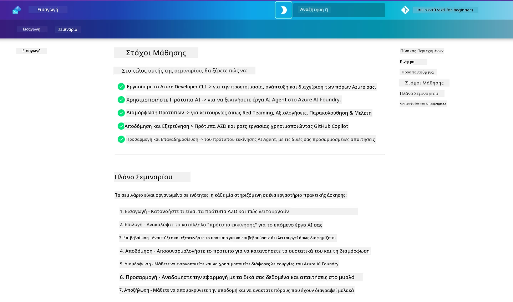

<div align="center">
  <div style="background: linear-gradient(135deg, #0078d4, #106ebe); border-radius: 10px; padding: 20px; margin: 20px 0; box-shadow: 0 4px 15px rgba(0, 120, 212, 0.3); border: 2px solid #005a9e;">
    <h2 style="color: white; margin: 0; font-size: 24px; text-shadow: 1px 1px 2px rgba(0,0,0,0.3);">
      🎯 Εργαστήριο AZD για Προγραμματιστές AI
    </h2>
    <p style="color: white; margin: 10px 0 0 0; font-size: 16px; text-shadow: 1px 1px 2px rgba(0,0,0,0.3);">
      <strong>Ένα πρακτικό εργαστήριο για τη δημιουργία εφαρμογών AI με το Azure Developer CLI.</strong><br>
      Ολοκληρώστε 7 ενότητες για να κυριαρχήσετε στα πρότυπα AZD και τις ροές εργασίας ανάπτυξης AI.
    </p>
    <div style="margin-top: 15px;">
      <span style="background: rgba(255,255,255,0.2); padding: 5px 10px; border-radius: 15px; color: white; font-size: 14px;">
        📅 Αναθεώρηση πηγής: Νοέμβριος 2026
      </span>
    </div>
  </div>
</div>

# Εργαστήριο AZD για Προγραμματιστές AI

Καλωσορίσατε στο πρακτικό εργαστήριο για την εκμάθηση του Azure Developer CLI (AZD) με έμφαση στην ανάπτυξη εφαρμογών AI. Αυτό το εργαστήριο σας βοηθά να αποκτήσετε πρακτική κατανόηση των προτύπων AZD σε 3 βήματα:

1. **Ανακάλυψη** - βρείτε το πρότυπο που σας ταιριάζει.
1. **Ανάπτυξη** - αναπτύξτε και επικυρώστε ότι λειτουργεί
1. **Προσαρμογή** - τροποποιήστε και επαναλάβετε για να το κάνετε δικό σας!

Κατά τη διάρκεια αυτού του εργαστηρίου, θα σας παρουσιαστούν επίσης βασικά εργαλεία και ροές εργασιών προγραμματιστή, για να βοηθήσετε στην απλοποίηση της συνολικής σας πορείας ανάπτυξης.

<br/>

## Οδηγός Βασισμένος σε Περιηγητή

Τα μαθήματα του εργαστηρίου είναι σε Markdown. Μπορείτε να τα περιηγηθείτε απευθείας στο GitHub ή να ξεκινήσετε μια προεπισκόπηση βασισμένη στον περιηγητή όπως φαίνεται στην παρακάτω εικόνα.



Για να χρησιμοποιήσετε αυτήν την επιλογή - κάντε fork το αποθετήριο στο προφίλ σας και εκκινήστε το GitHub Codespaces. Μόλις το τερματικό του VS Code είναι ενεργό, πληκτρολογήστε αυτήν την εντολή:

Αυτή η προεπισκόπηση περιηγητή λειτουργεί σε GitHub Codespaces, dev containers ή τοπικό αντίγραφο με εγκατεστημένα Python και MkDocs.

```bash title="" linenums="0"
python -m pip install -r requirements-dev.txt
python -m mkdocs serve --config-file workshop/mkdocs.yml
```

Εκτελέστε αυτές τις εντολές από τη **ρίζα του αποθετηρίου του μαθήματος**, όχι από το ξεχωριστά αρχικοποιημένο παράδειγμα AI. Κρατήστε την προεπισκόπηση σε πρώτο πλάνο ώστε να είναι ορατά τυχόν σφάλματα· σταματήστε το με Ctrl+C. Για να ελέγξετε τον ιστότοπο χωρίς να τον σερβίρετε, τρέξτε `python -m mkdocs build --strict --config-file workshop/mkdocs.yml`.

Μετά από μερικά δευτερόλεπτα, θα δείτε ένα αναδυόμενο παράθυρο διαλόγου. Επιλέξτε την επιλογή `Open in browser`. Ο διαδικτυακός οδηγός θα ανοίξει τώρα σε νέα καρτέλα περιηγητή. Μερικά οφέλη αυτής της προεπισκόπησης:

1. **Ενσωματωμένη αναζήτηση** - βρείτε γρήγορα λέξεις κλειδιά ή μαθήματα.
1. **Εικονίδιο αντιγραφής** - περάστε το ποντίκι πάνω από μπλοκ κώδικα για να δείτε αυτήν την επιλογή
1. **Εναλλαγή θέματος** - εναλλαγή μεταξύ σκοτεινού και φωτεινού θέματος
1. **Λάβετε βοήθεια** - κάντε κλικ στο εικονίδιο Discord στο υποσέλιδο για να συμμετάσχετε!

<br/>

## Επισκόπηση Εργαστηρίου

**Διάρκεια:** 3-4 ώρες  
**Επίπεδο:** Αρχάριος έως Μεσαίο  
**Προαπαιτούμενα:** Εξοικείωση με Azure, έννοιες AI, VS Code & εργαλεία γραμμής εντολών.

Πρόκειται για πρακτικό εργαστήριο όπου μαθαίνετε κάνοντας. Μόλις ολοκληρώσετε τις ασκήσεις, προτείνουμε να εξετάσετε το πρόγραμμα AZD For Beginners για να συνεχίσετε την εκπαιδευτική σας πορεία σε βέλτιστες πρακτικές Ασφάλειας και Παραγωγικότητας.

| Χρόνος| Ενότητα  | Στόχος |
|:---|:---|:---|
| 15 λεπτά | [Εισαγωγή](docs/instructions/0-Introduction.md) | Θέστε το πλαίσιο, κατανοήστε τους στόχους |
| 30 λεπτά | [Επιλογή Προτύπου AI](docs/instructions/1-Select-AI-Template.md) | Εξερευνήστε επιλογές και επιλέξτε αρχικό |
| 30 λεπτά | [Επικύρωση Προτύπου AI](docs/instructions/2-Validate-AI-Template.md) | Αναπτύξτε προεπιλεγμένη λύση στο Azure |
| 30 λεπτά | [Αποδόμηση Προτύπου AI](docs/instructions/3-Deconstruct-AI-Template.md) | Εξερευνήστε δομή και διαμόρφωση |
| 30 λεπτά | [Διαμόρφωση Προτύπου AI](docs/instructions/4-Configure-AI-Template.md) | Ενεργοποιήστε και δοκιμάστε διαθέσιμες λειτουργίες |
| 30 λεπτά | [Προσαρμογή Προτύπου AI](docs/instructions/5-Customize-AI-Template.md) | Προσαρμόστε το πρότυπο στις ανάγκες σας |
| 30 λεπτά | [Κατάργηση Υποδομής](docs/instructions/6-Teardown-Infrastructure.md) | Καθαρισμός και απελευθέρωση πόρων |
| 15 λεπτά | [Κλείσιμο & Επόμενα Βήματα](docs/instructions/7-Wrap-up.md) | Πόροι εκμάθησης, πρόκληση εργαστηρίου |

<br/>

## Τι θα Μάθετε

Σκεφτείτε το Πρότυπο AZD ως έναν εκπαιδευτικό χώρο εξερεύνησης διάφορων δυνατοτήτων και εργαλείων για ενδοεξέλιξη σε Microsoft Foundry. Μέχρι το τέλος αυτού του εργαστηρίου, θα πρέπει να έχετε μια διαισθητική αντίληψη για διάφορα εργαλεία και έννοιες στο πλαίσιο αυτό.

| Έννοια  | Στόχος |
|:---|:---|
| **Azure Developer CLI** | Κατανόηση εντολών εργαλείου και ροών εργασίας |
| **Πρότυπα AZD**| Κατανόηση δομής έργου και διαμόρφωσης |
| **Azure AI Agent**| Παροχή & ανάπτυξη έργου Microsoft Foundry  |
| **Azure AI Search**| Ενεργοποίηση μηχανικής συμφραζομένων με agents |
| **Παρατηρησιμότητα**| Εξερεύνηση εντοπισμού, παρακολούθησης και αξιολογήσεων |
| **Επίθεση Red Team**| Εξερεύνηση εχθρικών δοκιμών και αντιμετώπισης |

<br/>

## Δομή Εργαστηρίου

Το εργαστήριο είναι δομημένο για να σας πάρει σε μια διαδρομή από την ανακάλυψη προτύπου, στην ανάπτυξη, αποδόμηση, και προσαρμογή - χρησιμοποιώντας το επίσημο [Getting Started with AI Agents](https://github.com/Azure-Samples/get-started-with-ai-agents) αρχικό πρότυπο ως βάση.

### [Ενότητα 1: Επιλογή Προτύπου AI](docs/instructions/1-Select-AI-Template.md) (30 λεπτά)

- Τι είναι τα Πρότυπα AI;
- Πού μπορώ να βρω Πρότυπα AI;
- Πώς μπορώ να αρχίσω να φτιάχνω AI Agents;
- **Εργαστήριο**: Γρήγορη εκκίνηση σε Codespaces ή dev container

### [Ενότητα 2: Επικύρωση Προτύπου AI](docs/instructions/2-Validate-AI-Template.md) (30 λεπτά)

- Ποια είναι η Αρχιτεκτονική του Προτύπου AI;
- Ποια είναι η Ροή Εργασίας Ανάπτυξης AZD;
- Πώς μπορώ να πάρω βοήθεια με την Ανάπτυξη AZD;
- **Εργαστήριο**: Ανάπτυξη & Επικύρωση προτύπου AI Agents

### [Ενότητα 3: Αποδόμηση Προτύπου AI](docs/instructions/3-Deconstruct-AI-Template.md) (30 λεπτά)

- Εξερευνήστε το περιβάλλον σας στο `.azure/` 
- Εξερευνήστε τη ρύθμιση πόρων σας στο `infra/` 
- Εξερευνήστε τη διαμόρφωση AZD σας στα `azure.yaml`
- **Εργαστήριο**: Τροποποίηση μεταβλητών περιβάλλοντος & εκ νέου ανάπτυξη

### [Ενότητα 4: Διαμόρφωση Προτύπου AI](docs/instructions/4-Configure-AI-Template.md) (30 λεπτά)
- Εξερευνήστε: Ανακτώμενη Αυτοματοποιημένη Γενιά (RAG)
- Εξερευνήστε: Αξιολόγηση Agent & Επίθεση Red Team
- Εξερευνήστε: Εντοπισμό & Παρακολούθηση
- **Εργαστήριο**: Εξερεύνηση AI Agent + Παρατηρησιμότητα 

### [Ενότητα 5: Προσαρμογή Προτύπου AI](docs/instructions/5-Customize-AI-Template.md) (30 λεπτά)
- Ορίστε: PRD με Απαιτήσεις Σεναρίου
- Διαμορφώστε: Μεταβλητές Περιβάλλοντος για AZD
- Υλοποιήστε: Hooks Κύκλου Ζωής για επιπλέον εργασίες
- **Εργαστήριο**: Προσαρμογή προτύπου για το σενάριό μου

### [Ενότητα 6: Κατάργηση Υποδομής](docs/instructions/6-Teardown-Infrastructure.md) (30 λεπτά)
- Ανακεφαλαίωση: Τι είναι τα Πρότυπα AZD;
- Ανακεφαλαίωση: Γιατί να χρησιμοποιήσω το Azure Developer CLI;
- Επόμενα βήματα: Δοκιμάστε ένα διαφορετικό πρότυπο!
- **Εργαστήριο**: Αποδέσμευση υποδομής & καθαρισμός

<br/>

## Πρόκληση Εργαστηρίου

Θέλετε να προκληθείτε να κάνετε περισσότερα; Εδώ είναι μερικές προτάσεις έργων - ή μοιραστείτε τις ιδέες σας μαζί μας!!

| Έργο | Περιγραφή |
|:---|:---|
|1. **Αποδόμηση ενός Πολύπλοκου Προτύπου AI** | Χρησιμοποιήστε τη ροή εργασίας και τα εργαλεία που περιγράψαμε και δείτε αν μπορείτε να αναπτύξετε, να επικυρώσετε και να προσαρμόσετε ένα διαφορετικό πρότυπο λύσης AI. _Τι μάθατε;_|
|2. **Προσαρμογή με το Σενάριό σας**  | Δοκιμάστε να γράψετε ένα PRD (Έγγραφο Απαιτήσεων Προϊόντος) για ένα διαφορετικό σενάριο. Έπειτα χρησιμοποιήστε το GitHub Copilot στο αποθετήριο του προτύπου σας σε Agent Model - και ζητήστε του να δημιουργήσει μια ροή εργασίας προσαρμογής για εσάς. _Τι μάθατε; Πώς θα μπορούσατε να βελτιώσετε αυτές τις προτάσεις;_|
| | |

## Έχετε σχόλια;

1. Δημοσιεύστε ένα ζήτημα σε αυτό το repo - επισυνάψτε το `Workshop` για ευκολία.
1. Ελάτε στο Discord του Microsoft Foundry - συνδεθείτε με τους συναδέλφους σας!


| | | 
|:---|:---|
| **📚 Αρχική Μαθήματος**| [AZD For Beginners](../README.md)|
| **📖 Τεκμηρίωση** | [Ξεκινήστε με πρότυπα AI](https://learn.microsoft.com/en-us/azure/ai-foundry/how-to/develop/ai-template-get-started)|
| **🛠️Πρότυπα AI** | [Πρότυπα Microsoft Foundry](https://ai.azure.com/templates) |
|**🚀 Επόμενα Βήματα** | [Ξεκινήστε το Εργαστήριο](#workshop-overview) |
| | |

<br/>

---

**Πλοήγηση:** [Κύριο Μάθημα](../README.md) | [Εισαγωγή](docs/instructions/0-Introduction.md) | [Ενότητα 1: Επιλογή Προτύπου](docs/instructions/1-Select-AI-Template.md)

**Έτοιμοι να ξεκινήσετε την κατασκευή εφαρμογών AI με AZD;**

[Ξεκινήστε το Εργαστήριο: Εισαγωγή →](docs/instructions/0-Introduction.md)

---

<!-- CO-OP TRANSLATOR DISCLAIMER START -->
**Αποποίηση ευθυνών**:
Αυτό το έγγραφο έχει μεταφραστεί χρησιμοποιώντας την υπηρεσία μετάφρασης με τεχνητή νοημοσύνη [Co-op Translator](https://github.com/Azure/co-op-translator). Ενώ επιδιώκουμε την ακρίβεια, παρακαλούμε να έχετε υπόψη ότι οι αυτοματοποιημένες μεταφράσεις ενδέχεται να περιέχουν λάθη ή ανακρίβειες. Το πρωτότυπο έγγραφο στη μητρική του γλώσσα πρέπει να θεωρείται η αυθεντική πηγή. Για κρίσιμες πληροφορίες, συνιστάται επαγγελματική ανθρώπινη μετάφραση. Δεν φέρουμε ευθύνη για τυχόν παρεξηγήσεις ή λανθασμένες ερμηνείες που προκύπτουν από τη χρήση αυτής της μετάφρασης.
<!-- CO-OP TRANSLATOR DISCLAIMER END -->