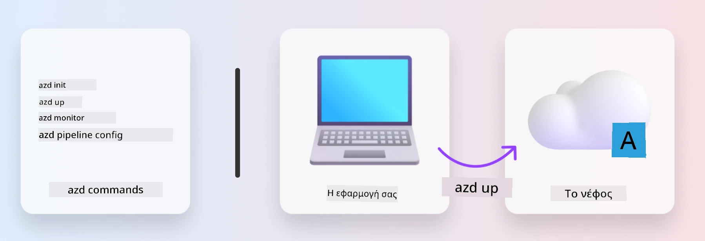
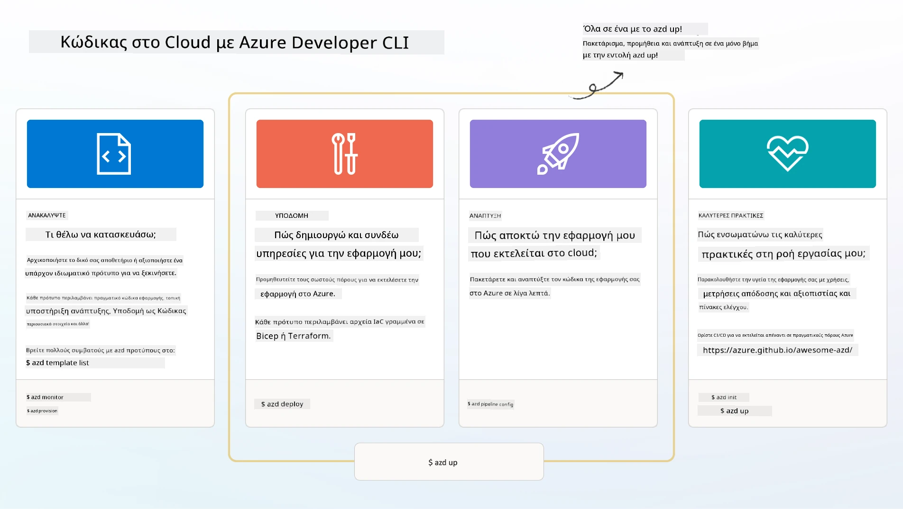

# 1. Επιλογή Προτύπου

!!! tip "ΜΕΧΡΙ ΤΟ ΤΕΛΟΣ ΑΥΤΟΥ ΤΟΥ ΜΑΘΗΜΑΤΟΣ ΘΑ ΜΠΟΡΕΙΤΕ ΝΑ"

    - [ ] Describe what AZD templates are
    - [ ] Discover and use AZD templates for AI
    - [ ] Get started with the AI Agents template
    - [ ] **Lab 1:** AZD Quickstart in Codespaces or a dev container

---

## 1. Μία Αναλογία Κατασκευαστή

Η κατασκευή μίας σύγχρονης εφαρμογής τεχνητής νοημοσύνης έτοιμης για επιχειρήσεις _από το μηδέν_ μπορεί να είναι απαιτητική. Είναι λίγο σαν να χτίζεις μόνος σου το καινούργιο σου σπίτι, τούβλο το τούβλο. Ναι, μπορεί να γίνει! Αλλά δεν είναι ο πιο αποτελεσματικός τρόπος για να πετύχεις το επιθυμητό τελικό αποτέλεσμα!

Αντίθετα, συχνά ξεκινάμε με ένα υπάρχον _σχέδιο σχεδίασης_ και συνεργαζόμαστε με έναν αρχιτέκτονα για να το προσαρμόσουμε στις προσωπικές μας απαιτήσεις. Και αυτή είναι η ακριβής προσέγγιση που πρέπει να ακολουθήσουμε όταν δημιουργούμε έξυπνες εφαρμογές. Πρώτα, βρες μία καλή αρχιτεκτονική σχεδίασης που ταιριάζει στον χώρο του προβλήματός σου. Έπειτα συνεργάσου με έναν αρχιτέκτονα λύσεων για να προσαρμόσετε και να αναπτύξετε τη λύση για το συγκεκριμένο σενάριό σου.

Αλλά πού μπορούμε να βρούμε αυτά τα σχέδια σχεδίασης; Και πώς βρίσκουμε έναν αρχιτέκτονα που είναι πρόθυμος να μας διδάξει πώς να προσαρμόσουμε και να αναπτύξουμε αυτά τα σχέδια μόνοι μας; Σε αυτό το εργαστήριο, απαντάμε σε αυτές τις ερωτήσεις παρουσιάζοντάς σας τρεις τεχνολογίες:

1. [Azure Developer CLI](https://aka.ms/azd) - ένα εργαλείο ανοιχτού κώδικα που επιταχύνει την πορεία του προγραμματιστή από την τοπική ανάπτυξη (κατασκευή) στην ανάπτυξη στο cloud (αποστολή).
1. [Microsoft Foundry Templates](https://ai.azure.com/templates) - τυποποιημένα αποθετήρια ανοιχτού κώδικα που περιέχουν δείγματα κώδικα, αρχεία υποδομής και διαμόρφωσης για την ανάπτυξη μιας αρχιτεκτονικής λύσης AI.
1. [GitHub Copilot Agent Mode](https://code.visualstudio.com/docs/copilot/chat/chat-agent-mode) - ένας πράκτορας κώδικα βασισμένος στη γνώση του Azure, που μπορεί να μας καθοδηγήσει στην πλοήγηση στον κώδικα και την πραγματοποίηση αλλαγών - χρησιμοποιώντας φυσική γλώσσα.

Με αυτά τα εργαλεία στα χέρια μας, μπορούμε τώρα να _ανακαλύψουμε_ το σωστό πρότυπο, να το _αναπτύξουμε_ για να επαληθεύσουμε ότι λειτουργεί και να το _προσαρμόσουμε_ ώστε να ταιριάζει στα συγκεκριμένα μας σενάρια. Ας ξεκινήσουμε και ας μάθουμε πώς λειτουργούν αυτά.


---

## 2. Azure Developer CLI

Το [Azure Developer CLI](https://learn.microsoft.com/en-us/azure/developer/azure-developer-cli/) (ή `azd`) είναι ένα εργαλείο γραμμής εντολών ανοικτού κώδικα που μπορεί να επιταχύνει το ταξίδι σου από τον κώδικα στο cloud με ένα σύνολο φιλικών προς τον προγραμματιστή εντολών που λειτουργούν με συνέπεια σε όλα τα περιβάλλοντα IDE (ανάπτυξη) και CI/CD (devops).

Με το `azd`, το ταξίδι ανάπτυξης μπορεί να είναι απλό όπως:

- `azd init` - Εισάγει ένα νέο έργο AI από ένα υπάρχον πρότυπο AZD.
- `azd up` - Προμηθεύει υποδομή και αναπτύσσει την εφαρμογή σου σε ένα βήμα.
- `azd monitor` - Παρέχει παρακολούθηση σε πραγματικό χρόνο και διαγνωστικά για την αναπτυγμένη εφαρμογή σου.
- `azd pipeline config` - Δημιουργεί pipelines CI/CD για αυτοματοποίηση ανάπτυξης στο Azure.

**🎯 | ΑΣΚΗΣΗ**: <br/> Εξερεύνησε το εργαλείο γραμμής εντολών `azd` στο τρέχον περιβάλλον εργαστηρίου σου τώρα. Αυτό μπορεί να είναι GitHub Codespaces, ένα dev container ή ένα τοπικό αντίγραφο με τα απαραίτητα προαπαιτούμενα εγκατεστημένα. Ξεκίνα πληκτρολογώντας την παρακάτω εντολή για να δεις τι μπορεί να κάνει το εργαλείο:

```bash title="" linenums="0"
azd help
```



---

## 3. Το Πρότυπο AZD

Για να πετύχει το `azd` αυτό, πρέπει να γνωρίζει την υποδομή που θα προμηθεύσει, τις ρυθμίσεις διαμόρφωσης που θα επιβάλει και την εφαρμογή που θα αναπτύξει. Εδώ εισέρχονται τα [πρότυπα AZD](https://learn.microsoft.com/en-us/azure/developer/azure-developer-cli/azd-templates?tabs=csharp).

Τα πρότυπα AZD είναι αποθετήρια ανοιχτού κώδικα που συνδυάζουν δείγματα κώδικα με αρχεία υποδομής και διαμόρφωσης που απαιτούνται για την ανάπτυξη της αρχιτεκτονικής λύσης.
Με τη χρήση μίας προσέγγισης _Υποδομής ως Κώδικα_ (IaC), επιτρέπουν τον έλεγχο έκδοσης των ορισμών πόρων του προτύπου και των ρυθμίσεων διαμόρφωσης (όπως και τον έλεγχο έκδοσης του πηγαίου κώδικα της εφαρμογής) - δημιουργώντας επαναχρησιμοποιήσιμα και συνεπή workflows σε όλους τους χρήστες αυτού του έργου.

Όταν δημιουργείς ή επαναχρησιμοποιείς ένα πρότυπο AZD για _το δικό σου_ σενάριο, λάβε υπόψη σου τις εξής ερωτήσεις:

1. Τι κατασκευάζεις; → Υπάρχει κάποιο πρότυπο με αρχικό κώδικα για αυτό το σενάριο;
1. Πώς είναι αρχιτεκτονικώς η λύση σου; → Υπάρχει κάποιο πρότυπο με τους απαραίτητους πόρους;
1. Πώς αναπτύσσεται η λύση σου; → Σκέψου `azd deploy` με hooks πριν/μετά την επεξεργασία!
1. Πώς μπορείς να το βελτιστοποιήσεις περαιτέρω; → Σκέψου ενσωματωμένη παρακολούθηση και αυτοματοποιημένα pipelines!

**🎯 | ΑΣΚΗΣΗ**: <br/> 
Επισκέψου την γκαλερί [Awesome AZD](https://azure.github.io/awesome-azd/) και χρησιμοποίησε τα φίλτρα για να εξερευνήσεις τα 250+ πρότυπα που είναι διαθέσιμα αυτή τη στιγμή. Δες αν μπορείς να βρεις κάποιο που ταιριάζει στις απαιτήσεις _του δικού σου_ σεναρίου.



---

## 4. Πρότυπα Εφαρμογών AI

Για εφαρμογές με τεχνητή νοημοσύνη, η Microsoft παρέχει εξειδικευμένα πρότυπα που διαθέτουν **Microsoft Foundry** και **Foundry Agents**. Αυτά τα πρότυπα επιταχύνουν τη δημιουργία έξυπνων εφαρμογών έτοιμων για παραγωγή.

### Πρότυπα Microsoft Foundry & Foundry Agents

Επίλεξε ένα πρότυπο παρακάτω για να το αναπτύξεις. Κάθε πρότυπο είναι διαθέσιμο στην [Awesome AZD](https://azure.github.io/awesome-azd/) και μπορεί να αρχικοποιηθεί με μία εντολή.

| Πρότυπο | Περιγραφή | Εντολή Ανάπτυξης |
|----------|-------------|----------------|
| **[AI Chat with RAG](https://github.com/Azure-Samples/azure-search-openai-demo)** | Εφαρμογή συνομιλίας βασισμένη στην αναζήτηση | `azd init -t Azure-Samples/azure-search-openai-demo .` |
| **[Get Started with AI Agents](https://github.com/Azure-Samples/get-started-with-ai-agents)** | Εφαρμογή συνομιλίας με υποστήριξη πρακτόρων; χρησιμοποιείται σε όλο το εργαστήριο | `azd init -t Azure-Samples/get-started-with-ai-agents .` |
| **[Get Started with AI Chat](https://github.com/Azure-Samples/get-started-with-ai-chat)** | Αρχική εφαρμογή συνομιλίας AI | `azd init -t Azure-Samples/get-started-with-ai-chat .` |

Αυτά είναι εναλλακτικά: αρχικοποίησε **ένα** πρότυπο στον δικό του κενό φάκελο. Το τελευταίο `.` επιλέγει αυτόν το φάκελο· παραλείποντάς το στις τρέχουσες εκδόσεις AZD δημιουργείται ένας υποφάκελος με το όνομα του προτύπου. Η αρχικοποίηση κατεβάζει το έργο· το `azd up` εκτελεί την επιβαρυντική ανάπτυξη αφού ελέγξεις τα προαπαιτούμενα, τους πόρους, την υποστήριξη περιοχής και το όριο.

### Γρήγορη Εκκίνηση

1. **Περιηγήσου στα πρότυπα**: Επισκέψου [https://azure.github.io/awesome-azd/](https://azure.github.io/awesome-azd/) και φίλτραρε κατά `AI`, `Agents`, ή `Microsoft Foundry`
2. **Επίλεξε το πρότυπό σου**: Διάλεξε ένα που ταιριάζει στη χρήση σου
3. **Αρχικοποίηση**: Τρέξε την εντολή `azd init` για το επιλεγμένο σου πρότυπο
4. **Ανάπτυξη**: Τρέξε `azd up` για προμήθεια και ανάπτυξη

**🎯 | ΑΣΚΗΣΗ**: <br/>
Επίλεξε ένα από τα παραπάνω πρότυπα με βάση το σενάριό σου:

- **Συνεχίζεις αυτό το εργαστήριο;** → Διάλεξε **Get Started with AI Agents**
- **Κατασκευάζεις συνομιλία βασισμένη σε αναζήτηση;** → Εξερεύνησε ξεχωριστά το **AI Chat with RAG**
- **Χρειάζεσαι άλλη αρχιτεκτονική;** → Ψάξε στην γκαλερί και επαλήθευσε το πραγματικό αποθετήριο, κατάσταση υλοποίησης και προαπαιτούμενα

```bash title="Initialize the workshop template in an empty directory" linenums="0"
azd init -t Azure-Samples/get-started-with-ai-agents .
azd auth login
azd up
```

!!! info "Εξερεύνησε Περισσότερα Πρότυπα"
    Η [Awesome AZD Gallery](https://azure.github.io/awesome-azd/) περιέχει πάνω από 250 πρότυπα. Χρησιμοποίησε τα φίλτρα για να βρεις πρότυπα που ταιριάζουν στις συγκεκριμένες σου απαιτήσεις για γλώσσα, πλαίσιο εργασίας και υπηρεσίες Azure.

---

<!-- CO-OP TRANSLATOR DISCLAIMER START -->
**Αποποίηση ευθυνών**:
Αυτό το έγγραφο έχει μεταφραστεί χρησιμοποιώντας την υπηρεσία μετάφρασης με τεχνητή νοημοσύνη [Co-op Translator](https://github.com/Azure/co-op-translator). Ενώ επιδιώκουμε την ακρίβεια, παρακαλούμε να έχετε υπόψη ότι οι αυτοματοποιημένες μεταφράσεις ενδέχεται να περιέχουν λάθη ή ανακρίβειες. Το πρωτότυπο έγγραφο στη μητρική του γλώσσα πρέπει να θεωρείται η αυθεντική πηγή. Για κρίσιμες πληροφορίες, συνιστάται επαγγελματική ανθρώπινη μετάφραση. Δεν φέρουμε ευθύνη για τυχόν παρεξηγήσεις ή λανθασμένες ερμηνείες που προκύπτουν από τη χρήση αυτής της μετάφρασης.
<!-- CO-OP TRANSLATOR DISCLAIMER END -->