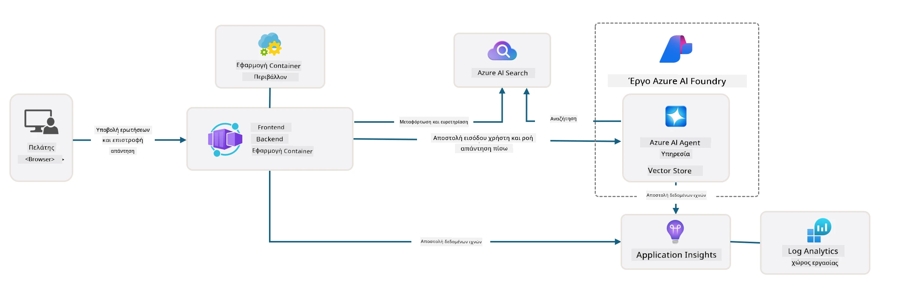
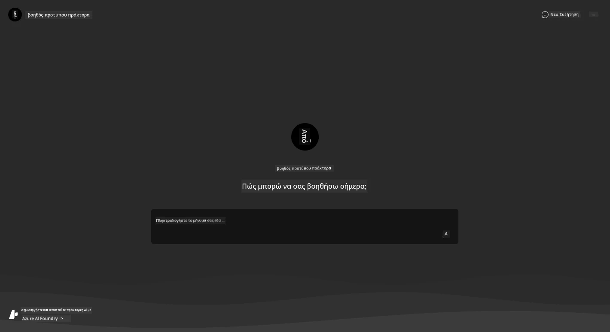

# 2. Επαλήθευση ενός προτύπου

> Η καθοδήγηση προέλευσης ελέγχθηκε έναντι του AZD 1.37.2 και του τρέχοντος δείγματος στις 4 Νοεμβρίου 2026. Οι λήψεις οθόνης είναι ενδεικτικές· η πλοήγηση στη πύλη, οι προεπιλογές προτύπου και η διαθεσιμότητα υπηρεσιών μπορεί να αλλάξουν. Αυτή η ανασκόπηση δεν εκτέλεσε ζωντανή ανάπτυξη Azure.

!!! tip "ΜΕΧΡΙ ΤΟ ΤΕΛΟΣ ΑΥΤΗΣ ΤΗΣ ΕΝΟΤΗΤΑΣ ΘΑ ΜΠΟΡΕΙΤΕ ΝΑ"

    - [ ] Identify the sample's prerequisites and intended resources
    - [ ] Deploy the selected template into an intentional environment
    - [ ] Verify the application and agent behavior separately from deployment success
    - [ ] **Lab 2:** Record evidence of a working baseline, or an actionable deployment blocker

---

## 1. Ελέγξτε τα προαπαιτούμενα

Το [Azure Developer CLI](https://learn.microsoft.com/azure/developer/azure-developer-cli/) διαχειρίζεται την ανάπτυξη εφαρμογών χρησιμοποιώντας τη διαμόρφωση, την υποδομή και τον κώδικα του προτύπου. Ελέγξτε την εγκατεστημένη έκδοσή σας:

```bash
azd version
```

Χρησιμοποιήστε τις [τρέχουσες οδηγίες εγκατάστασης/ενημέρωσης](https://learn.microsoft.com/azure/developer/azure-developer-cli/install-azd), αν χρειαστεί. Το ελεγμένο δείγμα δηλώνει AZD `>=1.14.0`, αλλά συνιστάται μια τρέχουσα υποστηριζόμενη έκδοση. Οι προαιρετικές επεκτάσεις AI έχουν ξεχωριστές απαιτήσεις έκδοσης· η κανονική ροή εργασίας `azd up` του δείγματος δεν απαιτεί την επέκταση agents.

Πριν από την παροχή, διαβάστε το [ρύθμιση λογαριασμού Azure](https://github.com/Azure-Samples/get-started-with-ai-agents/blob/main/docs/azure_account_setup.md) και τον [οδηγό ανάπτυξης](https://github.com/Azure-Samples/get-started-with-ai-agents/blob/main/docs/deployment.md) του δείγματος. Επιβεβαιώστε τη συνδρομή σας, τα δικαιώματα, τη διαθεσιμότητα μοντέλων, το περιφερειακό όριο και τα αναμενόμενα έξοδα. Ένας δωρεάν λογαριασμός Azure δεν εγγυάται πρόσβαση ή δωρεάν χρήση για κάθε απαιτούμενη υπηρεσία.

## 2. Ανοίξτε το επιλεγμένο δείγμα

Χρησιμοποιήστε το αποθετήριο [Get Started with AI Agents](https://github.com/Azure-Samples/get-started-with-ai-agents) που αρχικοποιήθηκε στην Ενότητα 1. Εάν δεν το έχετε αρχικοποιήσει, διαλέξτε μία από αυτές τις εναλλακτικές:

- Ανοίξτε έναν [Codespace για το δείγμα](https://github.com/codespaces/new/Azure-Samples/get-started-with-ai-agents).
- Κλωνοποιήστε το δείγμα και ακολουθήστε τη ρύθμιση τοπικά/στο dev-container.
- Σε έναν **κενό φάκελο**, εκτελέστε:

```bash
azd init --template Azure-Samples/get-started-with-ai-agents .
```

Μην αρχικοποιήσετε δεύτερο πρότυπο πάνω σε υπάρχον έργο. Εκτελέστε τις επόμενες εντολές από τη ρίζα του δείγματος που περιέχει `azure.yaml`, όχι από τη ρίζα του αποθετηρίου μαθήματος.

Το δείγμα φιλοξενεί μια εφαρμογή συνομιλίας υποστηριζόμενη από agent σε Container Apps και παρέχει υποστηρικτικούς πόρους Foundry. Ελέγξτε την τρέχουσα αρχιτεκτονική και τις προαιρετικές υπηρεσίες αντί να θεωρείτε μια παλιά λήψη οθόνης ως την ακριβή καταγραφή πόρων.



## 3. Αναπτύξτε σκόπιμα

```bash
azd auth login
azd up
```

Εξετάστε τα ερωτήματα:

1. Επιλέξτε ένα μοναδικό όνομα περιβάλλοντος AZD.
2. Επιλέξτε τη συνδρομή που προορίζεται, όχι απλώς την πρώτη που προσφέρεται.
3. Επιλέξτε μια περιοχή που υποστηρίζεται από το απαιτούμενο μοντέλο/έκδοση/SKU και το όριό σας.
4. Διαβάστε την έξοδο παροχής, ανάπτυξης και post-deployment hooks.

Οι ελεγμένες προεπιλογές περιλαμβάνουν `gpt-5-mini`, έκδοση `2025-08-07` και `GlobalStandard`. Ελέγξτε το αρχικοποιημένο πρότυπό σας και τους [υποστηριζόμενους συνδυασμούς μοντέλων/περιοχών](https://learn.microsoft.com/azure/ai-services/agents/concepts/model-region-support). Καμία περιοχή δεν εγγυάται παγκόσμια λειτουργία.

Η διάρκεια ανάπτυξης διαφέρει. Αν η παροχή αποτύχει, διατηρήστε το σφάλμα και διορθώστε την αιτία πριν δοκιμάσετε ξανά. Μην διαγράφετε την ανάπτυξη ή διαγράφετε οριστικά πόρους ως γενικό βήμα αντιμετώπισης προβλημάτων.

## 4. Επαληθεύστε την εφαρμογή

```bash
azd show
```

Ανοίξτε το endpoint για `api_and_frontend`, ή βρείτε το Container App στην ομάδα πόρων της ανάπτυξης στην [πύλη Azure](https://portal.azure.com/). Ακολουθήστε τις οδηγίες πρόσβασης/ελέγχου ταυτότητας του δείγματος αν απαιτείται σύνδεση· μην απενεργοποιείτε τον έλεγχο ταυτότητας ώστε να περάσει ένα απλό τεστ.



Δοκιμάστε μερικές [δειγματικές ερωτήσεις](https://github.com/Azure-Samples/get-started-with-ai-agents/blob/main/docs/sample_questions.md):

- Μια γενική πραγματολογική ερώτηση.
- Μια ερώτηση της οποίας η απάντηση θα πρέπει να είναι παρούσα στα ανεβασμένα έγγραφα του δείγματος.
- Μια ερώτηση που δεν μπορεί να απαντηθεί από αυτά τα έγγραφα.

Επιβεβαιώστε ότι το UI φορτώνει, το API απαντά, η ανάκτηση χρησιμοποιεί τα αναμενόμενα δεδομένα, οι παραπομπές ταιριάζουν με το περιεχόμενο πηγής και οι μη υποστηριζόμενες ερωτήσεις διαχειρίζονται κατάλληλα. Ένα επιτυχημένο μήνυμα `azd up` μόνο του δεν αποδεικνύει αυτά τα αποτελέσματα.

## 5. Ελέγξτε τον αναπτυγμένο agent

Ανοίξτε το έργο σας στην [πύλη Foundry](https://ai.azure.com/). Στην ελεγμένη πλοήγηση πύλης, επιλέξτε **Build**, μετά **Agents**, και εντοπίστε τον agent που δημιουργήθηκε από το δείγμα. Οι ετικέτες πλοήγησης μπορούν να αλλάξουν.

Καταγράψτε:

- Το όνομα και την έκδοση του agent.
- Την διαμορφωμένη ανάπτυξη μοντέλου.
- Τις πραγματικές οδηγίες και τα ενεργοποιημένα εργαλεία.
- Ποια αρχεία ή ευρετήριο αναζήτησης είναι συνδεδεμένα, και αν η ρύθμιση ολοκληρώθηκε επιτυχώς.

Το ελεγμένο δείγμα χρησιμοποιεί αναγνωριστικό agent σε μορφή `agent_name:agent_version` για τις δοκιμές αξιολόγησής του. Μην αντιγράφετε κλασικό αναγνωριστικό agent/thread από παλιά λήψη οθόνης σε νεότερη ροή API.

Συγκρίνετε τα ανεβασμένα έγγραφα με `src/files/` στην αρχικοποιημένη αναθεώρησή σας. Παλαιότερες λήψεις οθόνης εμφάνιζαν 32 αρχεία· αυτός ο αριθμός δεν είναι εγγυημένη τρέχουσα προεπιλογή. Επαληθεύστε οποιαδήποτε απάντηση σχετικά με πελάτες/προϊόντα του δείγματος με τα πραγματικά συνθετικά δεδομένα πηγής, και μην ανεβάζετε πραγματικά δεδομένα πελατών για αυτή την άσκηση.

## 6. Συγκρίνετε με τον playground

Ανοίξτε τον playground του επιλεγμένου agent στο Foundry και κάντε την ίδια ερώτηση ανάκτησης. Συγκρίνετε την διαμορφωμένη έκδοση agent, τα εργαλεία, τις παραπομπές και την ποιότητα απάντησης με την αναπτυγμένη εφαρμογή.

Οι απαντήσεις είναι πιθανοκρατικές· η ακριβής αντιστοιχία λέξη προς λέξη δεν είναι το κριτήριο. Αν τα αποτελέσματα διαφέρουν ουσιαστικά, ελέγξτε ότι η εφαρμογή και ο playground στοχεύουν το ίδιο έργο, agent/έκδοση και πηγή γνώσης.

## 7. Ελέγξτε τα προαπαιτούμενα παρατηρησιμότητας

Ο [οδηγός παρατηρησιμότητας](https://github.com/Azure-Samples/get-started-with-ai-agents/blob/main/docs/observability.md) του δείγματος είναι η πηγή αλήθειας για ιχνηλάτηση, αξιολόγηση και ρύθμιση red-teaming.

Στις ελεγμένες προεπιλογές υποδομής, το Application Insights είναι ενεργοποιημένο αλλά **ο πελατειακός εντοπισμός απενεργοποιημένος** (`ENABLE_AZURE_MONITOR_TRACING=false`). Η δημιουργία πόρου παρακολούθησης δεν αποδεικνύει ότι η εφαρμογή εξάγει ιχνηλασίες. Η Ενότητα 5 καλύπτει την ενεργοποίηση ιχνηλάτησης και τη δημιουργία δοκιμαστικού αιτήματος.

Χρησιμοποιήστε τα αρχεία καταγραφής εφαρμογής Container App για να εξετάσετε σφάλματα εκκίνησης/API. Στο Foundry, ελέγξτε τις διαθέσιμες προβολές ιχνηλάτησης και παρακολούθησης του agent. Οι καταχωρίσεις αξιολόγησης απαιτούν τη σχετική διαμόρφωση, υποστηριζόμενους αξιολογητές/περιοχή και πραγματικά αιτήματα· δεν εγγυώνται αυτόματη εμφάνιση σε κάθε εκτέλεση.

Αφήστε την καταγραφή περιεχομένου προτροπής/απόκρισης ανενεργή εκτός αν έχουν ελεγχθεί οι απαιτήσεις ιδιωτικότητας, διατήρησης, πρόσβασης και απόκρυψης.

## 8. Κατανοήστε τις τιμές περιβάλλοντος

Το AZD αποθηκεύει το επιλεγμένο περιβάλλον κάτω από `.azure/<environment-name>/`. Οι επίμονες εισόδους και τα αποτελέσματα ανάπτυξης μπορούν να διαβαστούν με:

```bash
azd env list
azd env get-value AZURE_ENV_NAME
azd env get-value AZURE_LOCATION
```

Η `azd env get-values` παραθέτει όλες τις τιμές, που μπορεί να περιλαμβάνουν ευαίσθητη διαμόρφωση. Μην επικολλάτε αυτή την έξοδο σε δημόσια προβλήματα ή αρχεία καταγραφής.

Το AZD χρησιμοποιεί το επιλεγμένο περιβάλλον κατά την εκτέλεση των εντολών/hooks του, ενώ οι μεταβλητές περιβάλλοντος διαδικασίας μπορούν επίσης να επηρεάσουν εντολές και πρότυπα. Αυτό **δεν** εξάγει τιμές στο γονικό σας κέλυφος ή σε κάθε ανεξάρτητη διεργασία Python. Ακολουθήστε τις [τοπικές οδηγίες ανάπτυξης](https://github.com/Azure-Samples/get-started-with-ai-agents/blob/main/docs/local_development.md) του δείγματος.

Οι προεπιλογές προτύπων μπορούν να εφαρμόζονται σε `infra/main.parameters.json` χωρίς να εμφανίζονται ως ρητές τοπικές τιμές. Η ρύθμιση μιας αυθαίρετης μεταβλητής δεν αλλάζει την υποδομή εκτός αν το πρότυπο την καταναλώνει.

Για παράδειγμα, για ρητή επιλογή των ελεγμένων προεπιλογών μοντέλου:

```bash
azd env set AZURE_AI_AGENT_MODEL_NAME gpt-5-mini
azd env set AZURE_AI_AGENT_MODEL_VERSION 2025-08-07
azd env set AZURE_AI_AGENT_DEPLOYMENT_SKU GlobalStandard
azd provision --preview
azd up
```

Εξετάστε πρώτα τη συμβατότητα, την ικανότητα, τη διαθεσιμότητα και τις προγραμματισμένες αλλαγές. Οι ενημερώσεις υποδομής απαιτούν παροχή πόρων· μόνο `azd deploy` δεν αρκεί. Οι αλλαγές υποστηριζόμενου μοντέλου συνήθως δεν απαιτούν αποσυναρμολόγηση ολόκληρης της εφαρμογής.

Η `azd env refresh` ανακτά αποτελέσματα ανάπτυξης για προσβάσιμο περιβάλλον· δεν ανασυνθέτει όλες τις προσαρμοσμένες εισόδους, δεν συγχρονίζει μυστικά ή δεν αντικαθιστά διαχείριση διαμόρφωσης.

## 9. Καταγράψτε τη βασική σας κατάσταση

- [ ] Επαληθεύτηκε σωστό περιβάλλον, συνδρομή, περιοχή και μοντέλο.
- [ ] Ολοκληρώθηκαν οι διαδικασίες παροχής, ανάπτυξης και οι απαραίτητοι ρυθμιστικοί γάντζοι χωρίς εκκρεμή σφάλματα.
- [ ] Ελέγχθηκε η πρόσβαση εφαρμογής, η συνομιλία, η ανάκτηση και οι παραπομπές.
- [ ] Καθορίστηκαν agent/έκδοση και πηγή γνώσης.
- [ ] Τεκμηριώθηκαν τα προαπαιτούμενα παρατηρησιμότητας και τυχόν εναπομείναντες περιορισμοί.

Συνεχίστε στο [Αποσυναρμολόγηση ενός προτύπου](3-Deconstruct-AI-Template.md).

---

<!-- CO-OP TRANSLATOR DISCLAIMER START -->
**Αποποίηση ευθυνών**:
Αυτό το έγγραφο έχει μεταφραστεί χρησιμοποιώντας την υπηρεσία μετάφρασης με τεχνητή νοημοσύνη [Co-op Translator](https://github.com/Azure/co-op-translator). Ενώ επιδιώκουμε την ακρίβεια, παρακαλούμε να έχετε υπόψη ότι οι αυτοματοποιημένες μεταφράσεις ενδέχεται να περιέχουν λάθη ή ανακρίβειες. Το πρωτότυπο έγγραφο στη μητρική του γλώσσα πρέπει να θεωρείται η αυθεντική πηγή. Για κρίσιμες πληροφορίες, συνιστάται επαγγελματική ανθρώπινη μετάφραση. Δεν φέρουμε ευθύνη για τυχόν παρεξηγήσεις ή λανθασμένες ερμηνείες που προκύπτουν από τη χρήση αυτής της μετάφρασης.
<!-- CO-OP TRANSLATOR DISCLAIMER END -->