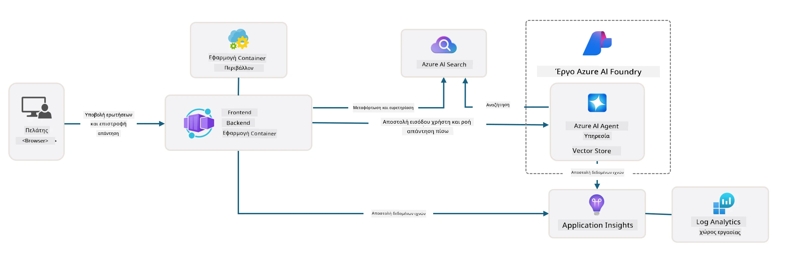

# 3. Αποσύνθεση ενός Προτύπου

!!! tip "ΜΕΧΡΙ ΤΟ ΤΕΛΟΣ ΑΥΤΟΥ ΤΟΥ ΜΟΝΤΟΥΛΟΥ ΘΑ ΜΠΟΡΕΙΤΕ ΝΑ"

    - [ ] Use GitHub Copilot and optional MCP tools for Azure documentation and read-only exploration
    - [ ] Identify the template's application, infrastructure, configuration, and test entry points
    - [ ] Verify generated explanations against actual repository files
    - [ ] **Lab 3:** Trace one request and one configuration input through the project

---

## 1. Ενεργοποιήστε το GitHub Copilot

Ανοίξτε το αρχικοποιημένο δείγμα AI στο VS Code και ενεργοποιήστε το [GitHub Copilot](https://code.visualstudio.com/docs/copilot/chat/chat-agent-mode). Συνδεθείτε με έναν λογαριασμό που διαθέτει κατάλληλο πλάνο· τα όρια χρήσης διαφέρουν. Ζητήστε από το Copilot να εξηγήσει το αποθετήριο πριν από την εξουσιοδότηση αλλαγών.

### Προαιρετικοί διακομιστές MCP

Αυτές οι υπηρεσίες μπορούν να παρέχουν πρόσθετα εργαλεία:

- [Azure MCP Server](https://learn.microsoft.com/azure/developer/azure-mcp-server/overview)
- [Microsoft Learn MCP Server](https://learn.microsoft.com/training/support/mcp)

Στο VS Code, ελέγξτε τις [οδηγίες διαμόρφωσης MCP](https://code.visualstudio.com/docs/copilot/chat/mcp-servers) και δημιουργήστε `.vscode/mcp.json` αν χρειάζεται:

```json
{
  "servers": {
    "Azure MCP Server": {
      "type": "stdio",
      "command": "npx",
      "args": ["-y", "@azure/mcp@latest", "server", "start"]
    },
    "microsoft.docs.mcp": {
      "type": "http",
      "url": "https://learn.microsoft.com/api/mcp"
    }
  }
}
```

Η εντολή `npx` απαιτεί υποστηριζόμενη εγκατάσταση Node.js/npm και κατεβάζει εκτελέσιμο κώδικα. Ελέγξτε το πακέτο και καθορίστε μια εγκεκριμένη έκδοση για αναπαραγώγιμη ρύθμιση ομάδας. Ξεκινήστε τους διακομιστές με τους ελέγχους MCP του VS Code και ελέγξτε τα διαθέσιμα εργαλεία τους· τα ονόματα μπορεί να αλλάξουν μεταξύ εκδόσεων.

**Η πιστοποίηση είναι ξεχωριστή.** Χρησιμοποιήστε `azd auth login` για AZD. Ακολουθήστε τη τεκμηριωμένη ροή πιστοποίησης του Azure MCP για τα εργαλεία του· μόνο η σύνδεση AZD δεν δημιουργεί συνεδρία MCP. Χρησιμοποιήστε `az login` ξεχωριστά όταν μια άσκηση ή ακίδα καλεί το Azure CLI.

Δοκιμάστε προτροπές μόνο ανάγνωσης:

1. “Χρησιμοποιήστε το Microsoft Learn MCP για να βρείτε την τεκμηρίωση διαμόρφωσης του Azure Developer CLI.”
2. “Εξηγήστε το `azure.yaml` αυτού του αποθετηρίου· αναφέρετε τα αρχεία που υλοποιούν κάθε ακίδα.”
3. “Χρησιμοποιώντας τα διαθέσιμα εργαλεία Azure MCP, απαριθμήστε τους αναπτυγμένους πόρους μου χωρίς να τροποποιήσετε τίποτα.”

Ελέγξτε τον επιλεγμένο ενοικιαστή/συνδρομή και κάθε προτεινόμενη κλήση εργαλείου. Μην εγκρίνετε δημιουργία πόρου, διαγραφή ή αλλαγές πρόσβασης μόνο για να εξερευνήσετε την αρχιτεκτονική.

## 2. Κατανοήστε την αρχιτεκτονική

Το δείγμα φιλοξενεί ένα backend Python FastAPI και ένα frontend React/TypeScript σε Azure Container Apps. Το backend επικοινωνεί με έναν agent σε ένα έργο Microsoft Foundry. Η ανάκτηση και η παρατηρησιμότητα εξαρτώνται από τα ενεργοποιημένα χαρακτηριστικά προτύπου και την επιτυχή εγκατάσταση· δεν εγγυώνται απλώς επειδή αναπτύχθηκε η εφαρμογή.



Συγκρίνετε αυτό το διάγραμμα με τον [τρέχοντα οδηγό ανάπτυξης upstream](https://github.com/Azure-Samples/get-started-with-ai-agents/blob/main/docs/deployment.md) και τους πραγματικούς πόρους σας. Ελέγξτε τη διαμόρφωση ανάπτυξης μοντέλου, τα εργαλεία agent, την διαχειριζόμενη ταυτότητα, τις αναθέσεις ρόλων και τους προαιρετικούς πόρους AI Search/Application Insights.

**Άσκηση:** Ζητήστε από το Copilot να ακολουθήσει ένα αίτημα συνομιλίας από το frontend μέσω του API προς το Foundry, με αναφορές σε αρχεία και συναρτήσεις. Ανοίξτε αυτές τις αναφορές και επαληθεύστε την εξήγηση. Μην συμπεραίνετε υλοποιημένη πιστοποίηση, δρομολόγηση ή εξουσιοδότηση μόνο από ένα διάγραμμα.

## 3. Δομή αποθετηρίου

Οι ακόλουθες επιλεγμένες διαδρομές ελέγχθηκαν σε σχέση με το δείγμα στις 4 Νοεμβρίου 2026. Η αρχικοποιημένη αναθεώρησή σας παραμένει η πηγή αλήθειας:

```text
get-started-with-ai-agents/
  azure.yaml
  docker-compose.yaml
  requirements-dev.txt
  .devcontainer/
  infra/
    main.bicep
    main.parameters.json
    api.bicep
    core/
  src/
    Dockerfile
    pyproject.toml
    requirements.txt
    api/
      main.py
      routes.py
      search_index_manager.py
    frontend/
      package.json
      src/
    files/
  scripts/
    validate_env_vars.sh
    validate_env_vars.ps1
    postdeploy.sh
    postdeploy.ps1
  tests/
    test_evaluation.py
    test_red_teaming.py
  docs/
    deployment.md
    deploy_customization.md
    ai_search.md
    observability.md
    local_development.md
    troubleshooting.md
```

### Υποδομή και διαμόρφωση

`infra/main.bicep` οργανώνει τους πόρους· `main.parameters.json` συνδέει τις εισόδους προτύπου με τις τιμές περιβάλλοντος AZD. `azure.yaml` επιλέγει την υπηρεσία εφαρμογής και τις ακίδες κύκλου ζωής. Ακολουθήστε μια είσοδο όπως `USE_AZURE_AI_SEARCH_SERVICE` μέσα από αυτά τα αρχεία για να βρείτε τι αλλάζει πραγματικά.

### Εφαρμογή και ταυτότητα

Διαβάστε `src/api/` και `src/frontend/` μαζί. Προσδιορίστε που δημιουργείται ή ανακτάται ο agent, που διαμορφώνονται οδηγίες/εργαλεία, και ποια ταυτότητα χρησιμοποιεί κάθε κλήση Azure. Τα δείγματα κάτω από `src/files/` είναι δεδομένα επίδειξης, όχι κατάλογος παραγωγής ή μοντέλο εξουσιοδότησης.

### Δοκιμές και παρατηρησιμότητα

Τα τρέχοντα σημεία εισόδου αξιολόγησης και red-teaming βρίσκονται κάτω από `tests/`· παλαιότερες αναφορές καταλόγου `evals/` και `airedteaming/` είναι απαρχαιωμένες για αυτό το δείγμα. Διαβάστε `docs/observability.md` για προαπαιτούμενα και κόστη πριν εκτελέσετε δοκιμές στο νέφος. Αυτές οι δοκιμές Python είναι ξεχωριστές από την προαιρετική επέκταση `azure.ai.evaluations` AZD.

## 4. Επαληθεύστε τα ευρήματά σας

- Προσδιορίστε τη διαδρομή API, την αλληλεπίδραση agent, και τον κώδικα ανάκτησης για μία δείγμα ερώτησης.
- Εξηγήστε ποια ταυτότητα αποκτά πρόσβαση στο Foundry και ποια διαμόρφωση επιλέγει το endpoint του.
- Βρείτε τα πραγματικά scripts πριν από την ανάδυση και μετά την ανάπτυξη και τη συμπεριφορά διαχείρισης σφαλμάτων τους.
- Καταγράψτε οποιεσδήποτε εξαρτήσεις ή προαιρετικά χαρακτηριστικά που λείπουν από την ανάπτυξή σας.

Συνεχίστε στο [Διαμόρφωση ενός Προτύπου](4-Configure-AI-Template.md).

---

<!-- CO-OP TRANSLATOR DISCLAIMER START -->
**Αποποίηση ευθυνών**:
Αυτό το έγγραφο έχει μεταφραστεί χρησιμοποιώντας την υπηρεσία μετάφρασης με τεχνητή νοημοσύνη [Co-op Translator](https://github.com/Azure/co-op-translator). Ενώ επιδιώκουμε την ακρίβεια, παρακαλούμε να έχετε υπόψη ότι οι αυτοματοποιημένες μεταφράσεις ενδέχεται να περιέχουν λάθη ή ανακρίβειες. Το πρωτότυπο έγγραφο στη μητρική του γλώσσα πρέπει να θεωρείται η αυθεντική πηγή. Για κρίσιμες πληροφορίες, συνιστάται επαγγελματική ανθρώπινη μετάφραση. Δεν φέρουμε ευθύνη για τυχόν παρεξηγήσεις ή λανθασμένες ερμηνείες που προκύπτουν από τη χρήση αυτής της μετάφρασης.
<!-- CO-OP TRANSLATOR DISCLAIMER END -->