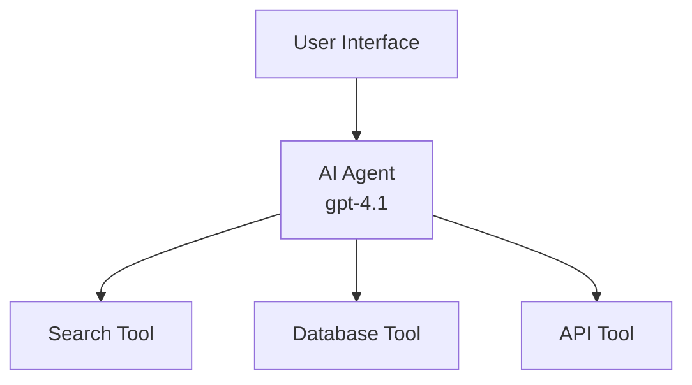
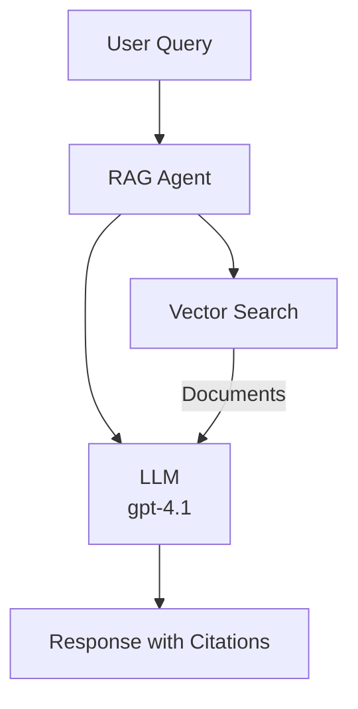
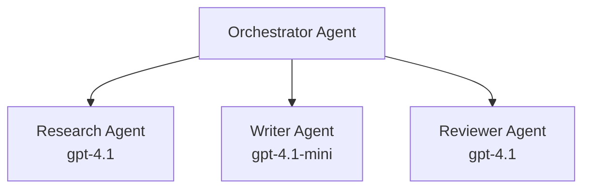

# AI Agents with Azure Developer CLI

**Chapter Navigation:**
- **📚 Course Home**: [AZD For Beginners](../../README.md)
- **📖 Current Chapter**: Chapter 2 - AI-First Development
- **⬅️ Previous**: [Microsoft Foundry Integration](microsoft-foundry-integration.md)
- **➡️ Next**: [AI Model Deployment](ai-model-deployment.md)
- **🚀 Advanced**: [Multi-Agent Solutions](../../examples/retail-scenario.md)

---

## Introduction

AI agents are autonomous programs that can perceive their environment, make decisions, and take actions to achieve specific goals. Unlike simple chatbots that respond to prompts, agents can:

- **Use tools** - Call APIs, search databases, execute code
- **Plan and reason** - Break complex tasks into steps
- **Learn from context** - Maintain memory and adapt behavior
- **Collaborate** - Work with other agents (multi-agent systems)

This guide shows you how to deploy AI agents to Azure using Azure Developer CLI (azd).

Using conversation context is not model training: persistent memory, access control, and retention must be implemented/configured by the application.

> **Release review (2026-11-04):** CLI examples were checked against `azd` `1.37.2`, `azure.ai.agents` `1.0.0-beta.23`, and `azure.ai.evaluations` `1.0.0-beta.2` documentation/source, not a live Azure deployment. Use `azd >= 1.37.0` for the combined workflow. See [recent changes and fixes](../chapter-08-production/production-ai-practices.md#recent-release-changes-and-fixes) before upgrading older projects.

## Learning Goals

By completing this guide, you will:
- Understand what AI agents are and how they differ from chatbots
- Deploy pre-built AI agent templates using AZD
- Configure Foundry Agents for custom agents
- Implement basic agent patterns (tool use, RAG, multi-agent)
- Monitor and debug deployed agents

## Learning Outcomes

Upon completion, you will be able to:
- Deploy AI agent applications to Azure with a single command
- Configure agent tools and capabilities
- Implement retrieval-augmented generation (RAG) with agents
- Design multi-agent architectures for complex workflows
- Troubleshoot common agent deployment issues

---

## 🤖 What Makes an Agent Different from a Chatbot?

| Feature | Chatbot | AI Agent |
|---------|---------|----------|
| **Behavior** | Responds to prompts | Takes autonomous actions |
| **Tools** | May use retrieval or tools | Typically uses tools in a goal-directed loop |
| **Memory** | Application-dependent | Persistent memory only if explicitly implemented |
| **Planning** | Single response | Multi-step reasoning |
| **Collaboration** | Single entity | Can work with other agents |

### Simple Analogy

- **Chatbot** = A helpful person answering questions at an information desk
- **AI Agent** = A personal assistant who can make calls, book appointments, and complete tasks for you

---

## 🚀 Quick Start: Deploy Your First Agent

Choose one option in a **new empty working directory**. The trailing `.` initializes there; without an explicit destination, current AZD may create a template-named subdirectory and does not change your shell's directory. Keep separate templates/environments in separate directories.

The time/cost ranges below are illustrative, not validated quotes. Check each sample's current prerequisites, pricing, model quota, and optional services before deployment.

### Option 1: Foundry Agents Template (Recommended)

```bash
# Initialize the AI agents template
azd init --template get-started-with-ai-agents .

# Deploy to Azure
azd up
```

**What gets deployed:** The sample's current infrastructure and selected options determine the model, tools, hosting, and monitoring resources. Review its README and `infra/` before provisioning; do not assume every agent template includes Search or a web interface.

**Time:** ~15-20 minutes
**Cost:** ~$100-150/month (development)

### Option 2: Creative Writing Agents with Prompty

```bash
# Initialize the Prompty-based agent template
azd init --template https://github.com/Azure-Samples/contoso-creative-writer .

# Deploy to Azure
azd up
```

**What gets deployed:** A FastAPI/Prompty multi-agent writing sample using Azure OpenAI, Bing Grounding, and Azure AI Search. The former `agent-openai-python-prompty` repository redirects here; it is not a minimal Azure Functions weather-agent template. Follow its current README for hosting, model quota, and Bing Grounding prerequisites.

**Time:** ~10-15 minutes
**Cost:** ~$50-100/month (development)

### Option 3: RAG Chat Agent

```bash
# Initialize RAG chat template
azd init --template azure-search-openai-demo .

# Deploy to Azure
azd up
```

**What gets deployed:**
- ✅ Microsoft Foundry Models
- ✅ Azure AI Search with sample data
- ✅ Document processing pipeline
- ✅ Chat interface with citations

**Time:** ~15-25 minutes
**Cost:** ~$80-150/month (development)

### Option 4: AZD AI Agent Init (Project Template Preview)

Use `azd ai agent init` interactively, or adopt a current `azure.yaml` agent project with `--template`/`-t`. The old `--manifest`/`-m` option is a deprecated alias, not a converter for legacy manifests.

```bash
# Install the AI agents extension
azd extension install azure.ai.agents

# Optional: verify the installed preview version
azd extension show azure.ai.agents

# Initialize from a current agent project template (supply your template path)
azd ai agent init --template ./templates/support-agent/azure.yaml

# Deploy to Azure
azd up

# Test the deployed agent (shows latency + time-to-first-byte)
azd ai agent invoke
```

**When to use `azd ai agent init` vs `azd init --template`:**

| Approach | Best For | How It Works |
|----------|----------|------|
| `azd init --template` | Starting from a working sample app | Clones a full template repo with code + infra |
| `azd ai agent init --template` | Adopting a current Foundry agent project | Uses an `azure.yaml` project document and its definitions |

> **Tip:** Use `azd init --template` when learning (Options 1-3 above). Use `azd ai agent init` for the Foundry agent workflow. To add a direct agent definition to an existing project, see [initialization and migration guidance](../chapter-08-production/production-ai-practices.md#initializing-agent-projects-with-azd-ai-agent-init).

After `azd up`, use `azd ai agent invoke` to test, the separate `azure.ai.evaluations` extension (`azd ai eval init`, `generate`, and `run start`) to measure quality, and `azd ai agent optimize` to improve it using the new evaluation configuration. Agents beta.22 replaced the legacy evaluation workflow and changed optimization's `--config` format. See [evaluation migration](../chapter-08-production/production-ai-practices.md#evaluation-migration-and-quality-checks) and [optimization migration](../chapter-08-production/production-ai-practices.md#optimization-configuration-migration) before reusing older examples.

---

## 🏗️ Agent Architecture Patterns

### Pattern 1: Single Agent with Tools

The simplest agent pattern - one agent that can use multiple tools.



**Best for:**
- Customer support bots
- Research assistants
- Data analysis agents

**Related application sample:** `azure-search-openai-demo` demonstrates RAG, not a generic arbitrary-tool agent loop.

### Pattern 2: RAG Agent (Retrieval-Augmented Generation)

An agent that retrieves relevant documents before generating responses.



**Best for:**
- Enterprise knowledge bases
- Document Q&A systems
- Compliance and legal research

**AZD Template:** `azure-search-openai-demo`

### Pattern 3: Multi-Agent System

Multiple specialized agents working together on complex tasks.



**Best for:**
- Complex content generation
- Multi-step workflows
- Tasks requiring different expertise

**Learn More:** [Multi-Agent Coordination Patterns](../chapter-06-pre-deployment/coordination-patterns.md)

---

## ⚙️ Configuring Agent Tools

Agents become powerful when they can use tools. Here's how to configure common tools:

### Tool Configuration in Foundry Agents

This **classic Agent Service SDK fragment** targets `azure-ai-projects==1.0.0` and `azure-ai-agents==1.1.0` with `azure-identity`. It is not the newer versioned-agent/Responses API used by some current Foundry templates, nor the `azure.ai.agents` AZD extension (a different package). Do not mix these API generations. Set `PROJECT_ENDPOINT` to a classic Foundry project endpoint and `MODEL_DEPLOYMENT_NAME` to an existing supported model deployment; authenticate with `az login` locally and grant the required project permissions.

```python
# agent_config.py
import os
from azure.ai.projects import AIProjectClient
from azure.ai.agents.models import FunctionTool
from azure.identity import DefaultAzureCredential

def search_knowledge_base(query: str) -> str:
    """Search the demonstration knowledge base.

    :param query: Search text.
    :return: Matching demonstration information.
    """
    # Local fixture only, not a production search implementation.
    return "Demo policy: returns are accepted within 30 days."

project_client = AIProjectClient(
    endpoint=os.environ["PROJECT_ENDPOINT"],
    credential=DefaultAzureCredential(),
)
search_tool = FunctionTool(functions={search_knowledge_base})
project_client.agents.enable_auto_function_calls(search_tool)
agent = project_client.agents.create_agent(
    model=os.environ["MODEL_DEPLOYMENT_NAME"],
    name="Support Agent",
    instructions="Use search_knowledge_base for policy questions. Label results as demo data.",
    tools=search_tool.definitions,
)
```

Registering a function schema does not execute Python on the service. In this SDK, `enable_auto_function_calls` plus `agents.runs.create_and_process(...)` runs registered callbacks in your client process. See the [released SDK example](https://github.com/Azure/azure-sdk-for-python/blob/azure-ai-agents_1.1.0/sdk/ai/azure-ai-agents/samples/agents_tools/sample_agents_auto_function_call.py). Close the client and delete demonstration agents/threads when finished.

### Environment Configuration

The following names are **illustrative custom-template inputs**, not built-in AZD switches. First wire each value through `infra/main.parameters.json`, infrastructure, and application code. `azd env set` alone does not change an agent's tools or instructions.

```bash
# Set up agent-specific environment variables
azd env set AZURE_OPENAI_MODEL "gpt-4.1"
azd env set AGENT_INSTRUCTIONS "You are a helpful assistant..."
azd env set ENABLE_CODE_INTERPRETER "true"
azd env set ENABLE_FILE_SEARCH "true"

# Apply wired infrastructure and application changes
azd up
```

---

## 📊 Monitoring Agents

### Application Insights Integration

If your selected template provisions Application Insights and configures instrumentation:

```bash
# Open monitoring dashboard
azd monitor --overview

# Open the Application Insights logs view (not a streaming log tail)
azd monitor --logs

# View live metrics
azd monitor --live
```

### Key Metrics to Track

| Metric | Description | Target |
|--------|-------------|--------|
| Response Latency | Time to generate response | < 5 seconds |
| Token Usage | Tokens per request | Monitor for cost |
| Tool Call Success Rate | % of successful tool executions | > 95% |
| Error Rate | Failed agent requests | < 1% |
| User Satisfaction | Feedback scores | > 4.0/5.0 |

### Custom Logging for Agents

```python
import os
from azure.monitor.opentelemetry import configure_azure_monitor
from opentelemetry import trace

# Configure Azure Monitor with OpenTelemetry
configure_azure_monitor(
    connection_string=os.environ["APPLICATIONINSIGHTS_CONNECTION_STRING"]
)

tracer = trace.get_tracer(__name__)

def log_agent_interaction(user_query, agent_response, tools_used, latency_ms):
    with tracer.start_as_current_span("agent_interaction") as span:
        span.set_attributes({
            "query_length": len(user_query),  # Do not log raw prompts or personal data
            "response_length": len(agent_response),
            "tools_used": tools_used,
            "latency_ms": latency_ms
        })
```

> **Note:** Install the required package: `pip install azure-monitor-opentelemetry`. It brings the OpenTelemetry dependencies; the import namespace is not a requirement to install a package named `opentelemetry`.

---

## 💰 Cost Considerations

### Estimated Monthly Costs by Pattern

These are illustrative planning ranges, not quotes or spending caps. Region, model tokens, Search/compute SKUs, tool sessions, storage, and traffic can exceed them. Check the sample's cost guidance and Azure pricing before `azd up`.

| Pattern | Dev Environment | Production |
|---------|-----------------|------------|
| Single Agent | $50-100 | $200-500 |
| RAG Agent | $80-150 | $300-800 |
| Multi-Agent (2-3 agents) | $150-300 | $500-1,500 |
| Enterprise Multi-Agent | $300-500 | $1,500-5,000+ |

### Cost Optimization Tips

1. **Use gpt-4.1-mini for simple tasks** (only if your template consumes this input)
   ```bash
   azd env set AZURE_OPENAI_MODEL "gpt-4.1-mini"
   ```

2. **Implement scoped caching for safe, repeated queries.** Include tenant/user authorization, model deployment, instructions, and retrieval version in the cache key; set an expiry. Do not share private conversation responses through a process-wide query-only cache. The SDK agent object has no generic `agent.run()` method.

3. **Set token limits per run**
   ```python
   # Set max_completion_tokens when running the agent, not during creation
   run = project_client.agents.runs.create_and_process(
       thread_id=thread.id,
       agent_id=agent.id,
       max_completion_tokens=1000  # Budget across the run; may finish as incomplete
   )
   ```

4. **Scale eligible Container Apps to zero when not in use**
   ```bash
   # Custom-template input: must map to template.scale.minReplicas
   azd env set MIN_REPLICAS "0"
   ```
   Apply the infrastructure change with `azd provision` or `azd up`. Scaling to zero needs a suitable trigger and does not stop Search, storage, or model/tool charges.

---

## 🔧 Troubleshooting Agents

### Common Issues and Solutions

<details>
<summary><strong>❌ Agent not responding to tool calls</strong></summary>

```bash
# Inspect the application deployment (not the agent's registered tools)
azd show

# Verify OpenAI deployment
az cognitiveservices account deployment list \
  --name $AZURE_OPENAI_NAME \
  --resource-group $RG_NAME

# Check agent logs
azd monitor --logs
```

**Common causes:**
- Tool function signature mismatch
- Missing required permissions
- API endpoint not accessible
</details>

<details>
<summary><strong>❌ High latency in agent responses</strong></summary>

```bash
# Check Application Insights for bottlenecks
azd monitor --live

# Consider using a faster model
azd env set AZURE_OPENAI_MODEL "gpt-4.1-mini"
azd up
```

**Optimization tips:**
- Use streaming responses
- Implement response caching
- Reduce context window size
</details>

<details>
<summary><strong>❌ Agent returning incorrect or hallucinated information</strong></summary>

```python
# Improve with better system prompts
instructions = """
You are a helpful assistant. IMPORTANT:
- Only answer based on provided context
- If you don't know, say "I don't know"
- Always cite your sources
- Never make up information
"""

# Use these instructions in the agent definition.
# For classic file search, first upload/index documents in a vector store,
# then use FileSearchTool(vector_store_ids=[...]) and pass both its
# .definitions and .resources when creating the agent.
```
Instructions and retrieval reduce risk; neither guarantees factual answers. Evaluate grounded and out-of-scope questions against known answers.
</details>

<details>
<summary><strong>❌ Token limit exceeded errors</strong></summary>

```python
# Implement context window management
def truncate_context(messages, max_tokens=8000, model="gpt-4.1"):
    """Approximate content-only budget for objects with .content strings."""
    import tiktoken
    encoding = tiktoken.encoding_for_model(model)
    total_tokens = 0
    truncated = []
    
    for msg in reversed(messages):
        msg_tokens = len(encoding.encode(msg.content))
        if total_tokens + msg_tokens > max_tokens:
            break
        truncated.insert(0, msg)
        total_tokens += msg_tokens
    
    return truncated
```
This helper excludes role/tool schemas, system instructions, image tokens, and protocol overhead. Reserve space for those and the completion; do not split tool-call/result pairs or discard required system instructions. Install `tiktoken` separately. It is not a general context-window validator.
</details>

---

## 🎓 Hands-On Exercises

### Exercise 1: Deploy a Basic Agent (20 minutes)

**Goal:** Deploy your first AI agent using AZD

```bash
# Step 1: Initialize template
azd init --template get-started-with-ai-agents .

# Step 2: Login to Azure
azd auth login
# If you work across tenants, add --tenant-id <tenant-id>

# Step 3: Deploy
azd up

# Step 4: Test the agent
# Expected output after deployment:
#   Deployment Complete!
#   Endpoint: https://<app-name>.<region>.azurecontainerapps.io
# Open the URL shown in the output and try asking a question

# Step 5: View monitoring
azd monitor --overview

# Step 6: Clean up
azd down --force --purge
```

**Success Criteria:**
- [ ] Agent responds to questions
- [ ] Can access monitoring dashboard via `azd monitor`
- [ ] Resources cleaned up successfully

### Exercise 2: Add a Custom Tool (30 minutes)

**Goal:** Extend an agent with a custom tool

**Starting point:** Use the classic SDK client from [Tool Configuration](#tool-configuration-in-foundry-agents), not an arbitrary template with a different SDK generation.

1. Add this deterministic fixture to `agent_config.py`:
   ```python
   def get_weather(location: str) -> str:
       """Return demonstration weather, not live conditions.

       :param location: City name.
       :return: A clearly labelled fixture.
       """
       print(f"TOOL_CALLED: {location}")
       return f"Demo weather in {location}: Sunny, 72°F (fixture, not live)"
   ```
2. Replace the search-tool registration and creation block with:
   ```python
   weather_tool = FunctionTool(functions={get_weather})
   project_client.agents.enable_auto_function_calls(weather_tool)
   agent = project_client.agents.create_agent(
       model=os.environ["MODEL_DEPLOYMENT_NAME"],
       name="Weather Agent",
       instructions="Call get_weather for weather questions; explain that it returns demo data.",
       tools=weather_tool.definitions,
   )
   thread = project_client.agents.threads.create()
   try:
       project_client.agents.messages.create(
           thread_id=thread.id, role="user", content="Use get_weather for Seattle."
       )
       run = project_client.agents.runs.create_and_process(
           thread_id=thread.id, agent_id=agent.id
       )
       if run.status != "completed":
           raise RuntimeError(f"Run status: {run.status}; error: {run.last_error}")
       for message in project_client.agents.messages.list(thread_id=thread.id):
           for text in message.text_messages:
               print(text.text.value)
   finally:
       project_client.agents.threads.delete(thread.id)
       project_client.agents.delete_agent(agent.id)
       project_client.close()
   ```
3. Run locally (this calls the existing Azure project and incurs model charges):
   ```bash
   python agent_config.py
   # Expected: TOOL_CALLED: Seattle, then a completed answer labelled demo data.
   ```

**Success Criteria:**
- [ ] Agent recognizes weather-related queries
- [ ] Tool is called correctly
- [ ] Response includes weather information

### Exercise 3: Build a RAG Agent (45 minutes)

**Goal:** Create an agent that answers questions from your documents

```bash
# Step 1: Deploy RAG template
azd init --template azure-search-openai-demo .
azd up

# Step 2: Upload your documents
# For the sample's local ingestion path, place supported files in data/.
# Run from the sample root after following its Python environment setup:
./scripts/prepdocs.sh
# Windows PowerShell equivalent: .\\scripts\\prepdocs.ps1

# Step 3: Test with domain-specific questions
# Open the web app URL from the azd up output
# Ask questions about your uploaded documents
# Responses should include citation references like [doc.pdf]
```

**Success Criteria:**
- [ ] Agent answers from uploaded documents
- [ ] Responses include citations
- [ ] Out-of-scope test questions are handled without unsupported claims (not a guarantee for every future question)

If `USE_CLOUD_INGESTION=true`, use the sample's cloud ingestion/upload workflow instead; the local wrapper intentionally skips ingestion. After testing, run `azd down` in the RAG environment and review the resources to be deleted.

---

## 📚 Next Steps

Now that you understand AI agents, explore these advanced topics:

| Topic | Description | Link |
|-------|-------------|------|
| **Multi-Agent Systems** | Build systems with multiple collaborating agents | [Retail Multi-Agent Example](../../examples/retail-scenario.md) |
| **Coordination Patterns** | Learn orchestration and communication patterns | [Coordination Patterns](../chapter-06-pre-deployment/coordination-patterns.md) |
| **Production Deployment** | Enterprise-ready agent deployment | [Production AI Practices](../chapter-08-production/production-ai-practices.md) |
| **Agent Evaluation** | Test and evaluate agent performance | [AI Troubleshooting](../chapter-07-troubleshooting/ai-troubleshooting.md) |
| **AI Workshop Lab** | Hands-on: Make your AI solution AZD-ready | [AI Workshop Lab](ai-workshop-lab.md) |

---

## 📖 Additional Resources

### Official Documentation
- [Microsoft Foundry Agent Service](https://learn.microsoft.com/azure/ai-services/agents/)
- [Microsoft Foundry Agent Service Quickstart](https://learn.microsoft.com/azure/ai-services/agents/quickstart)
- [Semantic Kernel Agent Framework](https://learn.microsoft.com/semantic-kernel/)

### AZD Templates for Agents
- [Get Started with AI Agents](https://github.com/Azure-Samples/get-started-with-ai-agents)
- [Creative Writing Agents with Prompty](https://github.com/Azure-Samples/contoso-creative-writer)
- [Azure Search OpenAI Demo](https://github.com/Azure-Samples/azure-search-openai-demo)

### Community Resources
- [Awesome AZD - Agent Templates](https://azure.github.io/awesome-azd/?tags=ai-agents)
- [Azure AI Discord](https://discord.gg/microsoft-azure)
- [Microsoft Foundry Discord](https://discord.gg/nTYy5BXMWG)

### Agent Skills for Your Editor
- [**Microsoft Azure Agent Skills**](https://skills.sh/microsoft/github-copilot-for-azure) - Install reusable AI agent skills for Azure development in GitHub Copilot, Cursor, or any supported agent. Includes skills for [Azure AI](https://skills.sh/microsoft/github-copilot-for-azure/azure-ai), [Microsoft Foundry](https://skills.sh/microsoft/github-copilot-for-azure/microsoft-foundry), [deployment](https://skills.sh/microsoft/github-copilot-for-azure/azure-deploy), and [diagnostics](https://skills.sh/microsoft/github-copilot-for-azure/azure-diagnostics):
  ```bash
  npx skills add microsoft/github-copilot-for-azure
  ```

---

**Navigation**
- **Previous Lesson**: [Microsoft Foundry Integration](microsoft-foundry-integration.md)
- **Next Lesson**: [AI Model Deployment](ai-model-deployment.md)

---

<!-- CO-OP TRANSLATOR DISCLAIMER START -->
**Disclaimer**:
This document has been translated using AI translation service [Co-op Translator](https://github.com/Azure/co-op-translator). While we strive for accuracy, please be aware that automated translations may contain errors or inaccuracies. The original document in its native language should be considered the authoritative source. For critical information, professional human translation is recommended. We are not liable for any misunderstandings or misinterpretations arising from the use of this translation.
<!-- CO-OP TRANSLATOR DISCLAIMER END -->