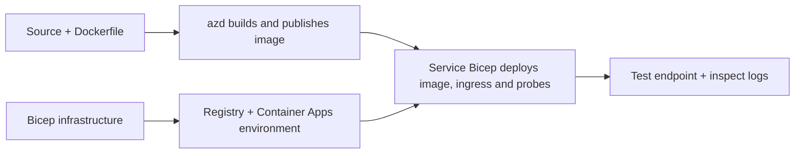

# Container App Deployment Examples with AZD

This directory contains two learning samples with source code, Dockerfiles,
Bicep infrastructure, and `azure.yaml`. Neither is production-hardened.

## Choose an example

| Sample | What is implemented | Prerequisite |
|---|---|---|
| [Simple Flask API](../../../../examples/container-app/simple-flask-api) | Single Python CRUD API, in-memory items, health probes, HTTP scaling | Basic CLI and HTTP knowledge |
| [Two-service microservices](../../../../examples/container-app/microservices) | Node.js gateway, internal read-only Python product service, telemetry and scaling | Complete the single-service sample first |

Allow 30–60 minutes including setup and verification. Azure provisioning times vary.

## Prerequisites

- [Azure Developer CLI](https://learn.microsoft.com/azure/developer/azure-developer-cli/install-azd)
- [Azure CLI](https://learn.microsoft.com/cli/azure/install-azure-cli) for verification commands
- Docker with its daemon running for building these container images
- An Azure subscription with resource-creation permissions and sufficient regional quota
- Bash for the shell examples, or equivalent PowerShell commands

```bash
azd version
az version
docker info
azd auth login
az login
```

The two tools have separate login sessions. Use a current stable azd; the current
published release at review time is 1.37.2. Older minimum version claims are not a
compatibility guarantee.

## Quick start

From the repository root:

```bash
cd examples/container-app/simple-flask-api
azd env new flask-demo
azd up
API_URL=$(azd env get-value API_ENDPOINT)
curl --fail-with-body "${API_URL}/health"
```

Expected: HTTP 200 with `"status": "healthy"`. Follow the sample README to create,
read, update, and delete an item, and to inspect logs.



Initial provisioning uses a public hello-world image on port 80. Service-specific
Bicep parameter files let `azd deploy` replace it with the built application image
and the correct app port/probes (8000 for Flask/product, 8080 for the gateway).
Keep these files with their `azure.yaml` `module` settings.

## Configuration: what changes what

`azure.yaml` selects source directories, languages, hosts, and deployment modules.
Container CPU/memory, ingress, probes, replica counts, and scale rules are defined
in **Bicep**, not arbitrary `resources`, `scale`, or `regions` service properties.

`azd env set SOME_VALUE ...` stores a value locally. It only changes a deployed
resource when a parameter, environment mapping, or hook explicitly consumes that
value. These examples do not consume `MAX_REPLICAS`, `SCALE_TO_ZERO_TIMEOUT`,
`CONTAINER_APP_REPLICA_TYPE`, or custom canary settings from azd environment values.
Edit the relevant Bicep and run `azd up` to re-provision and deploy.

Do not put application source under `infra/`. `project` must point to the source
directory containing the Dockerfile and dependency manifest.

## Monitoring and costs

- `azd monitor --logs` opens a portal view; it is not a terminal log stream.
  Use `az containerapp logs show --follow` with the actual resource name.
- The simple API writes stdout logs collected through Container Apps/Log Analytics.
  Its provisioned Application Insights resource is not automatically instrumented.
- The microservices gateway uses the Node.js Application Insights SDK; the Python
  service exports application log traces. Full Python request/dependency tracing
  is not configured.
- Scale-to-zero can reduce compute charges, but registry and log ingestion/storage
  can still cost money. The microservices defaults keep replicas running.
  Estimate your region and usage in the
  [Azure pricing calculator](https://azure.microsoft.com/pricing/calculator/).

## Advanced patterns — not included implementations

These are design directions, not additional local projects or copy-and-run snippets:

- **Persistent data and authentication:** replace in-memory stores and add
  Microsoft Entra ID authentication/authorization before production.
- **Blue-green/canary:** use Container Apps multiple-revision mode, revision
  labels, traffic weights, health verification, and rollback procedures.
  There is no `deploymentStrategy: canary` azd configuration in these samples.
  See [revision management](https://learn.microsoft.com/azure/container-apps/revisions).
- **Multi-region:** create separate environments and apps in Bicep and design
  global routing and data consistency. A service `regions` list is not an azd
  deployment mechanism.
- **Queue workers:** add worker source, dependencies, queue resources, a managed
  identity with data-plane roles, and an authenticated scale rule. Do not copy
  an empty `src/worker` path and expect a runnable project.
- **Dapr:** provision components, configure the sidecar, install the matching SDK,
  and implement state/pub-sub error handling.
- **Secrets:** use managed identity and role assignments where possible. Merely
  creating a Key Vault does not grant applications access or load secrets.

## Cleanup

From the sample directory:

```bash
azd down
```

Review deletion prompts and confirm that the dedicated resource group is removed.
Do not use these samples as a production baseline without additional design and tests.

[Examples index](../README.md) · [Course home](../../README.md) ·
[Container Apps documentation](https://learn.microsoft.com/azure/container-apps/) ·
[Report an issue](https://github.com/microsoft/AZD-for-beginners/issues)

---

<!-- CO-OP TRANSLATOR DISCLAIMER START -->
**Disclaimer**:
This document has been translated using AI translation service [Co-op Translator](https://github.com/Azure/co-op-translator). While we strive for accuracy, please be aware that automated translations may contain errors or inaccuracies. The original document in its native language should be considered the authoritative source. For critical information, professional human translation is recommended. We are not liable for any misunderstandings or misinterpretations arising from the use of this translation.
<!-- CO-OP TRANSLATOR DISCLAIMER END -->