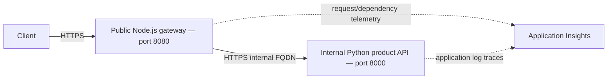

# Two-Service Microservices — Azure Container Apps

**Level:** Intermediate · **Time:** 45–60 minutes including setup

This learning sample implements a **Node.js API Gateway** and a **read-only Python
Product Service**. Source, Dockerfiles, Bicep, and azd configuration are included.
It is not a production-hardened system.

## What you'll learn

- Deploy two services independently.
- Use an internal backend FQDN over HTTPS.
- Verify success, not-found, and unavailable-service responses.
- Understand telemetry and independent scaling boundaries.



The product catalog contains five fixed products in memory. There are **no POST,
PUT, or DELETE handlers**, database, Service Bus, order/user/notification service,
C#, or Go code. Those are future development ideas, not included features.
The gateway does not authenticate users; internal ingress is not a replacement
for application authorization.

## Prerequisites

Complete the [single Flask API](../../../../../examples/container-app/simple-flask-api) first.
Install a current stable azd (published release at review time: 1.37.2), Azure CLI,
and Docker with the daemon running. You need an Azure subscription, resource
creation permissions, and Container Apps regional quota.

```bash
azd version
az version
docker info
azd auth login
az login
```

Use the same subscription in both CLI tools. Commands below use Bash.

## Deploy and verify

From the repository root:

```bash
cd examples/container-app/microservices
azd env new microservices-demo
azd up
GATEWAY_URL=$(azd env get-value API_GATEWAY_URL)
RG_NAME=$(azd env get-value AZURE_RESOURCE_GROUP)
GATEWAY_NAME=$(azd env get-value API_GATEWAY_NAME)
PRODUCT_NAME=$(azd env get-value PRODUCT_SERVICE_NAME)

curl --fail-with-body "${GATEWAY_URL}/health"
curl --fail-with-body "${GATEWAY_URL}/api/products"
curl --fail-with-body "${GATEWAY_URL}/api/products/1"
curl -i "${GATEWAY_URL}/api/products/999"
```

**Success:** health 200; list 200 with **five** products; product 1 is a Laptop
priced 999.99 with stock 50; unknown product returns 404.
Descriptions are included in responses; timestamps vary.

Initial provision uses public hello-world images on port 80 so it does not try
to pull nonexistent images from an empty registry. Service-specific Bicep modules
and parameter files replace them with built images and app ports/probes during
`azd deploy`. Main parameters preserve published image names for later provisioning.

## Services and networking

| Service | Exposed endpoints | Default resources |
|---|---|---|
| Gateway | GET `/`, `/health`, `/api/products`, `/api/products/:id` | 1 vCPU, 2 GiB, 2–20 replicas |
| Product | GET `/`, `/health`, `/products`, `/products/<id>` | 0.5 vCPU, 1 GiB, 1–10 replicas |

Product ingress has `external: false` and `allowInsecure: false`. Bicep injects
`PRODUCT_SERVICE_URL=https://<actual-internal-fqdn>` into the gateway. HTTP would
redirect; HTTPS matches the configured ingress. A short DNS name must match the
**actual Container App name**, not the logical service key `product-service`.
Do not try to call the internal URL directly from your laptop.

The gateway has a five-second timeout for product calls. Missing product IDs
propagate as 404; transport failures/other backend failures return 503. Gateway
`/health` only checks the gateway, not backend availability.

## Files and configuration

```text
azure.yaml
infra/main.bicep
infra/main.parameters.json
infra/abbreviations.json
infra/core/container-apps-environment.bicep
infra/core/monitor.bicep
infra/app/api-gateway.bicep
infra/app/api-gateway.parameters.json
infra/app/product-service.bicep
infra/app/product-service.parameters.json
src/api-gateway/{app.js,package.json,Dockerfile}
src/product-service/{main.py,requirements.txt,Dockerfile}
```

Scaling, CPU/memory, ports, and probes are set in `infra/app/*.bicep`. Change those
files and run `azd up` to apply infrastructure and redeploy. There is no
`GATEWAY_MAX_REPLICAS` environment-variable parameter in this sample.

For code-only changes:

```bash
azd deploy product-service
azd deploy api-gateway
```

The Node image uses Node 22; the Python image uses Python 3.11. Both bind to
`0.0.0.0`. Ingress/probes use port 8080 (gateway) and 8000 (product), respectively.

## Local development with Docker

Run from this example directory. Use a user-defined network, **not `localhost`
from one container to reach the other**:

```bash
docker network create azd-microservices-demo
docker build -t local-product ./src/product-service
docker build -t local-gateway ./src/api-gateway
docker run -d --name azd-product --network azd-microservices-demo local-product
docker run -d --name azd-gateway --network azd-microservices-demo \
  -p 8080:8080 -e PRODUCT_SERVICE_URL=http://azd-product:8000 local-gateway
curl --fail-with-body http://localhost:8080/api/products
```

Expected: five products. HTTP is used only for this local Docker network.

```bash
docker stop azd-product azd-gateway
docker rm azd-product azd-gateway
docker network rm azd-microservices-demo
```

## Monitoring

```bash
az containerapp logs show --name "$GATEWAY_NAME" --resource-group "$RG_NAME" --follow
# In a separate terminal:
az containerapp logs show --name "$PRODUCT_NAME" --resource-group "$RG_NAME" --tail 100
```

`azd monitor --logs` opens a portal view; it does not stream terminal logs.
The Node SDK collects gateway requests/dependencies. Python's `AzureLogHandler`
exports **log traces**, not automatic Flask requests, SQL dependencies, or full
distributed traces. OpenCensus is a legacy SDK; prefer Azure Monitor OpenTelemetry
when extending this sample.

In Application Insights Logs, generate requests and inspect:

```kusto
requests
| where timestamp > ago(1h)
| where name contains "products"
| summarize RequestCount=count(), AvgDuration=avg(duration) by bin(timestamp, 5m)
```

For Python application messages:

```kusto
traces
| where timestamp > ago(1h)
| where message contains "products"
| project timestamp, message, severityLevel
```

Allow ingestion delay and sampling; do not expect an exact request count or a
guaranteed latency. No custom alerts or dashboards are configured.

## Practical Exercises

### Exercise 1: Modify the catalog

**Starting point:** `src/product-service/main.py`.
**Goal:** verify independent service deployment.
Change Laptop's stock from 50 to 49 in the fixed `products` list, run
`azd deploy product-service`, then request `${GATEWAY_URL}/api/products/1`.

**Success criteria / solution:** HTTP 200 with `"stock":49`. Restore 50 and redeploy.
**Common issue:** editing the gateway instead of the service that owns the catalog.
This changes source data, not a persistent inventory database.

### Exercise 2: Verify replica configuration

**Starting point:** `infra/app/product-service.bicep`.
**Goal:** observe an infrastructure change without guessing at autoscaling.
Change `minReplicas: 1` to `minReplicas: 2`, run `azd up`, then:

```bash
az containerapp show --name "$PRODUCT_NAME" --resource-group "$RG_NAME" \
  --query properties.template.scale -o json
```

**Success criteria:** configured minimum is 2 and maximum remains 10.
Restore minimum 1 and run `azd up`.
**Common issue:** `azd deploy` alone does not apply changes to unrelated shared
infrastructure. Do not set `maxReplicas` to zero as a failure simulation.
This verifies configuration, not a load-test or a guaranteed instantaneous replica count.

### Exercise 3: Test unavailable-service handling locally

**Starting point:** both local Docker containers above are running.
**Goal:** distinguish backend failure from a missing product.
Stop only the product container:

```bash
docker stop azd-product
curl -i http://localhost:8080/api/products
docker start azd-product
curl --fail-with-body http://localhost:8080/api/products
```

**Success criteria:** while stopped, gateway returns 503 with
`"error":"Product service unavailable"`; after restart, the list returns 200.
Retry after a short startup delay if necessary.
**Common issue:** stopping the gateway tests a different failure (no HTTP response).

## Costs and production gaps

Default minimum replicas keep compute running. Registry and monitoring also incur
charges. There is no validated fixed $50/month total: estimate regional CPU/memory,
replica hours, requests, registry, and log retention in the
[Azure pricing calculator](https://azure.microsoft.com/pricing/calculator/).
Delete learning resources promptly.

Production work includes authentication/authorization, scoped managed identities,
persistent data, input/response validation, supported observability instrumentation,
load/failure testing, CI/CD, alerts, and recovery procedures. Adding an order
service, queue, or database is a separate implementation task, not a finished
exercise or a feature already available here.

## Troubleshooting and cleanup

- **Image not found during first provision:** bootstrap should use the public image;
  verify the main image parameter defaults and deployment module mappings.
- **503 products:** check product logs, image revision, and injected internal HTTPS URL.
- **404 unexpected path:** product API is read-only; verify the route, not a nonexistent CRUD handler.
- **No telemetry:** inspect runtime connection strings without exposing them and
  allow ingestion delay. Python request tables are not populated by its log handler.

From this sample directory:

```bash
azd down
```

Review deletion prompts and verify the dedicated resource group is removed.

[Previous: Flask API](../../../../../examples/container-app/simple-flask-api) · [Next: Database app](../../../../../examples/database-app) ·
[AI development](../../../docs/chapter-02-ai-development/README.md) ·
[Course home](../../../README.md) · [Report an issue](https://github.com/microsoft/AZD-for-beginners/issues)

---

<!-- CO-OP TRANSLATOR DISCLAIMER START -->
**Disclaimer**:
This document has been translated using AI translation service [Co-op Translator](https://github.com/Azure/co-op-translator). While we strive for accuracy, please be aware that automated translations may contain errors or inaccuracies. The original document in its native language should be considered the authoritative source. For critical information, professional human translation is recommended. We are not liable for any misunderstandings or misinterpretations arising from the use of this translation.
<!-- CO-OP TRANSLATOR DISCLAIMER END -->