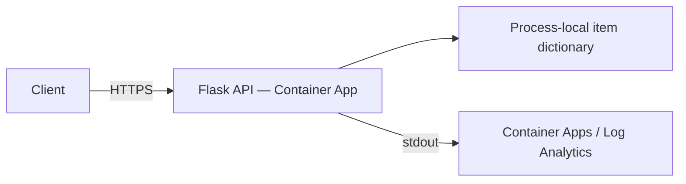

# Simple Flask API — Azure Container Apps

**Level:** Beginner · **Time:** 30–45 minutes including setup

Deploy a Python Flask CRUD API with Azure Developer CLI (azd). Source, Dockerfile,
Bicep, and deployment parameters are included. This is a **learning sample**, not
a production-ready API.

## What you'll learn

- Build and publish a container through azd.
- Configure ingress and liveness/readiness probes.
- Verify CRUD responses and inspect application logs.
- Understand why in-memory data is unsuitable for durable applications.



**Important:** items are held in one process. The default is **one Gunicorn worker,
0–1 replicas**, intentionally avoiding inconsistent data across workers/replicas.
Items are lost on restart, revision change, or scale-to-zero. Increasing replicas
requires shared persistent storage. The API has no authentication or authorization.

## Prerequisites

- [Current stable azd](https://learn.microsoft.com/azure/developer/azure-developer-cli/install-azd)
  (published release at review time: 1.37.2).
- [Azure CLI](https://learn.microsoft.com/cli/azure/install-azure-cli) for verification.
- Docker with its daemon running; it is required for the default local image build.
- Azure subscription, resource-creation permissions, and Container Apps regional quota.
- Bash for the commands below (or equivalent PowerShell).
- Python 3.11 for optional local development.

```bash
azd version
az version
docker info
azd auth login
az login
```

The CLI tools have separate login sessions. Use the same subscription in both.

## Quick start

From the repository root:

```bash
cd examples/container-app/simple-flask-api
azd env new flask-demo
azd up
API_URL=$(azd env get-value API_ENDPOINT)
RG_NAME=$(azd env get-value AZURE_RESOURCE_GROUP)
API_NAME=$(azd env get-value API_NAME)
curl --fail-with-body "${API_URL}/health"
```

Expected: HTTP 200 and JSON with `"status":"healthy"`,
`"service":"simple-flask-api"`, and a current UTC timestamp.
Provisioning and image building typically take several minutes; timings vary.

Initial provisioning uses a public hello-world image listening on port 80.
`azure.yaml` selects `infra/app/api.bicep` and its matching parameter file for
service deployment, which switches the image, ingress, and probes to port 8000.
Do not delete those deployment parameters.

## Verify CRUD

Run the following sequentially while the same replica remains active:

```bash
# Create: HTTP 201; note the returned id (1 for a fresh process).
curl -i -X POST "${API_URL}/api/items" \
  -H "Content-Type: application/json" \
  -d '{"name":"Test Item","description":"My first item"}'

# Read list: HTTP 200, total 1 in a fresh process.
curl --fail-with-body "${API_URL}/api/items"

# Replace 1 if your create response returned another id.
curl --fail-with-body "${API_URL}/api/items/1"
curl -i -X PUT "${API_URL}/api/items/1" \
  -H "Content-Type: application/json" -d '{"name":"Updated Item"}'
curl -i -X DELETE "${API_URL}/api/items/1"
curl -i "${API_URL}/api/items/1"
```

Success: POST 201, reads/PUT 200, DELETE 204 with no body, then missing item 404.
Malformed/non-object JSON or an empty name returns 400.
If an item disappears between requests, check for a restart or scale-to-zero;
this is an intentional in-memory limitation, not persistence.

| Endpoint | Methods |
|---|---|
| `/` | GET — service information |
| `/health` | GET — liveness/readiness |
| `/api/items` | GET, POST |
| `/api/items/{id}` | GET, PUT, DELETE |

## Logs and configuration

```bash
az containerapp logs show --name "$API_NAME" --resource-group "$RG_NAME" --follow
```

Expected: Gunicorn startup, request access logs, and application messages.
`azd monitor --logs` opens a portal view; it does not stream to the terminal.
Application Insights is provisioned but **not instrumented by this Flask code**;
use Container Apps/Log Analytics for stdout logs.

Edit `infra/app/api.bicep` for CPU/memory, replica limits, or scale rules, then
run `azd up`. Defaults are 0.5 vCPU, 1 GiB, minimum 0 / maximum 1 replica, and an
HTTP threshold of 50 concurrent requests. Scale-to-zero can add cold-start latency.

Arbitrary `azd env set MAX_REPLICAS`, `API_KEY`, `LOG_LEVEL`, or
`SCALE_TO_ZERO_TIMEOUT` values are **not wired to this template or app**.
Setting a value does not automatically make it a runtime environment variable.
The image binds port 8000 explicitly; update Dockerfile, Bicep ingress, and probes
together if changing the port.

## Files

```text
azure.yaml
infra/main.bicep
infra/main.parameters.json
infra/app/container-apps.bicep       # Environment, registry, monitoring
infra/app/api.bicep                  # App, ingress, probes, scale settings
infra/app/api.parameters.json        # Image and resource values for azd deploy
src/app.py
src/Dockerfile
src/requirements.txt
```

## Local development

From this example directory:

```bash
python -m venv .venv
source .venv/bin/activate  # PowerShell: .\.venv\Scripts\Activate.ps1
python -m pip install -r src/requirements.txt
python src/app.py
```

In another terminal, test `http://localhost:8000/health` and the CRUD endpoints.
Or build and run the actual image:

```bash
docker build -t flask-api:local ./src
docker run --rm -p 8000:8000 flask-api:local
```

For code-only changes after first deployment, run `azd deploy api`.
For Bicep changes, run `azd up` to re-provision and deploy.

## Practical exercises

### 1. Validate input rejection

**Starting point:** deployed API, `API_URL` above.
**Goal:** verify the API rejects invalid JSON shapes and missing names.

```bash
curl -i -X POST "${API_URL}/api/items" \
  -H "Content-Type: application/json" -d '[]'
curl -i -X POST "${API_URL}/api/items" \
  -H "Content-Type: application/json" -d '{"name":""}'
```

**Success criteria / solution:** both return 400 with a JSON error, not 500.
**Common issue:** omitting the JSON content-type header.

### 2. Add a read-only version endpoint

**Starting point:** `src/app.py`. **Goal:** extend and redeploy the API.
Add this before the `if __name__ == '__main__':` block:

```python
@app.route('/version', methods=['GET'])
def version():
    return jsonify({'version': '1.0.0'})
```

Run `azd deploy api`, then `curl --fail-with-body "${API_URL}/version"`.
**Success criteria:** HTTP 200 and `{"version":"1.0.0"}`.
**Common issue:** putting the route after the blocking `app.run()` call when
testing with `python src/app.py`.

### Knowledge checkpoint

Why is one worker insufficient for durable data? Because even one process loses
its dictionary on restart. A production version needs persistent shared storage,
authentication, authorization, migrations, tests, and operational monitoring.

## Costs and troubleshooting

This is not a guaranteed $0 deployment: the Basic registry and log storage/ingestion
can incur charges even when app compute is at zero. Use the
[pricing calculator](https://azure.microsoft.com/pricing/calculator/) for your region.

- **Docker build failure:** confirm `docker info`, network access, and dependencies.
- **Unhealthy app:** inspect console/system logs and verify image port, ingress,
  and probes agree. A placeholder must not be probed on the Flask port.
- **403/permissions:** confirm subscription and resource-creation permissions.
- **Items disappear:** in-memory state resets on restart/scale-to-zero; add a database
  for durable behavior.

## Cleanup and next steps

```bash
azd down
```

Review the deletion prompt and verify the dedicated resource group is removed.
Do not use destructive cleanup against a resource group containing unrelated data.

[Next: Database app](../../../../../examples/database-app) · [Microservices](../../../../../examples/container-app/microservices) ·
[Container overview](../README.md) · [Course home](../../../README.md) ·
[Report an issue](https://github.com/microsoft/AZD-for-beginners/issues)

---

<!-- CO-OP TRANSLATOR DISCLAIMER START -->
**Disclaimer**:
This document has been translated using AI translation service [Co-op Translator](https://github.com/Azure/co-op-translator). While we strive for accuracy, please be aware that automated translations may contain errors or inaccuracies. The original document in its native language should be considered the authoritative source. For critical information, professional human translation is recommended. We are not liable for any misunderstandings or misinterpretations arising from the use of this translation.
<!-- CO-OP TRANSLATOR DISCLAIMER END -->