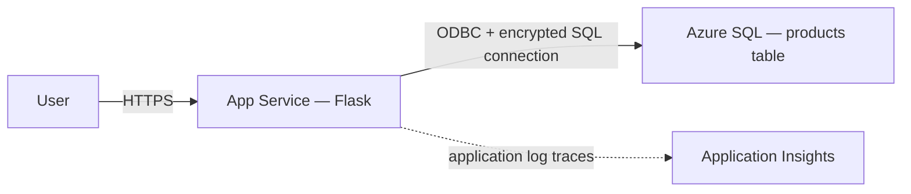

# Flask and Azure SQL on App Service

**Level:** Intermediate · **Time:** 30–60 minutes including prerequisites

This sample deploys a Python Flask read API to **Linux App Service** and a Basic
Azure SQL database. Source, Bicep, and azd configuration are included. It is a
learning application, not a production-ready database architecture.

## What you'll learn

- Provision App Service, SQL, and monitoring resources with Bicep.
- Configure encrypted SQL connectivity without committing credentials.
- Initialize a schema before starting Gunicorn workers.
- Verify seeded data, not-found responses, and database health.



Resources: dedicated resource group, B1 Linux App Service plan, Python 3.11 Web
App, SQL server and Basic 2-GB database, Application Insights, and Log Analytics.
The Web App uses **source/ZIP deployment and Oryx dependency installation**;
`azd deploy` does not build or deploy the optional Dockerfile.

## Prerequisites

- Current stable [azd](https://learn.microsoft.com/azure/developer/azure-developer-cli/install-azd)
  (published release at review time: 1.37.2).
- [Azure CLI](https://learn.microsoft.com/cli/azure/install-azure-cli) for verification.
- Azure subscription, permissions to create the listed resources, and regional quota.
- Python **3.11** for local development; the committed `pyodbc==5.0.1` may require
  native build tools on newer Python versions.
- Microsoft ODBC Driver 18 (or 17) for SQL Server on local machines. `pip install
  pyodbc` does not install the system driver. See
  [ODBC installation](https://learn.microsoft.com/sql/connect/odbc/download-odbc-driver-for-sql-server).
- Docker only if testing the optional container locally.

```bash
azd version
az version
azd auth login
az login
```

Use the same subscription in both tools. Commands below use Bash.

## Deploy

From the repository root:

```bash
cd examples/database-app
azd env new sql-demo
azd provision
azd deploy
WEB_URL=$(azd env get-value WEB_APP_URI)
WEB_NAME=$(azd env get-value WEB_APP_NAME)
RG_NAME=$(azd env get-value AZURE_RESOURCE_GROUP)
```

Choose a supported region. `sqlAdminLogin` defaults to `sqladmin`; the required
`sqlAdminPassword` is a secure parameter. Supply a strong password when prompted.
Keep deployment credentials out of Git and issue reports. The current connection
string interpolation expects a password without connection-string delimiters such
as `;`; adapt escaping before using such values.

Bicep sets a startup command that runs `init_database()` **before** Gunicorn
workers start. This is necessary because importing `app:app` does not execute
Python's `if __name__ == '__main__'` block. On a fresh database, initialization
creates `products` and inserts five rows. It is a simple teaching seed, not a
concurrent migration framework; use proper migrations before scaling out instances.

The app selects installed Microsoft ODBC Driver 18, then 17, if the connection
string does not explicitly name a driver. If neither exists, startup fails with
an actionable installation error. Verify driver availability in your selected
App Service runtime rather than assuming it.

## Verify

```bash
curl --fail-with-body "${WEB_URL}/"
curl --fail-with-body "${WEB_URL}/health"
curl --fail-with-body "${WEB_URL}/products"
curl --fail-with-body "${WEB_URL}/products/1"
curl -i "${WEB_URL}/products/999"
```

Expected:

- `/` returns endpoint information.
- `/health` returns 200 with `{"status":"healthy","database":"connected"}`.
- `/products` returns five seeded products on a fresh database.
- `/products/1` returns Laptop with price 1299.99.
- A nonexistent product returns 404 with `{"error":"Product not found"}`.

The API is read-only. There is no POST/PUT/DELETE route or browser UI.
Database connectivity failure returns 503 from `/health`; it is not success.

## Files and configuration

```text
azure.yaml                         # Python App Service source deployment
infra/main.bicep
infra/main.parameters.json
infra/abbreviations.json
infra/resources/sql-server.bicep
infra/resources/sql-database.bicep
infra/resources/app-service-plan.bicep
infra/resources/web-app.bicep       # Settings + initialization/startup command
infra/resources/app-insights.bicep
src/web/app.py
src/web/requirements.txt
src/web/Dockerfile                 # Optional local container, not the azd target
.env.sample
```

`SQL_CONNECTION_STRING` is passed as a secure Bicep parameter to the Web App module
and stored in App Service settings, not deployment outputs.
`APPLICATIONINSIGHTS_CONNECTION_STRING` configures log export.
`SCM_DO_BUILD_DURING_DEPLOYMENT=true` enables server-side dependency installation.
Setting arbitrary `azd env` values does not automatically alter app settings.

The SQL firewall's `0.0.0.0` rule allows connections from **Azure services,
including other customers' subscriptions**, subject to SQL authentication. It is
not restricted to this app or subscription. SQL public network access is enabled.
Use scoped networking and a non-admin application identity before production.

## Local development

Use Python 3.11 and an installed Microsoft SQL ODBC driver:

```bash
python -m venv .venv
source .venv/bin/activate  # PowerShell: .\.venv\Scripts\Activate.ps1
python -m pip install -r src/web/requirements.txt
export SQL_CONNECTION_STRING='Server=tcp:YOUR_SERVER.database.windows.net,1433;Database=YOUR_DATABASE;UID=YOUR_USER;PWD=YOUR_PASSWORD;Encrypt=yes;TrustServerCertificate=no;Connection Timeout=30;'
python src/web/app.py
```

Replace placeholders securely. A copied `.env` file is **not automatically loaded**
by this application. Export variables in your current shell instead.
For Azure SQL from a laptop, temporarily allow only your own public IP:

```bash
SQL_SERVER=$(azd env get-value SQL_SERVER_NAME)
MY_IP=YOUR_PUBLIC_IP
az sql server firewall-rule create -g "$RG_NAME" -s "$SQL_SERVER" \
  -n AllowMyLearningIP --start-ip-address "$MY_IP" --end-ip-address "$MY_IP"
```

Remove the rule after testing:

```bash
az sql server firewall-rule delete -g "$RG_NAME" -s "$SQL_SERVER" -n AllowMyLearningIP
```

Optional container test from this example directory:

```bash
docker build -t sql-flask:local src/web
docker run --rm -p 8000:8000 -e SQL_CONNECTION_STRING sql-flask:local
```

This image installs Driver 18 using the Debian 12 package repository matching its
Bookworm base, initializes the database once, then starts Gunicorn.

## Monitoring and troubleshooting

Enable/tail App Service filesystem application logs when diagnosing startup:

```bash
az webapp log config --name "$WEB_NAME" --resource-group "$RG_NAME" \
  --application-logging filesystem --level information
az webapp log tail --name "$WEB_NAME" --resource-group "$RG_NAME"
```

This code exports application **log traces** through a legacy OpenCensus handler.
It does not configure automatic Flask request/dependency tracing, Live Metrics,
SQL auditing, diagnostic settings, or alerts. Those require separate setup.
For new instrumentation, prefer Azure Monitor OpenTelemetry.

In Application Insights Logs, after making API requests:

```kusto
traces
| where timestamp > ago(1h)
| where message contains "products" or message contains "Health check"
| project timestamp, message, severityLevel
```

Allow ingestion delay. Request-table or Live Metrics activity is not a completion
criterion for this log-only instrumentation.

- **Missing driver:** inspect `pyodbc.drivers()` in the runtime and install a
  supported Microsoft ODBC driver. A Python package alone is insufficient.
- **Connection failure:** check SQL settings, credentials, firewall, and selected
  subscription. Do not disable encryption to bypass an error.
- **Missing products table:** confirm the Bicep startup command was deployed;
  starting `gunicorn app:app` alone skips initialization.
- **Package build failure:** use Python 3.11 or provide native build prerequisites.
- **Zero-price data:** zero is a valid decimal price; it must serialize as 0.0,
  not `null`.

## Practical Exercises

### Exercise 1: Verify missing-product behavior

**Starting point:** deployed API and `WEB_URL` above.
**Goal:** distinguish a missing row from a broken database.
Request `/health` and `/products/999` using the commands above.
**Success criteria / answer:** health 200, nonexistent product 404 (not 500 or 503).
**Common issue:** assuming a not-found response proves the SQL connection is broken.

### Exercise 2: Change a seeded value

**Starting point:** Azure SQL Query Editor, connected to the sample database.
**Goal:** show that API data is stored in SQL rather than process memory.

```sql
UPDATE products SET price = 0 WHERE id = 1;
SELECT id, name, price FROM products WHERE id = 1;
```

Request `${WEB_URL}/products/1`. **Success criteria:** price is `0.0`, not `null`.
Restore the value:

```sql
UPDATE products SET price = 1299.99 WHERE id = 1;
```

**Common issue:** editing the Python seed list does not update rows already in SQL.
Do not run schema/data exercises against a production database.

### Exercise 3: Add a read-only count endpoint

**Starting point:** `src/web/app.py`.
**Goal:** extend the API using a parameter-free aggregate query.
Add this before the `if __name__ == '__main__':` block:

```python
@app.route('/product-count')
def product_count():
    from contextlib import closing
    with closing(get_db_connection()) as conn, closing(conn.cursor()) as cursor:
        cursor.execute("SELECT COUNT(*) FROM products")
        return jsonify({'count': cursor.fetchone()[0]})
```

Run `azd deploy web`, then request `${WEB_URL}/product-count`.
**Success criteria:** 200 with `{"count":5}` on the untouched seeded database.
**Common issue:** changing the route but forgetting to redeploy.
For production, add error handling/tests; this short exercise focuses on the query.

## Costs, production gaps, and cleanup

B1 App Service and the Basic database are billed while provisioned. Stopping the
Web App does **not** stop App Service plan billing. Logs and storage can add costs.
Use the [Azure pricing calculator](https://azure.microsoft.com/pricing/calculator/)
for current regional pricing. Switching to F1 also requires disabling `alwaysOn`;
it is not a one-line drop-in replacement. SQL serverless is not automatically free.

Production work includes a least-privilege app identity (not SQL admin),
authentication/authorization, private networking, safe migrations, connection
pooling/lifecycle review, telemetry, auditing, alerts, tests, and recovery procedures.
Redis caching and additional tables are development ideas, not implemented exercises.

From this example directory:

```bash
azd down
```

Review the deletion prompt and verify that the dedicated resource group is removed.
Do not delete groups containing unrelated data.

[Container examples](../../../../examples/container-app) ·
[AI development](../../docs/chapter-02-ai-development/README.md) ·
[Course home](../../README.md) · [Report an issue](https://github.com/microsoft/AZD-for-beginners/issues)

---

<!-- CO-OP TRANSLATOR DISCLAIMER START -->
**Disclaimer**:
This document has been translated using AI translation service [Co-op Translator](https://github.com/Azure/co-op-translator). While we strive for accuracy, please be aware that automated translations may contain errors or inaccuracies. The original document in its native language should be considered the authoritative source. For critical information, professional human translation is recommended. We are not liable for any misunderstandings or misinterpretations arising from the use of this translation.
<!-- CO-OP TRANSLATOR DISCLAIMER END -->