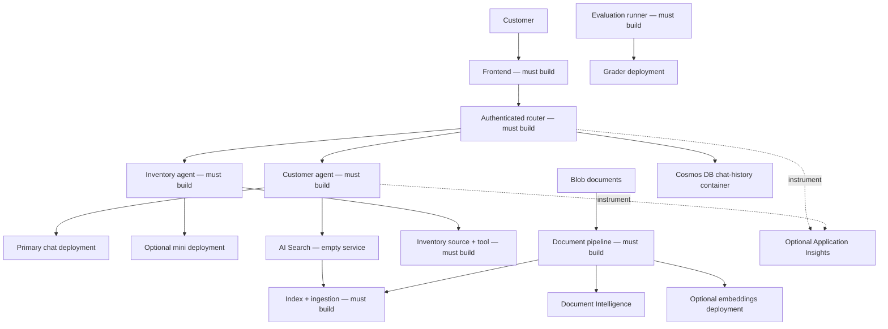

# Multi-Agent Customer Support — Retail Architecture Blueprint

**Chapter 5: Multi-Agent AI Solutions**

- [Course home](../README.md)
- [Chapter 5](../docs/chapter-05-multi-agent/README.md)
- [Prerequisite: AI integration](../docs/chapter-02-ai-development/microsoft-foundry-integration.md)
- [Next: Capacity planning](../docs/chapter-06-pre-deployment/capacity-planning.md)
- [ARM infrastructure scaffold](retail-multiagent-arm-template/README.md)

> **Architecture guide, not a working application.** The only retail implementation
> files are `azuredeploy.json`, `azuredeploy.parameters.json`, and `deploy.sh` in
> `retail-multiagent-arm-template/`. Router/frontend containers are hello-world
> placeholders. No retail agent, UI, ingestion pipeline, evaluator, scanner, or
> application test suite exists locally.

## Overview

**Goal:** design a customer-support system with a customer agent and an inventory
agent, identify what the infrastructure provides, and plan the missing application
contracts and verification.

**Audience:** developers who have completed the local
[chat sample](../../../examples/azure-openai-chat) and [two-service container sample](../../../examples/container-app/microservices).
Allow 2–3 hours for architectural study. Building the application is a separate
project: 80–120 development hours is an illustrative planning estimate for
experienced developers, **not a delivery promise**; production hardening, tests,
security review, and operations require additional work.

### Learning outcomes

- Explain routing, grounding, tool permissions, and conversation ownership.
- Distinguish model identifiers, deployment names, API versions, and ARM versions.
- Design document ingestion and retrieval with matching vector dimensions.
- Define verifiable functional, evaluation, and failure-recovery requirements.
- Separate optional architecture goals from resources actually provisioned.

## Solution Architecture



This is a **target application architecture**, not a diagram of running agent
services. The ARM scaffold creates the underlying services and two placeholder
containers only. Front Door, registry, managed identities, role assignments,
private endpoints, failover, application instrumentation, and alerts are not included.

### Responsibilities and contracts

| Component | Required behavior | Evidence before calling it complete |
|---|---|---|
| Frontend | Authenticate users, render chat, upload documents safely | UI and upload tests, accessible errors |
| Router | Authorize requests, choose agent, bound tool calls/timeouts | Routing tests, authorization checks, failure tests |
| Customer agent | Ground policy/product answers in approved sources | Correct citations, abstention when data is absent |
| Inventory tool | Read authoritative stock with scoped permissions | Deterministic stock tests; no invented availability |
| Document pipeline | Extract, chunk, embed, index, update/delete | Indexed fixtures and retry/dead-letter behavior |
| Conversation storage | Isolate users, enforce retention | Cross-user authorization and TTL tests |
| Evaluation runner | Compare outputs to ground truth and rubric | Coverage, failure counts, reproducible reports |

Think of the router as a reception desk and tools as restricted internal systems:
choosing a specialist is not authorization to access every customer's records.
Enforce identity and permissions in application code and data services, not prompts.

## Infrastructure vs. Application

Read the [scaffold README](retail-multiagent-arm-template/README.md) before
provisioning. It lists exact resources, modes, costs, and limitations.

| Logical use | ARM deployment name | Model / version | Default region |
|---|---|---|---|
| Customer chat | `gpt-4.1-chat` | `gpt-4.1` / `2025-04-14` | `eastus2` |
| Inventory | `gpt-4.1-mini-inventory` | `gpt-4.1-mini` / `2025-04-14` | `westus2`, optional |
| Embeddings | `text-embedding-ada-002` | `text-embedding-ada-002` / `2` | `francecentral`, optional |
| Evaluation | `gpt-4.1-grader` | `gpt-4.1` / `2025-04-14` | Primary region by default |

Check model/version/SKU availability and quota in **each region**. Chat/mini/grader
use `GlobalStandard`; embeddings use `Standard`. Capacity-unit-to-TPM mappings are
model-specific. Do not add unlike capacity units as a universal quota guarantee.

An Azure OpenAI request's `model` argument is the **deployment name**, not
necessarily the catalog model identifier. Data-plane API version `2024-10-21`
is distinct from model version `2025-04-14` and the ARM resource `apiVersion`.
One cannot fix an unavailable model by changing only the data-plane API version.

`--no-multi-region` skips secondary and embeddings accounts. A primary chat and
independent grader account remain. Separate model accounts do not provide automatic
failover; that requires application routing, compatible deployments, health checks,
retry limits, and data-residency review.

## Implementation Roadmap

### 1. Start with one tested interaction

Before provisioning the large scaffold, use the local chat sample to establish
inference connectivity. Define one representative customer question, the approved
answer source, expected citation, and failure behavior when that source is missing.

### 2. Define routing and tool boundaries

Create your own router source, dependency manifest, Dockerfile, and tests. An
illustrative contract could be `POST /chat` with `{"message":"...","conversation_id":"..."}`.
**That endpoint is a design proposal; it is not implemented by the ARM template.**

Validate body types/limits, derive user identity from authentication, enforce
conversation ownership, apply request timeouts, and return meaningful error codes.
Do not treat HTTP failures or empty replies as successful agent results.

### 3. Implement grounding and ingestion

The ARM template does not create a search index. This is a **reference JSON
fragment to adapt in your own index definition**, not a file already in the repo:

```json
{
  "name": "retail-product-index",
  "fields": [
    {"name": "id", "type": "Edm.String", "key": true},
    {"name": "title", "type": "Edm.String", "searchable": true},
    {"name": "content", "type": "Edm.String", "searchable": true},
    {"name": "category", "type": "Edm.String", "filterable": true},
    {
      "name": "content_vector",
      "type": "Collection(Edm.Single)",
      "searchable": true,
      "dimensions": 1536,
      "vectorSearchProfile": "retail-profile"
    }
  ],
  "vectorSearch": {
    "algorithms": [{"name": "retail-hnsw", "kind": "hnsw"}],
    "profiles": [{"name": "retail-profile", "algorithm": "retail-hnsw"}]
  }
}
```

The profile links the vector field to its algorithm. Dimensions must match the
actual embedding output (1536 for this `ada-002` deployment). For Python retrieval,
use `azure.search.documents.models.VectorizedQuery` rather than an incomplete
dictionary lacking its vector query kind:

```python
# Reference function only: supply an authenticated async SearchClient and an embedding.
from azure.search.documents.models import VectorizedQuery

async def retrieve(search_client, embedding):
    results = await search_client.search(
        search_text=None,
        vector_queries=[VectorizedQuery(
            vector=embedding,
            k_nearest_neighbors=5,
            fields="content_vector"
        )],
        select=["id", "title", "content"]
    )
    return [document async for document in results]
```

Create a separate ingestion implementation that:

1. Authorizes upload access and validates content type and size.
2. Reads private blobs using authenticated SDK calls. A private blob URL by itself
   is **not** a readable Document Intelligence input; send downloaded bytes with
   `AnalyzeDocumentRequest(bytes_source=...)` or use an appropriately scoped,
   short-lived SAS after reviewing access requirements.
3. Extracts text, chunks it to fit embedding limits, and generates embeddings.
4. Creates stable valid document keys and uploads chunks with matching vectors.
5. Checks per-document indexing results, handles retries, and updates/deletes stale data.

Do not interpolate arbitrary user keys/values into OData filters. Allowlist fields,
validate value types, and escape string quotes. Boolean and numeric filters need
typed literals, not quoted strings.

### 4. Web grounding

**Bing Search v7 was retired on August 11, 2025.** The old `Microsoft.Bing/accounts`
resource and `api.bing.microsoft.com/v7.0/search` examples are not a supported
implementation path. Evaluate a currently supported grounding integration in
Microsoft Foundry and its SDK, permissions, billing, and citation requirements;
none is implemented here. It is not a drop-in replacement for the retired endpoint.

### 5. Add telemetry and evaluation

Creating Application Insights does not instrument code. Use supported Azure Monitor
OpenTelemetry instrumentation when building a new application, propagate trace
context between services, and avoid logging customer prompts, documents, or secrets.
Truncating a query does **not** anonymize it.

Measure request duration, routing/tool failures, retrieval relevance, citation
correctness, token usage, and abstention. Store ground-truth inventory/policy facts
alongside evaluation cases: a grader cannot reliably determine factual accuracy
from only a question and an answer.

A grader deployment is not an evaluation runner. Implement a versioned rubric,
structured output/schema validation, score-range checks, transport failure counts,
and human-reviewed cases. Report incomplete/error cases separately; do not convert
them into successful grades or silently include them as zero-quality model responses.

Likewise, a few keyword checks are not a security certification. A failed HTTP
request, missing test strategy, or empty response must make a test **inconclusive or
failed**, not yield a “100% secure” score. Perform authorized testing with appropriate
tooling and human review before any production-readiness claim.

### 6. Deploy your application

Create your own source directories, manifests, tests, registry, and image-pull
permissions. Replace placeholders with built images and update ingress/probes to
match each app's listening port. Configure runtime environment variables in Bicep
or an explicit supported azd environment mapping.

There is no generic `config` dictionary under an azd service that automatically
creates runtime environment variables. `azd env set` only changes resources that
explicitly consume those values. No canary, regions list, or fine-tuning hook is
implemented in this scaffold.

## Practical design exercises

These are **architecture exercises**, not claims of executable retail starter code.

### Exercise 1: Verify the boundary

**Starting point:** the three files in `retail-multiagent-arm-template/`.
**Goal:** distinguish provisioning from application functionality.
Open `azuredeploy.json`, locate both container images and `targetPort` values,
then list the application components missing from the repository.

**Success criteria / answer:** both images are hello-world placeholders listening
on port 80; agents, chat UI, router handlers, index/ingestion, evaluator, and scanner
are absent. A successful placeholder root request does not validate `/chat`.
**Common issue:** interpreting resource names such as `retail-router` as working code.

### Exercise 2: Trace the vector configuration

**Starting point:** index JSON above.
**Goal:** understand the field → profile → algorithm relationship.
Identify which values must change when switching to an embedding model with a
different output dimension, then inspect the `retrieve` function.

**Success criteria / answer:** change field `dimensions` to actual vector length;
keep `vectorSearchProfile` aligned with a declared profile and its algorithm;
query `fields` must name the vector field. Regenerate existing document vectors
when the embedding model changes.
**Common issue:** changing only the model name while keeping incompatible vectors.

### Exercise 3: Define a failure test

**Starting point:** responsibilities table.
**Goal:** prevent false success.
Write expected behavior for an unavailable inventory API, a search index with no
matching documents, and an evaluation request returning HTTP 503.

**Success criteria / answer:** no invented inventory values; explicit abstention or
escalation when context is missing; evaluation reports a transport failure rather
than a quality or security pass. Add executable tests when you build the application.
**Common issue:** catching every exception and continuing with an empty answer.

## Costs, troubleshooting, and cleanup

- Infrastructure has ongoing charges even with empty search indexes and placeholder
  apps. Use current regional prices; neither “minimal” nor multi-region implies free.
- Token costs depend on model, cached/uncached input, output, and deployment SKU.
  Routing can save money only if measured workload and quality results justify it;
  a fixed 60–80% saving is not guaranteed.
- Check model availability and quota before provisioning; distinguish permission,
  deployment-name, region, model-version, and API-version errors.
- Do not run missing `setup-data.sh`, evaluator CLIs, or `pytest tests/` commands.
  Their implementations are part of your development backlog.
- The scaffold is ARM-only: follow its
  [verification and cleanup instructions](retail-multiagent-arm-template/README.md).
  `azd down` does not manage those resources.

## Related resources

- [Working local chat sample](../../../examples/azure-openai-chat)
- [Working two-service container sample](../../../examples/container-app/microservices)
- [AI Search vector indexes](https://learn.microsoft.com/azure/search/vector-search-how-to-create-index)
- [Container Apps documentation](https://learn.microsoft.com/azure/container-apps/)
- [Troubleshooting](../docs/chapter-07-troubleshooting/common-issues.md)
- [Report an issue](https://github.com/microsoft/AZD-for-beginners/issues)

---

<!-- CO-OP TRANSLATOR DISCLAIMER START -->
**Disclaimer**:
This document has been translated using AI translation service [Co-op Translator](https://github.com/Azure/co-op-translator). While we strive for accuracy, please be aware that automated translations may contain errors or inaccuracies. The original document in its native language should be considered the authoritative source. For critical information, professional human translation is recommended. We are not liable for any misunderstandings or misinterpretations arising from the use of this translation.
<!-- CO-OP TRANSLATOR DISCLAIMER END -->