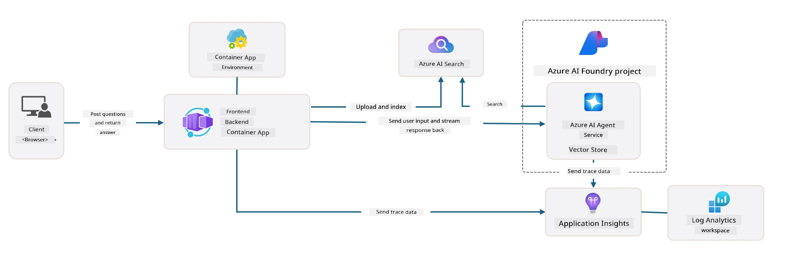
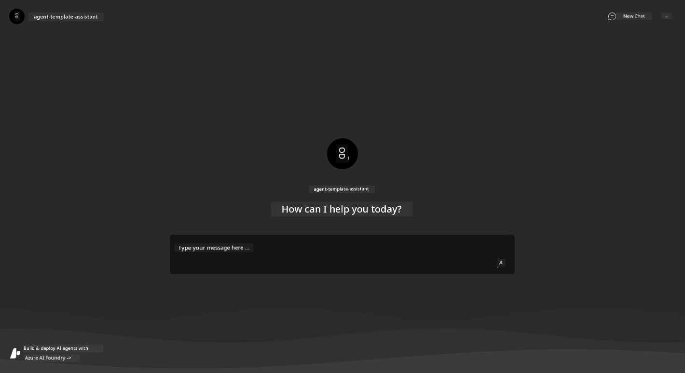

# 2. Validate a Template

> Source guidance reviewed against AZD 1.37.2 and the current sample on November 4, 2026. Screenshots are illustrative; portal navigation, template defaults, and service availability can change. This review did not perform a live Azure deployment.

!!! tip "BY THE END OF THIS MODULE YOU WILL BE ABLE TO"

    - [ ] Identify the sample's prerequisites and intended resources
    - [ ] Deploy the selected template into an intentional environment
    - [ ] Verify the application and agent behavior separately from deployment success
    - [ ] **Lab 2:** Record evidence of a working baseline, or an actionable deployment blocker

---

## 1. Check prerequisites

The [Azure Developer CLI](https://learn.microsoft.com/azure/developer/azure-developer-cli/) manages application deployment using the template's configuration, infrastructure, and code. Check your installed version:

```bash
azd version
```

Use the [current installation/update instructions](https://learn.microsoft.com/azure/developer/azure-developer-cli/install-azd) if necessary. The reviewed sample declares AZD `>=1.14.0`, but a current supported release is recommended. The optional AI extensions have separate version requirements; this sample's normal `azd up` workflow does not require the agents extension.

Before provisioning, read the sample's [Azure account setup](https://github.com/Azure-Samples/get-started-with-ai-agents/blob/main/docs/azure_account_setup.md) and [deployment guide](https://github.com/Azure-Samples/get-started-with-ai-agents/blob/main/docs/deployment.md). Confirm your subscription, permissions, model availability, regional quota, and expected charges. An Azure free account does not guarantee access or free usage for every required service.

## 2. Open the selected sample

Use the [Get Started with AI Agents](https://github.com/Azure-Samples/get-started-with-ai-agents) repository initialized in Module 1. If you have not initialized it, choose one of these alternatives:

- Open a [Codespace for the sample](https://github.com/codespaces/new/Azure-Samples/get-started-with-ai-agents).
- Clone the sample and follow its local/dev-container setup.
- In an **empty directory**, run:

```bash
azd init --template Azure-Samples/get-started-with-ai-agents .
```

Do not initialize a second template over an existing project. Run subsequent commands from the sample root containing `azure.yaml`, not the course repository root.

The sample hosts an agent-backed chat application in Container Apps and provisions supporting Foundry resources. Review the current architecture and optional services rather than treating an old screenshot as the exact resource inventory.



## 3. Deploy intentionally

```bash
azd auth login
azd up
```

Review the prompts:

1. Choose a unique AZD environment name.
2. Select the intended subscription, not simply whichever subscription is offered first.
3. Select a region supported by the required model/version/SKU and your quota.
4. Read the provisioning, deployment, and post-deployment hook output.

The reviewed defaults include `gpt-5-mini`, version `2025-08-07`, and `GlobalStandard`. Check your initialized template and the [supported model/region combinations](https://learn.microsoft.com/azure/ai-services/agents/concepts/model-region-support). No region is universally guaranteed to work.

Deployment duration varies. If provisioning fails, preserve the error and fix its cause before retrying. Do not delete the deployment or permanently purge resources as a generic troubleshooting step.

## 4. Validate the application

```bash
azd show
```

Open the endpoint for `api_and_frontend`, or find the Container App in the deployment's resource group in the [Azure portal](https://portal.azure.com/). Follow the sample's access/authentication instructions if sign-in is required; do not disable authentication to make a smoke test pass.



Try a few [sample questions](https://github.com/Azure-Samples/get-started-with-ai-agents/blob/main/docs/sample_questions.md):

- A general factual question.
- A question whose answer should be present in the sample's uploaded documents.
- A question that cannot be answered from those documents.

Verify that the UI loads, the API responds, retrieval uses the expected data, citations match source content, and unsupported questions are handled appropriately. A successful `azd up` message alone does not establish these outcomes.

## 5. Inspect the deployed agent

Open your project in the [Foundry portal](https://ai.azure.com/). In the reviewed portal flow, select **Build**, then **Agents**, and locate the agent created by the sample. Navigation labels can change.

Record:

- The agent name and version.
- Its configured model deployment.
- The actual instructions and enabled tools.
- Which files or search index are connected, and whether setup completed successfully.

The reviewed sample uses an agent identifier in `agent_name:agent_version` form for its evaluation tests. Do not copy a classic agent/thread identifier from an old screenshot into a newer API workflow.

Compare uploaded documents with `src/files/` in your initialized revision. Earlier screenshots showed 32 files; that count is not a guaranteed current default. Verify any answer about sample customers/products against the actual synthetic source data, and do not upload real customer data for this exercise.

## 6. Compare with the playground

Open the selected agent's playground in Foundry and ask the same retrieval question. Compare the configured agent version, tools, citations, and answer quality with the deployed application.

Responses are probabilistic; matching word-for-word is not the criterion. If the results differ substantially, check that the app and playground target the same project, agent/version, and knowledge source.

## 7. Check observability prerequisites

The sample's [observability guide](https://github.com/Azure-Samples/get-started-with-ai-agents/blob/main/docs/observability.md) is the source of truth for tracing, evaluation, and red-teaming setup.

In the reviewed infrastructure defaults, Application Insights is enabled but **client tracing is disabled** (`ENABLE_AZURE_MONITOR_TRACING=false`). Creating a monitoring resource does not prove that the application is exporting traces. Module 5 covers enabling tracing and generating a test request.

Use the Container App's application logs to investigate startup/API errors. In Foundry, inspect the agent's available tracing and monitoring views. Evaluation entries require the relevant configuration, supported evaluators/region, and actual requests; they are not guaranteed to appear automatically for every run.

Leave prompt/response content capture disabled unless its privacy, retention, access, and redaction requirements have been reviewed.

## 8. Understand environment values

AZD stores the selected environment under `.azure/<environment-name>/`. Persistent inputs and deployment outputs can be read with:

```bash
azd env list
azd env get-value AZURE_ENV_NAME
azd env get-value AZURE_LOCATION
```

`azd env get-values` lists all values, which may include sensitive configuration. Do not paste that output into public issues or logs.

AZD uses the selected environment when running its commands/hooks, while process environment variables can also influence commands and templates. This does **not** export values into your parent shell or every independently started Python process. Follow the sample's [local development instructions](https://github.com/Azure-Samples/get-started-with-ai-agents/blob/main/docs/local_development.md).

Template defaults can be applied in `infra/main.parameters.json` without appearing as explicit local values. Setting an arbitrary variable does not change infrastructure unless the template consumes it.

For example, to explicitly select the reviewed model defaults:

```bash
azd env set AZURE_AI_AGENT_MODEL_NAME gpt-5-mini
azd env set AZURE_AI_AGENT_MODEL_VERSION 2025-08-07
azd env set AZURE_AI_AGENT_DEPLOYMENT_SKU GlobalStandard
azd provision --preview
azd up
```

Review compatibility, capacity, availability, and the planned changes first. Infrastructure updates require provisioning; `azd deploy` alone is not enough. Supported model changes normally do not require tearing down the entire application.

`azd env refresh` retrieves deployment outputs for an accessible environment; it does not reconstruct all custom inputs, synchronize secrets, or replace configuration management.

## 9. Record your baseline

- [ ] Correct environment, subscription, region, and model verified.
- [ ] Provisioning, deployment, and required setup hooks completed without unresolved errors.
- [ ] Application access, chat, retrieval, and citations checked.
- [ ] Agent/version and knowledge source identified.
- [ ] Observability prerequisites and any remaining blockers documented.

Continue to [Deconstruct a Template](3-Deconstruct-AI-Template.md).

---

<!-- CO-OP TRANSLATOR DISCLAIMER START -->
**Disclaimer**:
This document has been translated using AI translation service [Co-op Translator](https://github.com/Azure/co-op-translator). While we strive for accuracy, please be aware that automated translations may contain errors or inaccuracies. The original document in its native language should be considered the authoritative source. For critical information, professional human translation is recommended. We are not liable for any misunderstandings or misinterpretations arising from the use of this translation.
<!-- CO-OP TRANSLATOR DISCLAIMER END -->