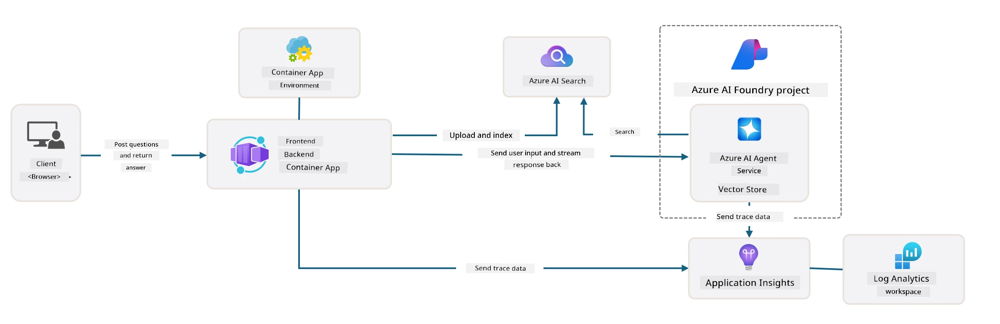

# 3. Deconstruct a Template

!!! tip "BY THE END OF THIS MODULE YOU WILL BE ABLE TO"

    - [ ] Use GitHub Copilot and optional MCP tools for Azure documentation and read-only exploration
    - [ ] Identify the template's application, infrastructure, configuration, and test entry points
    - [ ] Verify generated explanations against actual repository files
    - [ ] **Lab 3:** Trace one request and one configuration input through the project

---

## 1. Activate GitHub Copilot

Open the initialized AI sample in VS Code and enable [GitHub Copilot](https://code.visualstudio.com/docs/copilot/chat/chat-agent-mode). Sign in with an account that has an eligible plan; usage limits vary. Ask Copilot to explain the repository before authorizing changes.

### Optional MCP servers

These services can provide additional tools:

- [Azure MCP Server](https://learn.microsoft.com/azure/developer/azure-mcp-server/overview)
- [Microsoft Learn MCP Server](https://learn.microsoft.com/training/support/mcp)

In VS Code, review the [MCP configuration guidance](https://code.visualstudio.com/docs/copilot/chat/mcp-servers) and create `.vscode/mcp.json` if needed:

```json
{
  "servers": {
    "Azure MCP Server": {
      "type": "stdio",
      "command": "npx",
      "args": ["-y", "@azure/mcp@latest", "server", "start"]
    },
    "microsoft.docs.mcp": {
      "type": "http",
      "url": "https://learn.microsoft.com/api/mcp"
    }
  }
}
```

The `npx` command requires a supported Node.js/npm installation and downloads executable code. Review the package and pin an approved version for a reproducible team setup. Start the servers using VS Code's MCP controls and inspect their available tools; names can change between versions.

**Authentication is separate.** Use `azd auth login` for AZD. Follow Azure MCP's documented authentication flow for its tools; AZD login alone does not establish an MCP session. Use `az login` separately when an exercise or hook invokes Azure CLI.

Try read-only prompts:

1. “Use Microsoft Learn MCP to find the Azure Developer CLI configuration documentation.”
2. “Explain this repository's `azure.yaml`; cite the files that implement each hook.”
3. “Using the available Azure MCP tools, list my deployed resources without modifying anything.”

Check the selected tenant/subscription and every proposed tool call. Do not approve resource creation, deletion, or access changes merely to explore the architecture.

## 2. Understand the architecture

The sample hosts a Python FastAPI backend and a React/TypeScript frontend in Azure Container Apps. The backend communicates with an agent in a Microsoft Foundry project. Retrieval and observability depend on the enabled template features and successful setup; they are not guaranteed just because the application deployed.



Compare this diagram with the [current upstream deployment guide](https://github.com/Azure-Samples/get-started-with-ai-agents/blob/main/docs/deployment.md) and your actual resources. Check the configured model deployment, agent tools, managed identity, role assignments, and optional AI Search/Application Insights resources.

**Exercise:** Ask Copilot to trace a chat request from the frontend through the API to Foundry, with file and function references. Open those references and verify the explanation. Do not infer implemented authentication, routing, or authorization from a diagram alone.

## 3. Repository structure

The following selected paths were checked against the sample on November 4, 2026. Your initialized revision remains the source of truth:

```text
get-started-with-ai-agents/
  azure.yaml
  docker-compose.yaml
  requirements-dev.txt
  .devcontainer/
  infra/
    main.bicep
    main.parameters.json
    api.bicep
    core/
  src/
    Dockerfile
    pyproject.toml
    requirements.txt
    api/
      main.py
      routes.py
      search_index_manager.py
    frontend/
      package.json
      src/
    files/
  scripts/
    validate_env_vars.sh
    validate_env_vars.ps1
    postdeploy.sh
    postdeploy.ps1
  tests/
    test_evaluation.py
    test_red_teaming.py
  docs/
    deployment.md
    deploy_customization.md
    ai_search.md
    observability.md
    local_development.md
    troubleshooting.md
```

### Infrastructure and configuration

`infra/main.bicep` orchestrates resources; `main.parameters.json` connects template inputs to AZD environment values. `azure.yaml` selects the application service and lifecycle hooks. Trace an input such as `USE_AZURE_AI_SEARCH_SERVICE` through these files to find what actually changes.

### Application and identity

Read `src/api/` and `src/frontend/` together. Identify where the agent is created or retrieved, where instructions/tools are configured, and which identity each Azure call uses. Sample files under `src/files/` are demonstration data, not a production catalog or authorization model.

### Tests and observability

The current evaluation and red-teaming entry points are under `tests/`; older `evals/` and `airedteaming/` directory references are obsolete for this sample. Read `docs/observability.md` for prerequisites and costs before running cloud tests. These Python tests are separate from the optional `azure.ai.evaluations` AZD extension.

## 4. Verify your findings

- Identify the API route, agent interaction, and retrieval code for one sample question.
- Explain which identity accesses Foundry and which configuration selects its endpoint.
- Find the actual pre-up and post-deploy scripts and their error-handling behavior.
- List any dependencies or optional features that are absent from your deployment.

Continue to [Configure a Template](4-Configure-AI-Template.md).

---

<!-- CO-OP TRANSLATOR DISCLAIMER START -->
**Disclaimer**:
This document has been translated using AI translation service [Co-op Translator](https://github.com/Azure/co-op-translator). While we strive for accuracy, please be aware that automated translations may contain errors or inaccuracies. The original document in its native language should be considered the authoritative source. For critical information, professional human translation is recommended. We are not liable for any misunderstandings or misinterpretations arising from the use of this translation.
<!-- CO-OP TRANSLATOR DISCLAIMER END -->