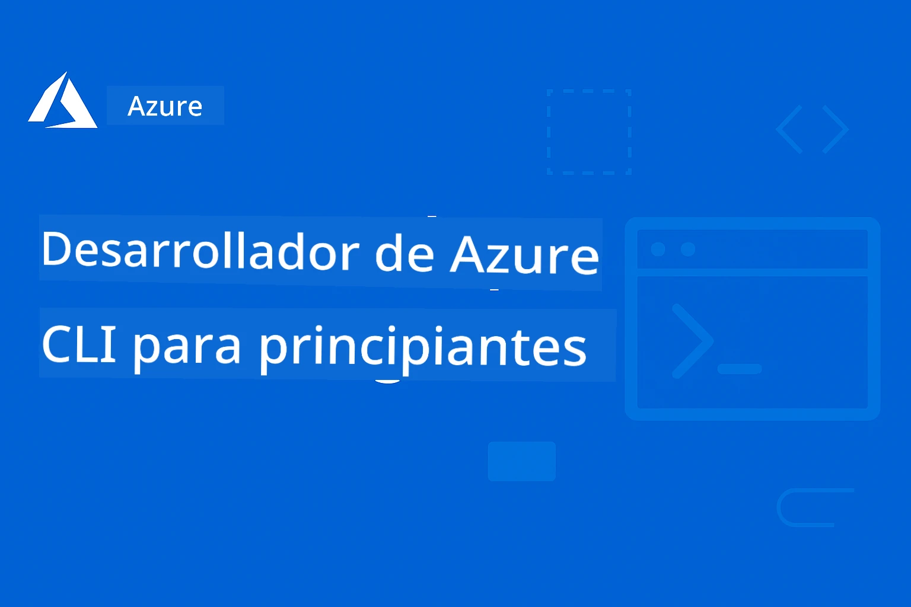

# AZD Para Principiantes: Un Viaje de Aprendizaje Estructurado

 

[](https://github.com/microsoft/AZD-for-beginners)
[](https://GitHub.com/microsoft/azd-for-beginners/network/)
[](https://github.com/microsoft/AZD-for-beginners)

[](https://discord.com/invite/nkVh3dp)
[](https://discord.gg/nTYy5BXMWG)

---

### Traducciones Automáticas (Siempre Actualizadas)

<!-- CO-OP TRANSLATOR LANGUAGES TABLE START -->
[Arabic](../ar/README.md) | [Bengali](../bn/README.md) | [Bulgarian](../bg/README.md) | [Burmese (Myanmar)](../my/README.md) | [Chinese (Simplified)](../zh-CN/README.md) | [Chinese (Traditional, Hong Kong)](../zh-HK/README.md) | [Chinese (Traditional, Macau)](../zh-MO/README.md) | [Chinese (Traditional, Taiwan)](../zh-TW/README.md) | [Croatian](../hr/README.md) | [Czech](../cs/README.md) | [Danish](../da/README.md) | [Dutch](../nl/README.md) | [Estonian](../et/README.md) | [Finnish](../fi/README.md) | [French](../fr/README.md) | [German](../de/README.md) | [Greek](../el/README.md) | [Hebrew](../he/README.md) | [Hindi](../hi/README.md) | [Hungarian](../hu/README.md) | [Indonesian](../id/README.md) | [Italian](../it/README.md) | [Japanese](../ja/README.md) | [Kannada](../kn/README.md) | [Khmer](../km/README.md) | [Korean](../ko/README.md) | [Lithuanian](../lt/README.md) | [Malay](../ms/README.md) | [Malayalam](../ml/README.md) | [Marathi](../mr/README.md) | [Nepali](../ne/README.md) | [Nigerian Pidgin](../pcm/README.md) | [Norwegian](../no/README.md) | [Persian (Farsi)](../fa/README.md) | [Polish](../pl/README.md) | [Portuguese (Brazil)](../pt-BR/README.md) | [Portuguese (Portugal)](../pt-PT/README.md) | [Punjabi (Gurmukhi)](../pa/README.md) | [Romanian](../ro/README.md) | [Russian](../ru/README.md) | [Serbian (Cyrillic)](../sr/README.md) | [Slovak](../sk/README.md) | [Slovenian](../sl/README.md) | [Spanish](./README.md) | [Swahili](../sw/README.md) | [Swedish](../sv/README.md) | [Tagalog (Filipino)](../tl/README.md) | [Tamil](../ta/README.md) | [Telugu](../te/README.md) | [Thai](../th/README.md) | [Turkish](../tr/README.md) | [Ukrainian](../uk/README.md) | [Urdu](../ur/README.md) | [Vietnamese](../vi/README.md)

> **¿Prefieres Clonar Localmente?**
>
> Este repositorio incluye más de 50 traducciones de idiomas, lo que aumenta significativamente el tamaño de la descarga. Para clonar sin traducciones, usa sparse checkout:
>
> **Bash / macOS / Linux:**
> ```bash
> git clone --filter=blob:none --sparse https://github.com/microsoft/AZD-for-beginners.git
> cd AZD-for-beginners
> git sparse-checkout set --no-cone '/*' '!translations' '!translated_images'
> ```
>
> **CMD (Windows):**
> ```cmd
> git clone --filter=blob:none --sparse https://github.com/microsoft/AZD-for-beginners.git
> cd AZD-for-beginners
> git sparse-checkout set --no-cone "/*" "!translations" "!translated_images"
> ```
>
> Esto te da todo lo que necesitas para completar el curso con una descarga mucho más rápida.
<!-- CO-OP TRANSLATOR LANGUAGES TABLE END -->

## 🆕 Novedades en azd Hoy

> 📌 **Actualización GA de Foundry (2026-11-09):** El **`microsoft.foundry` 1.0 bundle está generalmente disponible**, anunciado el [5 de noviembre de 2026](https://devblogs.microsoft.com/azure-sdk/microsoft-foundry-azure-developer-cli-ga/). Usa **`azd >= 1.37.0`** e instálalo con `azd ext install microsoft.foundry`. Sigue la [guía de agente alojado](docs/chapter-02-ai-development/microsoft-foundry-integration.md#hosted-agent-walkthrough-ga) para la configuración, prueba local y despliegue. Esta actualización se basa en directrices publicadas, no en un despliegue en vivo en Azure; la GA del bundle no hace que todas las características opcionales, extensiones o SDK estén generalmente disponibles.

Azure Developer CLI soporta muchos tipos de aplicaciones, incluyendo aplicaciones web, APIs y agentes de IA, a través de hosts, plantillas y extensiones compatibles.

Esto es lo que significa para ti:

- **Un bundle GA para desarrollo con Foundry.** `microsoft.foundry` instala siete extensiones principales, incluyendo agentes, proyectos e Inspector de Agentes. El código del agente y la configuración de despliegue se mantienen juntos en `azure.yaml`.
- **Prueba localmente, luego despliega tu código.** Usa `azd ai agent init --deploy-mode code`, `azd provision` y `azd ai agent run` para inspeccionar peticiones y respuestas locales. Luego usa `azd deploy` para una compilación remota en Foundry, sin compilación local en contenedor.
- **Mide la calidad por separado.** Instala **`azure.ai.evaluations`** para `azd ai eval generate`, `init` y `run start`; no está incluido en el bundle. Conserva conjuntos de datos revisados y rúbricas junto con tu código. Los proyectos antiguos deben seguir la [guía de migración para evaluación y optimización](docs/chapter-08-production/production-ai-practices.md#evaluation-migration-and-quality-checks).
- **Reutiliza configuración en CI/CD.** Tras un `azd up` exitoso, configura un pipeline con `azd pipeline config`. Instala el bundle en el runner y conserva la autenticación y configuración de ambiente generada.
- **Lo básico del día a día es más fluido.** Versiones recientes hicieron que `azd init` sea idempotente (seguro de volver a ejecutar), que `azd auth login` limpie tokens obsoletos automáticamente, y agregaron un amigable `azd tool` como aviso de configuración en la primera ejecución.
- **El flujo de trabajo central no ha cambiado.** Ya sea que despliegues una app de tareas, un microservicio o una solución de IA con múltiples agentes, los comandos son los mismos.

> **Nota para usuarios de Aspire:** Microsoft ahora llama al producto simplemente **Aspire** (antes ".NET Aspire"). El soporte de azd para Aspire no cambió, solo el nombre fue actualizado.

Si has usado azd antes, el soporte de IA es una extensión natural — no una herramienta separada ni una pista avanzada. Si empiezas desde cero, aprenderás un flujo de trabajo que funciona para todo.

---

## 🚀 ¿Qué es Azure Developer CLI (azd)?

**Azure Developer CLI (azd)** es una herramienta de línea de comandos amigable para desarrolladores que facilita el despliegue de aplicaciones en Azure. En lugar de crear y conectar manualmente docenas de recursos de Azure, puedes desplegar aplicaciones completas con un solo comando.

### La Magia de `azd up`

```bash
# This single command does everything:
# ✅ Creates all Azure resources  
# ✅ Configures networking and security
# ✅ Builds your application code
# ✅ Deploys to Azure
# ✅ Gives you a working URL
azd up
```

La plantilla provee la configuración de la aplicación e infraestructura. El despliegue exitoso aún requiere servicios/modelos soportados, cuota y permisos suficientes, entradas correctas y verificación de la aplicación desplegada. `azd up` no hace automáticamente que una plantilla sea segura, conforme o lista para producción.

---

## ❓ Azure Developer CLI vs Azure CLI: ¿Cuál es la diferencia?

Esta es la pregunta más común que hacen los principiantes. Aquí está la respuesta sencilla:

| Característica | **Azure CLI (`az`)** | **Azure Developer CLI (`azd`)** |
|---------------|-------------------------------|--------------------------------|
| **Propósito** | Gestionar recursos individuales de Azure | Desplegar aplicaciones completas |
| **Mentalidad** | Enfocado en infraestructura | Enfocado en aplicaciones |
| **Ejemplo** | `az webapp create --name myapp...` | `azd up` |
| **Curva de aprendizaje** | Necesitas conocer servicios Azure | Solo conocer tu app |
| **Lo mejor para** | DevOps, Infraestructura | Desarrolladores, Prototipos |

### Analogía sencilla

- **Azure CLI** es como tener todas las herramientas para construir una casa - martillos, sierras, clavos. Puedes construir cualquier cosa, pero necesitas saber construcción.
- **Azure Developer CLI** es como contratar a un contratista - describes lo que quieres y ellos se encargan de construirlo.

### Cuándo usar cada uno

| Escenario | Usa Esto |
|----------|----------|
| "Quiero desplegar mi app web rápidamente" | `azd up` |
| "Necesito crear solo una cuenta de almacenamiento" | `az storage account create` |
| "Estoy construyendo una aplicación completa de IA" | `azd init --template azure-search-openai-demo` |
| "Necesito depurar un recurso específico de Azure" | `az resource show` |
| "Quiero desplegar en mi entorno de producción configurado" | Revisa configuración, acceso, costos y controles operativos antes de `azd up --environment production` |

### Funcionan juntos

AZD y Azure CLI tienen autenticación y configuración separadas. Usa `azd auth login` para AZD, y `az login` cuando un hook o comando de diagnóstico explícitamente requiera Azure CLI. Puedes usar ambos:
```bash
# Deploy your app with AZD
azd up

# Then fine-tune specific resources with Azure CLI
az webapp config set --name myapp --always-on true
```

---

## 🌟 Encuentra Plantillas en Awesome AZD

¡No empieces desde cero! **Awesome AZD** es la colección comunitaria de plantillas listas para desplegar:

| Recurso | Descripción |
|---------|-------------|
| 🔗 [**Galería Awesome AZD**](https://azure.github.io/awesome-azd/) | Explora más de 200 plantillas con despliegue con un clic |
| 🔗 [**Enviar una Plantilla**](https://github.com/Azure/awesome-azd/issues) | Contribuye con tu propia plantilla a la comunidad |
| 🔗 [**Repositorio GitHub**](https://github.com/Azure/awesome-azd) | Estrella y explora el código fuente |

### Plantillas Populares de IA en Awesome AZD

Elige una plantilla en su propio directorio vacío; los comandos abajo son alternativos. El `.` al final inicializa ese directorio.

```bash
# RAG Chat with Microsoft Foundry Models + AI Search
azd init --template azure-search-openai-demo .

# Quick AI Chat Application
azd init --template openai-chat-app-quickstart .

# AI Agents with Foundry Agents
azd init --template get-started-with-ai-agents .
```

---

## 🎯 Comenzando en 3 Pasos

Antes de empezar, asegúrate de que tu máquina esté lista para la plantilla que quieres desplegar:

**Windows:**
```powershell
.\validate-setup.ps1
```

**macOS / Linux:**
```bash
bash ./validate-setup.sh
```

Si alguna comprobación requerida falla, arréglala primero y luego continúa con el inicio rápido.

### Paso 1: Instalar AZD (2 minutos)

**Windows:**
```powershell
winget install microsoft.azd
```

**macOS:**
```bash
brew tap azure/azd && brew install azd
```

**Linux:**
```bash
curl -fsSL https://aka.ms/install-azd.sh | bash
```

### Paso 2: Autenticarse para AZD

```bash
# Optional if you plan to use Azure CLI commands directly in this course
az login

# Required for AZD workflows
azd auth login
```

Si no estás seguro de cuál necesitas, sigue el flujo completo en [Instalación y Configuración](docs/chapter-01-foundation/installation.md#authentication-setup).

### Paso 3: Despliega tu Primera Aplicación

```bash
# Initialize from a template
azd init --template todo-nodejs-mongo .

# Deploy to Azure (creates everything!)
azd up
```

**🎉 ¡Eso es todo!** Tu aplicación está ahora en vivo en Azure.

### Limpieza (¡No lo olvides!)

```bash
# Remove all resources when done experimenting
azd down --force --purge
```

---

## 📚 Cómo Usar Este Curso

Este curso está diseñado para un **aprendizaje progresivo** - empieza donde te sientas cómodo y avanza:

| Tu Experiencia | Empieza Aquí |
|----------------|-------------|
| **Nuevo en Azure** | [Capítulo 1: Fundamentos](#-chapter-1-foundation--quick-start) |
| **Conoces Azure, nuevo en AZD** | [Capítulo 1: Fundamentos](#-chapter-1-foundation--quick-start) |
| **Quieres desplegar apps de IA** | [Capítulo 2: Desarrollo AI-First](#-chapter-2-ai-first-development-recommended-for-ai-developers) |
| **Quieres práctica práctica** | [🎓 Taller Interactivo](workshop/README.md) - laboratorio guiado de 3-4 horas |
| **Necesitas patrones de producción** | [Capítulo 8: Producción y Empresa](#-chapter-8-production--enterprise-patterns) |

### Configuración Rápida

1. **Haz un Fork de Este Repositorio**: [](https://GitHub.com/microsoft/azd-for-beginners/fork)
2. **Clónalo**: `git clone https://github.com/YOUR-USERNAME/azd-for-beginners.git`
3. **Pide Ayuda**: [Comunidad Discord de Azure](https://discord.com/invite/ByRwuEEgH4)

> **¿Prefieres Clonar Localmente?**

> Este repositorio incluye más de 50 traducciones de idiomas, lo que incrementa significativamente el tamaño de la descarga. Para clonar sin traducciones, use sparse checkout:
> ```bash
> git clone --filter=blob:none --sparse https://github.com/microsoft/AZD-for-beginners.git
> cd AZD-for-beginners
> git sparse-checkout set --no-cone '/*' '!translations' '!translated_images'
> ```
> Esto le proporciona todo lo necesario para completar el curso con una descarga mucho más rápida.


## Resumen del Curso

Domina Azure Developer CLI (azd) a través de capítulos estructurados diseñados para un aprendizaje progresivo. **Enfoque especial en el despliegue de aplicaciones de IA con integración de Microsoft Foundry.**

### Por qué este curso es esencial para los desarrolladores modernos

Los desarrolladores que despliegan cargas de trabajo de IA comúnmente necesitan orientación sobre:
- Arquitecturas complejas de IA con múltiples servicios
- Mejores prácticas para el despliegue de IA en producción  
- Integración y configuración de servicios de IA en Azure
- Optimización de costos para cargas de trabajo de IA
- Solución de problemas específicos de despliegue de IA

### Objetivos de Aprendizaje

Al completar este curso estructurado, usted:
- **Dominará los Fundamentos de AZD**: Conceptos clave, instalación y configuración
- **Desplegará Aplicaciones de IA**: Uso de AZD con servicios de Microsoft Foundry
- **Implementará Infraestructura como Código**: Gestión de recursos de Azure con plantillas Bicep
- **Resolverá Problemas de Despliegue**: Solución y depuración de problemas comunes
- **Optimizará para Producción**: Seguridad, escalabilidad, monitoreo y gestión de costos
- **Construirá Soluciones de Multi-Agente**: Despliegue de arquitecturas complejas de IA

## Antes de Comenzar: Cuentas, Accesos y Supuestos

Antes de iniciar el Capítulo 1, asegúrese de tener lo siguiente. Los pasos de instalación más adelante en esta guía asumen que estas bases ya están cubiertas.

- **Una suscripción a Azure**: Puede utilizar una suscripción existente del trabajo o propia, o crear una [prueba gratuita](https://aka.ms/azurefreetrial) para comenzar.
- **Permiso para crear recursos en Azure**: Para la mayoría de los ejercicios, debe tener al menos acceso de **Colaborador** en la suscripción o grupo de recursos objetivo. Algunos capítulos también asumen que puede crear grupos de recursos, identidades administradas y asignaciones RBAC.
- [**Una cuenta de GitHub**](https://github.com): Esto es útil para bifurcar el repositorio, seguir sus propios cambios y usar GitHub Codespaces para el taller.
- **Requisitos previos para las plantillas en tiempo de ejecución**: Algunas plantillas necesitan herramientas locales como Node.js, Python, Java o Docker. Ejecute el validador de configuración antes de comenzar para detectar herramientas faltantes temprano.
- **Familiaridad básica con la terminal**: No necesita ser experto, pero debe sentirse cómodo ejecutando comandos como `git clone`, `azd auth login`, y `azd up`.

> **¿Trabaja en una suscripción empresarial?**
> Si su entorno Azure está gestionado por un administrador, confirme con anticipación que puede desplegar recursos en la suscripción o grupo de recursos que planea usar. Si no, solicite una suscripción sandbox o acceso de Colaborador antes de comenzar.

> **¿Nuevo en Azure?**
> Comience con su propia prueba de Azure o suscripción de pago por uso en https://aka.ms/azurefreetrial para completar los ejercicios completos sin esperar aprobaciones a nivel de inquilino.

## 🗺️ Mapa del Curso: Navegación Rápida por Capítulo

Cada capítulo tiene un README dedicado con objetivos de aprendizaje, inicios rápidos y ejercicios:

| Capítulo | Tema | Lecciones | Duración | Complejidad |
|---------|-------|---------|----------|------------|
| **[Cap 1: Fundamento](docs/chapter-01-foundation/README.md)** | Comenzando | [Fundamentos de AZD](docs/chapter-01-foundation/azd-basics.md) &#124; [Instalación](docs/chapter-01-foundation/installation.md) &#124; [Primer Proyecto](docs/chapter-01-foundation/first-project.md) | 30-45 min | ⭐ |
| **[Cap 2: Desarrollo IA](docs/chapter-02-ai-development/README.md)** | Apps centradas en IA | [Integración Foundry](docs/chapter-02-ai-development/microsoft-foundry-integration.md) &#124; [Agentes IA](docs/chapter-02-ai-development/agents.md) &#124; [Despliegue de Modelos](docs/chapter-02-ai-development/ai-model-deployment.md) &#124; [Taller](docs/chapter-02-ai-development/ai-workshop-lab.md) | 1-2 hrs | ⭐⭐ |
| **[Cap 3: Configuración](docs/chapter-03-configuration/README.md)** | Autenticación y Seguridad | [Configuración](docs/chapter-03-configuration/configuration.md) &#124; [Autenticación y Seguridad](docs/chapter-03-configuration/authsecurity.md) | 45-60 min | ⭐⭐ |
| **[Cap 4: Infraestructura](docs/chapter-04-infrastructure/README.md)** | IaC y Despliegue | [Guía de Despliegue](docs/chapter-04-infrastructure/deployment-guide.md) &#124; [Provisionamiento](docs/chapter-04-infrastructure/provisioning.md) | 1-1.5 hrs | ⭐⭐⭐ |
| **[Cap 5: Multi-Agente](docs/chapter-05-multi-agent/README.md)** | Soluciones con Agentes IA | [Escenario Retail](examples/retail-scenario.md) &#124; [Patrones de Coordinación](docs/chapter-06-pre-deployment/coordination-patterns.md) | 2-3 hrs | ⭐⭐⭐⭐ |
| **[Cap 6: Pre-Despliegue](docs/chapter-06-pre-deployment/README.md)** | Planeación y Validación | [Chequeos Preflight](docs/chapter-06-pre-deployment/preflight-checks.md) &#124; [Planeación de Capacidad](docs/chapter-06-pre-deployment/capacity-planning.md) &#124; [Selección de SKU](docs/chapter-06-pre-deployment/sku-selection.md) &#124; [App Insights](docs/chapter-06-pre-deployment/application-insights.md) | 1 hr | ⭐⭐ |
| **[Cap 7: Solución de Problemas](docs/chapter-07-troubleshooting/README.md)** | Depuración y Corrección | [Problemas Comunes](docs/chapter-07-troubleshooting/common-issues.md) &#124; [Depuración](docs/chapter-07-troubleshooting/debugging.md) &#124; [Problemas en IA](docs/chapter-07-troubleshooting/ai-troubleshooting.md) | 1-1.5 hrs | ⭐⭐ |
| **[Cap 8: Producción](docs/chapter-08-production/README.md)** | Patrones Empresariales | [Prácticas de Producción](docs/chapter-08-production/production-ai-practices.md) | 2-3 hrs | ⭐⭐⭐⭐ |
| **[🎓 Taller](workshop/README.md)** | Laboratorio Práctico | [Introducción](workshop/docs/instructions/0-Introduction.md) &#124; [Selección](workshop/docs/instructions/1-Select-AI-Template.md) &#124; [Validación](workshop/docs/instructions/2-Validate-AI-Template.md) &#124; [Deconstrucción](workshop/docs/instructions/3-Deconstruct-AI-Template.md) &#124; [Configuración](workshop/docs/instructions/4-Configure-AI-Template.md) &#124; [Personalización](workshop/docs/instructions/5-Customize-AI-Template.md) &#124; [Desmontaje](workshop/docs/instructions/6-Teardown-Infrastructure.md) &#124; [Conclusión](workshop/docs/instructions/7-Wrap-up.md) | 3-4 hrs | ⭐⭐ |

**Duración Total del Curso:** ~10-14 horas | **Progresión de Habilidades:** Principiante → Listo para Producción

---

## 📚 Capítulos de Aprendizaje

*Seleccione su ruta de aprendizaje según su nivel de experiencia y objetivos*

### 🚀 Capítulo 1: Fundamentos y Inicio Rápido
**Requisitos previos**: Suscripción Azure, conocimientos básicos de línea de comandos  
**Duración**: 30-45 minutos  
**Complejidad**: ⭐

#### Qué Aprenderá
- Comprender los fundamentos de Azure Developer CLI
- Instalar AZD en su plataforma
- Su primer despliegue exitoso

#### Recursos para Aprender
- **🎯 Comience Aquí**: [¿Qué es Azure Developer CLI?](#-what-is-azure-developer-cli-azd)
- **📖 Teoría**: [Fundamentos AZD](docs/chapter-01-foundation/azd-basics.md) - Conceptos centrales y terminología
- **⚙️ Configuración**: [Instalación y Configuración](docs/chapter-01-foundation/installation.md) - Guías específicas por plataforma
- **🛠️ Práctico**: [Su Primer Proyecto](docs/chapter-01-foundation/first-project.md) - Tutorial paso a paso
- **📋 Referencia Rápida**: [Hoja de Referencia de Comandos](resources/cheat-sheet.md)

#### Ejercicios Prácticos
```bash
# Quick installation check
azd version

# Deploy your first application
azd init --template todo-nodejs-mongo .
azd up
```

**💡 Resultado del Capítulo**: Desplegar exitosamente una aplicación web simple en Azure usando AZD

**✅ Validación de Éxito:**
```bash
# After completing Chapter 1, you should be able to:
azd version              # Shows installed version
azd init --template todo-nodejs-mongo  # Initializes project
azd up                  # Deploys to Azure
azd show                # Displays running app URL
# Application opens in browser and works
azd down --force --purge  # Cleans up resources
```

**📊 Tiempo Estimado:** 30-45 minutos  
**📈 Nivel de Habilidad Después:** Puede desplegar aplicaciones básicas de forma independiente

---

### 🤖 Capítulo 2: Desarrollo con IA Primero (Recomendado para Desarrolladores de IA)
**Requisitos previos**: Capítulo 1 completado  
**Duración**: 1-2 horas  
**Complejidad**: ⭐⭐

#### Qué Aprenderá
- Integración de Microsoft Foundry con AZD
- Despliegue de aplicaciones potenciadas por IA
- Comprender configuraciones de servicios de IA

#### Recursos para Aprender
- **🎯 Comience Aquí**: [Integración Microsoft Foundry](docs/chapter-02-ai-development/microsoft-foundry-integration.md)
- **🤖 Agentes IA**: [Guía de Agentes IA](docs/chapter-02-ai-development/agents.md) - Desplegar agentes inteligentes con AZD
- **📖 Patrones**: [Despliegue de Modelos IA](docs/chapter-02-ai-development/ai-model-deployment.md) - Desplegar y gestionar modelos de IA
- **🛠️ Taller**: [Laboratorio Taller IA](docs/chapter-02-ai-development/ai-workshop-lab.md) - Prepare sus soluciones IA para AZD
- **🎥 Guía Interactiva**: [Materiales del Taller](workshop/README.md) - Aprendizaje en navegador con MkDocs * Entorno DevContainer
- **📋 Plantillas**: [Plantillas Microsoft Foundry](#featured-microsoft-foundry-templates)
- **📝 Ejemplos**: [Ejemplos de Despliegue AZD](examples/README.md)

#### Ejercicios Prácticos
```bash
# Deploy your first AI application
azd init --template azure-search-openai-demo .
azd up

# Try additional AI templates
azd init --template openai-chat-app-quickstart .
azd init --template agent-openai-python-prompty .
```

**💡 Resultado del Capítulo**: Desplegar y configurar una aplicación de chat con IA y capacidades RAG

**✅ Validación de Éxito:**
```bash
# After Chapter 2, you should be able to:
azd init --template azure-search-openai-demo .
azd up
# Test the AI chat interface
# Ask questions and get AI-powered responses with sources
# Verify search integration works
azd monitor  # Check Application Insights shows telemetry
azd down --force --purge
```

**📊 Tiempo Estimado:** 1-2 horas  
**📈 Nivel de Habilidad Después:** Puede desplegar aplicaciones de aprendizaje IA e identificar requisitos adicionales para producción
**💰 Conciencia de Costos:** Entienda costos de desarrollo $80-150/mes, costos de producción $300-3500/mes

#### 💰 Consideraciones de Costo para Despliegues de IA

**Entorno de Desarrollo (Estimado $80-150/mes):**
- Modelos Microsoft Foundry (Pago por uso): $0-50/mes (según uso de tokens)
- AI Search (nivel básico): $75/mes
- Container Apps (Consumo): $0-20/mes
- Almacenamiento (Estándar): $1-5/mes

**Entorno de Producción (Estimado $300-3,500+/mes):**
- Modelos Microsoft Foundry (PTU para rendimiento constante): $3,000+/mes O Pago por uso con alto volumen
- AI Search (nivel estándar): $250/mes
- Container Apps (Dedicado): $50-100/mes
- Application Insights: $5-50/mes
- Almacenamiento (Premium): $10-50/mes

**💡 Consejos de Optimización de Costos:**
- Revise precios de inferencia de modelos y créditos específicos de cuenta; Azure OpenAI no incluye una asignación universal gratuita de 50,000 tokens mensuales
- Ejecute `azd down` para eliminar recursos cuando ya no se necesiten, tras revisar el entorno seleccionado
- Comience con facturación por consumo, actualice a PTU sólo en producción
- Use `azd provision --preview` para inspeccionar la infraestructura planeada y luego calcule precios con la Calculadora de Precios de Azure
- Active autoescalado: pague sólo por el uso real

**Monitoreo de Costos:**
```bash
# Inspect planned resources (this does not calculate prices)
azd provision --preview

# Monitor actual costs in Azure Portal
az consumption budget list --resource-group <your-rg>
```

---

### ⚙️ Capítulo 3: Configuración y Autenticación
**Requisitos previos**: Capítulo 1 completado  
**Duración**: 45-60 minutos  
**Complejidad**: ⭐⭐

#### Qué Aprenderá
- Configuración y gestión de entornos
- Mejores prácticas de autenticación y seguridad
- Nomenclatura y organización de recursos

#### Recursos para Aprender
- **📖 Configuración**: [Guía de Configuración](docs/chapter-03-configuration/configuration.md) - Configuración del entorno
- **🔐 Seguridad**: [Patrones de autenticación e identidad administrada](docs/chapter-03-configuration/authsecurity.md) - Patrones de autenticación
- **📝 Ejemplos**: [Ejemplo de App Base de Datos](examples/database-app/README.md) - Ejemplos AZD de base de datos

#### Ejercicios Prácticos
- Configurar múltiples entornos (dev, staging, prod)
- Configurar autenticación con identidad administrada
- Implementar configuraciones específicas para cada entorno

**💡 Resultado del Capítulo**: Gestionar múltiples entornos con autenticación y seguridad adecuadas

---

### 🏗️ Capítulo 4: Infraestructura como Código y Despliegue
**Requisitos previos**: Capítulos 1-3 completados  
**Duración**: 1-1.5 horas  
**Complejidad**: ⭐⭐⭐

#### Qué Aprenderá
- Patrones avanzados de despliegue
- Infraestructura como Código con Bicep
- Estrategias de aprovisionamiento de recursos

#### Recursos para Aprender
- **📖 Despliegue**: [Guía de Despliegue](docs/chapter-04-infrastructure/deployment-guide.md) - Flujos de trabajo completos
- **🏗️ Provisionamiento**: [Provisionamiento de Recursos](docs/chapter-04-infrastructure/provisioning.md) - Gestión de recursos Azure
- **📝 Ejemplos**: [Ejemplo App Contenedores](../../examples/container-app) - Despliegues con contenedores

#### Ejercicios Prácticos
- Crear plantillas Bicep personalizadas
- Desplegar aplicaciones multi-servicio
- Implementar estrategias de despliegue blue-green

**💡 Resultado del Capítulo**: Desplegar aplicaciones complejas multi-servicio usando plantillas de infraestructura personalizadas

---

### 🎯 Capítulo 5: Soluciones Multi-Agente IA (Avanzado)
**Requisitos previos**: Capítulos 1-2 completados  
**Duración**: 2-3 horas  
**Complejidad**: ⭐⭐⭐⭐

#### Qué Aprenderá
- Patrones arquitectónicos multi-agente
- Orquestación y coordinación de agentes
- Despliegues de IA listos para producción

#### Recursos para Aprender
- **🤖 Diseño Destacado**: [Solución Multi-Agente para Retail](examples/retail-scenario.md) - Plano de arquitectura, no una aplicación completa
- **🛠️ Plantillas ARM**: [Paquete de Plantillas ARM](../../examples/retail-multiagent-arm-template) - Andamiaje de infraestructura; revisar prerequisitos y componentes de aplicación faltantes
- **📖 Arquitectura**: [Patrones de coordinación multi-agente](docs/chapter-06-pre-deployment/coordination-patterns.md) - Patrones

#### Ejercicios Prácticos
```bash
# Inspect the retail infrastructure scaffold before choosing to deploy it
cd examples/retail-multiagent-arm-template
cat README.md

# After an intentional deployment, inspect infrastructure state
az deployment group show --resource-group <rg-name> --name <deployment-name>
```

**💡 Resultado del Capítulo**: Entender el diseño multi-agente e identificar el trabajo de implementación, validación y operación necesario más allá del andamiaje de infraestructura

---

### 🔍 Capítulo 6: Validación y Planificación Previa al Despliegue
**Prerrequisitos**: Capítulo 4 completado  
**Duración**: 1 hora  
**Complejidad**: ⭐⭐

#### Qué Aprenderás
- Planificación de capacidad y validación de recursos
- Estrategias para selección de SKU
- Verificaciones previas y automatización

#### Recursos de Aprendizaje
- **📊 Planificación**: [Planificación de Capacidad](docs/chapter-06-pre-deployment/capacity-planning.md) - Validación de recursos
- **💰 Selección**: [Selección de SKU](docs/chapter-06-pre-deployment/sku-selection.md) - Opciones rentables
- **✅ Validación**: [Verificaciones Pre-Despliegue](docs/chapter-06-pre-deployment/preflight-checks.md) - Scripts automatizados

#### Ejercicios Prácticos
- Ejecutar scripts de validación de capacidad
- Optimizar selecciones de SKU para reducir costos
- Implementar verificaciones automáticas previas al despliegue

**💡 Resultado del Capítulo**: Validar y optimizar los despliegues antes de su ejecución

---

### 🚨 Capítulo 7: Solución de Problemas y Depuración
**Prerrequisitos**: Cualquier capítulo de despliegue completado  
**Duración**: 1-1.5 horas  
**Complejidad**: ⭐⭐

#### Qué Aprenderás
- Métodos sistemáticos de depuración
- Problemas comunes y soluciones
- Solución de problemas específica para AI

#### Recursos de Aprendizaje
- **🔧 Problemas Comunes**: [Problemas Comunes](docs/chapter-07-troubleshooting/common-issues.md) - Preguntas frecuentes y soluciones
- **🕵️ Depuración**: [Guía de Depuración](docs/chapter-07-troubleshooting/debugging.md) - Estrategias paso a paso
- **🤖 Problemas de AI**: [Solución de Problemas Específica de AI](docs/chapter-07-troubleshooting/ai-troubleshooting.md) - Problemas en servicios de AI

#### Ejercicios Prácticos
- Diagnosticar fallas de despliegue
- Resolver problemas de autenticación
- Depurar conectividad de servicios de AI

**💡 Resultado del Capítulo**: Diagnosticar y resolver problemas comunes de despliegue de manera independiente

---

### 🏢 Capítulo 8: Patrones de Producción y Empresariales
**Prerrequisitos**: Capítulos 1-4 completados  
**Duración**: 2-3 horas  
**Complejidad**: ⭐⭐⭐⭐

#### Qué Aprenderás
- Estrategias para despliegue en producción
- Patrones de seguridad empresarial
- Monitoreo y optimización de costos

#### Recursos de Aprendizaje
- **🏭 Producción**: [Mejores Prácticas AI para Producción](docs/chapter-08-production/production-ai-practices.md) - Patrones empresariales
- **📝 Ejemplos**: [Ejemplo de Microservicios](../../examples/microservices) - Arquitecturas complejas
- **📊 Monitoreo**: [Integración de Application Insights](docs/chapter-06-pre-deployment/application-insights.md) - Monitoreo

#### Ejercicios Prácticos
- Implementar patrones de seguridad empresarial
- Configurar monitoreo completo
- Desplegar en producción con gobernanza adecuada

**💡 Resultado del Capítulo**: Desplegar aplicaciones listas para producción con capacidades completas

---

## 🎓 Resumen del Taller: Experiencia de Aprendizaje Práctico

> **⚠️ ESTADO DEL TALLER: Desarrollo Activo**  
> Los materiales del taller están siendo desarrollados y refinados actualmente. Los módulos principales funcionan, pero algunas secciones avanzadas están incompletas. Estamos trabajando activamente para completar todo el contenido. [Seguir progreso →](workshop/README.md)

### Materiales Interactivos del Taller
**Aprendizaje práctico completo con herramientas basadas en navegador y ejercicios guiados**

Nuestros materiales de taller proporcionan una experiencia estructurada e interactiva que complementa el currículo basado en capítulos mencionado arriba. El taller está diseñado tanto para aprendizaje autodidacta como para sesiones dirigidas por instructor.

#### 🛠️ Características del Taller
- **Interfaz basada en navegador**: Taller completo impulsado por MkDocs con búsqueda, copia y opciones de tema
- **Integración con GitHub Codespaces**: Configuración del entorno de desarrollo con un clic
- **Camino de aprendizaje estructurado**: 8 módulos con ejercicios guiados (3-4 horas en total)
- **Metodología progresiva**: Introducción → Selección → Validación → Deconstrucción → Configuración → Personalización → Limpieza → Conclusión
- **Entorno DevContainer interactivo**: Herramientas y dependencias preconfiguradas

#### 📚 Estructura de los Módulos del Taller
El taller sigue una **metodología progresiva de 8 módulos** que te lleva desde el descubrimiento hasta el dominio del despliegue:

| Módulo | Tema | Qué Harás | Duración |
|--------|-------|------------|----------|
| **0. Introducción** | Resumen del Taller | Comprender objetivos, prerrequisitos y estructura del taller | 15 min |
| **1. Selección** | Descubrimiento de Plantillas | Explorar plantillas AZD y seleccionar la plantilla AI correcta para tu escenario | 20 min |
| **2. Validación** | Desplegar y Verificar | Desplegar la plantilla con `azd up` y validar que la infraestructura funcione | 30 min |
| **3. Deconstrucción** | Entender la Estructura | Usar GitHub Copilot para explorar arquitectura de plantilla, archivos Bicep y organización del código | 30 min |
| **4. Configuración** | Profundización en azure.yaml | Dominar la configuración de `azure.yaml`, ganchos de ciclo de vida y variables de entorno | 30 min |
| **5. Personalización** | Hazlo tuyo | Habilitar AI Search, trazabilidad, evaluación y personalización para tu escenario | 45 min |
| **6. Limpieza** | Limpiar | Desaprovisionar recursos de manera segura con `azd down --purge` | 15 min |
| **7. Conclusión** | Próximos Pasos | Revisar logros, conceptos clave y continuar tu aprendizaje | 15 min |

**Flujo del Taller:**
```
Introduction → Selection → Validation → Deconstruction → Configuration → Customization → Teardown → Wrap-up
     ↓            ↓           ↓              ↓               ↓              ↓            ↓           ↓
  Overview    Find the     Deploy &      Explore        Master         Customize     Clean up    Review &
             right        verify        code &        azure.yaml      for your      resources   next steps
             template                   structure                     scenario
```

#### 🚀 Comenzando con el Taller
```bash
# Option 1: GitHub Codespaces (Recommended)
# Click "Code" → "Create codespace on main" in the repository

# Option 2: Local Development
git clone https://github.com/microsoft/azd-for-beginners.git
cd azd-for-beginners/workshop
# Follow the setup instructions in workshop/README.md
```

#### 🎯 Resultados de Aprendizaje del Taller
Al completar el taller, los participantes:
- **Desplegar Aplicaciones AI en Producción**: Usar AZD con servicios Microsoft Foundry
- **Dominar Arquitecturas Multi-Agente**: Implementar soluciones coordinadas de agentes AI
- **Implementar Mejores Prácticas de Seguridad**: Configurar autenticación y control de acceso
- **Optimizar para Escalabilidad**: Diseñar despliegues rentables y de alto rendimiento
- **Solucionar Problemas de Despliegue**: Resolver problemas comunes de forma independiente

#### 📖 Recursos del Taller
- **🎥 Guía Interactiva**: [Materiales del Taller](workshop/README.md) - Entorno de aprendizaje basado en navegador
- **📋 Instrucciones por Módulo**:
  - [0. Introducción](workshop/docs/instructions/0-Introduction.md) - Resumen y objetivos del taller
  - [1. Selección](workshop/docs/instructions/1-Select-AI-Template.md) - Encontrar y seleccionar plantillas AI
  - [2. Validación](workshop/docs/instructions/2-Validate-AI-Template.md) - Desplegar y verificar plantillas
  - [3. Deconstrucción](workshop/docs/instructions/3-Deconstruct-AI-Template.md) - Explorar arquitectura de plantillas
  - [4. Configuración](workshop/docs/instructions/4-Configure-AI-Template.md) - Dominar azure.yaml
  - [5. Personalización](workshop/docs/instructions/5-Customize-AI-Template.md) - Personalizar para tu escenario
  - [6. Limpieza](workshop/docs/instructions/6-Teardown-Infrastructure.md) - Limpiar recursos
  - [7. Conclusión](workshop/docs/instructions/7-Wrap-up.md) - Revisión y próximos pasos
- **🛠️ Laboratorio Taller AI**: [Laboratorio Taller AI](docs/chapter-02-ai-development/ai-workshop-lab.md) - Ejercicios enfocados en AI
- **💡 Inicio Rápido**: [Guía de Configuración del Taller](workshop/README.md#browser-based-guide) - Configuración del entorno

**Ideal para**: Capacitación corporativa, cursos universitarios, aprendizaje autodidacta y bootcamps para desarrolladores.

---

## 📖 Profundización: Capacidades de AZD

Más allá de lo básico, AZD ofrece poderosas funciones para despliegues en producción:

- **Despliegues basados en plantillas** - Uso de plantillas preconstruidas para patrones comunes de aplicaciones
- **Infraestructura como Código** - Administración de recursos Azure con Bicep o Terraform  
- **Flujos de trabajo integrados** - Provisionamiento, despliegue y monitoreo de aplicaciones sin interrupciones
- **Amigable para desarrolladores** - Optimizado para productividad y experiencia del desarrollador

### **AZD + Microsoft Foundry: Perfecto para Despliegues AI**

**¿Por qué AZD para Soluciones AI?** AZD resuelve los principales retos que enfrentan los desarrolladores AI:

- **Plantillas preparadas para AI** - Plantillas preconfiguradas para Microsoft Foundry Models, Azure AI Services y cargas de trabajo ML
- **Despliegues AI seguros** - Patrones de seguridad integrados para servicios AI, llaves API y endpoints de modelos  
- **Patrones AI para producción** - Mejores prácticas para aplicaciones AI escalables y costo-efectivas
- **Flujos de trabajo AI de extremo a extremo** - Desde desarrollo de modelos hasta despliegue en producción con monitoreo adecuado
- **Optimización de costos** - Estrategias inteligentes de asignación y escalado de recursos para cargas AI
- **Integración Microsoft Foundry** - Conexión fluida al catálogo y endpoints de modelos Microsoft Foundry

---

## 🎯 Biblioteca de Plantillas y Ejemplos

### Destacado: Plantillas Microsoft Foundry
**¡Comienza aquí si vas a desplegar aplicaciones AI!**

> **Nota:** Estas plantillas muestran varios patrones AI. Algunas son muestras externas de Azure, otras son implementaciones locales.

| Plantilla | Capítulo | Complejidad | Servicios | Tipo |
|----------|---------|------------|----------|------|
| [**Inicio con chat AI**](https://github.com/Azure-Samples/get-started-with-ai-chat) | Capítulo 2 | ⭐⭐ | AzureOpenAI + Azure AI Model Inference API + Azure AI Search + Azure Container Apps + Application Insights | Externo |
| [**Inicio con agentes AI**](https://github.com/Azure-Samples/get-started-with-ai-agents) | Capítulo 2 | ⭐⭐ | Foundry Agents + AzureOpenAI + Azure AI Search + Azure Container Apps + Application Insights| Externo |
| [**Demostración Azure Search + OpenAI**](https://github.com/Azure-Samples/azure-search-openai-demo) | Capítulo 2 | ⭐⭐ | Azure OpenAI + Azure AI Search + Container Apps (predeterminado) + Storage | Externo |
| [**Inicio rápido App Chat OpenAI**](https://github.com/Azure-Samples/openai-chat-app-quickstart) | Capítulo 2 | ⭐ | AzureOpenAI + Container Apps + Application Insights | Externo |
| [**Agente OpenAI Python Prompty**](https://github.com/Azure-Samples/agent-openai-python-prompty) | Capítulo 5 | ⭐⭐⭐ | AzureOpenAI + Azure Functions + Prompty | Externo |
| [**Contoso Chat RAG**](https://github.com/Azure-Samples/contoso-chat) | Capítulo 8 | ⭐⭐⭐⭐ | AzureOpenAI + AI Search + Cosmos DB + Container Apps | Externo |
| [**Solución Multi-Agente Retail**](examples/retail-scenario.md) | Capítulo 5 | ⭐⭐⭐⭐ | Arquitectura propuesta y andamiaje de infraestructura; se requiere implementación de la aplicación | **Plano local** |

### Destacado: Escenarios Completos de Aprendizaje
**Plantillas de aplicaciones listas para producción mapeadas a los capítulos de aprendizaje**

| Plantilla | Capítulo de Aprendizaje | Complejidad | Aprendizaje Clave |
|----------|------------------|------------|--------------|
| [**openai-chat-app-quickstart**](https://github.com/Azure-Samples/openai-chat-app-quickstart) | Capítulo 2 | ⭐ | Patrones básicos de despliegue AI |
| [**azure-search-openai-demo**](https://github.com/Azure-Samples/azure-search-openai-demo) | Capítulo 2 | ⭐⭐ | Implementación RAG con Azure AI Search |
| [**get-started-with-ai-agents**](https://github.com/Azure-Samples/get-started-with-ai-agents) | Capítulo 2 | ⭐⭐ | Chat respaldado por agentes y pruebas específicas de evaluación |
| [**agent-openai-python-prompty**](https://github.com/Azure-Samples/agent-openai-python-prompty) | Capítulo 5 | ⭐⭐⭐ | Framework de agentes y llamadas a funciones |
| [**contoso-chat**](https://github.com/Azure-Samples/contoso-chat) | Capítulo 8 | ⭐⭐⭐ | Orquestación AI empresarial |
| [**retail-multi-agent-solution**](examples/retail-scenario.md) | Capítulo 5 | ⭐⭐⭐⭐ | Arquitectura multi-agente con agentes de Cliente e Inventario |

### Aprendizaje por Tipo de Ejemplo

> **📌 Ejemplos Locales vs. Externos:**  
> **Ejemplos Locales** (en este repositorio) = Revisar el README del ejemplo para estado de implementación y prerrequisitos
> **Ejemplos Externos** (Muestras Azure) = Clonar desde repositorios enlazados

#### Ejemplos Locales (Listos para Usar)
- [**Solución Multi-Agente Retail**](examples/retail-scenario.md) - Plano de arquitectura con andamiaje de infraestructura ARM
  - Roles propuestos para agentes Cliente e Inventario
  - Monitoreo, evaluación y código de aplicación deben ser implementados y verificados
  - Solo aprovisionar recursos no genera una aplicación retail funcional

#### Ejemplos Locales - Aplicaciones Contenerizadas (Capítulos 2-5)
**Ejemplos completos de despliegue de contenedores en este repositorio:**
- [**Ejemplos de Container Apps**](examples/container-app/README.md) - Guía completa para despliegues contenerizados
  - [API Flask Simple](../../examples/container-app/simple-flask-api) - API REST básica con escala a cero
  - [Arquitectura de Microservicios](../../examples/container-app/microservices) - Ejemplo de dos servicios; endurecimiento para producción es trabajo adicional
  - Patrones de inicio rápido, producción y avanzados
  - Guía de monitoreo, seguridad y optimización de costos

#### Ejemplos Externos - Aplicaciones Simples (Capítulos 1-2)
**Clona estos repositorios de muestras Azure para comenzar:**
- [Aplicación Web Simple - Node.js + MongoDB](https://github.com/Azure-Samples/todo-nodejs-mongo) - Patrones básicos de despliegue
- [Sitio Web Estático - SPA React](https://github.com/Azure-Samples/todo-csharp-sql-swa-func) - Despliegue de contenido estático
- [Aplicación Contenedora - Python Flask](https://github.com/Azure-Samples/container-apps-store-api-microservice) - Despliegue de API REST

#### Ejemplos Externos - Integración de Base de Datos (Capítulos 3-4)  
- [Aplicación Base de Datos - C# + SQL](https://github.com/Azure-Samples/todo-csharp-sql) - Patrones de conectividad a bases de datos
- [Funciones + Cosmos DB](https://github.com/Azure-Samples/todo-python-mongo-swa-func) - Flujo de trabajo sin servidor para datos

#### Ejemplos Externos - Patrones Avanzados (Capítulos 4-8)
- [Microservicios en Java](https://github.com/Azure-Samples/java-microservices-aca-lab) - Arquitecturas multi-servicio
- [Trabajos de Aplicaciones Contenedoras](https://github.com/Azure-Samples/container-apps-jobs) - Procesamiento en segundo plano  
- [Pipeline Empresarial de ML](https://github.com/Azure/mlops-v2) - Patrones de referencia para MLOps; no es una plantilla AZD lista para usar

### Colecciones de Plantillas Externas
- [**Galería Oficial de Plantillas AZD**](https://azure.github.io/awesome-azd/) - Colección curada de plantillas oficiales y comunitarias
- [**Plantillas Azure Developer CLI**](https://learn.microsoft.com/en-us/azure/developer/azure-developer-cli/azd-templates) - Documentación de plantillas en Microsoft Learn
- [**Directorio de Ejemplos**](examples/README.md) - Ejemplos locales de aprendizaje con explicaciones detalladas

---

## 📚 Recursos y Referencias de Aprendizaje

### Referencias Rápidas
- [**Hoja de Comandos**](resources/cheat-sheet.md) - Comandos azd esenciales organizados por capítulo
- [**Glosario**](resources/glossary.md) - Terminología de Azure y azd  
- [**Preguntas Frecuentes**](resources/faq.md) - Preguntas comunes organizadas por capítulo de aprendizaje
- [**Guía de Estudio**](resources/study-guide.md) - Ejercicios prácticos completos

### Talleres Prácticos
- [**Laboratorio de Taller de IA**](docs/chapter-02-ai-development/ai-workshop-lab.md) - Haz que tus soluciones de IA sean desplegables con AZD (2-3 horas)
- [**Taller Interactivo**](workshop/README.md) - Ejercicios guiados de 8 módulos con MkDocs y GitHub Codespaces
  - Sigue: Introducción → Selección → Validación → Deconstrucción → Configuración → Personalización → Desmontaje → Conclusión

### Recursos Externos de Aprendizaje
- [Documentación de Azure Developer CLI](https://learn.microsoft.com/en-us/azure/developer/azure-developer-cli/)
- [Centro de Arquitectura de Azure](https://learn.microsoft.com/en-us/azure/architecture/)
- [Calculadora de Precios de Azure](https://azure.microsoft.com/pricing/calculator/)
- [Estado de Azure](https://status.azure.com/)

### Habilidades de Agentes de IA para tu Editor
- [**Habilidades Microsoft Azure en skills.sh**](https://skills.sh/microsoft/github-copilot-for-azure) - 37 habilidades abiertas de agentes para Azure AI, Foundry, despliegue, diagnóstico, optimización de costos y más. Instálalas en GitHub Copilot, Cursor, Claude Code, o cualquier agente compatible:
  ```bash
  npx skills add microsoft/github-copilot-for-azure
  ```

---

## 🔧 Guía Rápida de Solución de Problemas

**Problemas comunes que enfrentan los principiantes y soluciones inmediatas:**

<details>
<summary><strong>❌ "azd: comando no encontrado"</strong></summary>

```bash
# Install AZD first
# Windows (PowerShell):
winget install microsoft.azd

# macOS:
brew tap azure/azd && brew install azd

# Linux:
curl -fsSL https://aka.ms/install-azd.sh | bash

# Verify installation
azd version
```
</details>

<details>
<summary><strong>❌ "No se encontró suscripción" o "Suscripción no configurada"</strong></summary>

```bash
# List available subscriptions
az account list --output table

# Set default subscription
az account set --subscription "<subscription-id-or-name>"

# Set for AZD environment
azd env set AZURE_SUBSCRIPTION_ID "<subscription-id>"

# Verify
az account show
```
</details>

<details>
<summary><strong>❌ "Cuota insuficiente" o "Cuota excedida"</strong></summary>

```bash
# Try different Azure region
azd env set AZURE_LOCATION "westus2"
azd up

# Or use smaller SKUs in development
# Edit infra/main.parameters.json:
{
  "sku": "B1"  // Instead of "P1V2"
}
```
</details>

<details>
<summary><strong>❌ "azd up" falla a mitad del proceso</strong></summary>

```bash
# Option 1: Inspect the error and retry after correcting its cause
azd show
azd up --debug

# Option 2: Just fix infrastructure
azd provision

# Option 3: Check detailed status
azd show

# Option 4: Check logs in Azure Monitor
azd monitor --logs
```
</details>

<details>
<summary><strong>❌ "Error de autenticación" o "Token expirado"</strong></summary>

```bash
# Re-authenticate for AZD
azd auth logout
azd auth login

# Optional: refresh Azure CLI too if you are running az commands
az logout
az login

# Verify authentication
az account show
```
</details>

<details>
<summary><strong>❌ "El recurso ya existe" o conflictos de nombres</strong></summary>

```bash
# Inspect the conflicting resource before changing or deleting anything.
# For an isolated new deployment, create a separate environment:
azd env new dev-v2
azd up
```
</details>

<details>
<summary><strong>❌ El despliegue de la plantilla tarda demasiado</strong></summary>

**Tiempos de espera normales:**
- Aplicación web simple: 5-10 minutos
- Aplicación con base de datos: 10-15 minutos
- Aplicaciones de IA: 15-25 minutos (la provisión de OpenAI es lenta)

```bash
# Check progress
azd show

# If stuck >30 minutes, check Azure Portal:
azd monitor --overview
# Look for failed deployments
```
</details>

<details>
<summary><strong>❌ "Permiso denegado" o "Prohibido"</strong></summary>

```bash
# Check your Azure role
az role assignment list --assignee $(az account show --query user.name -o tsv)

# You need at least "Contributor" role
# Ask your Azure admin to grant:
# - Contributor (for resources)
# - User Access Administrator (for role assignments)
```
</details>

<details>
<summary><strong>❌ No se puede encontrar la URL de la aplicación desplegada</strong></summary>

```bash
# Show all service endpoints
azd show

# Or open Azure Portal
azd monitor

# Check specific service
azd env get-values
# Look for *_URL variables
```
</details>

### 📚 Recursos completos para solución de problemas

- **Guía de problemas comunes:** [Soluciones detalladas](docs/chapter-07-troubleshooting/common-issues.md)
- **Problemas específicos de IA:** [Solución de problemas de IA](docs/chapter-07-troubleshooting/ai-troubleshooting.md)
- **Guía de depuración:** [Depuración paso a paso](docs/chapter-07-troubleshooting/debugging.md)
- **Obtén ayuda:** [Discord de Azure](https://discord.gg/microsoft-azure) #azure-developer-cli

---

## 🎓 Finalización del Curso y Certificación

### Seguimiento del Progreso
Realiza un seguimiento de tu progreso de aprendizaje a través de cada capítulo:

- [ ] **Capítulo 1**: Fundamentos y Comienzo Rápido ✅
- [ ] **Capítulo 2**: Desarrollo con IA como Prioridad ✅  
- [ ] **Capítulo 3**: Configuración y Autenticación ✅
- [ ] **Capítulo 4**: Infraestructura como Código y Despliegue ✅
- [ ] **Capítulo 5**: Soluciones Multi-Agente de IA ✅
- [ ] **Capítulo 6**: Validación y Planificación Previo al Despliegue ✅
- [ ] **Capítulo 7**: Solución de Problemas y Depuración ✅
- [ ] **Capítulo 8**: Patrones para Producción y Empresas ✅

### Verificación de Aprendizaje
Tras completar cada capítulo, verifica tus conocimientos mediante:
1. **Ejercicio Práctico**: Completa el despliegue práctico del capítulo
2. **Chequeo de Conocimiento**: Revisa la sección de FAQ del capítulo
3. **Discusión en Comunidad**: Comparte tu experiencia en el Discord de Azure
4. **Siguiente Capítulo**: Avanza al próximo nivel de complejidad

### Beneficios por Finalizar el Curso
Al completar todos los capítulos, habrás conseguido:
- **Experiencia en Producción**: Desplegado aplicaciones reales de IA en Azure
- **Habilidades Profesionales**: Capacidades para despliegue a nivel empresarial  
- **Reconocimiento Comunitario**: Miembro activo de la comunidad de desarrolladores Azure
- **Avance Profesional**: Experiencia demandada en AZD y despliegue de IA

---

## 🤝 Comunidad y Soporte

### Obtén Ayuda y Soporte
- **Problemas Técnicos**: [Reporta errores y solicita características](https://github.com/microsoft/azd-for-beginners/issues)
- **Preguntas de Aprendizaje**: [Comunidad Microsoft Azure Discord](https://discord.gg/microsoft-azure) y [](https://discord.gg/nTYy5BXMWG)
- **Ayuda específica de IA**: Únete al [](https://discord.gg/nTYy5BXMWG)
- **Documentación**: [Documentación oficial de Azure Developer CLI](https://learn.microsoft.com/en-us/azure/developer/azure-developer-cli/)

### Perspectivas de la Comunidad desde Microsoft Foundry Discord

**Temas discutidos en la comunidad:**
- Despliegues multi-servicio, gestión de credenciales y preparación para producción
- Plantillas específicas para IA, guías de solución de problemas y mejores prácticas

**Únete a nuestra comunidad para:**
- Compartir tus experiencias con AZD + IA y obtener ayuda
- Acceder a vistas previas tempranas de nuevas plantillas de IA
- Contribuir a las mejores prácticas de despliegue de IA
- Influir en el desarrollo futuro de características de IA + AZD

### Contribuir al Curso
¡Damos la bienvenida a las contribuciones! Por favor lee nuestra [Guía de Contribución](CONTRIBUTING.md) para detalles sobre:
- **Mejoras de Contenido**: Mejora capítulos y ejemplos existentes
- **Nuevos Ejemplos**: Añade escenarios y plantillas del mundo real  
- **Traducción**: Ayuda a mantener soporte multilingüe
- **Reportes de Errores**: Mejora la precisión y claridad
- **Normas Comunitarias**: Sigue nuestras directrices de comunidad inclusiva

---

## 📄 Información del Curso

### Licencia
Este proyecto está licenciado bajo la Licencia MIT - consulta el archivo [LICENSE](../../LICENSE) para más detalles.

### Recursos Relacionados de Microsoft Learn

Nuestro equipo produce otros cursos de aprendizaje completos:

<!-- CO-OP TRANSLATOR OTHER COURSES START -->
### LangChain
[](https://aka.ms/langchain4j-for-beginners)
[](https://aka.ms/langchainjs-for-beginners?WT.mc_id=m365-94501-dwahlin)
[](https://github.com/microsoft/langchain-for-beginners?WT.mc_id=m365-94501-dwahlin)
---

### Azure / Edge / MCP / Agentes
[](https://github.com/microsoft/AZD-for-beginners?WT.mc_id=academic-105485-koreyst)
[](https://github.com/microsoft/edgeai-for-beginners?WT.mc_id=academic-105485-koreyst)
[](https://github.com/microsoft/mcp-for-beginners?WT.mc_id=academic-105485-koreyst)
[](https://github.com/microsoft/ai-agents-for-beginners?WT.mc_id=academic-105485-koreyst)

---
 
### Serie de IA Generativa
[](https://github.com/microsoft/generative-ai-for-beginners?WT.mc_id=academic-105485-koreyst)
[-9333EA?style=for-the-badge&labelColor=E5E7EB&color=9333EA)](https://github.com/microsoft/Generative-AI-for-beginners-dotnet?WT.mc_id=academic-105485-koreyst)
[-C084FC?style=for-the-badge&labelColor=E5E7EB&color=C084FC)](https://github.com/microsoft/generative-ai-for-beginners-java?WT.mc_id=academic-105485-koreyst)
[-E879F9?style=for-the-badge&labelColor=E5E7EB&color=E879F9)](https://github.com/microsoft/generative-ai-with-javascript?WT.mc_id=academic-105485-koreyst)

---
 
### Aprendizaje Básico
[](https://aka.ms/ml-beginners?WT.mc_id=academic-105485-koreyst)
[](https://aka.ms/datascience-beginners?WT.mc_id=academic-105485-koreyst)
[](https://aka.ms/ai-beginners?WT.mc_id=academic-105485-koreyst)
[](https://github.com/microsoft/Security-101?WT.mc_id=academic-96948-sayoung)
[](https://aka.ms/webdev-beginners?WT.mc_id=academic-105485-koreyst)
[](https://aka.ms/iot-beginners?WT.mc_id=academic-105485-koreyst)
[](https://github.com/microsoft/xr-development-for-beginners?WT.mc_id=academic-105485-koreyst)

---
 
### Serie Copilot
[](https://aka.ms/GitHubCopilotAI?WT.mc_id=academic-105485-koreyst)
[](https://github.com/microsoft/mastering-github-copilot-for-dotnet-csharp-developers?WT.mc_id=academic-105485-koreyst)
[](https://github.com/microsoft/CopilotAdventures?WT.mc_id=academic-105485-koreyst)
<!-- CO-OP TRANSLATOR OTHER COURSES END -->

---

## 🗺️ Navegación del Curso

**🚀 ¿Listo para comenzar a aprender?**

**Principiantes**: Comienza con [Capítulo 1: Fundamentos y Comienzo Rápido](#-chapter-1-foundation--quick-start)  
**Desarrolladores de IA**: Salta a [Capítulo 2: Desarrollo con IA como Prioridad](#-chapter-2-ai-first-development-recommended-for-ai-developers)  
**Desarrolladores Experimentados**: Empieza con [Capítulo 3: Configuración y Autenticación](#️-chapter-3-configuration--authentication)

**Próximos pasos**: [Comienza Capítulo 1 - Conceptos básicos de AZD](docs/chapter-01-foundation/azd-basics.md) →

---

<!-- CO-OP TRANSLATOR DISCLAIMER START -->
**Descargo de responsabilidad**:
Este documento ha sido traducido utilizando el servicio de traducción automática [Co-op Translator](https://github.com/Azure/co-op-translator). Aunque nos esforzamos por la precisión, tenga en cuenta que las traducciones automatizadas pueden contener errores o inexactitudes. El documento original en su idioma nativo debe considerarse la fuente autorizada. Para información crítica, se recomienda una traducción profesional humana. No somos responsables de cualquier malentendido o interpretación errónea que surja del uso de esta traducción.
<!-- CO-OP TRANSLATOR DISCLAIMER END -->