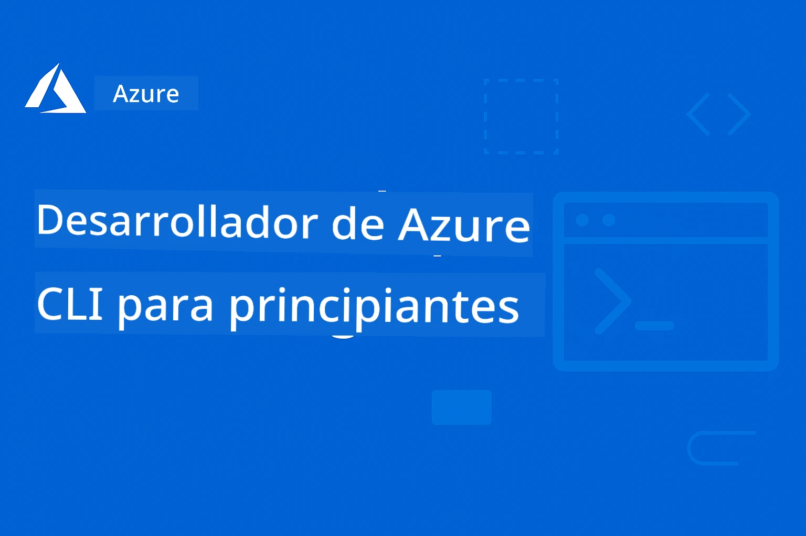

# AZD Para Principiantes: Un Viaje de Aprendizaje Estructurado

 

[](https://github.com/microsoft/AZD-for-beginners)
[](https://GitHub.com/microsoft/azd-for-beginners/network/)
[](https://github.com/microsoft/AZD-for-beginners)

[](https://discord.com/invite/nkVh3dp)
[](https://discord.gg/nTYy5BXMWG)

---

### Traducciones Automáticas (Siempre Actualizadas)

<!-- CO-OP TRANSLATOR LANGUAGES TABLE START -->
[Árabe](../ar/README.md) | [Bengalí](../bn/README.md) | [Búlgaro](../bg/README.md) | [Birmano (Myanmar)](../my/README.md) | [Chino (Simplificado)](../zh-CN/README.md) | [Chino (Tradicional, Hong Kong)](../zh-HK/README.md) | [Chino (Tradicional, Macau)](../zh-MO/README.md) | [Chino (Tradicional, Taiwán)](../zh-TW/README.md) | [Croata](../hr/README.md) | [Checo](../cs/README.md) | [Danés](../da/README.md) | [Holandés](../nl/README.md) | [Estonio](../et/README.md) | [Finlandés](../fi/README.md) | [Francés](../fr/README.md) | [Alemán](../de/README.md) | [Griego](../el/README.md) | [Hebreo](../he/README.md) | [Hindi](../hi/README.md) | [Húngaro](../hu/README.md) | [Indonesio](../id/README.md) | [Italiano](../it/README.md) | [Japonés](../ja/README.md) | [Kannada](../kn/README.md) | [Jemer](../km/README.md) | [Coreano](../ko/README.md) | [Lituano](../lt/README.md) | [Malayo](../ms/README.md) | [Malayalam](../ml/README.md) | [Manipuri (Meitei Mayek)](../mni/README.md) | [Maratí](../mr/README.md) | [Nepalí](../ne/README.md) | [Pidgin Nigeriano](../pcm/README.md) | [Noruego](../no/README.md) | [Persa (Farsi)](../fa/README.md) | [Polaco](../pl/README.md) | [Portugués (Brasil)](../pt-BR/README.md) | [Portugués (Portugal)](../pt-PT/README.md) | [Punyabí (Gurmukhi)](../pa/README.md) | [Rumano](../ro/README.md) | [Ruso](../ru/README.md) | [Serbio (Cirílico)](../sr/README.md) | [Eslovaco](../sk/README.md) | [Esloveno](../sl/README.md) | [Español](./README.md) | [Swahili](../sw/README.md) | [Sueco](../sv/README.md) | [Tagalo (Filipino)](../tl/README.md) | [Tamil](../ta/README.md) | [Telugu](../te/README.md) | [Tailandés](../th/README.md) | [Turco](../tr/README.md) | [Ucraniano](../uk/README.md) | [Urdu](../ur/README.md) | [Vietnamita](../vi/README.md)

> **¿Prefieres Clonar Localmente?**
>
> Este repositorio incluye traducciones en más de 50 idiomas, lo que aumenta significativamente el tamaño de la descarga. Para clonar sin traducciones, usa el checkout parcial:
>
> **Bash / macOS / Linux:**
> ```bash
> git clone --filter=blob:none --sparse https://github.com/microsoft/AZD-for-beginners.git
> cd AZD-for-beginners
> git sparse-checkout set --no-cone '/*' '!translations' '!translated_images'
> ```
>
> **CMD (Windows):**
> ```cmd
> git clone --filter=blob:none --sparse https://github.com/microsoft/AZD-for-beginners.git
> cd AZD-for-beginners
> git sparse-checkout set --no-cone "/*" "!translations" "!translated_images"
> ```
>
> Esto te da todo lo necesario para completar el curso con una descarga mucho más rápida.
<!-- CO-OP TRANSLATOR LANGUAGES TABLE END -->

## 🆕 Novedades en azd Hoy

> 📌 **Revisión de lanzamiento de AI CLI (2026-11-04):** La guía fue revisada contra la documentación/fuente publicada de **`azd 1.37.2`**, **agentes `1.0.0-beta.23`**, y **evaluaciones `1.0.0-beta.2`**. Utiliza `azd >= 1.37.0` para el flujo combinado. Ejecuta `azd version` y [actualiza el núcleo de CLI](https://learn.microsoft.com/azure/developer/azure-developer-cli/install-azd) antes de las extensiones. Consulta [cambios y correcciones del lanzamiento](docs/chapter-08-production/production-ai-practices.md#recent-release-changes-and-fixes). Esto no es una validación en vivo del despliegue de todo el curso.

Azure Developer CLI soporta muchos tipos de aplicaciones, incluyendo aplicaciones web, APIs, y agentes AI, a través de hosts, plantillas y extensiones compatibles.

Esto es lo que significa para ti:

- **Los agentes AI ahora son cargas de trabajo de primera clase en azd.** Puedes inicializar, desplegar y gestionar proyectos de agentes AI usando el mismo flujo `azd init` → `azd up` que ya conoces.
- **Un ciclo de vida de agente a través de dos extensiones.** Usa `azure.ai.agents` para inicializar, invocar, optimizar y retirar agentes. Instala **`azure.ai.evaluations`** por separado para `azd ai eval init`, `generate` y `run start`. Agentes beta.22 reemplazó el flujo de evaluación legado y cambió la configuración de optimización; sigue la [guía de migración](docs/chapter-08-production/production-ai-practices.md#evaluation-migration-and-quality-checks).
- **Más bloques de construcción AI.** Nuevas extensiones en vista previa—`azure.ai.skills` y `azure.ai.connections`—te permiten gestionar habilidades reutilizables de agentes y conexiones Foundry directamente con azd.
- **Integración con Microsoft Foundry** que trae despliegue de modelos, hospedaje de agentes, y configuración de servicios AI directamente al ecosistema de plantillas de azd.
- **Fundamentos diarios más fluidos.** Lanzamientos recientes hicieron a `azd init` idempotente (seguro para reejecutar), `azd auth login` limpia tokens obsoletos automáticamente y añadió un amigable aviso de configuración en la primera ejecución `azd tool`.
- **El flujo principal no ha cambiado.** Ya sea que despliegues una app de tareas, un microservicio o una solución AI multi-agente, los comandos son los mismos.

> **Nota para usuarios de Aspire:** Microsoft ahora se refiere al producto simplemente como **Aspire** (antes ".NET Aspire"). El soporte de Aspire en azd no ha cambiado; solo se actualizó el nombre.

Si ya usaste azd antes, el soporte AI es una extensión natural—no una herramienta separada ni una pista avanzada. Si estás empezando de cero, aprenderás un solo flujo que funciona para todo.

---

## 🚀 ¿Qué es Azure Developer CLI (azd)?

**Azure Developer CLI (azd)** es una herramienta de línea de comandos amigable para desarrolladores que facilita el despliegue de aplicaciones en Azure. En lugar de crear y conectar manualmente decenas de recursos de Azure, puedes desplegar aplicaciones completas con un solo comando.

### La Magia de `azd up`

```bash
# This single command does everything:
# ✅ Creates all Azure resources  
# ✅ Configures networking and security
# ✅ Builds your application code
# ✅ Deploys to Azure
# ✅ Gives you a working URL
azd up
```

La plantilla suministra la configuración de la aplicación e infraestructura. El despliegue exitoso aún requiere servicios/modelos soportados, cuota y permisos suficientes, entradas correctas y verificación de la aplicación desplegada. `azd up` no hace automáticamente que una plantilla sea segura, conforme o lista para producción.

---

## ❓ Azure Developer CLI vs Azure CLI: ¿Cuál es la diferencia?

Esta es la pregunta más común que hacen los principiantes. Aquí está la respuesta simple:

| Característica | **Azure CLI (`az`)** | **Azure Developer CLI (`azd`)** |
|---------|---------------------|--------------------------------|
| **Propósito** | Gestionar recursos individuales de Azure | Desplegar aplicaciones completas |
| **Mentalidad** | Enfocado en infraestructura | Enfocado en aplicación |
| **Ejemplo** | `az webapp create --name myapp...` | `azd up` |
| **Curva de aprendizaje** | Debe conocer servicios Azure | Solo conoce tu aplicación |
| **Mejor para** | DevOps, Infraestructura | Desarrolladores, Prototipado |

### Analogía Simple

- **Azure CLI** es como tener todas las herramientas para construir una casa - martillos, sierras, clavos. Puedes construir cualquier cosa, pero necesitas conocer construcción.
- **Azure Developer CLI** es como contratar a un contratista - describes lo que quieres y ellos se encargan de construirlo.

### Cuándo Usar Cada Uno

| Escenario | Usa Esto |
|----------|----------|
| "Quiero desplegar mi aplicación web rápido" | `azd up` |
| "Necesito crear solo una cuenta de almacenamiento" | `az storage account create` |
| "Estoy construyendo una aplicación AI completa" | `azd init --template azure-search-openai-demo` |
| "Necesito depurar un recurso Azure específico" | `az resource show` |
| "Quiero desplegar a mi entorno de producción configurado" | Revisa configuración, accesos, costos y controles operativos antes de `azd up --environment production` |

### ¡Funcionan Juntos!

AZD y Azure CLI tienen autenticación y configuración separadas. Usa `azd auth login` para AZD, y `az login` cuando un gancho o comando de diagnóstico explícitamente necesite Azure CLI. Puedes usar ambos:
```bash
# Deploy your app with AZD
azd up

# Then fine-tune specific resources with Azure CLI
az webapp config set --name myapp --always-on true
```

---

## 🌟 Encuentra Plantillas en Awesome AZD

¡No empieces desde cero! **Awesome AZD** es la colección comunitaria de plantillas listas para desplegar:

| Recurso | Descripción |
|----------|-------------|
| 🔗 [**Galería Awesome AZD**](https://azure.github.io/awesome-azd/) | Navega 200+ plantillas con despliegue con un clic |
| 🔗 [**Envía una Plantilla**](https://github.com/Azure/awesome-azd/issues) | Contribuye con tu propia plantilla a la comunidad |
| 🔗 [**Repositorio GitHub**](https://github.com/Azure/awesome-azd) | Marca con estrella y explora el código fuente |

### Plantillas AI Populares de Awesome AZD

Elige una plantilla en su propio directorio vacío; los comandos abajo son alternativas. El `.` final inicializa ese directorio.

```bash
# RAG Chat with Microsoft Foundry Models + AI Search
azd init --template azure-search-openai-demo .

# Quick AI Chat Application
azd init --template openai-chat-app-quickstart .

# AI Agents with Foundry Agents
azd init --template get-started-with-ai-agents .
```

---

## 🎯 Comenzando en 3 Pasos

Antes de empezar, asegúrate que tu máquina esté lista para la plantilla que quieres desplegar:

**Windows:**
```powershell
.\validate-setup.ps1
```

**macOS / Linux:**
```bash
bash ./validate-setup.sh
```

Si alguna verificación requerida falla, arréglala primero y luego continúa con el inicio rápido.

### Paso 1: Instalar AZD (2 minutos)

**Windows:**
```powershell
winget install microsoft.azd
```

**macOS:**
```bash
brew tap azure/azd && brew install azd
```

**Linux:**
```bash
curl -fsSL https://aka.ms/install-azd.sh | bash
```

### Paso 2: Autenticar para AZD

```bash
# Optional if you plan to use Azure CLI commands directly in this course
az login

# Required for AZD workflows
azd auth login
```

Si no estás seguro cuál necesitas, sigue el flujo completo en [Instalación y Configuración](docs/chapter-01-foundation/installation.md#authentication-setup).

### Paso 3: Desplegar Tu Primera App

```bash
# Initialize from a template
azd init --template todo-nodejs-mongo .

# Deploy to Azure (creates everything!)
azd up
```

**🎉 ¡Eso es todo!** Tu app ahora está en vivo en Azure.

### Limpieza (¡No lo Olvides!)

```bash
# Remove all resources when done experimenting
azd down --force --purge
```

---

## 📚 Cómo Usar Este Curso

Este curso está diseñado para un **aprendizaje progresivo** - comienza donde te sientas cómodo y avanza:

| Tu Experiencia | Empieza Aquí |
|-----------------|------------|
| **Nuevo en Azure** | [Capítulo 1: Fundamentos](#-chapter-1-foundation--quick-start) |
| **Conoces Azure, nuevo en AZD** | [Capítulo 1: Fundamentos](#-chapter-1-foundation--quick-start) |
| **Quieres desplegar apps AI** | [Capítulo 2: Desarrollo AI-First](#-chapter-2-ai-first-development-recommended-for-ai-developers) |
| **Quieres práctica práctica** | [🎓 Taller Interactivo](workshop/README.md) - laboratorio guiado de 3-4 horas |
| **Necesitas patrones para producción** | [Capítulo 8: Producción y Empresa](#-chapter-8-production--enterprise-patterns) |

### Configuración Rápida

1. **Haz Fork de Este Repositorio**: [](https://GitHub.com/microsoft/azd-for-beginners/fork)
2. **Clónalo**: `git clone https://github.com/YOUR-USERNAME/azd-for-beginners.git`
3. **Obtén Ayuda**: [Comunidad de Discord de Azure](https://discord.com/invite/ByRwuEEgH4)

> **¿Prefieres Clonar Localmente?**

> Este repositorio incluye traducciones en más de 50 idiomas, lo que aumenta significativamente el tamaño de la descarga. Para clonar sin traducciones, usa el checkout parcial:
> ```bash
> git clone --filter=blob:none --sparse https://github.com/microsoft/AZD-for-beginners.git
> cd AZD-for-beginners
> git sparse-checkout set --no-cone '/*' '!translations' '!translated_images'
> ```
> Esto te proporciona todo lo necesario para completar el curso con una descarga mucho más rápida.


## Descripción General del Curso

Domina Azure Developer CLI (azd) a través de capítulos estructurados diseñados para un aprendizaje progresivo. **Enfoque especial en el despliegue de aplicaciones de IA con integración de Microsoft Foundry.**

### Por Qué Este Curso es Esencial para Desarrolladores Modernos

Los desarrolladores que despliegan cargas de trabajo de IA comúnmente necesitan orientación sobre:
- Arquitecturas complejas de IA con múltiples servicios
- Mejores prácticas para despliegues de IA en producción  
- Integración y configuración de servicios de IA en Azure
- Optimización de costos para cargas de trabajo de IA
- Solución de problemas específicos del despliegue de IA

### Objetivos de Aprendizaje

Al completar este curso estructurado, podrás:
- **Dominar los Fundamentos de AZD**: Conceptos centrales, instalación y configuración
- **Desplegar Aplicaciones de IA**: Usar AZD con servicios de Microsoft Foundry
- **Implementar Infraestructura como Código**: Gestionar recursos de Azure con plantillas Bicep
- **Solucionar Despliegues**: Resolver problemas comunes y depurar errores
- **Optimizar para Producción**: Seguridad, escalabilidad, monitoreo y gestión de costos
- **Construir Soluciones Multi-Agente**: Desplegar arquitecturas complejas de IA

## Antes de Comenzar: Cuentas, Acceso y Suposiciones

Antes de iniciar el Capítulo 1, asegúrate de tener lo siguiente. Los pasos de instalación posteriores en esta guía asumen que estos básicos ya están cubiertos.

- **Una suscripción de Azure**: Puedes usar una suscripción existente del trabajo o tu propia cuenta, o crear una [prueba gratuita](https://aka.ms/azurefreetrial) para comenzar.
- **Permiso para crear recursos en Azure**: Para la mayoría de los ejercicios, debes tener al menos acceso de **Colaborador** en la suscripción o grupo de recursos objetivo. Algunos capítulos también pueden asumir que puedes crear grupos de recursos, identidades gestionadas y asignaciones RBAC.
- [**Una cuenta de GitHub**](https://github.com): Esto es útil para bifurcar el repositorio, registrar tus propios cambios y usar GitHub Codespaces para el taller.
- **Requisitos previos para la ejecución de plantillas**: Algunas plantillas necesitan herramientas locales como Node.js, Python, Java, o Docker. Ejecuta el validador de configuración antes de comenzar para detectar herramientas faltantes temprano.
- **Familiaridad básica con terminal**: No necesitas ser un experto, pero debes sentirte cómodo ejecutando comandos como `git clone`, `azd auth login`, y `azd up`.

> **¿Trabajas en una suscripción empresarial?**
> Si tu entorno de Azure es gestionado por un administrador, confirma con anticipación que puedes desplegar recursos en la suscripción o grupo de recursos que planeas usar. Si no, pide una suscripción sandbox o acceso de Colaborador antes de comenzar.

> **¿Nuevo en Azure?**
> Comienza con tu propia suscripción de prueba o de pago por uso en https://aka.ms/azurefreetrial para que puedas completar los ejercicios de principio a fin sin esperar aprobaciones a nivel de inquilino.

## 🗺️ Mapa del Curso: Navegación Rápida por Capítulo

Cada capítulo tiene un README dedicado con objetivos de aprendizaje, arranques rápidos y ejercicios:

| Capítulo | Tema | Lecciones | Duración | Complejidad |
|---------|-------|---------|----------|------------|
| **[Cap 1: Fundamentos](docs/chapter-01-foundation/README.md)** | Comenzando | [Conceptos Básicos AZD](docs/chapter-01-foundation/azd-basics.md) &#124; [Instalación](docs/chapter-01-foundation/installation.md) &#124; [Primer Proyecto](docs/chapter-01-foundation/first-project.md) | 30-45 min | ⭐ |
| **[Cap 2: Desarrollo IA](docs/chapter-02-ai-development/README.md)** | Aplicaciones IA-First | [Integración Foundry](docs/chapter-02-ai-development/microsoft-foundry-integration.md) &#124; [Agentes IA](docs/chapter-02-ai-development/agents.md) &#124; [Despliegue de Modelo](docs/chapter-02-ai-development/ai-model-deployment.md) &#124; [Taller](docs/chapter-02-ai-development/ai-workshop-lab.md) | 1-2 hrs | ⭐⭐ |
| **[Cap 3: Configuración](docs/chapter-03-configuration/README.md)** | Autenticación y Seguridad | [Configuración](docs/chapter-03-configuration/configuration.md) &#124; [Autenticación y Seguridad](docs/chapter-03-configuration/authsecurity.md) | 45-60 min | ⭐⭐ |
| **[Cap 4: Infraestructura](docs/chapter-04-infrastructure/README.md)** | IaC y Despliegue | [Guía de Despliegue](docs/chapter-04-infrastructure/deployment-guide.md) &#124; [Provisionamiento](docs/chapter-04-infrastructure/provisioning.md) | 1-1.5 hrs | ⭐⭐⭐ |
| **[Cap 5: Multi-Agente](docs/chapter-05-multi-agent/README.md)** | Soluciones Agentes IA | [Escenario Retail](examples/retail-scenario.md) &#124; [Patrones de Coordinación](docs/chapter-06-pre-deployment/coordination-patterns.md) | 2-3 hrs | ⭐⭐⭐⭐ |
| **[Cap 6: Pre-Despliegue](docs/chapter-06-pre-deployment/README.md)** | Planificación y Validación | [Cheques Previos](docs/chapter-06-pre-deployment/preflight-checks.md) &#124; [Planificación de Capacidad](docs/chapter-06-pre-deployment/capacity-planning.md) &#124; [Selección SKU](docs/chapter-06-pre-deployment/sku-selection.md) &#124; [App Insights](docs/chapter-06-pre-deployment/application-insights.md) | 1 hr | ⭐⭐ |
| **[Cap 7: Solución de Problemas](docs/chapter-07-troubleshooting/README.md)** | Depuración y Corrección | [Problemas Comunes](docs/chapter-07-troubleshooting/common-issues.md) &#124; [Depuración](docs/chapter-07-troubleshooting/debugging.md) &#124; [Problemas IA](docs/chapter-07-troubleshooting/ai-troubleshooting.md) | 1-1.5 hrs | ⭐⭐ |
| **[Cap 8: Producción](docs/chapter-08-production/README.md)** | Patrones Empresariales | [Prácticas en Producción](docs/chapter-08-production/production-ai-practices.md) | 2-3 hrs | ⭐⭐⭐⭐ |
| **[🎓 Taller](workshop/README.md)** | Laboratorio Práctico | [Introducción](workshop/docs/instructions/0-Introduction.md) &#124; [Selección](workshop/docs/instructions/1-Select-AI-Template.md) &#124; [Validación](workshop/docs/instructions/2-Validate-AI-Template.md) &#124; [Deconstrucción](workshop/docs/instructions/3-Deconstruct-AI-Template.md) &#124; [Configuración](workshop/docs/instructions/4-Configure-AI-Template.md) &#124; [Personalización](workshop/docs/instructions/5-Customize-AI-Template.md) &#124; [Desmontaje](workshop/docs/instructions/6-Teardown-Infrastructure.md) &#124; [Cierre](workshop/docs/instructions/7-Wrap-up.md) | 3-4 hrs | ⭐⭐ |

**Duración Total del Curso:** ~10-14 horas | **Progresión de Habilidades:** Principiante → Listo para Producción

---

## 📚 Capítulos de Aprendizaje

*Selecciona tu camino de aprendizaje según tu nivel de experiencia y objetivos*

### 🚀 Capítulo 1: Fundamentos y Comienzo Rápido
**Prerequisitos**: Suscripción a Azure, conocimiento básico de línea de comandos  
**Duración**: 30-45 minutos  
**Complejidad**: ⭐

#### Qué Aprenderás
- Entender los fundamentos de Azure Developer CLI
- Instalar AZD en tu plataforma
- Tu primer despliegue exitoso

#### Recursos de Aprendizaje
- **🎯 Comienza Aquí**: [¿Qué es Azure Developer CLI?](#-what-is-azure-developer-cli-azd)
- **📖 Teoría**: [Conceptos Básicos AZD](docs/chapter-01-foundation/azd-basics.md) - Conceptos centrales y terminología
- **⚙️ Configuración**: [Instalación y Configuración](docs/chapter-01-foundation/installation.md) - Guías específicas para plataformas
- **🛠️ Práctica**: [Tu Primer Proyecto](docs/chapter-01-foundation/first-project.md) - Tutorial paso a paso
- **📋 Referencia Rápida**: [Hoja de Comandos](resources/cheat-sheet.md)

#### Ejercicios Prácticos
```bash
# Quick installation check
azd version

# Deploy your first application
azd init --template todo-nodejs-mongo .
azd up
```

**💡 Resultado del Capítulo**: Desplegar exitosamente una aplicación web sencilla en Azure usando AZD

**✅ Validación del Éxito:**
```bash
# After completing Chapter 1, you should be able to:
azd version              # Shows installed version
azd init --template todo-nodejs-mongo  # Initializes project
azd up                  # Deploys to Azure
azd show                # Displays running app URL
# Application opens in browser and works
azd down --force --purge  # Cleans up resources
```

**📊 Inversión de Tiempo:** 30-45 minutos  
**📈 Nivel de Habilidad Después:** Puede desplegar aplicaciones básicas de forma independiente

---

### 🤖 Capítulo 2: Desarrollo IA-First (Recomendado para Desarrolladores de IA)
**Prerequisitos**: Capítulo 1 completado  
**Duración**: 1-2 horas  
**Complejidad**: ⭐⭐

#### Qué Aprenderás
- Integración de Microsoft Foundry con AZD
- Desplegar aplicaciones impulsadas por IA
- Entender las configuraciones de servicios de IA

#### Recursos de Aprendizaje
- **🎯 Comienza Aquí**: [Integración Microsoft Foundry](docs/chapter-02-ai-development/microsoft-foundry-integration.md)
- **🤖 Agentes IA**: [Guía de Agentes IA](docs/chapter-02-ai-development/agents.md) - Desplegar agentes inteligentes con AZD
- **📖 Patrones**: [Despliegue de Modelos IA](docs/chapter-02-ai-development/ai-model-deployment.md) - Desplegar y gestionar modelos de IA
- **🛠️ Taller**: [Laboratorio Taller IA](docs/chapter-02-ai-development/ai-workshop-lab.md) - Prepara tus soluciones IA con AZD
- **🎥 Guía Interactiva**: [Materiales del Taller](workshop/README.md) - Aprendizaje en navegador con MkDocs * Entorno DevContainer
- **📋 Plantillas**: [Plantillas Microsoft Foundry](#featured-microsoft-foundry-templates)
- **📝 Ejemplos**: [Ejemplos de Despliegue AZD](examples/README.md)

#### Ejercicios Prácticos
```bash
# Deploy your first AI application
azd init --template azure-search-openai-demo .
azd up

# Try additional AI templates
azd init --template openai-chat-app-quickstart .
azd init --template agent-openai-python-prompty .
```

**💡 Resultado del Capítulo**: Desplegar y configurar una aplicación de chat con IA con capacidades RAG

**✅ Validación del Éxito:**
```bash
# After Chapter 2, you should be able to:
azd init --template azure-search-openai-demo .
azd up
# Test the AI chat interface
# Ask questions and get AI-powered responses with sources
# Verify search integration works
azd monitor  # Check Application Insights shows telemetry
azd down --force --purge
```

**📊 Inversión de Tiempo:** 1-2 horas  
**📈 Nivel de Habilidad Después:** Puede desplegar aplicaciones de aprendizaje IA e identificar requisitos adicionales para producción
**💰 Conciencia de Costos:** Entiende costos de desarrollo $80-150/mes, costos de producción $300-3500/mes

#### 💰 Consideraciones de Costos para Despliegues IA

**Ambiente de Desarrollo (Estimado $80-150/mes):**
- Modelos Microsoft Foundry (Pago por uso): $0-50/mes (según uso de tokens)
- Búsqueda AI (nivel Básico): $75/mes
- Aplicaciones de Contenedor (Consumo): $0-20/mes
- Almacenamiento (Estándar): $1-5/mes

**Ambiente de Producción (Estimado $300-3,500+/mes):**
- Modelos Microsoft Foundry (PTU para rendimiento consistente): $3,000+/mes O pago por uso con volumen alto
- Búsqueda AI (nivel Estándar): $250/mes
- Aplicaciones de Contenedor (Dedicadas): $50-100/mes
- Application Insights: $5-50/mes
- Almacenamiento (Premium): $10-50/mes

**💡 Consejos de Optimización de Costos:**
- Revisa precios de inferencia de modelos y créditos específicos de cuenta; Azure OpenAI no incluye una asignación gratuita universal de 50,000 tokens mensuales
- Ejecuta `azd down` para eliminar recursos cuando ya no se necesiten, después de revisar el entorno seleccionado
- Comienza con facturación basada en consumo, actualiza a PTU solo para producción
- Usa `azd provision --preview` para inspeccionar la infraestructura planificada y luego calcula el precio con la Calculadora de Precios de Azure
- Habilita el autoescalado: paga solo por el uso real

**Monitoreo de Costos:**
```bash
# Inspect planned resources (this does not calculate prices)
azd provision --preview

# Monitor actual costs in Azure Portal
az consumption budget list --resource-group <your-rg>
```

---

### ⚙️ Capítulo 3: Configuración y Autenticación
**Prerequisitos**: Capítulo 1 completado  
**Duración**: 45-60 minutos  
**Complejidad**: ⭐⭐

#### Qué Aprenderás
- Configuración y gestión de entornos
- Mejores prácticas de autenticación y seguridad
- Nomenclatura y organización de recursos

#### Recursos de Aprendizaje
- **📖 Configuración**: [Guía de Configuración](docs/chapter-03-configuration/configuration.md) - Configuración del entorno
- **🔐 Seguridad**: [Patrones de autenticación e identidad gestionada](docs/chapter-03-configuration/authsecurity.md) - Patrones de autenticación
- **📝 Ejemplos**: [Ejemplo Aplicación Base de Datos](examples/database-app/README.md) - Ejemplos AZD de bases de datos

#### Ejercicios Prácticos
- Configurar múltiples entornos (desarrollo, pruebas, producción)
- Configurar autenticación con identidad gestionada
- Implementar configuraciones específicas para cada entorno

**💡 Resultado del Capítulo**: Gestionar múltiples entornos con autenticación y seguridad adecuadas

---

### 🏗️ Capítulo 4: Infraestructura como Código y Despliegue
**Prerequisitos**: Capítulos 1-3 completados  
**Duración**: 1-1.5 horas  
**Complejidad**: ⭐⭐⭐

#### Qué Aprenderás
- Patrones avanzados de despliegue
- Infraestructura como Código con Bicep
- Estrategias de aprovisionamiento de recursos

#### Recursos de Aprendizaje
- **📖 Despliegue**: [Guía de Despliegue](docs/chapter-04-infrastructure/deployment-guide.md) - Flujos de trabajo completos
- **🏗️ Aprovisionamiento**: [Aprovisionamiento de Recursos](docs/chapter-04-infrastructure/provisioning.md) - Gestión de recursos Azure
- **📝 Ejemplos**: [Ejemplo Aplicación en Contenedores](../../examples/container-app) - Despliegues con contenedores

#### Ejercicios Prácticos
- Crear plantillas Bicep personalizadas
- Desplegar aplicaciones multi-servicio
- Implementar estrategias de despliegue blue-green

**💡 Resultado del Capítulo**: Desplegar aplicaciones multi-servicio complejas usando plantillas personalizadas de infraestructura

---

### 🎯 Capítulo 5: Soluciones IA Multi-Agente (Avanzado)
**Prerequisitos**: Capítulos 1-2 completados  
**Duración**: 2-3 horas  
**Complejidad**: ⭐⭐⭐⭐

#### Qué Aprenderás
- Patrones de arquitectura multi-agente
- Orquestación y coordinación de agentes
- Despliegues de IA listos para producción

#### Recursos de Aprendizaje
- **🤖 Diseño Destacado**: [Solución Multi-Agente para Retail](examples/retail-scenario.md) - Plano arquitectónico, no una aplicación completa
- **🛠️ Plantillas ARM**: [Paquete de Plantillas ARM](../../examples/retail-multiagent-arm-template) - Andamio de infraestructura; revise los prerrequisitos y componentes faltantes de la aplicación
- **📖 Arquitectura**: [Patrones de coordinación multi-agente](docs/chapter-06-pre-deployment/coordination-patterns.md) - Patrones

#### Ejercicios prácticos
```bash
# Inspect the retail infrastructure scaffold before choosing to deploy it
cd examples/retail-multiagent-arm-template
cat README.md

# After an intentional deployment, inspect infrastructure state
az deployment group show --resource-group <rg-name> --name <deployment-name>
```

**💡 Resultado del capítulo**: Comprender el diseño multi-agente e identificar el trabajo de implementación, validación y operaciones necesario más allá de un andamio de infraestructura

---

### 🔍 Capítulo 6: Validación y planificación previas al despliegue
**Prerrequisitos**: Capítulo 4 completado  
**Duración**: 1 hora  
**Complejidad**: ⭐⭐

#### Lo que aprenderás
- Planificación de capacidad y validación de recursos
- Estrategias de selección de SKU
- Comprobaciones previas y automatización

#### Recursos de aprendizaje
- **📊 Planificación**: [Planificación de Capacidad](docs/chapter-06-pre-deployment/capacity-planning.md) - Validación de recursos
- **💰 Selección**: [Selección de SKU](docs/chapter-06-pre-deployment/sku-selection.md) - Opciones rentables
- **✅ Validación**: [Comprobaciones Previas](docs/chapter-06-pre-deployment/preflight-checks.md) - Scripts automatizados

#### Ejercicios prácticos
- Ejecutar scripts de validación de capacidad
- Optimizar selecciones de SKU para costo
- Implementar comprobaciones automatizadas previas al despliegue

**💡 Resultado del capítulo**: Validar y optimizar los despliegues antes de la ejecución

---

### 🚨 Capítulo 7: Resolución de problemas y depuración
**Prerrequisitos**: Cualquier capítulo de despliegue completado  
**Duración**: 1-1.5 horas  
**Complejidad**: ⭐⭐

#### Lo que aprenderás
- Enfoques sistemáticos de depuración
- Problemas comunes y sus soluciones
- Resolución de problemas específica para IA

#### Recursos de aprendizaje
- **🔧 Problemas Comunes**: [Problemas Comunes](docs/chapter-07-troubleshooting/common-issues.md) - Preguntas frecuentes y soluciones
- **🕵️ Depuración**: [Guía de depuración](docs/chapter-07-troubleshooting/debugging.md) - Estrategias paso a paso
- **🤖 Problemas de IA**: [Resolución de problemas específica de IA](docs/chapter-07-troubleshooting/ai-troubleshooting.md) - Problemas con servicios de IA

#### Ejercicios prácticos
- Diagnosticar fallos de despliegue
- Resolver problemas de autenticación
- Depurar conectividad de servicios de IA

**💡 Resultado del capítulo**: Diagnosticar y resolver problemas comunes de despliegue de forma independiente

---

### 🏢 Capítulo 8: Patrones de producción y empresariales
**Prerrequisitos**: Capítulos 1-4 completados  
**Duración**: 2-3 horas  
**Complejidad**: ⭐⭐⭐⭐

#### Lo que aprenderás
- Estrategias de despliegue en producción
- Patrones de seguridad empresarial
- Monitoreo y optimización de costos

#### Recursos de aprendizaje
- **🏭 Producción**: [Mejores prácticas de IA en producción](docs/chapter-08-production/production-ai-practices.md) - Patrones empresariales
- **📝 Ejemplos**: [Ejemplo de Microservicios](../../examples/microservices) - Arquitecturas complejas
- **📊 Monitoreo**: [Integración con Application Insights](docs/chapter-06-pre-deployment/application-insights.md) - Monitoreo

#### Ejercicios prácticos
- Implementar patrones de seguridad empresariales
- Configurar monitoreo integral
- Desplegar a producción con gobernanza adecuada

**💡 Resultado del capítulo**: Desplegar aplicaciones listas para producción con todas las capacidades empresariales

---

## 🎓 Resumen del taller: Experiencia de aprendizaje práctico

> **⚠️ ESTADO DEL TALLER: Desarrollo activo**  
> Los materiales del taller están siendo desarrollados y perfeccionados. Los módulos principales están funcionales, pero algunas secciones avanzadas están incompletas. Estamos trabajando activamente para completar todo el contenido. [Seguir progreso →](workshop/README.md)

### Materiales interactivos del taller
**Aprendizaje práctico integral con herramientas basadas en navegador y ejercicios guiados**

Nuestros materiales del taller proporcionan una experiencia de aprendizaje estructurada e interactiva que complementa el plan de estudios basado en capítulos arriba. El taller está diseñado tanto para aprendizaje autodirigido como para sesiones dirigidas por instructores.

#### 🛠️ Características del taller
- **Interfaz basada en navegador**: Taller completo impulsado por MkDocs con búsqueda, copiar y opciones de tema
- **Integración con GitHub Codespaces**: Configuración del entorno de desarrollo con un clic
- **Ruta de aprendizaje estructurada**: 8 módulos con ejercicios guiados (3-4 horas totales)
- **Metodología progresiva**: Introducción → Selección → Validación → Desconstrucción → Configuración → Personalización → Desmontaje → Conclusión
- **Entorno interactivo DevContainer**: Herramientas y dependencias preconfiguradas

#### 📚 Estructura del módulo del taller
El taller sigue una **metodología progresiva de 8 módulos** que te lleva desde el descubrimiento hasta el dominio del despliegue:

| Módulo | Tema | Lo que harás | Duración |
|--------|-------|--------------|----------|
| **0. Introducción** | Resumen del taller | Entender objetivos de aprendizaje, prerrequisitos y estructura del taller | 15 min |
| **1. Selección** | Descubrimiento de plantillas | Explorar plantillas AZD y seleccionar la plantilla AI adecuada para tu escenario | 20 min |
| **2. Validación** | Desplegar y verificar | Desplegar la plantilla con `azd up` y validar que la infraestructura funcione | 30 min |
| **3. Desconstrucción** | Entender la estructura | Usar GitHub Copilot para explorar arquitectura de plantillas, archivos Bicep y organización de código | 30 min |
| **4. Configuración** | Profundización en azure.yaml | Dominar la configuración de `azure.yaml`, ganchos de ciclo de vida y variables de entorno | 30 min |
| **5. Personalización** | Hazlo tuyo | Habilitar AI Search, trazabilidad, evaluación y personalizar para tu escenario | 45 min |
| **6. Desmontaje** | Limpieza | Desaprovisionar recursos de forma segura con `azd down --purge` | 15 min |
| **7. Conclusión** | Próximos pasos | Revisar logros, conceptos clave y continuar tu aprendizaje | 15 min |

**Flujo del taller:**
```
Introduction → Selection → Validation → Deconstruction → Configuration → Customization → Teardown → Wrap-up
     ↓            ↓           ↓              ↓               ↓              ↓            ↓           ↓
  Overview    Find the     Deploy &      Explore        Master         Customize     Clean up    Review &
             right        verify        code &        azure.yaml      for your      resources   next steps
             template                   structure                     scenario
```

#### 🚀 Comenzando con el taller
```bash
# Option 1: GitHub Codespaces (Recommended)
# Click "Code" → "Create codespace on main" in the repository

# Option 2: Local Development
git clone https://github.com/microsoft/azd-for-beginners.git
cd azd-for-beginners/workshop
# Follow the setup instructions in workshop/README.md
```

#### 🎯 Resultados de aprendizaje del taller
Al completar el taller, los participantes:
- **Desplegar aplicaciones AI en producción**: Usar AZD con los servicios de Microsoft Foundry
- **Dominar arquitecturas multi-agente**: Implementar soluciones AI coordinadas con agentes
- **Implementar mejores prácticas de seguridad**: Configurar autenticación y control de acceso
- **Optimizar para escala**: Diseñar despliegues rentables y con alto rendimiento
- **Resolver problemas de despliegue**: Solucionar problemas comunes de forma independiente

#### 📖 Recursos del taller
- **🎥 Guía interactiva**: [Materiales del taller](workshop/README.md) - Entorno de aprendizaje en el navegador
- **📋 Instrucciones módulo por módulo**:
  - [0. Introducción](workshop/docs/instructions/0-Introduction.md) - Resumen y objetivos del taller
  - [1. Selección](workshop/docs/instructions/1-Select-AI-Template.md) - Encontrar y seleccionar plantillas AI
  - [2. Validación](workshop/docs/instructions/2-Validate-AI-Template.md) - Desplegar y verificar plantillas
  - [3. Desconstrucción](workshop/docs/instructions/3-Deconstruct-AI-Template.md) - Explorar arquitectura de plantillas
  - [4. Configuración](workshop/docs/instructions/4-Configure-AI-Template.md) - Dominar azure.yaml
  - [5. Personalización](workshop/docs/instructions/5-Customize-AI-Template.md) - Personalizar para tu escenario
  - [6. Desmontaje](workshop/docs/instructions/6-Teardown-Infrastructure.md) - Limpiar recursos
  - [7. Conclusión](workshop/docs/instructions/7-Wrap-up.md) - Revisión y siguientes pasos
- **🛠️ Laboratorio AI del taller**: [Laboratorio AI del taller](docs/chapter-02-ai-development/ai-workshop-lab.md) - Ejercicios enfocados en AI
- **💡 Inicio rápido**: [Guía de configuración del taller](workshop/README.md#browser-based-guide) - Configuración del ambiente

**Perfecto para**: Entrenamiento corporativo, cursos universitarios, aprendizaje autodirigido y bootcamps para desarrolladores.

---

## 📖 Profundización: Capacidades de AZD

Más allá de lo básico, AZD proporciona potentes características para despliegues en producción:

- **Despliegues basados en plantillas** - Usar plantillas preconstruidas para patrones comunes de aplicaciones
- **Infraestructura como código** - Gestionar recursos de Azure usando Bicep o Terraform  
- **Flujos de trabajo integrados** - Provisión, despliegue y monitoreo de aplicaciones sin interrupciones
- **Optimizado para desarrolladores** - Enfocado en productividad y experiencia del desarrollador

### **AZD + Microsoft Foundry: Perfecto para despliegues AI**

**¿Por qué AZD para soluciones AI?** AZD aborda los principales desafíos que enfrentan los desarrolladores de IA:

- **Plantillas listas para AI** - Plantillas preconfiguradas para modelos Microsoft Foundry, servicios AI de Azure y cargas de trabajo de ML
- **Despliegues seguros de IA** - Patrones de seguridad integrados para servicios de IA, llaves API y endpoints de modelos  
- **Patrones AI para producción** - Mejores prácticas para despliegues escalables y rentables de aplicaciones AI
- **Flujos de trabajo AI de extremo a extremo** - Desde desarrollo de modelos hasta despliegue en producción con monitoreo adecuado
- **Optimización de costos** - Estrategias inteligentes de asignación y escalado de recursos para cargas de trabajo AI
- **Integración Microsoft Foundry** - Conexión sin interrupciones al catálogo y endpoints de modelos Microsoft Foundry

---

## 🎯 Biblioteca de plantillas y ejemplos

### Destacados: Plantillas Microsoft Foundry
**Empieza aquí si vas a desplegar aplicaciones AI!**

> **Nota:** Estas plantillas demuestran varios patrones AI. Algunas son muestras externas de Azure, otras implementaciones locales.

| Plantilla | Capítulo | Complejidad | Servicios | Tipo |
|----------|---------|------------|----------|------|
| [**Comienza con chat AI**](https://github.com/Azure-Samples/get-started-with-ai-chat) | Capítulo 2 | ⭐⭐ | AzureOpenAI + Azure AI Model Inference API + Azure AI Search + Azure Container Apps + Application Insights | Externo |
| [**Comienza con agentes AI**](https://github.com/Azure-Samples/get-started-with-ai-agents) | Capítulo 2 | ⭐⭐ | Foundry Agents + AzureOpenAI + Azure AI Search + Azure Container Apps + Application Insights| Externo |
| [**Demo de Azure Search + OpenAI**](https://github.com/Azure-Samples/azure-search-openai-demo) | Capítulo 2 | ⭐⭐ | Azure OpenAI + Azure AI Search + Container Apps (por defecto) + Almacenamiento | Externo |
| [**Inicio rápido app OpenAI chat**](https://github.com/Azure-Samples/openai-chat-app-quickstart) | Capítulo 2 | ⭐ | AzureOpenAI + Container Apps + Application Insights | Externo |
| [**Agent OpenAI Python Prompty**](https://github.com/Azure-Samples/agent-openai-python-prompty) | Capítulo 5 | ⭐⭐⭐ | AzureOpenAI + Azure Functions + Prompty | Externo |
| [**Contoso Chat RAG**](https://github.com/Azure-Samples/contoso-chat) | Capítulo 8 | ⭐⭐⭐⭐ | AzureOpenAI + AI Search + Cosmos DB + Container Apps | Externo |
| [**Solución multi-agente para retail**](examples/retail-scenario.md) | Capítulo 5 | ⭐⭐⭐⭐ | Arquitectura y andamio de infraestructura propuestos; se requiere implementación de la aplicación | **Plano local** |

### Destacados: Escenarios de aprendizaje completos
**Plantillas de aplicaciones listas para producción asignadas a capítulos de aprendizaje**

| Plantilla | Capítulo de aprendizaje | Complejidad | Aprendizaje clave |
|----------|-----------------------|------------|-------------------|
| [**openai-chat-app-quickstart**](https://github.com/Azure-Samples/openai-chat-app-quickstart) | Capítulo 2 | ⭐ | Patrones básicos de despliegue AI |
| [**azure-search-openai-demo**](https://github.com/Azure-Samples/azure-search-openai-demo) | Capítulo 2 | ⭐⭐ | Implementación RAG con Azure AI Search |
| [**get-started-with-ai-agents**](https://github.com/Azure-Samples/get-started-with-ai-agents) | Capítulo 2 | ⭐⭐ | Chat respaldado por agentes y pruebas de evaluación específicas |
| [**agent-openai-python-prompty**](https://github.com/Azure-Samples/agent-openai-python-prompty) | Capítulo 5 | ⭐⭐⭐ | Framework de agentes y llamadas a funciones |
| [**contoso-chat**](https://github.com/Azure-Samples/contoso-chat) | Capítulo 8 | ⭐⭐⭐ | Orquestación AI empresarial |
| [**retail-multi-agent-solution**](examples/retail-scenario.md) | Capítulo 5 | ⭐⭐⭐⭐ | Arquitectura multi-agente con agentes Cliente e Inventario |

### Aprendizaje por tipo de ejemplo

> **📌 Ejemplos Locales vs. Externos:**  
> **Ejemplos Locales** (en este repositorio) = Revisar el README del ejemplo para estado de implementación y prerrequisitos
> **Ejemplos Externos** (Muestras Azure) = Clonar desde repositorios vinculados

#### Ejemplos locales (listos para usar)
- [**Solución multi-agente para retail**](examples/retail-scenario.md) - Plano arquitectónico con andamio de infraestructura ARM
  - Roles propuestos para agentes Cliente e Inventario
  - Código para monitoreo, evaluación y aplicación debe implementarse y verificarse
  - Solo aprovisionar recursos no produce una aplicación retail funcional

#### Ejemplos locales - Aplicaciones en contenedores (Capítulos 2-5)
**Ejemplos completos de despliegue en contenedores en este repositorio:**
- [**Ejemplos de aplicaciones en contenedores**](examples/container-app/README.md) - Guía completa para despliegues contenerizados
  - [API Flask simple](../../examples/container-app/simple-flask-api) - API REST básica con escala a cero
  - [Arquitectura microservicios](../../examples/container-app/microservices) - Muestra de aprendizaje con dos servicios; endurecimiento para producción es trabajo adicional
  - Patrones de inicio rápido, producción y avanzados
  - Guía para monitoreo, seguridad y optimización de costos

#### Ejemplos externos - Aplicaciones simples (Capítulos 1-2)
**Clona estos repositorios de muestras Azure para empezar:**
- [Aplicación web simple - Node.js + MongoDB](https://github.com/Azure-Samples/todo-nodejs-mongo) - Patrones básicos de despliegue
- [Sitio estático - React SPA](https://github.com/Azure-Samples/todo-csharp-sql-swa-func) - Despliegue de contenido estático
- [Aplicación contenedorizada - Python Flask](https://github.com/Azure-Samples/container-apps-store-api-microservice) - Despliegue de API REST

#### Ejemplos externos - Integración de bases de datos (Capítulos 3-4)  
- [Aplicación de Base de Datos - C# + SQL](https://github.com/Azure-Samples/todo-csharp-sql) - Patrones de conectividad de base de datos
- [Funciones + Cosmos DB](https://github.com/Azure-Samples/todo-python-mongo-swa-func) - Flujo de trabajo de datos sin servidor

#### Ejemplos Externos - Patrones Avanzados (Capítulos 4-8)
- [Microservicios Java](https://github.com/Azure-Samples/java-microservices-aca-lab) - Arquitecturas multiservicio
- [Trabajos de Container Apps](https://github.com/Azure-Samples/container-apps-jobs) - Procesamiento en segundo plano  
- [Pipeline ML Empresarial](https://github.com/Azure/mlops-v2) - Patrones de referencia MLOps; no es una plantilla de AZD lista para usar

### Colecciones de Plantillas Externas
- [**Galería Oficial de Plantillas AZD**](https://azure.github.io/awesome-azd/) - Colección curada de plantillas oficiales y de la comunidad
- [**Plantillas de Azure Developer CLI**](https://learn.microsoft.com/en-us/azure/developer/azure-developer-cli/azd-templates) - Documentación de plantillas de Microsoft Learn
- [**Directorio de Ejemplos**](examples/README.md) - Ejemplos locales de aprendizaje con explicaciones detalladas

---

## 📚 Recursos y Referencias para el Aprendizaje

### Referencias Rápidas
- [**Hoja de comandos**](resources/cheat-sheet.md) - Comandos esenciales azd organizados por capítulo
- [**Glosario**](resources/glossary.md) - Terminología de Azure y azd  
- [**Preguntas frecuentes**](resources/faq.md) - Preguntas comunes organizadas por capítulo de aprendizaje
- [**Guía de estudio**](resources/study-guide.md) - Ejercicios prácticos completos

### Talleres Prácticos
- [**Laboratorio taller de IA**](docs/chapter-02-ai-development/ai-workshop-lab.md) - Haz que tus soluciones de IA sean desplegables con AZD (2-3 horas)
- [**Taller interactivo**](workshop/README.md) - Ejercicios guiados de 8 módulos con MkDocs y GitHub Codespaces
  - Sigue: Introducción → Selección → Validación → Deconstrucción → Configuración → Personalización → Desmontaje → Resumen

### Recursos de Aprendizaje Externos
- [Documentación Azure Developer CLI](https://learn.microsoft.com/en-us/azure/developer/azure-developer-cli/)
- [Centro de Arquitectura de Azure](https://learn.microsoft.com/en-us/azure/architecture/)
- [Calculadora de precios de Azure](https://azure.microsoft.com/pricing/calculator/)
- [Estado de Azure](https://status.azure.com/)

### Habilidades de Agente de IA para tu Editor
- [**Habilidades Microsoft Azure en skills.sh**](https://skills.sh/microsoft/github-copilot-for-azure) - 37 habilidades abiertas para agentes de Azure AI, Foundry, despliegue, diagnóstico, optimización de costos y más. Instálalas en GitHub Copilot, Cursor, Claude Code o en cualquier agente compatible:
  ```bash
  npx skills add microsoft/github-copilot-for-azure
  ```

---

## 🔧 Guía Rápida de Solución de Problemas

**Problemas comunes que enfrentan los principiantes y soluciones inmediatas:**

<details>
<summary><strong>❌ "azd: comando no encontrado"</strong></summary>

```bash
# Install AZD first
# Windows (PowerShell):
winget install microsoft.azd

# macOS:
brew tap azure/azd && brew install azd

# Linux:
curl -fsSL https://aka.ms/install-azd.sh | bash

# Verify installation
azd version
```
</details>

<details>
<summary><strong>❌ "No se encontró suscripción" o "Suscripción no configurada"</strong></summary>

```bash
# List available subscriptions
az account list --output table

# Set default subscription
az account set --subscription "<subscription-id-or-name>"

# Set for AZD environment
azd env set AZURE_SUBSCRIPTION_ID "<subscription-id>"

# Verify
az account show
```
</details>

<details>
<summary><strong>❌ "Cuota insuficiente" o "Cuota excedida"</strong></summary>

```bash
# Try different Azure region
azd env set AZURE_LOCATION "westus2"
azd up

# Or use smaller SKUs in development
# Edit infra/main.parameters.json:
{
  "sku": "B1"  // Instead of "P1V2"
}
```
</details>

<details>
<summary><strong>❌ "azd up" falla a medio camino</strong></summary>

```bash
# Option 1: Inspect the error and retry after correcting its cause
azd show
azd up --debug

# Option 2: Just fix infrastructure
azd provision

# Option 3: Check detailed status
azd show

# Option 4: Check logs in Azure Monitor
azd monitor --logs
```
</details>

<details>
<summary><strong>❌ "Autenticación fallida" o "Token expirado"</strong></summary>

```bash
# Re-authenticate for AZD
azd auth logout
azd auth login

# Optional: refresh Azure CLI too if you are running az commands
az logout
az login

# Verify authentication
az account show
```
</details>

<details>
<summary><strong>❌ "El recurso ya existe" o conflictos de nombres</strong></summary>

```bash
# Inspect the conflicting resource before changing or deleting anything.
# For an isolated new deployment, create a separate environment:
azd env new dev-v2
azd up
```
</details>

<details>
<summary><strong>❌ La implementación de la plantilla está tardando demasiado</strong></summary>

**Tiempos de espera normales:**
- Aplicación web simple: 5-10 minutos
- Aplicación con base de datos: 10-15 minutos
- Aplicaciones de IA: 15-25 minutos (la provisión de OpenAI es lenta)

```bash
# Check progress
azd show

# If stuck >30 minutes, check Azure Portal:
azd monitor --overview
# Look for failed deployments
```
</details>

<details>
<summary><strong>❌ "Permiso denegado" o "Prohibido"</strong></summary>

```bash
# Check your Azure role
az role assignment list --assignee $(az account show --query user.name -o tsv)

# You need at least "Contributor" role
# Ask your Azure admin to grant:
# - Contributor (for resources)
# - User Access Administrator (for role assignments)
```
</details>

<details>
<summary><strong>❌ No se puede encontrar la URL de la aplicación desplegada</strong></summary>

```bash
# Show all service endpoints
azd show

# Or open Azure Portal
azd monitor

# Check specific service
azd env get-values
# Look for *_URL variables
```
</details>

### 📚 Recursos Completos para Solución de Problemas

- **Guía de Problemas Comunes:** [Soluciones detalladas](docs/chapter-07-troubleshooting/common-issues.md)
- **Problemas específicos de IA:** [Solución de problemas de IA](docs/chapter-07-troubleshooting/ai-troubleshooting.md)
- **Guía de Depuración:** [Depuración paso a paso](docs/chapter-07-troubleshooting/debugging.md)
- **Obtén ayuda:** [Azure Discord](https://discord.gg/microsoft-azure) #azure-developer-cli

---

## 🎓 Finalización del Curso y Certificación

### Seguimiento del Progreso
Realiza un seguimiento de tu progreso de aprendizaje a través de cada capítulo:

- [ ] **Capítulo 1**: Fundamentos y Inicio Rápido ✅
- [ ] **Capítulo 2**: Desarrollo con IA Primero ✅  
- [ ] **Capítulo 3**: Configuración y Autenticación ✅
- [ ] **Capítulo 4**: Infraestructura como Código y Despliegue ✅
- [ ] **Capítulo 5**: Soluciones de IA Multi-Agente ✅
- [ ] **Capítulo 6**: Validación y Planificación Pre-Despliegue ✅
- [ ] **Capítulo 7**: Solución de problemas y Depuración ✅
- [ ] **Capítulo 8**: Patrones de Producción y Empresariales ✅

### Verificación del Aprendizaje
Después de completar cada capítulo, verifica tus conocimientos mediante:
1. **Ejercicio práctico**: Completa el despliegue práctico del capítulo
2. **Prueba de conocimientos**: Revisa la sección de preguntas frecuentes de tu capítulo
3. **Discusión comunitaria**: Comparte tu experiencia en Azure Discord
4. **Próximo capítulo**: Avanza al siguiente nivel de complejidad

### Beneficios al Completar el Curso
Al completar todos los capítulos, habrás obtenido:
- **Experiencia en producción**: Aplicaciones reales de IA desplegadas en Azure
- **Habilidades profesionales**: Capacidades de despliegue listas para empresas  
- **Reconocimiento en la comunidad**: Miembro activo de la comunidad de desarrolladores de Azure
- **Avance profesional**: Experiencia demandada en AZD y despliegue de IA

---

## 🤝 Comunidad y Soporte

### Obtén ayuda y soporte
- **Problemas técnicos**: [Reporta errores y solicita funciones](https://github.com/microsoft/azd-for-beginners/issues)
- **Preguntas de aprendizaje**: [Comunidad Microsoft Azure Discord](https://discord.gg/microsoft-azure) y [](https://discord.gg/nTYy5BXMWG)
- **Ayuda específica de IA**: Únete al [](https://discord.gg/nTYy5BXMWG)
- **Documentación**: [Documentación oficial de Azure Developer CLI](https://learn.microsoft.com/en-us/azure/developer/azure-developer-cli/)

### Perspectivas de la comunidad desde Microsoft Foundry Discord

**Temas discutidos por la comunidad:**
- Despliegues multiservicio, gestión de credenciales, y preparación para producción
- Plantillas específicas de IA, guías de solución de problemas y mejores prácticas

**Únete a nuestra comunidad para:**
- Compartir tus experiencias con AZD + IA y obtener ayuda
- Acceder a previews tempranos de nuevas plantillas de IA
- Contribuir a las mejores prácticas de despliegue de IA
- Influir en el desarrollo futuro de funciones de IA + AZD

### Contribuir al Curso
¡Damos la bienvenida a las contribuciones! Por favor lee nuestra [Guía de contribución](CONTRIBUTING.md) para detalles sobre:
- **Mejoras de contenido**: Mejorar los capítulos y ejemplos existentes
- **Nuevos ejemplos**: Añadir escenarios y plantillas del mundo real  
- **Traducción**: Ayudar a mantener el soporte multilingüe
- **Reportes de errores**: Mejorar la precisión y claridad
- **Normas comunitarias**: Seguir nuestras directrices inclusivas de comunidad

---

## 📄 Información del Curso

### Licencia
Este proyecto está licenciado bajo la Licencia MIT - consulta el archivo [LICENSE](../../LICENSE) para más detalles.

### Recursos de Aprendizaje Relacionados de Microsoft

Nuestro equipo produce otros cursos completos de aprendizaje:

<!-- CO-OP TRANSLATOR OTHER COURSES START -->
### LangChain
[](https://aka.ms/langchain4j-for-beginners)
[](https://aka.ms/langchainjs-for-beginners?WT.mc_id=m365-94501-dwahlin)
[](https://github.com/microsoft/langchain-for-beginners?WT.mc_id=m365-94501-dwahlin)
---

### Azure / Edge / MCP / Agentes
[](https://github.com/microsoft/AZD-for-beginners?WT.mc_id=academic-105485-koreyst)
[](https://github.com/microsoft/edgeai-for-beginners?WT.mc_id=academic-105485-koreyst)
[](https://github.com/microsoft/mcp-for-beginners?WT.mc_id=academic-105485-koreyst)
[](https://github.com/microsoft/ai-agents-for-beginners?WT.mc_id=academic-105485-koreyst)

---
 
### Serie de IA Generativa
[](https://github.com/microsoft/generative-ai-for-beginners?WT.mc_id=academic-105485-koreyst)
[-9333EA?style=for-the-badge&labelColor=E5E7EB&color=9333EA)](https://github.com/microsoft/Generative-AI-for-beginners-dotnet?WT.mc_id=academic-105485-koreyst)
[-C084FC?style=for-the-badge&labelColor=E5E7EB&color=C084FC)](https://github.com/microsoft/generative-ai-for-beginners-java?WT.mc_id=academic-105485-koreyst)
[-E879F9?style=for-the-badge&labelColor=E5E7EB&color=E879F9)](https://github.com/microsoft/generative-ai-with-javascript?WT.mc_id=academic-105485-koreyst)

---
 
### Aprendizaje Básico
[](https://aka.ms/ml-beginners?WT.mc_id=academic-105485-koreyst)
[](https://aka.ms/datascience-beginners?WT.mc_id=academic-105485-koreyst)
[](https://aka.ms/ai-beginners?WT.mc_id=academic-105485-koreyst)
[](https://github.com/microsoft/Security-101?WT.mc_id=academic-96948-sayoung)
[](https://aka.ms/webdev-beginners?WT.mc_id=academic-105485-koreyst)
[](https://aka.ms/iot-beginners?WT.mc_id=academic-105485-koreyst)
[](https://github.com/microsoft/xr-development-for-beginners?WT.mc_id=academic-105485-koreyst)

---
 
### Serie Copilot
[](https://aka.ms/GitHubCopilotAI?WT.mc_id=academic-105485-koreyst)
[](https://github.com/microsoft/mastering-github-copilot-for-dotnet-csharp-developers?WT.mc_id=academic-105485-koreyst)
[](https://github.com/microsoft/CopilotAdventures?WT.mc_id=academic-105485-koreyst)
<!-- CO-OP TRANSLATOR OTHER COURSES END -->

---

## 🗺️ Navegación del Curso

**🚀 ¿Listo para empezar a aprender?**

**Principiantes**: Comienza con [Capítulo 1: Fundamentos e Inicio Rápido](#-chapter-1-foundation--quick-start)  
**Desarrolladores de IA**: Salta a [Capítulo 2: Desarrollo con IA primero](#-chapter-2-ai-first-development-recommended-for-ai-developers)  
**Desarrolladores experimentados**: Empieza con [Capítulo 3: Configuración y autenticación](#️-chapter-3-configuration--authentication)

**Próximos pasos**: [Comienza Capítulo 1 - Conceptos básicos de AZD](docs/chapter-01-foundation/azd-basics.md) →

---

<!-- CO-OP TRANSLATOR DISCLAIMER START -->
**Descargo de responsabilidad**:
Este documento ha sido traducido utilizando el servicio de traducción automática [Co-op Translator](https://github.com/Azure/co-op-translator). Aunque nos esforzamos por la precisión, tenga en cuenta que las traducciones automatizadas pueden contener errores o inexactitudes. El documento original en su idioma nativo debe considerarse la fuente autorizada. Para información crítica, se recomienda una traducción profesional humana. No somos responsables de cualquier malentendido o interpretación errónea que surja del uso de esta traducción.
<!-- CO-OP TRANSLATOR DISCLAIMER END -->