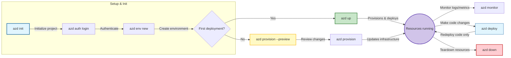
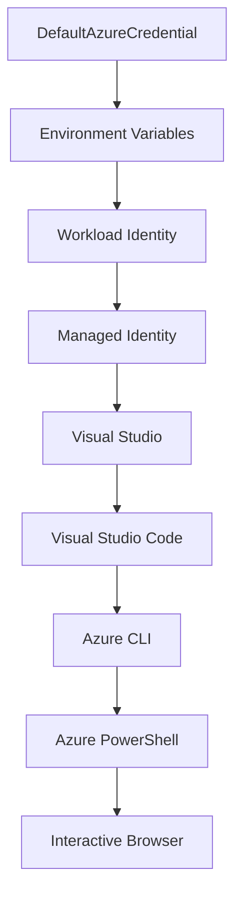

# Conceptos Básicos de AZD - Conceptos Fundamentales y Básicos

**Navegación del Capítulo:**
- **📚 Inicio del Curso**: [AZD Para Principiantes](../../README.md)
- **📖 Capítulo Actual**: Capítulo 1 - Fundamentos y Inicio Rápido
- **⬅️ Anterior**: [Resumen del Curso](../../README.md#-chapter-1-foundation--quick-start)
- **➡️ Siguiente**: [Instalación y Configuración](installation.md)
- **🚀 Próximo Capítulo**: [Capítulo 2: Desarrollo AI-First](../chapter-02-ai-development/microsoft-foundry-integration.md)

## Introducción

> Revisado contra `azd 1.37.2` (noviembre de 2026). Los comandos Bash usan marcadores entre comillas que debes reemplazar. Los flujos de trabajo de plantilla usan `.` para inicializar el directorio actual; sin un argumento de directorio, la inicialización de plantilla crea un subdirectorio y no cambia el directorio de trabajo del shell. Los fragmentos avanzados son ilustrativos, no proyectos completos.

Esta lección te presenta Azure Developer CLI (azd), una herramienta de línea de comandos potente que acelera tu viaje desde el desarrollo local hasta el despliegue en Azure. Aprenderás los conceptos fundamentales, las características principales y comprenderás cómo azd simplifica el despliegue de aplicaciones nativas en la nube.

## Objetivos de Aprendizaje

Al finalizar esta lección, podrás:
- Entender qué es Azure Developer CLI y su propósito principal
- Aprender los conceptos clave de plantillas, entornos y servicios
- Explorar características clave incluyendo desarrollo basado en plantillas e Infraestructura como Código
- Comprender la estructura del proyecto y el flujo de trabajo de azd
- Estar preparado para instalar y configurar azd en tu entorno de desarrollo

## Resultados de Aprendizaje

Después de completar esta lección, serás capaz de:
- Explicar el papel de azd en flujos de trabajo modernos de desarrollo en la nube
- Identificar los componentes de la estructura de un proyecto azd
- Describir cómo funcionan en conjunto las plantillas, entornos y servicios
- Entender los beneficios de Infraestructura como Código con azd
- Reconocer los diferentes comandos de azd y sus propósitos

## ¿Qué es Azure Developer CLI (azd)?

Azure Developer CLI (azd) es una herramienta de línea de comandos diseñada para acelerar tu viaje desde el desarrollo local hasta el despliegue en Azure. Simplifica el proceso de construir, desplegar y gestionar aplicaciones nativas en la nube sobre Azure.

### ¿Qué puedes desplegar con azd?

azd soporta una amplia variedad de cargas de trabajo—y la lista sigue creciendo. Hoy, puedes usar azd para desplegar:

| Tipo de carga de trabajo | Ejemplos | ¿Mismo flujo de trabajo? |
|-------------------------|----------|-----------------------|
| **Aplicaciones tradicionales** | Aplicaciones web, APIs REST, sitios estáticos | ✅ `azd up` |
| **Servicios y microservicios** | Container Apps, Function Apps, backends multi-servicio | ✅ `azd up` |
| **Aplicaciones con IA** | Apps de chat con Microsoft Foundry Models, soluciones RAG con AI Search | ✅ `azd up` |
| **Agentes inteligentes** | Agentes alojados en Foundry, orquestaciones multi-agente | ✅ `azd up` |

La clave es que **el ciclo de vida de azd se mantiene igual sin importar qué despliegues**. Inicializas un proyecto, aprovisionas infraestructura, despliegas tu código, monitorizas tu aplicación y limpias—ya sea un sitio web simple o un agente de IA sofisticado.

Esta continuidad es intencional. azd trata las capacidades de IA como otro tipo de servicio que tu aplicación puede usar, no como algo fundamentalmente distinto. Un endpoint de chat respaldado por Microsoft Foundry Models es, desde la perspectiva de azd, simplemente otro servicio para configurar y desplegar.

### 🎯 ¿Por qué usar AZD? Una comparación del mundo real

Compararemos el despliegue de una aplicación web simple con base de datos:

#### ❌ SIN AZD: Despliegue manual en Azure (más de 30 minutos)

**Comparación ilustrativa en Bash, no un iniciador de aplicación ejecutable.** Asume código de aplicación existente, nombres únicos de recursos, autenticación con Azure CLI y las extensiones CLI requeridas. Usa el ejercicio de plantilla abajo para el camino completo soportado.

```bash
# Step 1: Create resource group
az group create --name myapp-rg --location eastus

# Step 2: Create App Service Plan
az appservice plan create --name myapp-plan \
  --resource-group myapp-rg \
  --sku B1 --is-linux

# Step 3: Create Web App
az webapp create --name myapp-web-unique123 \
  --resource-group myapp-rg \
  --plan myapp-plan \
  --runtime "NODE:22-lts"

# Step 4: Create Cosmos DB account (10-15 minutes)
az cosmosdb create --name myapp-cosmos-unique123 \
  --resource-group myapp-rg \
  --kind MongoDB

# Step 5: Create database
az cosmosdb mongodb database create \
  --account-name myapp-cosmos-unique123 \
  --resource-group myapp-rg \
  --name tododb

# Step 6: Create collection
az cosmosdb mongodb collection create \
  --account-name myapp-cosmos-unique123 \
  --resource-group myapp-rg \
  --database-name tododb \
  --name todos

# Step 7: Get connection string
CONN_STR=$(az cosmosdb keys list \
  --name myapp-cosmos-unique123 \
  --resource-group myapp-rg \
  --type connection-strings \
  --query "connectionStrings[0].connectionString" -o tsv)

# Step 8: Configure app settings
az webapp config appsettings set \
  --name myapp-web-unique123 \
  --resource-group myapp-rg \
  --settings MONGODB_URI="$CONN_STR"

# Step 9: Enable logging
az webapp log config --name myapp-web-unique123 \
  --resource-group myapp-rg \
  --application-logging filesystem \
  --detailed-error-messages true

# Step 10: Set up Application Insights
az monitor app-insights component create \
  --app myapp-insights \
  --location eastus \
  --resource-group myapp-rg

# Step 11: Link App Insights to Web App
INSTRUMENTATION_KEY=$(az monitor app-insights component show \
  --app myapp-insights \
  --resource-group myapp-rg \
  --query "instrumentationKey" -o tsv)

az webapp config appsettings set \
  --name myapp-web-unique123 \
  --resource-group myapp-rg \
  --settings APPINSIGHTS_INSTRUMENTATIONKEY="$INSTRUMENTATION_KEY"

# Step 12: Build application locally
npm install
npm run build

# Step 13: Create deployment package
zip -r app.zip . -x "*.git*" "node_modules/*"

# Step 14: Deploy application
az webapp deployment source config-zip \
  --resource-group myapp-rg \
  --name myapp-web-unique123 \
  --src app.zip

# Step 15: Wait and pray it works 🙏
# (No automated validation, manual testing required)
```

**Problemas:**
- ❌ Más de 15 comandos para recordar y ejecutar en orden
- ❌ 30-45 minutos de trabajo manual
- ❌ Fácil cometer errores (errores tipográficos, parámetros incorrectos)
- ❌ Las credenciales requieren manejo explícito; los registros de depuración y rastreo del shell pueden exponerlas
- ❌ No hay reversión automática si algo falla
- ❌ Difícil replicar para miembros del equipo
- ❌ Cada vez diferente (no reproducible)

#### ✅ CON AZD: Despliegue automatizado (5 comandos, 10-15 minutos)

```bash
# Step 1: Initialize from template
azd init --template todo-nodejs-mongo .

# Step 2: Authenticate
azd auth login

# Step 3: Select the environment created during init
azd env select dev

# Step 4: Preview changes (optional but recommended)
azd provision --preview

# Step 5: Deploy everything
azd up

# ✨ Done! Everything is deployed, configured, and monitored
```

**Beneficios:**
- ✅ **5 comandos** vs más de 15 pasos manuales
- ✅ **10-15 minutos** tiempo total (mayormente esperando a Azure)
- ✅ **Menos errores manuales** - flujo consistente guiado por plantillas
- ✅ **Manejo seguro de secretos** - muchas plantillas usan almacenamiento secreto gestionado por Azure
- ✅ **Despliegues repetibles** - mismo flujo cada vez
- ✅ **Definiciones de infraestructura repetibles** - sujeto a cuotas, disponibilidad regional y versiones de plantilla
- ✅ **Listo para equipos** - cualquiera puede desplegar con los mismos comandos
- ✅ **Infraestructura como Código** - plantillas Bicep bajo control de versiones
- ✅ **Monitoreo definido por plantillas** - Application Insights cuando se incluye en la plantilla

### Tiempo y Confiabilidad

Los tiempos anteriores son estimaciones, no puntos de referencia. azd reduce los comandos que debes coordinar, pero no garantiza la duración del despliegue, elimina errores o proporciona reversión automática de aplicación/base de datos. Mantén versiones de trabajo en control de código y prueba procedimientos de recuperación.

## Conceptos Fundamentales

### Plantillas
Las plantillas son la base de azd. Contienen:
- **Código de aplicación** - Tu código fuente y dependencias
- **Definiciones de infraestructura** - Recursos Azure definidos en Bicep o Terraform
- **Archivos de configuración** - Ajustes y variables de entorno
- **Scripts de despliegue** - Flujos de trabajo automatizados de despliegue

### Entornos
Los entornos representan diferentes objetivos de despliegue:
- **Desarrollo** - Para pruebas y desarrollo
- **Preproducción** - Entorno previo a producción
- **Producción** - Entorno en vivo de producción

Cada entorno mantiene su propio:
- Nombre y valores del entorno; el aislamiento de recursos depende de la plantilla de infraestructura
- Configuraciones
- Estado del despliegue

### Servicios
Los servicios en `azure.yaml` describen componentes desplegables de la aplicación:
- **Frontend** - Aplicaciones web, SPAs
- **Backend** - APIs, microservicios

Bases de datos y almacenamiento normalmente se aprovisionan como recursos de infraestructura, no como hosts de servicio inventados como `host: postgres`.

## Características Clave

### 1. Desarrollo Guiado por Plantillas
```bash
# Browse available templates
azd template list

# Initialize from a template
azd init --template "<template-name>" .
```

### 2. Infraestructura como Código
- **Bicep** - Lenguaje específico de dominio de Azure
- **Terraform** - Herramienta multi-nube de infraestructura
- Bicep compila a plantillas ARM; JSON ARM crudo no es un `infra.provider` incorporado separado.

### 3. Flujos de Trabajo Integrados
```bash
# Complete deployment workflow
azd up            # Provision + Deploy this is hands off for first time setup

# 🧪 NEW: Preview infrastructure changes before deployment (SAFE)
azd provision --preview    # Simulate infrastructure deployment without making changes

azd provision     # Create Azure resources if you update the infrastructure use this
azd deploy        # Deploy application code or redeploy application code once update
azd down          # Clean up resources
```

#### 🛡️ Planeación segura de infraestructura con vista previa
El comando `azd provision --preview` es un cambio radical para despliegues seguros:
- **Análisis de prueba** - Muestra qué se creará, modificará o eliminará
- **No aplica infraestructura** - Revisa cambios del proveedor; inspecciona primero los ganchos del proyecto, ya que pueden ejecutar comandos con efectos secundarios
- **Colaboración en equipo** - Comparte resultados previos antes del despliegue
- **Entrada para planeación de costos** - Inspecciona SKUs propuestos, luego calcula precios con el Calculador de Precios de Azure; la vista previa no calcula precios

```bash
# Example preview workflow
azd provision --preview           # See what will change
# Review the output, discuss with team
azd provision                     # Apply changes with confidence
```

### 📊 Visual: Flujo de Trabajo de Desarrollo AZD



**Explicación del flujo de trabajo:**
1. **Init** - Comienza con plantilla o nuevo proyecto
2. **Auth** - Autentícate con Azure
3. **Environment** - Crea un entorno de despliegue aislado
4. **Preview** - 🆕 Siempre previsualiza cambios en infraestructura primero (práctica segura)
5. **Provision** - Crea/actualiza recursos Azure
6. **Deploy** - Envía el código de tu aplicación
7. **Monitor** - Observa el rendimiento de la aplicación
8. **Iterate** - Realiza cambios y redepliega código
9. **Cleanup** - Elimina recursos cuando termines

### 4. Gestión de Entornos
```bash
# Create and manage environments
azd env new "<environment-name>"
azd env select "<environment-name>"
azd env list
```

### 5. Extensiones y Comandos de IA

azd utiliza un sistema de extensiones para agregar capacidades más allá de la CLI central. Esto es especialmente útil para cargas de trabajo de IA:

```bash
# List available extensions
azd extension list

# Install the GA Foundry bundle (requires azd >= 1.37.0)
azd ext install microsoft.foundry

# Initialize an AI agent project interactively
azd ai agent init

# Test a deployed agent (shows latency and time-to-first-byte)
azd ai agent invoke

# Start the MCP server for AI-assisted development (Alpha)
azd mcp start
```

**El ciclo de vida del agente, de principio a fin.** El paquete GA `microsoft.foundry` incluye `azure.ai.agents` y otras seis extensiones centrales. Instala `azure.ai.evaluations` por separado para evaluación. Usa `azd >= 1.37.0` para este flujo. No necesitas todos estos el primer día:

| Etapa | Comando | Qué hace |
|-------|---------|------------|
| **Scaffold** | `azd ai agent init --template <path-to-azure.yaml>` | Adopta una plantilla actual de proyecto agente |
| **Ejecutar localmente** | `azd ai agent run`, luego `azd ai agent invoke --local "Test prompt"` en otra terminal | Inspecciona la actividad local en Agente Inspector; llamadas al modelo siguen usando Azure |
| **Desplegar** | `azd deploy` | Para agentes alojados en modo código, sube fuente para compilación remota en Foundry |
| **Probar** | `azd ai agent invoke` | Llama al agente y ve tiempos de respuesta |
| **Medir** | `azd ai eval init`, `generate`, `run start` | Configura, despliega y ejecuta evaluaciones usando la extensión separada |
| **Mejorar** | `azd ai agent optimize --eval <evaluation-name> --optimize-model <optimizer-deployment>` | Reutiliza una evaluación compatible para optimizar al agente |
| **Inspeccionar** | `azd ai agent endpoint show` | Ver la configuración del endpoint en vivo |
| **Limpiar** | `azd ai agent delete` | Elimina un agente alojado y todas sus versiones |

> Comienza con la [demostración de agente alojado GA](../chapter-02-ai-development/microsoft-foundry-integration.md#hosted-agent-walkthrough-ga), que cubre prerrequisitos, aprovisionamiento y limpieza segura. Las extensiones se abordan más en la referencia [Comandos CLI de IA AZD](../chapter-08-production/production-ai-practices.md#azd-ai-cli-commands-and-extensions).

## 📁 Estructura del Proyecto

Una estructura típica de proyecto azd:
```
my-app/
├── .azure/                  # Local environments and selected-environment config
│   ├── config.json
│   └── dev/.env
├── .devcontainer/          # Development container config
├── .github/workflows/      # GitHub Actions
├── .vscode/               # VS Code settings
├── infra/                 # Infrastructure code
│   ├── main.bicep        # Main infrastructure template
│   ├── main.parameters.json
│   └── modules/          # Reusable modules
├── src/                  # Application source code
│   ├── api/             # Backend services
│   └── web/             # Frontend application
├── azure.yaml           # azd project configuration
└── README.md
```

## 🔧 Archivos de Configuración

### azure.yaml
El archivo principal de configuración del proyecto:
```yaml
name: my-awesome-app
metadata:
  template: my-template@1.0.0

services:
  web:
    project: ./src/web
    language: js
    host: appservice
  api:
    project: ./src/api
    language: js
    host: appservice

hooks:
  preprovision:
    shell: pwsh
    run: echo "Preparing to provision..."
```

### .azure/config.json
Selección local en el proyecto del entorno predeterminado (ilustrativo; gestionado por azd):
```json
{
  "defaultEnvironment": "dev"
}
```

## 🎪 Flujos de Trabajo Comunes con Ejercicios Prácticos

> **💡 Consejo de aprendizaje:** Sigue estos ejercicios en orden para desarrollar tus habilidades en AZD progresivamente.

### 🎯 Ejercicio 1: Inicializa tu Primer Proyecto

**Objetivo:** Crear un proyecto AZD y explorar su estructura

**Pasos:**
```bash
# Use a proven template
mkdir azd-basics-practice
cd azd-basics-practice
# Choose "dev" for the environment name when prompted
azd init --template todo-nodejs-mongo .

# Explore the generated files
ls -la  # View all files including hidden ones

# Key files created:
# - azure.yaml (main config)
# - infra/ (infrastructure code)
# - src/ (application code)
```

**✅ Éxito:** Tienes los directorios azure.yaml, infra/ y src/

---

### 🎯 Ejercicio 2: Desplegar en Azure

**Objetivo:** Completar despliegue de extremo a extremo

**Pasos:**
```bash
# 1. Authenticate
azd auth login

# 2. Select the dev environment created in Exercise 1
azd env select dev
azd env set AZURE_LOCATION eastus

# 3. Preview changes (RECOMMENDED)
azd provision --preview

# 4. Deploy everything
azd up

# 5. Verify deployment
azd show    # View your app URL
```

**Tiempo esperado:** 10-15 minutos  
**✅ Éxito:** URL de la aplicación se abre en el navegador

---

### 🎯 Ejercicio 3: Múltiples Entornos

**Objetivo:** Desplegar en dev y staging

**Pasos:**
```bash
# Already have dev, create staging
azd env new staging
azd env set AZURE_LOCATION westus2
azd up

# Switch between them
azd env list
azd env select dev
```

**✅ Éxito:** Dos grupos de recursos separados en el Portal de Azure

**Limpieza:** El ejercicio 3 crea un segundo despliegue facturable. Elimina ambos cuando termines:

```bash
azd down --environment dev
azd down --environment staging
```

---

### 🛡️ Limpieza Destructiva: `azd down --force --purge`

Cuando quieras eliminar intencionalmente los recursos Azure del entorno seleccionado:

```bash
azd down --force --purge
```

**Qué hace:**
- `--force`: Sin pedidos de confirmación
- `--purge`: También elimina permanentemente los recursos compatibles con eliminación suave (p.ej. Key Vaults), cuando la protección de purga lo permite. No elimina el directorio local `.azure/`.

**Usar cuando:** hayas terminado con un entorno desechable. No consideres la limpieza destructiva como primera respuesta a errores de autenticación, cuota o configuración.

---

## 🎪 Referencia del Flujo de Trabajo Original

### Iniciando un Proyecto Nuevo
```bash
# Method 1: Use existing template
azd init --template todo-nodejs-mongo .

# Method 2: Start from scratch
azd init

# Method 3: Use current directory
azd init .
```

### Ciclo de Desarrollo
```bash
# Set up development environment
azd auth login
azd env new dev
azd env select dev

# Deploy everything
azd up

# Make changes and redeploy
azd deploy

# Clean up when done
azd down --force --purge # Deletes this environment's discovered Azure resources; review before forcing deletion.
```

## Entendiendo `azd down --force --purge`
El comando `azd down --force --purge` es una forma potente de eliminar completamente tu entorno azd y todos los recursos asociados. Aquí un desglose de qué hace cada bandera:
```
--force
```
- Omite pedidos de confirmación.
- Útil para automatización o scripts donde la entrada manual no es factible.
- No omite permisos, protección de purga o fallas de eliminación.

```
--purge
```
Elimina permanentemente recursos Azure con eliminación suave soportada sin confirmación adicional. La protección de purga y permisos siguen aplicando. **No** elimina entornos locales ni la carpeta `.azure/`.


### ¿Por qué usar ambos?
Úsalos solo cuando quieras eliminar los recursos Azure del entorno seleccionado y purgar los recursos recuperables. Esto es una limpieza destructiva, no una reparación general o reinicio de estado local.

Es especialmente útil después de eliminaciones manuales en el portal de Azure o al cambiar plantillas, entornos o convenciones de nombres de grupos de recursos.


### Gestión de Múltiples Entornos
```bash
# Create staging environment
azd env new staging
azd env select staging
azd up

# Switch back to dev
azd env select dev

# Compare environments
azd env list
```

## 🔐 Autenticación y Credenciales

Distingue la autenticación de despliegue (`azd auth login`) de la autenticación del SDK de la aplicación (`DefaultAzureCredential`). Son separadas. azd no usa credenciales de Azure CLI por defecto.

### Autenticación con Azure CLI (`az login`)

Ejecuta `azd auth login` para azd. Los siguientes comandos de Azure CLI son opcionales y autentican comandos `az` por separado:

```bash
# Interactive login (opens browser)
az login

# Login with specific tenant
az login --tenant "<tenant-id>"

# Login with service principal
az login --service-principal -u "<app-id>" -p "<password>" --tenant "<tenant-id>"

# Check current login status
az account show

# List available subscriptions
az account list --output table

# Set default subscription
az account set --subscription "<subscription-id>"
```

### Flujo de Autenticación
1. **Inicio de sesión interactivo**: Abre tu navegador predeterminado para autenticación
2. **Flujo de código de dispositivo**: Para entornos sin acceso a navegador
3. **Principal de servicio**: Para escenarios de automatización y CI/CD
4. **Identidad administrada**: Para aplicaciones alojadas en Azure

### Cadena DefaultAzureCredential

`DefaultAzureCredential` es un tipo de credencial que proporciona una experiencia de autenticación simplificada al intentar automáticamente múltiples fuentes de credenciales en un orden específico:

#### Cadena de credenciales del SDK de la aplicación

La cadena exacta depende del lenguaje del SDK de Azure Identity, versión, complementos instalados y opciones. Este diagrama es conceptual, no una secuencia de autenticación azd fija; los SDK recientes también pueden incluir credenciales del Azure Developer CLI.


#### 1. Variables de entorno
```bash
# Set environment variables for service principal
export AZURE_CLIENT_ID="<app-id>"
export AZURE_CLIENT_SECRET="<password>"
export AZURE_TENANT_ID="<tenant-id>"
```

#### 2. Identidad de carga de trabajo (Kubernetes/GitHub Actions)
Se usa automáticamente en:
- Azure Kubernetes Service (AKS) con identidad de carga de trabajo
- GitHub Actions con federación OIDC
- Otros escenarios de identidad federada

#### 3. Identidad administrada
Para recursos de Azure como:
- Máquinas virtuales
- App Service
- Azure Functions
- Instancias de contenedor

```bash
# Inspect a deployed Container App's configured identity (requires az login)
az containerapp show --name "<app-name>" --resource-group "<rg-name>" --query identity
```

#### 4. Integración con herramientas de desarrollo
- **Visual Studio**: Usa automáticamente la cuenta con sesión iniciada
- **VS Code**: El soporte depende del SDK y la configuración del intermediario/complemento soportado
- **Azure CLI**: Usa credenciales `az login` (lo más común para desarrollo local)

### Configuración de autenticación AZD

```bash
# Method 1: Direct azd authentication (recommended)
azd auth login

# Method 2: Direct azd authentication
azd auth login --use-device-code  # For headless environments

# Method 3: Check authentication status
azd auth login --check-status

# Method 4: Logout and re-authenticate
azd auth logout
azd auth login
```

### Mejores prácticas de autenticación

#### Para desarrollo local
```bash
# 1. Log in to azd
azd auth login

# 2. Select the subscription for this initialized environment
azd env set AZURE_SUBSCRIPTION_ID "<subscription-id>"

# 3. Check azd sign-in details (read the status message)
azd auth login --check-status
```

#### Para pipelines CI/CD
```yaml
# Partial GitHub Actions steps: assumes checkout, azd installation,
# required AZURE_* environment values, and pipeline secret configuration.
- name: Deploy with azd
  run: |
    azd auth login --client-id ${{ secrets.AZURE_CLIENT_ID }} \
                    --client-secret ${{ secrets.AZURE_CLIENT_SECRET }} \
                    --tenant-id ${{ secrets.AZURE_TENANT_ID }}
    azd up --no-prompt
```

#### Para entornos de producción
- Usa **Identidad administrada** cuando ejecutes en recursos de Azure
- Usa **Principal de servicio** para escenarios de automatización
- Evita almacenar credenciales en código o archivos de configuración
- Usa **Azure Key Vault** para configuración sensible

### Problemas comunes de autenticación y soluciones

#### Problema: "No se encontró suscripción"
```bash
# Solution: Set default subscription
az account list --output table
az account set --subscription "<subscription-id>"
azd env set AZURE_SUBSCRIPTION_ID "<subscription-id>"
```

#### Problema: "Permisos insuficientes"
```bash
# Solution: Check and assign required roles
az role assignment list --assignee $(az account show --query user.name --output tsv)

# Common required roles:
# - Contributor (for resource management)
# - User Access Administrator (for role assignments)
```

#### Problema: "Token expirado"
```bash
# Solution: Re-authenticate
az logout
az login
azd auth logout
azd auth login
```

### Autenticación en diferentes escenarios

#### Desarrollo local
```bash
# Personal development account
az login
azd auth login
```

#### Desarrollo en equipo
```bash
# Use specific tenant for organization
az login --tenant contoso.onmicrosoft.com
azd auth login --tenant-id "<tenant-id>"
```

#### Escenarios multiinquilino
```bash
# Switch between tenants
az login --tenant tenant1.onmicrosoft.com
azd auth login --tenant-id "<tenant-1-id>"
# Select an environment configured with tenant 1's subscription
azd env select tenant1-dev
# Deploy to tenant 1
azd up

az login --tenant tenant2.onmicrosoft.com  
azd auth login --tenant-id "<tenant-2-id>"
azd env select tenant2-dev
# Deploy to tenant 2
azd up
```

### Consideraciones de seguridad

1. **Almacenamiento de credenciales**: Nunca almacenes credenciales en el código fuente
2. **Limitación de alcance**: Usa el principio de menor privilegio para principales de servicio
3. **Rotación de tokens**: Rota regularmente los secretos del principal de servicio
4. **Registro de auditoría**: Monitorea actividades de autenticación y despliegue
5. **Seguridad de red**: Usa puntos finales privados cuando sea posible

### Solución de problemas de autenticación

```bash
# Debug authentication issues
azd auth login --check-status
az account show
az account get-access-token

# Common diagnostic commands
whoami                          # Current user context
az ad signed-in-user show      # Microsoft Entra ID user details
az group list                  # Test resource access
```

## Descubrimiento de comandos

### Descubrimiento
```bash
azd template list              # Browse templates
azd template list --help       # Template discovery options
azd init --help               # Initialization options
```

### Gestión de proyectos
```bash
azd show                     # Project overview
azd env list                # Available environments and selected default
azd config show            # Configuration settings
```

### Monitoreo
```bash
azd monitor                  # Open Azure portal monitoring
azd monitor --logs           # View application logs
azd monitor --live           # View live metrics
azd pipeline config          # Set up CI/CD
```

## Mejores prácticas

### 1. Usa nombres significativos
```bash
# Good
azd env new production-east
azd init --template todo-nodejs-mongo .

# Avoid
azd env new env1
azd init --template template1 .
```

### 2. Aprovecha las plantillas
- Comienza con plantillas existentes
- Personalízalas para tus necesidades
- Crea plantillas reutilizables para tu organización

### 3. Aislamiento de entornos
- Usa entornos separados para desarrollo/pruebas/producción
- Nunca despliegues directamente a producción desde la máquina local
- Usa pipelines CI/CD para despliegues a producción

### 4. Gestión de configuración
- Usa identidad administrada y Key Vault para secretos; los valores ordinarios `azd env set` son texto plano local
- Mantén la configuración en control de versiones
- Documenta configuraciones específicas por entorno

## Progresión de aprendizaje

### Principiante (Semana 1-2)
1. Instala azd y autentícate
2. Despliega una plantilla simple
3. Comprende la estructura del proyecto
4. Aprende comandos básicos (up, down, deploy)

### Intermedio (Semana 3-4)
1. Personaliza plantillas
2. Gestiona múltiples entornos
3. Entiende el código de infraestructura
4. Configura pipelines CI/CD

### Avanzado (Semana 5+)
1. Crea plantillas personalizadas
2. Patrones avanzados de infraestructura
3. Despliegues multi-región
4. Configuraciones a nivel empresarial

## Próximos pasos

**📖 Continúa el aprendizaje del Capítulo 1:**
- [Instalación y configuración](installation.md) - Obtén azd instalado y configurado
- [Tu primer proyecto](first-project.md) - Completa el tutorial práctico
- [Guía de configuración](../chapter-03-configuration/configuration.md) - Opciones avanzadas de configuración

**🎯 ¿Listo para el siguiente capítulo?**
- [Capítulo 2: Desarrollo con IA primero](../chapter-02-ai-development/microsoft-foundry-integration.md) - Comienza a construir aplicaciones IA

## Recursos adicionales

- [Resumen del Azure Developer CLI](https://learn.microsoft.com/en-us/azure/developer/azure-developer-cli/)
- [Galería de plantillas](https://azure.github.io/awesome-azd/)
- [Muestras de la comunidad](https://github.com/Azure-Samples)

---

## 🙋 Preguntas frecuentes

### Preguntas generales

**P: ¿Cuál es la diferencia entre AZD y Azure CLI?**

R: Azure CLI (`az`) es para administrar recursos individuales de Azure. AZD (`azd`) es para administrar aplicaciones completas:

```bash
# Azure CLI - Low-level resource management
az webapp create --name myapp --resource-group rg
az sql server create --name myserver --resource-group rg
# ...many more commands needed

# AZD - Application-level management
azd up  # Deploys entire app with all resources
```

**Piénsalo así:**
- `az` = Trabajar con ladrillos individuales de Lego
- `azd` = Trabajar con sets completos de Lego

---

**P: ¿Necesito conocer Bicep o Terraform para usar AZD?**

R: ¡No! Comienza con plantillas:
```bash
# Use existing template - no IaC knowledge needed
azd init --template todo-nodejs-mongo .
azd up
```

Puedes aprender Bicep más tarde para personalizar la infraestructura. Las plantillas ofrecen ejemplos funcionales para aprender.

---

**P: ¿Cuánto cuesta ejecutar plantillas AZD?**

R: Los costos varían según la región, SKU, tiempo activo, modo de base de datos y uso del modelo. Un entorno de desarrollo puede generar cargos mensuales sustanciales incluso estando inactivo; no asumas un rango universal de $50-150:

```bash
# Preview resource changes (not prices)
azd provision --preview

# Always cleanup when not using
azd down --force --purge  # Removes all resources
```

**Consejo profesional:** Usa niveles gratuitos cuando estén disponibles:
- App Service: nivel F1 (Gratis)
- Azure OpenAI: no hay una asignación mensual gratuita general garantizada de tokens; verifica el modelo y precios actuales
- Cosmos DB: cuentas de aprovisionamiento elegibles pueden optar por un nivel gratuito; las plantillas serverless no califican automáticamente

---

**P: ¿Puedo usar AZD con recursos de Azure existentes?**

R: Sí, pero es más fácil empezar desde cero. AZD funciona mejor cuando gestiona todo el ciclo de vida. Para recursos existentes:

```bash
# Option 1: Import existing resources (advanced)
azd init
# Then modify infra/ to reference existing resources

# Option 2: Start fresh (recommended)
azd init --template "<verified-template-name>" .
azd up  # Creates new environment
```

---

**P: ¿Cómo comparto mi proyecto con compañeros?**

R: Confirma el proyecto AZD en Git (pero NO la carpeta .azure):

```bash
# Already in .gitignore by default
.azure/        # Contains secrets and environment data
*.env          # Environment variables

# Team members then:
git clone "<your-repo>"
# Change into the cloned repository before running the remaining commands.
azd auth login
azd env new "<their-name>-dev"
azd up
```

Todos obtienen infraestructura idéntica desde las mismas plantillas.

---

### Preguntas de solución de problemas

**P: Falló "azd up" a mitad de camino. ¿Qué hago?**

R: Revisa el error, arréglalo y vuelve a intentar:

```bash
# Capture detailed diagnostics (redact sensitive values before sharing)
azd up --debug

# Common fixes:

# 1. If quota exceeded:
azd env set AZURE_LOCATION "westus2"  # Try different region

# 2. If resource name conflict:
azd down --force --purge  # Clean slate
azd up  # Retry

# 3. If auth expired:
az login
azd auth login
azd up
```

**Problema más común:** Suscripción Azure incorrecta seleccionada
```bash
az account list --output table
az account set --subscription "<correct-subscription>"
azd env set AZURE_SUBSCRIPTION_ID "<correct-subscription-id>"
```

---

**P: ¿Cómo despliego solo cambios de código sin reprovisionar?**

R: Usa `azd deploy` en lugar de `azd up`:

```bash
azd up          # First time: provision + deploy (slow)

# Make code changes...

azd deploy      # Subsequent times: deploy only (fast)
```

Comparación de velocidad:
- `azd up`: 10-15 minutos (provisiona infraestructura)
- `azd deploy`: 2-5 minutos (solo código)

---

**P: ¿Puedo personalizar las plantillas de infraestructura?**

R: ¡Sí! Edita los archivos Bicep en `infra/`:

```bash
# After azd init
cd infra/
code main.bicep  # Edit in VS Code

# Preview changes
azd provision --preview

# Apply changes
azd provision
```

**Consejo:** Empieza pequeño - cambia primero los SKU:
```bicep
// infra/main.bicep
sku: {
  name: 'B1'  // Change to 'P1V2' for production
}
```

---

**P: ¿Cómo borro todo lo que AZD creó?**

R: Un comando elimina todos los recursos:

```bash
azd down --force --purge

# This deletes:
# - Azure resources/resource groups discovered for the selected environment
# - Supported soft-deleted resources, if purge protection allows
# Local .azure files remain; shared/external resources may remain too.
```

**Ejecuta esto siempre cuando:**
- Termines de probar una plantilla
- Cambies a otro proyecto
- Quieras empezar desde cero

**Verificación de costos:** Confirma la eliminación en Azure y revisa recursos retenidos/compartidos. Los cargos previos incurridos siguen aplicando.

---

**P: ¿Qué pasa si borré recursos accidentalmente en Azure Portal?**

R: El estado de AZD puede desincronizarse. Enfoque de borrón y cuenta nueva:

```bash
# 1. Delete remaining resources only if that is your intent
azd down --force --purge

# 2. Start fresh
azd up

# Alternative: Let AZD detect and fix
azd provision  # Will create missing resources
```

---

### Preguntas avanzadas

**P: ¿Puedo usar AZD en pipelines CI/CD?**

R: ¡Sí! Ejemplo con GitHub Actions:

```yaml
# .github/workflows/deploy.yml
name: Deploy with AZD

on:
  push:
    branches: [main]

jobs:
  deploy:
    runs-on: ubuntu-latest
    steps:
      - uses: actions/checkout@v4
      
      - name: Install azd
        run: curl -fsSL https://aka.ms/install-azd.sh | bash
      
      - name: Azure Login
        run: |
          azd auth login \
            --client-id ${{ secrets.AZURE_CLIENT_ID }} \
            --client-secret ${{ secrets.AZURE_CLIENT_SECRET }} \
            --tenant-id ${{ secrets.AZURE_TENANT_ID }}
      
      - name: Deploy
        env:
          AZURE_ENV_NAME: dev
          AZURE_LOCATION: ${{ vars.AZURE_LOCATION }}
          AZURE_SUBSCRIPTION_ID: ${{ vars.AZURE_SUBSCRIPTION_ID }}
        run: azd up --no-prompt
```

---

**P: ¿Cómo manejo secretos y datos sensibles?**

R: Usa Key Vault explícitamente. `azd env set` escribe valores ordinarios al archivo local del entorno; no crea automáticamente un vault, asigna roles ni inyecta secretos en tu aplicación.

```bash
# Interactive: create/select a Key Vault secret and save its reference
azd env set-secret DATABASE_PASSWORD
```

Necesitas permisos adecuados en el vault. Tu infraestructura/aplicación debe conectar todavía el secreto con su consumidor y conceder acceso a la identidad en tiempo de ejecución. No imprimas valores resueltos de secretos en registros.

**Nunca confirmes:**
- Carpeta `.azure/` (contiene datos de entorno)
- Archivos `.env` (secretos locales)
- Cadenas de conexión

---

**P: ¿Puedo desplegar a múltiples regiones?**

R: Sí, crea un entorno por región:

```bash
# East US environment
azd env new prod-eastus
azd env set AZURE_LOCATION eastus
azd up

# West Europe environment
azd env new prod-westeurope
azd env set AZURE_LOCATION westeurope
azd up

# Each environment is independent
azd env list
```

Para aplicaciones verdaderamente multi-región, personaliza las plantillas Bicep para desplegar simultáneamente en varias regiones.

---

**P: ¿Dónde puedo obtener ayuda si estoy atascado?**

1. **Documentación AZD:** https://learn.microsoft.com/azure/developer/azure-developer-cli/
2. **Issues de GitHub:** https://github.com/Azure/azure-dev/issues
3. **Discord:** [Azure Discord](https://discord.gg/microsoft-azure) - canal #azure-developer-cli
4. **Stack Overflow:** Etiqueta `azure-developer-cli`
5. **Este curso:** [Guía de solución de problemas](../chapter-07-troubleshooting/common-issues.md)

**Consejo profesional:** Antes de preguntar, ejecuta:
```bash
azd show       # Shows current state
azd version    # Shows your version
```
Incluye esta información en tu consulta para una ayuda más rápida.

---

## 🎓 ¿Qué sigue?

Ahora entiendes los fundamentos de AZD. Elige tu camino:

### 🎯 Para principiantes:
1. **Siguiente:** [Instalación y configuración](installation.md) - Instala AZD en tu máquina
2. **Luego:** [Tu primer proyecto](first-project.md) - Despliega tu primera app
3. **Práctica:** Completa los 3 ejercicios en esta lección

### 🚀 Para desarrolladores de IA:
1. **Ir a:** [Capítulo 2: Desarrollo con IA primero](../chapter-02-ai-development/microsoft-foundry-integration.md)
2. **Despliega:** En un directorio de proyecto vacío, comienza con `azd init --template get-started-with-ai-chat .`
3. **Aprende:** Construye mientras despliegas

### 🏗️ Para desarrolladores experimentados:
1. **Revisa:** [Guía de configuración](../chapter-03-configuration/configuration.md) - Configuraciones avanzadas
2. **Explora:** [Infraestructura como código](../chapter-04-infrastructure/provisioning.md) - Profundización en Bicep
3. **Construye:** Crea plantillas personalizadas para tu stack

---

**Navegación del capítulo:**
- **📚 Inicio del curso**: [AZD para principiantes](../../README.md)
- **📖 Capítulo actual**: Capítulo 1 - Fundamentos y inicio rápido  
- **⬅️ Anterior**: [Resumen del curso](../../README.md#-chapter-1-foundation--quick-start)
- **➡️ Siguiente**: [Instalación y configuración](installation.md)
- **🚀 Siguiente capítulo**: [Capítulo 2: Desarrollo con IA primero](../chapter-02-ai-development/microsoft-foundry-integration.md)

---

<!-- CO-OP TRANSLATOR DISCLAIMER START -->
**Descargo de responsabilidad**:
Este documento ha sido traducido utilizando el servicio de traducción automática [Co-op Translator](https://github.com/Azure/co-op-translator). Aunque nos esforzamos por la precisión, tenga en cuenta que las traducciones automatizadas pueden contener errores o inexactitudes. El documento original en su idioma nativo debe considerarse la fuente autorizada. Para información crítica, se recomienda una traducción profesional humana. No somos responsables de cualquier malentendido o interpretación errónea que surja del uso de esta traducción.
<!-- CO-OP TRANSLATOR DISCLAIMER END -->