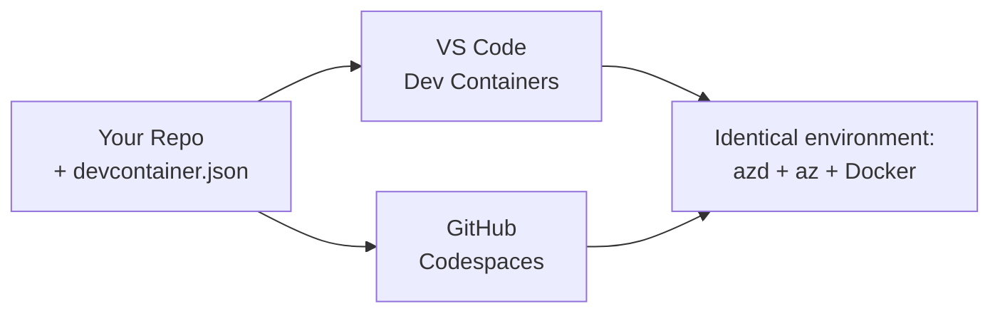

# Contenedores Dev y GitHub Codespaces para azd

**Navegación del capítulo:**
- **📚 Inicio del curso**: [AZD para principiantes](../../README.md)
- **📖 Capítulo actual**: Capítulo 1 - Fundamentos e inicio rápido
- **⬅️ Anterior**: [Lleva tu propia app](bring-your-own-app.md)
- **🚀 Próximo capítulo**: [Capítulo 2: Desarrollo AI-First](../chapter-02-ai-development/README.md)

> Objetivo de revisión de comandos y configuración: `azd 1.37.2` (noviembre 2026). No se ejecutaron compilaciones de contenedores ni implementaciones en Azure como parte de esta revisión.

## Introducción

Instalar azd, el runtime de lenguaje correcto, Docker y el Azure CLI en cada equipo es una tarea tediosa, y es la razón principal por la que un tutorial que "funciona en mi equipo" falla para otra persona. Un **contenedor dev** resuelve esto describiendo toda tu cadena de herramientas en un archivo. Cualquiera que abra el proyecto en VS Code o GitHub Codespaces obtiene exactamente el mismo entorno, con azd ya instalado. Esta lección te muestra cómo añadir uno.

## Objetivos de aprendizaje

Al final de esta lección, tú:
- Entenderás qué es un contenedor dev y por qué ayuda con azd
- Añadirás un `.devcontainer/devcontainer.json` mínimo a un proyecto
- Incluirás azd, el Azure CLI y Docker mediante *features* de Contenedor Dev
- Abrirás el proyecto en GitHub Codespaces o VS Code

## Resultados del aprendizaje

Tras completar esta lección, podrás:
- Crear un `devcontainer.json` para un proyecto azd
- Añadir azd y las herramientas de Azure sin instalaciones manuales
- Ejecutar `azd up` desde dentro de un contenedor o Codespace

---

## ¿Qué es un contenedor dev?

Un contenedor dev es un entorno de desarrollo basado en Docker definido por un archivo `.devcontainer/devcontainer.json` en tu repositorio. Cuando abres el proyecto:

- **VS Code** (con la extensión Dev Containers) construye el contenedor y se conecta a él.
- **GitHub Codespaces** construye el mismo contenedor en la nube y te ofrece un editor basado en navegador.

En cualquier caso, todos los colaboradores obtienen herramientas idénticas—no más problemas de "¿instalaste azd?".



---

## Paso 1: Crear el archivo devcontainer

Crea `.devcontainer/devcontainer.json` en la raíz de tu proyecto:

```json
{
  "name": "azd-project",
  "image": "mcr.microsoft.com/devcontainers/base:bookworm",
  "features": {
    "ghcr.io/devcontainers/features/azure-cli:1": {},
    "ghcr.io/azure/azure-dev/azd:0": { "version": "1.37.2" },
    "ghcr.io/devcontainers/features/docker-in-docker:2": {},
    "ghcr.io/devcontainers/features/node:1": {}
  },
  "customizations": {
    "vscode": {
      "extensions": [
        "ms-azuretools.azure-dev",
        "ms-azuretools.vscode-bicep"
      ]
    }
  },
  "forwardPorts": [3000],
  "postCreateCommand": "azd version"
}
```

Qué hace cada parte:

| Clave | Propósito |
|-----|---------|
| `image` | El sistema operativo base para el contenedor |
| `features` | Instaladores preconstruidos—aquí: Azure CLI, **azd**, Docker y Node.js |
| `customizations.vscode.extensions` | Instala automáticamente las extensiones de azd y Bicep para VS Code |
| `forwardPorts` | Expone el puerto de tu aplicación al navegador |
| `postCreateCommand` | Se ejecuta una vez tras construir el contenedor (aquí, una comprobación de integridad) |

> La versión de la característica (`azd:0`) y la versión instalada del CLI son diferentes. Configura la opción `version` de la feature en `"1.37.2"` para fijar la versión del CLI; no uses una versión de CLI como etiqueta de la feature.

---

## Paso 2: Ajusta la feature al lenguaje de tu app

Cambia la feature `node` por la que use tu app:

```jsonc
// Python project
"ghcr.io/devcontainers/features/python:1": {},

// .NET project
"ghcr.io/devcontainers/features/dotnet:2": {},

// Java project
"ghcr.io/devcontainers/features/java:1": {},

// Go project
"ghcr.io/devcontainers/features/go:1": {}
```

Mantén `docker-in-docker` cuando construyas imágenes localmente. Una compilación remota configurada en ACR (`docker.remoteBuild: true`) es una alternativa; el tipo de host por sí solo no siempre requiere Docker local.

---

## Paso 3: Ábrelo

**En VS Code:**
1. Instala la extensión **Dev Containers**.
2. Abre la carpeta del proyecto.
3. Haz clic en **Volver a abrir en contenedor** cuando se te solicite (o ejecuta *Dev Containers: Reopen in Container*).

**En GitHub Codespaces:**
1. Sube el repositorio a GitHub.
2. Haz clic en **Code → Codespaces → Create codespace on main**.
3. Espera a que se construya el contenedor—azd estará listo en el terminal.

---

## Paso 4: Implementa desde dentro del contenedor

El contenedor tiene azd preinstalado, así que el flujo normal funciona sin problemas:

```bash
azd auth login --use-device-code   # device code is handy inside Codespaces
azd up
```

> **¿Por qué `--use-device-code`?** En un contenedor remoto o Codespace no hay navegador local para redirigir, así que el inicio de sesión con código de dispositivo es el camino fiable. Pegarás un código en una pestaña del navegador para completar el inicio de sesión.

---

## Errores comunes

| Error | Solución |
|---------|-----|
| `azd up` no puede construir una imagen | Añade la feature `docker-in-docker` |
| El inicio de sesión del navegador se queda colgado en Codespaces | Usa `azd auth login --use-device-code` |
| Las herramientas difieren entre compañeros | Fija la versión del CLI mediante la opción `version` de la feature azd y fija los runtimes del lenguaje |
| La app no es accesible en el navegador | Añade el puerto a `forwardPorts` |

---

## Resumen

- Un contenedor dev hace reproducible tu cadena de herramientas azd para todos.
- Añade azd, el Azure CLI y Docker a través de *features* de Contenedor Dev.
- Ajusta la feature del lenguaje a tu app y mantén `docker-in-docker` para hosts de contenedores.
- Usa el inicio de sesión con código de dispositivo cuando ejecutes desde Codespaces.

---

## 🔗 Navegación

| Dirección | Recurso |
|-----------|----------|
| **Anterior** | [Lleva tu propia app](bring-your-own-app.md) |
| **Inicio del capítulo** | [Capítulo 1: Fundamentos e inicio rápido](README.md) |
| **Siguiente capítulo** | [Capítulo 2: Desarrollo AI-First](../chapter-02-ai-development/README.md) |

## 📖 Recursos relacionados

- [Instalación y configuración](installation.md)
- [Hoja de comandos de comandos](../../resources/cheat-sheet.md)
- [Especificación oficial de Dev Containers](https://containers.dev/)
- [Feature de contenedor dev de azd](https://github.com/Azure/azure-dev/tree/main/ext/devcontainer)

---

<!-- CO-OP TRANSLATOR DISCLAIMER START -->
**Descargo de responsabilidad**:
Este documento ha sido traducido utilizando el servicio de traducción automática [Co-op Translator](https://github.com/Azure/co-op-translator). Aunque nos esforzamos por la precisión, tenga en cuenta que las traducciones automatizadas pueden contener errores o inexactitudes. El documento original en su idioma nativo debe considerarse la fuente autorizada. Para información crítica, se recomienda una traducción profesional humana. No somos responsables de cualquier malentendido o interpretación errónea que surja del uso de esta traducción.
<!-- CO-OP TRANSLATOR DISCLAIMER END -->