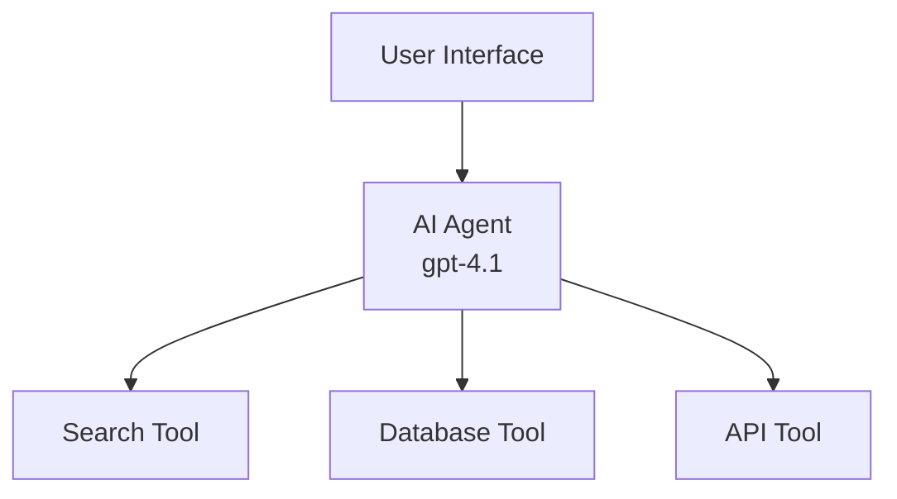
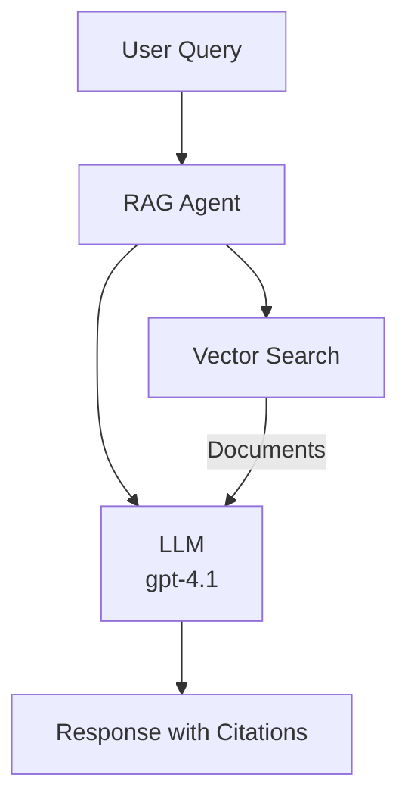
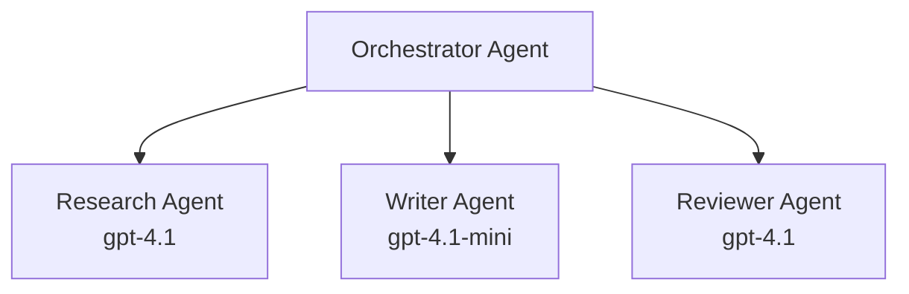

# Agentes de IA con Azure Developer CLI

**Navegación del Capítulo:**
- **📚 Inicio del Curso**: [AZD Para Principiantes](../../README.md)
- **📖 Capítulo Actual**: Capítulo 2 - Desarrollo AI-First
- **⬅️ Anterior**: [Integración con Microsoft Foundry](microsoft-foundry-integration.md)
- **➡️ Siguiente**: [Despliegue de Modelo de IA](ai-model-deployment.md)
- **🚀 Avanzado**: [Soluciones Multi-Agente](../../examples/retail-scenario.md)

---

## Introducción

Los agentes de IA son programas autónomos que pueden percibir su entorno, tomar decisiones y realizar acciones para alcanzar objetivos específicos. A diferencia de los chatbots simples que responden a instrucciones, los agentes pueden:

- **Usar herramientas** - Llamar APIs, buscar en bases de datos, ejecutar código
- **Planificar y razonar** - Dividir tareas complejas en pasos
- **Aprender del contexto** - Mantener memoria y adaptar comportamiento
- **Colaborar** - Trabajar con otros agentes (sistemas multi-agente)

Esta guía te muestra cómo desplegar agentes de IA en Azure usando Azure Developer CLI (azd).

Usar el contexto de la conversación no es entrenamiento de modelos: la memoria persistente, el control de acceso y la retención deben ser implementados/configurados por la aplicación.

> **Revisión de versión (2026-11-04):** Los ejemplos de CLI fueron verificados contra `azd` `1.37.2`, `azure.ai.agents` `1.0.0-beta.23`, y `azure.ai.evaluations` `1.0.0-beta.2` documentación/fuente, no un despliegue Azure en vivo. Usa `azd >= 1.37.0` para el flujo combinado. Consulta [cambios y correcciones recientes](../chapter-08-production/production-ai-practices.md#recent-release-changes-and-fixes) antes de actualizar proyectos antiguos.

## Objetivos de Aprendizaje

Al completar esta guía, podrás:
- Entender qué son los agentes de IA y cómo se diferencian de los chatbots
- Desplegar plantillas preconstruidas de agentes de IA usando AZD
- Configurar Foundry Agents para agentes personalizados
- Implementar patrones básicos de agente (uso de herramientas, RAG, multi-agente)
- Monitorear y depurar agentes desplegados

## Resultados de Aprendizaje

Al finalizar, podrás:
- Desplegar aplicaciones de agentes IA en Azure con un solo comando
- Configurar herramientas y capacidades del agente
- Implementar generación aumentada con recuperación (RAG) con agentes
- Diseñar arquitecturas multi-agente para flujos complejos
- Solucionar problemas comunes de despliegue de agentes

---

## 🤖 ¿Qué Hace a un Agente Diferente de un Chatbot?

| Característica | Chatbot | Agente de IA |
|---------|---------|----------|
| **Comportamiento** | Responde a instrucciones | Toma acciones autónomas |
| **Herramientas** | Puede usar recuperación o herramientas | Normalmente usa herramientas en un ciclo dirigido por objetivos |
| **Memoria** | Depende de la aplicación | Memoria persistente solo si se implementa explícitamente |
| **Planificación** | Respuesta única | Razonamiento de varios pasos |
| **Colaboración** | Entidad única | Puede trabajar con otros agentes |

### Analogía Simple

- **Chatbot** = Una persona útil que responde preguntas en un escritorio de información
- **Agente de IA** = Un asistente personal que puede hacer llamadas, reservar citas y completar tareas por ti

---

## 🚀 Inicio Rápido: Despliega Tu Primer Agente

Elige una opción en un **directorio de trabajo vacío nuevo**. El `.` final se inicializa ahí; sin un destino explícito, el AZD actual puede crear un subdirectorio nombrado por la plantilla y no cambia tu directorio de shell. Mantén plantillas/entornos separados en directorios separados.

Los rangos de tiempo/costo abajo son ilustrativos, no cotizaciones validadas. Revisa los prerrequisitos actuales, precios, cuota del modelo y servicios opcionales de cada ejemplo antes del despliegue.

### Opción 1: Plantilla Foundry Agents (Recomendada)

```bash
# Initialize the AI agents template
azd init --template get-started-with-ai-agents .

# Deploy to Azure
azd up
```

**Qué se despliega:** La infraestructura actual del ejemplo y las opciones seleccionadas determinan el modelo, herramientas, hosting y recursos de monitoreo. Revisa su README y `infra/` antes de provisionar; no asumas que cada plantilla de agente incluye Search o una interfaz web.

**Tiempo:** ~15-20 minutos
**Costo:** ~$100-150/mes (desarrollo)

### Opción 2: Agentes de Escritura Creativa con Prompty

```bash
# Initialize the Prompty-based agent template
azd init --template https://github.com/Azure-Samples/contoso-creative-writer .

# Deploy to Azure
azd up
```

**Qué se despliega:** Un ejemplo multi-agente de escritura FastAPI/Prompty usando Azure OpenAI, Bing Grounding y Azure AI Search. El antiguo repositorio `agent-openai-python-prompty` redirige aquí; no es una plantilla mínima de agente meteorológico para Azure Functions. Sigue su README actual para hosting, cuota de modelo y prerrequisitos de Bing Grounding.

**Tiempo:** ~10-15 minutos
**Costo:** ~$50-100/mes (desarrollo)

### Opción 3: Agente RAG Chat

```bash
# Initialize RAG chat template
azd init --template azure-search-openai-demo .

# Deploy to Azure
azd up
```

**Qué se despliega:**
- ✅ Modelos Microsoft Foundry
- ✅ Azure AI Search con datos de ejemplo
- ✅ Canalización de procesamiento de documentos
- ✅ Interfaz de chat con citas

**Tiempo:** ~15-25 minutos
**Costo:** ~$80-150/mes (desarrollo)

### Opción 4: Inicialización de Agente AZD AI (Vista Previa de Plantilla de Proyecto)

Usa `azd ai agent init` interactivamente, o adopta un proyecto actual de agente `azure.yaml` con `--template`/`-t`. La antigua opción `--manifest`/`-m` es un alias obsoleto, no un convertidor para manifiestos legacy.

```bash
# Install the AI agents extension
azd extension install azure.ai.agents

# Optional: verify the installed preview version
azd extension show azure.ai.agents

# Initialize from a current agent project template (supply your template path)
azd ai agent init --template ./templates/support-agent/azure.yaml

# Deploy to Azure
azd up

# Test the deployed agent (shows latency + time-to-first-byte)
azd ai agent invoke
```

**Cuándo usar `azd ai agent init` vs `azd init --template`:**

| Enfoque | Mejor para | Cómo funciona |
|----------|----------|------|
| `azd init --template` | Empezar desde una app de ejemplo funcional | Clona un repositorio plantilla completo con código + infra |
| `azd ai agent init --template` | Adoptar un proyecto actual de agente Foundry | Usa un documento de proyecto `azure.yaml` y sus definiciones |

> **Consejo:** Usa `azd init --template` cuando aprendas (Opciones 1-3 arriba). Usa `azd ai agent init` para el flujo de agente Foundry. Para añadir una definición directa de agente a un proyecto existente, consulta [guía de inicialización y migración](../chapter-08-production/production-ai-practices.md#initializing-agent-projects-with-azd-ai-agent-init).

Tras `azd up`, usa `azd ai agent invoke` para pruebas, la extensión `azure.ai.evaluations` separada (`azd ai eval init`, `generate`, y `run start`) para medir calidad, y `azd ai agent optimize` para mejorarla usando la nueva configuración de evaluación. Agents beta.22 reemplazó el flujo de evaluación legacy y cambió el formato `--config` de optimización. Consulta [migración de evaluación](../chapter-08-production/production-ai-practices.md#evaluation-migration-and-quality-checks) y [migración de optimización](../chapter-08-production/production-ai-practices.md#optimization-configuration-migration) antes de reutilizar ejemplos antiguos.

---

## 🏗️ Patrones de Arquitectura de Agentes

### Patrón 1: Un Solo Agente con Herramientas

El patrón de agente más simple: un agente que puede usar múltiples herramientas.



**Mejor para:**
- Bots de soporte al cliente
- Asistentes de investigación
- Agentes de análisis de datos

**Ejemplo de aplicación relacionado:** `azure-search-openai-demo` demuestra RAG, no un ciclo genérico multiherramienta arbitrario.

### Patrón 2: Agente RAG (Generación Aumentada por Recuperación)

Un agente que recupera documentos relevantes antes de generar respuestas.



**Mejor para:**
- Bases de conocimiento empresariales
- Sistemas de preguntas y respuestas sobre documentos
- Investigación legal y de cumplimiento

**Plantilla AZD:** `azure-search-openai-demo`

### Patrón 3: Sistema Multi-Agente

Múltiples agentes especializados trabajando juntos en tareas complejas.



**Mejor para:**
- Generación compleja de contenido
- Flujos de trabajo de múltiples pasos
- Tareas que requieren diferentes especializaciones

**Aprende más:** [Patrones de Coordinación Multi-Agente](../chapter-06-pre-deployment/coordination-patterns.md)

---

## ⚙️ Configuración de Herramientas de Agente

Los agentes se vuelven poderosos cuando pueden usar herramientas. Aquí se explica cómo configurar herramientas comunes:

### Configuración de Herramientas en Foundry Agents

Este **fragmento clásico del SDK Agent Service** apunta a `azure-ai-projects==1.0.0` y `azure-ai-agents==1.1.0` con `azure-identity`. No es la versión más nueva API versionada de agent/Responses usada por algunas plantillas actuales de Foundry, ni la extensión `azure.ai.agents` de AZD (un paquete diferente). No mezcles estas generaciones de API. Configura `PROJECT_ENDPOINT` en un endpoint clásico de proyecto Foundry y `MODEL_DEPLOYMENT_NAME` en un despliegue de modelo soportado existente; autentica con `az login` localmente y concede los permisos del proyecto requeridos.

```python
# agent_config.py
import os
from azure.ai.projects import AIProjectClient
from azure.ai.agents.models import FunctionTool
from azure.identity import DefaultAzureCredential

def search_knowledge_base(query: str) -> str:
    """Search the demonstration knowledge base.

    :param query: Search text.
    :return: Matching demonstration information.
    """
    # Local fixture only, not a production search implementation.
    return "Demo policy: returns are accepted within 30 days."

project_client = AIProjectClient(
    endpoint=os.environ["PROJECT_ENDPOINT"],
    credential=DefaultAzureCredential(),
)
search_tool = FunctionTool(functions={search_knowledge_base})
project_client.agents.enable_auto_function_calls(search_tool)
agent = project_client.agents.create_agent(
    model=os.environ["MODEL_DEPLOYMENT_NAME"],
    name="Support Agent",
    instructions="Use search_knowledge_base for policy questions. Label results as demo data.",
    tools=search_tool.definitions,
)
```

Registrar un esquema de función no ejecuta Python en el servicio. En este SDK, `enable_auto_function_calls` más `agents.runs.create_and_process(...)` ejecutan callbacks registrados en tu proceso cliente. Consulta el [ejemplo SDK lanzado](https://github.com/Azure/azure-sdk-for-python/blob/azure-ai-agents_1.1.0/sdk/ai/azure-ai-agents/samples/agents_tools/sample_agents_auto_function_call.py). Cierra el cliente y elimina agentes/hilos de demostración cuando termines.

### Configuración del Entorno

Los siguientes nombres son **entradas ilustrativas de plantilla personalizada**, no conmutadores integrados de AZD. Primero conecta cada valor a través de `infra/main.parameters.json`, infraestructura y código de aplicación. `azd env set` por sí solo no cambia las herramientas ni las instrucciones del agente.

```bash
# Set up agent-specific environment variables
azd env set AZURE_OPENAI_MODEL "gpt-4.1"
azd env set AGENT_INSTRUCTIONS "You are a helpful assistant..."
azd env set ENABLE_CODE_INTERPRETER "true"
azd env set ENABLE_FILE_SEARCH "true"

# Apply wired infrastructure and application changes
azd up
```

---

## 📊 Monitoreo de Agentes

### Integración con Application Insights

Si tu plantilla seleccionada provisiona Application Insights y configura instrumentación:

```bash
# Open monitoring dashboard
azd monitor --overview

# Open the Application Insights logs view (not a streaming log tail)
azd monitor --logs

# View live metrics
azd monitor --live
```

### Métricas Clave a Rastrear

| Métrica | Descripción | Objetivo |
|--------|-------------|--------|
| Latencia de Respuesta | Tiempo para generar respuesta | < 5 segundos |
| Uso de Tokens | Tokens por solicitud | Monitorea costos |
| Tasa de Éxito de Llamadas a Herramientas | % de ejecuciones exitosas de herramientas | > 95% |
| Tasa de Errores | Solicitudes fallidas del agente | < 1% |
| Satisfacción del Usuario | Puntuación de feedback | > 4.0/5.0 |

### Registro Personalizado para Agentes

```python
import os
from azure.monitor.opentelemetry import configure_azure_monitor
from opentelemetry import trace

# Configure Azure Monitor with OpenTelemetry
configure_azure_monitor(
    connection_string=os.environ["APPLICATIONINSIGHTS_CONNECTION_STRING"]
)

tracer = trace.get_tracer(__name__)

def log_agent_interaction(user_query, agent_response, tools_used, latency_ms):
    with tracer.start_as_current_span("agent_interaction") as span:
        span.set_attributes({
            "query_length": len(user_query),  # Do not log raw prompts or personal data
            "response_length": len(agent_response),
            "tools_used": tools_used,
            "latency_ms": latency_ms
        })
```

> **Nota:** Instala el paquete requerido: `pip install azure-monitor-opentelemetry`. Trae las dependencias OpenTelemetry; el espacio de nombres de importación no es un requisito para instalar un paquete llamado `opentelemetry`.

---

## 💰 Consideraciones de Costos

### Costos Mensuales Estimados por Patrón

Estos son rangos ilustrativos para planificación, no cotizaciones ni límites de gasto. La región, tokens de modelo, SKUs de Search/cómputo, sesiones de herramientas, almacenamiento y tráfico pueden excederlos. Consulta la guía de costos del ejemplo y precios de Azure antes de `azd up`.

| Patrón | Ambiente de Desarrollo | Producción |
|---------|-----------------|------------|
| Agente Único | $50-100 | $200-500 |
| Agente RAG | $80-150 | $300-800 |
| Multi-Agente (2-3 agentes) | $150-300 | $500-1,500 |
| Multi-Agente Empresarial | $300-500 | $1,500-5,000+ |

### Consejos para Optimización de Costos

1. **Usa gpt-4.1-mini para tareas simples** (solo si tu plantilla usa esta entrada)
   ```bash
   azd env set AZURE_OPENAI_MODEL "gpt-4.1-mini"
   ```

2. **Implementa almacenamiento en caché con alcance para consultas seguras y repetidas.** Incluye en la clave de caché autorización de inquilino/usuario, despliegue de modelo, instrucciones y versión de recuperación; establece expiración. No compartas respuestas privadas de conversaciones mediante una caché global solo consultas. El objeto agente del SDK no tiene un método genérico `agent.run()`.

3. **Establece límites de tokens por ejecución**
   ```python
   # Set max_completion_tokens when running the agent, not during creation
   run = project_client.agents.runs.create_and_process(
       thread_id=thread.id,
       agent_id=agent.id,
       max_completion_tokens=1000  # Budget across the run; may finish as incomplete
   )
   ```

4. **Escala aplicaciones contenedor elegibles a cero cuando no estén en uso**
   ```bash
   # Custom-template input: must map to template.scale.minReplicas
   azd env set MIN_REPLICAS "0"
   ```
   Aplica el cambio de infraestructura con `azd provision` o `azd up`. Escalar a cero necesita un desencadenador adecuado y no detiene cargos de Search, almacenamiento o modelo/herramienta.

---

## 🔧 Resolución de Problemas de Agentes

### Problemas Comunes y Soluciones

<details>
<summary><strong>❌ El agente no responde a llamadas de herramientas</strong></summary>

```bash
# Inspect the application deployment (not the agent's registered tools)
azd show

# Verify OpenAI deployment
az cognitiveservices account deployment list \
  --name $AZURE_OPENAI_NAME \
  --resource-group $RG_NAME

# Check agent logs
azd monitor --logs
```

**Causas comunes:**
- Firma de función de herramienta incorrecta
- Faltan permisos requeridos
- Punto de acceso API inaccesible
</details>

<details>
<summary><strong>❌ Alta latencia en respuestas del agente</strong></summary>

```bash
# Check Application Insights for bottlenecks
azd monitor --live

# Consider using a faster model
azd env set AZURE_OPENAI_MODEL "gpt-4.1-mini"
azd up
```

**Consejos de optimización:**
- Usa respuestas por streaming
- Implementa almacenamiento en caché de respuestas
- Reduce el tamaño de la ventana de contexto
</details>

<details>
<summary><strong>❌ Agente devuelve información incorrecta o «alucinada»</strong></summary>

```python
# Improve with better system prompts
instructions = """
You are a helpful assistant. IMPORTANT:
- Only answer based on provided context
- If you don't know, say "I don't know"
- Always cite your sources
- Never make up information
"""

# Use these instructions in the agent definition.
# For classic file search, first upload/index documents in a vector store,
# then use FileSearchTool(vector_store_ids=[...]) and pass both its
# .definitions and .resources when creating the agent.
```
 Las instrucciones y la recuperación reducen riesgo; ninguna garantiza respuestas fácticas. Evalúa preguntas fundamentadas y fuera de alcance contra respuestas conocidas.
</details>

<details>
<summary><strong>❌ Errores por límite de tokens excedido</strong></summary>

```python
# Implement context window management
def truncate_context(messages, max_tokens=8000, model="gpt-4.1"):
    """Approximate content-only budget for objects with .content strings."""
    import tiktoken
    encoding = tiktoken.encoding_for_model(model)
    total_tokens = 0
    truncated = []
    
    for msg in reversed(messages):
        msg_tokens = len(encoding.encode(msg.content))
        if total_tokens + msg_tokens > max_tokens:
            break
        truncated.insert(0, msg)
        total_tokens += msg_tokens
    
    return truncated
```
 Este ayudante excluye esquemas de rol/herramienta, instrucciones del sistema, tokens de imagen y sobrecarga de protocolo. Reserva espacio para ellos y para la finalización; no dividas pares llamada de herramienta/resultado ni descartes instrucciones del sistema requeridas. Instala `tiktoken` por separado. No es un validador general de ventana de contexto.
</details>

---

## 🎓 Ejercicios Prácticos

### Ejercicio 1: Despliega un Agente Básico (20 minutos)

**Objetivo:** Desplegar tu primer agente IA usando AZD

```bash
# Step 1: Initialize template
azd init --template get-started-with-ai-agents .

# Step 2: Login to Azure
azd auth login
# If you work across tenants, add --tenant-id <tenant-id>

# Step 3: Deploy
azd up

# Step 4: Test the agent
# Expected output after deployment:
#   Deployment Complete!
#   Endpoint: https://<app-name>.<region>.azurecontainerapps.io
# Open the URL shown in the output and try asking a question

# Step 5: View monitoring
azd monitor --overview

# Step 6: Clean up
azd down --force --purge
```

**Criterios de éxito:**
- [ ] El agente responde preguntas
- [ ] Puede acceder al panel de monitoreo via `azd monitor`
- [ ] Recursos limpiados correctamente

### Ejercicio 2: Añade una Herramienta Personalizada (30 minutos)

**Objetivo:** Extender un agente con una herramienta personalizada

**Punto de partida:** Usa el cliente clásico del SDK desde [Configuración de Herramientas](#tool-configuration-in-foundry-agents), no una plantilla arbitraria con diferente generación de SDK.

1. Agrega este fixture determinista a `agent_config.py`:
   ```python
   def get_weather(location: str) -> str:
       """Return demonstration weather, not live conditions.

       :param location: City name.
       :return: A clearly labelled fixture.
       """
       print(f"TOOL_CALLED: {location}")
       return f"Demo weather in {location}: Sunny, 72°F (fixture, not live)"
   ```
2. Reemplaza el bloque de registro y creación de search-tool con:
   ```python
   weather_tool = FunctionTool(functions={get_weather})
   project_client.agents.enable_auto_function_calls(weather_tool)
   agent = project_client.agents.create_agent(
       model=os.environ["MODEL_DEPLOYMENT_NAME"],
       name="Weather Agent",
       instructions="Call get_weather for weather questions; explain that it returns demo data.",
       tools=weather_tool.definitions,
   )
   thread = project_client.agents.threads.create()
   try:
       project_client.agents.messages.create(
           thread_id=thread.id, role="user", content="Use get_weather for Seattle."
       )
       run = project_client.agents.runs.create_and_process(
           thread_id=thread.id, agent_id=agent.id
       )
       if run.status != "completed":
           raise RuntimeError(f"Run status: {run.status}; error: {run.last_error}")
       for message in project_client.agents.messages.list(thread_id=thread.id):
           for text in message.text_messages:
               print(text.text.value)
   finally:
       project_client.agents.threads.delete(thread.id)
       project_client.agents.delete_agent(agent.id)
       project_client.close()
   ```
3. Ejecuta localmente (esto llama al proyecto Azure existente y genera cargos por el modelo):
   ```bash
   python agent_config.py
   # Expected: TOOL_CALLED: Seattle, then a completed answer labelled demo data.
   ```

**Criterios de éxito:**
- [ ] El agente reconoce consultas relacionadas con el clima
- [ ] La herramienta se llama correctamente
- [ ] La respuesta incluye información meteorológica

### Ejercicio 3: Construir un agente RAG (45 minutos)

**Objetivo:** Crear un agente que responda preguntas a partir de tus documentos

```bash
# Step 1: Deploy RAG template
azd init --template azure-search-openai-demo .
azd up

# Step 2: Upload your documents
# For the sample's local ingestion path, place supported files in data/.
# Run from the sample root after following its Python environment setup:
./scripts/prepdocs.sh
# Windows PowerShell equivalent: .\\scripts\\prepdocs.ps1

# Step 3: Test with domain-specific questions
# Open the web app URL from the azd up output
# Ask questions about your uploaded documents
# Responses should include citation references like [doc.pdf]
```

**Criterios de éxito:**
- [ ] El agente responde desde documentos cargados
- [ ] Las respuestas incluyen citas
- [ ] Las preguntas fuera de alcance se manejan sin afirmaciones no soportadas (no es una garantía para todas las preguntas futuras)

Si `USE_CLOUD_INGESTION=true`, utiliza el flujo de trabajo de ingesta/carga en la nube del ejemplo en su lugar; el envoltorio local omite intencionalmente la ingesta. Después de las pruebas, ejecuta `azd down` en el entorno RAG y revisa los recursos a eliminar.

---

## 📚 Próximos pasos

Ahora que entiendes los agentes de IA, explora estos temas avanzados:

| Tema | Descripción | Enlace |
|-------|-------------|------|
| **Sistemas Multi-Agente** | Construye sistemas con múltiples agentes que colaboran | [Ejemplo de Retail Multi-Agente](../../examples/retail-scenario.md) |
| **Patrones de Coordinación** | Aprende patrones de orquestación y comunicación | [Patrones de Coordinación](../chapter-06-pre-deployment/coordination-patterns.md) |
| **Despliegue en Producción** | Despliegue de agentes listo para empresa | [Prácticas de IA en Producción](../chapter-08-production/production-ai-practices.md) |
| **Evaluación de Agentes** | Prueba y evalúa el rendimiento del agente | [Solución de Problemas de IA](../chapter-07-troubleshooting/ai-troubleshooting.md) |
| **Laboratorio de Taller de IA** | Práctica: Prepara tu solución de IA para AZD | [Laboratorio de Taller IA](ai-workshop-lab.md) |

---

## 📖 Recursos adicionales

### Documentación oficial
- [Microsoft Foundry Agent Service](https://learn.microsoft.com/azure/ai-services/agents/)
- [Inicio rápido Microsoft Foundry Agent Service](https://learn.microsoft.com/azure/ai-services/agents/quickstart)
- [Marco de agentes Semantic Kernel](https://learn.microsoft.com/semantic-kernel/)

### Plantillas AZD para agentes
- [Comenzar con agentes de IA](https://github.com/Azure-Samples/get-started-with-ai-agents)
- [Agentes de escritura creativa con Prompty](https://github.com/Azure-Samples/contoso-creative-writer)
- [Demostración Azure Search OpenAI](https://github.com/Azure-Samples/azure-search-openai-demo)

### Recursos comunitarios
- [Awesome AZD - Plantillas para agentes](https://azure.github.io/awesome-azd/?tags=ai-agents)
- [Azure AI Discord](https://discord.gg/microsoft-azure)
- [Microsoft Foundry Discord](https://discord.gg/nTYy5BXMWG)

### Habilidades de agente para tu editor
- [**Habilidades de agente Microsoft Azure**](https://skills.sh/microsoft/github-copilot-for-azure) - Instala habilidades reutilizables de agentes de IA para desarrollo en Azure en GitHub Copilot, Cursor o cualquier agente soportado. Incluye habilidades para [Azure AI](https://skills.sh/microsoft/github-copilot-for-azure/azure-ai), [Microsoft Foundry](https://skills.sh/microsoft/github-copilot-for-azure/microsoft-foundry), [despliegue](https://skills.sh/microsoft/github-copilot-for-azure/azure-deploy) y [diagnósticos](https://skills.sh/microsoft/github-copilot-for-azure/azure-diagnostics):
  ```bash
  npx skills add microsoft/github-copilot-for-azure
  ```

---

**Navegación**
- **Lección anterior**: [Integración Microsoft Foundry](microsoft-foundry-integration.md)
- **Próxima lección**: [Despliegue de modelo AI](ai-model-deployment.md)

---

<!-- CO-OP TRANSLATOR DISCLAIMER START -->
**Descargo de responsabilidad**:
Este documento ha sido traducido utilizando el servicio de traducción automática [Co-op Translator](https://github.com/Azure/co-op-translator). Aunque nos esforzamos por la precisión, tenga en cuenta que las traducciones automatizadas pueden contener errores o inexactitudes. El documento original en su idioma nativo debe considerarse la fuente autorizada. Para información crítica, se recomienda una traducción profesional humana. No somos responsables de cualquier malentendido o interpretación errónea que surja del uso de esta traducción.
<!-- CO-OP TRANSLATOR DISCLAIMER END -->