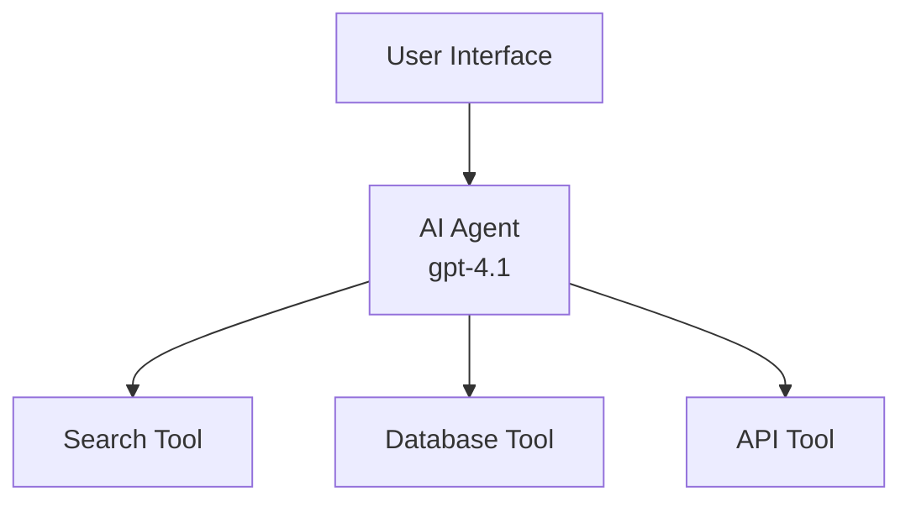
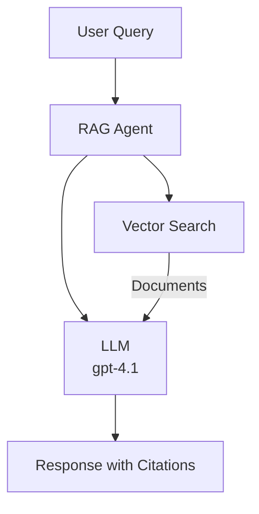
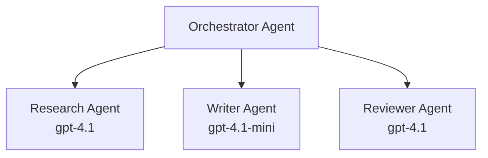

# Agentes de IA con Azure Developer CLI

**Navegación del Capítulo:**
- **📚 Inicio del Curso**: [AZD Para Principiantes](../../README.md)
- **📖 Capítulo Actual**: Capítulo 2 - Desarrollo AI-First
- **⬅️ Anterior**: [Integración Microsoft Foundry](microsoft-foundry-integration.md)
- **➡️ Siguiente**: [Despliegue de Modelos de IA](ai-model-deployment.md)
- **🚀 Avanzado**: [Soluciones Multi-Agente](../../examples/retail-scenario.md)

---

## Introducción

Los agentes de IA son programas autónomos que pueden percibir su entorno, tomar decisiones y realizar acciones para alcanzar objetivos específicos. A diferencia de los chatbots simples que responden a indicaciones, los agentes pueden:

- **Usar herramientas** - Llamar APIs, buscar en bases de datos, ejecutar código
- **Planificar y razonar** - Dividir tareas complejas en pasos
- **Aprender del contexto** - Mantener memoria y adaptar comportamiento
- **Colaborar** - Trabajar con otros agentes (sistemas multiagente)

Esta guía te muestra cómo desplegar agentes de IA en Azure usando Azure Developer CLI (azd).

Usar el contexto de la conversación no es entrenamiento del modelo: la memoria persistente, el control de acceso y la retención deben ser implementados/configurados por la aplicación.

> **Actualización GA de Foundry (2026-11-09):** Instala el paquete generalmente disponible `microsoft.foundry` 1.0 con `azd >= 1.37.0`. Las evaluaciones se instalan por separado; las características en vista previa opcionales y el fragmento clásico del SDK abajo no se promueven a GA con el anuncio del paquete. Esta guía se basa en el [anuncio GA](https://devblogs.microsoft.com/azure-sdk/microsoft-foundry-azure-developer-cli-ga/) y la documentación, no en un despliegue Azure activo.

## Objetivos de Aprendizaje

Al completar esta guía, podrás:
- Entender qué son los agentes de IA y cómo difieren de los chatbots
- Desplegar plantillas preconstruidas de agentes de IA usando AZD
- Configurar Foundry Agents para agentes personalizados
- Implementar patrones básicos de agentes (uso de herramientas, RAG, multiagente)
- Monitorizar y depurar agentes desplegados

## Resultados de Aprendizaje

Al completar, serás capaz de:
- Desplegar aplicaciones de agentes de IA en Azure con un solo comando
- Configurar herramientas y capacidades del agente
- Implementar generación aumentada por recuperación (RAG) con agentes
- Diseñar arquitecturas multiagente para flujos de trabajo complejos
- Solucionar problemas comunes en el despliegue de agentes

---

## 🤖 ¿Qué Hace que un Agente Sea Diferente de un Chatbot?

| Característica | Chatbot | Agente de IA |
|---------|---------|----------|
| **Comportamiento** | Responde a indicaciones | Realiza acciones autónomas |
| **Herramientas** | Puede usar recuperación o herramientas | Normalmente usa herramientas en un ciclo dirigido por objetivos |
| **Memoria** | Depende de la aplicación | Memoria persistente sólo si se implementa explícitamente |
| **Planificación** | Respuesta única | Razonamiento en varios pasos |
| **Colaboración** | Entidad única | Puede trabajar con otros agentes |

### Analogía Simple

- **Chatbot** = Una persona servicial respondiendo preguntas en un mostrador de información
- **Agente de IA** = Un asistente personal que puede hacer llamadas, reservar citas y completar tareas para ti

---

## 🚀 Inicio Rápido: Despliega Tu Primer Agente

Elige una opción en un **directorio de trabajo nuevo y vacío**. El `.` finaliza la inicialización allí; sin un destino explícito, AZD puede crear un subdirectorio con el nombre de plantilla y no cambia el directorio del shell. Mantén plantillas/entornos separados en directorios separados.

Los rangos de tiempo/costo a continuación son ilustrativos, no cotizaciones validadas. Consulta los prerrequisitos actuales, precios, cuotas de modelo y servicios opcionales de cada muestra antes del despliegue.

### Opción 1: Plantilla Foundry Agents (Recomendada)

```bash
# Initialize the AI agents template
azd init --template get-started-with-ai-agents .

# Deploy to Azure
azd up
```

**Qué se despliega:** La infraestructura actual de la muestra y las opciones seleccionadas determinan el modelo, herramientas, hosting y recursos de monitorización. Revisa su README y `infra/` antes de provisionar; no asumas que cada plantilla de agentes incluye Search o una interfaz web.

**Tiempo:** ~15-20 minutos
**Costo:** ~$100-150/mes (desarrollo)

### Opción 2: Agentes de Escritura Creativa con Prompty

```bash
# Initialize the Prompty-based agent template
azd init --template https://github.com/Azure-Samples/contoso-creative-writer .

# Deploy to Azure
azd up
```

**Qué se despliega:** Una muestra multidisciplinar de escritura FastAPI/Prompty usando Azure OpenAI, Bing Grounding y Azure AI Search. El repositorio anterior `agent-openai-python-prompty` redirige aquí; no es una plantilla mínima de agente meteorológico Azure Functions. Sigue su README actual para hosting, cuota de modelo y prerrequisitos de Bing Grounding.

**Tiempo:** ~10-15 minutos
**Costo:** ~$50-100/mes (desarrollo)

### Opción 3: Agente Chat RAG

```bash
# Initialize RAG chat template
azd init --template azure-search-openai-demo .

# Deploy to Azure
azd up
```

**Qué se despliega:**
- ✅ Modelos Microsoft Foundry
- ✅ Azure AI Search con datos de muestra
- ✅ Canalización de procesamiento de documentos
- ✅ Interfaz de chat con citas

**Tiempo:** ~15-25 minutos
**Costo:** ~$80-150/mes (desarrollo)

### Opción 4: Agente Hospedado con el Paquete GA Foundry

Usa el [recorrido completo para agentes hospedados](microsoft-foundry-integration.md#hosted-agent-walkthrough-ga) para la muestra básica Python Agent Framework Responses API. Esta ruta de despliegue de código necesita Python 3.13+, uv actual, permisos Foundry y cuota regional de modelo. Autentica llamadas SDK locales por separado cuando uses credenciales Azure CLI.

```bash
azd auth login
azd ext install microsoft.foundry
```

En el directorio vacío, inicializa la muestra:

```text
azd ai agent init --template https://github.com/microsoft-foundry/foundry-samples/blob/main/samples/python/hosted-agents/agent-framework/responses/01-basic/azure.yaml --deploy-mode code --src .
```

Elige un proyecto nuevo o existente, revisa `azure.yaml` y ejecuta `azd provision`. Usa `azd ai agent run` para abrir Agent Inspector y, desde otro terminal en ese directorio, `azd ai agent invoke --local "Explain how this agent is hosted."`. Tras la verificación local, usa `azd deploy` y `azd ai agent invoke "Explain how this agent is hosted."` para comparar la respuesta desplegada. Foundry construye el código subido remotamente; no es necesario construir un contenedor local.

**Cuándo usar `azd ai agent init` vs `azd init --template`:**

| Enfoque | Mejor Para | Cómo Funciona |
|----------|----------|------|
| `azd init --template` | Partiendo de una aplicación de muestra funcional | Clona un repositorio de plantilla completo con código + infra |
| `azd ai agent init --template` | Adoptando un proyecto agente Foundry actual | Usa un documento de proyecto `azure.yaml` y sus definiciones |

> **Consejo:** Las opciones 1-3 inician desde plantillas completas; la opción 4 enseña el flujo de trabajo GA para agentes hospedados. Ningún comando de inicialización migra automáticamente manifiestos de agentes heredados. Para añadir una definición directa de agente a un proyecto existente, consulta la [guía de inicialización y migración](../chapter-08-production/production-ai-practices.md#initializing-agent-projects-with-azd-ai-agent-init).

Instala `azure.ai.evaluations` por separado para generar y revisar datos/rúbricas de prueba, configurar una evaluación y ejecutarla usando `azd ai eval`. La optimización puede reutilizar evaluaciones compatibles; revisa los candidatos antes de desplegar uno explícitamente. Sigue el [flujo de trabajo de evaluación](../chapter-08-production/production-ai-practices.md#evaluation-migration-and-quality-checks) y la [migración de optimización](../chapter-08-production/production-ai-practices.md#optimization-configuration-migration) antes de reutilizar ejemplos antiguos. Para limpieza, los recursos de un proyecto Foundry reutilizado permanecen tras `azd down`; el grupo de recursos de un proyecto nuevo se elimina. Consulta la [guía de limpieza](microsoft-foundry-integration.md#7-clean-up-deliberately).

---

## 🏗️ Patrones de Arquitectura de Agentes

### Patrón 1: Agente Único con Herramientas

El patrón de agente más simple: un agente que puede usar múltiples herramientas.



**Mejor para:**
- Bots de soporte al cliente
- Asistentes de investigación
- Agentes de análisis de datos

**Ejemplo de aplicación relacionado:** `azure-search-openai-demo` demuestra RAG, no un ciclo arbitrario de agente con herramientas genéricas.

### Patrón 2: Agente RAG (Generación Aumentada por Recuperación)

Un agente que recupera documentos relevantes antes de generar respuestas.



**Mejor para:**
- Bases de conocimiento empresarial
- Sistemas de preguntas y respuestas sobre documentos
- Investigación de cumplimiento y legal

**Plantilla AZD:** `azure-search-openai-demo`

### Patrón 3: Sistema Multi-Agente

Múltiples agentes especializados trabajando juntos en tareas complejas.



**Mejor para:**
- Generación de contenido compleja
- Flujos de trabajo de múltiples pasos
- Tareas que requieren diferentes especialidades

**Más información:** [Patrones de Coordinación Multi-Agente](../chapter-06-pre-deployment/coordination-patterns.md)

---

## ⚙️ Configuración de Herramientas del Agente

Los agentes se vuelven poderosos cuando pueden usar herramientas. Aquí se explica cómo configurar herramientas comunes:

### Configuración de Herramientas en Foundry Agents

Este **fragmento clásico del SDK de Agent Service** está dirigido a `azure-ai-projects==1.0.0` y `azure-ai-agents==1.1.0` con `azure-identity`. No es la nueva API versionada agent/Responses usada por algunas plantillas actuales Foundry, ni la extensión AZD `azure.ai.agents` (un paquete diferente). No mezcles generaciones de API. Configura `PROJECT_ENDPOINT` a un endpoint clásico Foundry y `MODEL_DEPLOYMENT_NAME` a un despliegue de modelo soportado existente; autentica con `az login` localmente y otorga los permisos de proyecto requeridos.

```python
# agent_config.py
import os
from azure.ai.projects import AIProjectClient
from azure.ai.agents.models import FunctionTool
from azure.identity import DefaultAzureCredential

def search_knowledge_base(query: str) -> str:
    """Search the demonstration knowledge base.

    :param query: Search text.
    :return: Matching demonstration information.
    """
    # Local fixture only, not a production search implementation.
    return "Demo policy: returns are accepted within 30 days."

project_client = AIProjectClient(
    endpoint=os.environ["PROJECT_ENDPOINT"],
    credential=DefaultAzureCredential(),
)
search_tool = FunctionTool(functions={search_knowledge_base})
project_client.agents.enable_auto_function_calls(search_tool)
agent = project_client.agents.create_agent(
    model=os.environ["MODEL_DEPLOYMENT_NAME"],
    name="Support Agent",
    instructions="Use search_knowledge_base for policy questions. Label results as demo data.",
    tools=search_tool.definitions,
)
```

Registrar un esquema de función no ejecuta Python en el servicio. En este SDK, `enable_auto_function_calls` más `agents.runs.create_and_process(...)` ejecutan las callbacks registradas en tu proceso cliente. Consulta el [ejemplo SDK liberado](https://github.com/Azure/azure-sdk-for-python/blob/azure-ai-agents_1.1.0/sdk/ai/azure-ai-agents/samples/agents_tools/sample_agents_auto_function_call.py). Cierra el cliente y elimina agentes/hilos de demostración cuando termines.

### Configuración del Entorno

Los siguientes nombres son **entradas ilustrativas de plantillas personalizadas**, no opciones nativas AZD. Primero conecta cada valor a través de `infra/main.parameters.json`, infraestructura y código de la aplicación. `azd env set` solo no cambia las herramientas ni instrucciones de un agente.

```bash
# Set up agent-specific environment variables
azd env set AZURE_OPENAI_MODEL "gpt-4.1"
azd env set AGENT_INSTRUCTIONS "You are a helpful assistant..."
azd env set ENABLE_CODE_INTERPRETER "true"
azd env set ENABLE_FILE_SEARCH "true"

# Apply wired infrastructure and application changes
azd up
```

---

## 📊 Monitorización de Agentes

### Integración con Application Insights

Si tu plantilla seleccionada aprovisiona Application Insights y configura instrumentación:

```bash
# Open monitoring dashboard
azd monitor --overview

# Open the Application Insights logs view (not a streaming log tail)
azd monitor --logs

# View live metrics
azd monitor --live
```

### Métricas Clave a Rastrear

| Métrica | Descripción | Objetivo |
|--------|-------------|--------|
| Latencia de Respuesta | Tiempo para generar respuesta | < 5 segundos |
| Uso de Tokens | Tokens por solicitud | Monitorizar para costo |
| Tasa de Éxito de Llamadas a Herramientas | % de ejecuciones exitosas de herramientas | > 95% |
| Tasa de Errores | Solicitudes fallidas del agente | < 1% |
| Satisfacción del Usuario | Puntuaciones de feedback | > 4.0/5.0 |

### Registro Personalizado para Agentes

```python
import os
from azure.monitor.opentelemetry import configure_azure_monitor
from opentelemetry import trace

# Configure Azure Monitor with OpenTelemetry
configure_azure_monitor(
    connection_string=os.environ["APPLICATIONINSIGHTS_CONNECTION_STRING"]
)

tracer = trace.get_tracer(__name__)

def log_agent_interaction(user_query, agent_response, tools_used, latency_ms):
    with tracer.start_as_current_span("agent_interaction") as span:
        span.set_attributes({
            "query_length": len(user_query),  # Do not log raw prompts or personal data
            "response_length": len(agent_response),
            "tools_used": tools_used,
            "latency_ms": latency_ms
        })
```

> **Nota:** Instala el paquete requerido: `pip install azure-monitor-opentelemetry`. Trae las dependencias OpenTelemetry; el espacio de nombres de importación no es requisito para instalar un paquete llamado `opentelemetry`.

---

## 💰 Consideraciones de Costo

### Costos Mensuales Estimados por Patrón

Estos son rangos ilustrativos para planificación, no cotizaciones o topes de gasto. Región, tokens de modelo, SKUs de Search/cómputo, sesiones de herramientas, almacenamiento y tráfico pueden excederlos. Consulta la guía de costos de la muestra y precios de Azure antes de `azd up`.

| Patrón | Entorno Dev | Producción |
|---------|-----------------|------------|
| Agente Único | $50-100 | $200-500 |
| Agente RAG | $80-150 | $300-800 |
| Multi-Agente (2-3 agentes) | $150-300 | $500-1,500 |
| Multi-Agente Empresarial | $300-500 | $1,500-5,000+ |

### Consejos para Optimizar Costos

1. **Usa gpt-4.1-mini para tareas simples** (solo si tu plantilla usa esta entrada)
   ```bash
   azd env set AZURE_OPENAI_MODEL "gpt-4.1-mini"
   ```

2. **Implementa caché con ámbito para consultas seguras y repetidas.** Incluye autorización de inquilino/usuario, despliegue de modelo, instrucciones y versión de recuperación en la clave de caché; establece un tiempo de expiración. No compartas respuestas privadas de conversación a través de una caché de solo consulta a nivel de proceso. El objeto agente del SDK no tiene un método genérico `agent.run()`.

3. **Establece límites de tokens por ejecución**
   ```python
   # Set max_completion_tokens when running the agent, not during creation
   run = project_client.agents.runs.create_and_process(
       thread_id=thread.id,
       agent_id=agent.id,
       max_completion_tokens=1000  # Budget across the run; may finish as incomplete
   )
   ```

4. **Escala las Container Apps elegibles a cero cuando no estén en uso**
   ```bash
   # Custom-template input: must map to template.scale.minReplicas
   azd env set MIN_REPLICAS "0"
   ```
   Aplica el cambio de infraestructura con `azd provision` o `azd up`. Escalar a cero necesita un disparador adecuado y no detiene cargos por Search, almacenamiento o modelo/herramienta.

---

## 🔧 Solución de Problemas con Agentes

### Problemas Comunes y Soluciones

<details>
<summary><strong>❌ Agente no responde a llamadas de herramientas</strong></summary>

```bash
# Inspect the application deployment (not the agent's registered tools)
azd show

# Verify OpenAI deployment
az cognitiveservices account deployment list \
  --name $AZURE_OPENAI_NAME \
  --resource-group $RG_NAME

# Check agent logs
azd monitor --logs
```

**Causas comunes:**
- Desajuste en la firma de función de la herramienta
- Permisos requeridos faltantes
- Endpoint API inaccesible
</details>

<details>
<summary><strong>❌ Alta latencia en respuestas del agente</strong></summary>

```bash
# Check Application Insights for bottlenecks
azd monitor --live

# Consider using a faster model
azd env set AZURE_OPENAI_MODEL "gpt-4.1-mini"
azd up
```

**Consejos de optimización:**
- Usar respuestas por streaming
- Implementar caché de respuestas
- Reducir tamaño de ventana de contexto
</details>

<details>
<summary><strong>❌ Agente devuelve información incorrecta o alucinada</strong></summary>

```python
# Improve with better system prompts
instructions = """
You are a helpful assistant. IMPORTANT:
- Only answer based on provided context
- If you don't know, say "I don't know"
- Always cite your sources
- Never make up information
"""

# Use these instructions in the agent definition.
# For classic file search, first upload/index documents in a vector store,
# then use FileSearchTool(vector_store_ids=[...]) and pass both its
# .definitions and .resources when creating the agent.
```
Las instrucciones y la recuperación reducen el riesgo; ninguna garantiza respuestas factuales. Evalúa preguntas fundamentadas y fuera de alcance frente a respuestas conocidas.
</details>

<details>
<summary><strong>❌ Errores de límite de tokens excedido</strong></summary>

```python
# Implement context window management
def truncate_context(messages, max_tokens=8000, model="gpt-4.1"):
    """Approximate content-only budget for objects with .content strings."""
    import tiktoken
    encoding = tiktoken.encoding_for_model(model)
    total_tokens = 0
    truncated = []
    
    for msg in reversed(messages):
        msg_tokens = len(encoding.encode(msg.content))
        if total_tokens + msg_tokens > max_tokens:
            break
        truncated.insert(0, msg)
        total_tokens += msg_tokens
    
    return truncated
```
Este ayudante excluye esquemas de roles/herramientas, instrucciones del sistema, tokens de imagen y overhead de protocolo. Reserva espacio para estos y la conclusión; no dividas pares llamada/resultados de herramienta ni descartes instrucciones obligatorias del sistema. Instala `tiktoken` por separado. No es un validador general de ventana de contexto.
</details>

---

## 🎓 Ejercicios Prácticos

### Ejercicio 1: Despliega un Agente Básico (20 minutos)

**Objetivo:** Despliega tu primer agente de IA usando AZD

```bash
# Step 1: Initialize template
azd init --template get-started-with-ai-agents .

# Step 2: Login to Azure
azd auth login
# If you work across tenants, add --tenant-id <tenant-id>

# Step 3: Deploy
azd up

# Step 4: Test the agent
# Expected output after deployment:
#   Deployment Complete!
#   Endpoint: https://<app-name>.<region>.azurecontainerapps.io
# Open the URL shown in the output and try asking a question

# Step 5: View monitoring
azd monitor --overview

# Step 6: Review the listed resources and confirm cleanup
azd down
```

**Criterios de Éxito:**
- [ ] El agente responde a las preguntas
- [ ] Puede acceder al panel de monitoreo vía `azd monitor`
- [ ] Recursos limpiados exitosamente

### Ejercicio 2: Añadir una Herramienta Personalizada (30 minutos)

**Objetivo:** Extender un agente con una herramienta personalizada

**Punto de partida:** Usa el cliente clásico del SDK de [Configuración de Herramientas](#tool-configuration-in-foundry-agents), no una plantilla arbitraria con una generación SDK diferente.

1. Añade este fixture determinístico a `agent_config.py`:
   ```python
   def get_weather(location: str) -> str:
       """Return demonstration weather, not live conditions.

       :param location: City name.
       :return: A clearly labelled fixture.
       """
       print(f"TOOL_CALLED: {location}")
       return f"Demo weather in {location}: Sunny, 72°F (fixture, not live)"
   ```
2. Reemplaza el bloque de registro y creación de la herramienta de búsqueda con:
   ```python
   weather_tool = FunctionTool(functions={get_weather})
   project_client.agents.enable_auto_function_calls(weather_tool)
   agent = project_client.agents.create_agent(
       model=os.environ["MODEL_DEPLOYMENT_NAME"],
       name="Weather Agent",
       instructions="Call get_weather for weather questions; explain that it returns demo data.",
       tools=weather_tool.definitions,
   )
   thread = project_client.agents.threads.create()
   try:
       project_client.agents.messages.create(
           thread_id=thread.id, role="user", content="Use get_weather for Seattle."
       )
       run = project_client.agents.runs.create_and_process(
           thread_id=thread.id, agent_id=agent.id
       )
       if run.status != "completed":
           raise RuntimeError(f"Run status: {run.status}; error: {run.last_error}")
       for message in project_client.agents.messages.list(thread_id=thread.id):
           for text in message.text_messages:
               print(text.text.value)
   finally:
       project_client.agents.threads.delete(thread.id)
       project_client.agents.delete_agent(agent.id)
       project_client.close()
   ```
3. Ejecuta localmente (esto llama al proyecto existente de Azure y genera cargos por modelo):
   ```bash
   python agent_config.py
   # Expected: TOOL_CALLED: Seattle, then a completed answer labelled demo data.
   ```

**Criterios de Éxito:**
- [ ] El agente reconoce preguntas relacionadas con el clima
- [ ] La herramienta es llamada correctamente
- [ ] La respuesta incluye información del clima

### Ejercicio 3: Construir un Agente RAG (45 minutos)

**Objetivo:** Crear un agente que responda preguntas a partir de tus documentos

```bash
# Step 1: Deploy RAG template
azd init --template azure-search-openai-demo .
azd up

# Step 2: Upload your documents
# For the sample's local ingestion path, place supported files in data/.
# Run from the sample root after following its Python environment setup:
./scripts/prepdocs.sh
# Windows PowerShell equivalent: .\\scripts\\prepdocs.ps1

# Step 3: Test with domain-specific questions
# Open the web app URL from the azd up output
# Ask questions about your uploaded documents
# Responses should include citation references like [doc.pdf]
```

**Criterios de Éxito:**
- [ ] El agente responde a partir de documentos cargados
- [ ] Las respuestas incluyen citas
- [ ] Las preguntas fuera de alcance son manejadas sin afirmaciones no soportadas (no es garantía para cada pregunta futura)

Si `USE_CLOUD_INGESTION=true`, usa en su lugar el flujo de trabajo de ingesta/carga a la nube de la muestra; el envoltorio local omite intencionalmente la ingesta. Después de probar, ejecuta `azd down` en el entorno RAG y revisa los recursos para eliminar.

---

## 📚 Próximos Pasos

Ahora que entiendes los agentes de IA, explora estos temas avanzados:

| Tema | Descripción | Enlace |
|-------|-------------|------|
| **Sistemas Multi-Agente** | Construye sistemas con múltiples agentes colaboradores | [Ejemplo Multi-Agente Retail](../../examples/retail-scenario.md) |
| **Patrones de Coordinación** | Aprende patrones de orquestación y comunicación | [Patrones de Coordinación](../chapter-06-pre-deployment/coordination-patterns.md) |
| **Despliegue en Producción** | Despliegue de agentes listo para empresa | [Prácticas de IA para Producción](../chapter-08-production/production-ai-practices.md) |
| **Evaluación de Agentes** | Prueba y evalúa el rendimiento del agente | [Solución de Problemas de IA](../chapter-07-troubleshooting/ai-troubleshooting.md) |
| **Laboratorio Taller de IA** | Prácticas: Prepara tu solución de IA para AZD | [Laboratorio Taller de IA](ai-workshop-lab.md) |

---

## 📖 Recursos Adicionales

### Documentación Oficial
- [Microsoft Foundry Agent Service](https://learn.microsoft.com/azure/ai-services/agents/)
- [Microsoft Foundry Agent Service Inicio Rápido](https://learn.microsoft.com/azure/ai-services/agents/quickstart)
- [Marco de Agentes Semantic Kernel](https://learn.microsoft.com/semantic-kernel/)

### Plantillas AZD para Agentes
- [Empezar con Agentes de IA](https://github.com/Azure-Samples/get-started-with-ai-agents)
- [Agentes de Escritura Creativa con Prompty](https://github.com/Azure-Samples/contoso-creative-writer)
- [Demostración Azure Search OpenAI](https://github.com/Azure-Samples/azure-search-openai-demo)

### Recursos de la Comunidad
- [Awesome AZD - Plantillas de Agentes](https://azure.github.io/awesome-azd/?tags=ai-agents)
- [Discord Azure AI](https://discord.gg/microsoft-azure)
- [Discord Microsoft Foundry](https://discord.gg/nTYy5BXMWG)

### Habilidades de Agente para tu Editor
- [**Habilidades de Agente Microsoft Azure**](https://skills.sh/microsoft/github-copilot-for-azure) - Instala habilidades de agente de IA reutilizables para desarrollo Azure en GitHub Copilot, Cursor, o cualquier agente soportado. Incluye habilidades para [Azure AI](https://skills.sh/microsoft/github-copilot-for-azure/azure-ai), [Microsoft Foundry](https://skills.sh/microsoft/github-copilot-for-azure/microsoft-foundry), [despliegue](https://skills.sh/microsoft/github-copilot-for-azure/azure-deploy), y [diagnósticos](https://skills.sh/microsoft/github-copilot-for-azure/azure-diagnostics):
  ```bash
  npx skills add microsoft/github-copilot-for-azure
  ```

---

**Navegación**
- **Lección Anterior**: [Integración Microsoft Foundry](microsoft-foundry-integration.md)
- **Próxima Lección**: [Despliegue de Modelo de IA](ai-model-deployment.md)

---

<!-- CO-OP TRANSLATOR DISCLAIMER START -->
**Descargo de responsabilidad**:
Este documento ha sido traducido utilizando el servicio de traducción automática [Co-op Translator](https://github.com/Azure/co-op-translator). Aunque nos esforzamos por la precisión, tenga en cuenta que las traducciones automatizadas pueden contener errores o inexactitudes. El documento original en su idioma nativo debe considerarse la fuente autorizada. Para información crítica, se recomienda una traducción profesional humana. No somos responsables de cualquier malentendido o interpretación errónea que surja del uso de esta traducción.
<!-- CO-OP TRANSLATOR DISCLAIMER END -->