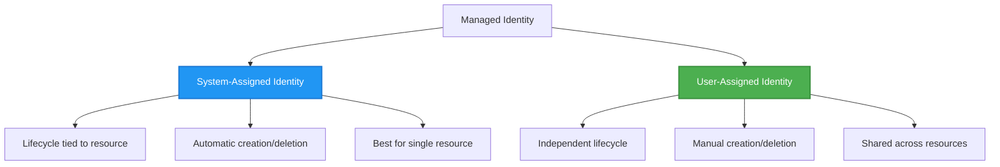

# Patrones de Autenticación e Identidad Gestionada

⏱️ **Tiempo Estimado**: 45-60 minutos de lectura; permita tiempo adicional para integrar ejercicios | 💰 **Impacto en el Costo**: Identidad/RBAC son gratuitos; cómputo desplegado, almacenamiento y Key Vault son facturables | ⭐ **Complejidad**: Intermedio

> Revisado conforme a `azd 1.37.2` (noviembre 2026). Esta lección contiene **fragmentos de integración ilustrativos, no una plantilla completa descargable `secure-app`**. Cree los archivos referenciados, proporcione la infraestructura que coincida, y reemplace los marcadores antes del despliegue. No se aprovisionaron recursos de Azure durante la revisión.

**📚 Ruta de Aprendizaje:**
- ← Anterior: [Gestión de Configuración](configuration.md) - Gestión de variables de entorno y secretos
- 🎯 **Estás aquí**: Autenticación & Seguridad (Identidad Gestionada, Key Vault, patrones seguros)
- → Siguiente: [Infraestructura como Código](../chapter-04-infrastructure/README.md) - Provisionar y desplegar recursos
- 🏠 [Inicio del Curso](../../README.md)

---

## Qué Aprenderás

Al completar esta lección, usted:
- Entenderá los patrones de autenticación de Azure (claves, cadenas de conexión, identidad gestionada)
- Implementará **Identidad Gestionada** para autenticación sin contraseña
- Asegurará secretos con integración de **Azure Key Vault**
- Configurará **control de acceso basado en roles (RBAC)** para despliegues con AZD
- Aplicará mejores prácticas de seguridad en Container Apps y servicios de Azure
- Migrará de autenticación basada en claves a basada en identidad

## Por Qué Importa la Identidad Gestionada

### El Problema: Autenticación Tradicional

**Antes de la Identidad Gestionada:**
```javascript
// ❌ SECURITY RISK: Hardcoded secrets in code
const connectionString = "Server=mydb.database.windows.net;User=admin;Password=P@ssw0rd123";
const storageKey = "xK7mN9pQ2wR5tY8uI0oP3aS6dF1gH4jK...";
const cosmosKey = "C2x7B9n4M1p8Q5w3E6r0T2y5U8i1O4p7...";
```

**Problemas:**
- 🔴 **Secretos expuestos** en código, archivos de configuración, variables de entorno
- 🔴 **Rotación de credenciales** requiere cambios en el código y redeploy
- 🔴 **Pesadillas de auditoría** - ¿quién accedió a qué y cuándo?
- 🔴 **Proliferación** - secretos dispersos en múltiples sistemas
- 🔴 **Riesgos de cumplimiento** - falla en auditorías de seguridad

### La Solución: Identidad Gestionada

**Después de la Identidad Gestionada:**
```javascript
// ✅ SECURE: No secrets in code
const credential = new DefaultAzureCredential();
const client = new BlobServiceClient(
  "https://mystorageaccount.blob.core.windows.net",
  credential  // Azure automatically handles authentication
);
```

**Beneficios:**
- ✅ **Cero secretos** en código o configuración
- ✅ **Rotación automática** - gestionada por Azure
- ✅ **Historial de auditoría completo** en registros de Microsoft Entra ID
- ✅ **Seguridad centralizada** - gestión en el portal de Azure
- ✅ **Listo para cumplimiento** - cumple normas de seguridad

**Analogía**: La autenticación tradicional es como llevar múltiples llaves físicas para diferentes puertas. La Identidad Gestionada es como tener una placa de seguridad que otorga acceso automáticamente basado en quién eres—sin llaves que perder, copiar o rotar.

---

## Visión General de la Arquitectura

### Flujo de Autenticación con Identidad Gestionada

```mermaid
sequenceDiagram
    participant App as Your Application<br/>(Container App)
    participant MI as Managed Identity<br/>(Microsoft Entra ID)
    participant KV as Key Vault
    participant Storage as Azure Storage
    participant DB as Azure SQL
    
    App->>MI: Request access token<br/>(automatic)
    MI->>MI: Verify identity<br/>(no password needed)
    MI-->>App: Return token for requested audience<br/>(lifetime varies)
    
    App->>KV: Get secret<br/>(using token)
    KV->>KV: Check RBAC permissions
    KV-->>App: Return secret value
    
    App->>Storage: Upload blob<br/>(using token)
    Storage->>Storage: Check RBAC permissions
    Storage-->>App: Success
    
    App->>DB: Query data<br/>(using token)
    DB->>DB: Check SQL permissions
    DB-->>App: Return results
    
    Note over App,DB: Request a separate token for each service audience;<br/>SDK credentials handle caching and renewal
```

### Tipos de Identidades Gestionadas



| Característica | Asignada por el Sistema | Asignada por el Usuario |
|--------------|-----------------------|-----------------------|
| **Ciclo de vida** | Vinculada al recurso | Independiente |
| **Creación** | Automática con el recurso | Creación manual |
| **Eliminación** | Eliminada con el recurso | Persiste tras eliminación del recurso |
| **Compartición** | Solo un recurso | Varios recursos |
| **Caso de uso** | Escenarios simples | Escenarios complejos con varios recursos |
| **Elección de plantilla** | Definida en infraestructura | Definida en infraestructura |

---

## Requisitos Previos

### Herramientas Requeridas

Debe tener estas ya instaladas de lecciones anteriores:

```bash
# Verify Azure Developer CLI
azd version
# ✅ Expected: azd version 1.0.0 or higher

# Verify Azure CLI
az --version
# ✅ Expected: azure-cli 2.50.0 or higher
```

### Requisitos en Azure

- Suscripción activa de Azure
- Permisos para:
  - Crear identidades gestionadas
  - Asignar roles RBAC
  - Crear recursos de Key Vault
  - Desplegar Container Apps

### Conocimientos Previos

Debe haber completado:
- [Guía de Instalación](../chapter-01-foundation/installation.md) - Configuración de AZD
- [Conceptos Básicos de AZD](../chapter-01-foundation/azd-basics.md) - Conceptos centrales
- [Gestión de Configuración](configuration.md) - Variables de entorno

---

## Lección 1: Comprendiendo los Patrones de Autenticación

### Patrón 1: Cadenas de Conexión (Legado - Evitar)

**Cómo funciona:**
```bash
# Connection string contains credentials
STORAGE_CONNECTION_STRING="DefaultEndpointsProtocol=https;AccountName=myaccount;AccountKey=xK7mN9pQ2wR5..."
COSMOS_CONNECTION_STRING="AccountEndpoint=https://myaccount.documents.azure.com:443/;AccountKey=C2x7..."
SQL_CONNECTION_STRING="Server=myserver.database.windows.net;User=admin;Password=P@ssw0rd..."
```

**Problemas:**
- ❌ Secretos visibles en variables de entorno
- ❌ Registrados en sistemas de despliegue
- ❌ Difíciles de rotar
- ❌ Sin historial de auditoría de accesos

**Cuándo usar:** Cuando el servicio objetivo requiere autenticación basada en claves. Prefiera identidad cuando sea compatible; si no, almacene las claves de forma segura y rótelas, incluso en producción.

---

### Patrón 2: Referencias a Key Vault (Mejor)

**Cómo funciona:**
**Fragmentos parciales de Bicep:** campos requeridos del vault, identidad del Container App y su entrada `configuration.secrets` están omitidos. `secretRef` nombra un secreto del Container App; **no es** una URI de Key Vault. Para usar Key Vault, defina ese secreto nombrado con `keyVaultUrl` y un `identity` autorizado.

```bicep
// Store secret in Key Vault
resource keyVault 'Microsoft.KeyVault/vaults@2023-02-01' = {
  name: 'mykv'
  properties: {
    enableRbacAuthorization: true
  }
}

// Reference in Container App
env: [
  {
    name: 'STORAGE_KEY'
    secretRef: 'storage-key'  // References Key Vault
  }
]
```

**Beneficios:**
- ✅ Secretos almacenados de forma segura en Key Vault
- ✅ Gestión centralizada de secretos
- ✅ Rotación sin cambios en código

**Limitaciones:**
- ⚠️ Todavía usa claves/contraseñas
- ⚠️ Necesidad de gestionar acceso a Key Vault

**Cuándo usar:** Paso de transición de cadenas de conexión a identidad gestionada.

---

### Patrón 3: Identidad Gestionada (Mejor Práctica)

**Cómo funciona:**
**Bicep parcial:** fusione el bloque de identidad en un Container App completo y suministre `storageAccount` y la definición de rol. Una asignación de rol también requiere un `name` determinista.

```bicep
// Enable managed identity
resource containerApp 'Microsoft.App/containerApps@2023-05-01' = {
  name: 'myapp'
  identity: {
    type: 'SystemAssigned'  // Automatically creates identity
  }
}

// Grant permissions
resource roleAssignment 'Microsoft.Authorization/roleAssignments@2022-04-01' = {
  name: guid(storageAccount.id, containerApp.id, storageBlobDataContributorRole)
  scope: storageAccount
  properties: {
    roleDefinitionId: storageBlobDataContributorRole
    principalId: containerApp.identity.principalId
    principalType: 'ServicePrincipal'
  }
}
```

**Código de la aplicación:**
```javascript
// No secrets needed!
const { DefaultAzureCredential } = require('@azure/identity');
const { BlobServiceClient } = require('@azure/storage-blob');

const credential = new DefaultAzureCredential();
const blobServiceClient = new BlobServiceClient(
  'https://mystorageaccount.blob.core.windows.net',
  credential
);
```

**Beneficios:**
- ✅ Cero secretos en código/configuración
- ✅ Rotación automática de credenciales
- ✅ Historial de auditoría completo
- ✅ Permisos basados en RBAC
- ✅ Listo para cumplimiento

**Cuándo usar:** Prefiera para aplicaciones alojadas en Azure que acceden a servicios que soportan autenticación Microsoft Entra.

---

### Patrón 4: Principales de Servicio (CI/CD y Automatización)

La identidad gestionada es el estándar de oro *para recursos que se ejecutan dentro de Azure*. Pero ¿qué hay de cosas que corren **fuera** de Azure—como una pipeline de CI/CD en un agente de compilación, o un script en su portátil que no puede usar su inicio de sesión interactivo? Ahí es donde entra un **principal de servicio**: una identidad no humana con sus propias credenciales que un proceso automatizado puede usar para iniciar sesión.

**Cómo funciona:**

Cree un principal de servicio con ámbito en un grupo de recursos (mínimo privilegio):

```bash
az ad sp create-for-rbac \
  --name "myapp-cicd" \
  --role contributor \
  --scopes "/subscriptions/<sub-id>/resourceGroups/<rg-name>"
```

Esto imprime un ID de cliente, secreto y tenant ID. azd puede iniciar sesión con ellos de forma no interactiva:

```bash
azd auth login \
  --client-id "<appId>" \
  --client-secret "<password>" \
  --tenant-id "<tenant>"
```

**Prefiera credenciales federadas (OIDC) sobre secretos.** En lugar de un secreto de cliente de larga duración, configure una credencial federada para que la pipeline intercambie un token de corta duración—sin secretos que puedan filtrarse o rotar:

```bash
azd auth login \
  --client-id "<appId>" \
  --federated-credential-provider "github" \
  --tenant-id "<tenant>"
```

> `azd pipeline config` configura esto automáticamente por usted. Vea los tutoriales de CI/CD en [Capítulo 8](../chapter-08-production/production-ai-practices.md).

**Beneficios:**
- ✅ Funciona fuera de Azure (agentes de compilación, local, otras nubes)
- ✅ Puede tener ámbito en un solo grupo de recursos con un solo rol
- ✅ Variante federada (OIDC) sin secreto almacenado

**Compromisos:**
- ⚠️ Variante basada en secretos requiere almacenamiento y rotación cuidadosa
- ⚠️ Un secreto filtrado otorga todo lo que el SP pueda hacer—mantenga ámbitos ajustados

**Cuándo usar:** Pipelines CI/CD y automatización que no pueden usar identidad gestionada. Siempre prefiera la variante **federada/OIDC** sobre un secreto de cliente, y prefiera identidad gestionada cuando la carga corra dentro de Azure.

**Almacenamiento seguro de credenciales:**
- Nunca cometa secretos—use el almacén de secretos de su pipeline (secretos de GitHub Actions, grupos de variables Azure DevOps / Key Vault).
- Dé ámbito al SP al rol y grupo de recursos mínimos necesarios.
- Establezca una expiración y rote, o elimine el secreto totalmente con OIDC.

---

## Lección 2: Implementar Identidad Gestionada con AZD

### Implementación Paso a Paso

Los siguientes fragmentos muestran cómo integrar la identidad gestionada en un proyecto Container App. No son un inicio para copiar y ejecutar: el módulo de Storage, infraestructura completa de entorno gestionado/registro, Dockerfile y archivo de parámetros no se suministran aquí en su totalidad. Comience desde una plantilla Container Apps funcional y fusione estos patrones, manteniendo su configuración de registro y etiquetas de servicio.

### Estructura del Proyecto

```
secure-app/
├── azure.yaml                 # AZD configuration
├── infra/
│   ├── main.bicep            # Main infrastructure
│   ├── core/
│   │   ├── identity.bicep    # Managed identity setup
│   │   ├── keyvault.bicep    # Key Vault configuration
│   │   └── storage.bicep     # Storage with RBAC
│   └── app/
│       └── container-app.bicep
└── src/
    ├── app.js                # Application code
    ├── package.json
    └── Dockerfile
```

### 1. Configurar AZD (azure.yaml)

```yaml
name: secure-app
metadata:
  template: secure-app@1.0.0

services:
  api:
    project: ./src
    language: js
    host: containerapp

# Managed identity must be enabled in the infrastructure, not by this YAML.
```

### 2. Infraestructura: Habilitar Identidad Gestionada

**Archivo: `infra/main.bicep`**

```bicep
targetScope = 'subscription'

param environmentName string
param location string = 'eastus'
param containerAppsEnvironmentId string
param containerImage string

var tags = { 'azd-env-name': environmentName }

// Resource group
resource rg 'Microsoft.Resources/resourceGroups@2021-04-01' = {
  name: 'rg-${environmentName}'
  location: location
  tags: tags
}

// Storage Account
module storage './core/storage.bicep' = {
  name: 'storage'
  scope: rg
  params: {
    name: 'st${uniqueString(rg.id)}'
    location: location
    tags: tags
  }
}

// Key Vault
module keyVault './core/keyvault.bicep' = {
  name: 'keyvault'
  scope: rg
  params: {
    name: 'kv-${uniqueString(rg.id)}'
    location: location
    tags: tags
  }
}

// Container App with Managed Identity
module containerApp './app/container-app.bicep' = {
  name: 'container-app'
  scope: rg
  params: {
    name: 'ca-${environmentName}'
    location: location
    tags: tags
    storageAccountName: storage.outputs.name
    keyVaultName: keyVault.outputs.name
    containerAppsEnvironmentId: containerAppsEnvironmentId
    containerImage: containerImage
  }
}

// Grant Container App access to Storage
module storageRoleAssignment './core/role-assignment.bicep' = {
  name: 'storage-role'
  scope: rg
  params: {
    principalId: containerApp.outputs.identityPrincipalId
    roleDefinitionId: 'ba92f5b4-2d11-453d-a403-e96b0029c9fe'  // Storage Blob Data Contributor
    targetResourceType: 'storage'
    targetResourceName: storage.outputs.name
  }
}

// Grant Container App access to Key Vault
module kvRoleAssignment './core/role-assignment.bicep' = {
  name: 'kv-role'
  scope: rg
  params: {
    principalId: containerApp.outputs.identityPrincipalId
    roleDefinitionId: '4633458b-17de-408a-b874-0445c86b69e6'  // Key Vault Secrets User
    targetResourceType: 'keyvault'
    targetResourceName: keyVault.outputs.name
  }
}

// Outputs
output AZURE_STORAGE_ACCOUNT_NAME string = storage.outputs.name
output AZURE_KEY_VAULT_NAME string = keyVault.outputs.name
output APP_URL string = containerApp.outputs.url
```

### 3. Container App con Identidad Asignada por el Sistema

**Archivo: `infra/app/container-app.bicep`**

```bicep
param name string
param location string
param tags object = {}
param storageAccountName string
param keyVaultName string
param containerAppsEnvironmentId string
param containerImage string

resource containerApp 'Microsoft.App/containerApps@2023-05-01' = {
  name: name
  location: location
  tags: union(tags, { 'azd-service-name': 'api' })
  identity: {
    type: 'SystemAssigned'  // 🔑 Enable managed identity
  }
  properties: {
    managedEnvironmentId: containerAppsEnvironmentId
    configuration: {
      ingress: {
        external: true
        targetPort: 3000
      }
    }
    template: {
      containers: [
        {
          name: 'api'
          image: containerImage // Must exist; configure registry credentials for private images
          resources: {
            cpu: json('0.5')
            memory: '1Gi'
          }
          env: [
            {
              name: 'AZURE_STORAGE_ACCOUNT_NAME'
              value: storageAccountName
            }
            {
              name: 'AZURE_KEY_VAULT_NAME'
              value: keyVaultName
            }
            // 🔑 No secrets - managed identity handles authentication!
          ]
        }
      ]
    }
  }
}

// Output the identity for RBAC assignments
output identityPrincipalId string = containerApp.identity.principalId
output id string = containerApp.id
output url string = 'https://${containerApp.properties.configuration.ingress.fqdn}'
```

### 4. Módulo de Asignación de Rol RBAC

**Archivo: `infra/core/role-assignment.bicep`**

```bicep
param principalId string
param roleDefinitionId string  // Azure built-in role ID
@allowed(['storage', 'keyvault'])
param targetResourceType string
param targetResourceName string

// Typed existing resources give Bicep a valid resource scope, not a string ID.
resource storageTarget 'Microsoft.Storage/storageAccounts@2023-01-01' existing = {
  name: targetResourceName
}
resource vaultTarget 'Microsoft.KeyVault/vaults@2023-02-01' existing = {
  name: targetResourceName
}

resource storageAssignment 'Microsoft.Authorization/roleAssignments@2022-04-01' = if (targetResourceType == 'storage') {
  name: guid(storageTarget.id, principalId, roleDefinitionId)
  scope: storageTarget
  properties: {
    roleDefinitionId: subscriptionResourceId('Microsoft.Authorization/roleDefinitions', roleDefinitionId)
    principalId: principalId
    principalType: 'ServicePrincipal'
  }
}

resource vaultAssignment 'Microsoft.Authorization/roleAssignments@2022-04-01' = if (targetResourceType == 'keyvault') {
  name: guid(vaultTarget.id, principalId, roleDefinitionId)
  scope: vaultTarget
  properties: {
    roleDefinitionId: subscriptionResourceId('Microsoft.Authorization/roleDefinitions', roleDefinitionId)
    principalId: principalId
    principalType: 'ServicePrincipal'
  }
}

// This module assigns at the target resource scope, not the whole resource group.
```

### 5. Código de Aplicación con Identidad Gestionada

**Archivo: `src/app.js`**

```javascript
const express = require('express');
const { DefaultAzureCredential } = require('@azure/identity');
const { BlobServiceClient } = require('@azure/storage-blob');
const { SecretClient } = require('@azure/keyvault-secrets');

const app = express();
const PORT = process.env.PORT || 3000;

// 🔑 Initialize credential (works automatically with managed identity)
const credential = new DefaultAzureCredential();

// Azure Storage setup
const storageAccountName = process.env.AZURE_STORAGE_ACCOUNT_NAME;
const blobServiceClient = new BlobServiceClient(
  `https://${storageAccountName}.blob.core.windows.net`,
  credential  // No keys needed!
);

// Key Vault setup
const keyVaultName = process.env.AZURE_KEY_VAULT_NAME;
const secretClient = new SecretClient(
  `https://${keyVaultName}.vault.azure.net`,
  credential  // No keys needed!
);

// Health check
app.get('/health', (req, res) => {
  res.json({ status: 'healthy', authentication: 'managed-identity' });
});

// Upload file to blob storage
app.post('/upload', async (req, res) => {
  try {
    const containerClient = blobServiceClient.getContainerClient('uploads');
    await containerClient.createIfNotExists();
    
    const blobName = `file-${Date.now()}.txt`;
    const blockBlobClient = containerClient.getBlockBlobClient(blobName);
    
    const content = 'Hello from managed identity!';
    await blockBlobClient.upload(content, Buffer.byteLength(content));
    
    res.json({
      success: true,
      blobName: blobName,
      message: 'File uploaded using managed identity!'
    });
  } catch (error) {
    console.error('Upload error:', error);
    res.status(500).json({ error: error.message });
  }
});

// Get secret from Key Vault
app.get('/secret/:name', async (req, res) => {
  try {
    const secretName = req.params.name;
    const secret = await secretClient.getSecret(secretName);
    
    res.json({
      name: secretName,
      retrieved: secret.value !== undefined, // Never return the secret value to callers
      message: 'Secret retrieved using managed identity!'
    });
  } catch (error) {
    console.error('Secret error:', error);
    res.status(500).json({ error: error.message });
  }
});

// List blob containers (demonstrates read access)
app.get('/containers', async (req, res) => {
  try {
    const containers = [];
    for await (const container of blobServiceClient.listContainers()) {
      containers.push(container.name);
    }
    
    res.json({
      containers: containers,
      count: containers.length,
      message: 'Containers listed using managed identity!'
    });
  } catch (error) {
    console.error('List error:', error);
    res.status(500).json({ error: error.message });
  }
});

app.listen(PORT, () => {
  console.log(`Secure API listening on port ${PORT}`);
  console.log('Authentication: Managed Identity (passwordless)');
});
```

**Archivo: `src/package.json`**

```json
{
  "name": "secure-app",
  "version": "1.0.0",
  "dependencies": {
    "express": "^4.18.2",
    "@azure/identity": "^4.0.0",
    "@azure/storage-blob": "^12.17.0",
    "@azure/keyvault-secrets": "^4.7.0"
  },
  "scripts": {
    "start": "node app.js"
  }
}
```

### 6. Desplegar y Probar

Ejecute estos comandos **solo después** de completar la infraestructura faltante, Dockerfile y `main.parameters.json` correspondiente en su propio proyecto. Autentique azd con `azd auth login`; inicie sesión por separado con `az login` para las verificaciones del CLI de Azure luego. Los endpoints mostrados son demostraciones y requieren controles de acceso adecuados antes de uso público.

```bash
# Initialize AZD environment
azd init

# Deploy infrastructure and application
azd up

# Get the app URL
APP_URL=$(azd env get-value APP_URL)

# Test health check
curl $APP_URL/health
```

**✅ Salida esperada:**
```json
{
  "status": "healthy",
  "authentication": "managed-identity"
}
```

**Prueba de carga de blob:**
```bash
curl -X POST $APP_URL/upload
```

**✅ Salida esperada:**
```json
{
  "success": true,
  "blobName": "file-1700404800000.txt",
  "message": "File uploaded using managed identity!"
}
```

**Prueba de listado de contenedores:**
```bash
curl $APP_URL/containers
```

**✅ Salida esperada:**
```json
{
  "containers": ["uploads"],
  "count": 1,
  "message": "Containers listed using managed identity!"
}
```

---

## Roles Comunes de Azure RBAC

### IDs de Rol Integrados para Identidad Gestionada

| Servicio | Nombre del Rol | ID del Rol | Permisos |
|---------|----------------|------------|----------|
| **Storage** | Storage Blob Data Reader | `2a2b9908-6ea1-4ae2-8e65-a410df84e7d1` | Leer blobs y contenedores |
| **Storage** | Storage Blob Data Contributor | `ba92f5b4-2d11-453d-a403-e96b0029c9fe` | Leer, escribir, eliminar blobs |
| **Storage** | Storage Queue Data Contributor | `974c5e8b-45b9-4653-ba55-5f855dd0fb88` | Leer, escribir, eliminar colas/mensajes |
| **Key Vault** | Key Vault Secrets User | `4633458b-17de-408a-b874-0445c86b69e6` | Leer secretos |
| **Key Vault** | Key Vault Secrets Officer | `b86a8fe4-44ce-4948-aee5-eccb2c155cd7` | Leer, escribir, eliminar secretos |
| **Cosmos DB** | Cosmos DB Built-in Data Reader | `00000000-0000-0000-0000-000000000001` | Leer datos de Cosmos DB |
| **Cosmos DB** | Cosmos DB Built-in Data Contributor | `00000000-0000-0000-0000-000000000002` | Leer, escribir datos de Cosmos DB |
| **SQL Database** | SQL DB Contributor | `9b7fa17d-e63e-47b0-bb0a-15c516ac86ec` | Gestionar recursos de base de datos; no concede acceso a datos SQL |
| **Service Bus** | Azure Service Bus Data Owner | `090c5cfd-751d-490a-894a-3ce6f1109419` | Enviar, recibir, gestionar mensajes |

### Cómo Encontrar IDs de Rol

Los dos IDs de Cosmos DB para NoSQL arriba son **definiciones nativas de roles en el plano de datos Cosmos**, no IDs de roles de suscripción Azure RBAC. Asígnelos con `az cosmosdb sql role assignment create` (o `Microsoft.DocumentDB/databaseAccounts/sqlRoleAssignments`), no con `az role assignment create`. El acceso a datos SQL requiere un usuario de base de datos Entra y permisos SQL.

```bash
# List all built-in roles
az role definition list --query "[].{Name:roleName, ID:name}" --output table

# Search for specific role
az role definition list --query "[?contains(roleName, 'Storage Blob')].{Name:roleName, ID:name}" --output table

# Get role details
az role definition list --name "Storage Blob Data Contributor"
```

---

## Ejercicios Prácticos

**Requisitos de integración para los tres ejercicios:** una plantilla Container App funcional en su propio proyecto, recursos Bicep coincidentes, inicio de sesión en Azure CLI/azd, y autoridad para asignar los roles requeridos. Estas son adaptaciones guiadas, no iniciadores locales independientes; reemplace los nombres de recursos de ejemplo con sus nombres desplegados.

### Ejercicio 1: Habilitar Identidad Gestionada para Aplicación Existente ⭐⭐ (Medio)

**Objetivo**: Añadir identidad gestionada a un despliegue existente de Container App

**Escenario**: Tiene una Container App que usa cadenas de conexión. Conviértala a identidad gestionada.

**Punto de partida**: Container App con esta configuración:

```bicep
// ❌ Current: Using connection string
env: [
  {
    name: 'STORAGE_CONNECTION_STRING'
    secretRef: 'storage-connection'
  }
]
```

**Pasos**:

1. **Habilite la identidad gestionada en Bicep:**

```bicep
resource containerApp 'Microsoft.App/containerApps@2023-05-01' = {
  name: 'myapp'
  identity: {
    type: 'SystemAssigned'  // Add this
  }
  // ... rest of configuration
}
```

2. **Conceda acceso a Storage:**

```bicep
// Get storage account reference
resource storageAccount 'Microsoft.Storage/storageAccounts@2023-01-01' existing = {
  name: storageAccountName
}

// Assign role
resource roleAssignment 'Microsoft.Authorization/roleAssignments@2022-04-01' = {
  name: guid(containerApp.id, 'ba92f5b4-2d11-453d-a403-e96b0029c9fe', storageAccount.id)
  scope: storageAccount
  properties: {
    roleDefinitionId: subscriptionResourceId('Microsoft.Authorization/roleDefinitions', 'ba92f5b4-2d11-453d-a403-e96b0029c9fe')
    principalId: containerApp.identity.principalId
    principalType: 'ServicePrincipal'
  }
}
```

3. **Actualice el código de la aplicación:**

**Antes (cadena de conexión):**
```javascript
const { BlobServiceClient } = require('@azure/storage-blob');

const blobServiceClient = BlobServiceClient.fromConnectionString(
  process.env.STORAGE_CONNECTION_STRING
);
```

**Después (identidad gestionada):**
```javascript
const { DefaultAzureCredential } = require('@azure/identity');
const { BlobServiceClient } = require('@azure/storage-blob');

const credential = new DefaultAzureCredential();
const blobServiceClient = new BlobServiceClient(
  `https://${process.env.STORAGE_ACCOUNT_NAME}.blob.core.windows.net`,
  credential
);
```

4. **Actualice variables de entorno:**

```bicep
env: [
  {
    name: 'STORAGE_ACCOUNT_NAME'
    value: storageAccountName  // Just the name, no secrets!
  }
  // Remove STORAGE_CONNECTION_STRING
]
```

5. **Desplegar y probar:**

```bash
# Redeploy
azd up

# Test that it still works
APP_URL=$(azd show --output json | jq -er '.services.api.ingressUrl')
curl --fail -X POST "$APP_URL/upload"
```

**✅ Criterios de éxito:**
- ✅ La aplicación se despliega sin errores
- ✅ Operaciones de Storage funcionan (carga, listado, descarga)
- ✅ No hay cadenas de conexión en variables de entorno
- ✅ Identidad visible en el portal de Azure bajo la pestaña "Identidad"

**Verificación:**

```bash
# Check managed identity is enabled
az containerapp show \
  --name myapp \
  --resource-group rg-myapp \
  --query "identity.type"
# ✅ Expected: "SystemAssigned"

# Check role assignment
az role assignment list \
  --assignee $(az containerapp show --name myapp --resource-group rg-myapp --query "identity.principalId" -o tsv) \
  --scope /subscriptions/{sub-id}/resourceGroups/rg-myapp/providers/Microsoft.Storage/storageAccounts/mystorageaccount
# ✅ Expected: Shows "Storage Blob Data Contributor" role
```

**Tiempo**: 20-30 minutos

---

### Ejercicio 2: Acceso Multi-Servicio con Identidad Asignada por Usuario ⭐⭐⭐ (Avanzado)

**Objetivo**: Crear una identidad asignada por usuario compartida entre múltiples Container Apps

**Escenario**: Tiene 3 microservicios que necesitan acceso al mismo Storage account y Key Vault.

**Pasos**:

1. **Crear identidad asignada por usuario:**

**Archivo: `infra/core/identity.bicep`**

```bicep
param name string
param location string
param tags object = {}

resource userAssignedIdentity 'Microsoft.ManagedIdentity/userAssignedIdentities@2023-01-31' = {
  name: name
  location: location
  tags: tags
}

output id string = userAssignedIdentity.id
output principalId string = userAssignedIdentity.properties.principalId
output clientId string = userAssignedIdentity.properties.clientId
```

2. **Asignar roles a la identidad asignada por usuario:**

```bicep
// In main.bicep
module userIdentity './core/identity.bicep' = {
  name: 'user-identity'
  scope: rg
  params: {
    name: 'id-${environmentName}'
    location: location
    tags: tags
  }
}

// Grant Storage access
resource storageRoleAssignment 'Microsoft.Authorization/roleAssignments@2022-04-01' = {
  name: guid(storageAccount.id, environmentName, 'storage-contributor')
  scope: storageAccount
  properties: {
    roleDefinitionId: subscriptionResourceId('Microsoft.Authorization/roleDefinitions', 'ba92f5b4-2d11-453d-a403-e96b0029c9fe')
    principalId: userIdentity.outputs.principalId
    principalType: 'ServicePrincipal'
  }
}

// Grant Key Vault access
resource kvRoleAssignment 'Microsoft.Authorization/roleAssignments@2022-04-01' = {
  name: guid(keyVault.id, environmentName, 'kv-secrets-user')
  scope: keyVault
  properties: {
    roleDefinitionId: subscriptionResourceId('Microsoft.Authorization/roleDefinitions', '4633458b-17de-408a-b874-0445c86b69e6')
    principalId: userIdentity.outputs.principalId
    principalType: 'ServicePrincipal'
  }
}
```

3. **Asignar identidad a múltiples Container Apps:**

```bicep
resource apiGateway 'Microsoft.App/containerApps@2023-05-01' = {
  name: 'api-gateway'
  identity: {
    type: 'UserAssigned'
    userAssignedIdentities: {
      '${userIdentity.outputs.id}': {}
    }
  }
  // ... rest of config
}

resource productService 'Microsoft.App/containerApps@2023-05-01' = {
  name: 'product-service'
  identity: {
    type: 'UserAssigned'
    userAssignedIdentities: {
      '${userIdentity.outputs.id}': {}
    }
  }
  // ... rest of config
}

resource orderService 'Microsoft.App/containerApps@2023-05-01' = {
  name: 'order-service'
  identity: {
    type: 'UserAssigned'
    userAssignedIdentities: {
      '${userIdentity.outputs.id}': {}
    }
  }
  // ... rest of config
}
```

4. **Código de aplicación (todos los servicios usan el mismo patrón):**

```javascript
const { ManagedIdentityCredential } = require('@azure/identity');
const { BlobServiceClient } = require('@azure/storage-blob');

// For user-assigned identity, specify the client ID
const credential = new ManagedIdentityCredential(
  process.env.AZURE_CLIENT_ID  // User-assigned identity client ID
);

// Alternative (choose ONE credential declaration):
// const { DefaultAzureCredential } = require('@azure/identity');
// const credential = new DefaultAzureCredential({
//   managedIdentityClientId: process.env.AZURE_CLIENT_ID
// });

const blobServiceClient = new BlobServiceClient(
  `https://${process.env.STORAGE_ACCOUNT_NAME}.blob.core.windows.net`,
  credential
);
```

Establece en cada Container App el valor de tiempo de ejecución `AZURE_CLIENT_ID` a `userIdentity.outputs.clientId` y `STORAGE_ACCOUNT_NAME` a tu nombre de almacenamiento en Bicep. Simplemente asignar la identidad o ejecutar `azd env set` no configura estos valores de tiempo de ejecución.

5. **Desplegar y verificar:**

```bash
azd up

# Test all services can access storage
# Replace with the actual ingress URLs reported for your three services
curl --fail -X POST "$API_GATEWAY_URL/upload"
curl --fail -X POST "$PRODUCT_SERVICE_URL/upload"
curl --fail -X POST "$ORDER_SERVICE_URL/upload"
```

**✅ Criterios de éxito:**
- ✅ Una identidad compartida entre 3 servicios
- ✅ Todos los servicios pueden acceder a Storage y Key Vault
- ✅ La identidad persiste si eliminas un servicio
- ✅ Gestión centralizada de permisos

**Beneficios de la identidad asignada por el usuario:**
- Una única identidad para administrar
- Permisos consistentes entre servicios
- Sobrevive a la eliminación del servicio
- Mejor para arquitecturas complejas

**Tiempo**: 30-40 minutos

---

### Ejercicio 3: Implementar la rotación de secretos en Key Vault ⭐⭐⭐ (Avanzado)

**Objetivo**: Almacenar claves API de terceros en Key Vault y acceder a ellas usando identidad administrada

**Escenario**: Tu aplicación necesita llamar a una API externa (OpenAI, Stripe, SendGrid) que requiere claves API.

**Pasos**:

1. **Crear Key Vault con RBAC:**

**Archivo: `infra/core/keyvault.bicep`**

```bicep
param name string
param location string
param tags object = {}

resource keyVault 'Microsoft.KeyVault/vaults@2023-02-01' = {
  name: name
  location: location
  tags: tags
  properties: {
    enableRbacAuthorization: true  // Use RBAC instead of access policies
    sku: {
      family: 'A'
      name: 'standard'
    }
    tenantId: subscription().tenantId
    enableSoftDelete: true
    softDeleteRetentionInDays: 90
  }
}

// Allow Container App to read secrets
output id string = keyVault.id
output name string = keyVault.name
output uri string = keyVault.properties.vaultUri
```

2. **Almacenar secretos en Key Vault:**

```bash
# Get Key Vault name
KV_NAME=$(azd env get-value AZURE_KEY_VAULT_NAME)

# Store third-party API keys
az keyvault secret set \
  --vault-name $KV_NAME \
  --name "OpenAI-ApiKey" \
  --value "sk-proj-xxxxxxxxxxxxx"

az keyvault secret set \
  --vault-name $KV_NAME \
  --name "Stripe-ApiKey" \
  --value "sk_live_xxxxxxxxxxxxx"

az keyvault secret set \
  --vault-name $KV_NAME \
  --name "SendGrid-ApiKey" \
  --value "SG.xxxxxxxxxxxxx"
```

3. **Código de aplicación para recuperar secretos:**

**Archivo: `src/config.js`**

```javascript
const { DefaultAzureCredential } = require('@azure/identity');
const { SecretClient } = require('@azure/keyvault-secrets');

class Config {
  constructor() {
    this.credential = new DefaultAzureCredential();
    this.secretClient = new SecretClient(
      `https://${process.env.AZURE_KEY_VAULT_NAME}.vault.azure.net`,
      this.credential
    );
    this.cache = {};
  }

  async getSecret(secretName) {
    // Check cache first
    if (this.cache[secretName]) {
      return this.cache[secretName];
    }

    try {
      const secret = await this.secretClient.getSecret(secretName);
      this.cache[secretName] = secret.value;
      console.log(`✅ Retrieved secret: ${secretName}`);
      return secret.value;
    } catch (error) {
      console.error(`❌ Failed to get secret ${secretName}:`, error.message);
      throw error;
    }
  }

  async getOpenAIKey() {
    return this.getSecret('OpenAI-ApiKey');
  }

  async getStripeKey() {
    return this.getSecret('Stripe-ApiKey');
  }

  async getSendGridKey() {
    return this.getSecret('SendGrid-ApiKey');
  }
}

module.exports = new Config();
```

4. **Usar secretos en la aplicación:**

**Archivo: `src/app.js`**

Este **fragmento de aplicación de reemplazo** requiere `npm install openai`, una clave real de terceros, un modelo accesible y la infraestructura de tu proyecto funcional. Llama a OpenAI directamente, no a un despliegue Azure OpenAI. Las claves de marcador de posición no autorizan una solicitud.

```javascript
const express = require('express');
const config = require('./config');
const { OpenAI } = require('openai');

const app = express();

// Initialize OpenAI with key from Key Vault
let openaiClient;

async function initializeServices() {
  const openaiKey = await config.getOpenAIKey();
  openaiClient = new OpenAI({ apiKey: openaiKey });
  console.log('✅ Services initialized with secrets from Key Vault');
}

app.post('/chat', async (req, res) => {
  try {
    const completion = await openaiClient.chat.completions.create({
      model: 'gpt-4.1',
      messages: [{ role: 'user', content: 'Hello!' }]
    });
    
    res.json({
      response: completion.choices[0].message.content,
      authentication: 'Key from Key Vault via Managed Identity'
    });
  } catch (error) {
    res.status(500).json({ error: error.message });
  }
});

// Start listening only after initialization succeeds.
initializeServices().then(() => {
  app.listen(3000, () => console.log('Key Vault demo running'));
}).catch(error => {
  console.error('Initialization failed:', error.message);
  process.exitCode = 1;
});
```

5. **Desplegar y probar:**

```bash
azd up

# Test that API keys work
curl -X POST https://myapp.azurecontainerapps.io/chat \
  -H "Content-Type: application/json" \
  -d '{"message":"Hello AI"}'
```

**✅ Criterios de éxito:**
- ✅ No hay claves API en el código o variables de entorno
- ✅ La aplicación recupera las claves desde Key Vault
- ✅ Las APIs de terceros funcionan correctamente
- ✅ Se pueden rotar claves sin cambios en el código

**Rotar un secreto:**

```bash
# Update secret in Key Vault
az keyvault secret set \
  --vault-name $KV_NAME \
  --name "OpenAI-ApiKey" \
  --value "sk-proj-NEW_KEY_HERE"

# Find the active revision name, then restart it to clear the in-process cache
az containerapp revision list --name myapp --resource-group rg-myapp --output table
az containerapp revision restart \
  --name myapp \
  --resource-group rg-myapp \
  --revision "<active-revision-name>"
```

**Tiempo**: 25-35 minutos

---

## Punto de control de conocimientos

### 1. Patrones de autenticación ✓

Pon a prueba tu comprensión:

- [ ] **P1**: ¿Cuáles son los tres principales patrones de autenticación? 
  - **R**: Cadenas de conexión (legacy), referencias a Key Vault (transición), identidad gestionada (mejor)

- [ ] **P2**: ¿Por qué es mejor la identidad gestionada que las cadenas de conexión?
  - **R**: Sin secretos en código, rotación automática, historial completo de auditoría, permisos RBAC

- [ ] **P3**: ¿Cuándo usarías identidad asignada por usuario en lugar de asignada por sistema?
  - **R**: Cuando se comparte identidad entre múltiples recursos o cuando el ciclo de vida de la identidad es independiente del ciclo de vida del recurso

**Verificación práctica:**
```bash
# Check what type of identity your app uses
az containerapp show \
  --name myapp \
  --resource-group rg-myapp \
  --query "identity.type"

# List all role assignments for the identity
az role assignment list \
  --assignee $(az containerapp show --name myapp --resource-group rg-myapp --query "identity.principalId" -o tsv)
```

---

### 2. RBAC y permisos ✓

Pon a prueba tu comprensión:

- [ ] **P1**: ¿Cuál es el ID del rol "Storage Blob Data Contributor"?
  - **R**: `ba92f5b4-2d11-453d-a403-e96b0029c9fe`

- [ ] **P2**: ¿Qué permisos ofrece "Key Vault Secrets User"?
  - **R**: Acceso de solo lectura a secretos (no puede crear, actualizar ni eliminar)

- [ ] **P3**: ¿Cómo se concede acceso de una Container App a Azure SQL?
  - **R**: Configurando la autenticación Microsoft Entra, creando la identidad como usuario de base de datos y otorgando los permisos SQL necesarios. "SQL DB Contributor" solo gestiona recursos Azure; no autoriza consultas.

**Verificación práctica:**
```bash
# Find specific role
az role definition list --name "Storage Blob Data Contributor"

# Check what roles are assigned to your identity
PRINCIPAL_ID=$(az containerapp show --name myapp --resource-group rg-myapp --query "identity.principalId" -o tsv)
az role assignment list --assignee $PRINCIPAL_ID --output table
```

---

### 3. Integración con Key Vault ✓

Pon a prueba tu comprensión:

- [ ] **P1**: ¿Cómo habilitas RBAC para Key Vault en lugar de políticas de acceso?
  - **R**: Establecer `enableRbacAuthorization: true` en Bicep

- [ ] **P2**: ¿Qué biblioteca del SDK de Azure maneja la autenticación de identidad gestionada?
  - **R**: `@azure/identity` con la clase `DefaultAzureCredential`

- [ ] **P3**: ¿Cuánto tiempo permanecen los secretos de Key Vault en caché?
  - **R**: Depende de la aplicación; implementa tu propia estrategia de caché

**Verificación práctica:**
```bash
# Test Key Vault access
az keyvault secret show \
  --vault-name $KV_NAME \
  --name "OpenAI-ApiKey" \
  --query "{name:name,enabled:attributes.enabled}"

# Check RBAC is enabled
az keyvault show \
  --name $KV_NAME \
  --query "properties.enableRbacAuthorization"
# ✅ Expected: true
```

---

## Mejores prácticas de seguridad

### ✅ HACER:

1. **Usar siempre identidad gestionada en producción**
   ```bicep
   identity: {
     type: 'SystemAssigned'
   }
   ```

2. **Usar roles RBAC de mínimo privilegio**
   - Usar roles "Reader" cuando sea posible
   - Evitar "Owner" o "Contributor" a menos que sea necesario

3. **Almacenar claves de terceros en Key Vault**
   ```javascript
   const apiKey = await secretClient.getSecret('ThirdPartyApiKey');
   ```

4. **Habilitar registro de auditoría** (fragmento parcial de recurso; combinar con tus declaraciones de vault y workspace)
   ```bicep
   resource vaultDiagnostics 'Microsoft.Insights/diagnosticSettings@2021-05-01-preview' = {
     name: 'vault-audit'
     scope: keyVault
     properties: {
       workspaceId: logAnalytics.id
       logs: [{ category: 'AuditEvent', enabled: true }]
     }
   }
   ```

5. **Usar identidades diferentes para dev/staging/prod**
   ```bash
   azd env new dev
   azd env new staging
   azd env new prod
   ```

6. **Rotar secretos regularmente**
   - Establecer fechas de expiración en secretos de Key Vault
   - Automatizar rotación con Azure Functions

### ❌ NO HACER:

1. **Nunca codifiques secretos directamente**
   ```javascript
   // ❌ BAD
   const apiKey = "sk-proj-xxxxxxxxxxxxx";
   ```

2. **No usar cadenas de conexión en producción**
   ```javascript
   // ❌ BAD
   BlobServiceClient.fromConnectionString(process.env.STORAGE_CONNECTION_STRING)
   ```

3. **No otorgar permisos excesivos**
   ```bicep
   // ❌ BAD - too much access
   roleDefinitionId: subscriptionResourceId('Microsoft.Authorization/roleDefinitions', '8e3af657-a8ff-443c-a75c-2fe8c4bcb635')
   
   // ✅ GOOD - least privilege
   roleDefinitionId: subscriptionResourceId('Microsoft.Authorization/roleDefinitions', '2a2b9908-6ea1-4ae2-8e65-a410df84e7d1')
   ```

4. **No registrar secretos**
   ```javascript
   // ❌ BAD
   console.log('API Key:', apiKey);
   
   // ✅ GOOD
   console.log('API Key retrieved successfully');
   ```

5. **No compartir identidades de producción entre entornos**
   ```bicep
   // ❌ BAD - same identity for dev and prod
   // ✅ GOOD - separate identities per environment
   ```

---

## Guía de solución de problemas

### Problema: "No autorizado" al acceder a Azure Storage

**Síntomas:**
```
Error: Unauthorized (403)
AuthorizationPermissionMismatch: This request is not authorized to perform this operation
```

**Diagnóstico:**

```bash
# Check if managed identity is enabled
az containerapp show \
  --name myapp \
  --resource-group rg-myapp \
  --query "identity.type"
# ✅ Expected: "SystemAssigned" or "UserAssigned"

# Check role assignments
PRINCIPAL_ID=$(az containerapp show --name myapp --resource-group rg-myapp --query "identity.principalId" -o tsv)
az role assignment list --assignee $PRINCIPAL_ID

# Expected: Should see "Storage Blob Data Contributor" or similar role
```

**Soluciones:**

1. **Conceder el rol RBAC correcto:**
```bash
STORAGE_ID=$(az storage account show --name mystorageaccount --resource-group rg-myapp --query "id" -o tsv)
az role assignment create \
  --assignee $PRINCIPAL_ID \
  --role "Storage Blob Data Contributor" \
  --scope $STORAGE_ID
```

2. **Esperar propagación (puede tardar 5-10 minutos):**
```bash
# Check role assignment status
az role assignment list --assignee $PRINCIPAL_ID --scope $STORAGE_ID
```

3. **Verificar que el código de la aplicación use la credencial correcta:**
```javascript
// Make sure you're using DefaultAzureCredential
const credential = new DefaultAzureCredential();
```

---

### Problema: Acceso denegado a Key Vault

**Síntomas:**
```
Error: Forbidden (403)
The user, group or application does not have secrets get permission
```

**Diagnóstico:**

```bash
# Check Key Vault RBAC is enabled
az keyvault show \
  --name $KV_NAME \
  --query "properties.enableRbacAuthorization"
# ✅ Expected: true

# Check role assignments
az role assignment list \
  --assignee $PRINCIPAL_ID \
  --scope /subscriptions/{sub-id}/resourceGroups/rg-myapp/providers/Microsoft.KeyVault/vaults/$KV_NAME
```

**Soluciones:**

1. **Habilitar RBAC en Key Vault:**
```bash
az keyvault update \
  --name $KV_NAME \
  --enable-rbac-authorization true
```

2. **Conceder rol Key Vault Secrets User:**
```bash
KV_ID=$(az keyvault show --name $KV_NAME --query "id" -o tsv)
az role assignment create \
  --assignee $PRINCIPAL_ID \
  --role "Key Vault Secrets User" \
  --scope $KV_ID
```

---

### Problema: DefaultAzureCredential falla localmente

**Síntomas:**
```
Error: DefaultAzureCredential failed to retrieve a token
CredentialUnavailableError: No credential available
```

**Diagnóstico:**

```bash
# Check if you're logged in
az account show

# Check Azure CLI authentication
az ad signed-in-user show
```

**Soluciones:**

1. **Iniciar sesión en Azure CLI:**
```bash
az login
```

2. **Establecer suscripción de Azure:**
```bash
az account set --subscription "Your Subscription Name"
```

3. **Para desarrollo local, usar variables de entorno:**
```bash
export AZURE_TENANT_ID="your-tenant-id"
export AZURE_CLIENT_ID="your-client-id"
export AZURE_CLIENT_SECRET="your-client-secret"
```

4. **O usar credencial distinta localmente:**
```javascript
const { DefaultAzureCredential, AzureCliCredential } = require('@azure/identity');

// Use AzureCliCredential for local dev
const credential = process.env.NODE_ENV === 'production' 
  ? new DefaultAzureCredential()
  : new AzureCliCredential();
```

---

### Problema: La asignación de roles tarda demasiado en propagarse

**Síntomas:**
- Rol asignado con éxito
- Aún obteniendo errores 403
- Acceso intermitente (a veces funciona, a veces no)

**Explicación:**
Los cambios en Azure RBAC pueden tardar 5-10 minutos en propagarse globalmente.

**Solución:**

```bash
# Wait and retry
echo "Waiting for RBAC propagation..."
sleep 300  # Wait 5 minutes

# Test access
curl --fail -X POST "$APP_URL/upload"

# If still failing, restart the app
az containerapp revision restart \
  --name myapp \
  --resource-group rg-myapp \
  --revision "<active-revision-name>"
```

---

## Consideraciones de costo

### Costos de identidad gestionada

| Recurso | Costo |
|----------|------|
| **Identidad gestionada** | 🆓 **GRATIS** - Sin cargo |
| **Asignaciones de roles RBAC** | 🆓 **GRATIS** - Sin cargo |
| **Solicitudes de token Microsoft Entra ID** | 🆓 **GRATIS** - Incluido |
| **Operaciones de Key Vault** | $0.03 por 10,000 operaciones |
| **Almacenamiento de secretos de Key Vault** | Consulta precios actuales; no asumas una tarifa mensual por secreto |

**La identidad gestionada ahorra dinero al:**
- ✅ Eliminar operaciones de Key Vault para autenticación servicio a servicio
- ✅ Reducir incidentes de seguridad (sin credenciales filtradas)
- ✅ Disminuir la carga operativa (sin rotación manual)

El número de solicitudes de la aplicación no equivale al número de operaciones de Key Vault: los patrones de caché y rotación determinan los costos de lectura de secretos. La identidad no elimina cargos por cómputo/almacenamiento. Consulta [Precio de Key Vault](https://azure.microsoft.com/pricing/details/key-vault/) y la Calculadora de Precios de Azure para tu región en lugar de inferir ahorros mensuales solo por el conteo de solicitudes.

---

## Aprende más

### Documentación oficial
- [Azure Managed Identity](https://learn.microsoft.com/entra/identity/managed-identities-azure-resources/overview)
- [Azure RBAC](https://learn.microsoft.com/azure/role-based-access-control/overview)
- [Azure Key Vault](https://learn.microsoft.com/azure/key-vault/general/overview)
- [DefaultAzureCredential](https://learn.microsoft.com/dotnet/api/azure.identity.defaultazurecredential)

### Documentación del SDK
- [@azure/identity (Node.js)](https://www.npmjs.com/package/@azure/identity)
- [Azure.Identity (C#)](https://www.nuget.org/packages/Azure.Identity/)
- [azure-identity (Python)](https://pypi.org/project/azure-identity/)

### Próximos pasos en este curso
- ← Anterior: [Gestión de configuración](configuration.md)
- → Siguiente: [Infraestructura como código](../chapter-04-infrastructure/README.md)
- 🏠 [Inicio del curso](../../README.md)

### Ejemplos relacionados
- [Ejemplo de chat con Microsoft Foundry Models](../../../../examples/azure-openai-chat) - Usa identidad gestionada para Microsoft Foundry Models
- [Ejemplo de microservicios](../../../../examples/microservices) - Patrones de autenticación multi-servicio

---

## Resumen

**Has aprendido:**
- ✅ Tres patrones de autenticación (cadenas de conexión, Key Vault, identidad gestionada)
- ✅ Cómo habilitar y configurar identidad gestionada en AZD
- ✅ Asignaciones de roles RBAC para servicios Azure
- ✅ Integración con Key Vault para secretos de terceros
- ✅ Identidades asignadas por usuario vs asignadas por sistema
- ✅ Mejores prácticas de seguridad y solución de problemas

**Puntos clave:**
1. **Usar siempre identidad gestionada en producción** - Cero secretos, rotación automática
2. **Usar roles RBAC de mínimo privilegio** - Otorgar solo permisos necesarios
3. **Almacenar claves de terceros en Key Vault** - Gestión centralizada de secretos
4. **Separar identidades por entorno** - Aislamiento dev, staging, prod
5. **Habilitar registro de auditoría** - Rastrear quién accedió a qué

**Próximos pasos:**
1. Completa los ejercicios prácticos anteriores
2. Migra una aplicación existente de cadenas de conexión a identidad gestionada
3. Revisa el flujo de despliegue para principiantes: [Primer proyecto](../chapter-01-foundation/first-project.md)

---

<!-- CO-OP TRANSLATOR DISCLAIMER START -->
**Descargo de responsabilidad**:
Este documento ha sido traducido utilizando el servicio de traducción automática [Co-op Translator](https://github.com/Azure/co-op-translator). Aunque nos esforzamos por la precisión, tenga en cuenta que las traducciones automatizadas pueden contener errores o inexactitudes. El documento original en su idioma nativo debe considerarse la fuente autorizada. Para información crítica, se recomienda una traducción profesional humana. No somos responsables de cualquier malentendido o interpretación errónea que surja del uso de esta traducción.
<!-- CO-OP TRANSLATOR DISCLAIMER END -->