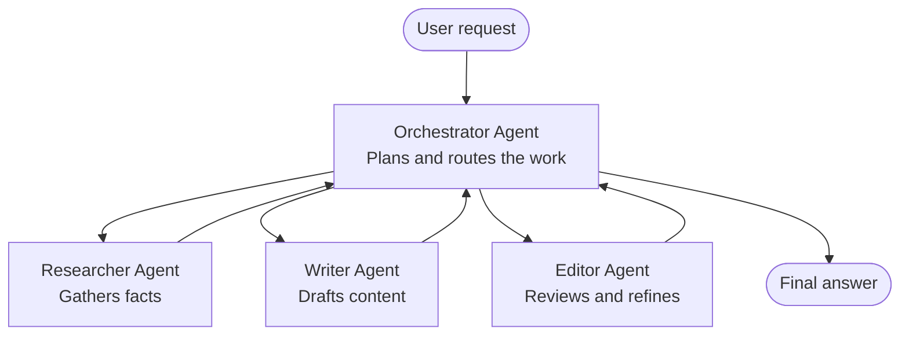

# Conceptos Básicos de Multi-Agente - Implementa Tu Primer Sistema de IA Coordinado

**Navegación del Capítulo:**
- **📚 Inicio del Curso**: [AZD Para Principiantes](../../README.md)
- **📖 Capítulo Actual**: Capítulo 5 - Soluciones de IA Multi-Agente
- **⬅️ Anterior**: [Capítulo 4: Infraestructura](../chapter-04-infrastructure/README.md)
- **➡️ Siguiente**: [Patrones de Coordinación](../chapter-06-pre-deployment/coordination-patterns.md)

> Guía de comandos revisada contra la referencia liberada `azd 1.37.2`. No se ejecutaron despliegues en la nube.

## Introducción

En los capítulos anteriores implementaste una sola aplicación—y en el Capítulo 2 implementaste un solo agente de IA. Esta lección da el siguiente paso: implementar un **sistema multi-agente**, donde varios agentes especializados trabajan juntos para resolver un problema que ningún agente solo podría manejar bien.

La buena noticia para principiantes: **no necesitas nuevos comandos.** Una solución multi-agente sigue siendo un proyecto azd. Vas a `azd init`, `azd up`, probar, y `azd down`—exactamente el flujo de trabajo que ya conoces. Lo que cambia es la *forma* de la aplicación por dentro.

## Objetivos de Aprendizaje

Al final de esta lección, podrás:
- Entender qué significa "multi-agente" y cuándo vale la pena la complejidad extra
- Reconocer los roles comunes en un sistema multi-agente (orquestador + especialistas)
- Implementar una plantilla multi-agente real y funcional con `azd up`
- Entender los recursos de Azure que respaldan una aplicación multi-agente
- Saber cómo verificar, personalizar, y desmantelar la solución de forma segura

## Resultados del Aprendizaje

Después de completar esta lección, serás capaz de:
- Explicar la diferencia entre un agente único y un sistema multi-agente
- Elegir entre un agente único con herramientas y un diseño multi-agente genuino
- Implementar y probar una plantilla multi-agente de extremo a extremo con azd
- Identificar dónde se ejecuta cada agente y cómo se comunican
- Limpiar todos los recursos para evitar cargos continuos

---

## ¿Qué es un Sistema Multi-Agente?

Un agente de IA único es un modelo con un conjunto de instrucciones y (opcionalmente) algunas herramientas. Eso funciona bien para tareas enfocadas. Pero a medida que una tarea crece—investigación, luego escritura, luego edición, luego verificación de hechos—encajar todo en un solo aviso hace que el agente sea más lento, menos confiable y más difícil de depurar.

Un **sistema multi-agente** divide el trabajo en especialistas que hacen bien un trabajo, coordinados por un orquestador:



### Los dos roles que siempre verás

| Rol | Trabajo | Ejemplo |
|------|-----|---------|
| **Orquestador** | Decide *qué sucede después* y enruta el trabajo entre agentes | "Primero investigar, luego escribir, luego editar" |
| **Especialista** | Hace un trabajo enfocado y devuelve un resultado | Un "investigador" que solo recoge hechos |

### ¿Realmente necesitas múltiples agentes?

Empieza simple. Usa multi-agente **solo** cuando una de estas sea verdadera:

- ✅ La tarea tiene **etapas distintas** que se benefician de instrucciones diferentes (investigar vs. escribir vs. revisar)
- ✅ Quieres que especialistas operen **en paralelo** para ahorrar tiempo
- ✅ Diferentes pasos necesitan **herramientas o fuentes de datos diferentes**
- ✅ Necesitas que cada paso sea **testable y depurable de forma independiente**

Si tu tarea es una sola pregunta y respuesta o una llamada simple a una herramienta, un **agente único con herramientas** (Capítulo 2) es más simple, barato y fácil de operar.

> **Consejo para principiantes:** "Más agentes" no es "mejor." Cada agente añade latencia, costo y algo nuevo que monitorear. Agrega agentes solo cuando el problema claramente se divide en partes.

---

## Dos Formas de Construir Multi-Agente en Azure

| Enfoque | Qué es | Mejor para |
|----------|-----------|----------|
| **Agente único + herramientas** | Un agente Foundry que llama funciones/herramientas | Flujos simples, empezar |
| **Múltiples agentes coordinados** | Varios agentes con un orquestador | Etapas distintas, trabajo en paralelo, especialización |

Esta lección se enfoca en el segundo enfoque usando una **plantilla lista para usar**, para que puedas ver un sistema multi-agente real funcionando antes de construir el tuyo propio.

---

## Práctica: Implementa una Aplicación Multi-Agente Funcional

Implementaremos **Contoso Creative Writer**, un ejemplo oficial de Azure que coordina agentes de investigación, producto, escritura y edición para producir un artículo. Antes de continuar, revisa los [prerrequisitos y costos del ejemplo](https://github.com/Azure-Samples/contoso-creative-writer#azure-account-requirements): necesita cuota de modelos, Azure AI Search, acceso a Bing Grounding, Python, Docker, y hooks compatibles con Bash. La disponibilidad del modelo y región depende de tu suscripción; no se garantiza implementación eligiendo una región particular.

### Paso 1: Inicializa la plantilla

```bash
# Create a working folder
mkdir creative-writer && cd creative-writer

# Initialize from the official multi-agent template
azd init --template Azure-Samples/contoso-creative-writer .
```

> Navega más plantillas multi-agente en cualquier momento en la [galería Awesome AZD AI](https://azure.github.io/awesome-azd/?tags=ai). Otras opciones amigables para principiantes incluyen `get-started-with-ai-agents` y `azure-ai-travel-agents`.

### Paso 2: Autenticarse

```bash
# Required for azd workflows
azd auth login

# Also required by this sample's Azure CLI hooks
az login
```

### Paso 3: Verifica el entorno

```bash
# init normally creates/selects an environment; confirm it before proceeding
azd env list
# Only if you need an additional environment:
# azd env new dev
```

### Paso 4: Vista previa, luego despliegue

```bash
# See what will be created before spending anything (recommended)
azd provision --preview

# Provision infrastructure and deploy all agents in one step
azd up
```

`azd up` solicitará los ajustes de suscripción y región faltantes, luego aprovisionará recursos y desplegará la aplicación. La vista previa no reserva cuota ni garantiza éxito; los hooks de plantilla pueden ejecutarse durante una vista previa de aprovisionamiento, así que inspecciónalos primero. Para extender cuánto espera azd por cada **despliegue de servicio** (no aprovisionamiento de modelo):

```bash
azd deploy --timeout 1800
```

Un tiempo de espera detiene la espera de azd; no cancela el despliegue en Azure. Inspecciona el estado del recurso antes de reintentar.

> **Advertencia sobre costos y capacidad:** Las aplicaciones multi-agente despliegan modelos de IA que consumen cuota e incurren en costo. Si `azd up` falla por cuota de modelo, consulta [Solución de Problemas de IA](../chapter-07-troubleshooting/ai-troubleshooting.md) para arreglar región y cuota, y el Capítulo 6 [Planificación de Capacidad](../chapter-06-pre-deployment/capacity-planning.md).

---

## Entendiendo Qué Implementaste

Una aplicación típica multi-agente como esta aprovisiona un conjunto de recursos de Azure que mapean directamente a las responsabilidades del diagrama arriba:

| Recurso | Por qué está |
|----------|----------------|
| **Microsoft Foundry / Modelos** | Aloja los modelos de lenguaje que cada agente usa |
| **Azure AI Search** | Proporciona datos fundamentados para que el agente investigador busque |
| **Container Apps** (o App Service) | Aloja el código del orquestador y agentes |
| **Cosmos DB** (en algunos ejemplos) | Almacena estado/memoria compartida entre agentes |
| **Application Insights** | Rastrea peticiones *a través* de agentes para que puedas depurar el flujo |

### Cómo se comunican los agentes entre sí

En la mayoría de los ejemplos azd multi-agente, el **orquestador se ejecuta en tu código de aplicación** (por ejemplo, usando un framework como Semantic Kernel o Microsoft Agent Framework). El orquestador llama a cada agente especialista a su turno, pasa los resultados, y arma la respuesta final. Los agentes comparten contexto a través de:

- **Llamadas a funciones/herramientas** — el orquestador invoca un especialista y recibe resultados
- **Memoria compartida** — una base de datos (a menudo Cosmos DB) almacena estado que ambos agentes pueden leer
- **Mensajes/eventos** — para acoplamiento más suelto, los agentes se comunican vía una cola o Service Bus

> **Por qué importa esto para depurar:** porque cada paso es separado, Application Insights te muestra *qué* agente fue lento o falló. Esa es una razón principal para dividir trabajo entre agentes desde el principio.

---

## Verifica el Despliegue

Confirma que el sistema funcione antes de continuar:

```bash
# Show the deployed endpoints
azd show

# Open the app's monitoring dashboard
azd monitor

# Open Application Insights Logs (not a terminal log stream)
azd monitor --logs
```

Luego abre la URL de la app desde `azd show` y solicita un artículo corto. Usa la vista de depuración del ejemplo para inspeccionar el flujo de trabajo del agente. La búsqueda de transacciones de Application Insights puede mostrar los pasos individuales solo si el ejemplo los instrumenta y correlaciona; azd no añade automáticamente trazas de agentes.

**Criterios de éxito:**
- ✅ `azd show` lista un endpoint accesible
- ✅ Una petición produce un resultado que claramente pasó por múltiples etapas
- ✅ La vista de depuración muestra múltiples pasos de agente; si el rastreo está habilitado, verifica la telemetría correspondiente después de la ingestión

---

## Personaliza: Agrega o Ajusta un Agente

Como cada agente son solo instrucciones más herramientas, personalizar es accesible:

1. **Encuentra las definiciones del agente** en la plantilla (a menudo un conjunto de archivos `prompts/`, `agents/`, o `*.prompty`).
2. **Ajusta las instrucciones de un agente** — por ejemplo, indica al agente editor que aplique un tono específico o tamaño de palabra.
3. **Despliega solamente el código** (la infraestructura no cambia):

   ```bash
   azd deploy
   ```

Para avanzar con tu *propio* proyecto de agente Foundry, usa el paquete GA con AZD 1.37.0+ en un directorio vacío separado:

```bash
azd ext install microsoft.foundry
azd ai agent init
azd up
azd ai agent invoke      # test, with response timing
```

Consulta el [tutorial de agente alojado GA](../chapter-02-ai-development/microsoft-foundry-integration.md#hosted-agent-walkthrough-ga) para pruebas locales de Agent Inspector, despliegue remoto de código y limpieza. La [referencia AZD AI CLI](../chapter-08-production/production-ai-practices.md#azd-ai-cli-commands-and-extensions) también cubre extensiones separadas de evaluaciones, optimización y eliminación de agentes.

---

## Limpieza

Las aplicaciones multi-agente ejecutan múltiples servicios facturables. Desmantela todo cuando termines:

```bash
# Review the resources and confirm deletion interactively
azd down
```

La eliminación es destructiva. Para un laboratorio desechable, `azd down --force --purge` omite la eliminación y las confirmaciones de purga con eliminación suave soportadas; purgar es irreversible donde está soportado y puede ser bloqueado por protección de purga. La eliminación suave es una cuestión de recuperación/reutilización de nombre, no en sí misma prueba de cargos continuos. Revisa recursos retenidos y facturación después de limpiar.

Si también inicializaste un agente alojado contra un proyecto Foundry existente, `azd down` deja ese agente y otros recursos del proyecto en su lugar. Elimina solo los recursos no deseados que poseas por separado. Para un proyecto nuevo de Foundry creado por su entorno AZD, `azd down` elimina el grupo de recursos y todo lo que contiene.

---

## Una Nota Sobre Sistemas Multi-Agente en Producción

La [Solución Multi-Agente para Retail](../../examples/retail-scenario.md) en este repositorio es un **plano de arquitectura**, no una plantilla de un solo comando—documenta cómo *sería* construído un sistema retail en producción (y es explícito que una construcción completa es un esfuerzo considerable). Úsalo como referencia de diseño *después* de haber implementado un ejemplo funcional aquí. Para asuntos de producción (resiliencia, costo, monitoreo, gobernanza), continúa con el [Capítulo 8: Prácticas de IA en Producción](../chapter-08-production/production-ai-practices.md).

---

## Resumen

- Un sistema multi-agente divide el trabajo entre especialistas coordinados por un orquestador.
- Úsalo solo cuando la tarea tenga etapas distintas, paralelismo o diferentes herramientas por paso—de lo contrario prefiere un agente único.
- El flujo de trabajo azd no cambia: `azd init` → `azd up` → probar → `azd down`.
- Una plantilla real como `contoso-creative-writer` te permite ver y personalizar una aplicación multi-agente funcionando hoy.
- El rastreo de Application Insights a través de agentes es uno de los mayores beneficios prácticos del diseño multi-agente.

---

## 🔗 Navegación

| Dirección | Lección |
|-----------|--------|
| **Anterior** | [Capítulo 4: Infraestructura](../chapter-04-infrastructure/README.md) |
| **Siguiente** | [Patrones de Coordinación](../chapter-06-pre-deployment/coordination-patterns.md) |

## 📖 Recursos Relacionados

- [Guía de Agentes de IA](../chapter-02-ai-development/agents.md)
- [Patrones de Coordinación](../chapter-06-pre-deployment/coordination-patterns.md)
- [Prácticas de IA en Producción](../chapter-08-production/production-ai-practices.md)
- [Solución de Problemas de IA](../chapter-07-troubleshooting/ai-troubleshooting.md)

---

<!-- CO-OP TRANSLATOR DISCLAIMER START -->
**Descargo de responsabilidad**:
Este documento ha sido traducido utilizando el servicio de traducción automática [Co-op Translator](https://github.com/Azure/co-op-translator). Aunque nos esforzamos por la precisión, tenga en cuenta que las traducciones automatizadas pueden contener errores o inexactitudes. El documento original en su idioma nativo debe considerarse la fuente autorizada. Para información crítica, se recomienda una traducción profesional humana. No somos responsables de cualquier malentendido o interpretación errónea que surja del uso de esta traducción.
<!-- CO-OP TRANSLATOR DISCLAIMER END -->