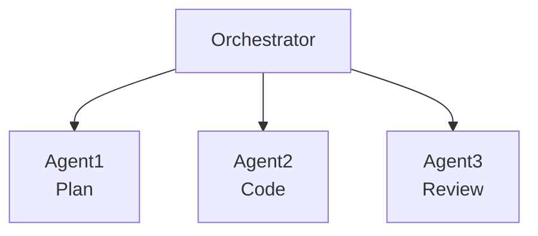
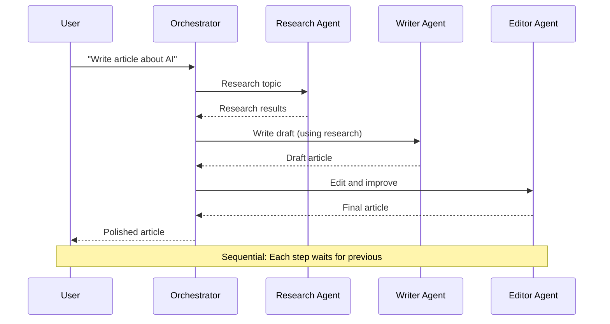
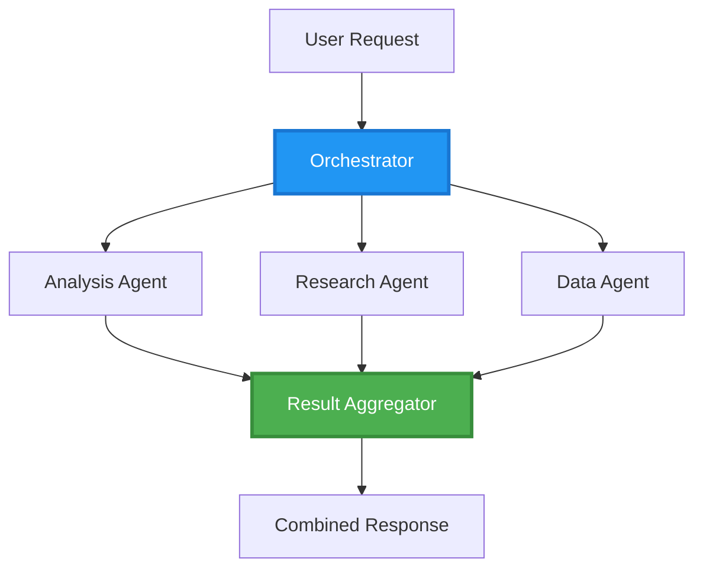
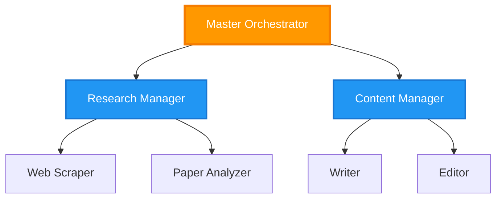
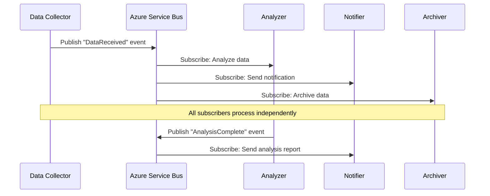
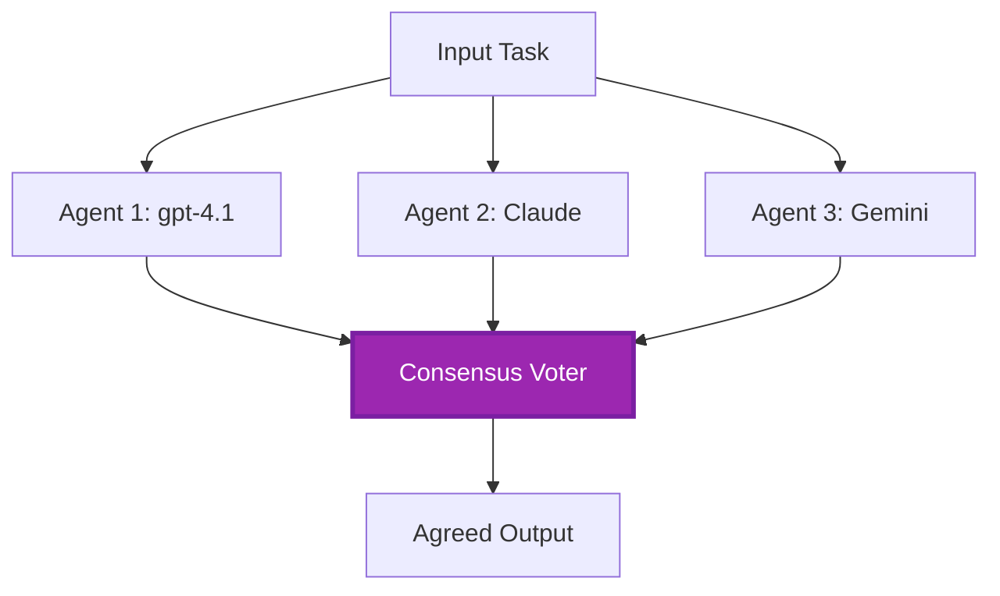
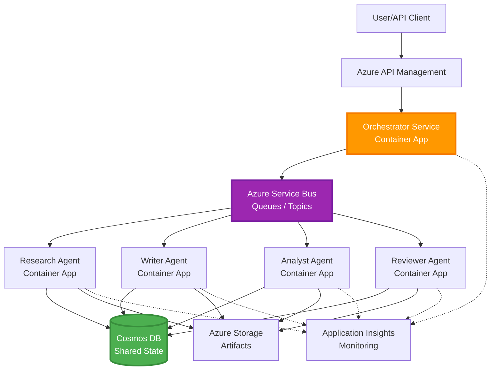

# Patrones de Coordinación Multi-Agente

⏱️ **Tiempo Estimado**: 60-75 minutos de lectura; varias horas para implementar | 💰 **Costo Estimado**: depende de la carga de trabajo | ⭐ **Complejidad**: Avanzado

**📚 Ruta de Aprendizaje:**
- ← Anterior: [Planificación de Capacidad](capacity-planning.md) - Estrategias de dimensionamiento y escalado de recursos
- 🎯 **Estás Aquí**: Patrones de Coordinación Multi-Agente (Orquestación, comunicación, gestión de estado)
- → Siguiente: [Selección de SKU](sku-selection.md) - Cómo elegir los servicios adecuados de Azure
- 🏠 [Inicio del Curso](../../README.md)

---

## Lo Que Aprenderás

Al completar esta lección, podrás:
- Entender patrones de **arquitectura multi-agente** y cuándo utilizarlos
- Implementar **patrones de orquestación** (centralizada, descentralizada, jerárquica)
- Diseñar estrategias de **comunicación entre agentes** (síncrona, asíncrona, basada en eventos)
- Gestionar **estado compartido** entre agentes distribuidos
- Desplegar **sistemas multi-agente** en Azure con AZD
- Aplicar **patrones de coordinación** en escenarios reales de IA
- Monitorizar y depurar sistemas distribuidos de agentes

## Por qué es Importante la Coordinación Multi-Agente

### La Evolución: De un Agente Único a Multi-Agente

**Agente Único (Simple):**
```
User → Agent → Response
```
- ✅ Fácil de entender e implementar
- ✅ Rápido para tareas simples
- ❌ Limitado por las capacidades de un solo modelo
- ❌ No permite paralelizar tareas complejas
- ❌ Sin especialización

**Sistema Multi-Agente (Avanzado):**

- ✅ Agentes especializados para tareas específicas
- ✅ Ejecución paralela para mayor velocidad
- ✅ Modular y mantenible
- ✅ Mejor para flujos de trabajo complejos
- ⚠️ Requiere lógica de coordinación

**Analogía**: Un agente único es como una persona haciendo todas las tareas. El multi-agente es como un equipo donde cada miembro tiene habilidades especializadas (investigador, programador, revisor, escritor) trabajando en conjunto.

---

## Patrones Fundamentales de Coordinación

### Patrón 1: Coordinación Secuencial (Cadena de Responsabilidad)

**Cuándo usarlo**: Las tareas deben completarse en un orden específico, cada agente construye sobre la salida del anterior.



**Beneficios:**
- ✅ Flujo de datos claro
- ✅ Fácil de depurar
- ✅ Orden de ejecución predecible

**Limitaciones:**
- ❌ Más lento (sin paralelismo)
- ❌ Una falla bloquea toda la cadena
- ❌ No puede manejar tareas interdependientes

**Ejemplos de Uso:**
- Pipeline de creación de contenido (investigar → escribir → editar → publicar)
- Generación de código (planificar → implementar → probar → desplegar)
- Generación de informes (recolección de datos → análisis → visualización → resumen)

---

### Patrón 2: Coordinación Paralela (Fan-Out/Fan-In)

**Cuándo usarlo**: Las tareas independientes pueden ejecutarse simultáneamente, los resultados se combinan al final.



**Beneficios:**
- ✅ Rápido (ejecución en paralelo)
- ✅ Tolerante a fallos (resultados parciales aceptables)
- ✅ Escalable horizontalmente

**Limitaciones:**
- ⚠️ Los resultados pueden llegar fuera de orden
- ⚠️ Requiere lógica de agregación
- ⚠️ Gestión de estado compleja

**Ejemplos de Uso:**
- Recopilación de datos de múltiples fuentes (APIs + bases de datos + web scraping)
- Análisis competitivo (múltiples modelos generan soluciones, se selecciona la mejor)
- Servicios de traducción (traducción a varios idiomas simultáneamente)

---

### Patrón 3: Coordinación Jerárquica (Gerente-Empleado)

**Cuándo usarlo**: Flujos de trabajo complejos con sub-tareas, se necesita delegación.



**Beneficios:**
- ✅ Maneja flujos de trabajo complejos
- ✅ Modular y mantenible
- ✅ Límites claros de responsabilidad

**Limitaciones:**
- ⚠️ Arquitectura más compleja
- ⚠️ Latencia mayor (múltiples capas de coordinación)
- ⚠️ Requiere orquestación sofisticada

**Ejemplos de Uso:**
- Procesamiento empresarial de documentos (clasificar → enrutar → procesar → archivar)
- Pipelines de datos multi-etapa (ingesta → limpieza → transformación → análisis → reporte)
- Flujos de automatización complejos (planificación → asignación de recursos → ejecución → monitoreo)

---

### Patrón 4: Coordinación Basada en Eventos (Publicar-Suscribir)

**Cuándo usarlo**: Los agentes deben reaccionar a eventos, se desea acoplamiento débil.



**Beneficios:**
- ✅ Acoplamiento débil entre agentes
- ✅ Fácil añadir nuevos agentes (solo suscribirse)
- ✅ Procesamiento asíncrono
- ✅ Resiliente (persistencia de mensajes)

**Limitaciones:**
- ⚠️ Consistencia eventual
- ⚠️ Depuración compleja
- ⚠️ Desafíos en el orden de mensajes

**Ejemplos de Uso:**
- Sistemas de monitoreo en tiempo real (alertas, paneles, registros)
- Notificaciones multicanal (correo, SMS, push, Slack)
- Pipelines de procesamiento de datos (múltiples consumidores de los mismos datos)

---

### Patrón 5: Coordinación Basada en Consenso (Votación/Quórum)

**Cuándo usarlo**: Se necesita acuerdo de varios agentes antes de continuar.



**Beneficios:**
- ✅ Mayor precisión (múltiples opiniones)
- ✅ Tolerante a fallos (fallas minoritarias aceptables)
- ✅ Aseguramiento de calidad incorporado

**Limitaciones:**
- ❌ Costoso (múltiples llamadas a modelos)
- ❌ Más lento (espera a todos los agentes)
- ⚠️ Se requiere resolución de conflictos

**Ejemplos de Uso:**
- Moderación de contenido (múltiples modelos revisan contenido)
- Revisión de código (múltiples linters/analizadores)
- Diagnóstico médico (múltiples modelos de IA, validación experta)

---

## Visión General de la Arquitectura

### Sistema Multi-Agente Completo en Azure



**Componentes Clave:**

| Componente | Propósito | Servicio de Azure |
|-----------|---------|---------------|
| **API Gateway** | Punto de entrada, limitación de tasa, autenticación | API Management |
| **Orquestador** | Coordina los flujos de trabajo de los agentes | Container Apps |
| **Cola de Mensajes** | Comunicación asíncrona | Service Bus / Event Hubs |
| **Agentes** | Trabajadores de IA especializados | Container Apps / Functions |
| **Almacenamiento de Estado** | Estado compartido, seguimiento de tareas | Cosmos DB |
| **Almacenamiento de Artefactos** | Documentos, resultados, registros | Blob Storage |
| **Monitorización** | Trazabilidad distribuida, registros | Application Insights |

Las colas/temas de Service Bus y Event Hubs son servicios diferentes con modelos de entrega/consumo distintos; Event Hubs no es un reemplazo directo para el código del trabajador de Service Bus a continuación. El paralelismo, mensajes persistidos y votación de modelos por sí solos no garantizan tolerancia a fallos o mayor precisión.

---

## Prerrequisitos

### Herramientas Requeridas

```bash
# Verify Azure Developer CLI
azd version
# Command reference baseline: azd 1.37.2

# Verify Azure CLI
az --version
# ✅ Expected: azure-cli 2.50.0 or higher

# Verify Docker (for local testing)
docker --version
# ✅ Expected: Docker version 20.10 or higher
```

### Requisitos de Azure

- Suscripción activa de Azure
- Permisos para crear:
  - Container Apps
  - Espacios de nombres de Service Bus
  - Cuentas de Cosmos DB
  - Cuentas de almacenamiento
  - Application Insights

### Prerrequisitos de Conocimientos

Debes haber completado:
- [Gestión de Configuración](../chapter-03-configuration/configuration.md)
- [Autenticación y Seguridad](../chapter-03-configuration/authsecurity.md)
- [Ejemplo de Microservicios](../../../../examples/microservices)

---

## Guía de Implementación

> **Fragmentos de diseño, no un laboratorio desplegable:** El árbol del proyecto y las etiquetas `File:` a continuación describen archivos para crear en tu propio proyecto; este repositorio no contiene una aplicación completa `multi-agent-system`. Faltan piezas como plantillas main/parameter, entorno/registro de Container Apps, Dockerfiles y bloqueos de dependencias, configuración de base de datos/contenedor Cosmos, despliegues de modelos, configuración de identidad/roles, reglas de escalado y trabajadores/colas en paralelo. No esperes que `azd init` genere estos archivos o que `azd up` despliegue los fragmentos sin cambios. Para un punto de partida ejecutable, completa [Fundamentos Multi-Agente](../chapter-05-multi-agent/multi-agent-basics.md).

**Suposiciones en tiempo de ejecución:** Python 3.10+, `azure-servicebus`, `azure-cosmos`, `openai`, Flask, y (para monitorización) `azure-monitor-opentelemetry`; pon `shared` en la ruta de importación de Python en cada imagen de servicio. El contenedor `agent-state/tasks` de Cosmos debe existir ya con clave de partición `/id`. Las conexiones basadas en clave simplifican estos fragmentos, no son recomendación para producción: prefiere identidades gestionadas con roles de plano de datos Service Bus/Cosmos/OpenAI con permisos limitados. No expongas claves en salidas o logs.

La entrega de Service Bus es **al menos una vez**. Mantén idempotencia por tarea **y paso**, usa concurrencia optimista (ETags) para leer/modificar/escribir estado, y renueva bloqueos de mensaje durante procesamiento largo. El administrador de estado simple abajo es solo secuencial y no aplica estas garantías de producción.

### Estructura del Proyecto

```
multi-agent-system/
├── azure.yaml                    # AZD configuration
├── infra/
│   ├── main.bicep               # Main infrastructure
│   ├── core/
│   │   ├── servicebus.bicep     # Message queue
│   │   ├── cosmos.bicep         # State store
│   │   ├── storage.bicep        # Artifact storage
│   │   └── monitoring.bicep     # Application Insights
│   └── app/
│       ├── orchestrator.bicep   # Orchestrator service
│       └── agent.bicep          # Agent template
└── src/
    ├── orchestrator/            # Orchestration logic
    │   ├── app.py
    │   ├── workflows.py
    │   └── Dockerfile
    ├── agents/
    │   ├── research/            # Research agent
    │   ├── writer/              # Writer agent
    │   ├── analyst/             # Analyst agent
    │   └── reviewer/            # Reviewer agent
    └── shared/
        ├── state_manager.py     # Shared state logic
        └── message_handler.py   # Message handling
```

---

## Lección 1: Patrón de Coordinación Secuencial

### Implementación: Pipeline de Creación de Contenido

Diseñemos un pipeline secuencial: Investigar → Escribir → Editar. La publicación queda fuera de este ejemplo.

### 1. Configuración AZD

**Archivo: `azure.yaml`**

```yaml
name: content-pipeline
metadata:
  template: multi-agent-sequential@1.0.0

services:
  orchestrator:
    project: ./src/orchestrator
    language: python
    host: containerapp
  
  research-agent:
    project: ./src/agents/research
    language: python
    host: containerapp
  
  writer-agent:
    project: ./src/agents/writer
    language: python
    host: containerapp
  
  editor-agent:
    project: ./src/agents/editor
    language: python
    host: containerapp
```

### 2. Infraestructura: Service Bus para Coordinación

**Archivo: `infra/core/servicebus.bicep`**

```bicep
param name string
param location string
param tags object = {}

resource serviceBusNamespace 'Microsoft.ServiceBus/namespaces@2022-10-01-preview' = {
  name: name
  location: location
  tags: tags
  sku: {
    name: 'Standard'
    tier: 'Standard'
  }
  properties: {
    minimumTlsVersion: '1.2'
  }
}

// Queue for orchestrator → research agent
resource researchQueue 'Microsoft.ServiceBus/namespaces/queues@2022-10-01-preview' = {
  parent: serviceBusNamespace
  name: 'research-tasks'
  properties: {
    maxDeliveryCount: 3
    lockDuration: 'PT5M'
    deadLetteringOnMessageExpiration: true
  }
}

// Queue for research agent → writer agent
resource writerQueue 'Microsoft.ServiceBus/namespaces/queues@2022-10-01-preview' = {
  parent: serviceBusNamespace
  name: 'writer-tasks'
  properties: {
    maxDeliveryCount: 3
    lockDuration: 'PT5M'
  }
}

// Queue for writer agent → editor agent
resource editorQueue 'Microsoft.ServiceBus/namespaces/queues@2022-10-01-preview' = {
  parent: serviceBusNamespace
  name: 'editor-tasks'
  properties: {
    maxDeliveryCount: 3
    lockDuration: 'PT5M'
  }
}

output namespace string = serviceBusNamespace.name
// Do not output RootManageSharedAccessKey. Resolve scoped credentials
// securely or use managed identity in the application and scale rules.
```

### 3. Administrador de Estado Compartido

**Archivo: `src/shared/state_manager.py`**

```python
from azure.cosmos import CosmosClient, PartitionKey
from datetime import datetime, timezone
import os

class StateManager:
    """Manages shared state across agents using Cosmos DB"""
    
    def __init__(self):
        endpoint = os.environ['COSMOS_ENDPOINT']
        key = os.environ['COSMOS_KEY']
        
        self.client = CosmosClient(endpoint, key)
        self.database = self.client.get_database_client('agent-state')
        self.container = self.database.get_container_client('tasks')
    
    def create_task(self, task_id: str, task_type: str, input_data: dict):
        """Create a new task"""
        task = {
            'id': task_id,
            'type': task_type,
            'status': 'pending',
            'input': input_data,
            'created_at': datetime.now(timezone.utc).isoformat(),
            'steps': []
        }
        self.container.create_item(task)
        return task
    
    def update_task_step(self, task_id: str, step_name: str, result: dict):
        """Update task with completed step"""
        task = self.container.read_item(task_id, partition_key=task_id)
        
        task['steps'].append({
            'name': step_name,
            'completed_at': datetime.now(timezone.utc).isoformat(),
            'result': result
        })
        
        self.container.replace_item(task_id, task)
        return task
    
    def complete_task(self, task_id: str, final_result: dict):
        """Mark task as complete"""
        task = self.container.read_item(task_id, partition_key=task_id)
        task['status'] = 'completed'
        task['result'] = final_result
        task['completed_at'] = datetime.now(timezone.utc).isoformat()
        self.container.replace_item(task_id, task)
        return task
    
    def get_task(self, task_id: str):
        """Retrieve task state"""
        return self.container.read_item(task_id, partition_key=task_id)
```

### 4. Servicio Orquestador

**Archivo: `src/orchestrator/app.py`**

```python
from flask import Flask, request, jsonify
from azure.servicebus import ServiceBusClient, ServiceBusMessage
import json
import uuid
import os
from shared.state_manager import StateManager

app = Flask(__name__)
state_manager = StateManager()

# Service Bus connection
servicebus_connection_str = os.environ['SERVICEBUS_CONNECTION_STRING']
servicebus_client = ServiceBusClient.from_connection_string(servicebus_connection_str)

@app.route('/health', methods=['GET'])
def health():
    return jsonify({'status': 'healthy', 'service': 'orchestrator'})

@app.route('/create-content', methods=['POST'])
def create_content():
    """
    Sequential workflow: Research → Write → Edit (returns a draft; no publishing)
    """
    data = request.get_json(silent=True) or {}
    topic = data.get('topic')
    
    if not topic:
        return jsonify({'error': 'Topic required'}), 400
    
    # Create task in state store
    task_id = str(uuid.uuid4())
    task = state_manager.create_task(
        task_id=task_id,
        task_type='content_creation',
        input_data={'topic': topic}
    )
    
    # Send message to research agent (first step)
    sender = servicebus_client.get_queue_sender('research-tasks')
    message = ServiceBusMessage(
        body=json.dumps({
            'task_id': task_id,
            'topic': topic,
            'next_queue': 'writer-tasks'  # Where to send results
        }),
        content_type='application/json'
    )
    
    with sender:
        sender.send_messages(message)
    
    return jsonify({
        'task_id': task_id,
        'status': 'started',
        'workflow': 'sequential',
        'steps': ['research', 'write', 'edit'],
        'message': 'Content creation pipeline initiated'
    }), 202

@app.route('/task/<task_id>', methods=['GET'])
def get_task_status(task_id):
    """Check task status"""
    try:
        task = state_manager.get_task(task_id)
        return jsonify(task)
    except Exception as e:
        return jsonify({'error': str(e)}), 404

if __name__ == '__main__':
    app.run(host='0.0.0.0', port=8080)
```

### 5. Agente Investigador

**Archivo: `src/agents/research/app.py`**

```python
from azure.servicebus import ServiceBusClient, ServiceBusMessage
from openai import AzureOpenAI
import json
import os
import time
from shared.state_manager import StateManager

# Initialize clients
state_manager = StateManager()
servicebus_client = ServiceBusClient.from_connection_string(
    os.environ['SERVICEBUS_CONNECTION_STRING']
)

openai_client = AzureOpenAI(
    api_key=os.environ['AZURE_OPENAI_API_KEY'],
    api_version="2024-10-21",
    azure_endpoint=os.environ['AZURE_OPENAI_ENDPOINT']
)

def process_research_task(message_data):
    """Process research request and pass to writer"""
    task_id = message_data['task_id']
    topic = message_data['topic']
    next_queue = message_data['next_queue']
    
    print(f"🔬 Researching: {topic}")
    
    # Call Microsoft Foundry Models for research
    response = openai_client.chat.completions.create(
        model=os.environ['AZURE_OPENAI_DEPLOYMENT'],
        messages=[
            {"role": "system", "content": "You are a research assistant. Provide comprehensive research on the given topic."},
            {"role": "user", "content": f"Research this topic thoroughly: {topic}"}
        ],
        max_tokens=1500
    )
    
    research_results = response.choices[0].message.content
    
    # Update state
    state_manager.update_task_step(
        task_id=task_id,
        step_name='research',
        result={'research': research_results}
    )
    
    # Send to next agent (writer)
    sender = servicebus_client.get_queue_sender(next_queue)
    message = ServiceBusMessage(
        body=json.dumps({
            'task_id': task_id,
            'topic': topic,
            'research': research_results,
            'next_queue': 'editor-tasks'
        }),
        content_type='application/json'
    )
    
    with sender:
        sender.send_messages(message)
    
    print(f"✅ Research complete for task {task_id}")

def main():
    """Listen to research queue"""
    receiver = servicebus_client.get_queue_receiver('research-tasks')
    
    print("🔬 Research Agent started, listening for tasks...")
    
    with receiver:
        while True:
            messages = receiver.receive_messages(max_wait_time=5)
            for message in messages:
                try:
                    message_data = json.loads(str(message))
                    process_research_task(message_data)
                    receiver.complete_message(message)
                except Exception as e:
                    print(f"❌ Error processing message: {e}")
                    receiver.abandon_message(message)

if __name__ == '__main__':
    main()
```

### 6. Agente Escritor

**Archivo: `src/agents/writer/app.py`**

```python
from azure.servicebus import ServiceBusClient, ServiceBusMessage
from openai import AzureOpenAI
import json
import os
from shared.state_manager import StateManager

state_manager = StateManager()
servicebus_client = ServiceBusClient.from_connection_string(
    os.environ['SERVICEBUS_CONNECTION_STRING']
)

openai_client = AzureOpenAI(
    api_key=os.environ['AZURE_OPENAI_API_KEY'],
    api_version="2024-10-21",
    azure_endpoint=os.environ['AZURE_OPENAI_ENDPOINT']
)

def process_writing_task(message_data):
    """Write article based on research"""
    task_id = message_data['task_id']
    topic = message_data['topic']
    research = message_data['research']
    next_queue = message_data['next_queue']
    
    print(f"✍️ Writing article: {topic}")
    
    # Call Microsoft Foundry Models to write article
    response = openai_client.chat.completions.create(
        model=os.environ['AZURE_OPENAI_DEPLOYMENT'],
        messages=[
            {"role": "system", "content": "You are a professional writer. Write engaging, well-structured articles."},
            {"role": "user", "content": f"Based on this research:\n\n{research}\n\nWrite a comprehensive article about: {topic}"}
        ],
        max_tokens=2000
    )
    
    article_draft = response.choices[0].message.content
    
    # Update state
    state_manager.update_task_step(
        task_id=task_id,
        step_name='writing',
        result={'draft': article_draft}
    )
    
    # Send to editor
    sender = servicebus_client.get_queue_sender(next_queue)
    message = ServiceBusMessage(
        body=json.dumps({
            'task_id': task_id,
            'topic': topic,
            'draft': article_draft
        }),
        content_type='application/json'
    )
    
    with sender:
        sender.send_messages(message)
    
    print(f"✅ Article draft complete for task {task_id}")

def main():
    """Listen to writer queue"""
    receiver = servicebus_client.get_queue_receiver('writer-tasks')
    
    print("✍️ Writer Agent started, listening for tasks...")
    
    with receiver:
        while True:
            messages = receiver.receive_messages(max_wait_time=5)
            for message in messages:
                try:
                    message_data = json.loads(str(message))
                    process_writing_task(message_data)
                    receiver.complete_message(message)
                except Exception as e:
                    print(f"❌ Error: {e}")
                    receiver.abandon_message(message)

if __name__ == '__main__':
    main()
```

### 7. Agente Editor

**Archivo: `src/agents/editor/app.py`**

```python
from azure.servicebus import ServiceBusClient
from openai import AzureOpenAI
import json
import os
from shared.state_manager import StateManager

state_manager = StateManager()
servicebus_client = ServiceBusClient.from_connection_string(
    os.environ['SERVICEBUS_CONNECTION_STRING']
)

openai_client = AzureOpenAI(
    api_key=os.environ['AZURE_OPENAI_API_KEY'],
    api_version="2024-10-21",
    azure_endpoint=os.environ['AZURE_OPENAI_ENDPOINT']
)

def process_editing_task(message_data):
    """Edit and finalize article"""
    task_id = message_data['task_id']
    topic = message_data['topic']
    draft = message_data['draft']
    
    print(f"📝 Editing article: {topic}")
    
    # Call Microsoft Foundry Models to edit
    response = openai_client.chat.completions.create(
        model=os.environ['AZURE_OPENAI_DEPLOYMENT'],
        messages=[
            {"role": "system", "content": "You are an expert editor. Improve grammar, clarity, and structure."},
            {"role": "user", "content": f"Edit and improve this article:\n\n{draft}"}
        ],
        max_tokens=2000
    )
    
    final_article = response.choices[0].message.content
    
    # Mark task as complete
    state_manager.complete_task(
        task_id=task_id,
        final_result={
            'topic': topic,
            'final_article': final_article,
            'word_count': len(final_article.split())
        }
    )
    
    print(f"✅ Article finalized for task {task_id}")

def main():
    """Listen to editor queue"""
    receiver = servicebus_client.get_queue_receiver('editor-tasks')
    
    print("📝 Editor Agent started, listening for tasks...")
    
    with receiver:
        while True:
            messages = receiver.receive_messages(max_wait_time=5)
            for message in messages:
                try:
                    message_data = json.loads(str(message))
                    process_editing_task(message_data)
                    receiver.complete_message(message)
                except Exception as e:
                    print(f"❌ Error: {e}")
                    receiver.abandon_message(message)

if __name__ == '__main__':
    main()
```

### 8. Desplegar y Probar

Estos comandos se aplican **solo después de que implementes los archivos faltantes del proyecto**. La inicialización del agente Foundry interactiva es un flujo de trabajo separado; no genera este diseño de Service Bus.

```bash
# In your completed custom project
azd up

# Alternative in a SEPARATE empty folder (agents beta.23 requires azd >= 1.37)
azd extension install azure.ai.agents
azd ai agent init
azd up
```

> Consulta [Comandos AZD AI CLI](../chapter-08-production/production-ai-practices.md#azd-ai-cli-commands-and-extensions) para todas las banderas y opciones `azd ai`.

```bash
# Get orchestrator URL
ORCHESTRATOR_URL=$(azd env get-values | grep ORCHESTRATOR_URL | cut -d '=' -f2 | tr -d '"')

# Create content
curl -X POST $ORCHESTRATOR_URL/create-content \
  -H "Content-Type: application/json" \
  -d '{"topic": "The Future of AI in Healthcare"}'
```

**✅ Salida esperada:**
```json
{
  "task_id": "a1b2c3d4-e5f6-7890-abcd-ef1234567890",
  "status": "started",
  "workflow": "sequential",
  "steps": ["research", "write", "edit"],
  "message": "Content creation pipeline initiated"
}
```

**Verifica el progreso de la tarea:**
```bash
TASK_ID="a1b2c3d4-e5f6-7890-abcd-ef1234567890"
curl $ORCHESTRATOR_URL/task/$TASK_ID
```

**✅ Salida esperada (completado):**
```json
{
  "id": "a1b2c3d4-e5f6-7890-abcd-ef1234567890",
  "type": "content_creation",
  "status": "completed",
  "steps": [
    {
      "name": "research",
      "completed_at": "2025-11-19T10:30:00Z",
      "result": {"research": "..."}
    },
    {
      "name": "writing",
      "completed_at": "2025-11-19T10:32:00Z",
      "result": {"draft": "..."}
    }
  ],
  "result": {
    "topic": "The Future of AI in Healthcare",
    "final_article": "...",
    "word_count": 1500
  }
}
```

---

## Lección 2: Patrón de Coordinación Paralela

### Implementación: Agregador de Investigación Multi-Fuente

Construyamos un sistema paralelo que reúna información de múltiples fuentes simultáneamente.

### Orquestador Paralelo

**Archivo: `src/orchestrator/parallel_workflow.py`**

```python
from flask import Flask, request, jsonify
from azure.servicebus import ServiceBusClient, ServiceBusMessage
import json
import uuid
import os
from shared.state_manager import StateManager

app = Flask(__name__)
state_manager = StateManager()

servicebus_client = ServiceBusClient.from_connection_string(
    os.environ['SERVICEBUS_CONNECTION_STRING']
)

@app.route('/research-parallel', methods=['POST'])
def research_parallel():
    """
    Parallel workflow: Multiple agents work simultaneously
    """
    data = request.json
    query = data.get('query')
    
    task_id = str(uuid.uuid4())
    task = state_manager.create_task(
        task_id=task_id,
        task_type='parallel_research',
        input_data={
            'query': query,
            'agents': ['web', 'academic', 'news', 'social']
        }
    )
    
    # Fan-out: publish sequentially; workers may process concurrently.
    agents = [
        ('web-research-queue', 'web'),
        ('academic-research-queue', 'academic'),
        ('news-research-queue', 'news'),
        ('social-research-queue', 'social')
    ]
    
    for queue_name, agent_type in agents:
        sender = servicebus_client.get_queue_sender(queue_name)
        message = ServiceBusMessage(
            body=json.dumps({
                'task_id': task_id,
                'query': query,
                'agent_type': agent_type,
                'result_queue': 'aggregation-queue'
            }),
            content_type='application/json'
        )
        
        with sender:
            sender.send_messages(message)
    
    return jsonify({
        'task_id': task_id,
        'status': 'started',
        'workflow': 'parallel',
        'agents_dispatched': 4,
        'message': 'Parallel research initiated'
    }), 202

if __name__ == '__main__':
    app.run(host='0.0.0.0', port=8080)
```

### Lógica de Agregación

**Archivo: `src/agents/aggregator/app.py`**

```python
from azure.servicebus import ServiceBusClient
import json
import os
from collections import defaultdict
from shared.state_manager import StateManager

state_manager = StateManager()
servicebus_client = ServiceBusClient.from_connection_string(
    os.environ['SERVICEBUS_CONNECTION_STRING']
)

# Single-process demo only: not durable or shared across replicas.
# Production: use durable unique (task_id, agent_type) result records.
task_results = defaultdict(dict)
expected_agents = 4  # web, academic, news, social

def process_result(message_data):
    """Aggregate results from parallel agents"""
    task_id = message_data['task_id']
    agent_type = message_data['agent_type']
    result = message_data['result']
    
    # Store result
    task_results[task_id][agent_type] = {
        'agent': agent_type,
        'data': result
    }
    
    print(f"📊 Received result from {agent_type} agent ({len(task_results[task_id])}/{expected_agents})")
    
    # Check if all agents completed (fan-in)
    if len(task_results[task_id]) == expected_agents:
        print(f"✅ All agents completed for task {task_id}. Aggregating...")
        
        # Combine results
        aggregated = {
            'query': message_data['query'],
            'sources': list(task_results[task_id].values()),
            'summary': generate_summary(list(task_results[task_id].values()))
        }
        
        # Mark complete
        state_manager.complete_task(task_id, aggregated)
        
        # Clean up
        del task_results[task_id]
        
        print(f"✅ Aggregation complete for task {task_id}")

def generate_summary(results):
    """Generate summary from all sources"""
    summaries = [r['data'].get('summary', '') for r in results]
    return '\n\n'.join(summaries)

def main():
    """Listen to aggregation queue"""
    receiver = servicebus_client.get_queue_receiver('aggregation-queue')
    
    print("📊 Aggregator started, listening for results...")
    
    with receiver:
        while True:
            messages = receiver.receive_messages(max_wait_time=5)
            for message in messages:
                try:
                    message_data = json.loads(str(message))
                    process_result(message_data)
                    receiver.complete_message(message)
                except Exception as e:
                    print(f"❌ Error: {e}")
                    receiver.abandon_message(message)

if __name__ == '__main__':
    main()
```

**Beneficios del Patrón Paralelo:**
- ⚡ **Potencialmente menor latencia** (limitado por el trabajador más lento más la sobrecarga de coordinación)
- 🔄 **Puede soportar resultados parciales** con fechas límite explícitas y política de fallos (no implementado por el agregador básico)
- 📈 **Escalable** (fácil agregar más agentes)

---

## Ejercicios Prácticos

### Ejercicio 1: Agregar Manejo de Timeout ⭐⭐ (Medio)

**Objetivo**: Implementar lógica de timeout para que el agregador no espere indefinidamente a agentes lentos.

**Punto de partida:** Ejecuta esta simulación local de fecha límite antes de integrarla en un trabajador de cola. Un timeout chequeado solo cuando llega otro mensaje nunca se dispara si el trabajador faltante no envía nada.

**Pasos**:

1. **Agregar seguimiento de timeout al agregador:**

```python
import asyncio

async def simulated_agent(name, delay):
    await asyncio.sleep(delay)
    return {'agent': name, 'result': 'done'}

async def main():
    tasks = [asyncio.create_task(simulated_agent(name, delay))
             for name, delay in [('web', 0.1), ('academic', 0.2),
                                 ('news', 0.3), ('social', 3)]]
    done, pending = await asyncio.wait(tasks, timeout=1)
    results = [task.result() for task in done]
    for task in pending:
        task.cancel()
    await asyncio.gather(*pending, return_exceptions=True)
    print({'completed_agents': len(results), 'timed_out': bool(pending)})
    assert len(results) == 3 and pending

asyncio.run(main())
```

2. **Salida esperada:**

```text
{'completed_agents': 3, 'timed_out': True}
```

3. **Integración con sistema de colas (tarea de diseño):** Persiste la fecha límite de despacho y los agentes esperados al crear la tarea, ejecuta un barrido periódico de fecha límite independiente de los resultados entrantes, finaliza atómicamente resultados parciales y ignora mensajes tardíos/duplicados para tareas finalizadas. Un timeout local no cancela trabajadores remotos.

Solo para tu proyecto implementado:

```bash
azd deploy aggregator

# Submit task
curl -X POST $ORCHESTRATOR_URL/research-parallel \
  -H "Content-Type: application/json" \
  -d '{"query": "AI safety research"}'

# Check results after 30 seconds
curl $ORCHESTRATOR_URL/task/$TASK_ID
```

**✅ Criterios de éxito:**
- ✅ La prueba local retorna después de su fecha límite de un segundo incluso si un agente está incompleto
- ✅ La respuesta indica resultados parciales (`"timed_out": true`)
- ✅ Se retornan resultados disponibles (3 de 4 agentes)

**Tiempo**: 20-25 minutos

---

### Ejercicio 2: Implementar Lógica de Reintentos ⭐⭐⭐ (Avanzado)

**Objetivo**: Reintentar automáticamente tareas de agentes fallidos antes de rendirse.

**Pasos**:

1. **Usar conteos de entrega de Service Bus en lugar de contar reintentos personalizados:**

```python
import json
import time
# Integration fragment: use a live peek-lock ServiceBusReceiver.
# Set queue maxDeliveryCount to 4 for one attempt + up to three retries.
```

2. **Agregar manejador de reintentos a agentes:**

```python
def process_with_retry(message, receiver, process_func):
    """Process message with automatic retry on failure"""
    try:
        message_data = json.loads(str(message))
        
        # Process the message
        process_func(message_data)
        
        # Success - complete
        receiver.complete_message(message)
        
    except Exception as e:
        if message.delivery_count < 4:
            # Bounded exponential delay: 5s, 10s, 20s.
            # Renew the lock if processing + waiting can exceed its duration.
            time.sleep(5 * 2 ** (message.delivery_count - 1))
            receiver.abandon_message(message)
        else:
            # Max retries exceeded - move to dead letter queue
            print(f"❌ Max attempts exceeded for message {message.message_id}")
            receiver.dead_letter_message(
                message,
                reason="MaxRetriesExceeded",
                error_description=str(e)
            )
```

3. **Monitorear cola de letras muertas:**

```python
def monitor_dead_letters():
    """Check dead letter queue for failed messages"""
    receiver = servicebus_client.get_queue_receiver(
        'research-tasks',
        sub_queue='deadletter'
    )
    
    with receiver:
        messages = receiver.receive_messages(max_wait_time=5)
        for message in messages:
            print(f"☠️ Dead letter: {message.message_id}")
            print(f"Reason: {message.dead_letter_reason}")
            print(f"Description: {message.dead_letter_error_description}")
```

**✅ Criterios de éxito:**
- ✅ Las tareas fallidas reintentan automáticamente (hasta 3 veces)
- ✅ Retroceso exponencial entre reintentos (5s, 10s, 20s), con renovación de bloqueo de mensaje donde sea necesario
- ✅ Después de reintentos máximos, los mensajes van a la cola de letras muertas
- ✅ Los mensajes en letras muertas pueden ser inspeccionados; la repetición necesita flujo de recuperación idempotente separado

**Tiempo**: 30-40 minutos

---

### Ejercicio 3: Implementar Interruptor de Circuito ⭐⭐⭐ (Avanzado)

**Objetivo**: Evitar fallas en cascada deteniendo solicitudes a agentes fallidos.

**Pasos**:

1. **Crear clase de interruptor de circuito:**

```python
from enum import Enum
from datetime import datetime, timedelta, timezone

class CircuitState(Enum):
    CLOSED = "closed"      # Normal operation
    OPEN = "open"          # Failing, reject requests
    HALF_OPEN = "half_open"  # Testing if recovered

class CircuitBreaker:
    def __init__(self, failure_threshold=5, timeout_seconds=60):
        self.failure_threshold = failure_threshold
        self.timeout_seconds = timeout_seconds
        self.failure_count = 0
        self.last_failure_time = None
        self.state = CircuitState.CLOSED
    
    def call(self, func):
        """Execute function with circuit breaker protection"""
        if self.state == CircuitState.OPEN:
            # Check if timeout expired
            if datetime.now(timezone.utc) - self.last_failure_time > timedelta(seconds=self.timeout_seconds):
                self.state = CircuitState.HALF_OPEN
                print("🔄 Circuit breaker: HALF_OPEN (testing)")
            else:
                raise Exception(f"Circuit breaker OPEN for agent. Try again in {self.timeout_seconds}s")
        
        try:
            result = func()
            
            # Success
            self.failure_count = 0 # Count consecutive failures only
            if self.state == CircuitState.HALF_OPEN:
                self.state = CircuitState.CLOSED
                self.failure_count = 0
                print("✅ Circuit breaker: CLOSED (recovered)")
            
            return result
            
        except Exception as e:
            self.failure_count += 1
            self.last_failure_time = datetime.now(timezone.utc)
            
            if self.failure_count >= self.failure_threshold:
                self.state = CircuitState.OPEN
                print(f"🔴 Circuit breaker: OPEN (too many failures)")
            
            raise
```

2. **Aplicar en las llamadas a agentes:**

```python
# In orchestrator
agent_circuits = {
    'web': CircuitBreaker(failure_threshold=5, timeout_seconds=60),
    'academic': CircuitBreaker(failure_threshold=5, timeout_seconds=60),
    'news': CircuitBreaker(failure_threshold=5, timeout_seconds=60),
    'social': CircuitBreaker(failure_threshold=5, timeout_seconds=60)
}

def send_to_agent(agent_type, message_data):
    """Send with circuit breaker protection"""
    circuit = agent_circuits[agent_type]
    
    try:
        circuit.call(lambda: send_message(agent_type, message_data))
    except Exception as e:
        print(f"⚠️ Skipping {agent_type} agent: {e}")
        # Continue with other agents
```

Este circuito protege la **operación de envío**, no la finalización por parte del trabajador remoto: encolar con éxito un mensaje no dice nada sobre si un agente está activo. `send_message` es la función de envío de tu aplicación. Para circuitos de ejecución, alimenta fallas/tiempos de espera de tareas observadas a un coordinador durable. Esta clase en memoria es una demostración de un solo hilo, no un interruptor de circuito distribuido.

3. **Prueba el interruptor de circuito localmente:**

```python
# Run after the class definition; no Azure changes required.
circuit = CircuitBreaker(failure_threshold=5, timeout_seconds=0)
def fail():
    raise RuntimeError("simulated failure")
for _ in range(5):
    try:
        circuit.call(fail)
    except RuntimeError:
        pass
assert circuit.state == CircuitState.OPEN
assert circuit.call(lambda: "recovered") == "recovered"
assert circuit.state == CircuitState.CLOSED
print("Circuit breaker recovery verified")
```

**✅ Criterios de éxito:**
- ✅ Después de 5 fallos, el circuito se abre (rechaza solicitudes)
- ✅ Después de 60 segundos, el circuito pasa a medio abierto (prueba la recuperación)
- ✅ Otros agentes continúan trabajando normalmente
- ✅ El circuito se cierra automáticamente cuando el agente se recupera

**Tiempo**: 40-50 minutos

---

## Monitoreo y Depuración

### Rastreo Distribuido con Application Insights

**Archivo: `src/shared/tracing.py`**

```python
from azure.monitor.opentelemetry import configure_azure_monitor
from opentelemetry import trace
from opentelemetry.trace import SpanKind
import logging
import os

connection_string = os.environ.get('APPLICATIONINSIGHTS_CONNECTION_STRING')

# Configure once per process. Message send/receive trace-context propagation
# and agent attributes on exceptions need explicit instrumentation.
if connection_string:
    configure_azure_monitor(connection_string=connection_string, logger_name=__name__)
tracer = trace.get_tracer(__name__)

# Configure logging
logger = logging.getLogger(__name__)
logger.setLevel(logging.INFO)

def trace_agent_call(agent_name, task_id, operation_name, operation):
    """Trace agent operations"""
    with tracer.start_as_current_span(f'agent.{agent_name}.{operation_name}', kind=SpanKind.CLIENT) as span:
        span.set_attribute('agent', agent_name)
        span.set_attribute('task_id', task_id)
        span.set_attribute('operation', operation_name)
        
        try:
            result = operation()
            span.set_attribute('status', 'success')
            logger.info('Agent operation completed', extra={
                'agent': agent_name, 'task_id': task_id, 'operation': operation_name
            })
            return result
        except Exception as e:
            span.set_attribute('status', 'error')
            logger.exception('Agent operation failed', extra={
                'agent': agent_name, 'task_id': task_id, 'operation': operation_name
            })
            raise
```

### Consultas de Application Insights

**Rastrea flujos de trabajo multi-agente:**

```kusto
// Trace complete workflow for a task
traces
| where customDimensions.task_id == "a1b2c3d4-..."
| project timestamp, message, customDimensions.agent, customDimensions.operation
| order by timestamp asc
```

**Comparación de rendimiento de agentes:**

```kusto
// Compare agent execution times
dependencies
| where name contains "agent"
| summarize 
    avg_duration = avg(duration),
    p95_duration = percentile(duration, 95),
    count = count()
  by agent = tostring(customDimensions.agent)
| order by avg_duration desc
```

**Análisis de fallos:**

```kusto
// Find which agents fail most
exceptions
| where customDimensions.agent != ""
| summarize 
    failure_count = count(),
    unique_errors = dcount(outerMessage)
  by agent = tostring(customDimensions.agent)
| order by failure_count desc
```

---

## Análisis de Costos

### Costos del Sistema Multi-Agente (Estimaciones Mensuales)

Cifras ilustrativas para planificación únicamente, no cotizaciones: la suma abajo es **$240-565/mes**. Verifica tarifas regionales actuales, horas activas/inactivas de réplicas, mezcla de tokens de entrada/salida, almacenamiento y telemetría. Serverless no tiene un mínimo de rendimiento aprovisionado pero aún factura por solicitudes y almacenamiento.

| Componente | Configuración | Costo |
|-----------|--------------|------|
| **Orquestador** | 1 Container App (1 vCPU, 2GB) | $30-50 |
| **4 Agentes** | 4 Container Apps (0.5 vCPU, 1GB cada uno) | $60-120 |
| **Service Bus** | Nivel estándar, 10M mensajes | $10-20 |
| **Cosmos DB** | Serverless, 5GB almacenamiento, 1M RUs | $25-50 |
| **Blob Storage** | 10GB almacenamiento, 100K operaciones | $5-10 |
| **Application Insights** | 5GB ingestión | $10-15 |
| **Microsoft Foundry Models** | gpt-4.1, 10M tokens | $100-300 |
| **Total** | | **$240-565/mes** |

### Estrategias de Optimización de Costos

1. **Usa serverless donde sea posible:**
   ```bicep
   // Cosmos DB serverless (no minimum cost)
   properties: {
     databaseAccountOfferType: 'Standard'
     capabilities: [{ name: 'EnableServerless' }]
   }
   ```

2. **Escala los agentes a cero cuando estén inactivos:**
   ```bicep
   scale: {
     minReplicas: 0  // Requires a Service Bus/KEDA scale rule to wake workers
     maxReplicas: 10
   }
   ```

3. **Usa procesamiento por lotes para Service Bus:**
   ```python
   # Send messages in batches (cheaper)
   sender.send_messages([message1, message2, message3])
   ```

4. **Cachea resultados de uso frecuente:**
   ```python
   # Use Azure Cache for Redis
   if cache.exists(query_hash):
       return cache.get(query_hash)
   ```

---

## Mejores Prácticas

### ✅ HACER:

1. **Usar operaciones idempotentes**
   ```python
   # Pseudocode: implement a durable, atomic per-step deduplication claim.
   def process_task(task_id):
       raise NotImplementedError("Claim (task_id, step) atomically, execute, persist outcome")
   ```

2. **Implementar registro exhaustivo**
   ```python
   logger.info(f"Agent: {agent_name}, Task: {task_id}, Action: {action}")
   ```

3. **Usar IDs de correlación**
   ```python
   # Pass task_id through entire workflow
   message_data = {
       'task_id': task_id,  # Correlation ID
       'timestamp': datetime.utcnow().isoformat()
   }
   ```

4. **Establecer TTL (tiempo de vida) en mensajes**
   ```bicep
   properties: {
     defaultMessageTimeToLive: 'PT1H'  // 1 hour max
   }
   ```

5. **Monitorear colas de mensajes fallidos (dead letter queues)**
   ```python
   # Regular monitoring of failed messages
   monitor_dead_letters()
   ```

### ❌ NO HACER:

1. **No crear dependencias circulares**
   ```python
   # ❌ BAD: Agent A → Agent B → Agent A (infinite loop)
   # ✅ GOOD: Define clear directed acyclic graph (DAG)
   ```

2. **No bloquear hilos de agentes**
   ```python
   # ❌ BAD: Synchronous wait
   while not task_complete:
       time.sleep(1)
   
   # ✅ GOOD: Use message queue callbacks
   ```

3. **No ignorar fallos parciales**
   ```python
   # ❌ BAD: Fail entire workflow if one agent fails
   # ✅ GOOD: Return partial results with error indicators
   ```

4. **No usar reintentos infinitos**
   ```python
   # ❌ BAD: retry forever
   # ✅ GOOD: max_retries = 3, then dead letter
   ```

---

## Guía de Solución de Problemas

### Problema: Mensajes atascados en la cola

**Síntomas:**
- Mensajes se acumulan en la cola
- Agentes no procesan
- Estado de tarea atascado en "pendiente"

**Diagnóstico:**
```bash
# Check queue depth
az servicebus queue show \
  --resource-group "$RG_NAME" \
  --namespace-name mybus \
  --name research-tasks \
  --query "countDetails"

# Check agent logs using Azure CLI
az containerapp logs show --name research-agent --resource-group $RG_NAME --tail 50
```

**Soluciones:**

1. **Aumentar réplicas de agentes:**
   ```bash
   az containerapp update \
     --resource-group "$RG_NAME" \
     --name research-agent \
     --min-replicas 3 \
     --max-replicas 10
   ```

2. **Verificar cola de mensajes fallidos:**
   ```bash
   az servicebus queue show \
     --resource-group "$RG_NAME" \
     --namespace-name mybus \
     --name research-tasks \
     --query "countDetails.deadLetterMessageCount"
   ```

---

### Problema: Tiempo de espera de tarea / nunca finaliza

**Síntomas:**
- Estado de tarea permanece "en_progreso"
- Algunos agentes completan, otros no
- Sin mensajes de error

**Diagnóstico:**
```bash
# Check task state
curl $ORCHESTRATOR_URL/task/$TASK_ID

# Check Application Insights
# Run query: traces | where customDimensions.task_id == "..."
```

**Soluciones:**

1. **Implementar tiempo de espera en agregador (Ejercicio 1)**

2. **Verificar fallos de agentes usando Azure Monitor:**
   ```bash
   # View logs via azd monitor
   azd monitor --logs
   
   # Or use Azure CLI to check specific container app logs
   az containerapp logs show --name <agent-name> --resource-group $RG_NAME --follow | grep "ERROR\|FAIL"
   ```

3. **Verificar que todos los agentes estén en ejecución:**
   ```bash
   az containerapp list \
     --resource-group rg-agents \
     --query "[].{name:name, status:properties.runningStatus}"
   ```

---

## Aprende Más

### Documentación Oficial
- [Azure Service Bus](https://learn.microsoft.com/azure/service-bus-messaging/service-bus-messaging-overview)
- [Cosmos DB](https://learn.microsoft.com/azure/cosmos-db/introduction)
- [Container Apps DAPR](https://learn.microsoft.com/azure/container-apps/dapr-overview)
- [Patrones de Orquestación de Agentes AI](https://learn.microsoft.com/azure/architecture/ai-ml/guide/ai-agent-design-patterns)

### Próximos Pasos en Este Curso
- ← Anterior: [Planificación de Capacidad](capacity-planning.md)
- → Siguiente: [Selección de SKU](sku-selection.md)
- 🏠 [Inicio del Curso](../../README.md)

### Ejemplos Relacionados
- [Ejemplo de Microservicios](../../../../examples/microservices) - Patrones de comunicación de servicios
- [Ejemplo de Microsoft Foundry Models](../../../../examples/azure-openai-chat) - Integración AI

---

## Resumen

**Has aprendido:**
- ✅ Cinco patrones de coordinación (secuencial, paralelo, jerárquico, orientado a eventos, consenso)
- ✅ Arquitectura multi-agente en Azure (Service Bus, Cosmos DB, Container Apps)
- ✅ Gestión de estado entre agentes distribuidos
- ✅ Manejo de tiempos de espera, reintentos e interruptores de circuito
- ✅ Monitoreo y depuración de sistemas distribuidos
- ✅ Estrategias de optimización de costos

**Puntos Clave:**
1. **Escoge el patrón adecuado** - Secuencial para flujos ordenados, paralelo para rapidez, orientado a eventos para flexibilidad
2. **Gestiona el estado con cuidado** - Usa Cosmos DB o similar para estado compartido
3. **Maneja fallos con gracia** - Tiempos de espera, reintentos, interruptores de circuito, colas de mensajes fallidos
4. **Monitorea todo** - El rastreo distribuido es esencial para depuración
5. **Optimiza costos** - Escala a cero, usa serverless, implementa caching

**Próximos Pasos:**
1. Completa los ejercicios prácticos
2. Construye un sistema multi-agente para tu caso de uso
3. Estudia [Selección de SKU](sku-selection.md) para optimizar rendimiento y costo

---

<!-- CO-OP TRANSLATOR DISCLAIMER START -->
**Descargo de responsabilidad**:
Este documento ha sido traducido utilizando el servicio de traducción automática [Co-op Translator](https://github.com/Azure/co-op-translator). Aunque nos esforzamos por la precisión, tenga en cuenta que las traducciones automatizadas pueden contener errores o inexactitudes. El documento original en su idioma nativo debe considerarse la fuente autorizada. Para información crítica, se recomienda una traducción profesional humana. No somos responsables de cualquier malentendido o interpretación errónea que surja del uso de esta traducción.
<!-- CO-OP TRANSLATOR DISCLAIMER END -->