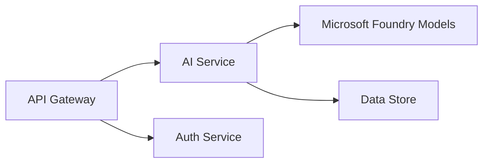
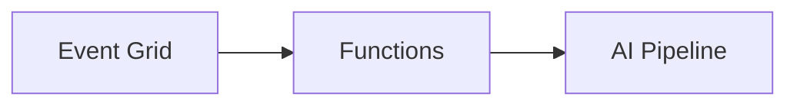

# Capítulo 8: Patrones de Producción y Empresa

**📚 Curso**: [AZD para Principiantes](../../README.md) | **⏱️ Duración**: 2-3 horas | **⭐ Complejidad**: Avanzado

---

## Resumen

Este capítulo cubre patrones de implementación listos para empresas, endurecimiento de seguridad, monitoreo y optimización de costes para cargas de trabajo de IA en producción.

Esta es una referencia arquitectónica, no una plantilla de producción completa y desplegable. Los ejemplos omiten detalles de integración que deben ser proporcionados y probados en su propia aplicación; leer la lista de verificación no certifica la preparación para producción.

> **Revisión de lanzamiento (2026-11-04):** La guía AI CLI fue verificada contra la documentación/fuente de `azd 1.37.2`, agentes `1.0.0-beta.23` y evaluaciones `1.0.0-beta.2`. Véase [cambios y correcciones de la versión](production-ai-practices.md#recent-release-changes-and-fixes) para requisitos de compatibilidad y detalles de migración; esto no es una validación en vivo de despliegue.

## Objetivos de aprendizaje

Al completar este capítulo, usted podrá:
- Desplegar aplicaciones resilientes multirregión
- Implementar patrones de seguridad empresarial
- Configurar monitoreo integral
- Optimizar costos a escala
- Configurar pipelines CI/CD con AZD

---

## 📚 Lecciones

| # | Lección | Descripción | Tiempo |
|---|---------|-------------|--------|
| 1 | [Prácticas de IA en Producción](production-ai-practices.md) | Patrones de despliegue empresarial | 90 min |

---

## 🚀 Lista de verificación para producción

- [ ] Despliegue multirregión para resiliencia
- [ ] Identidad administrada para autenticación (sin claves)
- [ ] Application Insights para monitoreo
- [ ] Presupuestos y alertas de costos configurados
- [ ] Escaneo de seguridad habilitado
- [ ] Integración de pipeline CI/CD
- [ ] Plan de recuperación ante desastres

---

## 🏗️ Patrones de Arquitectura

### Patrón 1: Microservicios IA



### Patrón 2: IA basada en eventos



---

## 🔐 Mejores prácticas de seguridad

```bicep
// Illustrative properties from different resources, NOT a standalone Bicep file.
// Attach identity to the application host:
identity: {
  type: 'SystemAssigned'
}

// AI account properties (also require private endpoints, DNS and app connectivity):
properties: {
  publicNetworkAccess: 'Disabled'
  networkAcls: {
    defaultAction: 'Deny'
  }
}
```

---

## 💰 Optimización de costos

| Estrategia | Restricción principal |
|-----------|----------------------|
| Escalar a cero (Container Apps) | Requiere un disparador adecuado; otros servicios aún generan costos |
| Usar niveles de consumo para desarrollo | Comparar precios del servicio seleccionado y la carga de trabajo |
| Escalado programado | Escalar mediante infraestructura/automatización soportada |
| Reservas/capacidad aprovisionada | Sólo cuando es soportado; compromisos pueden aumentar costos inactivos |

Use el [patrón completo de recurso de presupuesto](production-ai-practices.md#2-cost-monitoring-and-budgets) con una fecha de inicio válida, ámbito de facturación, destinatarios y permisos. Un presupuesto envía alertas; no limita el gasto. El ahorro depende de la utilización medida y no son porcentajes garantizados.

---

## 📊 Configuración de monitoreo

```bash
# Open the Application Insights logs view (requires configured monitoring)
azd monitor --logs

# Check Application Insights
azd monitor --overview

# View metrics
az monitor metrics list --resource <resource-id>
```

---

## 🔗 Navegación

| Dirección | Capítulo |
|-----------|----------|
| **Anterior** | [Capítulo 7: Solución de Problemas](../chapter-07-troubleshooting/README.md) |
| **Curso Completo** | [Inicio del Curso](../../README.md) |

---

## 📖 Recursos Relacionados

- [Guía de Agentes de IA](../chapter-02-ai-development/agents.md)
- [Application Insights](../chapter-06-pre-deployment/application-insights.md)
- [Soluciones Multi-Agente](../chapter-05-multi-agent/README.md)
- [Ejemplo de Microservicios](../../examples/microservices/README.md)

---

<!-- CO-OP TRANSLATOR DISCLAIMER START -->
**Descargo de responsabilidad**:
Este documento ha sido traducido utilizando el servicio de traducción automática [Co-op Translator](https://github.com/Azure/co-op-translator). Aunque nos esforzamos por la precisión, tenga en cuenta que las traducciones automatizadas pueden contener errores o inexactitudes. El documento original en su idioma nativo debe considerarse la fuente autorizada. Para información crítica, se recomienda una traducción profesional humana. No somos responsables de cualquier malentendido o interpretación errónea que surja del uso de esta traducción.
<!-- CO-OP TRANSLATOR DISCLAIMER END -->