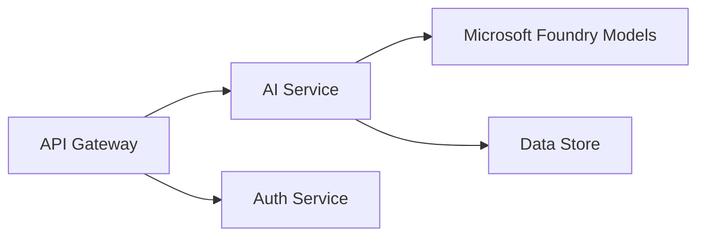
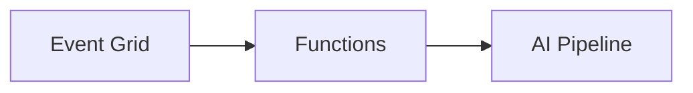

# Capítulo 8: Patrones de Producción y Empresariales

**📚 Curso**: [AZD Para Principiantes](../../README.md) | **⏱️ Duración**: 2-3 horas | **⭐ Complejidad**: Avanzado

---

## Resumen

Este capítulo cubre patrones de despliegue preparados para empresas, fortalecimiento de la seguridad, monitoreo y optimización de costos para cargas de trabajo de IA en producción.

Esta es una referencia arquitectónica, no una plantilla completa para producción desplegable. Los ejemplos omiten detalles de integración que deben ser proporcionados y probados en su propia aplicación; leer la lista de verificación no certifica estar listo para producción.

> **Actualización GA de Foundry (2026-11-09):** Use `azd >= 1.37.0` y el paquete `microsoft.foundry` 1.0 generalmente disponible para el flujo de trabajo Foundry; las evaluaciones se instalan por separado. Vea [alcance de la versión y migración](production-ai-practices.md#recent-release-changes-and-fixes) y el [ejemplo de pipeline autenticado](production-ai-practices.md#cicd-pipeline-configuration). Esta es una revisión de documentación, no una validación de despliegue en vivo ni un estado GA general para funciones opcionales en vista previa.

## Objetivos de Aprendizaje

Al completar este capítulo, usted podrá:
- Desplegar aplicaciones resilientes multi-región
- Implementar patrones de seguridad empresarial
- Configurar monitoreo integral
- Optimizar costos a escala
- Configurar pipelines CI/CD con AZD

---

## 📚 Lecciones

| # | Lección | Descripción | Tiempo |
|---|--------|-------------|------|
| 1 | [Prácticas de IA en Producción](production-ai-practices.md) | Patrones de despliegue empresarial | 90 min |

---

## 🚀 Lista de Verificación para Producción

- [ ] Despliegue multi-región para resiliencia
- [ ] Identidad administrada para autenticación (sin claves)
- [ ] Application Insights para monitoreo
- [ ] Presupuestos y alertas de costos configurados
- [ ] Escaneo de seguridad habilitado
- [ ] Integración de pipeline CI/CD
- [ ] Plan de recuperación ante desastres

---

## 🏗️ Patrones Arquitectónicos

### Patrón 1: IA basada en Microservicios



### Patrón 2: IA orientada a Eventos



---

## 🔐 Mejores Prácticas de Seguridad

```bicep
// Illustrative properties from different resources, NOT a standalone Bicep file.
// Attach identity to the application host:
identity: {
  type: 'SystemAssigned'
}

// AI account properties (also require private endpoints, DNS and app connectivity):
properties: {
  publicNetworkAccess: 'Disabled'
  networkAcls: {
    defaultAction: 'Deny'
  }
}
```

---

## 💰 Optimización de Costos

| Estrategia | Restricción Principal |
|----------|---------|
| Escalado a cero (Container Apps) | Requiere un disparador adecuado; otros servicios aún generan costos |
| Uso de niveles de consumo para desarrollo | Comparar precios del servicio seleccionado y carga de trabajo |
| Escalado programado | Escalar mediante infraestructura/automatización soportada |
| Reservas/capacidad provisionada | Solo cuando está soportado; compromisos pueden aumentar costos ociosos |

Use el [patrón completo de recurso de presupuesto](production-ai-practices.md#2-cost-monitoring-and-budgets) con una fecha de inicio válida, alcance de facturación, destinatarios y permisos. Un presupuesto envía alertas; no limita el gasto. Los ahorros dependen de la utilización medida y no son porcentajes garantizados.

---

## 📊 Configuración de Monitoreo

```bash
# Open the Application Insights logs view (requires configured monitoring)
azd monitor --logs

# Check Application Insights
azd monitor --overview

# View metrics
az monitor metrics list --resource <resource-id>
```

---

## 🔗 Navegación

| Dirección | Capítulo |
|-----------|---------|
| **Anterior** | [Capítulo 7: Resolución de Problemas](../chapter-07-troubleshooting/README.md) |
| **Curso Completo** | [Inicio del Curso](../../README.md) |

---

## 📖 Recursos Relacionados

- [Guía de Agentes de IA](../chapter-02-ai-development/agents.md)
- [Application Insights](../chapter-06-pre-deployment/application-insights.md)
- [Soluciones Multi-Agente](../chapter-05-multi-agent/README.md)
- [Ejemplo de Microservicios](../../examples/microservices/README.md)

---

<!-- CO-OP TRANSLATOR DISCLAIMER START -->
**Descargo de responsabilidad**:
Este documento ha sido traducido utilizando el servicio de traducción automática [Co-op Translator](https://github.com/Azure/co-op-translator). Aunque nos esforzamos por la precisión, tenga en cuenta que las traducciones automatizadas pueden contener errores o inexactitudes. El documento original en su idioma nativo debe considerarse la fuente autorizada. Para información crítica, se recomienda una traducción profesional humana. No somos responsables de cualquier malentendido o interpretación errónea que surja del uso de esta traducción.
<!-- CO-OP TRANSLATOR DISCLAIMER END -->