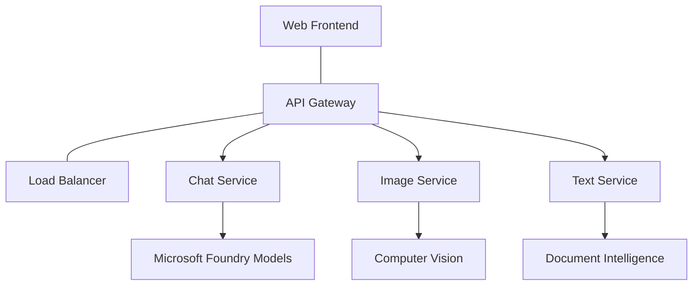

# Mejores Prácticas para Cargas de Trabajo de IA en Producción con AZD

**Navegación de Capítulos:**
- **📚 Inicio del Curso**: [AZD Para Principiantes](../../README.md)
- **📖 Capítulo Actual**: Capítulo 8 - Patrones de Producción y Empresariales
- **⬅️ Capítulo Anterior**: [Capítulo 7: Resolución de Problemas](../chapter-07-troubleshooting/debugging.md)
- **⬅️ También Relacionado**: [Laboratorio de Taller de IA](../chapter-02-ai-development/ai-workshop-lab.md)
- **🎯 Curso Completo**: [AZD Para Principiantes](../../README.md)

## Visión General

Esta guía explica patrones de diseño de IA en producción usando Azure Developer CLI (AZD). Es una referencia de diseño, no una aplicación desplegable ni una certificación de producción.

**Límites del ejemplo:** A menos que se describa explícitamente como completo, los fragmentos de Bicep asumen parámetros y recursos referenciados de una plantilla contenedora. Omiten imágenes/planes de host, identidades, asignaciones de roles, DNS, salidas y otras integraciones requeridas. Las rutas YAML de servicios y scripts de hook/prueba son archivos ilustrativos para crear en **su propia aplicación**; no los proporciona este curso. Use una muestra funcional de AZD como base, compile la infraestructura completa y pruébela en un entorno aislado antes de producción.

## Desafíos Clave Abordados

Las preocupaciones comunes en producción incluyen despliegues multi-servicio, gestión de identidad y secretos, escalado, controles de costos y monitoreo. No se reclama prevalencia medida aquí.

## Patrones de Arquitectura para IA en Producción

### Patrón 1: Arquitectura de IA con Microservicios

**Cuándo usar**: Aplicaciones de IA complejas con múltiples capacidades



**Implementación con AZD**:

```yaml
# azure.yaml
name: enterprise-ai-platform
services:
  web:
    project: ./web
    host: staticwebapp
  api-gateway:
    project: ./api-gateway
    host: containerapp
  chat-service:
    project: ./services/chat
    host: containerapp
  vision-service:
    project: ./services/vision
    host: containerapp
  text-service:
    project: ./services/text
    host: containerapp
```

### Patrón 2: Procesamiento de IA Basado en Eventos

**Cuándo usar**: Procesamiento por lotes, análisis de documentos, flujos asincrónicos

```bicep
// Event Hub for AI processing pipeline
resource eventHub 'Microsoft.EventHub/namespaces@2024-01-01' = {
  name: eventHubNamespaceName
  location: location
  sku: {
    name: 'Standard'
    tier: 'Standard'
    capacity: 1
  }
}

// Service Bus for reliable message processing
resource serviceBus 'Microsoft.ServiceBus/namespaces@2024-01-01' = {
  name: serviceBusNamespaceName
  location: location
  sku: {
    name: 'Premium'
    tier: 'Premium'
    capacity: 1
  }
}

// Function App for processing
resource functionApp 'Microsoft.Web/sites@2023-01-01' = {
  name: functionAppName
  location: location
  kind: 'functionapp,linux'
  properties: {
    siteConfig: {
      appSettings: [
        {
          name: 'FUNCTIONS_EXTENSION_VERSION'
          value: '~4'
        }
        {
          name: 'AZURE_OPENAI_ENDPOINT'
          value: '@Microsoft.KeyVault(VaultName=${keyVault.name};SecretName=openai-endpoint)'
        }
      ]
    }
  }
}
```

Esto crea fragmentos de espacio de nombres, no hubs, colas, suscripciones ni triggers de Funciones. Una Función ejecutable también necesita un plan de hosting, configuración runtime/almacenamiento, una identidad adjunta, RBAC y acceso de red. La referencia a Key Vault necesita permiso para leer el secreto; una URL de endpoint no es una credencial.

## Pensando Sobre la Salud del Agente de IA

Cuando una aplicación web tradicional falla, los síntomas son familiares: una página no carga, una API devuelve un error o una publicación falla. Las aplicaciones potentes de IA pueden fallar de esas mismas formas, pero también pueden comportarse de maneras más sutiles que no producen mensajes de error evidentes.

Esta sección te ayuda a construir un modelo mental para monitorear cargas de trabajo de IA para saber dónde buscar cuando algo no parece correcto.

### Cómo la Salud del Agente Difere de la Salud de una Aplicación Tradicional

Las aplicaciones tradicionales también pueden tener fallas sutiles de corrección. Un agente de IA añade calidad de respuesta no determinista a las usuales preocupaciones de disponibilidad y corrección. Piensa en la salud del agente en dos capas:

| Capa | Qué Observar | Dónde Buscar |
|-------|--------------|---------------|
| **Salud de infraestructura** | ¿Está el servicio funcionando? ¿Se han aprovisionado los recursos? ¿Son accesibles los endpoints? | `azd monitor`, salud de recursos en Azure Portal, logs de contenedores/aplicaciones |
| **Salud del comportamiento** | ¿Responde el agente de forma precisa? ¿Son oportunas las respuestas? ¿Se llama correctamente al modelo? | rastros de Application Insights, métricas de latencia de llamadas al modelo, logs de calidad de respuesta |

La salud de infraestructura es familiar: es igual para cualquier aplicación azd. La salud del comportamiento es la nueva capa que introducen las cargas de trabajo de IA.

### Dónde Buscar Cuando las Aplicaciones de IA No Se Comportan como Se Espera

Si tu aplicación de IA no produce los resultados esperados, aquí tienes una lista conceptual:

1. **Empieza por lo básico.** ¿Está la aplicación funcionando? ¿Puede alcanzar sus dependencias? Revisa `azd monitor` y la salud de recursos tal como lo harías para cualquier aplicación.
2. **Verifica la conexión con el modelo.** ¿Está tu aplicación llamando correctamente al modelo de IA? Fallos o tiempos de espera en llamadas al modelo son la causa más común de problemas y aparecerán en los logs de la aplicación.
3. **Inspecciona la entrada y el fundamento de manera segura.** Las respuestas incorrectas pueden resultar de la recuperación, las instrucciones, las limitaciones del modelo o la ejecución de herramientas. Usa datos de diagnóstico con acceso controlado y redactados; no habilites el registro indiscriminado de instrucciones/respuestas en producción.
4. **Revisa la latencia de la respuesta.** Las llamadas al modelo de IA son más lentas que las llamadas API típicas. Si tu app se siente lenta, verifica si los tiempos de respuesta del modelo han aumentado; esto puede indicar limitaciones, throttling o congestión a nivel regional.
5. **Atento a señales de costo.** Picos inesperados en uso de tokens o llamadas API pueden indicar un ciclo, un prompt mal configurado o reintentos excesivos.

No necesitas dominar las herramientas de observabilidad de inmediato. La conclusión clave es que las aplicaciones de IA tienen una capa adicional de comportamiento para monitorear, y el monitoreo incorporado de azd (`azd monitor`) te da un punto de partida para investigar ambas capas.

---

## Mejores Prácticas de Seguridad

### 1. Modelo de Seguridad Zero-Trust

**Estrategia de Implementación**:
- Sin comunicación servicio a servicio sin autenticación
- Todas las llamadas API usan identidades gestionadas
- Aislamiento de red con endpoints privados
- Controles de acceso con menor privilegio

```bicep
// Managed Identity for each service
resource chatServiceIdentity 'Microsoft.ManagedIdentity/userAssignedIdentities@2023-01-31' = {
  name: 'chat-service-identity'
  location: location
}

// Role assignments with minimal permissions
resource openAIUserRole 'Microsoft.Authorization/roleAssignments@2022-04-01' = {
  scope: openAIAccount
  name: guid(openAIAccount.id, chatServiceIdentity.id, '5e0bd9bd-7b93-4f28-af87-19fc36ad61bd')
  properties: {
    roleDefinitionId: subscriptionResourceId('Microsoft.Authorization/roleDefinitions', '5e0bd9bd-7b93-4f28-af87-19fc36ad61bd')
    principalId: chatServiceIdentity.properties.principalId
    principalType: 'ServicePrincipal'
  }
}
```

### 2. Gestión Segura de Secretos

**Patrón de Integración con Key Vault**:

```bicep
// Key Vault with proper access policies
resource keyVault 'Microsoft.KeyVault/vaults@2023-02-01' = {
  name: keyVaultName
  location: location
  properties: {
    tenantId: tenant().tenantId
    sku: {
      family: 'A'
      name: 'standard' // Premium is needed for HSM-backed keys, not ordinary secrets
    }
    enableRbacAuthorization: true  // Use RBAC instead of access policies
    enablePurgeProtection: true    // Prevent accidental deletion
    enableSoftDelete: true
    softDeleteRetentionInDays: 90
  }
}

// Optional legacy key-auth alternative; omit when using Entra ID.
resource openAIKeySecret 'Microsoft.KeyVault/vaults/secrets@2023-02-01' = {
  parent: keyVault
  name: 'openai-api-key'
  properties: {
    value: openAIAccount.listKeys().key1
    attributes: {
      enabled: true
    }
  }
}
```

Asigna la identidad en tiempo de ejecución `Key Vault Secrets User` en el ámbito adecuado y adjúntala al host; `enableRbacAuthorization` solo no concede acceso. Prefiere la autenticación con identidad gestionada de OpenAI con `disableLocalAuth: true`. La clave secreta opcional solo tiene sentido para una cuenta con clave habilitada deliberadamente, y el principal de aprovisionamiento también necesita permiso para escribir secretos.

### 3. Seguridad de Red

**Configuración de Endpoint Privado**:

```bicep
// Virtual Network for AI services
resource virtualNetwork 'Microsoft.Network/virtualNetworks@2023-04-01' = {
  name: vnetName
  location: location
  properties: {
    addressSpace: {
      addressPrefixes: ['10.0.0.0/16']
    }
    subnets: [
      {
        name: 'ai-services-subnet'
        properties: {
          addressPrefix: '10.0.1.0/24'
          privateEndpointNetworkPolicies: 'Disabled'
        }
      }
      {
        name: 'app-services-subnet'
        properties: {
          addressPrefix: '10.0.2.0/24'
          delegations: [
            {
              name: 'Microsoft.Web/serverFarms'
              properties: {
                serviceName: 'Microsoft.Web/serverFarms'
              }
            }
          ]
        }
      }
    ]
  }
}

// Private endpoints for all AI services
resource openAIPrivateEndpoint 'Microsoft.Network/privateEndpoints@2023-04-01' = {
  name: '${openAIAccountName}-pe'
  location: location
  properties: {
    subnet: {
      id: virtualNetwork.properties.subnets[0].id
    }
    privateLinkServiceConnections: [
      {
        name: 'openai-connection'
        properties: {
          privateLinkServiceId: openAIAccount.id
          groupIds: ['account']
        }
      }
    ]
  }
}
```

Los endpoints privados también necesitan grupos de zonas DNS privadas/enlaces VNet e integración VNet de la aplicación. No bloquean automáticamente acceso público: deshabilita explícitamente el acceso público de la cuenta de IA tras validar conectividad privada y acceso al despliegue.

## Rendimiento y Escalado

### 1. Estrategias de Autoescalado

**Autoescalado en Container Apps**:

```bicep
resource containerApp 'Microsoft.App/containerApps@2023-05-01' = {
  name: containerAppName
  location: location
  properties: {
    configuration: {
      ingress: {
        external: true
        targetPort: 8000
        transport: 'http'
      }
    }
    template: {
      scale: {
        minReplicas: 2  // Always have 2 instances minimum
        maxReplicas: 50 // Scale up to 50 for high load
        rules: [
          {
            name: 'http-scaling'
            http: {
              metadata: {
                concurrentRequests: '20'  // Scale when >20 concurrent requests
              }
            }
          }
          {
            name: 'cpu-scaling'
            custom: {
              type: 'cpu'
              metadata: {
                type: 'Utilization'
                value: '70'  // Scale when CPU >70%
              }
            }
          }
        ]
      }
    }
  }
}
```

### 2. Estrategias de Caché

**Caché Redis para Respuestas de IA**:

```bicep
// Legacy Azure Cache for Redis example (not recommended for new deployments)
resource redisCache 'Microsoft.Cache/redis@2023-04-01' = {
  name: redisCacheName
  location: location
  properties: {
    sku: {
      name: 'Premium'
      family: 'P'
      capacity: 1
    }
    enableNonSslPort: false
    minimumTlsVersion: '1.2'
    redisConfiguration: {
      'maxmemory-policy': 'allkeys-lru'
    }
    // Sharding distributes data; replication/failover provides availability.
    shardCount: 2
  }
}

// Cache configuration in application
var cacheConnectionString = '${redisCache.properties.hostName}:6380,password=${redisCache.listKeys().primaryKey},ssl=True,abortConnect=False'
```

Azure Cache para Redis Basic/Standard/Premium está en una [ruta de retiro](https://learn.microsoft.com/azure/azure-cache-for-redis/retirement-faq). Usa Azure Managed Redis para nuevos diseños y su SKU documentado, identidad y configuración TLS, en lugar de copiar este recurso legado en un sistema de producción nuevo. La línea de cadena de conexión es un marcador de posición no funcional, no una credencial. Particiona las claves de caché por autorización, modelo/instrucciones y versión de recuperación, con expiración; una caché compartida solo consulta puede exponer datos de otro usuario.

### 3. Balanceo de Carga y Gestión de Tráfico

**Application Gateway con WAF**:

```bicep
// Application Gateway with Web Application Firewall
resource applicationGateway 'Microsoft.Network/applicationGateways@2023-04-01' = {
  name: appGatewayName
  location: location
  properties: {
    sku: {
      name: 'WAF_v2'
      tier: 'WAF_v2'
      capacity: 2
    }
    webApplicationFirewallConfiguration: {
      enabled: true
      firewallMode: 'Prevention'
      ruleSetType: 'OWASP'
      ruleSetVersion: '3.2'
    }
    // Backend pools for AI services
    backendAddressPools: [
      {
        name: 'ai-services-pool'
        properties: {
          backendAddresses: [
            {
              fqdn: '${containerApp.properties.configuration.ingress.fqdn}'
            }
          ]
        }
      }
    ]
  }
}
```

Este es un recurso parcial de gateway: un despliegue real también necesita configuración de subnet/IP para el gateway, IPs y puertos frontend, listeners/certificados TLS, configuración de backend HTTP/sondas, reglas y prioridades de enrutamiento, y una política WAF revisada. El hostname/SNI TLS y autenticación deben coincidir con el backend de Container App.

## 💰 Optimización de Costos

### 1. Dimensionado Adecuado de Recursos

**Configuraciones Específicas de Entorno**:

Estos nombres son **entradas ilustrativas de plantillas personalizadas**, no configuraciones automáticas de AZD. Mapea cada uno en `infra/main.parameters.json`/Bicep y configuración de host primero. Por ejemplo, la muestra RAG usa `AZURE_SEARCH_SERVICE_SKU` y `AZURE_OPENAI_CHATGPT_DEPLOYMENT_CAPACITY`, no los nombres genéricos abajo. Da a la memoria de Container Apps una unidad soportada como `1Gi` en el recurso real. Aplica cambios de infraestructura con `azd up` o `azd provision`; `azd deploy` solo no aplica cambios en Bicep.

```bash
# Development environment
azd env new development
azd env set AZURE_OPENAI_SKU "S0"
azd env set AZURE_OPENAI_CAPACITY 10
azd env set AZURE_SEARCH_SKU "basic"
azd env set CONTAINER_CPU 0.5
azd env set CONTAINER_MEMORY 1.0

# Production environment  
azd env new production
azd env set AZURE_OPENAI_SKU "S0"
azd env set AZURE_OPENAI_CAPACITY 100
azd env set AZURE_SEARCH_SKU "standard"
azd env set CONTAINER_CPU 2.0
azd env set CONTAINER_MEMORY 4.0
```

### 2. Monitoreo de Costos y Presupuestos

```bicep
// Supply the first day of the current UTC month, e.g. 2026-11-01T00:00:00Z.
param budgetStartDate string

// Cost management and budgets
resource budget 'Microsoft.Consumption/budgets@2024-08-01' = {
  name: 'ai-workload-budget'
  properties: {
    timePeriod: {
      startDate: budgetStartDate
    }
    timeGrain: 'Monthly'
    amount: 2000  // In the billing currency, not necessarily USD
    category: 'Cost'
    notifications: {
      warning: {
        enabled: true
        operator: 'GreaterThan'
        threshold: 80
        contactEmails: [
          'finance@company.com'
          'engineering@company.com'
        ]
        contactRoles: [
          'Owner'
          'Contributor'
        ]
      }
      critical: {
        enabled: true
        operator: 'GreaterThan'
        threshold: 95
        contactEmails: [
          'cto@company.com'
        ]
      }
    }
  }
}
```

Reemplaza los destinatarios de ejemplo y verifica alcance/permisos. Las alertas de presupuesto usan datos de facturación retardados y no imponen un límite de gasto.

### 3. Optimización del Uso de Tokens

**Gestión de Costos con OpenAI**:

Esto es solo una heurística basada en caracteres para una vista previa UI, **no** un validador de límite de tokens del modelo. El código de producción debe usar un tokenizer apropiado al modelo desplegado y considerar instrucciones del sistema, esquemas de herramientas, historial y presupuesto de salida. Rechaza un mensaje de usuario sobredimensionado en lugar de truncarlo silenciosamente.

```typescript
// Application-level token optimization
class TokenOptimizer {
  private readonly maxTokens = 4000;
  private readonly reserveTokens = 500;
  
  optimizePrompt(userInput: string, context: string): string {
    const availableTokens = this.maxTokens - this.reserveTokens;
    if (this.estimateTokens(userInput) + 8 >= availableTokens) {
      throw new Error("User input exceeds the illustrative prompt budget");
    }
    const estimatedTokens = this.estimateTokens(userInput + context) + 8;
    
    if (estimatedTokens > availableTokens) {
      // Truncate context, not user input
      context = this.truncateContext(context, Math.max(0, availableTokens - this.estimateTokens(userInput) - 8));
    }
    
    return `${context}\n\nUser: ${userInput}`;
  }
  
  private estimateTokens(text: string): number {
    // Rough estimation: 1 token ≈ 4 characters
    return Math.ceil(text.length / 4);
  }

  private truncateContext(text: string, estimatedBudget: number): string {
    return text.slice(0, Math.max(0, estimatedBudget) * 4);
  }
}
```

## Monitoreo y Observabilidad

### 1. Application Insights Integral

```bicep
// Application Insights with advanced features
resource applicationInsights 'Microsoft.Insights/components@2020-02-02' = {
  name: applicationInsightsName
  location: location
  kind: 'web'
  properties: {
    Application_Type: 'web'
    WorkspaceResourceId: logAnalyticsWorkspace.id
    SamplingPercentage: 100  // Ingestion setting; review cost and SDK sampling separately
    DisableIpMasking: false  // Retain IP masking
  }
}

// Custom metrics for AI operations
resource aiMetricAlerts 'Microsoft.Insights/metricAlerts@2018-03-01' = {
  name: 'ai-high-error-rate'
  location: 'global'
  properties: {
    description: 'Alert when failed request count exceeds 10 in five minutes'
    severity: 2
    enabled: true
    scopes: [
      applicationInsights.id
    ]
    evaluationFrequency: 'PT1M'
    windowSize: 'PT5M'
    criteria: {
      'odata.type': 'Microsoft.Azure.Monitor.SingleResourceMultipleMetricCriteria'
      allOf: [
        {
          name: 'high-error-rate'
          metricName: 'requests/failed'
          operator: 'GreaterThan'
          threshold: 10
          timeAggregation: 'Count'
        }
      ]
    }
  }
}
```

### 2. Monitoreo Específico de IA

**Dashboards personalizados para métricas de IA**:

```json
{
  "dashboard": {
    "name": "AI Application Monitoring",
    "tiles": [
      {
        "name": "OpenAI Request Volume",
        "query": "dependencies | where target contains 'openai' | summarize count() by bin(timestamp, 5m)"
      },
      {
        "name": "AI Response Latency",
        "query": "dependencies | where target contains 'openai' | summarize avg(duration) by bin(timestamp, 5m)"
      },
      {
        "name": "Token Usage",
        "query": "customMetrics | where name == 'openai_tokens_used' | summarize sum(value) by bin(timestamp, 1h)"
      },
      {
        "name": "Cost per Hour",
        "query": "customMetrics | where name == 'openai_cost' | summarize sum(value) by bin(timestamp, 1h)"
      }
    ]
  }
}
```

Este JSON es un boceto definido por la aplicación, no un esquema de dashboard importable en Azure portal. Las consultas de tokens/costos requieren que tu aplicación emita esas métricas personalizadas exactas; no son creadas por AZD. Adapta filtros de dependencia según tus nombres reales de endpoint/span de modelo.

### 3. Comprobaciones de Salud y Monitoreo de Uptime

```bicep
// Application Insights availability tests
resource availabilityTest 'Microsoft.Insights/webtests@2022-06-15' = {
  name: 'ai-app-availability-test'
  location: location
  tags: {
    'hidden-link:${applicationInsights.id}': 'Resource'
  }
  properties: {
    SyntheticMonitorId: 'ai-app-availability-test'
    Name: 'AI Application Availability Test'
    Description: 'Tests AI application endpoints'
    Enabled: true
    Frequency: 300  // 5 minutes
    Timeout: 120    // 2 minutes
    Kind: 'standard'
    Locations: [
      {
        Id: 'us-east-2-azr'
      }
      {
        Id: 'us-west-2-azr'
      }
    ]
    Request: {
      RequestUrl: 'https://${webApp.properties.defaultHostName}/health'
      HttpVerb: 'GET'
      FollowRedirects: true
      ParseDependentRequests: false
    }
    ValidationRules: {
      ExpectedHttpStatusCode: 200
      SSLCheck: true
      SSLCertRemainingLifetimeCheck: 7
    }
  }
}
```

## Recuperación ante Desastres y Alta Disponibilidad

La prueba precedente asume un App Service existente `webApp` y recurso Application Insights. Las pruebas estándar de disponibilidad son facturables y requieren un endpoint accesible; las aplicaciones solo privadas necesitan un diseño apropiado de monitoreo privado. Las pruebas de ping de URL están obsoletas; usa [pruebas estándar de disponibilidad](https://learn.microsoft.com/azure/azure-monitor/app/availability).

### 1. Despliegue Multi-Región

```yaml
# azure.yaml - Multi-region configuration
name: ai-app-multiregion
services:
  api-primary:
    project: ./api
    host: containerapp
    env:
      AZURE_REGION: eastus
  api-secondary:
    project: ./api
    host: containerapp
    env:
      AZURE_REGION: westus2
```

```bicep
// Separate App Service topology, not the Container Apps declarations above
resource trafficManager 'Microsoft.Network/trafficManagerProfiles@2022-04-01' = {
  name: trafficManagerProfileName
  location: 'global'
  properties: {
    profileStatus: 'Enabled'
    trafficRoutingMethod: 'Priority'
    dnsConfig: {
      relativeName: trafficManagerProfileName
      ttl: 30
    }
    monitorConfig: {
      protocol: 'HTTPS'
      port: 443
      path: '/health'
      intervalInSeconds: 30
      toleratedNumberOfFailures: 3
      timeoutInSeconds: 10
    }
    endpoints: [
      {
        name: 'primary-endpoint'
        type: 'Microsoft.Network/trafficManagerProfiles/azureEndpoints'
        properties: {
          targetResourceId: primaryAppService.id
          endpointStatus: 'Enabled'
          priority: 1
        }
      }
      {
        name: 'secondary-endpoint'
        type: 'Microsoft.Network/trafficManagerProfiles/azureEndpoints'
        properties: {
          targetResourceId: secondaryAppService.id
          endpointStatus: 'Enabled'
          priority: 2
        }
      }
    ]
  }
}
```

Las variables de entorno no eligen ubicaciones de recursos. IaC debe aprovisionar hosts regionales distintos y ligar cada servicio con etiquetas `resourceName` o `azd-service-name`. El ejemplo Traffic Manager es una **topología separada de App Service** (`primaryAppService`/`secondaryAppService`), no enrutamiento para las declaraciones de Container Apps. Container Apps requiere un endpoint externo/configurado frontal adecuadamente, enrutamiento TLS/dominio personalizado y sondas de salud.

### 2. Respaldo y Recuperación de Datos

```bicep
// Backup configuration for critical data
resource backupVault 'Microsoft.DataProtection/backupVaults@2023-05-01' = {
  name: backupVaultName
  location: location
  identity: {
    type: 'SystemAssigned'
  }
  properties: {
    storageSettings: [
      {
        datastoreType: 'VaultStore'
        type: 'LocallyRedundant'
      }
    ]
  }
}

```

El vault por sí solo no respalda nada. Configura una **política y instancia de respaldo soportadas específicas para la carga de trabajo**, permisos de fuente, retención y pruebas de restauración usando las [matrices de soporte de Azure Backup](https://learn.microsoft.com/azure/backup/backup-support-matrix). No existe una política genérica de Azure Backup para despliegues de modelos Azure OpenAI hospedados. Mantén definiciones de infraestructura/despliegue de modelos en control de código fuente; protege documentos subidos, datos de aplicación y artefactos de fine-tuning usando las funciones de respaldo/exportación soportadas de cada servicio subyacente. Define y prueba explícitamente RPO/RTO.

## Integración DevOps y CI/CD

### 1. Flujo de Trabajo GitHub Actions

```yaml
# .github/workflows/deploy-ai-app.yml
name: Deploy AI Application

on:
  push:
    branches: [main]
  pull_request:
    branches: [main]

jobs:
  test:
    runs-on: ubuntu-latest
    steps:
      - uses: actions/checkout@v4
      
      - name: Setup Python
        uses: actions/setup-python@v4
        with:
          python-version: '3.11'
          
      - name: Install dependencies
        run: |
          pip install -r requirements.txt
          pip install pytest
          
      - name: Run tests
        run: pytest tests/
        
      - name: AI Safety Tests
        run: |
          python scripts/test_ai_safety.py
          python scripts/validate_prompts.py

```

Esta es la **porción solo de prueba** de un flujo de trabajo y asume que has creado `requirements.txt`, `tests/` y los dos scripts de seguridad. Añade los trabajos autenticados de aprovisionamiento/despliegue OIDC desde [Configuración de Pipeline CI/CD](#cicd-pipeline-configuration), con `needs: test`, un trigger manual/seguro y entornos GitHub protegidos. No despliegues código de pull-request no confiable con credenciales cloud. Un runner nuevo no tiene ambiente local AZD seleccionado; suministra las entradas de ambiente/suscripción/ubicación y usa `azd auth login`, no solo `azure/login`.

### 2. Validación de Infraestructura

```bash
# scripts/validate_infrastructure.sh
#!/bin/bash
set -euo pipefail

echo "Validating AI infrastructure deployment..."

# Requires Azure CLI login and the resource group selected explicitly.
: "${AZURE_RESOURCE_GROUP:?Set AZURE_RESOURCE_GROUP}"
: "${AZURE_OPENAI_NAME:?Set AZURE_OPENAI_NAME}"
: "${AZURE_OPENAI_CHAT_DEPLOYMENT:?Set the actual deployment name}"

# A successful empty list is not proof that resources exist.
types=("Microsoft.CognitiveServices/accounts" "Microsoft.Search/searchServices"
       "Microsoft.Storage/storageAccounts" "Microsoft.KeyVault/vaults")
for resource_type in "${types[@]}"; do
    count=$(az resource list --resource-group "$AZURE_RESOURCE_GROUP" \
        --resource-type "$resource_type" --query "length(@)" -o tsv)
    if [[ "$count" -lt 1 ]]; then
        echo "ERROR: No $resource_type found in $AZURE_RESOURCE_GROUP"
        exit 1
    fi
done

# Validate OpenAI model deployments
echo "Validating OpenAI model deployments..."
state=$(az cognitiveservices account deployment show \
  --name "$AZURE_OPENAI_NAME" --resource-group "$AZURE_RESOURCE_GROUP" \
  --deployment-name "$AZURE_OPENAI_CHAT_DEPLOYMENT" \
  --query "properties.provisioningState" -o tsv)
if [[ "$state" != "Succeeded" ]]; then
    echo "ERROR: Required model deployment is not provisioned successfully"
    exit 1
fi

echo "Infrastructure validation completed successfully!"
```

Se espera: un cero de salida y el mensaje de finalización solo cuando existan todos los tipos esperados y el despliegue del modelo nombrado esté provisionado. Esto verifica inventario/estado de aprovisionamiento, **no** salud de recursos, topología exacta, RBAC, accesibilidad de red o comportamiento del modelo. Adapta los tipos esperados a tu arquitectura, luego realiza una prueba de preparación de aplicación autenticada separada.

## Lista de Verificación para Preparación en Producción

### Seguridad ✅
- [ ] Todos los servicios usan identidades gestionadas
- [ ] Secretos almacenados en Key Vault
- [ ] Endpoints privados configurados
- [ ] Grupos de seguridad de red implementados
- [ ] RBAC con menor privilegio
- [ ] WAF habilitado en endpoints públicos

### Rendimiento ✅
- [ ] Autoescalado configurado
- [ ] Caché implementada
- [ ] Balanceo de carga configurado
- [ ] CDN para contenido estático
- [ ] Pooling de conexiones de base de datos
- [ ] Optimización de uso de tokens

### Monitoreo ✅
- [ ] Application Insights configurado
- [ ] Métricas personalizadas definidas
- [ ] Reglas de alerta configuradas
- [ ] Dashboard creado
- [ ] Comprobaciones de salud implementadas
- [ ] Políticas de retención de logs

### Confiabilidad ✅
- [ ] Despliegue multi-región
- [ ] Plan de respaldo y recuperación
- [ ] Implementación de circuit breakers
- [ ] Políticas de reintento configuradas
- [ ] Degradación gradual
- [ ] Endpoints de comprobación de salud

### Gestión de Costos ✅
- [ ] Alertas de presupuesto configuradas
- [ ] Dimensionado adecuado de recursos
- [ ] Descuentos para desarrollo/prueba aplicados
- [ ] Instancias reservadas compradas
- [ ] Dashboard de monitoreo de costos
- [ ] Revisiones regulares de costos

### Cumplimiento ✅
- [ ] Requisitos de residencia de datos cumplidos
- [ ] Registro de auditoría habilitado
- [ ] Políticas de cumplimiento aplicadas
- [ ] Líneas base de seguridad implementadas
- [ ] Evaluaciones regulares de seguridad
- [ ] Plan de respuesta a incidentes

## Benchmarks de Rendimiento

### Objetivos de Producción Ilustrativos

Estos son SLOs de ejemplo para negociar y realizar pruebas de carga, no benchmarks medidos o garantías. La latencia de respuesta depende del modelo/longitud de salida; el gasto mensual en tokens depende de tráfico y precios, no solo del conteo de tokens.

| Métrica | Objetivo | Monitoreo |
|--------|--------|------------|
| **Tiempo de Respuesta** | < 2 segundos | Application Insights |
| **Disponibilidad** | 99.9% | Monitoreo de uptime |
| **Tasa de Error** | < 0.1% | Logs de aplicación |
| **Gasto en Modelo** | < $500/mes (presupuesto ejemplo) | Gestión de costos |
| **Usuarios Concurrentes** | 1000+ | Pruebas de carga |
| **Tiempo de Recuperación** | < 1 hora | Pruebas de recuperación ante desastres |

### Pruebas de Carga

Lo siguiente es un esquema de interfaz para un script de prueba de carga **que debes implementar**; este repositorio no provee `scripts/load_test.py`. Define cargas útiles de solicitudes, autenticación, cargas representativas, afirmaciones de latencia/error percentil, y un límite de gasto en tu herramienta elegida de pruebas de carga antes de ejecutarla:

```bash
# Load testing script for AI applications
python scripts/load_test.py \
  --endpoint https://your-ai-app.azurewebsites.net \
  --concurrent-users 100 \
  --duration 300 \
  --ramp-up 60
```

## 🤝 Mejores Prácticas de la Comunidad

Basado en comentarios de la comunidad de Microsoft Foundry Discord:

### Principales Recomendaciones de la Comunidad:

1. **Comienza Pequeño, Escala Gradualmente**: Empieza con SKUs básicos y escala según el uso real
2. **Monitorea Todo**: Configura monitoreo completo desde el primer día
3. **Automatiza la Seguridad**: Usa infraestructura como código para seguridad consistente
4. **Prueba a Fondo**: Incluye pruebas específicas de IA en tu pipeline
5. **Planifica los Costos**: Monitorea el uso de tokens y establece alertas presupuestarias temprano

### Errores Comunes a Evitar:

- ❌ Codificar claves API en el código
- ❌ No configurar monitoreo adecuado
- ❌ Ignorar la optimización de costos
- ❌ No probar escenarios de falla
- ❌ Desplegar sin comprobaciones de salud

## Comandos y Extensiones AI de AZD CLI

AZD incluye un conjunto creciente de comandos y extensiones específicas para IA que facilitan los flujos de trabajo de IA en producción. Estas herramientas cierran la brecha entre el desarrollo local y el despliegue en producción para cargas de trabajo de IA.

> **Actualización de Foundry GA (2026-11-09):** El paquete `microsoft.foundry` alcanzó la **1.0 / disponibilidad general** el [5 de noviembre de 2026](https://devblogs.microsoft.com/azure-sdk/microsoft-foundry-azure-developer-cli-ga/). Usa **`azd >= 1.37.0`** para este flujo de trabajo. La revisión anterior de `azd 1.37.2`, agentes beta.23 y evaluaciones beta.2 se conserva abajo como historial de migración, no como versión actual del paquete. Esto es una revisión de documentación/fuente, no una validación de despliegue en vivo ni una afirmación de que todas las extensiones opcionales, API o características en vista previa sean GA.

### Extensiones AZD para IA

AZD usa un sistema de extensiones para agregar capacidades específicas de IA. Instala y administra extensiones con:

```bash
# List all available extensions (including AI)
azd extension list

# Inspect installed versions
azd version
azd ext list --installed

# Install the GA Foundry bundle
azd ext install microsoft.foundry

# Install the separate Foundry evaluations extension
azd extension install azure.ai.evaluations

# Install the fine-tuning extension
azd extension install azure.ai.finetune

# Install the custom models extension
azd extension install azure.ai.models

# Upgrade the Foundry bundle
azd ext upgrade microsoft.foundry
```

**Extensiones AI disponibles:**

| Extensión | Propósito | Estado |
|-----------|---------|--------|
| `microsoft.foundry` | Meta-paquete que instala las siete extensiones principales abajo; sin grupo de comandos propio | Paquete GA 1.0 |
| `azure.ai.agents` | `azd ai agent`: configuración de agente, ejecución local y operaciones | Incluido; versionado independiente |
| `azure.ai.connections` | `azd ai connection`: conexiones de proyecto | Incluido; versionado independiente |
| `azure.ai.inspector` | `azd ai inspector`: UI local del Inspector de Agentes | Incluido; versionado independiente |
| `azure.ai.projects` | `azd ai project`: recursos de proyecto y despliegues de modelo | Incluido; versionado independiente |
| `azure.ai.routines` | `azd ai routine`: schedules y disparadores | Incluido; versionado independiente |
| `azure.ai.skills` | `azd ai skill`: directrices de comportamiento reutilizables | Incluido; versionado independiente |
| `azure.ai.toolboxes` | `azd ai toolbox`: colecciones de herramientas versionadas | Incluido; versionado independiente |
| `azure.ai.evaluations` | Conjuntos de datos de evaluación, evaluadores, grupos de evaluación y ejecuciones | Instalación/lanzamiento separado |
| `azure.ai.dataset` | Registro y versionado de datasets | Instalación/lanzamiento separado |
| `azure.ai.finetune` | Ajuste fino de modelos Foundry | Instalación/lanzamiento separado |
| `azure.ai.models` | Modelos personalizados Foundry | Instalación/lanzamiento separado |

Instalar `azure.ai.agents` individualmente sigue siendo compatible e instala sus dependencias; el paquete es el predeterminado del curso para el flujo GA. El paquete GA no garantiza el estado de lanzamiento para las funciones opcionales de sus componentes. Consulta el [empaquetado y verificación de extensiones](https://learn.microsoft.com/azure/foundry/agents/how-to/install-cli-foundry-extensions) e inspecciona la ayuda del comando instalado antes de usarlas.

> Actualiza primero el núcleo del CLI con `azd update` o el [método de instalación/actualización correspondiente](https://learn.microsoft.com/azure/developer/azure-developer-cli/install-azd), luego ejecuta `azd ext upgrade microsoft.foundry`. Actualiza evaluaciones instaladas por separado según sea necesario con `azd ext upgrade azure.ai.evaluations`. No hay comando núcleo `azd upgrade`. Registra y revisa extensiones con versionado independiente en la automatización de producción; una actualización no migra automáticamente configuraciones antiguas.

### Cambios y Correcciones Recientes en Releases

| Versión | Qué cambia para este curso |
|---------|------------------------------|
| `microsoft.foundry` 1.0 GA (2026-11-05) | Predeterminado al paquete de siete extensiones, mantener configuraciones agente/despliegue en `azure.yaml`, prueba local con Inspector de Agentes, y sube código para construcción remota Foundry. Instalar evaluaciones por separado y reinstalar extensiones requeridas en runners CI. |
| `azd 1.37.0` | Añade APIs estables de vista previa-de-despliegue y corrige edición de extensiones que sobrescribía configuraciones `azure.yaml` no relacionadas. |
| `azd 1.37.1` | Corrige propagación de Ctrl+C entre extensiones y distingue cancelaciones/timeouts de fallos genéricos. |
| `azd 1.37.2` | Mejora validación de provisión: advertencias críticas por defecto a **No**, falla sin confirmación en ejecuciones sin supervisión, y cancelación omite hooks post-provisión. También corrige valores de entorno no resueltos en listas de denegación de Deployment Stacks cuando la función alfa está habilitada. |
| Agentes `beta.22` | Migra evaluación a `azd ai eval`, cambia optimización a API GA v1, requiere plural `toolboxes`, y separa managed-harness, voice, y opt-ins de vista previa de ejecución prolongada. Corrige selección de modelo específica de entorno y autenticación en toolbox. |
| Agentes `beta.23` | Expone `init --harness`; corrige salida respuesta A2A 0.3, rutas/módulos prompt-agent inválidos en capas de infraestructura, diagnóstico de timeout de activación, y advertencias RBAC de desarrollador retenidas. |
| Evaluaciones `beta.2` | Requiere configuración camelCase de evaluación, agrega autoría de conversación estática/simulada y fuentes explícitas de archivo local, y corrige manejo de identidad/version dataset, recuentos quality-gate, y diagnósticos de ejecuciones fallidas. |

Un timeout de activación del agente **no** prueba fallo del despliegue: inspecciona la versión intentada y su estado antes de reintentar. Las advertencias RBAC de desarrollador pueden persistir aún cuando la provisión tenga éxito; resuelve el acceso faltante antes de invocar como ese desarrollador.

Las filas beta arriba describen correcciones anteriores y límites de migración, no un requisito para fijar nuevos proyectos a esas versiones.

Fuentes: [anuncio Foundry GA](https://devblogs.microsoft.com/azure-sdk/microsoft-foundry-azure-developer-cli-ga/), [lanzamientos AZD](https://github.com/Azure/azure-dev/releases), [lanzamiento agentes beta.23](https://github.com/Azure/azure-dev/releases/tag/azd-ext-azure-ai-agents_1.0.0-beta.23), [migración agentes beta.22](https://github.com/Azure/azure-dev/releases/tag/azd-ext-azure-ai-agents_1.0.0-beta.22), y [lanzamiento evaluaciones beta.2](https://github.com/Azure/azure-dev/releases/tag/azd-ext-azure-ai-evaluations_1.0.0-beta.2).

**¿Qué son las extensiones empaquetadas `skills` y `connections`?**

Estas se instalan con el paquete núcleo pero sirven propósitos diferentes:

- **`azure.ai.skills`** — Un **skill** empaqueta directrices de comportamiento reutilizables para agentes. Comparte instrucciones revisadas entre agentes en lugar de copiarlas. Un skill no implementa por sí mismo una herramienta ni otorga acceso a datos; usa toolboxes y código de aplicación para la ejecución de herramientas.
- **`azure.ai.connections`** — Una **connection** es un enlace gestionado de tu proyecto Foundry a un recurso externo que tus agentes necesitan—una fuente de datos (como Azure AI Search), un endpoint de herramienta, u otro servicio. Las conexiones centralizan *dónde* y *cómo* los agentes acceden a datos, para que credenciales y endpoints vivan en un lugar gobernado en vez de dispersos por el código.

No necesitas configurar todas las capacidades empaquetadas para desplegar tu primer agente. Usa skills cuando los agentes compartan directrices de comportamiento y conexiones cuando compartan recursos externos.

### Inicializando Proyectos de Agente con `azd ai agent init`

El comando `azd ai agent init` estructura un proyecto de agente Microsoft Foundry. Para un ejemplo ejecutable de despliegue de código con Python 3.13+ y uv actual, sigue la [guía del agente alojado GA](../chapter-02-ai-development/microsoft-foundry-integration.md#hosted-agent-walkthrough-ga). Los comandos abajo ilustran en lugar adoptar **tu propio** template actual de proyecto `azure.yaml`; el template local nombrado no es suministrado por este curso:

```bash
# Initialize a new agent project from a local project template
azd ai agent init --template ./templates/support-agent/azure.yaml

# Initialize and target a specific Foundry project
azd ai agent init --template ./templates/support-agent/azure.yaml --project-id <foundry-project-id>

# Adopt the template into a different directory
azd ai agent init --template ./templates/support-agent/azure.yaml --src ./agents/my-agent
```

**Marcas clave:**

| Marca | Descripción |
|------|-------------|
| `-t, --template` | Ruta o URI GitHub soportado a un documento de proyecto `azure.yaml` |
| `-p, --project-id` | ID de Proyecto Microsoft Foundry existente para tu entorno azd |
| `-s, --src` | Directorio fuente para agentes generados, o directorio objetivo al adoptar un proyecto |
| `--deploy-mode code` | Carga fuente para construcción remota Foundry en lugar de construir contenedor local |
| `--model-deployment` | Reutiliza un despliegue de modelo existente nombrado durante la inicialización |
| `--kind` | Inicializa un agente `hosted`, `prompt`, o de vista previa `prompt-voice` |
| `--harness` | Arnés de ejecución opcional para `--kind prompt`; requiere opt-in de vista previa |
| `-e, --environment` | Entorno azd a usar |

`--manifest`/`-m` es un alias obsoleto para `--template`/`-t`; renombrar la marca no convierte un manifiesto antiguo en un documento actual de proyecto. `--host containerapp` no es una marca actual de agent-init. Para una aplicación Container Apps ordinaria, usa `azd init --template` con un template que declare `host: containerapp`.

Para un proyecto existente con exactamente un servicio `azure.ai.project`, `azd ai agent add support-agent --file ./agents/support-agent.yaml` añade o actualiza una definición directa de agente sin provisión ni despliegue. Los comandos en tiempo de ejecución rechazan `agent.yaml`/AgentManifest implícitos legacy y definiciones anidadas de servicio `config:`; migra estas a un servicio `azure.ai.agent` actual. Cuando init imprima un siguiente paso `cd`, ejecútalo antes de `azd up`: init no cambia tu directorio shell.

**Consejo de producción**: Usa `--project-id` para conectar directamente a un proyecto Foundry existente, manteniendo tu código de agente y recursos en la nube vinculados desde el comienzo.

#### Funciones Opcionales en Vista Previa

El arnés gestionado, voz y llamada de larga duración están deshabilitados por defecto de forma independiente. Establece sólo el interruptor para la característica que necesites en el **entorno de proceso shell/CI**, no con `azd env set`:

| Característica | Variable de entorno de proceso |
|--------------|------------------------------|
| Arnés gestionado (`init --kind prompt --harness ...`) | `AZD_ALPHA_ENABLE_AGENTS_MANAGED_HARNESS=true` |
| Voz (`init --kind prompt-voice`) | `AZD_ALPHA_ENABLE_AGENTS_VOICE=true` |
| Llamada de larga duración | `AZD_ALPHA_ENABLE_AGENTS_LONG_RUNNING=true` |

Por ejemplo, usa `export AZD_ALPHA_ENABLE_AGENTS_MANAGED_HARNESS=true` en Bash o `$env:AZD_ALPHA_ENABLE_AGENTS_MANAGED_HARNESS = "true"` en PowerShell antes de ejecutar el comando relevante. Un interruptor no activa los otros. Consulta el [README de agentes lanzados](https://github.com/Azure/azure-dev/blob/azd-ext-azure-ai-agents_1.0.0-beta.23/cli/azd/extensions/azure.ai.agents/README.md) para todos los interruptores de vista previa y limitaciones.

### Gestión del Ciclo de Vida del Agente

La extensión `azure.ai.agents` del paquete soporta pruebas locales y operaciones de agentes desplegados. Instala `azure.ai.evaluations` por separado para medir la calidad:

```bash
# Start the local agent and Agent Inspector (leave running)
azd ai agent run

# From a second terminal in the project directory
azd ai agent invoke --local "Explain how this agent is deployed."

# Invoke a deployed agent and view server response timing
# (total latency and time to first byte)
azd ai agent invoke

# Show the live endpoint configuration before changing it
azd ai agent endpoint show

# Download the deployed source of a code-based hosted agent
# (with SHA-256 verification)
azd ai agent code download

# Delete a hosted agent and all of its versions
# (--force terminates active sessions)
azd ai agent delete --force
```

**Ciclo de vida de un vistazo:**

| Etapa | Comando | Uso en producción |
|-------|---------|----------------|
| Prueba local | `azd ai agent run`, luego `azd ai agent invoke --local "Test prompt"` | Inspecciona solicitudes y respuestas antes del despliegue; las llamadas a modelos Azure aún generan cargos |
| Desplegar | `azd deploy` | En modo código, construye la fuente subida remotamente en Foundry |
| Probar | `azd ai agent invoke` | Valida respuestas y mide latencia antes del lanzamiento |
| Diagnosticar | `azd ai agent doctor`, `azd ai agent monitor --follow` | Revisa configuración/permisos y transmite logs del agente |
| Inspeccionar | `azd ai agent endpoint show` | Revisa autenticación/configuración del endpoint; detecta cambios disruptivos temprano |
| Medir | `azd ai eval init`, `generate`, `run start` | Define, despliega y ejecuta evaluaciones repetibles |
| Mejorar | `azd ai agent optimize --eval <evaluation-name> --optimize-model <optimizer-deployment>` | Reutiliza evaluaciones compatibles para optimizar el agente |
| Recuperar | `azd ai agent code download` | Recupera la fuente exacta desplegada para auditoría/reversión |
| Retirar | `azd ai agent delete --force` | Desmantela un agente y sus versiones limpiamente |

> Ejecuta `azd ai agent --help` para inspeccionar comandos en la versión instalada. El paquete es GA; las características en vista previa con control independiente siguen siendo optativas. Antes de limpiar, distingue eliminación de agente de eliminación de proyecto: `azd down` elimina el grupo de recursos de un proyecto recién creado, pero deja recursos de proyectos reutilizados. Sigue la [guía de limpieza](../chapter-02-ai-development/microsoft-foundry-integration.md#7-clean-up-deliberately).

`endpoint show` soporta agentes alojados, de prompt y de voz, pero las actualizaciones de endpoint son solo para alojados; agentes de flujo de trabajo no están soportados. La descarga de código y el ejemplo de retiro de agente alojado arriba no son operaciones genéricas para todos los tipos de agente.

#### Migración de Evaluación y Chequeos de Calidad

A partir de agentes **1.0.0-beta.22 (2026-10-23)**, los comandos legacy `azd ai agent eval` proveen guía de migración en lugar del anterior flujo de trabajo de evaluación. No copies ejemplos antiguos `eval generate --dataset ...`: la evaluación ahora está bajo **`azd ai eval`**.

En un proyecto de agente inicializado, autentíquese con `azd auth login`, confirme el entorno/proyecto Foundry seleccionado e instale `azure.ai.evaluations`. Se necesita un despliegue de modelo juez para puntuación basada en modelo; la generación y simulación de conversación pueden requerir sus propias selecciones de modelo e incurrir en cargos adicionales.

```bash
# Generate a draft rubric and dataset from the deployed agent
azd ai eval generate

# After reviewing the assets, configure a named evaluation
azd ai eval init --name quality

# Review generated files, then register datasets, evaluators, and eval groups
azd up

# Start an evaluation and wait for its results
azd ai eval run start --eval quality --wait

# Inspect runs and available test-case output
azd ai eval run list
azd ai eval run show <run-id>
azd ai eval run output list <run-id>
```

Para el ejemplo del anuncio GA, seleccione **Dataset and evaluator** y **Turn** durante la generación, luego seleccione esos activos revisados y un modelo juez durante la inicialización. Siga los pasos impresos siguientes en lugar de asumir que los activos generados ya están registrados. También puede inicializar contra un conjunto de datos/rúbrica revisado existente sin generar nuevos datos. La configuración de evaluación normalmente vive en `evals/azure.eval.yaml`, referenciada por el servicio `azure.ai.eval` en `azure.yaml`. Las claves son **camelCase** (`evaluationLevel`, `maxSamples`, `initializationParameters`, `dataMapping`); las claves de configuración antiguas en snake_case son rechazadas. Las rutas dentro de una configuración referenciada se resuelven relativas a ese archivo, no a la raíz del repositorio.

Para evaluaciones de conversación, elija **static** para puntuar transcripciones completas sin invocar un agente, o **simulation** para generar conversaciones a partir de semillas de escenario. La simulación necesita un objetivo agente, un modelo simulador y una selección separada del modelo juez. Para comandos sin asistencia, suministre las entradas listadas por `azd ai eval init --help` y `azd ai eval generate --help`; no asuma que el modelo de generación es también el juez o simulador.

Para CI, configure una política de calidad explícita usando `azd ai eval run start --help` (`--fail-on`) y trate una salida del host distinta de cero como fallo. Una ejecución completada no es automáticamente un pase de calidad. Revise filas fallidas/con error y diagnósticos; los conteos de resultados faltantes o inconsistentes no son evidencia de éxito. Los conjuntos de datos registrados mantienen su identidad/version del servicio; `--max-samples` no puede subsetear un conjunto de datos registrado. Publique un conjunto de datos más pequeño deliberadamente o use una fuente de archivo local soportada.

```bash
# Example CI policy: at least 90% of all test cases must pass
azd ai eval run start --eval quality --wait --no-prompt --fail-on "pass-rate=0.9"
```

La puerta de tasa de aprobación usa casos de prueba aprobados divididos por casos totales; las filas fallidas, con error, omitidas y demás sin aprobar cuentan en contra. No combine una puerta con `--no-wait`, que retorna antes de que un veredicto esté disponible.

#### Migración de Configuración de Optimización

La optimización ahora usa la API GA v1. Para reutilizar una evaluación compatible **a nivel de turno y respaldada por conjunto de datos** del nuevo flujo de trabajo:

```bash
# Replace placeholders with the evaluation name and optimizer model deployment
azd ai agent optimize --eval-config ./evals/azure.eval.yaml --eval <evaluation-name> --optimize-model <optimizer-deployment>
```

`--eval` selecciona una evaluación; `--eval-config` selecciona su archivo de configuración (incluidas definiciones respaldadas por archivos). `--config` en cambio toma una **solicitud de API de optimización independiente** en YAML o JSON. No pase un antiguo `eval.yaml` del agente ni el nuevo `azure.eval.yaml` a `--config`, y no combine `--config` con `--eval`/`--eval-config`. Evaluaciones de conversación, trazas o simulación no son intercambiables con el atajo de optimización respaldado por conjunto de datos; use el formato de solicitud de optimización soportado para esos escenarios. Revise candidatos antes de aplicarlos o desplegarlos.

Vea la [referencia de evaluaciones para la versión revisada](https://github.com/Azure/azure-dev/blob/azd-ext-azure-ai-evaluations_1.0.0-beta.2/cli/azd/extensions/azure.ai.evaluations/README.md) y la [fuente del comando de optimización para la versión revisada](https://github.com/Azure/azure-dev/blob/azd-ext-azure-ai-agents_1.0.0-beta.23/cli/azd/extensions/azure.ai.agents/internal/cmd/optimize.go) para opciones exactas.

#### Vista previa de despliegue de agente alojado solo lectura

Para un entorno existente vinculado a Foundry con un servicio `azure.ai.agent` unificado de `kind: hosted`, compare la configuración soportada antes de desplegar:

```bash
azd deploy <service-name> --preview --no-prompt
```

Esta vista previa no despliega el agente. No es una diferencia completa de infraestructura/seguridad: agentes de prompt/voz/flujo de trabajo, disposiciones de configuración heredadas y algunos ajustes alojados están fuera de su alcance. Un resultado `unknown` no es aprobación para desplegar. No existe un comando independiente `azd ai agent deploy` o `--dry-run`; use el flujo de trabajo central de despliegue.

### Protocolo de Contexto de Modelo (MCP) con `azd mcp`

AZD incluye soporte nativo para servidor MCP (Alpha), permitiendo que agentes y herramientas de IA interactúen con sus recursos de Azure mediante un protocolo estandarizado:

```bash
# Start the MCP server for your project
azd mcp start

# Review current Copilot consent rules for tool execution
azd copilot consent list
```

El servidor MCP expone el contexto de su proyecto azd: entornos, servicios y recursos de Azure, a herramientas de desarrollo potenciadas por IA. Esto permite:

- **Despliegue asistido por IA**: Permita que agentes de codificación consulten el estado de su proyecto y desencadenen despliegues
- **Descubrimiento de recursos**: Las herramientas de IA pueden descubrir qué recursos de Azure usa su proyecto
- **Gestión de entornos**: Los agentes pueden cambiar entre entornos de desarrollo/prueba/producción

### Generación de Infraestructura con `azd infra generate`

Para cargas de trabajo de IA en producción, puede generar y personalizar Infraestructura como Código en lugar de depender del aprovisionamiento automático:

```bash
# Generate supported infrastructure for this project type
azd infra generate
```

El soporte depende del proyecto/anfitrión y proveedores instalados; esto no es un comando general de ingeniería inversa para recursos arbitrarios de Azure ni una promesa de generar ambos Bicep y Terraform. Ejecute `azd infra generate --help` e inspeccione el formato generado. Donde se soporte, escribir IaC en disco permite:
- Revisar y auditar infraestructura antes de desplegar
- Añadir políticas de seguridad personalizadas (reglas de red, endpoints privados)
- Integrarse con procesos existentes de revisión de IaC
- Control de versiones de cambios de infraestructura por separado del código de aplicación

### Hooks del Ciclo de Vida de Producción

Los hooks de AZD le permiten inyectar lógica personalizada en cada etapa del ciclo de vida del despliegue, fundamental para flujos de trabajo de IA en producción:

```yaml
# azure.yaml - Production hooks example
name: ai-production-app
hooks:
  preprovision:
    shell: sh
    run: scripts/validate-quotas.sh    # Check AI model quota before provisioning
  postprovision:
    shell: sh
    run: scripts/verify-networking.sh  # Verify IaC-provisioned private connectivity
  predeploy:
    shell: sh
    run: scripts/run-ai-safety-tests.sh  # Run prompt safety checks
  postdeploy:
    shell: sh
    run: scripts/smoke-test.sh           # Verify agent responses post-deploy
services:
  agent-api:
    project: ./src/agent
    host: containerapp
    hooks:
      predeploy:
        shell: sh
        run: scripts/validate-model-access.sh  # Per-service hook
```

```bash
# Run a specific hook manually during development
azd hooks run predeploy
```

**Hooks de producción recomendados para cargas de trabajo de IA:**

| Hook | Caso de Uso |
|------|----------|
| `preprovision` | Validar cuotas de suscripción para capacidad de modelos de IA |
| `postprovision` | Verificar conectividad privada y salidas de recursos requeridas |
| `predeploy` | Ejecutar pruebas de seguridad de IA, validar plantillas de prompt |
| `postdeploy` | Pruebas de humo de respuestas del agente, verificar conectividad del modelo |

### Configuración de Pipeline CI/CD

Primero valide el proyecto localmente y complete un `azd up` exitoso. Luego use `azd pipeline config` para conectarlo a GitHub Actions o Azure Pipelines con autenticación segura de Azure:

```bash
# Configure CI/CD pipeline (interactive)
azd pipeline config

# Configure with a specific provider
azd pipeline config --provider github
```

Este comando:
- Crea o configura una identidad de pipeline; revise su alcance/permiso de rol generado en lugar de asumir el menor privilegio
- Configura credenciales federadas (sin secretos almacenados)
- Genera o actualiza su archivo de definición de pipeline
- Establece variables de entorno necesarias en su sistema CI/CD

#### Paso a paso: su primer pipeline de GitHub Actions

Aquí está la guía completa desde un proyecto azd funcional hasta despliegues automáticos en cada push.

**1. Asegúrese de que su proyecto esté en GitHub**

```bash
git init
git add .
git commit -m "Initial azd project"
gh repo create my-ai-app --private --source=. --push
```

**2. Ejecute configuración del pipeline**

```bash
azd pipeline config --provider github
```

azd interactuará para:
- Preguntar qué suscripción de Azure y entorno se desea utilizar
- Crear un **registro de aplicación + principal de servicio** de Entra para el pipeline
- Configurar **credenciales federadas (OIDC)**, para que GitHub se autentique con Azure con tokens temporales y **no se almacenen secretos**
- Subir las **variables** necesarias a su repo de GitHub (`AZURE_CLIENT_ID`, `AZURE_TENANT_ID`, `AZURE_SUBSCRIPTION_ID`, `AZURE_ENV_NAME`, `AZURE_LOCATION`)

**3. Comprenda el flujo de trabajo generado**

Para una plantilla soportada, configure/revise `.github/workflows/azure-dev.yml`. El siguiente ejemplo de Foundry incluye checkout, inicio de sesión OIDC y ajustes de entorno objetivo e instala el paquete GA más evaluaciones en el runner. Añada las cadenas de herramientas y requerimientos del proveedor de infraestructura de su app; para Terraform, mantenga la configuración generada, estado remoto y pasos de autenticación. Elija y fije una versión revisada de AZD igual o mayor a 1.37.0; este extracto usa el mínimo del anuncio.

```yaml
# .github/workflows/azure-dev.yml
on:
  push:
    branches: [ main ]
  workflow_dispatch:        # lets you run it manually too

permissions:
  id-token: write           # required for OIDC federated login
  contents: read

concurrency:
  group: foundry-production-deployment
  cancel-in-progress: false

jobs:
  build:
    runs-on: ubuntu-latest
    env:
      AZURE_CLIENT_ID: ${{ vars.AZURE_CLIENT_ID }}
      AZURE_TENANT_ID: ${{ vars.AZURE_TENANT_ID }}
      AZURE_SUBSCRIPTION_ID: ${{ vars.AZURE_SUBSCRIPTION_ID }}
      AZURE_ENV_NAME: ${{ vars.AZURE_ENV_NAME }}
      AZURE_LOCATION: ${{ vars.AZURE_LOCATION }}
    steps:
      - uses: actions/checkout@v4
      - name: Install azd
        uses: Azure/setup-azd@v2
        with:
          version: 1.37.0
      - name: Install Foundry extensions
        run: azd ext install microsoft.foundry azure.ai.evaluations
      - name: Log in with OIDC
        run: azd auth login --client-id "$AZURE_CLIENT_ID" --federated-credential-provider "github" --tenant-id "$AZURE_TENANT_ID"
      - name: Provision infrastructure
        run: azd provision --no-prompt
      - name: Deploy application
        run: azd deploy --no-prompt
      - name: Evaluate deployed agent
        run: azd ai eval run start --eval quality --wait --no-prompt --fail-on "pass-rate=0.9"
```

El paso de evaluación requiere un `evals/azure.eval.yaml` comprometido, su referencia de servicio en `azure.yaml`, activos de prueba no secretos revisados y acceso del pipeline a los conjuntos de datos, evaluadores y despliegues de modelo referenciados. Configure la evaluación `quality` antes de habilitar este paso; omita tanto el paso como la instalación de evaluaciones si su proyecto no lo usa. Una ejecución completada por sí sola no es una puerta de calidad: este ejemplo requiere al menos 90% de todos los casos aprobados.

Use un entorno AZD separado y aprobaciones adecuadas para cada etapa. El grupo de concurrencia serializa solo este flujo, no otras herramientas o repositorios que actualicen el mismo agente. Conceda permisos de recursos y Foundry necesarios a la identidad del pipeline y almacene las credenciales de tiempo de ejecución necesarias en secretos, no en la configuración comprometida. Vea la [guía completa de Foundry CI/CD](https://learn.microsoft.com/azure/foundry/agents/how-to/set-up-ci-cd-cli) para requisitos específicos del proveedor.

**4. Verifique que funcione**

```bash
# Push a change to trigger the pipeline
git commit -am "Trigger pipeline" --allow-empty
git push
```

Abra la pestaña **Actions** en su repo de GitHub y observe la ejecución automática del flujo de trabajo `azd provision` y `azd deploy`.

> **Por qué importan las credenciales federadas:** los pipelines antiguos almacenaban un secreto de cliente en GitHub. Las credenciales federadas OIDC eliminan ese secreto por completo: GitHub solicita un token temporal en tiempo de ejecución, que es más seguro y no requiere rotación ni riesgo de filtración. Esto es lo que por defecto configura `azd pipeline config`.

> **Secretos vs. variables:** los identificadores no sensibles (`AZURE_CLIENT_ID`, etc.) van en las **variables** del repo. Si su app realmente necesita un secreto en build time, agréguelo como **secreto** de GitHub y refiéralo con `${{ secrets.NAME }}`, pero prefiera Key Vault + identidad administrada en tiempo de ejecución (ver [Capítulo 3](../chapter-03-configuration/authsecurity.md)).

**Flujo de trabajo de producción con configuración de pipeline:**

```bash
# 1. Set up production environment
azd env new production
azd env set AZURE_OPENAI_CAPACITY 100

# 2. Configure the pipeline
azd pipeline config --provider github

# 3. Review the generated trigger, provisioning/deployment steps, and approvals
```

#### Paso a paso: Azure DevOps Pipelines

¿Prefiere Azure DevOps en lugar de GitHub Actions? azd lo soporta de forma nativa con el proveedor `azdo`. El flujo es casi idéntico: azd genera el archivo de pipeline, crea una conexión de servicio y configura la autenticación.

**1. Asegúrese de tener un proyecto de Azure DevOps**

Necesita una organización y un proyecto en `https://dev.azure.com/<your-org>`. Genere un Token de Acceso Personal (PAT) con permisos **Build (Read & execute)**, **Code (Read & write)** y **Service Connections (Read, query & manage)**; azd le lo solicitará.

**2. Configure el pipeline**

```bash
azd pipeline config --provider azdo
```

azd:
- Preguntará por su organización y proyecto de Azure DevOps
- Creará (o reutilizará) una **conexión de servicio** a Azure usando un principal de servicio
- Configurará **federación de identidad de carga de trabajo (OIDC)** para no almacenar secretos de cliente
- Configurará una definición de pipeline (comúnmente `.azdo/pipelines/azure-dev.yml`) a partir de la plantilla del pipeline del proyecto

**3. Revise el pipeline generado**

Use el pipeline generado del proyecto, incluyendo su **conexión de servicio de Azure y pasos de autenticación AZD**. La guía oficial [Configuración de Azure Pipelines](https://learn.microsoft.com/azure/developer/azure-developer-cli/pipeline-azure-pipelines) muestra el fragmento de instalador abajo; esto es **solo instalación**, no un flujo de trabajo desplegable autenticado:

```yaml
# .azdo/pipelines/azure-dev.yml (installer fragment only)
trigger:
  - main

pool:
  vmImage: ubuntu-latest

steps:
  - task: setup-azd@0
    displayName: Install azd
```

Instale la extensión AZD para Azure DevOps si esa tarea no está disponible en su organización. Para trabajos Foundry, verifique AZD 1.37.0+ e instale `microsoft.foundry` en el runner, más `azure.ai.evaluations` cuando se requieran evaluaciones. No copie pasos de shell `azd provision`/`azd deploy` sin autenticación: tener una conexión de servicio configurada no inicia sesión automáticamente en AZD para cada proceso. Siga el inicio de sesión OIDC y el contexto autorizado de tarea del template generado, y suministre el entorno/suscripción/ubicación seleccionados.

**4. De dónde vienen las variables**

azd guarda los valores de entorno (`AZURE_ENV_NAME`, `AZURE_LOCATION`, `AZURE_SUBSCRIPTION_ID`) como un **grupo de variables** en Azure DevOps para que el pipeline los lea. Puede verlos y editarlos en **Pipelines → Library**.

> **Mismo beneficio OIDC que GitHub:** el proveedor `azdo` también configura la federación de identidad de carga por defecto, así que no se almacena secreto de cliente en la conexión de servicio—Azure DevOps intercambia un token temporal en tiempo de ejecución. Pase `--auth-type client-credentials` solo si su organización aún no puede usar OIDC.

**5. Ejecútelo**

```bash
git commit -am "Add Azure DevOps pipeline" --allow-empty
git push
```

Abra **Pipelines** en Azure DevOps para observar la ejecución de `azd provision` y `azd deploy`.

### Agregar Componentes con `azd add`

Agregue servicios de Azure incrementalmente a un proyecto existente:

```bash
# Add a new service component interactively
azd add
```

Esto es particularmente útil para ampliar aplicaciones de IA en producción—por ejemplo, añadiendo un servicio de búsqueda vectorial, un nuevo endpoint de agente o un componente de monitoreo a un despliegue existente.

## Recursos Adicionales

- **Azure Well-Architected Framework**: [Guía para cargas de trabajo de IA](https://learn.microsoft.com/azure/well-architected/ai/)
- **Documentación de Microsoft Foundry**: [Documentación oficial](https://learn.microsoft.com/azure/ai-studio/)
- **Plantillas de la comunidad**: [Ejemplos de Azure](https://github.com/Azure-Samples)
- **Comunidad Discord**: [canal #Azure](https://discord.gg/microsoft-azure)
- **Habilidades de agente para Azure**: [microsoft/github-copilot-for-azure en skills.sh](https://skills.sh/microsoft/github-copilot-for-azure) - Habilidades reutilizables para agentes en Azure AI, Foundry, despliegue, optimización de costes y diagnóstico. Instale en su editor:
  ```bash
  npx skills add microsoft/github-copilot-for-azure
  ```

---

**Navegación del capítulo:**
- **📚 Inicio del curso**: [AZD Para Principiantes](../../README.md)
- **📖 Capítulo actual**: Capítulo 8 - Patrones de Producción y Empresariales
- **⬅️ Capítulo Anterior**: [Capítulo 7: Solución de Problemas](../chapter-07-troubleshooting/debugging.md)
- **⬅️ También Relacionado**: [Laboratorio de Taller de IA](../chapter-02-ai-development/ai-workshop-lab.md)
- **🎯 Curso Completo**: [AZD Para Principiantes](../../README.md)

**Recuerda**: Las cargas de trabajo de IA en producción requieren planificación cuidadosa, monitoreo y optimización continua. Comienza con estos patrones y adáptalos a tus requisitos específicos.

---

<!-- CO-OP TRANSLATOR DISCLAIMER START -->
**Descargo de responsabilidad**:
Este documento ha sido traducido utilizando el servicio de traducción automática [Co-op Translator](https://github.com/Azure/co-op-translator). Aunque nos esforzamos por la precisión, tenga en cuenta que las traducciones automatizadas pueden contener errores o inexactitudes. El documento original en su idioma nativo debe considerarse la fuente autorizada. Para información crítica, se recomienda una traducción profesional humana. No somos responsables de cualquier malentendido o interpretación errónea que surja del uso de esta traducción.
<!-- CO-OP TRANSLATOR DISCLAIMER END -->