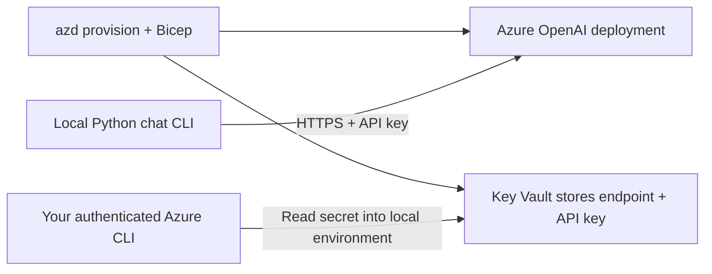

# Azure OpenAI Chat — CLI local e infraestructura AZD

**Nivel:** Intermedio · **Tiempo:** 35–60 minutos incluyendo la configuración

Este ejemplo provisiona un **recurso de Azure OpenAI y Key Vault**, luego ejecuta un
CLI de chat Python interactivo **en tu máquina**. No aloja una aplicación web
ni una aplicación de contenedor. El modelo predeterminado es `gpt-4.1`, versión `2025-04-14`, con
capacidad de despliegue `GlobalStandard` 20. Verifica la disponibilidad y cuota actual en
tu región seleccionada antes de provisionar; las fechas del ciclo de vida del modelo pueden cambiar.

## Objetivos de aprendizaje

- Provisionar infraestructura de modelos con Bicep y azd.
- Recuperar una clave API desde Key Vault sin incluirla en los outputs de despliegue.
- Enviar solicitudes de Chat Completions y mantener el historial de la conversación.
- Interpretar el conteo de tokens y las limitaciones de las estimaciones de costos.



No hay integración con identidad administrada en tiempo de ejecución, conmutación por error entre regiones,
limitador de tasa personalizado, modo streaming, ni computación alojada en este ejemplo. El SDK de OpenAI
realiza hasta dos reintentos en fallos reintentables; el CLI informa los errores restantes.

## Prerrequisitos

- Una versión estable actual de [azd](https://learn.microsoft.com/azure/developer/azure-developer-cli/install-azd)
  (versión publicada al momento de la revisión: 1.37.2).
- [Azure CLI](https://learn.microsoft.com/cli/azure/install-azure-cli).
- Python **3.10+** (3.11 recomendado) y un entorno virtual.
- Una suscripción de Azure con permiso para crear recursos de Cognitive Services y Key Vault,
  desplegar modelos y leer los secretos del almacén.
- Disponibilidad regional y cuota `GlobalStandard` para `gpt-4.1`. Los requisitos de acceso
  dependen de la suscripción y la característica; no hay un tiempo garantizado de aprobación.

```bash
azd version
az version
python --version
azd auth login
az login
```

Estas son sesiones de autenticación separadas. Seleccione la misma suscripción en ambas
herramientas antes de ejecutar los comandos a continuación.

## Inicio rápido (Bash)

Ejecutar desde la raíz del repositorio:

```bash
cd examples/azure-openai-chat
azd env new myopenai
azd provision
```

Elija una región compatible. La aprovisionamiento crea un grupo de recursos, cuenta OpenAI,
el despliegue del modelo, Key Vault y los secretos `openai-endpoint`/`openai-api-key`.
No hay **servicios para desplegar** en `azure.yaml`.

Cargue las salidas no secretas y obtenga el secreto en su shell actual:

```bash
export AZURE_OPENAI_ENDPOINT="$(azd env get-value AZURE_OPENAI_ENDPOINT)"
export AZURE_OPENAI_MODEL="$(azd env get-value AZURE_OPENAI_MODEL)"
KV_NAME="$(azd env get-value AZURE_KEY_VAULT_NAME)"
export AZURE_OPENAI_API_KEY="$(az keyvault secret show \
  --vault-name "$KV_NAME" --name openai-api-key --query value --output tsv)"

python -m venv .venv
source .venv/bin/activate
python -m pip install -r src/requirements.txt
python src/chat.py
```

En PowerShell, active con `.\.venv\Scripts\Activate.ps1` y asigne variables de entorno
con `$env:AZURE_OPENAI_ENDPOINT = azd env get-value AZURE_OPENAI_ENDPOINT`
(y de manera similar para el modelo). Obtenga la clave API usando
`$env:AZURE_OPENAI_API_KEY = az keyvault secret show --vault-name $KV_NAME --name openai-api-key --query value -o tsv`.
Configure `$KV_NAME = azd env get-value AZURE_KEY_VAULT_NAME` primero.

No imprima, confirme ni pegue la clave API en informes de problemas. La CLI lee variables
de entorno del proceso; **no** recupera secretos de Key Vault ni carga archivos `.env`.
`config.py` valida el endpoint, límite de tokens y temperatura al iniciar.

Salida esperada (el contenido y uso varían):

```text
Azure OpenAI Chat Application
Model: gpt-4.1
...
You: Say hello in one sentence.
Assistant: Hello! How can I help you today?
[Tokens: ... | Cost: $...]
```

Comandos: `stats` muestra totales, `clear` borra el historial de conversación y
`quit`/`exit` termina la sesión. No existen comandos `--stream`, `--show-tokens`, `tokens`,
ni `cost`.

## Verificar el despliegue

Después de cargar las variables de shell anteriores:

```bash
curl --fail-with-body \
  "${AZURE_OPENAI_ENDPOINT%/}/openai/deployments/${AZURE_OPENAI_MODEL}/chat/completions?api-version=2024-10-21" \
  -H "Content-Type: application/json" \
  -H "api-key: $AZURE_OPENAI_API_KEY" \
  -d '{"messages":[{"role":"user","content":"Say hello!"}],"max_tokens":50}'

az keyvault secret list --vault-name "$KV_NAME" --query "[].name" -o table
```

Éxito: la API devuelve HTTP 200 con `choices[0].message.content` y `usage`;
el vault lista `openai-api-key` y `openai-endpoint`. Un despliegue exitoso de ARM
por sí solo no verifica la inferencia.

## Archivos y configuración

```text
azure.yaml                         # Infrastructure-only AZD project
infra/main.bicep                   # Subscription deployment
infra/main.parameters.json         # Environment, location, principal ID
infra/resources/openai.bicep       # Account + model
infra/resources/keyvault.bicep     # Vault + deploying user's secret access policy
infra/resources/secrets.bicep      # Writes secrets, no key output
src/chat.py                        # Interactive CLI
src/config.py                      # Environment validation
src/requirements.txt               # Python packages
```

Para cambiar el modelo/version/capacidad aprovisionados, edite los valores predeterminados en
`infra/main.bicep` y ejecute `azd provision`. Configurar `AZURE_OPENAI_MODEL` en su
shell solo selecciona un **nombre de despliegue existente**; no despliega otro modelo.

| Variable de tiempo de ejecución | Predeterminado / fuente |
|---|---|
| `AZURE_OPENAI_ENDPOINT` | Requerido; salida no secreta de azd |
| `AZURE_OPENAI_API_KEY` | Requerido; recuperar desde Key Vault |
| `AZURE_OPENAI_MODEL` | `gpt-4.1`; nombre de despliegue de Azure |
| `AZURE_OPENAI_MAX_TOKENS` | 800 (rango de validación 1–4096) |
| `AZURE_OPENAI_TEMPERATURE` | 0.7 (rango 0–2) |
| `AZURE_OPENAI_INPUT_PRICE_PER_1K` | 0.002 USD; tarifa ilustrativa de entrada sin caché |
| `AZURE_OPENAI_OUTPUT_PRICE_PER_1K` | 0.008 USD; tarifa ilustrativa de salida |

## Costos y limitaciones de seguridad

La visualización de costos es una **estimación**, no la facturación de Azure. Multiplica el uso de tokens
de la API por las tarifas configuradas y no considera descuentos por entradas en caché,
diferencias regionales/SKU, impuestos, cambios de precio, o llamadas fallidas/reintentadas.
Sobrescriba **ambas tarifas** cuando use otro modelo o SKU y verifique la
[tarificación de Azure OpenAI](https://azure.microsoft.com/pricing/details/cognitive-services/openai-service/) actual.

A modo de ilustración, 100 solicitudes usando 500 tokens de entrada sin caché y 200 de salida cada una
a las tarifas predeterminadas cuestan `100 × (500/1000 × .002 + 200/1000 × .008) = $0.26`.
Las operaciones/almacenamiento de Key Vault generan cargos separados. No hay un cargo fijo de $50/mes
para esta CLI local y no hay cómputo alojado en la plantilla.

El vault usa una política de acceso para el principal que despliega; no es un ejemplo de RBAC o
aplicación con identidad administrada. Los endpoints públicos y la autenticación con clave API
se usan para enseñanza. Limite permisos y agregue controles de identidad/red apropiados antes de adaptarlo para producción.


**Inicio:** ejecutar CLI. **Objetivo:** observar el historial.
Di "Recuerda la palabra cedro," luego pregunta "¿Qué palabra te pedí que recordaras?"
Ejecuta `stats`; dos turnos exitosos deben contar como dos mensajes intercambiados.
Ejecuta `clear` y `stats`; los mensajes intercambiados deberían ser cero (los totales de tokens permanecen).
La redacción exacta del modelo no es determinista.

### 2. Cambiar el límite de respuesta

**Inicio:** salir del CLI, manteniendo la misma shell.
Ejecuta `export AZURE_OPENAI_MAX_TOKENS=100`, reinicia `python src/chat.py` y pide
una explicación breve de azd. Verifica que el banner muestre 100.
Restaura con `unset AZURE_OPENAI_MAX_TOKENS`. Un límite de respuesta menor no
reduce los tokens de historial ya enviados.

### Problemas comunes

- **Variables de entorno faltantes:** la provisión no exporta valores de shell;
  repite los pasos de exportación. Una terminal nueva los necesita de nuevo.
- **403 leyendo Key Vault:** verifica la suscripción/inicio de sesión de Azure CLI y el principal
  en la política de acceso del vault. Los cambios en la política pueden tardar en propagarse.
- **404 inferencia:** verifica el nombre del despliegue, el punto de conexión y el estado del despliegue.
- **429 inferencia:** espera a que se restablezcan los límites de tasa; verifica la cuota regional del modelo.
  El CLI elimina los turnos fallidos del historial para que reintentar no los duplique.
- **Longitud de contexto:** el ejemplo no recorta conversaciones largas; usa `clear`.
- **Modelo no disponible/retirado:** consulta la disponibilidad actual del modelo y actualiza
  modelo/versión/SKU juntos; la versión de API y la versión del modelo son configuraciones diferentes.

## Limpieza y siguientes pasos

```bash
azd down
unset AZURE_OPENAI_API_KEY
```

La retención de eliminación suave de Key Vault es de siete días; purgar requiere permisos separados.
No hay un conjunto de pruebas comprometido; no ejecutes un comando `pytest tests/` inexistente.
Agrega pruebas de API simuladas antes de extender el código.

[Ejemplos de contenedores](../../../../examples/container-app) · [Plano de arquitectura minorista](../retail-scenario.md) ·
[Inicio del curso](../../README.md) · [Reportar un problema](https://github.com/microsoft/AZD-for-beginners/issues)

---

<!-- CO-OP TRANSLATOR DISCLAIMER START -->
**Descargo de responsabilidad**:
Este documento ha sido traducido utilizando el servicio de traducción automática [Co-op Translator](https://github.com/Azure/co-op-translator). Aunque nos esforzamos por la precisión, tenga en cuenta que las traducciones automatizadas pueden contener errores o inexactitudes. El documento original en su idioma nativo debe considerarse la fuente autorizada. Para información crítica, se recomienda una traducción profesional humana. No somos responsables de cualquier malentendido o interpretación errónea que surja del uso de esta traducción.
<!-- CO-OP TRANSLATOR DISCLAIMER END -->