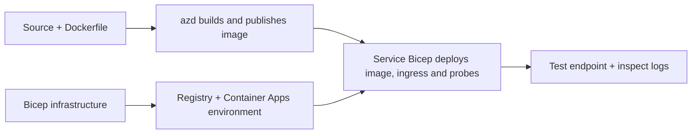

# Ejemplos de implementación de aplicaciones contenedor con AZD

Este directorio contiene dos ejemplos de aprendizaje con código fuente, Dockerfiles,
infraestructura Bicep y `azure.yaml`. Ninguno está preparado para producción.

## Elija un ejemplo

| Ejemplo | Qué se implementa | Prerrequisito |
|---|---|---|
| [API Flask simple](../../../../examples/container-app/simple-flask-api) | API CRUD de Python única, elementos en memoria, sondas de estado, escalado HTTP | Conocimientos básicos de CLI y HTTP |
| [Microservicios de dos servicios](../../../../examples/container-app/microservices) | Pasarela Node.js, servicio interno de productos Python de solo lectura, telemetría y escalado | Completar primero el ejemplo de un solo servicio |

Permita de 30 a 60 minutos, incluyendo configuración y verificación. Los tiempos de aprovisionamiento en Azure varían.

## Prerrequisitos

- [CLI de Azure Developer](https://learn.microsoft.com/azure/developer/azure-developer-cli/install-azd)
- [Azure CLI](https://learn.microsoft.com/cli/azure/install-azure-cli) para comandos de verificación
- Docker con su demonio activo para construir estas imágenes de contenedor
- Una suscripción de Azure con permisos para crear recursos y cuota regional suficiente
- Bash para los ejemplos de shell, o comandos equivalentes de PowerShell

```bash
azd version
az version
docker info
azd auth login
az login
```

Las dos herramientas tienen sesiones de inicio de sesión separadas. Use una versión estable y actual de azd; la versión publicada actual en el momento de la revisión es 1.37.2. Las versiones mínimas más antiguas no garantizan compatibilidad.


## Inicio rápido

Desde la raíz del repositorio:

```bash
cd examples/container-app/simple-flask-api
azd env new flask-demo
azd up
API_URL=$(azd env get-value API_ENDPOINT)
curl --fail-with-body "${API_URL}/health"
```

Esperado: HTTP 200 con `"status": "healthy"`. Siga el README de ejemplo para crear,
leer, actualizar y eliminar un ítem, y para inspeccionar registros.



La provisión inicial usa una imagen pública hello-world en el puerto 80. Los archivos de parámetros Bicep
específicos del servicio permiten que `azd deploy` la reemplace con la imagen de la aplicación construida
y el puerto/probes correctos de la app (8000 para Flask/product, 8080 para el gateway).
Mantenga estos archivos con sus `azure.yaml` `module` configuraciones.

## Configuración: qué cambia qué

`azure.yaml` selecciona directorios de origen, lenguajes, hosts y módulos de despliegue.
La CPU/memoria del contenedor, ingress, probes, conteo de réplicas y reglas de escala se definen
en **Bicep**, no en propiedades arbitrarias del servicio `resources`, `scale`, o `regions`.

`azd env set SOME_VALUE ...` almacena un valor localmente. Solo cambia un recurso desplegado
cuando un parámetro, asignación de entorno, o hook consume explícitamente ese
valor. Estos ejemplos no consumen `MAX_REPLICAS`, `SCALE_TO_ZERO_TIMEOUT`,
`CONTAINER_APP_REPLICA_TYPE`, o configuraciones canary personalizadas de valores del entorno azd.
Edite el Bicep relevante y ejecute `azd up` para reaprovisionar y desplegar.

No coloque el código fuente de la aplicación bajo `infra/`. `project` debe apuntar al directorio
fuente que contiene el Dockerfile y el manifiesto de dependencias.

## Monitorización y costos

- `azd monitor --logs` abre una vista del portal; no es un stream de registros en terminal.
  Use `az containerapp logs show --follow` con el nombre real del recurso.
- La API simple escribe registros stdout recolectados a través de Container Apps/Log Analytics.
  Su recurso Application Insights aprovisionado no está instrumentado automáticamente.
- El gateway de microservicios usa el SDK Node.js de Application Insights; el servicio Python
  exporta trazas de registros de la aplicación. No está configurado el tracing completo de solicitudes/dependencias en Python.

- Escalar a cero puede reducir cargos de cómputo, pero el registro y la ingesta/almacenamiento de logs
  todavía pueden costar dinero. Los valores predeterminados de microservicios mantienen réplicas en ejecución.
  Estime su región y uso en el
  [calculador de precios de Azure](https://azure.microsoft.com/pricing/calculator/).

## Patrones avanzados — implementaciones no incluidas

Estas son direcciones de diseño, no proyectos locales adicionales ni fragmentos para copiar y ejecutar:

- **Datos persistentes y autenticación:** reemplace los almacenes en memoria y agregue
  autenticación/autorización de Microsoft Entra ID antes de producción.
- **Blue-green/canary:** use el modo de múltiples revisiones de Container Apps, etiquetas de revisión,
  ponderaciones de tráfico, verificación de estado y procedimientos de reversión.
  No hay configuración `deploymentStrategy: canary` azd en estos ejemplos.
  Vea [gestión de revisiones](https://learn.microsoft.com/azure/container-apps/revisions).
- **Multirregión:** cree entornos y aplicaciones separados en Bicep y diseñe
  enrutamiento global y coherencia de datos. Una lista de servicios `regions` no es un
  mecanismo de implementación azd.
- **Trabajadores en cola:** agregue código fuente de trabajador, dependencias, recursos de cola, una identidad
  administrada con roles de plano de datos y una regla de escalado autenticada. No copie
  una ruta `src/worker` vacía y espere un proyecto ejecutable.
- **Dapr:** aprovisione componentes, configure el sidecar, instale el SDK correspondiente
  e implemente el manejo de errores en estado/pub-sub.
- **Secretos:** use identidad administrada y asignaciones de roles cuando sea posible. Simplemente
  crear un Key Vault no concede acceso a las aplicaciones ni carga secretos.

## Limpieza

Desde el directorio del ejemplo:

```bash
azd down
```

Revise los mensajes de eliminación y confirme que el grupo de recursos dedicado sea removido.
No use estos ejemplos como una base para producción sin diseño y pruebas adicionales.

[Índice de ejemplos](../README.md) · [Inicio del curso](../../README.md) ·
[Documentación de Container Apps](https://learn.microsoft.com/azure/container-apps/) ·
[Reportar un problema](https://github.com/microsoft/AZD-for-beginners/issues)

---

<!-- CO-OP TRANSLATOR DISCLAIMER START -->
**Descargo de responsabilidad**:
Este documento ha sido traducido utilizando el servicio de traducción automática [Co-op Translator](https://github.com/Azure/co-op-translator). Aunque nos esforzamos por la precisión, tenga en cuenta que las traducciones automatizadas pueden contener errores o inexactitudes. El documento original en su idioma nativo debe considerarse la fuente autorizada. Para información crítica, se recomienda una traducción profesional humana. No somos responsables de cualquier malentendido o interpretación errónea que surja del uso de esta traducción.
<!-- CO-OP TRANSLATOR DISCLAIMER END -->