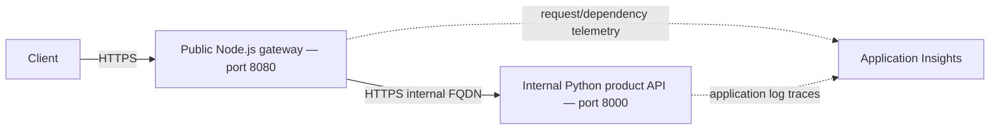

# Microservicios de dos servicios — Azure Container Apps

**Nivel:** Intermedio · **Tiempo:** 45–60 minutos incluyendo la configuración

Esta muestra de aprendizaje implementa un **API Gateway en Node.js** y un **Servicio de Producto
en Python de solo lectura**. Se incluyen el código fuente, Dockerfiles, Bicep y la configuración azd.
No es un sistema preparado para producción.

## Qué aprenderás

- Desplegar dos servicios de forma independiente.
- Usar un FQDN interno para el backend sobre HTTPS.
- Verificar respuestas de éxito, no encontrado y servicio no disponible.
- Entender la telemetría y los límites de escalado independientes.



El catálogo de productos contiene cinco productos fijos en memoria. No hay **manejadores POST,
PUT, o DELETE**, base de datos, Service Bus, servicio de pedidos/usuarios/notificaciones,
código C# o Go. Esas son ideas para desarrollos futuros, no características incluidas.
El gateway no autentica usuarios; el ingreso interno no es un reemplazo
para la autorización de la aplicación.

## Requisitos previos

Completa primero el [API Flask único](../../../../../examples/container-app/simple-flask-api).
Instala una versión estable actual de azd (versión publicada en el momento de la revisión: 1.37.2), Azure CLI,
y Docker con el daemon en ejecución. Necesitas una suscripción a Azure, recurso
permisos de creación y cuota regional de Container Apps.

```bash
azd version
az version
docker info
azd auth login
az login
```

Usa la misma suscripción en ambas herramientas CLI. Los comandos a continuación usan Bash.

## Desplegar y verificar

Desde la raíz del repositorio:

```bash
cd examples/container-app/microservices
azd env new microservices-demo
azd up
GATEWAY_URL=$(azd env get-value API_GATEWAY_URL)
RG_NAME=$(azd env get-value AZURE_RESOURCE_GROUP)
GATEWAY_NAME=$(azd env get-value API_GATEWAY_NAME)
PRODUCT_NAME=$(azd env get-value PRODUCT_SERVICE_NAME)

curl --fail-with-body "${GATEWAY_URL}/health"
curl --fail-with-body "${GATEWAY_URL}/api/products"
curl --fail-with-body "${GATEWAY_URL}/api/products/1"
curl -i "${GATEWAY_URL}/api/products/999"
```

**Éxito:** health 200; lista 200 con **cinco** productos; producto 1 es una Laptop
con precio 999.99 y stock 50; producto desconocido devuelve 404.
Las descripciones están incluidas en las respuestas; las marcas de tiempo varían.

La provisión inicial usa imágenes públicas hello-world en el puerto 80 para que no intente
descargar imágenes inexistentes de un registro vacío. Los módulos Bicep específicos del servicio
y los archivos de parámetros las reemplazan con imágenes construidas y puertos/probes de la aplicación durante
`azd deploy`. Los parámetros principales mantienen los nombres de imagen publicados para la provisión posterior.

## Servicios y red

| Servicio | Endpoints expuestos | Recursos predeterminados |
|---|---|---|
| Gateway | GET `/`, `/health`, `/api/products`, `/api/products/:id` | 1 vCPU, 2 GiB, 2–20 réplicas |
| Product | GET `/`, `/health`, `/products`, `/products/<id>` | 0.5 vCPU, 1 GiB, 1–10 réplicas |

El ingreso del producto tiene `external: false` y `allowInsecure: false`. Bicep inyecta
`PRODUCT_SERVICE_URL=https://<actual-internal-fqdn>` en el gateway. HTTP haría
redireccionamiento; HTTPS coincide con el ingreso configurado. Un nombre DNS corto debe coincidir con el
**nombre real de la Container App**, no con la clave lógica del servicio `product-service`.
No intentes llamar directamente a la URL interna desde tu laptop.

El gateway tiene un tiempo de espera de cinco segundos para llamadas al producto. Los IDs de producto faltantes
se propagan como 404; fallos de transporte/otros fallos de backend devuelven 503. El gateway
`/health` solo verifica el gateway, no la disponibilidad del backend.

## Archivos y configuración

```text
azure.yaml
infra/main.bicep
infra/main.parameters.json
infra/abbreviations.json
infra/core/container-apps-environment.bicep
infra/core/monitor.bicep
infra/app/api-gateway.bicep
infra/app/api-gateway.parameters.json
infra/app/product-service.bicep
infra/app/product-service.parameters.json
src/api-gateway/{app.js,package.json,Dockerfile}
src/product-service/{main.py,requirements.txt,Dockerfile}
```

La escala, CPU/memoria, puertos y probes se configuran en `infra/app/*.bicep`. Cambia esos
archivos y ejecuta `azd up` para aplicar la infraestructura y redeplegar. No hay
un parámetro `GATEWAY_MAX_REPLICAS` para variables de entorno en este ejemplo.

Para cambios solo de código:

```bash
azd deploy product-service
azd deploy api-gateway
```

La imagen de Node usa Node 22; la imagen de Python usa Python 3.11. Ambas se enlazan a
`0.0.0.0`. Ingress/probes usan el puerto 8080 (gateway) y 8000 (producto), respectivamente.

## Desarrollo local con Docker

Ejecuta desde este directorio de ejemplo. Usa una red definida por el usuario, **no `localhost`
desde un contenedor para alcanzar al otro**:

```bash
docker network create azd-microservices-demo
docker build -t local-product ./src/product-service
docker build -t local-gateway ./src/api-gateway
docker run -d --name azd-product --network azd-microservices-demo local-product
docker run -d --name azd-gateway --network azd-microservices-demo \
  -p 8080:8080 -e PRODUCT_SERVICE_URL=http://azd-product:8000 local-gateway
curl --fail-with-body http://localhost:8080/api/products
```

Esperado: cinco productos. HTTP se usa solo para esta red local de Docker.

```bash
docker stop azd-product azd-gateway
docker rm azd-product azd-gateway
docker network rm azd-microservices-demo
```

## Monitoreo

```bash
az containerapp logs show --name "$GATEWAY_NAME" --resource-group "$RG_NAME" --follow
# In a separate terminal:
az containerapp logs show --name "$PRODUCT_NAME" --resource-group "$RG_NAME" --tail 100
```

`azd monitor --logs` abre una vista del portal; no transmite registros del terminal.
El SDK de Node recopila solicitudes/dependencias del gateway. `AzureLogHandler` de Python
exporta **rastros de logs**, no solicitudes automáticas de Flask, dependencias SQL ni rastros
distribuidos completos. OpenCensus es un SDK legado; preferir Azure Monitor OpenTelemetry
al extender este ejemplo.

En Application Insights Logs, genera solicitudes e inspecciona:

```kusto
requests
| where timestamp > ago(1h)
| where name contains "products"
| summarize RequestCount=count(), AvgDuration=avg(duration) by bin(timestamp, 5m)
```

Para mensajes de la aplicación Python:

```kusto
traces
| where timestamp > ago(1h)
| where message contains "products"
| project timestamp, message, severityLevel
```

Permite el retraso de ingestión y muestreo; no esperes un conteo exacto de solicitudes ni
una latencia garantizada. No se configuran alertas o paneles personalizados.

## Ejercicios Prácticos

### Ejercicio 1: Modificar el catálogo

**Punto de partida:** `src/product-service/main.py`.
**Meta:** verificar despliegue independiente del servicio.
Cambia en el stock de Laptop de 50 a 49 en la lista fija `products`, ejecuta
`azd deploy product-service`, luego solicita `${GATEWAY_URL}/api/products/1`.

**Criterios de éxito / solución:** HTTP 200 con `"stock":49`. Restaura 50 y redepliega.
**Problema común:** editar el gateway en lugar del servicio que posee el catálogo.
Esto cambia datos fuente, no una base de datos persistente de inventario.

### Ejercicio 2: Verificar configuración de réplicas

**Punto de partida:** `infra/app/product-service.bicep`.
**Meta:** observar un cambio en la infraestructura sin suposiciones sobre autoescalado.
Cambia `minReplicas: 1` a `minReplicas: 2`, ejecuta `azd up`, luego:

```bash
az containerapp show --name "$PRODUCT_NAME" --resource-group "$RG_NAME" \
  --query properties.template.scale -o json
```

**Criterios de éxito:** el mínimo configurado es 2 y el máximo sigue siendo 10.
Restaura el mínimo 1 y ejecuta `azd up`.
**Problema común:** `azd deploy` solo no aplica cambios a infraestructuras compartidas no relacionadas.
No configures `maxReplicas` a cero como simulación de fallo.
Esto verifica la configuración, no es una prueba de carga ni un conteo garantizado instantáneo de réplicas.

### Ejercicio 3: Probar manejo de servicio no disponible localmente

**Punto de partida:** ambos contenedores Docker locales arriba están en ejecución.
**Meta:** distinguir fallo de backend de producto faltante.
Detén solo el contenedor del producto:

```bash
docker stop azd-product
curl -i http://localhost:8080/api/products
docker start azd-product
curl --fail-with-body http://localhost:8080/api/products
```

**Criterios de éxito:** mientras está detenido, el gateway devuelve 503 con
`"error":"Product service unavailable"`; después de reiniciar, la lista devuelve 200.
Reintentar tras breve retraso de inicio si es necesario.
**Problema común:** detener el gateway prueba un fallo distinto (sin respuesta HTTP).

## Costos y brechas en producción

Las réplicas mínimas predeterminadas mantienen la computación en marcha. También se generan
cargos por registro y monitoreo. No hay un total fijo validado de $50/mes: estima CPU/memoria regional,
horas de réplicas, solicitudes, registro y retención de logs en la
[calculadora de precios de Azure](https://azure.microsoft.com/pricing/calculator/).
Elimina recursos de aprendizaje de inmediato.

El trabajo en producción incluye autenticación/autorización, identidades gestionadas con ámbito,
datos persistentes, validación de entrada/respuesta, instrumentación soportada para observabilidad,
pruebas de carga/fallo, CI/CD, alertas y procedimientos de recuperación. Agregar un servicio de órdenes,
cola o base de datos es una tarea separada de implementación, no un ejercicio terminado ni una
característica ya disponible aquí.

## Solución de problemas y limpieza

- **Imagen no encontrada durante la primera provisión:** bootstrap debe usar la imagen pública;
  verifica los valores predeterminados del parámetro de imagen principal y los mapeos del módulo de despliegue.
- **503 productos:** revisa logs del producto, revisión de imagen y URL HTTPS interna inyectada.
- **404 ruta inesperada:** la API del producto es solo lectura; verifica la ruta, no un manejador CRUD inexistente.
- **Sin telemetría:** inspecciona las cadenas de conexión en tiempo de ejecución sin exponerlas y
  permite el retraso de ingestión. Las tablas de solicitudes de Python no se rellenan con su manejador de logs.

Desde este directorio ejemplo:

```bash
azd down
```

Revisa las solicitudes de eliminación y verifica que se elimine el grupo de recursos dedicado.

[Anterior: Flask API](../../../../../examples/container-app/simple-flask-api) · [Siguiente: aplicación de base de datos](../../../../../examples/database-app) ·
[Desarrollo AI](../../../docs/chapter-02-ai-development/README.md) ·
[Inicio del curso](../../../README.md) · [Reportar un problema](https://github.com/microsoft/AZD-for-beginners/issues)

---

<!-- CO-OP TRANSLATOR DISCLAIMER START -->
**Descargo de responsabilidad**:
Este documento ha sido traducido utilizando el servicio de traducción automática [Co-op Translator](https://github.com/Azure/co-op-translator). Aunque nos esforzamos por la precisión, tenga en cuenta que las traducciones automatizadas pueden contener errores o inexactitudes. El documento original en su idioma nativo debe considerarse la fuente autorizada. Para información crítica, se recomienda una traducción profesional humana. No somos responsables de cualquier malentendido o interpretación errónea que surja del uso de esta traducción.
<!-- CO-OP TRANSLATOR DISCLAIMER END -->