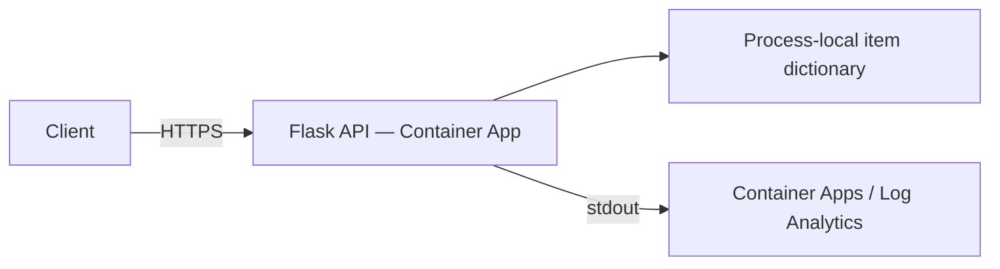

# API sencilla de Flask — Azure Container Apps

**Nivel:** Principiante · **Tiempo:** 30–45 minutos incluyendo la configuración

Implementa una API CRUD de Python Flask con Azure Developer CLI (azd). Se incluyen el código fuente, Dockerfile,
Bicep y parámetros de implementación. Este es un **ejemplo para aprendizaje**, no
una API lista para producción.

## Lo que aprenderás

- Compilar y publicar un contenedor mediante azd.
- Configurar sondas de ingreso y de estado/liveness/readiness.
- Verificar respuestas CRUD e inspeccionar registros de la aplicación.
- Entender por qué los datos en memoria no son adecuados para aplicaciones duraderas.



**Importante:** los elementos se mantienen en un solo proceso. El valor predeterminado es **un trabajador Gunicorn,
0–1 réplicas**, evitando intencionalmente datos inconsistentes entre trabajadores/réplicas.
Los elementos se pierden al reiniciar, cambiar la revisión o escalar a cero. Incrementar réplicas
requiere un almacenamiento persistente compartido. La API no tiene autenticación ni autorización.

## Prerequisites

- [Azd estable actual](https://learn.microsoft.com/azure/developer/azure-developer-cli/install-azd)
  (versión publicada al momento de la revisión: 1.37.2).
- [Azure CLI](https://learn.microsoft.com/cli/azure/install-azure-cli) para verificación.
- Docker con su demonio en ejecución; es necesario para la construcción local de imágenes por defecto.
- Suscripción de Azure, permisos para creación de recursos y cuota regional de Container Apps.
- Bash para los comandos siguientes (o PowerShell equivalente).
- Python 3.11 para desarrollo local opcional.

```bash
azd version
az version
docker info
azd auth login
az login
```

Las herramientas de CLI tienen sesiones de inicio de sesión separadas. Usa la misma suscripción en ambas.

## Inicio rápido

Desde la raíz del repositorio:

```bash
cd examples/container-app/simple-flask-api
azd env new flask-demo
azd up
API_URL=$(azd env get-value API_ENDPOINT)
RG_NAME=$(azd env get-value AZURE_RESOURCE_GROUP)
API_NAME=$(azd env get-value API_NAME)
curl --fail-with-body "${API_URL}/health"
```

Esperado: HTTP 200 y JSON con `"status":"healthy"`,
`"service":"simple-flask-api"`, y una marca de tiempo UTC actual.
El aprovisionamiento y la creación de imágenes generalmente toman varios minutos; los tiempos varían.

La provisión inicial utiliza una imagen pública hello-world que escucha en el puerto 80.
`azure.yaml` selecciona `infra/app/api.bicep` y su archivo de parámetros correspondiente para
el despliegue del servicio, lo que cambia la imagen, el ingreso y las sondas al puerto 8000.
No elimine esos parámetros de despliegue.

## Verificar CRUD

Ejecuta lo siguiente secuencialmente mientras la misma réplica siga activa:

```bash
# Create: HTTP 201; note the returned id (1 for a fresh process).
curl -i -X POST "${API_URL}/api/items" \
  -H "Content-Type: application/json" \
  -d '{"name":"Test Item","description":"My first item"}'

# Read list: HTTP 200, total 1 in a fresh process.
curl --fail-with-body "${API_URL}/api/items"

# Replace 1 if your create response returned another id.
curl --fail-with-body "${API_URL}/api/items/1"
curl -i -X PUT "${API_URL}/api/items/1" \
  -H "Content-Type: application/json" -d '{"name":"Updated Item"}'
curl -i -X DELETE "${API_URL}/api/items/1"
curl -i "${API_URL}/api/items/1"
```

Éxito: POST 201, lecturas/PUT 200, DELETE 204 sin cuerpo, luego elemento faltante 404.
JSON malformado/no objeto o un nombre vacío devuelve 400.
Si un elemento desaparece entre solicitudes, revise por un reinicio o escalado a cero;
esta es una limitación intencionada en memoria, no de persistencia.

| Endpoint | Métodos |
|---|---|
| `/` | GET — información del servicio |
| `/health` | GET — vida/listo |
| `/api/items` | GET, POST |
| `/api/items/{id}` | GET, PUT, DELETE |

## Registros y configuración

```bash
az containerapp logs show --name "$API_NAME" --resource-group "$RG_NAME" --follow
```

Esperado: Inicio de Gunicorn, registros de acceso de solicitudes y mensajes de la aplicación.
`azd monitor --logs` abre una vista de portal; no transmite al terminal.
Application Insights está aprovisionado pero **no instrumentado por este código Flask**;
usa Container Apps/Log Analytics para los registros stdout.

Edite `infra/app/api.bicep` para CPU/memoria, límites de réplicas o reglas de escalado, luego
ejecute `azd up`. Los valores predeterminados son 0.5 vCPU, 1 GiB, mínimo 0 / máximo 1 réplica, y un
umbral HTTP de 50 solicitudes concurrentes. Escalar a cero puede añadir latencia de inicio en frío.

`azd env set MAX_REPLICAS`, `API_KEY`, `LOG_LEVEL` arbitrarios, o
Los valores de `SCALE_TO_ZERO_TIMEOUT` **no están conectados a esta plantilla o aplicación**.
Establecer un valor no lo convierte automáticamente en una variable de entorno en tiempo de ejecución.
La imagen enlaza explícitamente el puerto 8000; actualice Dockerfile, Bicep ingress y probes
juntos si cambia el puerto.

## Archivos

```text
azure.yaml
infra/main.bicep
infra/main.parameters.json
infra/app/container-apps.bicep       # Environment, registry, monitoring
infra/app/api.bicep                  # App, ingress, probes, scale settings
infra/app/api.parameters.json        # Image and resource values for azd deploy
src/app.py
src/Dockerfile
src/requirements.txt
```

## Desarrollo local

Desde este directorio de ejemplo:

```bash
python -m venv .venv
source .venv/bin/activate  # PowerShell: .\.venv\Scripts\Activate.ps1
python -m pip install -r src/requirements.txt
python src/app.py
```

En otro terminal, prueba `http://localhost:8000/health` y los endpoints CRUD.
O construye y ejecuta la imagen real:

```bash
docker build -t flask-api:local ./src
docker run --rm -p 8000:8000 flask-api:local
```

Para cambios solo de código después del primer despliegue, ejecute `azd deploy api`.
Para cambios de Bicep, ejecute `azd up` para volver a aprovisionar y desplegar.

## Ejercicios prácticos

### 1. Validar el rechazo de entrada

**Punto de partida:** API desplegada, `API_URL` arriba.
**Objetivo:** verificar que la API rechace formas JSON inválidas y nombres faltantes.

```bash
curl -i -X POST "${API_URL}/api/items" \
  -H "Content-Type: application/json" -d '[]'
curl -i -X POST "${API_URL}/api/items" \
  -H "Content-Type: application/json" -d '{"name":""}'
```

**Criterios de éxito / solución:** ambos retornan 400 con un error JSON, no 500.
**Problema común:** omitir el encabezado de tipo de contenido JSON.

### 2. Agregar un endpoint de solo lectura

**Punto de partida:** `src/app.py`. **Objetivo:** ampliar y volver a desplegar la API.
Añadir esto antes del bloque `if __name__ == '__main__':`:

```python
@app.route('/version', methods=['GET'])
def version():
    return jsonify({'version': '1.0.0'})
```

Ejecuta `azd deploy api`, luego `curl --fail-with-body "${API_URL}/version"`.
**Criterios de éxito:** HTTP 200 y `{"version":"1.0.0"}`.
**Problema común:** colocar la ruta después de la llamada bloqueante `app.run()` al
probar con `python src/app.py`.

### Punto de control de conocimientos

¿Por qué un solo trabajador es insuficiente para datos duraderos? Porque incluso un proceso pierde
su diccionario al reiniciarse. Una versión de producción necesita almacenamiento compartido persistente,
autenticación, autorización, migraciones, pruebas y monitoreo operacional.

## Costos y solución de problemas

Esta no es una implementación garantizada de $0: el registro Básico y el almacenamiento/ingesta de logs
pueden generar cargos incluso cuando el cómputo de la aplicación está en cero. Usa el
[calculador de precios](https://azure.microsoft.com/pricing/calculator/) para tu región.

- **Error de compilación de Docker:** confirme `docker info`, acceso a la red y dependencias.
- **Aplicación no saludable:** inspeccione los registros de consola/sistema y verifique que el puerto de la imagen, el ingreso,
  y las sondas coincidan. No se debe sondear un marcador de posición en el puerto Flask.
- **403/permisos:** confirme la suscripción y los permisos para la creación de recursos.
- **Los elementos desaparecen:** el estado en memoria se reinicia en reinicios/escalado a cero; agregue una base de datos
  para un comportamiento duradero.

## Limpieza y siguientes pasos

```bash
azd down
```

Revise el aviso de eliminación y verifique que se haya eliminado el grupo de recursos dedicado.
No utilice una limpieza destructiva contra un grupo de recursos que contenga datos no relacionados.

[Siguiente: Aplicación de base de datos](../../../../../examples/database-app) · [Microservicios](../../../../../examples/container-app/microservices) ·
[Descripción general del contenedor](../README.md) · [Inicio del curso](../../../README.md) ·
[Reportar un problema](https://github.com/microsoft/AZD-for-beginners/issues)

---

<!-- CO-OP TRANSLATOR DISCLAIMER START -->
**Descargo de responsabilidad**:
Este documento ha sido traducido utilizando el servicio de traducción automática [Co-op Translator](https://github.com/Azure/co-op-translator). Aunque nos esforzamos por la precisión, tenga en cuenta que las traducciones automatizadas pueden contener errores o inexactitudes. El documento original en su idioma nativo debe considerarse la fuente autorizada. Para información crítica, se recomienda una traducción profesional humana. No somos responsables de cualquier malentendido o interpretación errónea que surja del uso de esta traducción.
<!-- CO-OP TRANSLATOR DISCLAIMER END -->