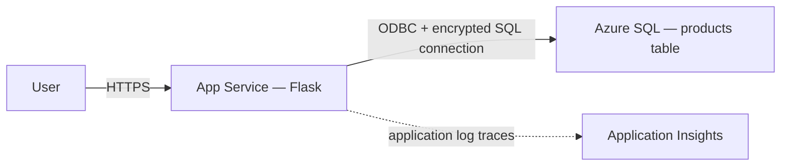

# Flask y Azure SQL en App Service

**Nivel:** Intermedio · **Tiempo:** 30–60 minutos incluyendo los prerrequisitos

Esta muestra despliega una API de lectura en Python Flask a **Linux App Service** y una base de datos Azure SQL básica.
Se incluyen el código fuente, Bicep y la configuración de azd. Es una
aplicación de aprendizaje, no una arquitectura de base de datos lista para producción.

## Qué aprenderás

- Provisione recursos de App Service, SQL y monitoreo con Bicep.
- Configure conectividad SQL cifrada sin comprometer las credenciales.
- Inicialice un esquema antes de iniciar los workers de Gunicorn.
- Verifique los datos precargados, respuestas de no encontrado y el estado de la base de datos.



Recursos: grupo de recursos dedicado, plan de App Service Linux B1, App Web Python 3.11,
servidor SQL y base de datos Basic de 2 GB, Application Insights y Log Analytics.
La App Web utiliza **despliegue desde fuente/ZIP e instalación de dependencias Oryx**;
`azd deploy` no construye ni despliega el Dockerfile opcional.

## Requisitos previos

- Versión estable actual de [azd](https://learn.microsoft.com/azure/developer/azure-developer-cli/install-azd)
  (versión publicada al momento de la revisión: 1.37.2).
- [CLI de Azure](https://learn.microsoft.com/cli/azure/install-azure-cli) para verificación.
- Suscripción de Azure, permisos para crear los recursos listados y cuota regional.
- Python **3.11** para desarrollo local; `pyodbc==5.0.1` comprometido puede requerir
  herramientas nativas de compilación en versiones recientes de Python.
- Controlador Microsoft ODBC Driver 18 (o 17) para SQL Server en máquinas locales. `pip install
  pyodbc` no instala el controlador del sistema. Ver
  [instalación de ODBC](https://learn.microsoft.com/sql/connect/odbc/download-odbc-driver-for-sql-server).
- Docker solo si se prueba el contenedor opcional localmente.

```bash
azd version
az version
azd auth login
az login
```

Use la misma suscripción en ambas herramientas. Los comandos a continuación usan Bash.

## Desplegar

Desde la raíz del repositorio:

```bash
cd examples/database-app
azd env new sql-demo
azd provision
azd deploy
WEB_URL=$(azd env get-value WEB_APP_URI)
WEB_NAME=$(azd env get-value WEB_APP_NAME)
RG_NAME=$(azd env get-value AZURE_RESOURCE_GROUP)
```

Elija una región compatible. `sqlAdminLogin` por defecto usa `sqladmin`; el parámetro seguro requerido
`sqlAdminPassword` es una contraseña fuerte. Proporcione una contraseña segura cuando se solicite.
Mantenga las credenciales de despliegue fuera de Git y reportes de incidencias. La interpolación actual
de la cadena de conexión espera una contraseña sin delimitadores de cadena 
como `;`; adapte el escape antes de usar esos valores.

Bicep establece un comando de inicio que ejecuta `init_database()` **antes** de que empiecen
los workers Gunicorn. Esto es necesario porque importar `app:app` no ejecuta el bloque
`if __name__ == '__main__'` de Python. En una base de datos nueva, la inicialización
crea `products` e inserta cinco filas. Es una semilla educativa sencilla, no un framework
de migración concurrente; use migraciones adecuadas antes de escalar instancias.

La app selecciona Microsoft ODBC Driver 18 instalado, luego 17 si la cadena de conexión
no nombra explícitamente un controlador. Si ninguno existe, la inicialización falla con
un error instalable. Verifique la disponibilidad del controlador en la ejecución de App Service seleccionada,
no lo asuma.

## Verificar

```bash
curl --fail-with-body "${WEB_URL}/"
curl --fail-with-body "${WEB_URL}/health"
curl --fail-with-body "${WEB_URL}/products"
curl --fail-with-body "${WEB_URL}/products/1"
curl -i "${WEB_URL}/products/999"
```

Esperado:

- `/` devuelve información del endpoint.
- `/health` devuelve 200 con `{"status":"healthy","database":"connected"}`.
- `/products` devuelve cinco productos sembrados en una base de datos nueva.
- `/products/1` devuelve Laptop con precio 1299.99.
- Un producto inexistente devuelve 404 con `{"error":"Product not found"}`.

El API es solo lectura. No hay rutas POST/PUT/DELETE ni interfaz de navegador.
Fallo de conexión a base de datos devuelve 503 desde `/health`; no es éxito.

## Archivos y configuración

```text
azure.yaml                         # Python App Service source deployment
infra/main.bicep
infra/main.parameters.json
infra/abbreviations.json
infra/resources/sql-server.bicep
infra/resources/sql-database.bicep
infra/resources/app-service-plan.bicep
infra/resources/web-app.bicep       # Settings + initialization/startup command
infra/resources/app-insights.bicep
src/web/app.py
src/web/requirements.txt
src/web/Dockerfile                 # Optional local container, not the azd target
.env.sample
```

`SQL_CONNECTION_STRING` se pasa como parámetro seguro de Bicep al módulo de Web App
y se almacena en la configuración de App Service, no en salida de despliegue.
`APPLICATIONINSIGHTS_CONNECTION_STRING` configura la exportación de logs.
`SCM_DO_BUILD_DURING_DEPLOYMENT=true` habilita instalación de dependencias del lado del servidor.
Establecer valores arbitrarios `azd env` no altera automáticamente la configuración de la app.

La regla `0.0.0.0` del firewall SQL permite conexiones desde **servicios de Azure,
incluyendo otras suscripciones de clientes**, sujeto a autenticación SQL. No se limita
a esta app o suscripción. El acceso público a la red SQL está habilitado.
Use redes con alcance y una identidad de aplicación no administrativa antes de producción.

## Desarrollo local

Use Python 3.11 y un controlador ODBC Microsoft SQL instalado:

```bash
python -m venv .venv
source .venv/bin/activate  # PowerShell: .\.venv\Scripts\Activate.ps1
python -m pip install -r src/web/requirements.txt
export SQL_CONNECTION_STRING='Server=tcp:YOUR_SERVER.database.windows.net,1433;Database=YOUR_DATABASE;UID=YOUR_USER;PWD=YOUR_PASSWORD;Encrypt=yes;TrustServerCertificate=no;Connection Timeout=30;'
python src/web/app.py
```

Reemplace los marcadores de posición de forma segura. Un archivo `.env` copiado **no se carga automáticamente**
con esta aplicación. Exporte variables en la shell actual en su lugar.
Para Azure SQL desde un portátil, permita temporalmente solo su IP pública:

```bash
SQL_SERVER=$(azd env get-value SQL_SERVER_NAME)
MY_IP=YOUR_PUBLIC_IP
az sql server firewall-rule create -g "$RG_NAME" -s "$SQL_SERVER" \
  -n AllowMyLearningIP --start-ip-address "$MY_IP" --end-ip-address "$MY_IP"
```

Elimine la regla tras las pruebas:

```bash
az sql server firewall-rule delete -g "$RG_NAME" -s "$SQL_SERVER" -n AllowMyLearningIP
```

Prueba opcional de contenedor desde este directorio del ejemplo:

```bash
docker build -t sql-flask:local src/web
docker run --rm -p 8000:8000 -e SQL_CONNECTION_STRING sql-flask:local
```

Esta imagen instala el Driver 18 usando el repositorio de paquetes Debian 12 correspondiente a su base
Bookworm, inicializa la base de datos una vez, luego arranca Gunicorn.

## Monitorización y solución de problemas

Habilite y siga los logs del sistema de archivos de App Service al diagnosticar inicio:

```bash
az webapp log config --name "$WEB_NAME" --resource-group "$RG_NAME" \
  --application-logging filesystem --level information
az webapp log tail --name "$WEB_NAME" --resource-group "$RG_NAME"
```

Este código exporta los **logs de trazas** de la aplicación a través de un manejador OpenCensus heredado.
No configura trazado automático de solicitudes/dependencias Flask, métricas en vivo,
auditoría SQL, configuración de diagnósticos ni alertas. Esas requieren configuración separada.
Para instrumentación nueva, prefiera Azure Monitor OpenTelemetry.

En Application Insights Logs, tras realizar solicitudes API:

```kusto
traces
| where timestamp > ago(1h)
| where message contains "products" or message contains "Health check"
| project timestamp, message, severityLevel
```

Permita retraso en la ingestión. La actividad en la tabla de solicitudes o métricas en vivo no es criterio
de finalización para esta instrumentación solo de logs.

- **Controlador faltante:** inspeccione `pyodbc.drivers()` en el runtime e instale un
  controlador ODBC Microsoft compatible. Un paquete Python solo no es suficiente.
- **Fallo de conexión:** revise configuración SQL, credenciales, firewall y suscripción
  seleccionada. No desactive el cifrado para evitar un error.
- **Falta tabla de productos:** confirme que el comando de inicio Bicep fue desplegado;
  iniciar `gunicorn app:app` solo omite la inicialización.
- **Fallo de compilación de paquete:** use Python 3.11 o provea prerrequisitos nativos.
- **Datos con precio cero:** cero es un precio decimal válido; debe serializarse como 0.0,
  no como `null`.

## Ejercicios prácticos

### Ejercicio 1: Verificar comportamiento con producto ausente

**Punto de partida:** API desplegada y `WEB_URL` arriba.
**Meta:** distinguir una fila ausente de una base de datos rota.
Solicite `/health` y `/products/999` con los comandos anteriores.
**Criterios de éxito / respuesta:** estado 200 saludable, producto inexistente 404 (no 500 ni 503).
**Problema común:** asumir que una respuesta no encontrada prueba que la conexión SQL está rota.

### Ejercicio 2: Cambiar un valor sembrado

**Punto de partida:** Editor de consultas Azure SQL, conectado a la base de datos de ejemplo.
**Meta:** mostrar que los datos API se almacenan en SQL y no en memoria del proceso.

```sql
UPDATE products SET price = 0 WHERE id = 1;
SELECT id, name, price FROM products WHERE id = 1;
```

Solicite `${WEB_URL}/products/1`. **Criterio de éxito:** el precio es `0.0`, no `null`.
Restaure el valor:

```sql
UPDATE products SET price = 1299.99 WHERE id = 1;
```

**Problema común:** editar la lista semilla en Python no actualiza filas ya en SQL.
No ejecute ejercicios de esquema/datos en bases de datos de producción.

### Ejercicio 3: Agregar un endpoint de conteo solo lectura

**Punto de partida:** `src/web/app.py`.
**Meta:** extender la API usando una consulta agregada sin parámetros.
Agregue esto antes del bloque `if __name__ == '__main__':`:

```python
@app.route('/product-count')
def product_count():
    from contextlib import closing
    with closing(get_db_connection()) as conn, closing(conn.cursor()) as cursor:
        cursor.execute("SELECT COUNT(*) FROM products")
        return jsonify({'count': cursor.fetchone()[0]})
```

Ejecute `azd deploy web`, luego solicite `${WEB_URL}/product-count`.
**Criterio de éxito:** 200 con `{"count":5}` en la base de datos sembrada sin cambios.
**Problema común:** cambiar la ruta pero olvidar volver a desplegar.
Para producción, agregue manejo de errores/pruebas; este ejercicio corto se enfoca en la consulta.

## Costos, brechas en producción y limpieza

App Service B1 y la base de datos Basic se cobran mientras estén aprovisionados. Detener la
Web App **no** detiene la facturación del plan App Service. Logs y almacenamiento pueden generar costos.
Use la [calculadora de precios de Azure](https://azure.microsoft.com/pricing/calculator/)
para precios regionales actuales. Cambiar a F1 también requiere deshabilitar `alwaysOn`;
no es un reemplazo sencillo de una línea. SQL serverless no es automáticamente gratuito.

El trabajo de producción incluye identidad de app con mínimo privilegio (no admin de SQL),
autenticación/autorización, red privada, migraciones seguras, revisión del ciclo de vida/pool de conexiones,
telemetría, auditoría, alertas, pruebas y procedimientos de recuperación.
Caché Redis y tablas adicionales son ideas de desarrollo, no ejercicios implementados.

Desde este directorio de ejemplo:

```bash
azd down
```

Revise el aviso de eliminación y verifique que el grupo de recursos dedicado sea eliminado.
No elimine grupos que contengan datos no relacionados.

[Ejemplos de contenedor](../../../../examples/container-app) ·
[Desarrollo AI](../../docs/chapter-02-ai-development/README.md) ·
[Inicio del curso](../../README.md) · [Reportar un problema](https://github.com/microsoft/AZD-for-beginners/issues)

---

<!-- CO-OP TRANSLATOR DISCLAIMER START -->
**Descargo de responsabilidad**:
Este documento ha sido traducido utilizando el servicio de traducción automática [Co-op Translator](https://github.com/Azure/co-op-translator). Aunque nos esforzamos por la precisión, tenga en cuenta que las traducciones automatizadas pueden contener errores o inexactitudes. El documento original en su idioma nativo debe considerarse la fuente autorizada. Para información crítica, se recomienda una traducción profesional humana. No somos responsables de cualquier malentendido o interpretación errónea que surja del uso de esta traducción.
<!-- CO-OP TRANSLATOR DISCLAIMER END -->