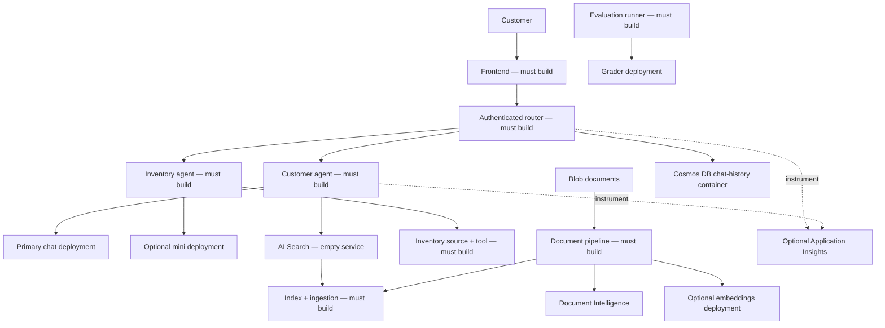

# Soporte al Cliente Multi-Agente — Plano Arquitectónico para Retail

**Capítulo 5: Soluciones de IA Multi-Agente**

- [Inicio del curso](../README.md)
- [Capítulo 5](../docs/chapter-05-multi-agent/README.md)
- [Requisito previo: Integración de IA](../docs/chapter-02-ai-development/microsoft-foundry-integration.md)
- [Siguiente: Planificación de capacidad](../docs/chapter-06-pre-deployment/capacity-planning.md)
- [Estructura ARM para infraestructura](retail-multiagent-arm-template/README.md)

> **Guía de arquitectura, no una aplicación funcional.** Los únicos archivos de implementación para retail
> son `azuredeploy.json`, `azuredeploy.parameters.json`, y `deploy.sh` en
> `retail-multiagent-arm-template/`. Los contenedores router/frontend son marcadores de posición tipo hello-world.
> No existe localmente un agente retail, interfaz de usuario, canal de ingestión, evaluador, escáner, o
> conjunto de pruebas de aplicación.

## Resumen

**Objetivo:** diseñar un sistema de soporte al cliente con un agente de atención y un agente de inventario,
identificar qué provee la infraestructura, y planificar los contratos de aplicación faltantes y su verificación.


**Audiencia:** desarrolladores que han completado la
[muestra de chat](../../../examples/azure-openai-chat) local y la [muestra de contenedor de dos servicios](../../../examples/container-app/microservices).
Permita de 2 a 3 horas para el estudio arquitectónico. Construir la aplicación es un proyecto separado:
80–120 horas de desarrollo es una estimación ilustrativa para planificar
desarrolladores experimentados, **no una promesa de entrega**; el endurecimiento para producción, pruebas,
revisión de seguridad y operaciones requieren trabajo adicional.

### Resultados de aprendizaje

- Explicar ruteo, grounding, permisos de herramientas y propiedad de la conversación.
- Distinguir identificadores de modelos, nombres de despliegue, versiones de API y versiones de ARM.
- Diseñar ingestión y recuperación de documentos con dimensiones vectoriales coincidentes.
- Definir requisitos verificables funcionales, de evaluación y de recuperación ante fallas.
- Separar los objetivos opcionales de arquitectura de los recursos realmente aprovisionados.

## Arquitectura de la solución



Esta es una **arquitectura objetivo de la aplicación**, no un diagrama de agentes en ejecución.
El esqueleto ARM crea los servicios subyacentes y solo dos contenedores de reserva.
Front Door, registro, identidades gestionadas, asignaciones de roles,
puntos finales privados, conmutación por error, instrumentación de la aplicación y alertas no están incluidos.

### Responsabilidades y contratos

| Componente | Comportamiento requerido | Evidencia antes de llamarlo completo |
|---|---|---|
| Frontend | Autenticar usuarios, mostrar chat, cargar documentos de forma segura | UI y pruebas de carga, errores accesibles |
| Router | Autorizar solicitudes, elegir agente, llamadas/límites de tiempo a herramientas acotados | Pruebas de ruteo, verificaciones de autorización, pruebas de fallos |
| Agente cliente | Groundear respuestas de política/producto en fuentes aprobadas | Citaciones correctas, abstención cuando falta datos |
| Herramienta de inventario | Leer stock autoritativo con permisos limitados | Pruebas deterministas de stock; no inventar disponibilidad |
| Canalización de documentos | Extraer, fragmentar, insertar vectores, indexar, actualizar/eliminar | Fijaciones indexadas y comportamiento de reintento/carta muerta |
| Almacenamiento de conversaciones | Aislar usuarios, aplicar retención | Pruebas de autorización cruzada y TTL |
| Ejecutor de evaluación | Comparar resultados con la verdad de referencia y rúbrica | Cobertura, conteo de fallos, informes reproducibles |

Piensa en el router como un mostrador de recepción y las herramientas como sistemas internos restringidos:
elegir un especialista no es autorización para acceder a todos los registros de un cliente.
Aplica la identidad y permisos en el código de la aplicación y servicios de datos, no en los prompts.

## Infraestructura vs. Aplicación

Lea el [README del esqueleto](retail-multiagent-arm-template/README.md) antes
de aprovisionar. Enumera recursos exactos, modos, costos y limitaciones.

| Uso lógico | Nombre de despliegue ARM | Modelo / versión | Región predeterminada |
|---|---|---|---|
| Chat cliente | `gpt-4.1-chat` | `gpt-4.1` / `2025-04-14` | `eastus2` |
| Inventario | `gpt-4.1-mini-inventory` | `gpt-4.1-mini` / `2025-04-14` | `westus2`, opcional |
| Inserciones | `text-embedding-ada-002` | `text-embedding-ada-002` / `2` | `francecentral`, opcional |
| Evaluación | `gpt-4.1-grader` | `gpt-4.1` / `2025-04-14` | Región primaria por defecto |

Verifique la disponibilidad de modelo/versión/SKU y cuota en **cada región**. Chat/mini/grader
usan `GlobalStandard`; las inserciones usan `Standard`. Las asignaciones unidades de capacidad a TPM
son específicas por modelo. No agregue unidades de capacidad diferentes como garantía universal de cuota.

El argumento `model` de una solicitud Azure OpenAI es el **nombre de despliegue**, no
necesariamente el identificador del modelo del catálogo. La versión de API del plano de datos `2024-10-21`
es distinta de la versión del modelo `2025-04-14` y del recurso ARM `apiVersion`.
No se puede corregir un modelo no disponible solo cambiando la versión de API del plano de datos.

`--no-multi-region` omite cuentas secundarias y de inserciones. Quedan una cuenta principal de chat y
una cuenta independiente de grader. Las cuentas separadas de modelo no proporcionan
conmutación por error automática; esto requiere ruteo de aplicación, despliegues compatibles, chequeos de salud,
límites de reintentos y revisión de residencia de datos.

## Hoja de ruta de implementación

### 1. Comience con una interacción probada

Antes de aprovisionar el gran esqueleto, use la muestra de chat local para establecer
conectividad de inferencia. Defina una pregunta representativa del cliente, la fuente aprobada
de respuestas, la citación esperada y el comportamiento ante falla cuando falta esa fuente.

### 2. Defina límites de ruteo y herramientas

Cree su propio código fuente de router, manifiesto de dependencias, Dockerfile y pruebas. Un
contrato ilustrativo podría ser `POST /chat` con `{"message":"...","conversation_id":"..."}`.
**Ese endpoint es una propuesta de diseño; no está implementado por la plantilla ARM.**

Valide tipos/límites del cuerpo, derive identidad del usuario desde autenticación, aplique
propiedad de conversación, aplique límites de tiempo a solicitudes y devuelva códigos de error significativos.
No considere fallos HTTP o respuestas vacías como resultados exitosos del agente.

### 3. Implemente grounding e ingestión

La plantilla ARM no crea un índice de búsqueda. Esto es un **fragmento JSON de referencia
para adaptar en su propia definición de índice**, no un archivo ya en el repositorio:

```json
{
  "name": "retail-product-index",
  "fields": [
    {"name": "id", "type": "Edm.String", "key": true},
    {"name": "title", "type": "Edm.String", "searchable": true},
    {"name": "content", "type": "Edm.String", "searchable": true},
    {"name": "category", "type": "Edm.String", "filterable": true},
    {
      "name": "content_vector",
      "type": "Collection(Edm.Single)",
      "searchable": true,
      "dimensions": 1536,
      "vectorSearchProfile": "retail-profile"
    }
  ],
  "vectorSearch": {
    "algorithms": [{"name": "retail-hnsw", "kind": "hnsw"}],
    "profiles": [{"name": "retail-profile", "algorithm": "retail-hnsw"}]
  }
}
```

El perfil vincula el campo vectorial con su algoritmo. Las dimensiones deben coincidir con el
salida de incrustación actual (1536 para este `ada-002` despliegue). Para la recuperación en Python,
usa `azure.search.documents.models.VectorizedQuery` en lugar de un
diccionario incompleto que carece de su tipo de consulta vectorial:

```python
# Reference function only: supply an authenticated async SearchClient and an embedding.
from azure.search.documents.models import VectorizedQuery

async def retrieve(search_client, embedding):
    results = await search_client.search(
        search_text=None,
        vector_queries=[VectorizedQuery(
            vector=embedding,
            k_nearest_neighbors=5,
            fields="content_vector"
        )],
        select=["id", "title", "content"]
    )
    return [document async for document in results]
```

Crea una implementación de ingestión separada que:

1. Autoriza el acceso de subida y valida el tipo y tamaño del contenido.
2. Lee blobs privados usando llamadas SDK autenticadas. Una URL de blob privado por sí sola
   **no** es una entrada legible para Document Intelligence; envía los bytes descargados con
   `AnalyzeDocumentRequest(bytes_source=...)` o usa un SAS de vida corta y con el alcance adecuado
   después de revisar los requisitos de acceso.
3. Extrae texto, lo divide en fragmentos para ajustarse a los límites de embedding, y genera embeddings.
4. Crea claves de documento válidas y estables y sube fragmentos con vectores correspondientes.
5. Verifica los resultados del indexado por documento, maneja reintentos y actualiza/elimina datos obsoletos.

No interpole claves/valores arbitrarios de usuario en filtros OData. Permita solo campos,
valide los tipos de valores y escape las comillas de las cadenas. Los filtros booleanos y numéricos necesitan
literales tipados, no cadenas entre comillas.

### 4. Anclaje web

**Bing Search v7 fue retirado el 11 de agosto de 2025.** El antiguo recurso `Microsoft.Bing/accounts`
y los ejemplos `api.bing.microsoft.com/v7.0/search` no son una ruta de implementación soportada.
Evalúe una integración de anclaje actualmente soportada en
Microsoft Foundry y su SDK, permisos, facturación y requisitos de citación;
ninguno está implementado aquí. No es un reemplazo directo para el endpoint retirado.

### 5. Agregar telemetría y evaluación

Crear Application Insights no instrumenta el código. Use la instrumentación de OpenTelemetry
soportada por Azure Monitor al construir una nueva aplicación, propague el contexto de traza
entre servicios y evite registrar solicitudes, documentos o secretos de clientes.
Truncar una consulta **no** la anonimiza.

Mida la duración de la solicitud, fallos en enrutamiento/herramientas, relevancia de recuperación, 
corrección de citas, uso de tokens y abstención. Almacene hechos verdaderos del inventario/política 
junto con casos de evaluación: un evaluador no puede determinar confiablemente la exactitud 
factual solo con una pregunta y una respuesta.

Un despliegue de evaluador no es un ejecutor de evaluación. Implemente una rúbrica versionada, 
salida estructurada/validación de esquema, verificaciones de rango de puntajes, conteos de fallos 
de transporte y casos revisados por humanos. Informe casos incompletos/error por separado; no los 
convierta en calificaciones exitosas ni los incluya silenciosamente como respuestas de modelo de calidad cero.

Del mismo modo, algunas verificaciones de palabras clave no constituyen una certificación de seguridad. 
Una solicitud HTTP fallida, estrategia de prueba faltante o respuesta vacía debe hacer que una prueba sea 
**inconclusa o fallida**, no obtener una puntuación de “100 % segura”. Realice pruebas autorizadas con 
herramientas apropiadas y revisión humana antes de cualquier afirmación de preparación para producción.

### 6. Despliegue su aplicación

Cree sus propios directorios fuente, manifiestos, pruebas, registro y permisos de extracción de imagen. 
Reemplace los marcadores de posición con imágenes compiladas y actualice el ingreso/probes para que 
coincidan con el puerto de escucha de cada aplicación. Configure variables de entorno de tiempo de 
ejecución en Bicep o un mapeo explícito de entorno compatible azd.

No existe un diccionario `config` genérico bajo un servicio azd que cree automáticamente 
variables de entorno de tiempo de ejecución. `azd env set` solo cambia recursos que consumen 
explícitamente esos valores. No se implementa ningún canario, lista de regiones o gancho de ajuste fino 
en este esqueleto.

## Ejercicios prácticos de diseño

Estos son **ejercicios de arquitectura**, no afirmaciones de código de inicio ejecutable para comercio minorista.

### Ejercicio 1: Verifique el límite

**Punto de partida:** los tres archivos en `retail-multiagent-arm-template/`.
**Objetivo:** distinguir la provisión de la funcionalidad de la aplicación.
Abra `azuredeploy.json`, ubique tanto las imágenes del contenedor como los valores de `targetPort`,
luego liste los componentes de la aplicación que faltan en el repositorio.

**Criterios de éxito / respuesta:** ambas imágenes son marcadores de posición hello-world escuchando
en el puerto 80; agentes, interfaz de chat, manejadores del enrutador, índice/ingesta, evaluador y escáner
están ausentes. Una solicitud raíz exitosa al marcador de posición no valida `/chat`.
**Problema común:** interpretar nombres de recursos como `retail-router` como código funcional.

### Ejercicio 2: Rastrear la configuración de vector

**Punto de partida:** JSON del índice arriba.
**Objetivo:** comprender la relación campo → perfil → algoritmo.
Identifique qué valores deben cambiar al cambiar a un modelo de incrustación con una
dimensión de salida diferente, luego inspeccione la función `retrieve`.

**Criterios de éxito / respuesta:** cambie el campo `dimensions` a la longitud real del vector;
mantenga `vectorSearchProfile` alineado con un perfil declarado y su algoritmo;
la consulta `fields` debe nombrar el campo vectorial. Regenerar los vectores de documentos existentes
cuando cambie el modelo de incrustación.
**Problema común:** cambiar solo el nombre del modelo manteniendo vectores incompatibles.

### Ejercicio 3: Definir una prueba de fallo

**Punto de partida:** tabla de responsabilidades.
**Objetivo:** evitar falsos éxitos.
Escriba el comportamiento esperado para una API de inventario no disponible, un índice de búsqueda sin
documentos coincidentes y una solicitud de evaluación que devuelve HTTP 503.

**Criterios de éxito / respuesta:** no inventar valores de inventario; abstención explícita o
escalada cuando falta contexto; la evaluación reporta una falla de transporte en lugar de
un pase de calidad o seguridad. Agregue pruebas ejecutables al construir la aplicación.
**Problema común:** capturar toda excepción y continuar con una respuesta vacía.

## Costos, solución de problemas y limpieza

- La infraestructura tiene cargos continuos incluso con índices de búsqueda vacíos y aplicaciones de marcador de posición.
  Use los precios regionales actuales; ni “mínimo” ni multi-región implica gratis.
- Los costos de tokens dependen del modelo, entrada en caché/no caché, salida y SKU de despliegue.
  El enrutamiento puede ahorrar dinero solo si la carga medida y los resultados de calidad lo justifican;
  no se garantiza un ahorro fijo del 60–80%.
- Verifique la disponibilidad del modelo y la cuota antes de provisionar; distinga errores de permiso,
  nombre de despliegue, región, versión del modelo y versión de API.
- No ejecute `setup-data.sh` faltantes, interfaces de línea de comandos evaluadoras ni comandos `pytest tests/`.
  Sus implementaciones forman parte de su cartera de desarrollo.
- El armazón es solo para ARM: siga sus
  [instrucciones de verificación y limpieza](retail-multiagent-arm-template/README.md).
  `azd down` no administra esos recursos.

## Recursos relacionados

- [Ejemplo local de chat funcionando](../../../examples/azure-openai-chat)
- [Ejemplo de contenedor de dos servicios funcionando](../../../examples/container-app/microservices)
- [Índices vectoriales de AI Search](https://learn.microsoft.com/azure/search/vector-search-how-to-create-index)
- [Documentación de Container Apps](https://learn.microsoft.com/azure/container-apps/)
- [Solución de problemas](../docs/chapter-07-troubleshooting/common-issues.md)
- [Reportar un problema](https://github.com/microsoft/AZD-for-beginners/issues)

---

<!-- CO-OP TRANSLATOR DISCLAIMER START -->
**Descargo de responsabilidad**:
Este documento ha sido traducido utilizando el servicio de traducción automática [Co-op Translator](https://github.com/Azure/co-op-translator). Aunque nos esforzamos por la precisión, tenga en cuenta que las traducciones automatizadas pueden contener errores o inexactitudes. El documento original en su idioma nativo debe considerarse la fuente autorizada. Para información crítica, se recomienda una traducción profesional humana. No somos responsables de cualquier malentendido o interpretación errónea que surja del uso de esta traducción.
<!-- CO-OP TRANSLATOR DISCLAIMER END -->