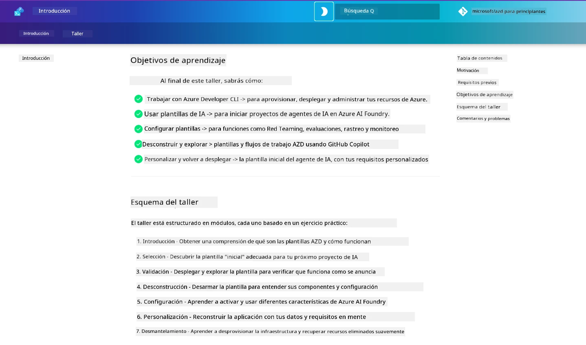

<div align="center">
  <div style="background: linear-gradient(135deg, #0078d4, #106ebe); border-radius: 10px; padding: 20px; margin: 20px 0; box-shadow: 0 4px 15px rgba(0, 120, 212, 0.3); border: 2px solid #005a9e;">
    <h2 style="color: white; margin: 0; font-size: 24px; text-shadow: 1px 1px 2px rgba(0,0,0,0.3);">
      🎯 Taller AZD para Desarrolladores de IA
    </h2>
    <p style="color: white; margin: 10px 0 0 0; font-size: 16px; text-shadow: 1px 1px 2px rgba(0,0,0,0.3);">
      <strong>Un taller práctico para crear aplicaciones de IA con Azure Developer CLI.</strong><br>
      Completa 7 módulos para dominar las plantillas AZD y los flujos de trabajo de implementación de IA.
    </p>
    <div style="margin-top: 15px;">
      <span style="background: rgba(255,255,255,0.2); padding: 5px 10px; border-radius: 15px; color: white; font-size: 14px;">
        📅 Guía revisada: noviembre de 2026
      </span>
    </div>
  </div>
</div>

# Taller AZD para Desarrolladores de IA

Bienvenido al taller práctico para aprender Azure Developer CLI (AZD) con enfoque en la implementación de aplicaciones de IA. Este taller te ayuda a adquirir un entendimiento aplicado de las plantillas AZD en 3 pasos:

1. **Descubrimiento** - encuentra la plantilla que es adecuada para ti.
1. **Implementación** - despliega y valida que funcione.
1. **Personalización** - ¡modifica e itera para hacerla tuya!

Durante el taller, también se te presentarán herramientas y flujos de trabajo fundamentales para desarrolladores, para ayudarte a optimizar tu recorrido de desarrollo de principio a fin.

<br/>

## Guía Basada en Navegador

Las lecciones del taller están en Markdown. Puedes navegar directamente en GitHub o lanzar una vista previa basada en navegador como se muestra en la captura de pantalla a continuación.



Para usar esta opción, haz un fork del repositorio a tu perfil y lanza GitHub Codespaces. Una vez el terminal de VS Code esté activo, escribe este comando:

Esta vista previa en el navegador funciona en GitHub Codespaces, contenedores de desarrollo o una clonación local con Python y MkDocs instalados.

```bash title="" linenums="0"
python -m pip install -r requirements-dev.txt
python -m mkdocs serve --config-file workshop/mkdocs.yml
```

Ejecuta estos comandos desde la **raíz del repositorio del curso**, no desde la muestra de IA inicializada por separado. Mantén la vista previa en primer plano para que los errores sean visibles; deténla con Ctrl+C. Para comprobar el sitio sin servirlo, ejecuta `python -m mkdocs build --strict --config-file workshop/mkdocs.yml`.

En unos segundos, verás un cuadro de diálogo emergente. Selecciona la opción `Open in browser`. La guía basada en web se abrirá ahora en una nueva pestaña del navegador. Algunos beneficios de esta vista previa:

1. **Búsqueda incorporada** - busca palabras clave o lecciones rápidamente.
1. **Icono de copiar** - pasa el ratón sobre los bloques de código para ver esta opción.
1. **Cambio de tema** - alterna entre los temas oscuro y claro.
1. **Obtén ayuda** - ¡haz clic en el icono de Discord en el pie de página para unirte!

<br/>

## Resumen del Taller

**Duración:** 3-4 horas  
**Nivel:** Principiante a Intermedio  
**Requisitos previos:** Familiaridad con Azure, conceptos de IA, VS Code y herramientas de línea de comandos.

Este es un taller práctico donde aprendes haciendo. Una vez que termines los ejercicios, recomendamos revisar el currículo AZD Para Principiantes para continuar tu aprendizaje sobre las mejores prácticas en Seguridad y Productividad.

| Tiempo | Módulo | Objetivo |
|:---|:---|:---|
| 15 mins | [Introducción](docs/instructions/0-Introduction.md) | Establecer el contexto, entender los objetivos |
| 30 mins | [Seleccionar Plantilla de IA](docs/instructions/1-Select-AI-Template.md) | Explorar opciones y elegir punto de partida | 
| 30 mins | [Validar Plantilla de IA](docs/instructions/2-Validate-AI-Template.md) | Desplegar solución predeterminada en Azure |
| 30 mins | [Deconstruir Plantilla de IA](docs/instructions/3-Deconstruct-AI-Template.md) | Explorar estructura y configuración |
| 30 mins | [Configurar Plantilla de IA](docs/instructions/4-Configure-AI-Template.md) | Activar y probar funciones disponibles |
| 30 mins | [Personalizar Plantilla de IA](docs/instructions/5-Customize-AI-Template.md) | Adaptar la plantilla a tus necesidades |
| 30 mins | [Desmontar Infraestructura](docs/instructions/6-Teardown-Infrastructure.md) | Limpieza y liberación de recursos |
| 15 mins | [Conclusión y Próximos Pasos](docs/instructions/7-Wrap-up.md) | Recursos de aprendizaje, desafío del taller |

<br/>

## Lo Que Aprenderás

Piensa en la plantilla AZD como un sandbox de aprendizaje para explorar diversas capacidades y herramientas para el desarrollo de extremo a extremo en Microsoft Foundry. Al final de este taller, deberías tener una sensación intuitiva sobre diversas herramientas y conceptos en este contexto.

| Concepto | Objetivo |
|:---|:---|
| **Azure Developer CLI** | Entender comandos y flujos de trabajo de la herramienta |
| **Plantillas AZD** | Entender estructura del proyecto y configuración |
| **Azure AI Agent** | Provisionar y desplegar proyecto de Microsoft Foundry |
| **Azure AI Search** | Habilitar ingeniería de contexto con agentes |
| **Observabilidad** | Explorar trazabilidad, monitoreo y evaluaciones |
| **Red Teaming** | Explorar pruebas adversariales y mitigaciones |

<br/>

## Estructura del Taller

El taller está estructurado para llevarte en un recorrido desde el descubrimiento de la plantilla, la implementación, deconstrucción y personalización, usando la plantilla oficial [Getting Started with AI Agents](https://github.com/Azure-Samples/get-started-with-ai-agents) como base.

### [Módulo 1: Seleccionar Plantilla de IA](docs/instructions/1-Select-AI-Template.md) (30 mins)

- ¿Qué son las plantillas de IA?
- ¿Dónde puedo encontrar plantillas de IA?
- ¿Cómo empezar a construir agentes de IA?
- **Laboratorio**: Inicio rápido en Codespaces o contenedor de desarrollo

### [Módulo 2: Validar Plantilla de IA](docs/instructions/2-Validate-AI-Template.md) (30 mins)

- ¿Cuál es la arquitectura de la plantilla de IA?
- ¿Cuál es el flujo de trabajo de desarrollo AZD?
- ¿Cómo puedo obtener ayuda con el desarrollo AZD?
- **Laboratorio**: Desplegar y validar plantilla de agentes de IA

### [Módulo 3: Deconstruir Plantilla de IA](docs/instructions/3-Deconstruct-AI-Template.md) (30 mins)

- Explora tu entorno en `.azure/` 
- Explora tu configuración de recursos en `infra/` 
- Explora tu configuración AZD en `azure.yaml`s
- **Laboratorio**: Modificar variables de entorno y redeplegar

### [Módulo 4: Configurar Plantilla de IA](docs/instructions/4-Configure-AI-Template.md) (30 mins)
- Explora: Generación aumentada por recuperación
- Explora: Evaluación de agentes y Red Teaming
- Explora: Trazabilidad y monitoreo
- **Laboratorio**: Explora agente de IA + observabilidad 

### [Módulo 5: Personalizar Plantilla de IA](docs/instructions/5-Customize-AI-Template.md) (30 mins)
- Define: PRD con requerimientos de escenario
- Configura: variables de entorno para AZD
- Implementa: hooks de ciclo de vida para tareas adicionales
- **Laboratorio**: Personaliza plantilla para mi escenario

### [Módulo 6: Desmontar Infraestructura](docs/instructions/6-Teardown-Infrastructure.md) (30 mins)
- Recapitulación: ¿Qué son las plantillas AZD?
- Recapitulación: ¿Por qué usar Azure Developer CLI?
- Próximos pasos: ¡Prueba una plantilla diferente!
- **Laboratorio**: Desprovisionar infraestructura y limpiar

<br/>

## Desafío del Taller

¿Quieres desafiarte a ti mismo para hacer más? Aquí tienes algunas sugerencias de proyectos, ¡o comparte tus ideas con nosotros!

| Proyecto | Descripción |
|:---|:---|
|1. **Deconstruir una plantilla compleja de IA** | Usa el flujo de trabajo y herramientas que describimos y ve si puedes desplegar, validar y personalizar una plantilla diferente de solución IA. _¿Qué aprendiste?_ |
|2. **Personalizar con tu escenario** | Intenta escribir un PRD (Documento de Requerimientos del Producto) para un escenario diferente. Luego usa GitHub Copilot en tu repo de plantilla en Agent Model, y pídele generar un flujo de personalización para ti. _¿Qué aprendiste? ¿Cómo podrías mejorar esas sugerencias?_ |
| | |

## ¿Tienes comentarios?

1. Publica un issue en este repositorio - etiquétalo como `Workshop` para mayor comodidad.
1. Únete al Discord de Microsoft Foundry - ¡conéctate con tus compañeros!


| | | 
|:---|:---|
| **📚 Inicio del Curso**| [AZD para Principiantes](../README.md)|
| **📖 Documentación** | [Comienza con plantillas de IA](https://learn.microsoft.com/en-us/azure/ai-foundry/how-to/develop/ai-template-get-started)|
| **🛠️ Plantillas de IA** | [Plantillas Microsoft Foundry](https://ai.azure.com/templates) |
|**🚀 Próximos Pasos** | [Comenzar Taller](#workshop-overview) |
| | |

<br/>

---

**Navegación:** [Curso Principal](../README.md) | [Introducción](docs/instructions/0-Introduction.md) | [Módulo 1: Seleccionar Plantilla](docs/instructions/1-Select-AI-Template.md)

**¿Listo para comenzar a construir aplicaciones de IA con AZD?**

[Comenzar Taller: Introducción →](docs/instructions/0-Introduction.md)

---

<!-- CO-OP TRANSLATOR DISCLAIMER START -->
**Descargo de responsabilidad**:
Este documento ha sido traducido utilizando el servicio de traducción automática [Co-op Translator](https://github.com/Azure/co-op-translator). Aunque nos esforzamos por la precisión, tenga en cuenta que las traducciones automatizadas pueden contener errores o inexactitudes. El documento original en su idioma nativo debe considerarse la fuente autorizada. Para información crítica, se recomienda una traducción profesional humana. No somos responsables de cualquier malentendido o interpretación errónea que surja del uso de esta traducción.
<!-- CO-OP TRANSLATOR DISCLAIMER END -->