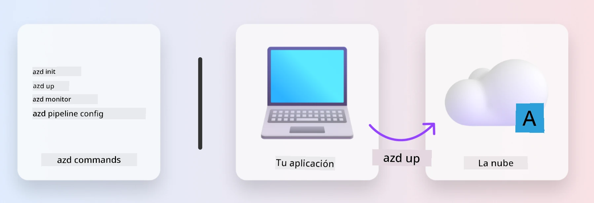
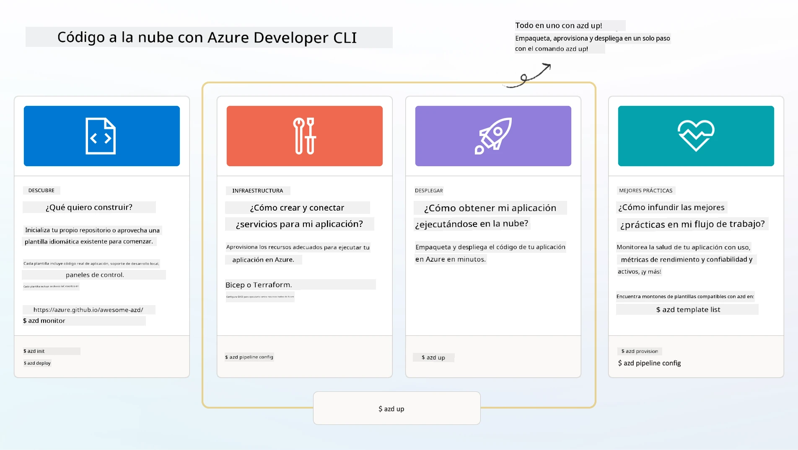

# 1. Selecciona una plantilla

!!! tip "AL FINALIZAR ESTE MÓDULO PODRÁS"

    - [ ] Describe what AZD templates are
    - [ ] Discover and use AZD templates for AI
    - [ ] Get started with the AI Agents template
    - [ ] **Lab 1:** AZD Quickstart in Codespaces or a dev container

---

## 1. Una analogía del constructor

Construir una aplicación de IA moderna lista para la empresa _desde cero_ puede ser abrumador. Es un poco como construir tu nueva casa por tu cuenta, ladrillo a ladrillo. ¡Sí, se puede hacer! Pero no es la manera más efectiva de obtener el resultado final deseado.

En cambio, a menudo comenzamos con un _plan de diseño_ existente y trabajamos con un arquitecto para personalizarlo según nuestros requisitos personales. Y ese es exactamente el enfoque a tomar cuando construimos aplicaciones inteligentes. Primero, encuentra una buena arquitectura de diseño que se adapte a tu espacio de problema. Luego, trabaja con un arquitecto de soluciones para personalizar y desarrollar la solución para tu escenario específico.

Pero, ¿dónde podemos encontrar estos planos de diseño? ¿Y cómo encontramos un arquitecto que esté dispuesto a enseñarnos cómo personalizar y desplegar estos planos por nuestra cuenta? En este taller, respondemos esas preguntas presentándote tres tecnologías:

1. [Azure Developer CLI](https://aka.ms/azd) - una herramienta de código abierto que acelera el camino del desarrollador desde el desarrollo local (construcción) hasta el despliegue en la nube (entrega).
1. [Microsoft Foundry Templates](https://ai.azure.com/templates) - repositorios estandarizados de código abierto que contienen código de ejemplo, infraestructura y archivos de configuración para desplegar una arquitectura de solución de IA.
1. [GitHub Copilot Agent Mode](https://code.visualstudio.com/docs/copilot/chat/chat-agent-mode) - un agente de codificación basado en el conocimiento de Azure, que nos puede guiar para navegar por la base de código y hacer cambios, usando lenguaje natural.

Con estas herramientas en mano, ahora podemos _descubrir_ la plantilla adecuada, _desplegarla_ para validar que funciona, y _personalizarla_ para adaptarla a nuestros escenarios específicos. Vamos a profundizar y aprender cómo funcionan.


---

## 2. Azure Developer CLI

La [Azure Developer CLI](https://learn.microsoft.com/en-us/azure/developer/azure-developer-cli/) (o `azd`) es una herramienta de línea de comandos de código abierto que puede acelerar tu viaje del código a la nube con un conjunto de comandos amigables para desarrolladores que funcionan de manera consistente a través de tu IDE (desarrollo) y entornos de CI/CD (devops).

Con `azd`, tu viaje de despliegue puede ser tan simple como:

- `azd init` - Inicializa un nuevo proyecto de IA desde una plantilla AZD existente.
- `azd up` - Provisiones infraestructura y despliega tu aplicación en un solo paso.
- `azd monitor` - Obtén monitoreo y diagnósticos en tiempo real para tu aplicación desplegada.
- `azd pipeline config` - Configura pipelines de CI/CD para automatizar el despliegue a Azure.

**🎯 | EJERCICIO**: <br/> Explora la herramienta de línea de comandos `azd` en tu entorno actual del taller. Esto puede ser GitHub Codespaces, un contenedor de desarrollo o un clon local con los prerrequisitos instalados. Comienza escribiendo este comando para ver qué puede hacer la herramienta:

```bash title="" linenums="0"
azd help
```



---

## 3. La plantilla AZD

Para que `azd` logre esto, necesita saber la infraestructura a provisionar, las configuraciones a aplicar y la aplicación a desplegar. Aquí es donde entran las [plantillas AZD](https://learn.microsoft.com/en-us/azure/developer/azure-developer-cli/azd-templates?tabs=csharp).

Las plantillas AZD son repositorios de código abierto que combinan código de ejemplo con infraestructura y archivos de configuración necesarios para desplegar la arquitectura de la solución.
Al usar un enfoque de _Infraestructura como Código_ (IaC), permiten que las definiciones de recursos de la plantilla y las configuraciones sean controladas por versiones (igual que el código fuente de la aplicación), creando flujos de trabajo reutilizables y consistentes para los usuarios de ese proyecto.

Al crear o reutilizar una plantilla AZD para _tu_ escenario, considera estas preguntas:

1. ¿Qué estás construyendo? → ¿Existe una plantilla que tenga código inicial para ese escenario?
1. ¿Cómo está arquitectada tu solución? → ¿Existe una plantilla que tenga los recursos necesarios?
1. ¿Cómo se despliega tu solución? → ¡Piensa en `azd deploy` con hooks de pre/post-procesamiento!
1. ¿Cómo puedes optimizarla aún más? → ¡Piensa en monitoreo integrado y pipelines de automatización!

**🎯 | EJERCICIO**: <br/>
Visita la galería [Awesome AZD](https://azure.github.io/awesome-azd/) y usa los filtros para explorar las más de 250 plantillas actualmente disponibles. Ve si puedes encontrar una que se alinee con los requisitos de _tu_ escenario.



---

## 4. Plantillas de aplicaciones de IA

Para aplicaciones potenciadas por IA, Microsoft proporciona plantillas especializadas que cuentan con **Microsoft Foundry** y **Foundry Agents**. Estas plantillas aceleran tu camino para construir aplicaciones inteligentes listas para producción.

### Plantillas de Microsoft Foundry & Foundry Agents

Selecciona una plantilla abajo para desplegar. Cada plantilla está disponible en [Awesome AZD](https://azure.github.io/awesome-azd/) y puede ser inicializada con un solo comando.

| Plantilla | Descripción | Comando de despliegue |
|----------|-------------|----------------|
| **[AI Chat con RAG](https://github.com/Azure-Samples/azure-search-openai-demo)** | Aplicación de chat con búsqueda integradora | `azd init -t Azure-Samples/azure-search-openai-demo .` |
| **[Comenzar con Agentes de IA](https://github.com/Azure-Samples/get-started-with-ai-agents)** | Aplicación de chat con agentes; usada durante todo este taller | `azd init -t Azure-Samples/get-started-with-ai-agents .` |
| **[Comenzar con chat de IA](https://github.com/Azure-Samples/get-started-with-ai-chat)** | Aplicación de chat inicial de IA | `azd init -t Azure-Samples/get-started-with-ai-chat .` |

Estas son alternativas: inicializa **una** plantilla en su propio directorio vacío. El `.` final selecciona ese directorio; omitirlo en las versiones actuales de AZD crea un subdirectorio con nombre de la plantilla. La inicialización descarga un proyecto; `azd up` realiza el despliegue facturable tras que revises prerrequisitos, recursos, soporte regional y cuota.

### Inicio rápido

1. **Explora plantillas**: Visita [https://azure.github.io/awesome-azd/](https://azure.github.io/awesome-azd/) y filtra por `AI`, `Agents`, o `Microsoft Foundry`
2. **Selecciona tu plantilla**: Elige una que coincida con tu caso de uso
3. **Inicializa**: Ejecuta el comando `azd init` para la plantilla elegida
4. **Despliega**: Ejecuta `azd up` para provisionar y desplegar

**🎯 | EJERCICIO**: <br/>
Selecciona una de las plantillas anteriores según tu escenario:

- **¿Continuando este taller?** → Elige **Comenzar con Agentes de IA**
- **¿Construyendo chat con búsqueda integrada?** → Explora **AI Chat con RAG** por separado
- **¿Necesitas otra arquitectura?** → Busca en la galería y verifica el repositorio real, el estado de implementación, y prerrequisitos

```bash title="Initialize the workshop template in an empty directory" linenums="0"
azd init -t Azure-Samples/get-started-with-ai-agents .
azd auth login
azd up
```

!!! info "Explora más plantillas"
    La [Galería Awesome AZD](https://azure.github.io/awesome-azd/) contiene más de 250 plantillas. Usa los filtros para encontrar plantillas que coincidan con tus requisitos específicos de idioma, framework y servicios de Azure.

---

<!-- CO-OP TRANSLATOR DISCLAIMER START -->
**Descargo de responsabilidad**:
Este documento ha sido traducido utilizando el servicio de traducción automática [Co-op Translator](https://github.com/Azure/co-op-translator). Aunque nos esforzamos por la precisión, tenga en cuenta que las traducciones automatizadas pueden contener errores o inexactitudes. El documento original en su idioma nativo debe considerarse la fuente autorizada. Para información crítica, se recomienda una traducción profesional humana. No somos responsables de cualquier malentendido o interpretación errónea que surja del uso de esta traducción.
<!-- CO-OP TRANSLATOR DISCLAIMER END -->