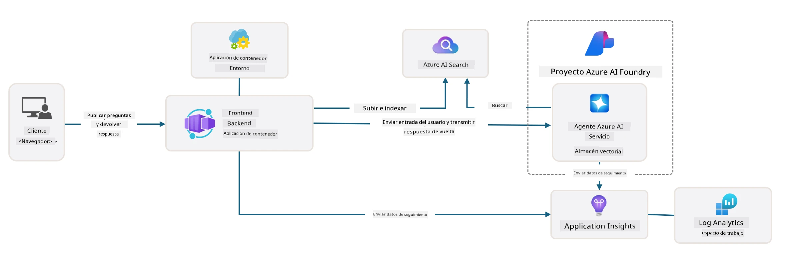
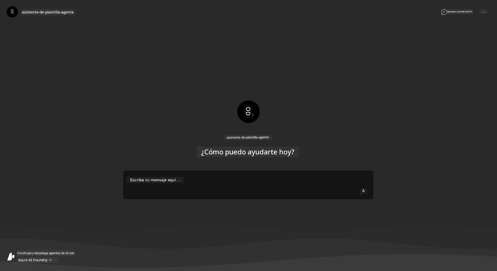

# 2. Validar una plantilla

> Guía revisada según AZD 1.37.2 y el ejemplo actual el 4 de noviembre de 2026. Las capturas de pantalla son ilustrativas; la navegación del portal, valores predeterminados de la plantilla y disponibilidad de servicios pueden cambiar. Esta revisión no realizó una implementación en vivo en Azure.

!!! tip "AL FINAL DE ESTE MÓDULO PODRÁS"

    - [ ] Identify the sample's prerequisites and intended resources
    - [ ] Deploy the selected template into an intentional environment
    - [ ] Verify the application and agent behavior separately from deployment success
    - [ ] **Lab 2:** Record evidence of a working baseline, or an actionable deployment blocker

---

## 1. Verificar los requisitos previos

El [Azure Developer CLI](https://learn.microsoft.com/azure/developer/azure-developer-cli/) gestiona el despliegue de aplicaciones usando la configuración, infraestructura y código de la plantilla. Verifica tu versión instalada:

```bash
azd version
```

Usa las [instrucciones actuales de instalación/actualización](https://learn.microsoft.com/azure/developer/azure-developer-cli/install-azd) si es necesario. El ejemplo revisado declara AZD `>=1.14.0`, pero se recomienda una versión soportada actual. Las extensiones opcionales de IA tienen requisitos de versión separados; el flujo de trabajo normal `azd up` de este ejemplo no requiere la extensión de agentes.

Antes de aprovisionar, lee la [configuración de cuenta de Azure](https://github.com/Azure-Samples/get-started-with-ai-agents/blob/main/docs/azure_account_setup.md) y la [guía de despliegue](https://github.com/Azure-Samples/get-started-with-ai-agents/blob/main/docs/deployment.md) del ejemplo. Confirma tu suscripción, permisos, disponibilidad del modelo, cuota regional y cargos esperados. Una cuenta gratuita de Azure no garantiza acceso ni uso gratuito para todos los servicios necesarios.

## 2. Abrir el ejemplo seleccionado

Usa el repositorio [Iniciar con Agentes de IA](https://github.com/Azure-Samples/get-started-with-ai-agents) inicializado en el Módulo 1. Si no lo has inicializado, elige una de estas alternativas:

- Abre un [Codespace para el ejemplo](https://github.com/codespaces/new/Azure-Samples/get-started-with-ai-agents).
- Clona el ejemplo y sigue su configuración local/contenedor-dev.
- En un **directorio vacío**, ejecuta:

```bash
azd init --template Azure-Samples/get-started-with-ai-agents .
```

No inicialices una segunda plantilla sobre un proyecto existente. Ejecuta los comandos subsiguientes desde la raíz del ejemplo que contiene `azure.yaml`, no desde la raíz del repositorio del curso.

El ejemplo aloja una aplicación de chat respaldada por agente en Container Apps y aprovisiona recursos de Foundry de soporte. Revisa la arquitectura actual y servicios opcionales en lugar de tratar una captura antigua como el inventario exacto de recursos.



## 3. Desplegar intencionadamente

```bash
azd auth login
azd up
```

Revisa las indicaciones:

1. Elige un nombre único para el entorno AZD.
2. Selecciona la suscripción deseada, no simplemente la primera que se ofrezca.
3. Selecciona una región compatible con el modelo/versión/SKU requerido y tu cuota.
4. Lee la salida de aprovisionamiento, despliegue y hooks posteriores al despliegue.

Los valores predeterminados revisados incluyen `gpt-5-mini`, versión `2025-08-07`, y `GlobalStandard`. Verifica tu plantilla inicializada y las [combinaciones soportadas de modelo/región](https://learn.microsoft.com/azure/ai-services/agents/concepts/model-region-support). Ninguna región garantiza funcionamiento universal.

La duración del despliegue varía. Si el aprovisionamiento falla, conserva el error y corrige la causa antes de reintentar. No elimines el despliegue ni purgues recursos permanentemente como paso genérico de solución de problemas.

## 4. Validar la aplicación

```bash
azd show
```

Abre el endpoint para `api_and_frontend`, o encuentra la Container App en el grupo de recursos del despliegue en el [portal de Azure](https://portal.azure.com/). Sigue las instrucciones de acceso/autenticación del ejemplo si requiere inicio de sesión; no deshabilites la autenticación para que una prueba rápida pase.



Prueba algunas [preguntas de ejemplo](https://github.com/Azure-Samples/get-started-with-ai-agents/blob/main/docs/sample_questions.md):

- Una pregunta general de hechos.
- Una pregunta cuya respuesta debería estar en los documentos cargados del ejemplo.
- Una pregunta que no puede ser respondida con esos documentos.

Verifica que la UI cargue, la API responda, la recuperación use los datos esperados, las citas coincidan con el contenido de origen y que las preguntas no soportadas se gestionen apropiadamente. Un mensaje `azd up` exitoso por sí solo no confirma estos resultados.

## 5. Inspeccionar el agente desplegado

Abre tu proyecto en el [portal Foundry](https://ai.azure.com/). En el flujo revisado del portal, selecciona **Build**, luego **Agents**, y localiza el agente creado por el ejemplo. Las etiquetas de navegación pueden cambiar.

Registra:

- El nombre y versión del agente.
- Su despliegue de modelo configurado.
- Las instrucciones reales y herramientas habilitadas.
- Qué archivos o índice de búsqueda están conectados, y si la configuración finalizó exitosamente.

El ejemplo revisado usa un identificador de agente en formato `agent_name:agent_version` para sus pruebas de evaluación. No copies un identificador clásico de agente/hilo de una captura antigua a un flujo de trabajo API más reciente.

Compara los documentos cargados con `src/files/` en tu revisión inicializada. Capturas anteriores mostraban 32 archivos; ese conteo no es un valor predeterminado garantizado actual. Verifica cualquier respuesta sobre clientes/productos en el ejemplo contra datos sintéticos reales y no cargues datos reales de clientes para este ejercicio.

## 6. Comparar con el entorno de pruebas (playground)

Abre el playground del agente seleccionado en Foundry y formula la misma pregunta de recuperación. Compara la versión del agente configurada, herramientas, citas y calidad de respuestas con la aplicación desplegada.

Las respuestas son probabilísticas; que coincidan palabra por palabra no es el criterio. Si los resultados difieren sustancialmente, verifica que la app y playground apunten al mismo proyecto, agente/versión y fuente de conocimiento.

## 7. Verificar requisitos previos de observabilidad

La [guía de observabilidad](https://github.com/Azure-Samples/get-started-with-ai-agents/blob/main/docs/observability.md) del ejemplo es la fuente de verdad para configuración de trazas, evaluación y red-teaming.

En los valores predeterminados de infraestructura revisados, Application Insights está habilitado pero **el trazado del cliente está deshabilitado** (`ENABLE_AZURE_MONITOR_TRACING=false`). Crear un recurso de monitoreo no prueba que la aplicación esté exportando trazas. El Módulo 5 trata sobre habilitar trazado y generar una solicitud de prueba.

Usa los logs de aplicación del Container App para investigar errores de inicio/API. En Foundry, inspecciona las vistas de trazado y monitoreo disponibles del agente. Las entradas de evaluación requieren la configuración relevante, evaluadores/región soportados, y solicitudes reales; no están garantizadas automáticamente para cada ejecución.

Deja deshabilitada la captura de contenido de indicaciones/respuestas a menos que se hayan revisado sus requisitos de privacidad, retención, acceso y redacción.

## 8. Comprender valores de entorno

AZD almacena el entorno seleccionado en `.azure/<environment-name>/`. Las entradas persistentes y salidas de despliegue pueden leerse con:

```bash
azd env list
azd env get-value AZURE_ENV_NAME
azd env get-value AZURE_LOCATION
```

`azd env get-values` lista todos los valores, que pueden incluir configuración sensible. No pegues esa salida en problemas o logs públicos.

AZD usa el entorno seleccionado al ejecutar sus comandos/hooks, mientras que las variables de entorno del proceso también pueden influir en comandos y plantillas. Esto **no** exporta valores a tu shell padre ni a cada proceso Python iniciado independientemente. Sigue las [instrucciones para desarrollo local](https://github.com/Azure-Samples/get-started-with-ai-agents/blob/main/docs/local_development.md) del ejemplo.

Los valores predeterminados de plantilla pueden aplicarse en `infra/main.parameters.json` sin aparecer como valores locales explícitos. Configurar una variable arbitraria no cambia infraestructura a menos que la plantilla la consuma.

Por ejemplo, para seleccionar explícitamente los valores predeterminados del modelo revisado:

```bash
azd env set AZURE_AI_AGENT_MODEL_NAME gpt-5-mini
azd env set AZURE_AI_AGENT_MODEL_VERSION 2025-08-07
azd env set AZURE_AI_AGENT_DEPLOYMENT_SKU GlobalStandard
azd provision --preview
azd up
```

Revisa primero compatibilidad, capacidad, disponibilidad y los cambios planeados. Las actualizaciones de infraestructura requieren aprovisionamiento; `azd deploy` por sí solo no es suficiente. Los cambios soportados de modelo normalmente no requieren destruir toda la aplicación.

`azd env refresh` recupera salidas de despliegue para un entorno accesible; no reconstruye todas las entradas personalizadas, sincroniza secretos ni reemplaza la gestión de configuración.

## 9. Registra tu línea base

- [ ] Entorno, suscripción, región y modelo correctos verificados.
- [ ] Aprovisionamiento, despliegue y hooks de configuración requeridos completados sin errores pendientes.
- [ ] Acceso a la aplicación, chat, recuperación y citas comprobados.
- [ ] Agente/versión y fuente de conocimiento identificados.
- [ ] Requisitos previos de observabilidad y bloqueos restantes documentados.

Continúa con [Deconstruir una plantilla](3-Deconstruct-AI-Template.md).

---

<!-- CO-OP TRANSLATOR DISCLAIMER START -->
**Descargo de responsabilidad**:
Este documento ha sido traducido utilizando el servicio de traducción automática [Co-op Translator](https://github.com/Azure/co-op-translator). Aunque nos esforzamos por la precisión, tenga en cuenta que las traducciones automatizadas pueden contener errores o inexactitudes. El documento original en su idioma nativo debe considerarse la fuente autorizada. Para información crítica, se recomienda una traducción profesional humana. No somos responsables de cualquier malentendido o interpretación errónea que surja del uso de esta traducción.
<!-- CO-OP TRANSLATOR DISCLAIMER END -->