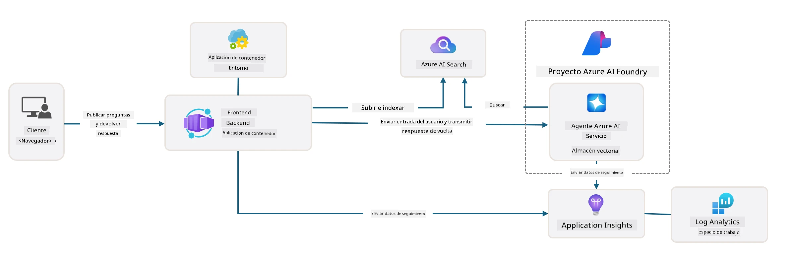

# 3. Desconstruir una plantilla

!!! tip "AL FINALIZAR ESTE MÓDULO PODRÁS"

    - [ ] Use GitHub Copilot and optional MCP tools for Azure documentation and read-only exploration
    - [ ] Identify the template's application, infrastructure, configuration, and test entry points
    - [ ] Verify generated explanations against actual repository files
    - [ ] **Lab 3:** Trace one request and one configuration input through the project

---

## 1. Activar GitHub Copilot

Abre el ejemplo de IA inicializado en VS Code y habilita [GitHub Copilot](https://code.visualstudio.com/docs/copilot/chat/chat-agent-mode). Inicia sesión con una cuenta que tenga un plan elegible; los límites de uso varían. Pide a Copilot que explique el repositorio antes de autorizar cambios.

### Servidores MCP opcionales

Estos servicios pueden proporcionar herramientas adicionales:

- [Servidor MCP de Azure](https://learn.microsoft.com/azure/developer/azure-mcp-server/overview)
- [Servidor MCP de Microsoft Learn](https://learn.microsoft.com/training/support/mcp)

En VS Code, revisa la [guía de configuración MCP](https://code.visualstudio.com/docs/copilot/chat/mcp-servers) y crea `.vscode/mcp.json` si es necesario:

```json
{
  "servers": {
    "Azure MCP Server": {
      "type": "stdio",
      "command": "npx",
      "args": ["-y", "@azure/mcp@latest", "server", "start"]
    },
    "microsoft.docs.mcp": {
      "type": "http",
      "url": "https://learn.microsoft.com/api/mcp"
    }
  }
}
```

El comando `npx` requiere una instalación soportada de Node.js/npm y descarga código ejecutable. Revisa el paquete y fija una versión aprobada para una configuración reproducible en equipo. Inicia los servidores usando los controles MCP de VS Code e inspecciona las herramientas disponibles; los nombres pueden cambiar entre versiones.

**La autenticación es aparte.** Usa `azd auth login` para AZD. Sigue el flujo de autenticación documentado de Azure MCP para sus herramientas; solo iniciar sesión en AZD no establece una sesión MCP. Usa `az login` por separado cuando un ejercicio o gancho invoque Azure CLI.

Prueba indicaciones de solo lectura:

1. “Usa Microsoft Learn MCP para encontrar la documentación de configuración de Azure Developer CLI.”
2. “Explica el `azure.yaml` de este repositorio; cita los archivos que implementan cada gancho.”
3. “Usando las herramientas disponibles de Azure MCP, lista mis recursos desplegados sin modificar nada.”

Verifica el inquilino/suscripción seleccionado y cada llamada a herramienta propuesta. No apruebes creación, eliminación o cambios de acceso a recursos solo para explorar la arquitectura.

## 2. Comprender la arquitectura

El ejemplo aloja un backend Python FastAPI y un frontend React/TypeScript en Azure Container Apps. El backend se comunica con un agente en un proyecto Microsoft Foundry. La recuperación y observabilidad dependen de las características habilitadas en la plantilla y la configuración exitosa; no están garantizadas solo porque la aplicación se haya desplegado.



Compara este diagrama con la [guía de despliegue actual upstream](https://github.com/Azure-Samples/get-started-with-ai-agents/blob/main/docs/deployment.md) y tus recursos reales. Revisa el despliegue configurado del modelo, las herramientas del agente, la identidad administrada, las asignaciones de roles y los recursos opcionales de AI Search/Application Insights.

**Ejercicio:** Pide a Copilot que trace una solicitud de chat desde el frontend a través de la API hasta Foundry, con referencias a archivos y funciones. Abre esas referencias y verifica la explicación. No infieras autenticación, enrutamiento o autorización implementados solo con un diagrama.

## 3. Estructura del repositorio

Las siguientes rutas seleccionadas se verificaron contra el ejemplo el 4 de noviembre de 2026. Tu revisión inicializada sigue siendo la fuente de verdad:

```text
get-started-with-ai-agents/
  azure.yaml
  docker-compose.yaml
  requirements-dev.txt
  .devcontainer/
  infra/
    main.bicep
    main.parameters.json
    api.bicep
    core/
  src/
    Dockerfile
    pyproject.toml
    requirements.txt
    api/
      main.py
      routes.py
      search_index_manager.py
    frontend/
      package.json
      src/
    files/
  scripts/
    validate_env_vars.sh
    validate_env_vars.ps1
    postdeploy.sh
    postdeploy.ps1
  tests/
    test_evaluation.py
    test_red_teaming.py
  docs/
    deployment.md
    deploy_customization.md
    ai_search.md
    observability.md
    local_development.md
    troubleshooting.md
```

### Infraestructura y configuración

`infra/main.bicep` orquesta recursos; `main.parameters.json` conecta entradas de plantilla con valores del entorno AZD. `azure.yaml` selecciona el servicio de aplicación y ganchos de ciclo de vida. Traza una entrada como `USE_AZURE_AI_SEARCH_SERVICE` a través de estos archivos para encontrar qué cambia realmente.

### Aplicación e identidad

Lee `src/api/` y `src/frontend/` juntos. Identifica dónde se crea o recupera el agente, dónde se configuran instrucciones/herramientas y qué identidad usa cada llamada a Azure. Los archivos de ejemplo bajo `src/files/` son datos de demostración, no un catálogo de producción ni modelo de autorización.

### Pruebas y observabilidad

Los puntos de entrada actuales para evaluación y red-teaming están bajo `tests/`; referencias antiguas de directorios `evals/` y `airedteaming/` están obsoletas para este ejemplo. Lee `docs/observability.md` para prerrequisitos y costos antes de ejecutar pruebas en la nube. Estas pruebas en Python son independientes de la extensión opcional `azure.ai.evaluations` de AZD.

## 4. Verifica tus hallazgos

- Identifica la ruta de la API, interacción del agente y código de recuperación para una pregunta de ejemplo.
- Explica qué identidad accede a Foundry y qué configuración selecciona su punto final.
- Encuentra los scripts reales de pre-up y post-despliegue y su manejo de errores.
- Enumera dependencias o características opcionales que no están presentes en tu despliegue.

Continúa en [Configurar una plantilla](4-Configure-AI-Template.md).

---

<!-- CO-OP TRANSLATOR DISCLAIMER START -->
**Descargo de responsabilidad**:
Este documento ha sido traducido utilizando el servicio de traducción automática [Co-op Translator](https://github.com/Azure/co-op-translator). Aunque nos esforzamos por la precisión, tenga en cuenta que las traducciones automatizadas pueden contener errores o inexactitudes. El documento original en su idioma nativo debe considerarse la fuente autorizada. Para información crítica, se recomienda una traducción profesional humana. No somos responsables de cualquier malentendido o interpretación errónea que surja del uso de esta traducción.
<!-- CO-OP TRANSLATOR DISCLAIMER END -->