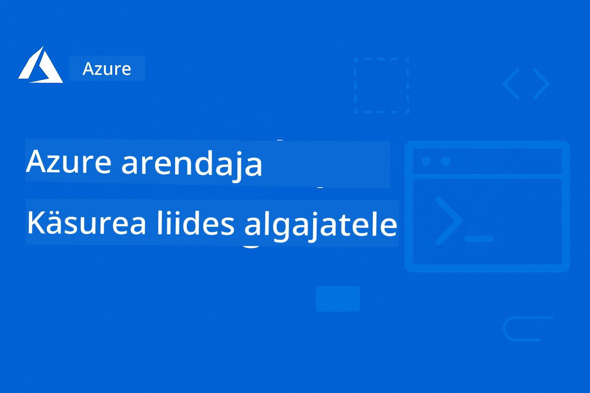

# AZD algajatele: Struktureeritud õppeprogramm

 

[](https://github.com/microsoft/AZD-for-beginners)
[](https://GitHub.com/microsoft/azd-for-beginners/network/)
[](https://github.com/microsoft/AZD-for-beginners)

[](https://discord.com/invite/nkVh3dp)
[](https://discord.gg/nTYy5BXMWG)

---

### Automaatne tõlge (Alati ajakohane)

<!-- CO-OP TRANSLATOR LANGUAGES TABLE START -->
[Araabia](../ar/README.md) | [Bengali](../bn/README.md) | [Bulgaaria](../bg/README.md) | [Burma (Myanmar)](../my/README.md) | [Hiina (lihtsustatud)](../zh-CN/README.md) | [Hiina (traditsiooniline, Hongkong)](../zh-HK/README.md) | [Hiina (traditsiooniline, Macau)](../zh-MO/README.md) | [Hiina (traditsiooniline, Taiwan)](../zh-TW/README.md) | [Horvaadi](../hr/README.md) | [Tšehhi](../cs/README.md) | [Taani](../da/README.md) | [Hollandi](../nl/README.md) | [Eesti](./README.md) | [Soome](../fi/README.md) | [Prantsuse](../fr/README.md) | [Saksa](../de/README.md) | [Kreeka](../el/README.md) | [Heebrea](../he/README.md) | [Hindi](../hi/README.md) | [Ungari](../hu/README.md) | [Indoneesia](../id/README.md) | [Itaalia](../it/README.md) | [Jaapani](../ja/README.md) | [Kannada](../kn/README.md) | [Khmer](../km/README.md) | [Korea](../ko/README.md) | [Leedu](../lt/README.md) | [Malai](../ms/README.md) | [Malajalami](../ml/README.md) | [Manipuri (Meitei Mayek)](../mni/README.md) | [Marathi](../mr/README.md) | [Nepali](../ne/README.md) | [Nigeeria pidžin](../pcm/README.md) | [Norra](../no/README.md) | [Persia (Farsi)](../fa/README.md) | [Poola](../pl/README.md) | [Portugali (Brasiilia)](../pt-BR/README.md) | [Portugali (Portugal)](../pt-PT/README.md) | [Punjabi (Gurmukhi)](../pa/README.md) | [Rumeenia](../ro/README.md) | [Vene](../ru/README.md) | [Serbia (kirilitsa)](../sr/README.md) | [Slovaki](../sk/README.md) | [Sloveeni](../sl/README.md) | [Hispaania](../es/README.md) | [Suahiili](../sw/README.md) | [Rootsi](../sv/README.md) | [Tagalogi (Filipino)](../tl/README.md) | [Tamili](../ta/README.md) | [Telugu](../te/README.md) | [Tai](../th/README.md) | [Türgi](../tr/README.md) | [Ukraina](../uk/README.md) | [Urdu](../ur/README.md) | [Vietnami](../vi/README.md)

> **Eelistad kloonimist lokaalselt?**
>
> Selles hoidlas on üle 50 keele tõlke, mis suurendab oluliselt allalaaditava faili suurust. Translatesioonideta kloonimiseks kasuta sparse checkout'i:
>
> **Bash / macOS / Linux:**
> ```bash
> git clone --filter=blob:none --sparse https://github.com/microsoft/AZD-for-beginners.git
> cd AZD-for-beginners
> git sparse-checkout set --no-cone '/*' '!translations' '!translated_images'
> ```
>
> **CMD (Windows):**
> ```cmd
> git clone --filter=blob:none --sparse https://github.com/microsoft/AZD-for-beginners.git
> cd AZD-for-beginners
> git sparse-checkout set --no-cone "/*" "!translations" "!translated_images"
> ```
>
> See annab sulle kõike, mida vajad kursuse läbimiseks palju kiirema allalaadimisega.
<!-- CO-OP TRANSLATOR LANGUAGES TABLE END -->

## 🆕 Mis on täna uuel azd-s

> 📌 **AI CLI versiooniülevaade (2026-11-04):** Juhised kontrolliti avaldatud **`azd 1.37.2`**, **agents `1.0.0-beta.23`** ja **evaluations `1.0.0-beta.2`** dokumentatsiooni/allikaga. Kasuta `azd >= 1.37.0` ühise töövoo jaoks. Käivita `azd version` ja [uuenda põhikliendi tööriist](https://learn.microsoft.com/azure/developer/azure-developer-cli/install-azd) enne laiendusi. Vaata [versiooni muudatusi ja parandusi](docs/chapter-08-production/production-ai-practices.md#recent-release-changes-and-fixes). See ei ole kogu kursuse reaalajas juurutamise valideerimine.

Azure Developer CLI toetab paljusid rakendustüüpe, sealhulgas veebirakendusi, API-sid ja AI agente, läbi toetatud majutajate, mallide ja laienduste.

See tähendab sinu jaoks järgmist:

- **AI agentid on nüüd esmaklassilised azd töökoormused.** Sa saad initsialiseerida, juurutada ja hallata AI agendi projekte kasutades sama `azd init` → `azd up` töövoogu, mida juba tead.
- **Agendi elutsükkel kahe laienduse kaudu.** Kasuta `azure.ai.agents` agentide initsialiseerimiseks, kutsumiseks, optimeerimiseks ja pensionile jätmiseks. Paigalda eraldi **`azure.ai.evaluations`** jaoks `azd ai eval init`, `generate` ja `run start`. Agentide beta.22 asendas varasema hinnangu töövoo ning muutsid optimeerimise konfiguratsiooni; järgi [ülemineku juhendit](docs/chapter-08-production/production-ai-practices.md#evaluation-migration-and-quality-checks).
- **Rohkem AI ehitusplokke.** Uued eelvaate laiendused—`azure.ai.skills` ja `azure.ai.connections`—lubavad hallata taaskasutatavaid agendi oskuseid ja Foundry ühendusi otse azd-ga.
- **Microsoft Foundry integratsioon** toob mudelite juurutamise, agendi majutamise ja AI teenuse konfiguratsiooni otse azd malli ökosüsteemi.
- **Sujuvam igapäevane töö.** Hiljutised väljaanded tegid `azd init` iherklikuks (turvaline uuesti käivitada), panid `azd auth login` automaatselt eemaldama aegunud tokenid ning lisasid sõbraliku `azd tool` esmakordse seadistamise viiba.
- **Põhitöövoog ei ole muutunud.** Kas sa juurutad todo rakendust, mikroteenust või mitme agendi AI lahendust, käsud on samad.

> **Märkus Aspire kasutajatele:** Microsoft nimetab toodet nüüd lihtsalt **Aspire** (varem ".NET Aspire"). azd Aspire tugi on muutumatu—ainult nimi värskendati.

Kui oled varem azd-d kasutanud, on AI tugi loomulik laiendus, mitte eraldi tööriist ega edasijõudnud rada. Kui alustad nullist, õpid ühe töövoo, mis töötab kõigi jaoks.

---

## 🚀 Mis on Azure Developer CLI (azd)?

**Azure Developer CLI (azd)** on arendajasõbralik käsurea tööriist, mis teeb rakenduste juurutamise Azure'isse lihtsaks. Selle asemel, et käsitsi luua ja ühendada kümneid Azure ressursse, saad juurutada terveid rakendusi ühe käsuga.

### `azd up` maagia

```bash
# This single command does everything:
# ✅ Creates all Azure resources  
# ✅ Configures networking and security
# ✅ Builds your application code
# ✅ Deploys to Azure
# ✅ Gives you a working URL
azd up
```

Mall sisaldab rakenduse ja infrastruktuuri konfiguratsiooni. Edukas juurutamine nõuab siiski toetatud teenuseid/mudeleid, piisavat kvota ja õigusi, korrektsed sisendeid ning juurutatud rakenduse kontrollimist. `azd up` ei muuda automaatselt malli turvaliseks, nõuetele vastavaks ega tootmiskõlblikuks.

---

## ❓ Azure Developer CLI vs Azure CLI: Mis vahe on?

See on kõige levinum küsimus algajate seas. Siin on lihtne vastus:

| Funktsioon | **Azure CLI (`az`)** | **Azure Developer CLI (`azd`)** |
|---------|---------------------|--------------------------------|
| **Eesmärk** | Haldab üksikuid Azure ressursse | Juurutab terviklikke rakendusi |
| **Mõtteviis** | Infrastruktuurorianteeritud | Rakenduse orienteeritud |
| **Näide** | `az webapp create --name myapp...` | `azd up` |
| **Õppekõver** | Peab tundma Azure teenuseid | Pead teadma oma rakendust |
| **Parim kasutuseks** | DevOps, infrastruktuur | Arendajad, prototüübi loomine |

### Lihtne võrdlus

- **Azure CLI** on nagu kõik tööriistad maja ehitamiseks – haamrid, saed, naelad. Sa võid ehitada kõike, aga pead teadma ehitust.
- **Azure Developer CLI** on nagu tellid töövõtja – sa kirjeldad, mida tahad, ja nemad ehitavad.

### Millal kumbagi kasutada

| Stsenaarium | Kasuta seda |
|----------|----------|
| "Tahan kiiresti juurutada oma veebirakendust" | `azd up` |
| "Pean looma ainult salvestuskonto" | `az storage account create` |
| "Loon täisväärtusliku AI rakenduse" | `azd init --template azure-search-openai-demo` |
| "Pean siluma konkreetset Azure ressurssi" | `az resource show` |
| "Tahan juurutada minu konfigureeritud tootmiskeskkonda" | Kontrolli konfiguratsiooni, juurdepääsu, kulu ja operatsioonilubasid enne `azd up --environment production` |

### Nad töötavad koos!

AZD ja Azure CLI on eraldi autentimise ja seadistusega. Kasuta AZD jaoks `azd auth login` ning kui mõni konks või diagnostika käsk nõuab selgesõnaliselt Azure CLI-d, kasuta `az login`. Mõlemaid saab kasutada:
```bash
# Deploy your app with AZD
azd up

# Then fine-tune specific resources with Azure CLI
az webapp config set --name myapp --always-on true
```

---

## 🌟 Leia malle Awesome AZD-st

Ära alusta tühjalt lehelt! **Awesome AZD** on kogukonna kogumik kasutusvalmis mallidest:

| Ressurss | Kirjeldus |
|----------|-------------|
| 🔗 [**Awesome AZD galerii**](https://azure.github.io/awesome-azd/) | Sirvi 200+ malli ühe klõpsuga juurutamiseks |
| 🔗 [**Esita mall**](https://github.com/Azure/awesome-azd/issues) | Panusta oma mall kogukonda |
| 🔗 [**GitHub hoidla**](https://github.com/Azure/awesome-azd) | Lisa täht ja avasta lähtekoodi |

### Populaarsed AI mallid Awesome AZD-st

Vali üks mall oma tühjas kataloogis; all olevad käsud on alternatiivid. Järgmine `.` initsialiseerib selle kataloogi.

```bash
# RAG Chat with Microsoft Foundry Models + AI Search
azd init --template azure-search-openai-demo .

# Quick AI Chat Application
azd init --template openai-chat-app-quickstart .

# AI Agents with Foundry Agents
azd init --template get-started-with-ai-agents .
```

---

## 🎯 Alustamine 3 sammuga

Enne alustamist kontrolli, et sinu masin on valmis malliks, mida soovid juurutada:

**Windows:**
```powershell
.\validate-setup.ps1
```

**macOS / Linux:**
```bash
bash ./validate-setup.sh
```

Kui mõni vajalik kontroll ebaõnnestub, paranda see esmalt ja jätka seejärel kiire algusega.

### Samm 1: Paigalda AZD (2 minutit)

**Windows:**
```powershell
winget install microsoft.azd
```

**macOS:**
```bash
brew tap azure/azd && brew install azd
```

**Linux:**
```bash
curl -fsSL https://aka.ms/install-azd.sh | bash
```

### Samm 2: Autentimine AZD jaoks

```bash
# Optional if you plan to use Azure CLI commands directly in this course
az login

# Required for AZD workflows
azd auth login
```

Kui sa ei tea, kumba vaja on, järgi täis seadistuse juhendit [Installation & Setup](docs/chapter-01-foundation/installation.md#authentication-setup).

### Samm 3: Juuruta oma esimene rakendus

```bash
# Initialize from a template
azd init --template todo-nodejs-mongo .

# Deploy to Azure (creates everything!)
azd up
```

**🎉 Valmis!** Sinu rakendus on nüüd Azure'is avalikult saadaval.

### Puhastus (Ära unusta!)

```bash
# Remove all resources when done experimenting
azd down --force --purge
```

---

## 📚 Kuidas seda kursust kasutada

See kursus on mõeldud **progressiivseks õppimiseks** - alusta sealt, kus tunned end mugavalt, ja liigu ülespoole:

| Sinu kogemus | Alusta siit |
|-----------------|------------|
| **Täitsa uus Azure'is** | [1. peatükk: Alused](#-chapter-1-foundation--quick-start) |
| **Tunned Azure'i, aga azd on uus** | [1. peatükk: Alused](#-chapter-1-foundation--quick-start) |
| **Tahan juurutada AI rakendusi** | [2. peatükk: AI-eelistusega arendus](#-chapter-2-ai-first-development-recommended-for-ai-developers) |
| **Tahan praktilist kogemust** | [🎓 Interaktiivne töötuba](workshop/README.md) - 3-4 tundi juhendamist |
| **Vajan tootmismustreid** | [8. peatükk: Tootmine ja ettevõtlus](#-chapter-8-production--enterprise-patterns) |

### Kiire seadistus

1. **Loo sellele hoidla fork**: [](https://GitHub.com/microsoft/azd-for-beginners/fork)
2. **Klooni see**: `git clone https://github.com/YOUR-USERNAME/azd-for-beginners.git`
3. **Saavuta abi**: [Azure Discordi kogukond](https://discord.com/invite/ByRwuEEgH4)

> **Eelistad kloonimist lokaalselt?**

> Selles hoidlas on üle 50 keele tõlke, mis suurendab oluliselt allalaadimismahtu. Kui soovid kloonida ilma tõlgeteta, kasuta sparse checkout'i:
> ```bash
> git clone --filter=blob:none --sparse https://github.com/microsoft/AZD-for-beginners.git
> cd AZD-for-beginners
> git sparse-checkout set --no-cone '/*' '!translations' '!translated_images'
> ```
> See annab teile kõik, mida vajate kursuse lõpetamiseks palju kiirema allalaadimisega.


## Kursuse ülevaade

Valmistuge Azure Developer CLI (azd) valdamiseks struktureeritud peatükkide kaudu, mis on mõeldud järk-järguliseks õppimiseks. **Eriti keskendutakse AI-rakenduste juurutamisele Microsoft Foundry integreerimisega.**

### Miks see kursus on kaasaegsetele arendajatele oluline

AI töökoormate juurutamisel vajavad arendajad tavaliselt juhiseid:
- Keerukate mitmepoolsete AI arhitektuuride jaoks
- Tootmiskeskkonna AI juurutamise headeks tavadeks  
- Azure AI teenuste integreerimiseks ja konfigureerimiseks
- AI tööde kulude optimeerimiseks
- AI-spetsiifiliste juurutamisprobleemide tõrkeotsinguks

### Õpieesmärgid

Selle struktureeritud kursuse lõpetamisega:
- **Valdate AZD põhialuseid**: põhimõisted, installimine ja konfigureerimine
- **Juurutate AI-rakendusi**: kasutades AZD-d Microsoft Foundry teenustega
- **Rakendate infrastruktuuri koodina**: Azure'i ressursside haldamine Bicep mallide abil
- **Tõrkeotsing juurutamisel**: tavaliste probleemide lahendamine ja silumine
- **Optimeerite tootmiseks**: turvalisus, skaleerimine, jälgimine ja kulude juhtimine
- **Loote mitmeagendi lahendusi**: keerukate AI arhitektuuride juurutamine

## Enne alustamist: kontod, juurdepääs ja eeldused

Enne 1. peatükiga alustamist veenduge, et järgmised tingimused on täidetud. Hilisemad installimise juhised eeldavad nende põhitõdede olemasolu.

- **Azure’i tellimus**: võite kasutada olemasolevat töö- või isiklikku tellimust või luua [tasuta prooviperioodi](https://aka.ms/azurefreetrial) alustamiseks.
- **Õigus Azure’i ressursside loomiseks**: enamikeks harjutusteks peaks teil olema vähemalt **Contributor** õigused sihttellimuse või ressursside grupi suhtes. Mõned peatükid eeldavad ka ressursside rühmade, hallatud identiteetide ja RBAC-omanike loomise õigust.
- [**GitHubi konto**](https://github.com): kasulik hoidla forkimiseks, oma muudatuste jälgimiseks ja GitHub Codespaces kasutamiseks töökoda jaoks.
- **Mallide käituskeskkonna eeldused**: mõned mallid vajavad kohalikke tööriistu nagu Node.js, Python, Java või Docker. Käivitage seadistuse valideerija enne alustamist, et varakult puuduvad tööriistad märgata.
- **Basic terminali tuttavus**: ei pea olema ekspert, kuid peaksite mugavalt käivitama käske nagu `git clone`, `azd auth login` ja `azd up`.

> **Töö ettevõtte tellimuses?**
> Kui teie Azure keskkonda haldab administraator, kinnitage eelnevalt, et saate tellimusse või ressursside gruppi, mida plaanite kasutada, ressursse juurutada. Kui ei, siis küsige enne alustamist liivakasti tellimust või Contributor juurdepääsu.

> **Azure on teile uus?**
> Alustage oma Azure’i prooviperioodiga või tasulise tellimusega aadressil https://aka.ms/azurefreetrial, et saaksite harjutusi lõpuni teha ilma ooteaegadeta hõljuva tasandi heakskiitudele.

## 🗺️ Kursuse kaart: kiire navigeerimine peatükkide kaupa

Iga peatüki kohta on eraldi README koos õpieesmärkide, kiire alguse ja harjutustega:

| Peatükk | Teema | Õppetunnid | Kestus | Keerukus |
|---------|-------|---------|----------|------------|
| **[1. peatükk: Alused](docs/chapter-01-foundation/README.md)** | Alustamine | [AZD põhialused](docs/chapter-01-foundation/azd-basics.md) &#124; [Installatsioon](docs/chapter-01-foundation/installation.md) &#124; [Esimene projekt](docs/chapter-01-foundation/first-project.md) | 30-45 min | ⭐ |
| **[2. peatükk: AI arendus](docs/chapter-02-ai-development/README.md)** | AI esimesed rakendused | [Foundry integratsioon](docs/chapter-02-ai-development/microsoft-foundry-integration.md) &#124; [AI agentid](docs/chapter-02-ai-development/agents.md) &#124; [Mudelijuhtimine](docs/chapter-02-ai-development/ai-model-deployment.md) &#124; [Töökoda](docs/chapter-02-ai-development/ai-workshop-lab.md) | 1-2 tundi | ⭐⭐ |
| **[3. peatükk: Konfiguratsioon](docs/chapter-03-configuration/README.md)** | Autentimine ja turvalisus | [Konfiguratsioon](docs/chapter-03-configuration/configuration.md) &#124; [Autentimine ja turvalisus](docs/chapter-03-configuration/authsecurity.md) | 45-60 min | ⭐⭐ |
| **[4. peatükk: Infrastruktuur](docs/chapter-04-infrastructure/README.md)** | IaC ja juurutamine | [Juurutamise juhend](docs/chapter-04-infrastructure/deployment-guide.md) &#124; [Provisioning](docs/chapter-04-infrastructure/provisioning.md) | 1-1.5 tundi | ⭐⭐⭐ |
| **[5. peatükk: Mitmeagendi lahendused](docs/chapter-05-multi-agent/README.md)** | AI agentide lahendused | [Jaemüügi stsenaarium](examples/retail-scenario.md) &#124; [Koordineerimise mustrid](docs/chapter-06-pre-deployment/coordination-patterns.md) | 2-3 tundi | ⭐⭐⭐⭐ |
| **[6. peatükk: Eeljuurutamine](docs/chapter-06-pre-deployment/README.md)** | Planeerimine ja valideerimine | [Lennueelsed kontrollid](docs/chapter-06-pre-deployment/preflight-checks.md) &#124; [Mahuplaanimine](docs/chapter-06-pre-deployment/capacity-planning.md) &#124; [SKU valik](docs/chapter-06-pre-deployment/sku-selection.md) &#124; [App Insights](docs/chapter-06-pre-deployment/application-insights.md) | 1 tund | ⭐⭐ |
| **[7. peatükk: Tõrkeotsing](docs/chapter-07-troubleshooting/README.md)** | Silumine ja parandamine | [Tavalised probleemid](docs/chapter-07-troubleshooting/common-issues.md) &#124; [Silumine](docs/chapter-07-troubleshooting/debugging.md) &#124; [AI probleemid](docs/chapter-07-troubleshooting/ai-troubleshooting.md) | 1-1.5 tundi | ⭐⭐ |
| **[8. peatükk: Tootmine](docs/chapter-08-production/README.md)** | Ettevõtte mustrid | [Tootmiskeskkonna tavade](docs/chapter-08-production/production-ai-practices.md) | 2-3 tundi | ⭐⭐⭐⭐ |
| **[🎓 Töökoda](workshop/README.md)** | Praktiline laboratoriaalane materjal | [Sissejuhatus](workshop/docs/instructions/0-Introduction.md) &#124; [Valik](workshop/docs/instructions/1-Select-AI-Template.md) &#124; [Valideerimine](workshop/docs/instructions/2-Validate-AI-Template.md) &#124; [Lammutamine](workshop/docs/instructions/3-Deconstruct-AI-Template.md) &#124; [Konfiguratsioon](workshop/docs/instructions/4-Configure-AI-Template.md) &#124; [Kohandamine](workshop/docs/instructions/5-Customize-AI-Template.md) &#124; [Lõpetamine](workshop/docs/instructions/6-Teardown-Infrastructure.md) &#124; [Kokkuvõte](workshop/docs/instructions/7-Wrap-up.md) | 3-4 tundi | ⭐⭐ |

**Kogu kursuse kestus:** ~10-14 tundi | **Oskuste tase:** Algaja → Tootmisvalmis

---

## 📚 Õppepeatükid

*Valige oma õpitee kogemustaseme ja eesmärkide põhjal*

### 🚀 1. peatükk: Alused ja kiire algus
**Eeldused**: Azure’i tellimus, põhiteadmised käsureast  
**Kestus**: 30-45 minutit  
**Keerukus**: ⭐

#### Mida õpite
- Azure Developer CLI põhitõdede mõistmine
- AZD installimine teie platvormile
- Teie esimene edukas juurutamine

#### Õppematerjalid
- **🎯 Alustage siit**: [Mis on Azure Developer CLI?](#-what-is-azure-developer-cli-azd)
- **📖 Teooria**: [AZD põhialused](docs/chapter-01-foundation/azd-basics.md) - Põhimõisted ja terminoloogia
- **⚙️ Seadistamine**: [Installatsioon ja seadistus](docs/chapter-01-foundation/installation.md) - Platvormispetsiifilised juhendid
- **🛠️ Praktiline**: [Teie esimene projekt](docs/chapter-01-foundation/first-project.md) - Samm-sammult juhend
- **📋 Kiire viide**: [Käskude ülevaade](resources/cheat-sheet.md)

#### Praktilised harjutused
```bash
# Quick installation check
azd version

# Deploy your first application
azd init --template todo-nodejs-mongo .
azd up
```

**💡 Peatüki tulemus**: Edukas lihtsa veebirakenduse juurutamine Azure'is kasutades AZD-d

**✅ Edu kinnitamine:**
```bash
# After completing Chapter 1, you should be able to:
azd version              # Shows installed version
azd init --template todo-nodejs-mongo  # Initializes project
azd up                  # Deploys to Azure
azd show                # Displays running app URL
# Application opens in browser and works
azd down --force --purge  # Cleans up resources
```

**📊 Ajakulu:** 30-45 minutit  
**📈 Oskuste tase pärast:** Suudab iseseisvalt juurutada põhirakendusi

---

### 🤖 2. peatükk: AI-keskne arendus (soovitatav AI arendajatele)
**Eeldused**: 1. peatükk lõpetatud  
**Kestus**: 1-2 tundi  
**Keerukus**: ⭐⭐

#### Mida õpite
- Microsoft Foundry integratsiooni AZD-ga
- AI-põhiste rakenduste juurutamine
- AI teenuste konfiguratsioonide mõistmine

#### Õppematerjalid
- **🎯 Alustage siit**: [Microsoft Foundry integratsioon](docs/chapter-02-ai-development/microsoft-foundry-integration.md)
- **🤖 AI agentid**: [AI agentide juhend](docs/chapter-02-ai-development/agents.md) - Intelligentsete agentide juurutamine AZD abil
- **📖 Mustrid**: [AI mudeli juurutamine](docs/chapter-02-ai-development/ai-model-deployment.md) - AI mudelite juurutamine ja haldamine
- **🛠️ Töökoda**: [AI töötoa labor](docs/chapter-02-ai-development/ai-workshop-lab.md) - Valmistage oma AI lahendused AZD valmiduseks
- **🎥 Interaktiivne juhend**: [Töökodade materjalid](workshop/README.md) - Brauseripõhine õpe MkDocs * DevContainer keskkonnaga
- **📋 Mallid**: [Microsoft Foundry mallid](#featured-microsoft-foundry-templates)
- **📝 Näited**: [AZD juurutamise näited](examples/README.md)

#### Praktilised harjutused
```bash
# Deploy your first AI application
azd init --template azure-search-openai-demo .
azd up

# Try additional AI templates
azd init --template openai-chat-app-quickstart .
azd init --template agent-openai-python-prompty .
```

**💡 Peatüki tulemus**: AI-põhise vestluse rakenduse juurutamine ja konfigureerimine koos RAG võimekusega

**✅ Edu kinnitamine:**
```bash
# After Chapter 2, you should be able to:
azd init --template azure-search-openai-demo .
azd up
# Test the AI chat interface
# Ask questions and get AI-powered responses with sources
# Verify search integration works
azd monitor  # Check Application Insights shows telemetry
azd down --force --purge
```

**📊 Ajakulu:** 1-2 tundi  
**📈 Oskuste tase pärast:** Suudab juurutada AI õppimisrakendusi ja tuvastada täiendavaid tootmisvalmiduse nõudeid
**💰 Kulude teadlikkus:** Mõista arenduskulud $80-150/kuus, tootmiskulud $300-3500/kuus

#### 💰 Kulude kaalumised AI juurutamisel

**Arenduskeskkond (hinnanguliselt $80-150/kuus):**
- Microsoft Foundry mudelid (tasu kasutuse järgi): $0-50/kuus (sõltuvalt märgiste kasutamisest)
- AI Search (põhitasand): $75/kuus
- Container Apps (tarbimise alusel): $0-20/kuus
- Salvestus (standardsed): $1-5/kuus

**Tootmiskeskkond (hinnanguliselt $300-3500+/kuus):**
- Microsoft Foundry mudelid (PTU optimeeritud jõudluseks): $3,000+/kuus VÕI tasu tarbimise järgi suure mahuga
- AI Search (standardsed tasandid): $250/kuus
- Container Apps (pühendatud): $50-100/kuus
- Application Insights: $5-50/kuus
- Salvestus (premium klass): $10-50/kuus

**💡 Kulusid optimeerivad näpunäited:**
- Kontrollige mudelite tuletamise hindasid ja konto-spetsiifilisi krediite; Azure OpenAI ei sisalda universaalset 50 000 märgise tasuta kuutasu
- Käivitage `azd down`, et kustutada ressursid, kui need enam vajalikud pole, pärast valitud keskkonna ülevaatamist
- Alustage tarbimise alusel arveldamisest, uuendage PTU-le ainult tootmises
- Kasutage `azd provision --preview` planeeritud infrastruktuuri kontrollimiseks ja seejärel hinnastage teenused Azure Price Calculatoriga
- Lubage automaatne skaleerimine: tasute ainult tegeliku kasutuse eest

**Kulude jälgimine:**
```bash
# Inspect planned resources (this does not calculate prices)
azd provision --preview

# Monitor actual costs in Azure Portal
az consumption budget list --resource-group <your-rg>
```

---

### ⚙️ 3. peatükk: Konfiguratsioon ja autentimine
**Eeldused**: 1. peatükk lõpetatud  
**Kestus**: 45-60 minutit  
**Keerukus**: ⭐⭐

#### Mida õpite
- Keskkonna konfiguratsioon ja haldus
- Autentimise ja turvalisuse head tavad
- Ressursside nimetamine ja organiseerimine

#### Õppematerjalid
- **📖 Konfiguratsioon**: [Konfiguratsiooni juhend](docs/chapter-03-configuration/configuration.md) - Keskkonna seadistamine
- **🔐 Turvalisus**: [Autentimise mustrid ja hallatud identiteet](docs/chapter-03-configuration/authsecurity.md) - Autentimise mustrid
- **📝 Näited**: [Andmebaasi rakenduse näide](examples/database-app/README.md) - AZD andmebaasi näited

#### Praktilised harjutused
- Konfigureerige mitu keskkonda (dev, staging, prod)
- Seadistage hallatud identiteedi autentimine
- Rakendage keskkonnapõhised konfiguratsioonid

**💡 Peatüki tulemus**: Mitme keskkonna haldamine õige autentimise ja turvalisusega

---

### 🏗️ 4. peatükk: Infrastruktuur koodina ja juurutamine
**Eeldused**: Peatükid 1-3 lõpetatud  
**Kestus**: 1-1,5 tundi  
**Keerukus**: ⭐⭐⭐

#### Mida õpite
- Täiustatud juurutamismustrid
- Infrastruktuur koodina Bicepiga
- Ressursside provisioning strateegiad

#### Õppematerjalid
- **📖 Juurutamine**: [Juurutamise juhend](docs/chapter-04-infrastructure/deployment-guide.md) - Täielikud töövood
- **🏗️ Provisioning**: [Ressursside provisioning](docs/chapter-04-infrastructure/provisioning.md) - Azure'i ressursside haldamine
- **📝 Näited**: [Container App näide](../../examples/container-app) - Konteineripõhised juurutused

#### Praktilised harjutused
- Looge kohandatud Bicep mallid
- Juurutage mitme teenuse rakendusi
- Rakendage sinine-roheline juurutamismustrid

**💡 Peatüki tulemus**: Juurutada keerukaid mitme teenuse rakendusi kasutades kohandatud infrastruktuuri malle

---

### 🎯 5. peatükk: Mitmeagendi AI lahendused (edasijõudnutele)
**Eeldused**: Peatükid 1-2 lõpetatud  
**Kestus**: 2-3 tundi  
**Keerukus**: ⭐⭐⭐⭐

#### Mida õpite
- Mitmeagendi arhitektuurimustrid
- Agentide orkestreerimine ja koordineerimine
- Tootmisküpsed AI juurutused

#### Õppematerjalid
- **🤖 Esiletõstetud disain**: [Jaemüügi mitmeagendi lahendus](examples/retail-scenario.md) - Arhitektuuri lähteplaan, mitte täielik rakendus
- **🛠️ ARM mallid**: [ARM Template Package](../../examples/retail-multiagent-arm-template) - Infrastruktuuri alus; eeltingimuste ja puuduvate rakenduse komponentide ülevaatus
- **📖 Arhitektuur**: [Mitme agendi koordineerimismustrid](docs/chapter-06-pre-deployment/coordination-patterns.md) - Mustrid

#### Praktilised harjutused
```bash
# Inspect the retail infrastructure scaffold before choosing to deploy it
cd examples/retail-multiagent-arm-template
cat README.md

# After an intentional deployment, inspect infrastructure state
az deployment group show --resource-group <rg-name> --name <deployment-name>
```

**💡 Peatüki tulemus**: Mõista mitme agendi kujundust ning tuvastada infrastruktuuri alusest kaugemale jäävad rakendamise, valideerimise ja operatiivsed tööd

---

### 🔍 Peatükk 6: Enne juurutamist valideerimine ja planeerimine
**Eeltingimused**: Peatükk 4 lõpetatud  
**Kestus**: 1 tund  
**Kompleksus**: ⭐⭐

#### Mida õpid
- Mahuplaani koostamine ja ressursside valideerimine
- SKU valiku strateegiad
- Enne käivitust kontrollimine ja automatiseerimine

#### Õppematerjalid
- **📊 Planeerimine**: [Mahuplaani koostamine](docs/chapter-06-pre-deployment/capacity-planning.md) - Ressursside valideerimine
- **💰 Valik**: [SKU valik](docs/chapter-06-pre-deployment/sku-selection.md) - Kuluefektiivsed valikud
- **✅ Valideerimine**: [Pre-flight kontrollid](docs/chapter-06-pre-deployment/preflight-checks.md) - Automatiseeritud skriptid

#### Praktilised harjutused
- Käivita mahu valideerimise skriptid
- Optimeeri SKU valikud kulude vähendamiseks
- Rakenda automatiseeritud enne juurutamist kontrollid

**💡 Peatüki tulemus**: Valideeri ja optimeeri juurutusi enne nende käivitamist

---

### 🚨 Peatükk 7: Tõrkeotsing ja silumine
**Eeltingimused**: Mistahes juurutamise peatükk lõpetatud  
**Kestus**: 1-1.5 tundi  
**Kompleksus**: ⭐⭐

#### Mida õpid
- Süsteemsed silumise lähenemised
- Levinud probleemid ja lahendused
- AI-spetsiifiline tõrkeotsing

#### Õppematerjalid
- **🔧 Levinud probleemid**: [Levinud probleemid](docs/chapter-07-troubleshooting/common-issues.md) - KKK ja lahendused
- **🕵️ Silumine**: [Silumise juhend](docs/chapter-07-troubleshooting/debugging.md) - Samm-sammult strateegiad
- **🤖 AI probleemid**: [AI-spetsiifiline tõrkeotsing](docs/chapter-07-troubleshooting/ai-troubleshooting.md) - AI teenuse probleemid

#### Praktilised harjutused
- Diagnostiseeri juurutamise ebaõnnestumisi
- Lahenda autentimise probleemid
- Silu AI teenuse ühenduvust

**💡 Peatüki tulemus**: Iseseisvalt diagnoosi ja lahenda levinuimad juurutamise probleemid

---

### 🏢 Peatükk 8: Tootmine ja ettevõtte mustrid
**Eeltingimused**: Peatükid 1-4 lõpetatud  
**Kestus**: 2-3 tundi  
**Kompleksus**: ⭐⭐⭐⭐

#### Mida õpid
- Tootmisjuurutuse strateegiad
- Ettevõtte turvalisuse mustrid
- Jälgimine ja kulude optimeerimine

#### Õppematerjalid
- **🏭 Tootmine**: [Tootmise parimad AI praktikad](docs/chapter-08-production/production-ai-practices.md) - Ettevõtte mustrid
- **📝 Näited**: [Mikroteenused näide](../../examples/microservices) - Komplekssed arhitektuurid
- **📊 Jälgimine**: [Application Insights integratsioon](docs/chapter-06-pre-deployment/application-insights.md) - Jälgimine

#### Praktilised harjutused
- Rakenda ettevõtte turvalisuse mustrid
- Loo põhjalik jälgimissüsteem
- Juuruta tootmisesse korrektse valitsemisega

**💡 Peatüki tulemus**: Juuruta ettevõttevalmis rakendused täielike tootmisvõimalustega

---

## 🎓 Töötuba kokkuvõte: Praktiline õppimiskogemus

> **⚠️ TÖÖTOA STAATUS: Aktiivses arenduses**  
> Töötuba materjalid on hetkel arendamisel ja täiendamisel. Põhimoodulid toimivad, kuid mõned edasijõudnud osad on poolikud. Töötame aktiivselt kogu sisu lõpetamise nimel. [Jälgi edusamme →](workshop/README.md)

### Interaktiivsed töötuba materjalid
**Terviklik praktiline õpe brauseripõhiste tööriistade ja juhendatud harjutustega**

Meie töötuba materjalid pakuvad struktureeritud ja interaktiivset õpikogemust, mis täiendavad ülaltoodud peatükkide põhjal curriculum'i. Töötuba on mõeldud nii enesejuhtivaks õppimiseks kui ka juhendatud sessioonideks.

#### 🛠️ Töötuba omadused
- **Brauseripõhine liides**: Täielikult MkDocs-i poolt toetatud töötuba koos otsingu, kopeerimise ja teemade funktsioonidega
- **GitHub Codespaces integratsioon**: Ühe klõpsuga arenduskeskkonna seadistus
- **Struktureeritud õpperännak**: 8-mooduline juhendatud harjutuste sari (kokku 3-4 tundi)
- **Progressiivne metoodika**: Sissejuhatus → Valik → Valideerimine → Lammutamine → Konfiguratsioon → Kohandamine → Lõpetamine → Kokkuvõte
- **Interaktiivne DevContainer keskkond**: Eelseadistatud tööriistad ja sõltuvused

#### 📚 Töötuba mooduli struktuur
Töötuba järgib **8-moodulilist progressiivset metoodikat**, mis viib sind avastamisest juurutamise meisterlikkuseni:

| Moodul | Teema | Mida sa teed | Kestus |
|--------|-------|----------------|----------|
| **0. Sissejuhatus** | Töötuba ülevaade | Mõista õpieesmärke, eeltingimusi ja töötoa ülesehitust | 15 min |
| **1. Valik** | Malle avastamine | Uuri AZD malle ja vali õige AI mall oma stsenaariumi jaoks | 20 min |
| **2. Valideerimine** | Juurutamine ja kontroll | Juuruta mall `azd up` abil ja valideeri infrastruktuuri toimimine | 30 min |
| **3. Lammutamine** | Struktuuri mõistmine | Kasuta GitHub Copilot'i malliarhitektuuri, Bicep failide ja koodi organiseerimise uurimiseks | 30 min |
| **4. Konfiguratsioon** | azure.yaml põhjalik uurimine | Valda `azure.yaml` konfiguratsiooni, elutsükli haake ja keskkonnamuutujaid | 30 min |
| **5. Kohandamine** | Tee see enda omaks | Luba AI Otsing, jälgimine, hinnangud ning kohanda oma stsenaariumi jaoks | 45 min |
| **6. Lõpetamine** | Korista | Turvaliselt eemalda ressursid `azd down --purge` abil | 15 min |
| **7. Kokkuvõte** | Järgmised sammud | Vaata üle saavutused, põhimõisted ja jätka õppeteekonda | 15 min |

**Töötoa kulg:**
```
Introduction → Selection → Validation → Deconstruction → Configuration → Customization → Teardown → Wrap-up
     ↓            ↓           ↓              ↓               ↓              ↓            ↓           ↓
  Overview    Find the     Deploy &      Explore        Master         Customize     Clean up    Review &
             right        verify        code &        azure.yaml      for your      resources   next steps
             template                   structure                     scenario
```

#### 🚀 Töötuba alustamine
```bash
# Option 1: GitHub Codespaces (Recommended)
# Click "Code" → "Create codespace on main" in the repository

# Option 2: Local Development
git clone https://github.com/microsoft/azd-for-beginners.git
cd azd-for-beginners/workshop
# Follow the setup instructions in workshop/README.md
```

#### 🎯 Töötoa õppimise tulemused
Töötuba lõpetanud osalejad:
- **Juurutavad tootmisvalmis AI rakendusi**: Kasutada AZD-d Microsoft Foundry teenustega
- **Valdavad mitme agendi arhitektuure**: Rakendada koordineeritud AI agendi lahendusi
- **Rakendavad turvalisuse parimaid tavasid**: Konfigureerivad autentimist ja ligipääsukontrolli
- **Optimeerivad skaleerimiseks**: Kujundavad kuluefektiivseid ja kiireid juurutusi
- **Tõrkeotsing juurutustel**: Lahendavad iseseisvalt levinumaid probleeme

#### 📖 Töötuba ressursid
- **🎥 Interaktiivne juhend**: [Töötoa materjalid](workshop/README.md) - Brauseripõhine õpikeskkond
- **📋 Moodulite juhised**:
  - [0. Sissejuhatus](workshop/docs/instructions/0-Introduction.md) - Töötoa ülevaade ja eesmärgid
  - [1. Valik](workshop/docs/instructions/1-Select-AI-Template.md) - AI mallide otsimine ja valimine
  - [2. Valideerimine](workshop/docs/instructions/2-Validate-AI-Template.md) - Mallide juurutamine ja kontrollimine
  - [3. Lammutamine](workshop/docs/instructions/3-Deconstruct-AI-Template.md) - Malli arhitektuuri uurimine
  - [4. Konfiguratsioon](workshop/docs/instructions/4-Configure-AI-Template.md) - azure.yaml valdamin
  - [5. Kohandamine](workshop/docs/instructions/5-Customize-AI-Template.md) - Kohandamine oma stsenaariumi jaoks
  - [6. Lõpetamine](workshop/docs/instructions/6-Teardown-Infrastructure.md) - Ressursside koristamine
  - [7. Kokkuvõte](workshop/docs/instructions/7-Wrap-up.md) - Ülevaade ja järgmised sammud
- **🛠️ AI töötuba labor**: [AI Workshop Lab](docs/chapter-02-ai-development/ai-workshop-lab.md) - AI-keskseid harjutusi
- **💡 Kiire algus**: [Töötoa seadistamise juhend](workshop/README.md#browser-based-guide) - Keskkonna seadistamine

**Sobib suurepäraselt**: Ettevõtte koolitustele, ülikoolikursustele, enesejuhtivale õppimisele ja arendajate laagritele.

---

## 📖 Süvaülevaade: AZD võimalused

Põhitõdedest kaugemale minnes pakub AZD võimsaid funktsioone tootmisjuurutusteks:

- **Mallipõhised juurutused** - Kasuta eelnevalt ehitatud malle tavapärastele rakenduse mustritele
- **Infrastruktuur kui kood** - Haldab Azure ressursse Bicepi või Terraforniga  
- **Integreeritud töövood** - Juurutuse, pakutuse ja rakenduste jälgimise sujuv protsess
- **Arendajasõbralik** - Optimeeritud arendaja tootlikkuse ja kogemuse jaoks

### **AZD + Microsoft Foundry: Täiuslik AI juurutusteks**

**Miks valida AZD AI lahenduste jaoks?** AZD lahendab AI arendajate peamised väljakutsed:

- **AI-valmis mallid** - Eelseadistatud mallid Microsoft Foundry mudelite, Azure AI teenuste ja ML töökoormuste jaoks
- **Turvalised AI juurutused** - Sisseehitatud turvalisuse mustrid AI teenuste, API võtmete ja mudelipunktide jaoks  
- **Tootmise AI mustrid** - Parimad tavad skaleeritavate ja kuluefektiivsete AI rakenduste juurutamiseks
- **AI töövoogude otsast otsani** - Alates mudeli arendusest kuni tootmiseni koos korraliku jälgimisega
- **Kulude optimeerimine** - Nutikad ressursside jaotamise ja skaleerimise strateegiad AI töökoormustele
- **Microsoft Foundry integratsioon** - Sujuv ühendus Microsoft Foundry mudelikalendri ja endpointidega

---

## 🎯 Mallide ja näidete kogu

### Esiletõstetud: Microsoft Foundry mallid
**Alusta siit, kui juurutad AI rakendusi!**

> **Märkus:** Need mallid demonstreerivad erinevaid AI mustreid. Mõned on ametlikud Azure näited, teised kohalikud teostused.

| Mall | Peatükk | Kompleksus | Teenused | Tüüp |
|----------|---------|------------|----------|------|
| [**Alustamine AI jutuga**](https://github.com/Azure-Samples/get-started-with-ai-chat) | Peatükk 2 | ⭐⭐ | AzureOpenAI + Azure AI Mudeli päring API + Azure AI Otsing + Azure Container Apps + Application Insights | Väline |
| [**Alustamine AI agentidega**](https://github.com/Azure-Samples/get-started-with-ai-agents) | Peatükk 2 | ⭐⭐ | Foundry agendid + AzureOpenAI + Azure AI Otsing + Azure Container Apps + Application Insights | Väline |
| [**Azure Otsing + OpenAI Demo**](https://github.com/Azure-Samples/azure-search-openai-demo) | Peatükk 2 | ⭐⭐ | Azure OpenAI + Azure AI Otsing + Container Apps (vaikimisi) + Storage | Väline |
| [**OpenAI Chat rakenduse kiire algus**](https://github.com/Azure-Samples/openai-chat-app-quickstart) | Peatükk 2 | ⭐ | AzureOpenAI + Container Apps + Application Insights | Väline |
| [**Agent OpenAI Python Prompty**](https://github.com/Azure-Samples/agent-openai-python-prompty) | Peatükk 5 | ⭐⭐⭐ | AzureOpenAI + Azure Functions + Prompty | Väline |
| [**Contoso jututoa RAG**](https://github.com/Azure-Samples/contoso-chat) | Peatükk 8 | ⭐⭐⭐⭐ | AzureOpenAI + AI otsing + Cosmos DB + Container Apps | Väline |
| [**Jaemüügi mitme agendi lahendus**](examples/retail-scenario.md) | Peatükk 5 | ⭐⭐⭐⭐ | Pakutud arhitektuur ja infrastruktuuri alus; rakenduse teostus vajalik | **Kohalik lähtejoonis** |

### Esiletõstetud: Täielikud õppesituatsioonid
**Tootmisvalmis rakendusmallid vastavuses õppe peatükkidega**

| Mall | Õppepeatükk | Kompleksus | Peamine õpe |
|----------|------------------|------------|--------------|
| [**openai-chat-app-quickstart**](https://github.com/Azure-Samples/openai-chat-app-quickstart) | Peatükk 2 | ⭐ | Põhilised AI juurutus mustrid |
| [**azure-search-openai-demo**](https://github.com/Azure-Samples/azure-search-openai-demo) | Peatükk 2 | ⭐⭐ | RAG implementeerimine Azure AI Otsinguga |
| [**get-started-with-ai-agents**](https://github.com/Azure-Samples/get-started-with-ai-agents) | Peatükk 2 | ⭐⭐ | Agendipõhine jututuba ja näidis-spetsiifilised hindamistestid |
| [**agent-openai-python-prompty**](https://github.com/Azure-Samples/agent-openai-python-prompty) | Peatükk 5 | ⭐⭐⭐ | Agendi raamistik ja funktsioonikutsed |
| [**contoso-chat**](https://github.com/Azure-Samples/contoso-chat) | Peatükk 8 | ⭐⭐⭐ | Ettevõtte AI orkestreerimine |
| [**retail-multi-agent-solution**](examples/retail-scenario.md) | Peatükk 5 | ⭐⭐⭐⭐ | Mitme agendi arhitektuur koos kliendi ja laoseisu agentidega |

### Õppimine näidete järgi

> **📌 Kohalikud vs väline näited:**  
> **Kohalikud näited** (käesolevas hoidlas) = Vaata näidise README-d, et teada saada teostuse staatus ja eeltingimused
> **Välised näited** (Azure Samples) = Klooni lingitud hoidlatest

#### Kohalikud näited (valmis kasutamiseks)
- [**Jaemüügi mitme agendi lahendus**](examples/retail-scenario.md) - Arhitektuuri lähtejoonis koos ARM infrastruktuuri alusega
  - Pakutud kliendi ja laoseisu agendi rollid
  - Jälgimine, hindamine ja rakenduse kood tuleb realiseerida ja valideerida
  - Ainult ressursside loomine ei loo toimivat jaemüügi rakendust

#### Kohalikud näited - konteinerirakendused (peatükid 2-5)
**Hoidlas on põhjalikud konteineripõhiste juurutuste näited:**
- [**Konteinerirakenduste näited**](examples/container-app/README.md) - Täielik juhend konteinerjuurutuste kohta
  - [Lihtne Flask API](../../examples/container-app/simple-flask-api) - Põhiline REST API nullist skalaarini
  - [Mikroteenuste arhitektuur](../../examples/container-app/microservices) - Kahe teenuse õppemudel; tootmiseks on vaja täiendavat tugevdust
  - Kiire algus, tootmine ja edasijõudnud juurutusmustrid
  - Jälgimise, turvalisuse ja kulude optimeerimise juhised

#### Välised näited - lihtsad rakendused (peatükid 1-2)
**Klooni need Azure Samples hoidlad, et alustada:**
- [Lihtne veebirakendus - Node.js + MongoDB](https://github.com/Azure-Samples/todo-nodejs-mongo) - Põhilised juurutusmustrid
- [Staatiline veebileht - React SPA](https://github.com/Azure-Samples/todo-csharp-sql-swa-func) - Staatilise sisu juurutus
- [Konteinerirakendus - Python Flask](https://github.com/Azure-Samples/container-apps-store-api-microservice) - REST API juurutus

#### Välised näited - andmebaasi integratsioon (peatükid 3-4)  
- [Andmebaasi rakendus - C# + SQL](https://github.com/Azure-Samples/todo-csharp-sql) - Andmebaasi ühenduvuse mustrid
- [Funktsioonid + Cosmos DB](https://github.com/Azure-Samples/todo-python-mongo-swa-func) - Serverivaba andmevoog

#### Välised näited - keerukamad mustrid (peatükid 4-8)
- [Java mikroteenused](https://github.com/Azure-Samples/java-microservices-aca-lab) - Mitmeteenuselised arhitektuurid
- [Konteinerirakenduste tööd](https://github.com/Azure-Samples/container-apps-jobs) - Tausttöötlus  
- [Ettevõtte ML torujuhe](https://github.com/Azure/mlops-v2) - MLOps viitemustrid; mitte otse kasutatav AZD mall

### Välised malli kogumikud
- [**Ametlik AZD malligalerii**](https://azure.github.io/awesome-azd/) - Valitud ametlikud ja kogukonna mallid
- [**Azure arendaja CLI mallid**](https://learn.microsoft.com/en-us/azure/developer/azure-developer-cli/azd-templates) - Microsoft Learn malli dokumentatsioon
- [**Näidiste kataloog**](examples/README.md) - Kohalikud õppimisnäited koos põhjalike selgitustega

---

## 📚 Õppematerjalid ja viited

### Kiirviited
- [**Käsu kiirjuhend**](resources/cheat-sheet.md) - Olulised azd käsud peatükkide kaupa organiseeritud
- [**Terminoloogia**](resources/glossary.md) - Azure ja azd terminid  
- [**KKK**](resources/faq.md) - Sageli esinevad küsimused peatükkide kaupa
- [**Õpijuhend**](resources/study-guide.md) - Põhjalikud harjutused

### Praktilised töötoad
- [**AI töötuba labor**](docs/chapter-02-ai-development/ai-workshop-lab.md) - Muuda oma AI lahendused AZD abil juurutatavaks (2-3 tundi)
- [**Interaktiivne töötuba**](workshop/README.md) - 8 mooduliga juhendatud harjutused MkDocs ja GitHub Codespaces abil
  - Järgneb: Sissejuhatus → Valik → Kinnitamine → Lagundamine → Konfigureerimine → Kohandamine → Lammutamine → Kokkuvõte

### Välised õppematerjalid
- [Azure arendaja CLI dokumentatsioon](https://learn.microsoft.com/en-us/azure/developer/azure-developer-cli/)
- [Azure arhitektuuri keskus](https://learn.microsoft.com/en-us/azure/architecture/)
- [Azure hinnakalkulaator](https://azure.microsoft.com/pricing/calculator/)
- [Azure olek](https://status.azure.com/)

### AI agendi oskused sinu tekstiredaktori jaoks
- [**Microsoft Azure oskused aadressil skills.sh**](https://skills.sh/microsoft/github-copilot-for-azure) - 37 avatud agendi oskust Azure AI, Foundry, juurutuse, diagnostika, kuluefektiivsuse ja muude jaoks. Paigalda need GitHub Copilot, Cursor, Claude Code või mõnda toetatud agendisse:
  ```bash
  npx skills add microsoft/github-copilot-for-azure
  ```

---

## 🔧 Kiire veaparandusjuhend

**Sageli algajate poolt kogetud probleemid ja kiire lahendus:**

<details>
<summary><strong>❌ "azd: käsku ei leitud"</strong></summary>

```bash
# Install AZD first
# Windows (PowerShell):
winget install microsoft.azd

# macOS:
brew tap azure/azd && brew install azd

# Linux:
curl -fsSL https://aka.ms/install-azd.sh | bash

# Verify installation
azd version
```
</details>

<details>
<summary><strong>❌ "Liitumisvõtmeid ei leitud" või "Liitumist pole seatud"</strong></summary>

```bash
# List available subscriptions
az account list --output table

# Set default subscription
az account set --subscription "<subscription-id-or-name>"

# Set for AZD environment
azd env set AZURE_SUBSCRIPTION_ID "<subscription-id>"

# Verify
az account show
```
</details>

<details>
<summary><strong>❌ "Piirnormistik puudub" või "Kvoot ületatud"</strong></summary>

```bash
# Try different Azure region
azd env set AZURE_LOCATION "westus2"
azd up

# Or use smaller SKUs in development
# Edit infra/main.parameters.json:
{
  "sku": "B1"  // Instead of "P1V2"
}
```
</details>

<details>
<summary><strong>❌ "azd up" ebaõnnestub poole peal</strong></summary>

```bash
# Option 1: Inspect the error and retry after correcting its cause
azd show
azd up --debug

# Option 2: Just fix infrastructure
azd provision

# Option 3: Check detailed status
azd show

# Option 4: Check logs in Azure Monitor
azd monitor --logs
```
</details>

<details>
<summary><strong>❌ "Autentimine ebaõnnestus" või "Token aegunud"</strong></summary>

```bash
# Re-authenticate for AZD
azd auth logout
azd auth login

# Optional: refresh Azure CLI too if you are running az commands
az logout
az login

# Verify authentication
az account show
```
</details>

<details>
<summary><strong>❌ "Resurss juba olemas" või nimetamise konfliktid</strong></summary>

```bash
# Inspect the conflicting resource before changing or deleting anything.
# For an isolated new deployment, create a separate environment:
azd env new dev-v2
azd up
```
</details>

<details>
<summary><strong>❌ Malle juurutamine võtab liiga kaua aega</strong></summary>

**Tavapärased ooteajad:**
- Lihtne veebirakendus: 5-10 minutit
- Rakendus andmebaasiga: 10-15 minutit
- AI rakendused: 15-25 minutit (OpenAI provisjoneerimine on aeglane)

```bash
# Check progress
azd show

# If stuck >30 minutes, check Azure Portal:
azd monitor --overview
# Look for failed deployments
```
</details>

<details>
<summary><strong>❌ "Luba keelatud" või "Keelatud"</strong></summary>

```bash
# Check your Azure role
az role assignment list --assignee $(az account show --query user.name -o tsv)

# You need at least "Contributor" role
# Ask your Azure admin to grant:
# - Contributor (for resources)
# - User Access Administrator (for role assignments)
```
</details>

<details>
<summary><strong>❌ Paigaldatud rakenduse URL-i ei leitud</strong></summary>

```bash
# Show all service endpoints
azd show

# Or open Azure Portal
azd monitor

# Check specific service
azd env get-values
# Look for *_URL variables
```
</details>

### 📚 Põhjalikud veaparandusvahendid

- **Sageli esinevate probleemide juhend:** [Põhjalikud lahendused](docs/chapter-07-troubleshooting/common-issues.md)
- **AI-spetsiifilised probleemid:** [AI veaparandus](docs/chapter-07-troubleshooting/ai-troubleshooting.md)
- **Silumise juhend:** [Järkjärguline silumine](docs/chapter-07-troubleshooting/debugging.md)
- **Abi saamiseks:** [Azure Discord](https://discord.gg/microsoft-azure) #azure-developer-cli

---

## 🎓 Kursuse läbimine ja sertifitseerimine

### Edusammude jälgimine
Jälgi oma õppe edenemist iga peatüki lõikes:

- [ ] **Peatükk 1**: Vundament ja kiire algus ✅
- [ ] **Peatükk 2**: AI-eelne arendus ✅  
- [ ] **Peatükk 3**: Konfigureerimine ja autentimine ✅
- [ ] **Peatükk 4**: Infrastruktuur koodina ja juurutamine ✅
- [ ] **Peatükk 5**: Mitme agendi AI lahendused ✅
- [ ] **Peatükk 6**: Eeljuurutuse kontroll ja planeerimine ✅
- [ ] **Peatükk 7**: Veaparandus ja silumine ✅
- [ ] **Peatükk 8**: Tootmine ja ettevõtte mustrid ✅

### Õppe kinnitamine
Pärast iga peatüki lõpetamist kinnita oma teadmised:
1. **Praktiline ülesanne**: viimistlus peatüki praktilise juurutusega
2. **Teadmiste kontroll**: vaata läbi peatüki KKK osa
3. **Kogukonna arutelu**: jaga oma kogemust Azure Discordis
4. **Järgmine peatükk**: liigu järgmisele keerukuse tasemele

### Kursuse läbimise eelised
Kõigi peatükkide lõpetamisel omandad:
- **Tootmiskogemuse**: Reaalselt juurutatud AI rakendused Azure'is
- **Professionaalsed oskused**: Ettevõttevalmiduse juurutusvõimekus  
- **Kogukonna tunnustuse**: Aktiivne liige Azure arendajate kogukonnas
- **Karjääriedu**: Nõutud AZD ja AI juurutuse ekspertteadmised

---

## 🤝 Kogukond ja tugi

### Saad abi ja tuge
- **Tehnilised probleemid**: [Teata vigadest ja palu funktsioone](https://github.com/microsoft/azd-for-beginners/issues)
- **Õppimisega seotud küsimused**: [Microsoft Azure Discordi kogukond](https://discord.gg/microsoft-azure) ja [](https://discord.gg/nTYy5BXMWG)
- **AI-spetsiifiline abi**: Liitu [](https://discord.gg/nTYy5BXMWG)
- **Dokumentatsioon**: [Ametlik Azure arendaja CLI dokumentatsioon](https://learn.microsoft.com/en-us/azure/developer/azure-developer-cli/)

### Kogukonna teadmised Microsoft Foundry Discordist

**Kogukonna käsitletud teemad:**
- Mitmeteenuselised juurutused, volituste haldus ja tootmise valmisolek
- AI-spetsiifsed mallid, veaparanduse juhendid ja parimad praktikad

**Liitu meie kogukonnaga, et:**
- Jagada oma AZD + AI kogemusi ja saada abi
- Saada varajast ligipääsu uutele AI mallidele
- Panustada AI juurutuste parimatesse tavadesse
- Mõjutada tulevasi AI + AZD funktsiooniarendusi

### Kursuse panustamine
Ootame panuseid! Palun loe meie [Panustamise juhendit](CONTRIBUTING.md) lisateabe saamiseks teemadel:
- **Sisu parandamine**: Täienda olemasolevaid peatükke ja näiteid
- **Uued näited**: Lisa reaalseid stsenaariume ja malle  
- **Tõlkimine**: Aita hoida mitmekeelset tuge
- **Vigade raportimine**: Paranda täpsust ja selgust
- **Kogukonna eeskirjad**: Järgi kaasavaid kogukonna juhiseid

---

## 📄 Kursuse info

### Litsents
See projekt on litsentseeritud MIT litsentsi alusel - vt [LICENSE](../../LICENSE) faili üksikasjade jaoks.

### Seotud Microsofti õppematerjalid

Meie meeskond toodab ka teisi põhjalikke õppematerjale:

<!-- CO-OP TRANSLATOR OTHER COURSES START -->
### LangChain
[](https://aka.ms/langchain4j-for-beginners)
[](https://aka.ms/langchainjs-for-beginners?WT.mc_id=m365-94501-dwahlin)
[](https://github.com/microsoft/langchain-for-beginners?WT.mc_id=m365-94501-dwahlin)
---

### Azure / Edge / MCP / Agendid
[](https://github.com/microsoft/AZD-for-beginners?WT.mc_id=academic-105485-koreyst)
[](https://github.com/microsoft/edgeai-for-beginners?WT.mc_id=academic-105485-koreyst)
[](https://github.com/microsoft/mcp-for-beginners?WT.mc_id=academic-105485-koreyst)
[](https://github.com/microsoft/ai-agents-for-beginners?WT.mc_id=academic-105485-koreyst)

---
 
### Generatiivse AI sari
[](https://github.com/microsoft/generative-ai-for-beginners?WT.mc_id=academic-105485-koreyst)
[-9333EA?style=for-the-badge&labelColor=E5E7EB&color=9333EA)](https://github.com/microsoft/Generative-AI-for-beginners-dotnet?WT.mc_id=academic-105485-koreyst)
[-C084FC?style=for-the-badge&labelColor=E5E7EB&color=C084FC)](https://github.com/microsoft/generative-ai-for-beginners-java?WT.mc_id=academic-105485-koreyst)
[-E879F9?style=for-the-badge&labelColor=E5E7EB&color=E879F9)](https://github.com/microsoft/generative-ai-with-javascript?WT.mc_id=academic-105485-koreyst)

---
 
### Põhiõpe
[](https://aka.ms/ml-beginners?WT.mc_id=academic-105485-koreyst)
[](https://aka.ms/datascience-beginners?WT.mc_id=academic-105485-koreyst)
[](https://aka.ms/ai-beginners?WT.mc_id=academic-105485-koreyst)
[](https://github.com/microsoft/Security-101?WT.mc_id=academic-96948-sayoung)
[](https://aka.ms/webdev-beginners?WT.mc_id=academic-105485-koreyst)
[](https://aka.ms/iot-beginners?WT.mc_id=academic-105485-koreyst)
[](https://github.com/microsoft/xr-development-for-beginners?WT.mc_id=academic-105485-koreyst)

---
 
### Copilot sari
[](https://aka.ms/GitHubCopilotAI?WT.mc_id=academic-105485-koreyst)
[](https://github.com/microsoft/mastering-github-copilot-for-dotnet-csharp-developers?WT.mc_id=academic-105485-koreyst)
[](https://github.com/microsoft/CopilotAdventures?WT.mc_id=academic-105485-koreyst)
<!-- CO-OP TRANSLATOR OTHER COURSES END -->

---

## 🗺️ Kursuse navigeerimine

**🚀 Valmis õppima hakkama?**

**Algajad**: Alusta [Peatükist 1: Vundament ja kiire algus](#-chapter-1-foundation--quick-start)  
**AI arendajad**: Liigu otse [Peatükki 2: AI-eelne arendus](#-chapter-2-ai-first-development-recommended-for-ai-developers)  
**Kogenud arendajad**: Alusta [Peatükist 3: Konfigureerimine ja autentimine](#️-chapter-3-configuration--authentication)

**Järgmised sammud**: [Alusta peatükist 1 - AZD alused](docs/chapter-01-foundation/azd-basics.md) →

---

<!-- CO-OP TRANSLATOR DISCLAIMER START -->
**Lahtiütlus**:
See dokument on tõlgitud kasutades AI tõlketeenust [Co-op Translator](https://github.com/Azure/co-op-translator). Kuigi me püüdleme täpsuse poole, palun pange tähele, et automatiseeritud tõlgetes võib esineda vigu või ebatäpsusi. Originaaldokument selle emakeeles tuleks pidada autoriteetseks allikaks. Olulise teabe puhul soovitatakse kasutada professionaalset inimtõlget. Me ei vastuta selle tõlkega seotud eksimustest või valesti mõistmistest.
<!-- CO-OP TRANSLATOR DISCLAIMER END -->