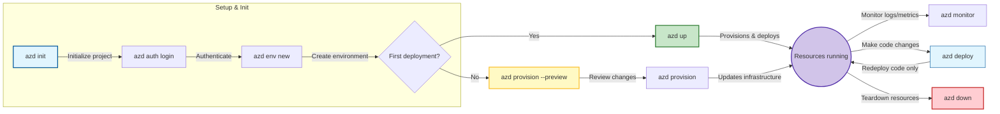
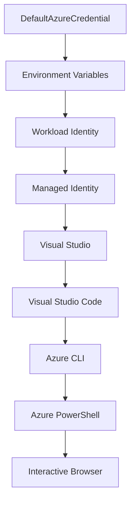

# AZD Põhitõed - Põhikontseptsioonid ja Alused

**Peatüki navigeerimine:**
- **📚 Kooli Kodu**: [AZD Algajatele](../../README.md)
- **📖 Praegune peatükk**: Peatükk 1 - Alus & Kiire algus
- **⬅️ Eelmine**: [Kursuse Ülevaade](../../README.md#-chapter-1-foundation--quick-start)
- **➡️ Järgmine**: [Paigaldamine & Häälestus](installation.md)
- **🚀 Järgmine peatükk**: [Peatükk 2: Tehisintellekt esimesena arenduses](../chapter-02-ai-development/microsoft-foundry-integration.md)

## Sissejuhatus

> Läbitud versiooniga `azd 1.37.2` (november 2026). Bash käsud kasutavad jutumärkides märke, mida tuleb asendada. Malli töövood kasutavad `.`, et initsialiseerida praegune kataloog; ilma kataloogi argumendita loob malli initsialiseerimine alamkataloogi ega muuda teie shelli töökataloogi. Täiustatud näited on illustratiivsed, mitte täielikud projektid.

See õppetund tutvustab teile Azure Developer CLI'd (azd), võimsat käsureatööriista, mis kiirendab teie teekonda kohalikust arendusest Azure'i juurutamiseni. Õpite põhikontseptsioone, põhifunktsioone ja saate aru, kuidas azd lihtsustab pilvenatiivsete rakenduste juurutamist.

## Õpieesmärgid

Selle õppetunni lõpuks:
- Saate aru, mis on Azure Developer CLI ja selle põhieesmärk
- Õpite põhikontseptsioone mallide, keskkondade ja teenuste kohta
- Uurite põhifunktsioone, sealhulgas malli-põhist arendust ja infrastruktuuri kui koodi
- Mõistate azd projektistruktuuri ja töövoogu
- Olete valmis installima ja seadistama azd oma arenduskeskkonnas

## Õpitulemused

Pärast selle õppetunni läbimist suudate:
- Selgitada azd rolli kaasaegsetes pilvearenduse töövoogudes
- Tuvastada azd projekti struktuuri komponendid
- Kirjeldada, kuidas mallid, keskkonnad ja teenused töötavad koos
- Mõista infrastruktuuri kui koodi eeliseid azd-ga
- Tunda ära erinevad azd käsud ja nende otstarved

## Mis on Azure Developer CLI (azd)?

Azure Developer CLI (azd) on käsureatööriist, mis on loodud kiirendama teie teekonda kohalikust arendusest Azure'i juurutamiseni. See lihtsustab pilvenatiivsete rakenduste ehitamist, juurutamist ja haldamist Azure'is.

### Mida saate azd-ga juurutada?

azd toetab laia valikut töökoormusi – ja nimekiri kasvab edasi. Täna saate azd abil juurutada:

| Töökoormuse tüüp | Näited | Sama töövoog? |
|---------------|----------|----------------|
| **Traditsioonilised rakendused** | Veebirakendused, REST API-d, staatilised saidid | ✅ `azd up` |
| **Teenused ja mikroteenused** | Container Apps, Function Apps, mitme teenusega taustaprogrammid | ✅ `azd up` |
| **Tehisintellektiga toidetud rakendused** | Vestlusrakendused Microsoft Foundry mudelitega, RAG-lahendused AI otsinguga | ✅ `azd up` |
| **Intelligentset agendid** | Foundry majutatud agendid, mitme agendiga orkestreerimine | ✅ `azd up` |

Peamine järeldus on see, et **azd elutsükkel jääb samaks, olenemata sellest, mida juurutate**. Te initsialiseerite projekti, varustate infrastruktuuri, juurutate oma koodi, jälgite rakendust ja koristate kokku – olgu see siis lihtne veebisait või keerukas tehisintellekti agent.

See järjepidevus on kavandatud. azd käsitleb AI võimeid kui teist tüüpi teenust, mida teie rakendus saab kasutada, mitte kui midagi fundamentaalselt erinevat. Vestluspunkt, mida toetavad Microsoft Foundry mudelid, on azd vaatenurgast lihtsalt veel üks teenus, mida konfigureerida ja juurutada.

### 🎯 Miks kasutada AZD? Reaalmaailma võrdlus

Võrdleme lihtsa veebirakenduse juurutamist koos andmebaasiga:

#### ❌ ILMA AZD-ta: käsitsi Azure'i juurutamine (30+ minutit)

**Illustreeriv Bash võrdlus, mitte käivitatav rakenduse stardipunkt.** See eeldab olemasolevat rakenduse koodi, ainulaadseid ressursi nimesid, Azure CLI autentimist ja vajalikke CLI laiendusi. Kasutage toetatud otsast lõpuni rada allolevas malli harjutuses.

```bash
# Step 1: Create resource group
az group create --name myapp-rg --location eastus

# Step 2: Create App Service Plan
az appservice plan create --name myapp-plan \
  --resource-group myapp-rg \
  --sku B1 --is-linux

# Step 3: Create Web App
az webapp create --name myapp-web-unique123 \
  --resource-group myapp-rg \
  --plan myapp-plan \
  --runtime "NODE:22-lts"

# Step 4: Create Cosmos DB account (10-15 minutes)
az cosmosdb create --name myapp-cosmos-unique123 \
  --resource-group myapp-rg \
  --kind MongoDB

# Step 5: Create database
az cosmosdb mongodb database create \
  --account-name myapp-cosmos-unique123 \
  --resource-group myapp-rg \
  --name tododb

# Step 6: Create collection
az cosmosdb mongodb collection create \
  --account-name myapp-cosmos-unique123 \
  --resource-group myapp-rg \
  --database-name tododb \
  --name todos

# Step 7: Get connection string
CONN_STR=$(az cosmosdb keys list \
  --name myapp-cosmos-unique123 \
  --resource-group myapp-rg \
  --type connection-strings \
  --query "connectionStrings[0].connectionString" -o tsv)

# Step 8: Configure app settings
az webapp config appsettings set \
  --name myapp-web-unique123 \
  --resource-group myapp-rg \
  --settings MONGODB_URI="$CONN_STR"

# Step 9: Enable logging
az webapp log config --name myapp-web-unique123 \
  --resource-group myapp-rg \
  --application-logging filesystem \
  --detailed-error-messages true

# Step 10: Set up Application Insights
az monitor app-insights component create \
  --app myapp-insights \
  --location eastus \
  --resource-group myapp-rg

# Step 11: Link App Insights to Web App
INSTRUMENTATION_KEY=$(az monitor app-insights component show \
  --app myapp-insights \
  --resource-group myapp-rg \
  --query "instrumentationKey" -o tsv)

az webapp config appsettings set \
  --name myapp-web-unique123 \
  --resource-group myapp-rg \
  --settings APPINSIGHTS_INSTRUMENTATIONKEY="$INSTRUMENTATION_KEY"

# Step 12: Build application locally
npm install
npm run build

# Step 13: Create deployment package
zip -r app.zip . -x "*.git*" "node_modules/*"

# Step 14: Deploy application
az webapp deployment source config-zip \
  --resource-group myapp-rg \
  --name myapp-web-unique123 \
  --src app.zip

# Step 15: Wait and pray it works 🙏
# (No automated validation, manual testing required)
```

**Probleemid:**
- ❌ 15+ käsku, mida meeles pidada ja järjekorras täita
- ❌ 30-45 minutit käsitsi tööd
- ❌ Lihtne teha vigu (trükivead, valed parameetrid)
- ❌ Tuvastamisandmed vajavad otsest käsitlemist; silumislogid ja shelli jälgimine võivad neid avalikustada
- ❌ Ei ole automatiseeritud tagasikerimist, kui midagi läheb valesti
- ❌ Raske tiimiliikmetele korrata
- ❌ Kordub erinevalt iga kord (mitte reprodutseeritav)

#### ✅ AZD-ga: Automatiseeritud juurutamine (5 käsku, 10-15 minutit)

```bash
# Step 1: Initialize from template
azd init --template todo-nodejs-mongo .

# Step 2: Authenticate
azd auth login

# Step 3: Select the environment created during init
azd env select dev

# Step 4: Preview changes (optional but recommended)
azd provision --preview

# Step 5: Deploy everything
azd up

# ✨ Done! Everything is deployed, configured, and monitored
```

**Eelised:**
- ✅ **5 käsku** vs 15+ käsitsi sammu
- ✅ **10-15 minutit** koguaeg (suures osas Azure ooteaeg)
- ✅ **Vähem käsitsi tehtud vigu** - järjepidev, malli-põhine töövoog
- ✅ **Turvaline salajaste andmete käsitlemine** - paljud mallid kasutavad Azure'i hallatavaid salajaste hoidlaid
- ✅ **Korduvad juurutused** - sama töövoog iga kord
- ✅ **Korduvad infrastruktuuri definitsioonid** - allub kvantiteetidele, regiooni saadavusele ja malli versioonidele
- ✅ **Meeskonnale valmis** - kõik saavad samade käskudega juurutada
- ✅ **Infrastruktuur kui kood** - versioonihalduses Bicep mallid
- ✅ **Mallis määratletud jälgimine** - Application Insightsi kaasamisel mallis

### Aeg ja usaldusväärsus

Ülaltoodud ajad on hinnangud, mitte võrdluspunktid. azd vähendab käskude hulka, mida peate koordineerima, kuid ei taga juurutamise kestust, ei välista vigu ega paku automaatset rakenduse/andmebaasi tagasipööramist. Hoidke töökorras versioone lähtekontrollis ja testige taastamismeetodeid.

## Põhikontseptsioonid

### Mallid
Mallid on azd aluseks. Need sisaldavad:
- **Rakenduse kood** - Teie lähtekood ja sõltuvused
- **Infrastruktuuri definitsioonid** - Azure ressursid defineeritud Bicep või Terraformiga
- **Seadistusfailid** - Seaded ja keskkonnamuutujad
- **Juurutusskriptid** - Automatiseeritud juurutamise töövood

### Keskkonnad
Keskkonnad esindavad erinevaid juurutamise sihtmärke:
- **Arendus** - Testimiseks ja arenduseks
- **Eelprodutsioon** - Eeltootmis keskkond
- **Tootmine** - Otse tootmiskeskkond

Iga keskkond haldab oma:
- Keskkonna nimi ja väärtused; ressursside isolatsioon sõltub infrastruktuuri mallist
- Seadistussätted
- Juurutamise olek

### Teenused
Teenused `azure.yaml` kirjeldavad juurutatavaid rakenduse komponente:
- **Frontend** - Veebirakendused, ühe lehe rakendused (SPA)
- **Backend** - API-d, mikroteenused

Andmebaasid ja salvestusruumid määratakse tavaliselt infrastruktuuri ressurssidena, mitte leiutatud teenuste hostidena nagu `host: postgres`.

## Põhifunktsioonid

### 1. Mallipõhine arendus
```bash
# Browse available templates
azd template list

# Initialize from a template
azd init --template "<template-name>" .
```

### 2. Infrastruktuur kui kood
- **Bicep** - Azure domeenispetsiifiline keel
- **Terraform** - Mitme pilve infrastruktuuri tööriist
- Bicep kompileerib ARM mallideks; too ARM JSON ei ole eraldi sisseehitatud `infra.provider`.

### 3. Integreeritud töövood
```bash
# Complete deployment workflow
azd up            # Provision + Deploy this is hands off for first time setup

# 🧪 NEW: Preview infrastructure changes before deployment (SAFE)
azd provision --preview    # Simulate infrastructure deployment without making changes

azd provision     # Create Azure resources if you update the infrastructure use this
azd deploy        # Deploy application code or redeploy application code once update
azd down          # Clean up resources
```

#### 🛡️ Turvaline infrastruktuuri planeerimine eelvaates
`azd provision --preview` käsk on mängumuutja turvaliste juurutuste jaoks:
- **Kuivkatse analüüs** - Näitab, mis luuakse, muudetakse või kustutatakse
- **Ei rakenda infrastruktuuri** - Kontrollib pakkuja muudatusi; vaadake esmalt projekti konksud üle, kuna konksud võivad käivitada kõrvalmõjuga käske
- **Meeskonna koostöö** - Jagage eelvaate tulemusi enne juurutamist
- **Kulude planeerimise sisend** - Kontrollige pakutud SKU-sid, seejärel hinnake neid Azure Hinnakalkulaatoriga; eelvaade ei arvuta hindu

```bash
# Example preview workflow
azd provision --preview           # See what will change
# Review the output, discuss with team
azd provision                     # Apply changes with confidence
```

### 📊 Visuaal: AZD arendusprotsess



**Töövoo selgitus:**
1. **Init** - Alustage mallist või uuest projektist
2. **Auth** - Autentige Azure'is
3. **Environment** - Looge isoleeritud juurutamiskeskkond
4. **Preview** - 🆕 Alati esimesena vaadake infrastruktuuri muudatusi eelvaates (turbapraktika)
5. **Provision** - Looge/uuendage Azure ressursse
6. **Deploy** - Lükake oma rakenduse kood
7. **Monitor** - Jälgige rakenduse jõudlust
8. **Iterate** - Tehke muudatusi ja juurutage uuesti
9. **Cleanup** - Eemaldage ressursid, kui olete lõpetanud

### 4. Keskkondade haldus
```bash
# Create and manage environments
azd env new "<environment-name>"
azd env select "<environment-name>"
azd env list
```

### 5. Laiendused ja AI käsud

azd kasutab laiendussüsteemi, et lisada funktsioone, mis ületavad põhikäsurea võimalused. See on eriti kasulik AI töökoormuste jaoks:

```bash
# List available extensions
azd extension list

# Install the GA Foundry bundle (requires azd >= 1.37.0)
azd ext install microsoft.foundry

# Initialize an AI agent project interactively
azd ai agent init

# Test a deployed agent (shows latency and time-to-first-byte)
azd ai agent invoke

# Start the MCP server for AI-assisted development (Alpha)
azd mcp start
```

**Agendi elutsükkel algusest lõpuni.** GA `microsoft.foundry` komplekt sisaldab `azure.ai.agents` ja kuut muud põhilaiendit. Installige `azure.ai.evaluations` eraldi hindamiseks. Kasutage seda töövoogu jaoks `azd >= 1.37.0`. Te ei vaja kõiki neid esimesel päeval:

| Etapp | Käsk | Mida see teeb |
|-------|---------|--------------|
| **Scaffold** | `azd ai agent init --template <path-to-azure.yaml>` | Kasuta olemasoleva agendi projekti malli |
| **Käivita kohapeal** | `azd ai agent run`, seejärel `azd ai agent invoke --local "Test prompt"` teises terminalis | Kontrolli kohalikku tegevust Agent Inspectoris; mudelikutsed kasutavad siiski Azure'i |
| **Juuruta** | `azd deploy` | Koodi režiimis majutatud agendile laadige üles lähtekood kaugema Foundry ehituse jaoks |
| **Testi** | `azd ai agent invoke` | Helista agendile ja vaata reageerimise aega |
| **Mõõda** | `azd ai eval init`, `generate`, `run start` | Seadista, juuruta ja käivita hinnangud eraldi laiendi abil |
| **Paranda** | `azd ai agent optimize --eval <evaluation-name> --optimize-model <optimizer-deployment>` | Taaskasutage ühilduv hindamine agendi optimeerimiseks |
| **Kontrolli** | `azd ai agent endpoint show` | Vaata live lõpp-punkti konfiguratsiooni |
| **Korista** | `azd ai agent delete` | Kustuta majutatud agent ja kõik selle versioonid |

> Alustage [GA majutatud agendi juhendist](../chapter-02-ai-development/microsoft-foundry-integration.md#hosted-agent-walkthrough-ga), mis katab eeltingimused, varustamise ja turvalise koristamise. Laiendeid käsitletakse üksikasjalikumalt [AZD AI CLI käskude](../chapter-08-production/production-ai-practices.md#azd-ai-cli-commands-and-extensions) viites.

## 📁 Projekti struktuur

Tüüpiline azd projekti struktuur:
```
my-app/
├── .azure/                  # Local environments and selected-environment config
│   ├── config.json
│   └── dev/.env
├── .devcontainer/          # Development container config
├── .github/workflows/      # GitHub Actions
├── .vscode/               # VS Code settings
├── infra/                 # Infrastructure code
│   ├── main.bicep        # Main infrastructure template
│   ├── main.parameters.json
│   └── modules/          # Reusable modules
├── src/                  # Application source code
│   ├── api/             # Backend services
│   └── web/             # Frontend application
├── azure.yaml           # azd project configuration
└── README.md
```

## 🔧 Konfiguratsioonifailid

### azure.yaml
Peamine projekti konfiguratsioonifail:
```yaml
name: my-awesome-app
metadata:
  template: my-template@1.0.0

services:
  web:
    project: ./src/web
    language: js
    host: appservice
  api:
    project: ./src/api
    language: js
    host: appservice

hooks:
  preprovision:
    shell: pwsh
    run: echo "Preparing to provision..."
```

### .azure/config.json
Projekti lokaalne vaike-keskkonna valik (illustratiivne; hallatud azd poolt):
```json
{
  "defaultEnvironment": "dev"
}
```

## 🎪 Levinumad töövood praktiliste harjutustega

> **💡 Õppevink:** Järgige neid harjutusi järjekorras, et areneda AZD oskustes samm-sammult.

### 🎯 Harjutus 1: Esimese projekti initsialiseerimine

**Eesmärk:** Loo AZD projekt ja uurige selle struktuuri

**Sammud:**
```bash
# Use a proven template
mkdir azd-basics-practice
cd azd-basics-practice
# Choose "dev" for the environment name when prompted
azd init --template todo-nodejs-mongo .

# Explore the generated files
ls -la  # View all files including hidden ones

# Key files created:
# - azure.yaml (main config)
# - infra/ (infrastructure code)
# - src/ (application code)
```

**✅ Edu:** Teil on azure.yaml, infra/ ja src/ kataloogid olemas

---

### 🎯 Harjutus 2: Juuruta Azure'i

**Eesmärk:** Täielik otsast lõpuni juurutamine

**Sammud:**
```bash
# 1. Authenticate
azd auth login

# 2. Select the dev environment created in Exercise 1
azd env select dev
azd env set AZURE_LOCATION eastus

# 3. Preview changes (RECOMMENDED)
azd provision --preview

# 4. Deploy everything
azd up

# 5. Verify deployment
azd show    # View your app URL
```

**Eeldatav aeg:** 10-15 minutit  
**✅ Edu:** Rakenduse URL avaneb brauseris

---

### 🎯 Harjutus 3: Mitmekeskkonnad

**Eesmärk:** Juuruta arendus- ja eelprodutsioonikeskkondadesse

**Sammud:**
```bash
# Already have dev, create staging
azd env new staging
azd env set AZURE_LOCATION westus2
azd up

# Switch between them
azd env list
azd env select dev
```

**✅ Edu:** Kaks eraldi ressursirühma Azure Portaali sees

**Koristus:** Harjutus 3 loob teise arveldatava juurutuse. Kustutage mõlemad, kui olete lõpetanud:

```bash
azd down --environment dev
azd down --environment staging
```

---

### 🛡️ Destruktiivne koristus: `azd down --force --purge`

Kui soovite tahtlikult kustutada valitud keskkonna Azure ressursid:

```bash
azd down --force --purge
```

**Mida see teeb:**
- `--force`: Ei küsi kinnitust
- `--purge`: Kustutab ka püsivalt toetatud pehmeid kustutatud ressursse (näiteks Key Vaults), kus kustutuskaitse seda lubab. See ei kustuta kohalikku `.azure/` kataloogi.

**Kasutage, kui:** olete lõpetanud ühekordse keskkonnaga. Ärge pidage destruktiivset koristust autentimis-, kvota- või konfiguratsioonivea esmaseks lahenduseks.

---

## 🎪 Originaalne töövoo viide

### Uue projekti alustamine
```bash
# Method 1: Use existing template
azd init --template todo-nodejs-mongo .

# Method 2: Start from scratch
azd init

# Method 3: Use current directory
azd init .
```

### Arendustsükkel
```bash
# Set up development environment
azd auth login
azd env new dev
azd env select dev

# Deploy everything
azd up

# Make changes and redeploy
azd deploy

# Clean up when done
azd down --force --purge # Deletes this environment's discovered Azure resources; review before forcing deletion.
```

## Avastage `azd down --force --purge`
`azd down --force --purge` käsk on võimas viis oma azd keskkond ja kõik seotud ressursid täielikult maha võtta. Siin on lühike ülevaade iga lippu ülesannetest:
```
--force
```
- Jätab vahele kinnitusküsimised.
- Kasulik automatiseerimisel või skriptimisel, kus käsitsi sisestus pole võimalik.
- Ei jäta tähelepanuta volitusi, kustutuskaitset ega kustutamise tõrkeid.

```
--purge
```
Püsivalt kustutab toetatud pehmete kustutatud Azure ressursside. Täiendavad kinnituseta. Kustutuskaitse ja volitused kehtivad ikka. See **ei eemalda** kohalikke keskkondi ega `.azure/` kausta.


### Miks kasutada mõlemat?
Kasutage kahte käsku ainult siis, kui kavatsete kustutada valitud keskkonna Azure ressursid ja puhastada taastatavad ressursid. See on destruktiivne koristus, mitte üldine parandamine või kohaliku oleku lähtestamine.

See on eriti kasulik pärast käsitsi tehtud ressursside kustutamist Azure portaalis või mallide, keskkondade või ressursigruppide nimede muutmisel.


### Mitme keskkonna haldamine
```bash
# Create staging environment
azd env new staging
azd env select staging
azd up

# Switch back to dev
azd env select dev

# Compare environments
azd env list
```

## 🔐 Autentimine ja volitused

Eraldage juurutamise autentimine (`azd auth login`) rakenduse SDK autentimisest (`DefaultAzureCredential`). Need on eraldi. azd ei kasuta vaikimisi Azure CLI volitusi.

### Azure CLI autentimine (`az login`)

Käivitage `azd auth login` azd jaoks. Järgivad Azure CLI käsud on valikulised ja autentivad `az` käske eraldi:

```bash
# Interactive login (opens browser)
az login

# Login with specific tenant
az login --tenant "<tenant-id>"

# Login with service principal
az login --service-principal -u "<app-id>" -p "<password>" --tenant "<tenant-id>"

# Check current login status
az account show

# List available subscriptions
az account list --output table

# Set default subscription
az account set --subscription "<subscription-id>"
```

### Autentimise töövoog
1. **Interaktiivne sisselogimine**: Avab teie vaikebrauseri autentimiseks
2. **Seadme koodivoog**: brauseri juurde pääsu puudumisel
3. **Teenuse peamine**: automatiseerimise ja CI/CD stsenaariumite jaoks
4. **Haldatud identiteet**: Azure'is hostitud rakenduste jaoks

### DefaultAzureCredential ahel

`DefaultAzureCredential` on volitustüüp, mis pakub lihtsustatud autentimiskogemust, proovides automaatselt mitmeid volituse allikaid kindlas järjekorras:

#### Rakenduse SDK volitusahel

Täpne ahel sõltub Azure Identity SDK keelest, versioonist, paigaldatud lisadest ja valikutest. See diagramm on kontseptuaalne, mitte fikseeritud azd autentimissüsteem; viimased SDK-d võivad sisaldada ka Azure Developer CLI volitusi.


#### 1. Keskkonnamuutujad
```bash
# Set environment variables for service principal
export AZURE_CLIENT_ID="<app-id>"
export AZURE_CLIENT_SECRET="<password>"
export AZURE_TENANT_ID="<tenant-id>"
```

#### 2. Töökoormuse identiteet (Kubernetes/GitHub Actions)
Kasutatakse automaatselt:
- Azure Kubernetes Service (AKS) koos töökoormuse identiteediga
- GitHub Actions koos OIDC föderatsiooniga
- Muudes föderatsiooni identiteedi stsenaariumides

#### 3. Haldatud identiteet
Azure ressursside puhul, nagu:
- Virtuaalmasinad
- App Service
- Azure Functions
- Container Instances

```bash
# Inspect a deployed Container App's configured identity (requires az login)
az containerapp show --name "<app-name>" --resource-group "<rg-name>" --query identity
```

#### 4. Arendustööriistade integratsioon
- **Visual Studio**: Kasutab automaatselt sisse logitud kontot
- **VS Code**: Tugi sõltub SDK-st ja selle toetatud vahendaja/lisade seadistusest
- **Azure CLI**: Kasutab `az login` volitusi (kohaliku arenduse puhul kõige tavalisem)

### AZD autentimise seadistus

```bash
# Method 1: Direct azd authentication (recommended)
azd auth login

# Method 2: Direct azd authentication
azd auth login --use-device-code  # For headless environments

# Method 3: Check authentication status
azd auth login --check-status

# Method 4: Logout and re-authenticate
azd auth logout
azd auth login
```

### Autentimise parimad tavad

#### Kohaliku arenduse jaoks
```bash
# 1. Log in to azd
azd auth login

# 2. Select the subscription for this initialized environment
azd env set AZURE_SUBSCRIPTION_ID "<subscription-id>"

# 3. Check azd sign-in details (read the status message)
azd auth login --check-status
```

#### CI/CD torustike jaoks
```yaml
# Partial GitHub Actions steps: assumes checkout, azd installation,
# required AZURE_* environment values, and pipeline secret configuration.
- name: Deploy with azd
  run: |
    azd auth login --client-id ${{ secrets.AZURE_CLIENT_ID }} \
                    --client-secret ${{ secrets.AZURE_CLIENT_SECRET }} \
                    --tenant-id ${{ secrets.AZURE_TENANT_ID }}
    azd up --no-prompt
```

#### Tootmiskeskkondade jaoks
- Kasuta **haldatu identiteeti** Azure ressurssidel töötamisel
- Kasuta **teenuse peamist** automatiseerimise stsenaariumites
- Väldi volituste salvestamist koodi või konfigureerimisfailidesse
- Kasuta **Azure Key Vaulti** tundliku konfiguratsiooni jaoks

### Levinud autentimise probleemid ja lahendused

#### Probleem: "Tellimust ei leitud"
```bash
# Solution: Set default subscription
az account list --output table
az account set --subscription "<subscription-id>"
azd env set AZURE_SUBSCRIPTION_ID "<subscription-id>"
```

#### Probleem: "Piisavad õigused puuduvad"
```bash
# Solution: Check and assign required roles
az role assignment list --assignee $(az account show --query user.name --output tsv)

# Common required roles:
# - Contributor (for resource management)
# - User Access Administrator (for role assignments)
```

#### Probleem: "Token on aegunud"
```bash
# Solution: Re-authenticate
az logout
az login
azd auth logout
azd auth login
```

### Autentimine erinevates stsenaariumites

#### Kohalik arendus
```bash
# Personal development account
az login
azd auth login
```

#### Meeskonna arendus
```bash
# Use specific tenant for organization
az login --tenant contoso.onmicrosoft.com
azd auth login --tenant-id "<tenant-id>"
```

#### Mitme rentniku stsenaariumid
```bash
# Switch between tenants
az login --tenant tenant1.onmicrosoft.com
azd auth login --tenant-id "<tenant-1-id>"
# Select an environment configured with tenant 1's subscription
azd env select tenant1-dev
# Deploy to tenant 1
azd up

az login --tenant tenant2.onmicrosoft.com  
azd auth login --tenant-id "<tenant-2-id>"
azd env select tenant2-dev
# Deploy to tenant 2
azd up
```

### Turvalisuse kaalutlused

1. **Volituste hoidmine**: Ära kunagi salvesta volitusi lähtekoodis
2. **Piirangu ulatus**: Kasuta teenuse peamiste puhul minimaalsete õiguste põhimõtet
3. **Tokeni vahetamine**: Vaheta teenuse peamise saladusi regulaarselt
4. **Auditijälg**: Jälgi autentimise ja juurutamise tegevusi
5. **Võrgu turvalisus**: Kasuta privaatseid lõpp-punkte, kui võimalik

### Autentimise tõrkeotsing

```bash
# Debug authentication issues
azd auth login --check-status
az account show
az account get-access-token

# Common diagnostic commands
whoami                          # Current user context
az ad signed-in-user show      # Microsoft Entra ID user details
az group list                  # Test resource access
```

## Käskude avastamine

### Avastamine
```bash
azd template list              # Browse templates
azd template list --help       # Template discovery options
azd init --help               # Initialization options
```

### Projekti haldamine
```bash
azd show                     # Project overview
azd env list                # Available environments and selected default
azd config show            # Configuration settings
```

### Jälgimine
```bash
azd monitor                  # Open Azure portal monitoring
azd monitor --logs           # View application logs
azd monitor --live           # View live metrics
azd pipeline config          # Set up CI/CD
```

## Parimad tavad

### 1. Kasuta tähenduslikke nimesid
```bash
# Good
azd env new production-east
azd init --template todo-nodejs-mongo .

# Avoid
azd env new env1
azd init --template template1 .
```

### 2. Kasuta malle
- Alusta olemasolevate mallidega
- Kohanda vastavalt oma vajadustele
- Loo oma organisatsioonile taaskasutatavad mallid

### 3. Keskkondade isolatsioon
- Kasuta eraldi keskkondi dev/staging/tootmiskeskkondade jaoks
- Ära kunagi juuruta otse tootmiskeskkonda kohalikult masinalt
- Kasuta tootmise juurutamiseks CI/CD torustikke

### 4. Konfiguratsiooni haldamine
- Kasuta haldatud identiteeti ja Key Vaulti salasõnade jaoks; tavalised `azd env set` väärtused on kohalikus selges tekstis
- Hoia konfiguratsioon versioonikontrollis
- Dokumenteeri keskkonnaspetsiifilised sätted

## Õppimise järjekord

### Algaja (nädal 1-2)
1. Paigalda azd ja autentimine
2. Juuruta lihtne mall
3. Mõista projekti struktuuri
4. Õpi põhikäsklusi (up, down, deploy)

### Kesktase (nädal 3-4)
1. Kohanda malle
2. Halda mitut keskkonda
3. Mõista infrastruktuuri koodi
4. Sea üles CI/CD torustikud

### Täiustatud (nädal 5+)
1. Loo kohandatud malle
2. Täiustatud infrastruktuuri mustrid
3. Mitmeregiooniline juurutus
4. Ettevõtte taseme konfiguratsioonid

## Järgmised sammud

**📖 Jätka peatüki 1 õppimist:**
- [Paigaldamine ja seadistamine](installation.md) - Paigalda ja sea azd üles
- [Sinu esimene projekt](first-project.md) - Täienda praktilist juhendit
- [Konfiguratsioonijuhend](../chapter-03-configuration/configuration.md) - Täiustatud konfiguratsiooni valikud

**🎯 Oled valmis järgmise peatüki jaoks?**
- [Peatükk 2: AI-Esimene arendus](../chapter-02-ai-development/microsoft-foundry-integration.md) - Alusta AI-rakenduste loomist

## Lisamaterjalid

- [Azure Developer CLI ülevaade](https://learn.microsoft.com/en-us/azure/developer/azure-developer-cli/)
- [Malli galerii](https://azure.github.io/awesome-azd/)
- [Kogukonna näited](https://github.com/Azure-Samples)

---

## 🙋 Korduma kippuvad küsimused

### Üldised küsimused

**K: Mis vahe on AZD-l ja Azure CLI-l?**

V: Azure CLI (`az`) on mõeldud üksikute Azure ressursside haldamiseks. AZD (`azd`) on mõeldud tervikrakenduste haldamiseks:

```bash
# Azure CLI - Low-level resource management
az webapp create --name myapp --resource-group rg
az sql server create --name myserver --resource-group rg
# ...many more commands needed

# AZD - Application-level management
azd up  # Deploys entire app with all resources
```

**Mõtle nii:**
- `az` = Tegutsemine üksikute Lego klotsidega
- `azd` = Töö tervik Lego komplektidega

---

**K: Kas AZD kasutamiseks pean teadma Bicepit või Terraformi?**

V: Ei! Alusta mallidega:
```bash
# Use existing template - no IaC knowledge needed
azd init --template todo-nodejs-mongo .
azd up
```

Hiljem saad õppida Bicepi, et kohandada infrastruktuuri. Mallid pakuvad töötavaid näiteid õppimiseks.

---

**K: Kui palju maksab AZD mallide käitamine?**

V: Kulud sõltuvad regioonist, SKU-st, tööajast, andmebaasi režiimist ja mudeli kasutusest. Arendus keskkond võib kuus põhjustada märkimisväärseid kulusid isegi seisakusseisundis; ära eelda universaalset 50-150 dollari vahemikku:

```bash
# Preview resource changes (not prices)
azd provision --preview

# Always cleanup when not using
azd down --force --purge  # Removes all resources
```

**Pro nõuanne:** Kasuta tasuta tasemeid, kus võimalik:
- App Service: F1 (tasuta) tase
- Azure OpenAI: üldist garantii kuupõhist tasuta tokenikvooti ei ole; kontrolli mudeli ja pakkumise hindasid
- Cosmos DB: sobivad provisioned-throughput kontod saavad optimeerida tasuta taseme; serverless mallid automaatselt ei kvalifitseeru

---

**K: Kas võin kasutada AZD olemasolevate Azure ressurssidega?**

V: Jah, kuid lihtsam on alustada nullist. AZD töötab kõige paremini siis, kui haldab kogu elu tsüklit. Olemasolevate ressursside jaoks:

```bash
# Option 1: Import existing resources (advanced)
azd init
# Then modify infra/ to reference existing resources

# Option 2: Start fresh (recommended)
azd init --template "<verified-template-name>" .
azd up  # Creates new environment
```

---

**K: Kuidas jagada oma projekti meeskonnakaaslastega?**

V: Kommiteeri AZD projekt Gitisse (aga MITTE .azure kausta):

```bash
# Already in .gitignore by default
.azure/        # Contains secrets and environment data
*.env          # Environment variables

# Team members then:
git clone "<your-repo>"
# Change into the cloned repository before running the remaining commands.
azd auth login
azd env new "<their-name>-dev"
azd up
```

Kõik saavad samad infrastruktuuri mallid.

---

### Tõrkeotsingu küsimused

**K: "azd up" ebaõnnestus poole peal. Mida teha?**

V: Kontrolli viga, paranda ja proovi uuesti:

```bash
# Capture detailed diagnostics (redact sensitive values before sharing)
azd up --debug

# Common fixes:

# 1. If quota exceeded:
azd env set AZURE_LOCATION "westus2"  # Try different region

# 2. If resource name conflict:
azd down --force --purge  # Clean slate
azd up  # Retry

# 3. If auth expired:
az login
azd auth login
azd up
```

**Kõige tavalisem probleem:** Vale Azure tellimus valitud
```bash
az account list --output table
az account set --subscription "<correct-subscription>"
azd env set AZURE_SUBSCRIPTION_ID "<correct-subscription-id>"
```

---

**K: Kuidas juurutada ainult koodimuudatusi ilma infrastruktuuri uuesti loomiseta?**

V: Kasuta `azd deploy` asemel `azd up`:

```bash
azd up          # First time: provision + deploy (slow)

# Make code changes...

azd deploy      # Subsequent times: deploy only (fast)
```

Kiiruse võrdlus:
- `azd up`: 10-15 minutit (infrastruktuuri loomine)
- `azd deploy`: 2-5 minutit (ainult kood)

---

**K: Kas saan infrastruktuuri malle kohandada?**

V: Jah! Muuda Bicep faile kataloogis `infra/`:

```bash
# After azd init
cd infra/
code main.bicep  # Edit in VS Code

# Preview changes
azd provision --preview

# Apply changes
azd provision
```

**Nõuanne:** Alusta väikesest – muuda esmalt SKU-sid:
```bicep
// infra/main.bicep
sku: {
  name: 'B1'  // Change to 'P1V2' for production
}
```

---

**K: Kuidas kustutada kõik, mida AZD lõi?**

V: Üks käsk eemaldab kõik ressursid:

```bash
azd down --force --purge

# This deletes:
# - Azure resources/resource groups discovered for the selected environment
# - Supported soft-deleted resources, if purge protection allows
# Local .azure files remain; shared/external resources may remain too.
```

**Käivita see alati, kui:**
- Oled lõpetanud malli testimise
- Lähed üle teisele projektile
- Tahad alusta puhtalt lehelt

**Kulu kontroll:** Kinnita kustutamine Azure'is ja kontrolli hoitud/jagamisi ressursse. Varem tekkinud kulud kehtivad ikka.

---

**K: Mida teha kui kogemata kustutasin ressursid Azure Portaalis?**

V: AZD seisund võib sünkroonist väljas olla. Kasuta puhta lehe lähenemist:

```bash
# 1. Delete remaining resources only if that is your intent
azd down --force --purge

# 2. Start fresh
azd up

# Alternative: Let AZD detect and fix
azd provision  # Will create missing resources
```

---

### Täiustatud küsimused

**K: Kas saan kasutada AZD CI/CD torustikes?**

V: Jah! Näide GitHub Actions-ist:

```yaml
# .github/workflows/deploy.yml
name: Deploy with AZD

on:
  push:
    branches: [main]

jobs:
  deploy:
    runs-on: ubuntu-latest
    steps:
      - uses: actions/checkout@v4
      
      - name: Install azd
        run: curl -fsSL https://aka.ms/install-azd.sh | bash
      
      - name: Azure Login
        run: |
          azd auth login \
            --client-id ${{ secrets.AZURE_CLIENT_ID }} \
            --client-secret ${{ secrets.AZURE_CLIENT_SECRET }} \
            --tenant-id ${{ secrets.AZURE_TENANT_ID }}
      
      - name: Deploy
        env:
          AZURE_ENV_NAME: dev
          AZURE_LOCATION: ${{ vars.AZURE_LOCATION }}
          AZURE_SUBSCRIPTION_ID: ${{ vars.AZURE_SUBSCRIPTION_ID }}
        run: azd up --no-prompt
```

---

**K: Kuidas käsitleda salasõnu ja tundlikke andmeid?**

V: Kasuta Key Vaulti selgelt. `azd env set` kirjutab tavalisi väärtusi kohalikku keskkonna faili; ta ei loo automaatselt kaitset, määra rolle ega süsti salasõnu sinu rakendusse.

```bash
# Interactive: create/select a Key Vault secret and save its reference
azd env set-secret DATABASE_PASSWORD
```

Sul peavad olema õiged ligipääsud vaultile. Sinu infrastruktuur/rakendus peab siiski ühendama salajase tarbijaga ning andma täitmise identiteedile juurdepääsu. Ära trüki logides lahendatud salajasi väärtusi.

**Ära kunagi kommiti:**
- `.azure/` kaust (sisaldab keskkonna andmeid)
- `.env` failid (kohalikud salajased andmed)
- Ühendusstringid

---

**K: Kas saan juurutada mitmesse regiooni?**

V: Jah, loo iga regiooni jaoks eraldi keskkond:

```bash
# East US environment
azd env new prod-eastus
azd env set AZURE_LOCATION eastus
azd up

# West Europe environment
azd env new prod-westeurope
azd env set AZURE_LOCATION westeurope
azd up

# Each environment is independent
azd env list
```

Tõeliste mitmeregiooniliste rakenduste puhul kohanda Bicepi malle, et samal ajal juurutada mitmesse regiooni.

---

**K: Kust saan abi, kui takerdun?**

1. **AZD dokumentatsioon:** https://learn.microsoft.com/azure/developer/azure-developer-cli/
2. **GitHub Issues:** https://github.com/Azure/azure-dev/issues
3. **Discord:** [Azure Discord](https://discord.gg/microsoft-azure) - #azure-developer-cli kanal
4. **Stack Overflow:** Märksõna `azure-developer-cli`
5. **See kursus:** [Tõrkeotsingu juhend](../chapter-07-troubleshooting/common-issues.md)

**Pro nõuanne:** Enne küsimist käivita:
```bash
azd show       # Shows current state
azd version    # Shows your version
```
Lisa see info oma küsimusse kiirema abi saamiseks.

---

## 🎓 Mis järgmiseks?

Sa mõistad nüüd AZD aluseid. Vali oma tee:

### 🎯 Algajatele:
1. **Järgmine:** [Paigaldamine ja seadistamine](installation.md) - Paigalda AZD oma masinale
2. **Seejärel:** [Sinu esimene projekt](first-project.md) - Juuruta oma esimene rakendus
3. **Praktiseeri:** Täida kõik 3 harjutust selles õppetükis

### 🚀 AI arendajatele:
1. **Mine otse:** [Peatükk 2: AI-Esimene arendus](../chapter-02-ai-development/microsoft-foundry-integration.md)
2. **Juuruta:** Tühi projekti kataloog, alusta `azd init --template get-started-with-ai-chat .`
3. **Õpi:** Ehita samal ajal kui juurutad

### 🏗️ Kogenud arendajatele:
1. **Vaata üle:** [Konfiguratsioonijuhend](../chapter-03-configuration/configuration.md) - Täiustatud sätted
2. **Uuri:** [Infrastructure as Code](../chapter-04-infrastructure/provisioning.md) - Bicepi süvitsi sukeldumine
3. **Loo:** Tee kohandatud malle oma kõikidele virnadele

---

**Peatüki navigeerimine:**
- **📚 Kursuse avaleht**: [AZD algajatele](../../README.md)
- **📖 Praegune peatükk**: Peatükk 1 - Alused ja kiire algus  
- **⬅️ Eelmine**: [Kursuse ülevaade](../../README.md#-chapter-1-foundation--quick-start)
- **➡️ Järgmine**: [Paigaldamine ja seadistamine](installation.md)
- **🚀 Järgmine peatükk**: [Peatükk 2: AI-Esimene arendus](../chapter-02-ai-development/microsoft-foundry-integration.md)

---

<!-- CO-OP TRANSLATOR DISCLAIMER START -->
**Lahtiütlus**:
See dokument on tõlgitud kasutades AI tõlketeenust [Co-op Translator](https://github.com/Azure/co-op-translator). Kuigi me püüdleme täpsuse poole, palun pange tähele, et automatiseeritud tõlgetes võib esineda vigu või ebatäpsusi. Originaaldokument selle emakeeles tuleks pidada autoriteetseks allikaks. Olulise teabe puhul soovitatakse kasutada professionaalset inimtõlget. Me ei vastuta selle tõlkega seotud eksimustest või valesti mõistmistest.
<!-- CO-OP TRANSLATOR DISCLAIMER END -->