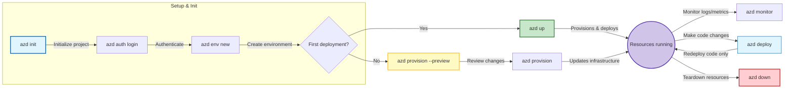
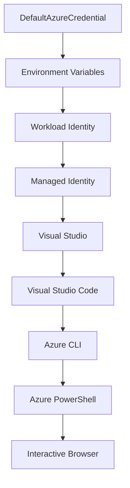

# AZD põhialused - Tuumik kontseptsioonid ja alusteadmised

**Peatüki navigeerimine:**
- **📚 Kursuse avaleht**: [AZD algajatele](../../README.md)
- **📖 Praegune peatükk**: Peatükk 1 - Alus ja kiire algus
- **⬅️ Eelmine**: [Kursuse ülevaade](../../README.md#-chapter-1-foundation--quick-start)
- **➡️ Järgmine**: [Paigaldamine ja seadistamine](installation.md)
- **🚀 Järgmine peatükk**: [Peatükk 2: AI-esimene arendus](../chapter-02-ai-development/microsoft-foundry-integration.md)

## Sissejuhatus

> Läbivaadatud vastavalt `azd 1.37.2` (november 2026). Bash käsud kasutavad jutumärkides kohatäiteid, mida peate asendama. Malli töövood kasutavad `.`, et initsialiseerida praegune kataloog; ilma kataloogi argumendita loob malli initsialiseerimine alamkataloogi ega muuda teie kestatöö kataloogi. Täiendavad fragmendid on illustratiivsed, mitte täisprojektid.

See õppetund tutvustab teile Azure Developer CLI-d (azd), võimsat käsurea tööriista, mis kiirendab teie teekonda kohalikust arendusest Azure pilve juurutamiseni. Õpite põhimõisteid, tuumikfunktsioone ja saate aru, kuidas azd lihtsustab pilvepõhiste rakenduste juurutamist.

## Õpieesmärgid

Selle õppetunni lõpuks suudate:
- Mõista, mis on Azure Developer CLI ja mis on selle peamine eesmärk
- Õppida mallide, keskkondade ja teenuste põhimõisted
- Uurida peamisi funktsioone, sealhulgas malli-põhist arendust ja infrastruktuuri koodina
- Mõista azd projekti struktuuri ja töövoogu
- Olla valmis paigaldama ja seadistama azd oma arenduskeskkonda

## Õpitulemused

Pärast selle õppetunni läbimist suudate:
- Selgitada azd rolli tänapäevastes pilve arendusprotsessides
- Tuua välja azd projekti struktuuri komponendid
- Kirjeldada, kuidas mallid, keskkonnad ja teenused töötavad koos
- Mõista infrastruktuuri koodi eeliseid azd kasutades
- Tunda ära erinevad azd käsud ja nende eesmärgid

## Mis on Azure Developer CLI (azd)?

Azure Developer CLI (azd) on käsurea tööriist, mis on loodud kiirendama teie teekonda kohalikust arendusest Azure pilve juurutamiseni. See lihtsustab pilvepõhiste rakenduste loomist, juurutamist ja haldamist Azure platvormil.

### Mida saate azd-ga juurutada?

azd toetab mitmesuguseid töökoormusi — ja nimekiri kasvab pidevalt. Täna saate azd abil juurutada:

| Töökoormuse tüüp | Näited | Sama töövoog? |
|---------------|----------|----------------|
| **Traditsioonilised rakendused** | Veebirakendused, REST API-d, staatilised saidid | ✅ `azd up` |
| **Teenused ja mikroteenused** | Container Apps, Function Apps, mitmeteenusega tagapõhjad | ✅ `azd up` |
| **Tehisintellektiga rakendused** | Vestlusrakendused Microsoft Foundry mudelitega, RAG lahendused AI otsinguga | ✅ `azd up` |
| **Intelligentsete agentide süsteemid** | Foundry-hostitud agendid, mitmeagentide orkestreerimine | ✅ `azd up` |

Võtmetähtsusega on, et **azd elutsükkel on sama olenemata sellest, mida juurutate**. Te initsialiseerite projekti, varustate infrastruktuuri, juurutate koodi, jälgite rakendust ja korrastate — olgu tegemist lihtsa veebisaidiga või keeruka tehisintellekti agendiga.

See järjepidevus on kavandatud. azd käsitleb tehisintellekti võimalusi kui veel üht teenust, mida teie rakendus võib kasutada, mitte midagi fundamentaalselt erinevat. Microsoft Foundry mudelitel põhinev vestluse lõpp-punkt on azd vaatenurgast lihtsalt veel üks teenus, mida konfigureerida ja juurutada.

### 🎯 Miks kasutada AZD? Tõeline võrdlus

Võrdleme lihtsa veebirakenduse koos andmebaasiga juurutamist:

#### ❌ ILMA AZD-ta: käsitsi Azure juurutamine (30+ minutit)

**Illustratiivne Bash võrdlus, mitte käivitatav rakenduse algataja.** Eeldab olemasolevat rakenduse koodi, unikaalseid ressursside nimesid, Azure CLI autentimist ja vajalikke CLI laiendusi. Kasutage allolevat malliharjutust toetatud täieliku tee jaoks.

```bash
# Step 1: Create resource group
az group create --name myapp-rg --location eastus

# Step 2: Create App Service Plan
az appservice plan create --name myapp-plan \
  --resource-group myapp-rg \
  --sku B1 --is-linux

# Step 3: Create Web App
az webapp create --name myapp-web-unique123 \
  --resource-group myapp-rg \
  --plan myapp-plan \
  --runtime "NODE:22-lts"

# Step 4: Create Cosmos DB account (10-15 minutes)
az cosmosdb create --name myapp-cosmos-unique123 \
  --resource-group myapp-rg \
  --kind MongoDB

# Step 5: Create database
az cosmosdb mongodb database create \
  --account-name myapp-cosmos-unique123 \
  --resource-group myapp-rg \
  --name tododb

# Step 6: Create collection
az cosmosdb mongodb collection create \
  --account-name myapp-cosmos-unique123 \
  --resource-group myapp-rg \
  --database-name tododb \
  --name todos

# Step 7: Get connection string
CONN_STR=$(az cosmosdb keys list \
  --name myapp-cosmos-unique123 \
  --resource-group myapp-rg \
  --type connection-strings \
  --query "connectionStrings[0].connectionString" -o tsv)

# Step 8: Configure app settings
az webapp config appsettings set \
  --name myapp-web-unique123 \
  --resource-group myapp-rg \
  --settings MONGODB_URI="$CONN_STR"

# Step 9: Enable logging
az webapp log config --name myapp-web-unique123 \
  --resource-group myapp-rg \
  --application-logging filesystem \
  --detailed-error-messages true

# Step 10: Set up Application Insights
az monitor app-insights component create \
  --app myapp-insights \
  --location eastus \
  --resource-group myapp-rg

# Step 11: Link App Insights to Web App
INSTRUMENTATION_KEY=$(az monitor app-insights component show \
  --app myapp-insights \
  --resource-group myapp-rg \
  --query "instrumentationKey" -o tsv)

az webapp config appsettings set \
  --name myapp-web-unique123 \
  --resource-group myapp-rg \
  --settings APPINSIGHTS_INSTRUMENTATIONKEY="$INSTRUMENTATION_KEY"

# Step 12: Build application locally
npm install
npm run build

# Step 13: Create deployment package
zip -r app.zip . -x "*.git*" "node_modules/*"

# Step 14: Deploy application
az webapp deployment source config-zip \
  --resource-group myapp-rg \
  --name myapp-web-unique123 \
  --src app.zip

# Step 15: Wait and pray it works 🙏
# (No automated validation, manual testing required)
```

**Probleemid:**
- ❌ Tuleb meeles pidada ja täita 15+ käsku õiges järjekorras
- ❌ 30-45 minutit käsitsi tööd
- ❌ Lihtne teha vigu (trükivead, valed parameetrid)
- ❌ Volitusi tuleb käsitsi hallata; silumislogid ja kestal jälgimine võivad need avalikustada
- ❌ Ei ole automatiseeritud tagasipööramist kui midagi ebaõnnestub
- ❌ Raske meeskonnaliikmetele kopeerida
- ❌ Iga kord erinev (mitte korduv)

#### ✅ AZD-ga: automatiseeritud juurutamine (5 käsku, 10-15 minutit)

```bash
# Step 1: Initialize from template
azd init --template todo-nodejs-mongo .

# Step 2: Authenticate
azd auth login

# Step 3: Select the environment created during init
azd env select dev

# Step 4: Preview changes (optional but recommended)
azd provision --preview

# Step 5: Deploy everything
azd up

# ✨ Done! Everything is deployed, configured, and monitored
```

**Eelised:**
- ✅ **5 käsku** vs 15+ käsitsi sammu
- ✅ **Kokku 10-15 minutit** (enamasti Azure ootamine)
- ✅ **Vähem käsitsi tehtud vigu** - järjepidev, malli-põhine töövoog
- ✅ **Salajaste andmete turvaline käsitlus** - paljud mallid kasutavad Azure halduses olevaid salajaste hoidlaid
- ✅ **Korduvad juurutamised** - sama töövoog iga kord
- ✅ **Korduvad infrastruktuuri definitsioonid** - sõltub kvotidest, regioonide kättesaadavusest ja malli versioonidest
- ✅ **Valmis meeskonnale** - igaüks võib juurutada samade käskudega
- ✅ **Infrastruktuur koodina** - versioonihalduses olevad Bicepi mallid
- ✅ **Malli määratud jälgimine** - Application Insights kui see on mallis kaasatud

### Aeg ja usaldusväärsus

Ülaltoodud ajad on hinnangud, mitte võrdlusmõõdikud. azd vähendab käskude koordineerimise vajadust, kuid ei taga juurutamise kestust, ei välista vigu ega anna automaatset rakenduse/andmebaasi tagasipööramist. Hoidke töökorras versioonid lähtekoodihalduses ja testige taastamisprotseduure.

## Tuumik kontseptsioonid

### Mallid
Mallid on azd alus. Need sisaldavad:
- **Rakenduse kood** - Teie lähtekood ja sõltuvused
- **Infrastruktuuri definitsioonid** - Azure ressursid, mis on defineeritud Bicepi või Terraforniga
- **Seadistusfailid** - Seaded ja keskkonnamuutujad
- **Juurutus skriptid** - Automatiseeritud juurutamise töövood

### Keskkonnad
Keskkonnad esindavad erinevaid juurutamise sihtkohti:
- **Arendus** - Testimiseks ja arendamiseks
- **Testkeskkond** - Eeltootmiskeskkond
- **Tootmine** - Otse tootmises kasutatav keskkond

Igal keskkonnal on oma:
- Keskkonna nimi ja väärtused; ressursieraldus sõltub infrastruktuuri mallist
- Seadistuse sätted
- Juurutamise olek

### Teenused
Teenused `azure.yaml` kirjeldavad juurutatavaid rakenduse komponente:
- **Frontend** - veebirakendused, üheleheküljelised rakendused
- **Backend** - API-d, mikroteenused

Andmebaasid ja salvestusruumid varustatakse tavaliselt infrastruktuuriressurssidena, mitte teenusehostitena nagu `host: postgres`.

## Peamised Omadused

### 1. Mallipõhine Areng
```bash
# Browse available templates
azd template list

# Initialize from a template
azd init --template "<template-name>" .
```

### 2. Infrastruktuur Koodi Kujul
- **Bicep** - Azure'i domeenispetsiifiline keel
- **Terraform** - mitmepilve infrastruktuuritööriist
- Bicep kompileerib ARM mallideks; toore ARM JSON ei ole eraldi sisseehitatud `infra.provider`.

### 3. Integreeritud Töövood
```bash
# Complete deployment workflow
azd up            # Provision + Deploy this is hands off for first time setup

# 🧪 NEW: Preview infrastructure changes before deployment (SAFE)
azd provision --preview    # Simulate infrastructure deployment without making changes

azd provision     # Create Azure resources if you update the infrastructure use this
azd deploy        # Deploy application code or redeploy application code once update
azd down          # Clean up resources
```

#### 🛡️ Ohutu Infrastruktuuri Planeerimine Eelvaatega
Käsk `azd provision --preview` on murranguline ohutute juurutuste jaoks:
- **Kuivkatse analüüs** - Kuvab, mida luuakse, muudetakse või kustutatakse
- **Ei rakenda infrastruktuuri** - Ülevaade pakkuja muudatustest; kontrolli esmalt projekti konksusid, kuna need võivad käivitada käske kõrvalmõjudega
- **Meeskonnatöö** - Jaga eelvaate tulemusi enne juurutust
- **Kulude planeerimise sisend** - Kontrolli pakutud SKU-sid ja hinnata neid Azure'i hinnakaluga; eelvaade ei arvuta hindu

```bash
# Example preview workflow
azd provision --preview           # See what will change
# Review the output, discuss with team
azd provision                     # Apply changes with confidence
```

### 📊 Visuaal: AZD Arengutöövoog



**Töövoo tähendus:**
1. **Init** - alusta mallist või uuest projektist
2. **Auth** - autentimine Azure'iga
3. **Keskkond** - loo isoleeritud juurutuskeskkond
4. **Preview** - 🆕 Alati vaata infrastruktuuri muudatusi esmalt läbi (ohutu tava)
5. **Provision** - loo/värskenda Azure'i ressursse
6. **Deploy** - lükka oma rakenduse kood
7. **Monitor** - jälgi rakenduse jõudlust
8. **Iterate** - tee muudatusi ja juuruta uuesti kood
9. **Cleanup** - eemalda ressursid pärast lõpetamist

### 4. Keskkonna Halduse
```bash
# Create and manage environments
azd env new "<environment-name>"
azd env select "<environment-name>"
azd env list
```

### 5. Laiendused ja AI käsud

azd kasutab laiendussüsteemi, et lisada võimalusi väljaspool põhilist CLI-d. See on eriti kasulik AI töökoormuste jaoks:

```bash
# List available extensions
azd extension list

# Install the Foundry agents extension
azd extension install azure.ai.agents

# Initialize an AI agent project interactively
azd ai agent init

# Test a deployed agent (shows latency and time-to-first-byte)
azd ai agent invoke

# Start the MCP server for AI-assisted development (Alpha)
azd mcp start
```

**Agentide elutsükkel algusest lõpuni.** Kasuta `azure.ai.agents` agentide elutsükli toiminguteks ja paigalda `azure.ai.evaluations` eraldi hindamiseks. Kasuta `azd >= 1.37.0` kombineeritud töövoo jaoks. Sul ei ole neid kõiki vaja esimesel päeval:

| Etapp | Käsk | Mida see teeb |
|-------|---------|--------------|
| **Raam** | `azd ai agent init --template <path-to-azure.yaml>` | Kasuta praegust agentide projekti malli |
| **Test** | `azd ai agent invoke` | Kutsu agent ja vaata vastuse aega |
| **Mõõda** | `azd ai eval init`, `generate`, `run start` | Konfigureeri, juuruta ja käivita hindamised eraldi laiendusega |
| **Paranda** | `azd ai agent optimize --eval <evaluation-name> --optimize-model <optimizer-deployment>` | Kasuta ühilduvat hindamist agenti optimeerimiseks uuesti |
| **Uuri** | `azd ai agent endpoint show` | Vaata live lõpp-punkti konfiguratsiooni |
| **Puhasta** | `azd ai agent delete` | Kustuta hostitud agent ja kõik selle versioonid |

> Laiendustest on põhjalikumalt juttu [2. Peatükk: AI-Esite arendus](../chapter-02-ai-development/agents.md) ja [AZD AI CLI käsud](../chapter-08-production/production-ai-practices.md#azd-ai-cli-commands-and-extensions) viidetes.

## 📁 Projekti Struktuur

Tavaline azd projekti struktuur:
```
my-app/
├── .azure/                  # Local environments and selected-environment config
│   ├── config.json
│   └── dev/.env
├── .devcontainer/          # Development container config
├── .github/workflows/      # GitHub Actions
├── .vscode/               # VS Code settings
├── infra/                 # Infrastructure code
│   ├── main.bicep        # Main infrastructure template
│   ├── main.parameters.json
│   └── modules/          # Reusable modules
├── src/                  # Application source code
│   ├── api/             # Backend services
│   └── web/             # Frontend application
├── azure.yaml           # azd project configuration
└── README.md
```

## 🔧 Konfiguratsioonifailid

### azure.yaml
Põhiline projekti konfiguratsioonifail:
```yaml
name: my-awesome-app
metadata:
  template: my-template@1.0.0

services:
  web:
    project: ./src/web
    language: js
    host: appservice
  api:
    project: ./src/api
    language: js
    host: appservice

hooks:
  preprovision:
    shell: pwsh
    run: echo "Preparing to provision..."
```

### .azure/config.json
Projekti kohaliku vaikekeskkonna valik (näidis; haldab azd):
```json
{
  "defaultEnvironment": "dev"
}
```

## 🎪 Levinumad Töövood Praktiliste Harjutustega

> **💡 Õppimisnõuanne:** Järgi neid harjutusi järjest, et järk-järgult oma AZD oskusi arendada.

### 🎯 Harjutus 1: Algata Oma Esimene Projekt

**Eesmärk:** Loo AZD projekt ja uuri selle struktuuri

**Sammud:**
```bash
# Use a proven template
mkdir azd-basics-practice
cd azd-basics-practice
# Choose "dev" for the environment name when prompted
azd init --template todo-nodejs-mongo .

# Explore the generated files
ls -la  # View all files including hidden ones

# Key files created:
# - azure.yaml (main config)
# - infra/ (infrastructure code)
# - src/ (application code)
```

**✅ Edu:** Sul on azure.yaml, infra/ ja src/ kaustad

---

### 🎯 Harjutus 2: Juuruta Azure'i

**Eesmärk:** Täielik lõpp-lõpuni juurutus

**Sammud:**
```bash
# 1. Authenticate
azd auth login

# 2. Select the dev environment created in Exercise 1
azd env select dev
azd env set AZURE_LOCATION eastus

# 3. Preview changes (RECOMMENDED)
azd provision --preview

# 4. Deploy everything
azd up

# 5. Verify deployment
azd show    # View your app URL
```

**Oodatav aeg:** 10-15 minutit  
**✅ Edu:** Rakenduse URL avaneb brauseris

---

### 🎯 Harjutus 3: Mitmekeskkonnad

**Eesmärk:** Juuruta arendusse ja testimisse

**Sammud:**
```bash
# Already have dev, create staging
azd env new staging
azd env set AZURE_LOCATION westus2
azd up

# Switch between them
azd env list
azd env select dev
```

**✅ Edu:** Kaks eraldi ressursirühma Azure'i portaalis

**Puhastus:** Harjutus 3 loob teise arveldatava juurutuse. Kustuta mõlemad pärast lõpetamist:

```bash
azd down --environment dev
azd down --environment staging
```

---

### 🛡️ Destruktiivne Puhastus: `azd down --force --purge`

Kui soovid teadlikult kustutada valitud keskkonna Azure'i ressursid:

```bash
azd down --force --purge
```

**Mida see teeb:**
- `--force`: Ilma kinnitusviipadeta
- `--purge`: Kustutab ka alaliselt toetatud pehmelt kustutatud ressursid (nt Key Vaultid), kui puhastus on lubatud. Ei kustuta kohalikku `.azure/` kausta.

**Kasutus:** kui oled lõpetanud ajutise keskkonna kasutamise. Ära käsitle destruktiivset puhastust kui kohe esimest lahendust autentimis-, kvota- või konfiguratsioonivea korral.

---

## 🎪 Algne Töövoo Viide

### Uue Projekti Algus
```bash
# Method 1: Use existing template
azd init --template todo-nodejs-mongo .

# Method 2: Start from scratch
azd init

# Method 3: Use current directory
azd init .
```

### Arendustsükkel
```bash
# Set up development environment
azd auth login
azd env new dev
azd env select dev

# Deploy everything
azd up

# Make changes and redeploy
azd deploy

# Clean up when done
azd down --force --purge # Deletes this environment's discovered Azure resources; review before forcing deletion.
```

## `azd down --force --purge` mõistmine
Käsk `azd down --force --purge` on võimas viis oma azd keskkonna ja kõigi sellega seotud ressursside täielikuks eemaldamiseks. Siin on iga lippu tähendus:
```
--force
```
- Jätab vahele kinnitusviipad.
- Kasulik automatiseerimiseks või skriptimiseks, kus käsitsi sisestamine pole võimalik.
- Ei möödu õigustest, puhastuskoormusest ega kustutamisvigadest.

```
--purge
```
Permanentselt kustutab toetatud pehme kustutusega Azure'i ressursid ilma täiendava kinnitamiseta. Puhastusensation ja õigused kehtivad endiselt. See **ei** eemalda kohalikke keskkondi ega kausta `.azure/`.


### Miks kasutada mõlemat?
Kasutage mõlemat ainult siis, kui kavatsete kustutada valitud keskkonna Azure'i ressursid ja puhastada taastatavad ressursid. See on destruktiivne puhastus, mitte üldine parandamine või kohaliku oleku lähtestamine.

See on eriti kasulik pärast käsitsi tehtud ressursside kustutamist Azure portaalis või mallide, keskkondade või ressursigruppide nimetamisstandardite muutmisel.


### Mitme keskkonna haldamine
```bash
# Create staging environment
azd env new staging
azd env select staging
azd up

# Switch back to dev
azd env select dev

# Compare environments
azd env list
```

## 🔐 Autentimine ja volitused

Erinevustage juurutamise autentimist (`azd auth login`) rakenduse SDK autentimisest (`DefaultAzureCredential`). Need on eraldi. azd ei kasuta vaikimisi Azure CLI volitusi.

### Azure CLI autentimine (`az login`)

Käivitage `azd auth login` azd jaoks. Järgmised Azure CLI käsud on valikulised ja autentivad `az` käsud eraldi:

```bash
# Interactive login (opens browser)
az login

# Login with specific tenant
az login --tenant "<tenant-id>"

# Login with service principal
az login --service-principal -u "<app-id>" -p "<password>" --tenant "<tenant-id>"

# Check current login status
az account show

# List available subscriptions
az account list --output table

# Set default subscription
az account set --subscription "<subscription-id>"
```

### Autentimise voog
1. **Interaktiivne sisselogimine**: Avab teie vaikimisi brauseri autentimiseks
2. **Seadme koodivoo**: Keskkondades, kus puudub brauseri juurdepääs
3. **Teenusepõhise konto kasutaja**: Automatiseerimise ja CI/CD stsenaariumite jaoks
4. **Haldusega identiteet**: Azure'is majutatud rakenduste jaoks

### DefaultAzureCredential ketti

`DefaultAzureCredential` on volitusliik, mis pakub lihtsustatud autentimiskogemust, proovides automaatselt mitut volitusallikat kindlas järjekorras:

#### Rakenduse SDK volitusahel

Täpne ahel sõltub Azure Identity SDK keelest, versioonist, paigaldatud pistikprogrammidest ja valikutest. See diagramm on kontseptuaalne, mitte fikseeritud azd autentimissagedus; hiljutised SDK-d võivad sisaldada ka Azure Developer CLI mandaate.


#### 1. Keskkonnamuutujad
```bash
# Set environment variables for service principal
export AZURE_CLIENT_ID="<app-id>"
export AZURE_CLIENT_SECRET="<password>"
export AZURE_TENANT_ID="<tenant-id>"
```

#### 2. Töökoormuse identiteet (Kubernetes/GitHub Actions)
Kasutatakse automaatselt:
- Azure Kubernetes Service (AKS) töökoormuse identiteediga
- GitHub Actions OIDC föderatsiooniga
- Teised föderatsiooniga identiteedi stsenaariumid

#### 3. Hallatud identiteet
Azure ressursside puhul nagu:
- Virtuaalmasinad
- App Service
- Azure Functions
- Konteinerite instantsid

```bash
# Inspect a deployed Container App's configured identity (requires az login)
az containerapp show --name "<app-name>" --resource-group "<rg-name>" --query identity
```

#### 4. Arendustööriistade integratsioon
- **Visual Studio**: Kasutab automaatselt sisse logitud kontot
- **VS Code**: Tugi sõltub SDK-st ja selle toetatud vahendaja/pistikprogrammi seadistusest
- **Azure CLI**: Kasutab `az login` mandaate (kõige tavalisem kohaliku arenduse puhul)

### AZD autentimise seadistus

```bash
# Method 1: Direct azd authentication (recommended)
azd auth login

# Method 2: Direct azd authentication
azd auth login --use-device-code  # For headless environments

# Method 3: Check authentication status
azd auth login --check-status

# Method 4: Logout and re-authenticate
azd auth logout
azd auth login
```

### Parimad praktikad autentimiseks

#### Kohalikuks arenduseks
```bash
# 1. Log in to azd
azd auth login

# 2. Select the subscription for this initialized environment
azd env set AZURE_SUBSCRIPTION_ID "<subscription-id>"

# 3. Check azd sign-in details (read the status message)
azd auth login --check-status
```

#### CI/CD torujuhtmete jaoks
```yaml
# Partial GitHub Actions steps: assumes checkout, azd installation,
# required AZURE_* environment values, and pipeline secret configuration.
- name: Deploy with azd
  run: |
    azd auth login --client-id ${{ secrets.AZURE_CLIENT_ID }} \
                    --client-secret ${{ secrets.AZURE_CLIENT_SECRET }} \
                    --tenant-id ${{ secrets.AZURE_TENANT_ID }}
    azd up --no-prompt
```

#### Tootmiskeskkondade jaoks
- Kasuta **Hallatud identiteeti**, kui töötab Azure ressurssidel
- Kasuta **Teenuse peamist** automaatikastsenaariumite jaoks
- Ära säilita mandaate koodis või konfiguratsioonifailides
- Kasuta **Azure Key Vault** tundliku konfiguratsiooni jaoks

### Levinud autentimisprobleemid ja lahendused

#### Probleem: "Tellimus puudub"
```bash
# Solution: Set default subscription
az account list --output table
az account set --subscription "<subscription-id>"
azd env set AZURE_SUBSCRIPTION_ID "<subscription-id>"
```

#### Probleem: "Piiratud õigused"
```bash
# Solution: Check and assign required roles
az role assignment list --assignee $(az account show --query user.name --output tsv)

# Common required roles:
# - Contributor (for resource management)
# - User Access Administrator (for role assignments)
```

#### Probleem: "Token on aegunud"
```bash
# Solution: Re-authenticate
az logout
az login
azd auth logout
azd auth login
```

### Autentimine erinevates stsenaariumites

#### Kohalik arendus
```bash
# Personal development account
az login
azd auth login
```

#### Meeskondlik arendus
```bash
# Use specific tenant for organization
az login --tenant contoso.onmicrosoft.com
azd auth login --tenant-id "<tenant-id>"
```

#### Mitme üürniku stsenaariumid
```bash
# Switch between tenants
az login --tenant tenant1.onmicrosoft.com
azd auth login --tenant-id "<tenant-1-id>"
# Select an environment configured with tenant 1's subscription
azd env select tenant1-dev
# Deploy to tenant 1
azd up

az login --tenant tenant2.onmicrosoft.com  
azd auth login --tenant-id "<tenant-2-id>"
azd env select tenant2-dev
# Deploy to tenant 2
azd up
```

### Turvalisusega seotud kaalutlused

1. **Mandaatide säilitamine**: Ära kunagi säilita mandaate lähtekoodis
2. **Ulatuspiirang**: Kasuta teenuse peamiste puhul vähima privileegiga põhimõtet
3. **Tokenite pööramine**: Vaheta regulaarselt teenusepeamiste saladusi
4. **Audit jälg**: Jälgi autentimise ja juurutustegevusi
5. **Võrgu turvalisus**: Kasuta võimalusel privaatseid lõpp-punkte

### Autentimise tõrkeotsing

```bash
# Debug authentication issues
azd auth login --check-status
az account show
az account get-access-token

# Common diagnostic commands
whoami                          # Current user context
az ad signed-in-user show      # Microsoft Entra ID user details
az group list                  # Test resource access
```

## Käskude avastamine

### Avastamine
```bash
azd template list              # Browse templates
azd template list --help       # Template discovery options
azd init --help               # Initialization options
```

### Projekti haldus
```bash
azd show                     # Project overview
azd env list                # Available environments and selected default
azd config show            # Configuration settings
```

### Jälgimine
```bash
azd monitor                  # Open Azure portal monitoring
azd monitor --logs           # View application logs
azd monitor --live           # View live metrics
azd pipeline config          # Set up CI/CD
```

## Parimad praktikad

### 1. Kasuta tähenduslikke nimesid
```bash
# Good
azd env new production-east
azd init --template todo-nodejs-mongo .

# Avoid
azd env new env1
azd init --template template1 .
```

### 2. Kasuta malle
- Alusta olemasolevatest mallidest
- Kohanda vastavalt vajadusele
- Loo taaskasutatavad mallid oma organisatsioonile

### 3. Keskkonna isolatsioon
- Kasuta eraldi keskkondi arendus-/test-/tootmiseks
- Ära kunagi juuruta otse tootmiskeskkonda kohalikust arvutist
- Kasuta tootmise juurutamiseks CI/CD torujuhtmeid

### 4. Konfiguratsiooni haldus
- Kasuta hallatud identiteeti ja Key Vault'i saladuste jaoks; tavalised `azd env set` väärtused on kohalikus tekstivormingus
- Hoia konfiguratsioon versioonikontrollis
- Dokumenteeri keskkonnaspetsiifilised seaded

## Õppimise edenemine

### Algaja (1.-2. nädal)
1. Paigalda azd ja autentimise seadistus
2. Juuruta lihtne mall
3. Mõista projekti struktuuri
4. Õpi põhilisi käske (up, down, deploy)

### Kesktase (3.-4. nädal)
1. Kohanda malle
2. Halda mitut keskkonda
3. Mõista infrastruktuuri koodi
4. Sea üles CI/CD torujuhtmed

### Edasijõudnud (5+ nädal)
1. Loo kohandatud malle
2. Täiustatud infrastruktuuri mustrid
3. Mitmeregiooni juurutused
4. Ettevõtte taseme konfiguratsioonid

## Järgmised sammud

**📖 Jätka 1. peatüki õppimist:**
- [Paigaldus & Seadistus](installation.md) - Paigalda ja configureeri azd
- [Sinu esimene projekt](first-project.md) - Läbivi käsitsi juhendatud kursus
- [Konfiguratsiooni juhend](../chapter-03-configuration/configuration.md) - Täiustatud seadistusvalikud

**🎯 Valmis järgmise peatüki jaoks?**
- [2. peatükk: AI-esimesed arendused](../chapter-02-ai-development/microsoft-foundry-integration.md) - Alusta AI rakenduste loomist

## Lisamaterjalid

- [Azure Developer CLI ülevaade](https://learn.microsoft.com/en-us/azure/developer/azure-developer-cli/)
- [Malli galerii](https://azure.github.io/awesome-azd/)
- [Kogukonna näited](https://github.com/Azure-Samples)

---

## 🙋 Sageli esitatavad küsimused

### Üldküsimused

**K: Mis vahe on AZD ja Azure CLI vahel?**

V: Azure CLI (`az`) on ühe Azure ressursi haldamiseks. AZD (`azd`) on kogu rakenduse haldamiseks:

```bash
# Azure CLI - Low-level resource management
az webapp create --name myapp --resource-group rg
az sql server create --name myserver --resource-group rg
# ...many more commands needed

# AZD - Application-level management
azd up  # Deploys entire app with all resources
```

**Mõtle nii:**
- `az` = Üksikute Lego klotsidega töötamine
- `azd` = Terve Lego komplekti kasutamine

---

**K: Kas AZD kasutamiseks pean teadma Bicepit või Terraformi?**

V: Ei! Alusta mallidega:
```bash
# Use existing template - no IaC knowledge needed
azd init --template todo-nodejs-mongo .
azd up
```

Hiljem võid õppida Bicepit infrastruktuuri kohandamiseks. Mallid esitavad töövalmis näited õppimiseks.

---

**K: Kui palju maksab AZD mallide jooksutamine?**

V: Kulud sõltuvad piirkonnast, SKU-st, töötamisajast, andmebaasi režiimist ja mudeli kasutamisest. Arenduskeskkond võib kuus tuua olulisi kulusid isegi pausil olles; ära eelda üldist $50-150 piires:

```bash
# Preview resource changes (not prices)
azd provision --preview

# Always cleanup when not using
azd down --force --purge  # Removes all resources
```

**Pro näpunäide:** Kasuta võimalusel tasuta tasemeid:
- App Service: F1 (Tasuta) tase
- Azure OpenAI: üldist garantiid tasuta igakuist tokenipiiri pole; kontrolli mudelit ja pakkumise hinda
- Cosmos DB: õigustatud läbivoolu kontod saavad valida tasuta taseme; serverless mallid ei kvalifitseeru automaatselt

---

**K: Kas võin kasutada AZD olemasolevate Azure ressurssidega?**

V: Jah, aga lihtsam on alustada puhtalt lehelt. AZD töötab kõige paremini, kui haldab kogu elutsüklit. Olemasolevate ressursside puhul:

```bash
# Option 1: Import existing resources (advanced)
azd init
# Then modify infra/ to reference existing resources

# Option 2: Start fresh (recommended)
azd init --template "<verified-template-name>" .
azd up  # Creates new environment
```

---

**K: Kuidas jagada projekti meeskonnakaaslastega?**

V: Salvesta AZD projekt Giti (aga MITTE .azure kausta):

```bash
# Already in .gitignore by default
.azure/        # Contains secrets and environment data
*.env          # Environment variables

# Team members then:
git clone "<your-repo>"
# Change into the cloned repository before running the remaining commands.
azd auth login
azd env new "<their-name>-dev"
azd up
```

Kõik saavad identsed infrastruktuurid samadest mallidest.

---

### Tõrkeotsingu küsimused

**K: "azd up" ebaõnnestus poole peal. Mida teha?**

V: Kontrolli viga, korda ning proovi uuesti:

```bash
# Capture detailed diagnostics (redact sensitive values before sharing)
azd up --debug

# Common fixes:

# 1. If quota exceeded:
azd env set AZURE_LOCATION "westus2"  # Try different region

# 2. If resource name conflict:
azd down --force --purge  # Clean slate
azd up  # Retry

# 3. If auth expired:
az login
azd auth login
azd up
```

**Kõige sagedasem probleem:** Valesti valitud Azure tellimus
```bash
az account list --output table
az account set --subscription "<correct-subscription>"
azd env set AZURE_SUBSCRIPTION_ID "<correct-subscription-id>"
```

---

**K: Kuidas juurutada lihtsalt koodimuudatusi ilma infrastruktuuri uuesti juurutamata?**

V: Kasuta `azd deploy` asemel `azd up`:

```bash
azd up          # First time: provision + deploy (slow)

# Make code changes...

azd deploy      # Subsequent times: deploy only (fast)
```

Kiiruse võrdlus:
- `azd up`: 10-15 minutit (infrastruktuur juurutatakse)
- `azd deploy`: 2-5 minutit (ainult kood)

---

**K: Kas infrastruktuuri malle saab kohandada?**

V: Jah! Muuda Bicep faile kaustas `infra/`:

```bash
# After azd init
cd infra/
code main.bicep  # Edit in VS Code

# Preview changes
azd provision --preview

# Apply changes
azd provision
```

**Nõuanne:** Alusta väikesest - muuda esmalt SKU-sid:
```bicep
// infra/main.bicep
sku: {
  name: 'B1'  // Change to 'P1V2' for production
}
```

---

**K: Kuidas kustutada kõik, mida AZD lõi?**

V: Üks käsk eemaldab kõik ressursid:

```bash
azd down --force --purge

# This deletes:
# - Azure resources/resource groups discovered for the selected environment
# - Supported soft-deleted resources, if purge protection allows
# Local .azure files remain; shared/external resources may remain too.
```

**Käivita see alati, kui:**
- Lõpetad malli testimise
- Vahetad projekti
- Tahad alustada puhtalt lehelt

**Kulude kontroll:** Kinnita kustutamine Azure'is ja kontrolli säilinud/jagatud ressursse. Varasemad kulud jäävad kehtima.

---

**K: Mis juhtub, kui kogemata kustutasin ressursid Azure Portaalis?**

V: AZD seisund võib sünkroonist väljuda. Puhas algus:

```bash
# 1. Delete remaining resources only if that is your intent
azd down --force --purge

# 2. Start fresh
azd up

# Alternative: Let AZD detect and fix
azd provision  # Will create missing resources
```

---

### Täiustatud küsimused

**K: Kas AZD-d saab kasutada CI/CD torujuhtmetes?**

V: Jah! GitHub Actions näide:

```yaml
# .github/workflows/deploy.yml
name: Deploy with AZD

on:
  push:
    branches: [main]

jobs:
  deploy:
    runs-on: ubuntu-latest
    steps:
      - uses: actions/checkout@v4
      
      - name: Install azd
        run: curl -fsSL https://aka.ms/install-azd.sh | bash
      
      - name: Azure Login
        run: |
          azd auth login \
            --client-id ${{ secrets.AZURE_CLIENT_ID }} \
            --client-secret ${{ secrets.AZURE_CLIENT_SECRET }} \
            --tenant-id ${{ secrets.AZURE_TENANT_ID }}
      
      - name: Deploy
        env:
          AZURE_ENV_NAME: dev
          AZURE_LOCATION: ${{ vars.AZURE_LOCATION }}
          AZURE_SUBSCRIPTION_ID: ${{ vars.AZURE_SUBSCRIPTION_ID }}
        run: azd up --no-prompt
```

---

**K: Kuidas hallata salasid ja tundlikke andmeid?**

V: Kasuta Key Vaulti otseselt. `azd env set` kirjutab tavalisi väärtusi kohaliku keskkonna faili; see ei loo automaatselt vaulti, ei määra rolle ega süsti salajasi andmeid sinu rakendusse.

```bash
# Interactive: create/select a Key Vault secret and save its reference
azd env set-secret DATABASE_PASSWORD
```

Sul peab olema sobivad vaulti õigused. Sinu infrastruktuur/rakendus peab siiski ühendama salajase selle tarbijaga ja andma käitamisidentiteedile juurdepääsu. Ära trüki lahendatud salaväärtusi logidesse.

**Ära kunagi salvesta:**
- `.azure/` kausta (sisaldab keskkonnaandmeid)
- `.env` faile (kohalikud salajased andmed)
- Ühendus stringid

---

**K: Kas saan juurutada mitmesse piirkonda?**

V: Jah, loo iga piirkonna jaoks eraldi keskkond:

```bash
# East US environment
azd env new prod-eastus
azd env set AZURE_LOCATION eastus
azd up

# West Europe environment
azd env new prod-westeurope
azd env set AZURE_LOCATION westeurope
azd up

# Each environment is independent
azd env list
```

Tõeliste mitmeregiooni rakenduste jaoks kohanda Bicep malle, et juurutada samaaegselt mitmesse piirkonda.

---

**K: Kust saan abi, kui jään hätta?**

1. **AZD dokumentatsioon:** https://learn.microsoft.com/azure/developer/azure-developer-cli/
2. **GitHubi probleemid:** https://github.com/Azure/azure-dev/issues
3. **Discord:** [Azure Discord](https://discord.gg/microsoft-azure) - kanalis #azure-developer-cli
4. **Stack Overflow:** märgisega `azure-developer-cli`
5. **See kursus:** [Tõrkeotsingu juhend](../chapter-07-troubleshooting/common-issues.md)

**Pro näpunäide:** Enne küsimist käivita:
```bash
azd show       # Shows current state
azd version    # Shows your version
```
Sisesta see info oma küsimusse kiirema abi saamiseks.

---

## 🎓 Mis edasi?

Sa mõistad nüüd AZD põhitõdesid. Vali oma tee:

### 🎯 Algajatele:
1. **Järgmine:** [Paigaldus & Seadistus](installation.md) - Paigalda AZD oma masinasse
2. **Kell:** [Sinu esimene projekt](first-project.md) - Juuruta esimene rakendus
3. **Praktika:** Täida kõik 3 harjutust selles õppetükis

### 🚀 AI arendajatele:
1. **Mine otse:** [2. peatükk: AI-esimese arenduse](../chapter-02-ai-development/microsoft-foundry-integration.md)
2. **Juuruta:** Tühja projekti kaustas alusta `azd init --template get-started-with-ai-chat .`
3. **Õpi:** Ehita samal ajal, kui juurutad

### 🏗️ Kogenud arendajatele:
1. **Vaata üle:** [Konfiguratsiooni juhend](../chapter-03-configuration/configuration.md) - Täiustatud seadistused
2. **Uuri:** [Infrastruktuur koodina](../chapter-04-infrastructure/provisioning.md) - Bicep põhjalik ülevaade
3. **Loo:** Loo oma stacki kohandatud mallid

---

**Peatüki navigeerimine:**
- **📚 Kursuse avaleht**: [AZD algajatele](../../README.md)
- **📖 Praegune peatükk**: Peatükk 1 - Alused & Kiire alustamine  
- **⬅️ Eelmine**: [Kursuse ülevaade](../../README.md#-chapter-1-foundation--quick-start)
- **➡️ Järgmine**: [Paigaldus & Seadistus](installation.md)
- **🚀 Järgmine peatükk**: [2. peatükk: AI-esimene arendus](../chapter-02-ai-development/microsoft-foundry-integration.md)

---

<!-- CO-OP TRANSLATOR DISCLAIMER START -->
**Lahtiütlus**:
See dokument on tõlgitud kasutades AI tõlketeenust [Co-op Translator](https://github.com/Azure/co-op-translator). Kuigi me püüdleme täpsuse poole, palun pange tähele, et automatiseeritud tõlgetes võib esineda vigu või ebatäpsusi. Originaaldokument selle emakeeles tuleks pidada autoriteetseks allikaks. Olulise teabe puhul soovitatakse kasutada professionaalset inimtõlget. Me ei vastuta selle tõlkega seotud eksimustest või valesti mõistmistest.
<!-- CO-OP TRANSLATOR DISCLAIMER END -->