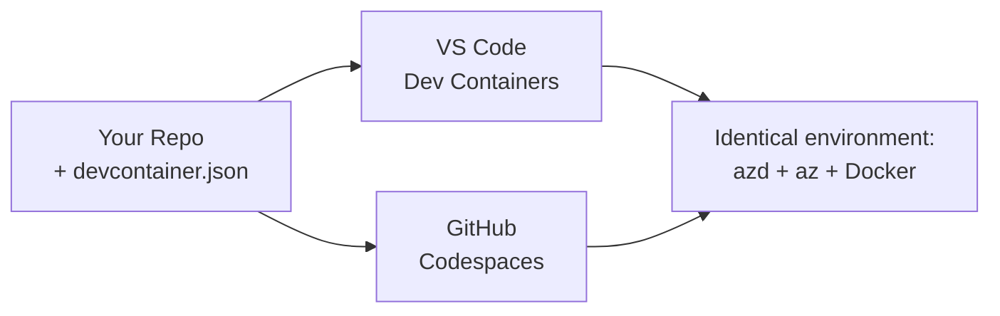

# Arenduskonteinerid ja GitHub Codespaces azd jaoks

**Peatüki navigeerimine:**
- **📚 Kursuse avaleht**: [AZD algajatele](../../README.md)
- **📖 Praegune peatükk**: Peatükk 1 - Alused ja kiire algus
- **⬅️ Eelmine**: [Too omaenda rakendus](bring-your-own-app.md)
- **🚀 Järgmine peatükk**: [Peatükk 2: AI-esmane arendus](../chapter-02-ai-development/README.md)

> Käskude ja konfiguratsiooni ülevaate siht: `azd 1.37.2` (november 2026). Konteineri ehitused ja Azure'i juurutused ei olnud osa sellest ülevaatest.

## Sissejuhatus

azd, õige keeleruntime'i, Dockeri ja Azure CLI paigaldamine iga masinasse on vaev—ning see on peamine põhjus, miks õpetus, mis "töötab minu masinas", ebaõnnestub kellelgi teisel. **Arenduskonteiner** lahendab selle, kirjeldades teie kogu tööriistakomplekti ühes failis. Igaüks, kes avab projekti VS Code'is või GitHub Codespaces'is, saab täpselt sama keskkonna, millel on juba azd paigaldatud. See õppetund näitab, kuidas see lisada.

## Õpieesmärgid

Selle õppetunni lõpuks oskad sa:
- Mõista, mis on arenduskonteiner ja miks see aitab azd kasutamisel
- Lisada minimaalne `.devcontainer/devcontainer.json` projekti
- Sisaldada azd, Azure CLI ja Docker Dev Container *funktsioonide* kaudu
- Avada projekt GitHub Codespaces'is või VS Code'is

## Õpi tulemused

Õppetunni lõpetamisel saad:
- Koostada `devcontainer.json` azd projektile
- Lisada azd ja Azure tööriistad ilma käsitsi installeerimiseta
- Käivitada `azd up` konteineri või Codespace'i sees

---

## Mis on arenduskonteiner?

Arenduskonteiner on Dockeri-põhine arenduskeskkond, mida määratletakse teie hoidlas oleva `.devcontainer/devcontainer.json` failiga. Kui avate projekti:

- **VS Code** (Dev Containers laiendusega) ehitab konteineri ja ühendub sellega.
- **GitHub Codespaces** ehitab sama konteineri pilves ja annab teile sirvijapõhise redaktori.

Mõlemal juhul saavad kõik panustajad identsed tööriistad—pole vaja muretseda küsimuse üle "kas sa installeerisid azd?".



---

## 1. samm: loo devcontainer fail

Loo `.devcontainer/devcontainer.json` oma projekti juurkausta:

```json
{
  "name": "azd-project",
  "image": "mcr.microsoft.com/devcontainers/base:bookworm",
  "features": {
    "ghcr.io/devcontainers/features/azure-cli:1": {},
    "ghcr.io/azure/azure-dev/azd:0": { "version": "1.37.2" },
    "ghcr.io/devcontainers/features/docker-in-docker:2": {},
    "ghcr.io/devcontainers/features/node:1": {}
  },
  "customizations": {
    "vscode": {
      "extensions": [
        "ms-azuretools.azure-dev",
        "ms-azuretools.vscode-bicep"
      ]
    }
  },
  "forwardPorts": [3000],
  "postCreateCommand": "azd version"
}
```

Mida iga osa teeb:

| Võti | Eesmärk |
|-----|---------|
| `image` | Konteineri baasoperatsioonisüsteem |
| `features` | Eelnevalt ehitatud installerid—siin: Azure CLI, **azd**, Docker ja Node.js |
| `customizations.vscode.extensions` | Paigaldab automaatselt azd ja Bicep VS Code laiendused |
| `forwardPorts` | Avab teie rakenduse pordi sirvijas nähtavaks |
| `postCreateCommand` | Käivitub korra pärast konteineri ehitamist (siin tervislikkuse kontroll) |

> Funktsiooni versioon (`azd:0`) ja paigaldatud CLI versioon on erinevad. Seadistage funktsiooni `version` valik väärtusele `"1.37.2"`, et fikseerida CLI versioon; ärge kasutage CLI versiooni funktsiooni märgendina.

---

## 2. samm: sobitage funktsioon oma rakenduse keelega

Asendage `node` funktsioon teie rakenduse keelega:

```jsonc
// Python project
"ghcr.io/devcontainers/features/python:1": {},

// .NET project
"ghcr.io/devcontainers/features/dotnet:2": {},

// Java project
"ghcr.io/devcontainers/features/java:1": {},

// Go project
"ghcr.io/devcontainers/features/go:1": {}
```

Hoidke `docker-in-docker` lokaalse pildi ehitamise jaoks. Konfigureeritud kaug-ACR ehitus (`docker.remoteBuild: true`) on alternatiiv; hosti tüüp üksinda ei nõua alati kohalikku Dockerit.

---

## 3. samm: avage see

**VS Code'is:**
1. Paigaldage **Dev Containers** laiendus.
2. Avage projektikaust.
3. Klõpsake, kui küsitakse, **Ava konteineris uuesti** (või käivitage *Dev Containers: Reopen in Container*).

**GitHub Codespaces'is:**
1. Lükake hoidla GitHubi.
2. Klõpsake **Code → Codespaces → Create codespace on main**.
3. Oodake konteineri ehitamist—azd on terminalis valmis.

---

## 4. samm: juurutamine konteineri sees

Konteineril on azd eelinstalleeritud, nii et tavapärane töövoog lihtsalt toimib:

```bash
azd auth login --use-device-code   # device code is handy inside Codespaces
azd up
```

> **Miks `--use-device-code`?** Kaugkonteineris või Codespaces'is pole kohalikku sirvijat, kuhu suunata, seega on seadmekoodi sisselogimine usaldusväärne viis. Te peate sisestama brauseri vahekaardile koodi, et sisselogimine lõpuni viia.

---

## Levinumad lõksud

| Lõks | Parandus |
|---------|-----|
| `azd up` ei saa pilti ehitada | Lisage `docker-in-docker` funktsioon |
| Browseri sisselogimine jääb Codespaces'is seisma | Kasutage `azd auth login --use-device-code` |
| Tööriistad erinevad meeskonnaliikmete vahel | Fikseerige CLI azd funktsiooni `version` valiku kaudu ja fikseerige keeleruntime'id |
| Rakendus pole sirvijas saadaolev | Lisage pordi avamine `forwardPorts` kaudu |

---

## Kokkuvõte

- Arenduskonteiner teeb teie azd tööriistakomplekti kõigile reprodutseeritavaks.
- Lisage azd, Azure CLI ja Docker Dev Container *funktsioonide* kaudu.
- Sobitage keele funktsioon oma rakendusega ja hoidke `docker-in-docker` konteinerihostide jaoks.
- Kasutage seadmekoodi sisselogimist, kui töötate Codespaces'is.

---

## 🔗 Navigeerimine

| Suund | Ressurss |
|-----------|----------|
| **Eelmine** | [Too omaenda rakendus](bring-your-own-app.md) |
| **Peatüki avaleht** | [Peatükk 1: Alused ja kiire algus](README.md) |
| **Järgmine peatükk** | [Peatükk 2: AI-esmane arendus](../chapter-02-ai-development/README.md) |

## 📖 Seotud ressursid

- [Paigaldamine ja seadistamine](installation.md)
- [Käskude petutabel](../../resources/cheat-sheet.md)
- [Ametlik Dev Containers spetsifikatsioon](https://containers.dev/)
- [azd Dev Container funktsioon](https://github.com/Azure/azure-dev/tree/main/ext/devcontainer)

---

<!-- CO-OP TRANSLATOR DISCLAIMER START -->
**Lahtiütlus**:
See dokument on tõlgitud kasutades AI tõlketeenust [Co-op Translator](https://github.com/Azure/co-op-translator). Kuigi me püüdleme täpsuse poole, palun pange tähele, et automatiseeritud tõlgetes võib esineda vigu või ebatäpsusi. Originaaldokument selle emakeeles tuleks pidada autoriteetseks allikaks. Olulise teabe puhul soovitatakse kasutada professionaalset inimtõlget. Me ei vastuta selle tõlkega seotud eksimustest või valesti mõistmistest.
<!-- CO-OP TRANSLATOR DISCLAIMER END -->